# 5

# 系统架构

## 5.1 引言

系统架构是设计和开发工程过程中的重要工具。它可以通过将顶层需求映射到基本构建块，成为概念阶段早期可视化的一部分。框图经常被用作“涂鸦板”，用于尝试功能和数据流的想法，以及功能依赖关系。然后可以开发一个坚实的架构以添加更多细节，纳入功能到物理的映射，并就功能分配达成一致。这是决定哪些功能将外包给供应商进行招标的合适阶段。

架构也是“固定”外部约束的有用工具。例如，决定使用特定的商用航电标准，如 ARINC 429，将自动决定一些架构原则，其他数据总线类型也是如此。其他设计驱动因素可能包括决定使用商用现成组件（COTS）或客户库存物品，这同样会限制设计。这些限制可以记录在架构图和注释上。

系统架构是对系统概念形状和形式的表示，可以完全独立于任何物理实现进行可视化。它是使用框图格式作为方便的简写符号来制作系统简单易懂表示的宝贵工具。这种简单的可视化使概念能够清晰地表示，并作为促进各工程学科之间讨论以就接口、功能分配和标准达成一致的机制。从这种简单的基本表示出发，可以在无需转向布线互连或详细组件的过度细节的情况下进一步开发架构。这对于软件和硬件构建块而言在物理和功能表示方面都是正确的。它对于设定和同意边界和接口尤其有用。

除了允许做出设计决策外，系统架构还是识别早期权衡候选方案和利用电子表格进行不同架构设计之间的成本、效益和性能比较的理想工具。

## 5.2 定义

“架构”或“系统架构”这两个术语在系统工程中广泛使用。这些术语很大程度上源于土木工程和建筑设计。当系统工程师谈论系统架构时，其方式与建筑师谈论建筑概念非常相似。在土木工程术语中，*《牛津英语词典》*将架构定义为：

- *设计并监督建筑施工的艺术与科学。*
- *建筑或结构的一种风格。*
- *建筑物或结构的统称。*
- *任何事物的结构或设计。*

*《牛津英语词典》*将架构定义为*一种特殊的方法或风格，建筑的结构细节和装饰布置均遵循该方法或风格。*建筑师被定义为*通过规划、设计、构思或建造来实现预期结果的人。*建筑师构思设计的形式和结构，通常从一张白纸开始。然后，他将适用于基本结构的指导原则和标准逐级分解到各个组成部分中。这确保了产品在整个开发过程中保持设计的完整性。这种完整性既包括风格或时尚等美学品质，也包括居住、供暖、服务等功能方面，以及对建筑规范、健康与安全及所有法律考虑等监管要求的遵守。

这种对模式、形式和结构的鉴赏力在土木建筑之外也有用途。一种古代文字（线形文字B）的破译是由一位建筑师而非语言学家完成的，这一事实引发了对建筑师特质或能力的如下评述：

> *建筑师的眼睛看到的不是建筑单纯的立面，不是装饰与结构特征的混杂；它能透过表象，辨别出图案的重要部分、建筑的结构要素和框架。*

> （Chadwick 1987）

正是这种观察模式而非细节的能力，使这位建筑师得出结论：线形文字B所代表的语言是希腊语。语言学家们纠缠于细节和哲学争论，却忽略了关键点。

上述定义和评述得出一个结论：形式、结构和秩序是架构的基本特征，而非细节。因此，建筑师必须具备处理这些特征的能力，并制定适用的形式和标准，以便遵循其设计建造的人能构建出牢固的结构。在飞机系统工程中，基本的架构原则通过系统设计的各个层级逐级分解到构成硬件和固件解决方案的每一个设备项目中。如图5.1所示。

为本书之目的，“架构”一词用于标识设计过程中的一个部分，该部分可用于提供系统的初步图形描述。它主要在设计生命周期的早期阶段使用，特别是概念阶段和定义阶段，但它仍然是记录该过程后续阶段设计进展的有效机制。它尤其适用于阐释营销材料，并作为清晰、直观的速记方式用于演示，以支持系统描述。

图5.1 架构原则的逐级分解。

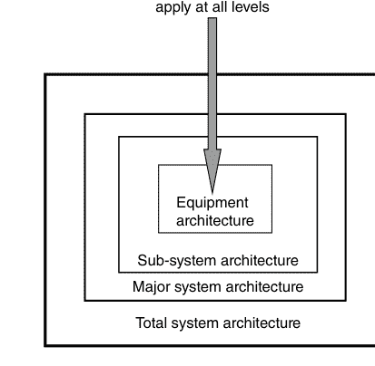

在概念和设计阶段，架构用于引入和展开初始概念设计，并建立与其他系统的接口和关系。架构具有简洁性和清晰性，能激发与项目其他方或利益相关者的讨论。架构分阶段逐步发展，每个阶段都达成共识，直至设计阶段；在设计阶段，需要开始将产品定义到可以开始制造的程度。正是在这里，简洁性和清晰性被纳入到规格说明和建造所需的详细程度之中。

## 5.3 系统架构

在系统工程的早期设计阶段，最适宜考虑形式或结构，而非具体工程解决方案。正是在这种抽象层面上，可以就需要的主要功能构建模块以及这些模块之间的通信方式做出决策。例如，在计算系统中，计算机架构被定义为计算机系统硬件组件的设计和结构。该术语包含一般性考量，例如系统是基于串行、并行还是分布式计算（多台计算机连接在一起）。它还涵盖更详细的方面，例如中央处理器（CPU）的内部结构描述。微型计算机常被描述为具有16位、32位或64位架构，具体取决于CPU能处理的数据字长度和数据总线的宽度。

同样，在设计系统时，工程师经常谈论功能、处理标准、接口标准、软件语言以及连接功能的数据总线标准。

一旦在此层面达成一致，这些原则便会由所有相关方在后续每个详细设计层面加以应用。

系统架构通常始于一个简单的系统方框图表示，即方框图。这使人们能够将需要执行的主要功能、数据交换机制以及功能之间的相互依赖关系可视化。当为命名主要高层功能和数据交换标准制定了基本规则后，架构的各个模块就可以更详细地展开。这在某种程度上类似于确定建筑物的平面布置图和轮廓，并商定施工和设施供应应遵循的标准。图5.2说明了这一过程，展示了一个通用系统架构中架构原则的逐级分解。

图5.2 通用系统架构示例。

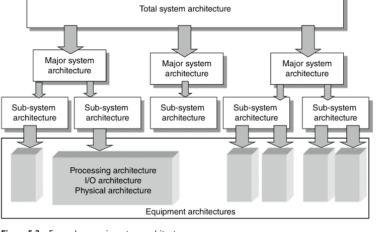

负责控制或制定架构标准的工程师被称为系统架构师。架构师是运用设计建筑所需技能的人，可以说他追求的是简单表示而非详细设计。这种简单表示的意图是创造一种媒介，以简单清晰的形式表达设计的高层视角。它可以用作激发讨论、达成共识和记录设计各阶段的手段，项目所有相关方均可将其作为工作的可靠基础。

图5.3展示了整个系统架构起点的示例。在此图中，飞机系统被分配到特定的小组，并采用共同的互通方式：

图5.3 顶层系统架构示例。

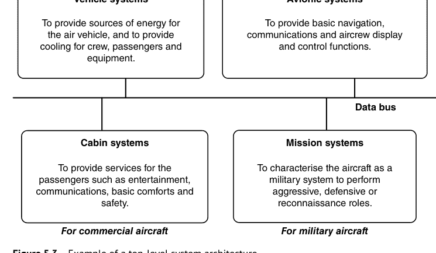

- 飞行器系统
- 航空电子系统
- 任务系统
- 客舱系统
- 数据总线。

每组都提供了功能的简要描述。采用共同的数据总线标准意味着可以定义接口和数据格式。这种分组并非随意——各组的完整性要求差异很大。飞行器系统通常属于安全关键系统，必须设计为使失效概率极小，因为失效可能危及飞机和机组人员。航空电子系统涉及安全：其失效可能危及飞机。任务系统失效将导致性能下降或无法达到预期的任务成功率。从安全角度来看，客舱和娱乐系统的失效是可以容忍的，尽管客户满意度可能会下降。

尽管这是一个非常简单的起点，但它使各个团队能够明确各自的职责和设计方法，并进一步更详细地定义架构。正是在这个阶段，通信、安全性、完整性、可用性以及可制造性设计等标准得以确立，这些标准将适用于后续所有层面。

图5.4展示了每个小组进一步细化后架构可能呈现的样子。

### 5.3.1 飞行器系统

飞行器系统小组已经过细化，以显示所需的各个系统。此类系统大多含有大量机械部件，例如泵、油箱、操纵杆等，但在此架构中展示对这些系统的需求也是完全合理的。由于飞行器系统需要一定的控制和监控功能，因此这也被纳入其中。为了与飞机其他部分通信，需要数据总线连接，因为这是约定的互通方式。然而，飞行器系统对于飞机持续安全运行至关重要，因此必须确保这种稳健性得以保持。

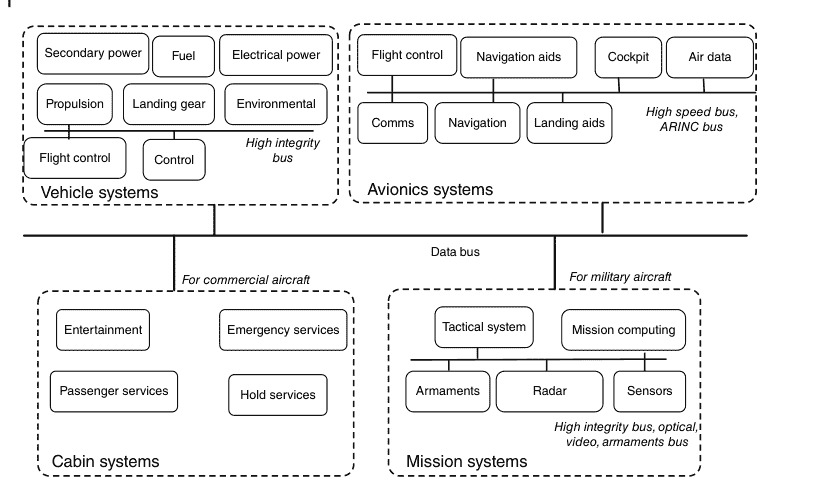

**图 5.4** 飞机系统。

已确定需要一种高完整性总线。这可能是与飞机总线相同的物理实现，但可能包含不同级别的冗余或不同的消息调度协议。车辆管理系统（VMS）架构的开发示例可参见第 5.7 节，示例 4。

### 5.3.2 航电系统

航电系统组已类似地开发，以显示机舱显示系统之间互通所需高速总线的需求，以及使用商用标准 ARINC 总线用于现成航电子系统，例如 ARINC 429 或 ARINC 664。军用航电系统可能需要符合 MIL-STD-1553 等标准军用总线标准。

### 5.3.3 任务系统

任务系统组与军用飞机相关，可能使用高完整性武器总线以及光纤和视频链路。航电、车辆管理和任务系统将在大多数军用项目中按照同一套军用标准进行设计。然而，在基于商用平台的飞机上，例如侦察机，保留平台商用航电并与任务系统建立连接可能是有利的。示例可参见第 5.7 节，示例 1。当携带武器时尤其如此，以确保武器电路与所有其他系统隔离。

### 5.3.4 客舱系统

客舱系统组可能对机上娱乐系统有特殊要求，例如高质量的视频和音频通信。这可能需要视频或光纤数据连接。在许多情况下，允许丢失部分客舱系统，例如切断厨房区的负载。虽然这可能会让乘客感到烦恼，但不会影响其安全。

### 5.3.5 数据总线

在每种情况下，关于主数据总线选择的决策都将被保留并遵守其消息协议。

这再次是对系统的简单表示，但定义已得到推进并达成了一致。图 5.5 显示了车辆系统组已开发以显示控制系统的更多细节以及通用系统的连接。此开发展示了以下特点：

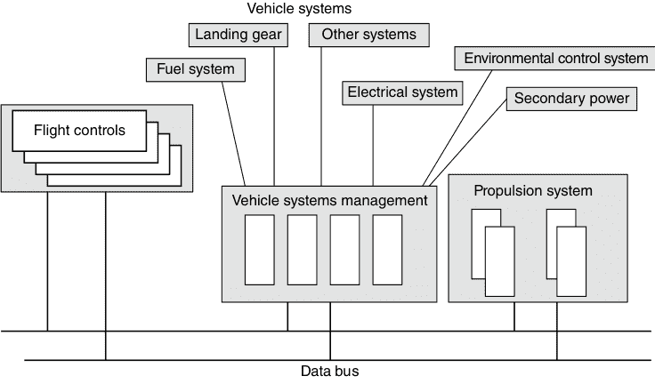

**图 5.5** 车辆系统架构示例。

- 飞行控制系统为四余度并直接连接到数据总线。作为项目决策，它已被有意不纳入车辆系统控制，因为其完整性高于车辆系统。
- 车辆系统的控制由连接到数据总线的四计算机子系统执行。
- 车辆系统组件（执行器、传感器等）的连接通过离散布线馈电实现。
- 推进系统为双双余度并直接连接到数据总线，但同样*不*属于车辆系统控制。
- 与其他航电系统的连接，包括驾驶舱显示和控制，均通过数据总线实现。
- 数据总线为双份，以保留所有通信的双路径。

这代表了系统架构定义的又一次进步，现在可以将其功能分配给通用系统架构模块的组件。

架构模块图表示不仅限于大型系统的可视化。设计人员也可以使用这些技术来设计设备，例如上图所示的系统管理处理器。处理器的内部配置或架构如图 5.6 所示。

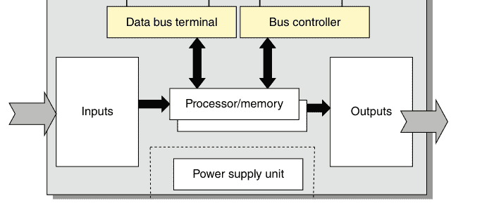

**图 5.6** 车辆系统管理处理器的架构。

这显示处理器被划分为其主要元素，如输入输出接口、数据总线连接和控制、处理器和存储器以及电源。这种简单视图可以进一步开发，以确保外部系统的冗余、隔离和完整性原则在设备设计中得到保留。第 5.7 节描述了更多简单架构的示例。

## 5.4 架构建模与权衡

以燃油系统为例，说明如何使用架构来定义一个系统，以便利用建模和权衡技术寻求最优解。燃油系统执行与燃油携带和使用相关的若干功能。它通常被认为属于安全关键，因为飞机发动机完全失去燃油可能是灾难性的。燃油被辅助动力装置（APU）和主发动机使用，并具有一些辅助作用。它被飞行控制系统用于将飞机重心控制在一定范围内，并在飞机冷却系统中用作冷却介质，例如燃油冷却油冷却器和热交换器。该系统在飞机上有多个接口，涉及众多利益相关方，包括：

- 结构部门 – 提供油箱位置和管道布置
- 燃油使用者 – 推进系统和 APU
- 机组人员用于人机界面
- 地勤人员用于给飞机加油和放油
- 驾驶舱设计师
- 需要散热的系统
- 安全部门用于本质安全方面
- VMS 用于与系统组件接口并托管系统功能（注意此功能可能纳入整体飞机计算系统架构）。

本示例始于若干概念研究提案，其中正在提出一种通用飞机。对于每个研究，都需要燃油系统通用架构。图 5.7 在此阶段是一个合适的架构，因为在提案被接受并做出严肃设计决策时将会进行更改。虽然这看起来很简单，但它确实允许将与其他系统的某些接口可视化。

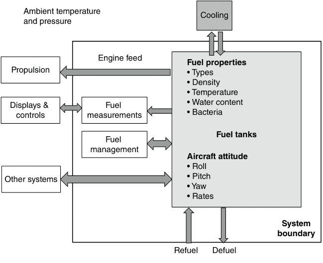

下一步开始于项目配置性质的决策 – 在本例中，它将是一架双发超音速快速喷气战斗机，具有超音速性能、空中加油需求，并能够在全球范围内运行。概念阶段架构如图 5.8 所示。

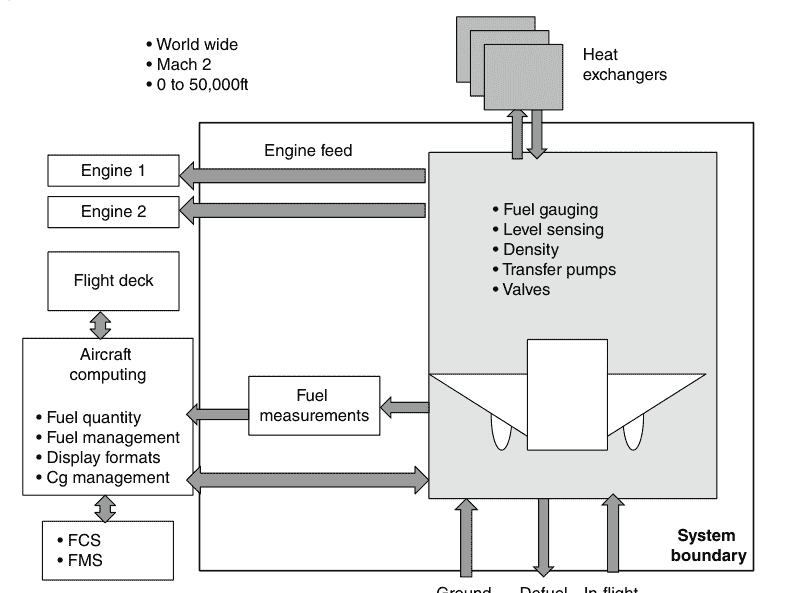

**图 5.8** 记录概念阶段协议的燃油系统架构。

从燃油系统角度来看，这意味着需要两个发动机供油回路，需要空中加油探针及相关回路，并且可以设想一个初步的油箱布局。航电组已决定将有一个计算系统，需要从燃油系统获取数据以执行燃油显示、与飞行控制的接口以及空数据系统的功能。从中可以看出，燃油系统现在与航电系统架构有明确的接口。这意味着所有燃油系统测量值都可以传递给航电系统，并且需要就燃油系统功能如何定义给软件团队达成一致。

可以做出一些架构决策，这些决策可以在此阶段与所有其他团队达成一致，并会影响其他系统架构。在此阶段达成一致并被接受意味着所有团队现在都可以在其系统边界内工作，除非出现无法实现接口定义的情况。来自燃油系统角度的一些示例决策是：

- 就机身油箱的位置和形状达成一致
- 就外部油箱的需求及其抛弃方式达成一致
- 就燃油传感器数量及其在油箱中的位置达成一致，以实现所需的燃油数量精度
- 就输油泵数量达成一致
- 就燃油管道尺寸、弯曲半径和位置达成一致

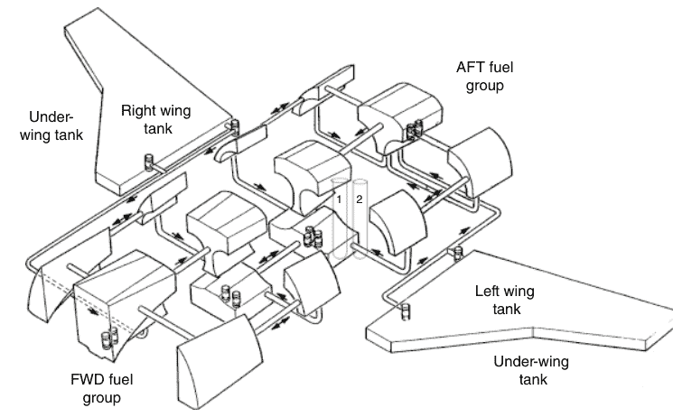

Figure 5.9 Preliminary tank layout.

- agreement on the information to be displayed in the cockpit and its form
- agreement on the interface with refuelling equipment for both the ground system and the airborne refuelling elements.

The structures teams will have defined a shape for the fuselage and wings, and will need information on which to define the location and shape of fuel tanks. With knowledge of the aircraft range, endurance, and combat performance the fuel team will know how much fuel is needed and how to design a system of pipes, pumps, valves, and measurements sensors. An initial agreement with the structures teams based on their knowledge of the volume available in the airframe for fuel storage will have led to a tank layout similar to that shown in Figure 5.9.

This level of definition is sufficient to continue the design of the quantity measuring systems to determine how many gauge probes are required and their location in the tanks. This enables preliminary modelling to take place to determine how the fuel will be managed by inter-tank transfers, and allow the airframe teams to draw the tanks so that they can be designed as an integral part of the structure. This modelling may include computer modelling of the tank shapes to perform the calculation of fuel quantity and may include models to take into account changes in aircraft attitude and calculation of the centre of mass of the fuel. This leads to the design of a preliminary circuit diagram, as illustrated in Figure 5.10.

## 5.5 Example of a Developing Architecture

Figure 5.3 showed a top-level system architecture in which the requirement for aircrew control and display functions are shown. This is developed further in Figure 5.4 to show other system interfaces. Figure 5.11 shows a simple architecture of a display system that

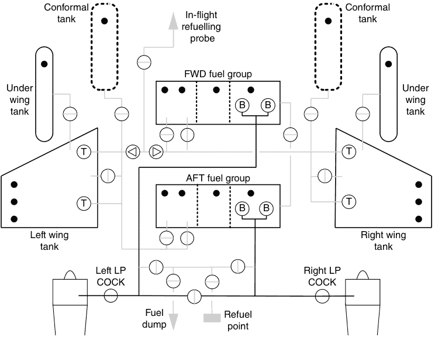

**Figure 5.10**  Preliminary circuit diagram.

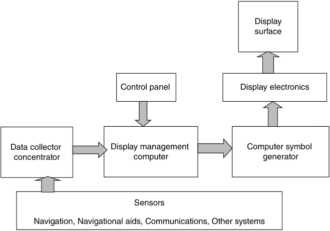

**Figure 5.11**  General display system architecture.

will provide control and display functions for a two-crew cockpit. The major elements of this general display system are:

- a data collection/concentrator that acquires the data to be displayed from other systems and selects the most appropriate data sources and performs data integrity checks
- a display management computer (DMC) that determines the display modes and the elements to be displayed
- symbol/graphics generator that constructs the symbology and graphics as text and symbols
- a display unit consisting of the display surface and the display device electronics.

This architecture is developed further in Figure 5.12, which shows the system exhibiting a redundancy structure of three DMCs, six displays, and a switching mechanism. This allows the crew to select the information most appropriate to the phase of flight and their roles of captain and first officer. The architecture also shows that the functions of data collection/concentration and symbol generation have been absorbed into the DMCs. Connections to the aircraft data bus structure are shown to enable connections to other systems.

Further development of this architecture is possible with ever-increasing detail until an aircraft wiring diagram emerges. The resulting implementations can be seen in the two-crew flight decks of modern commercial aircraft such as the A350, A380, and B-787.

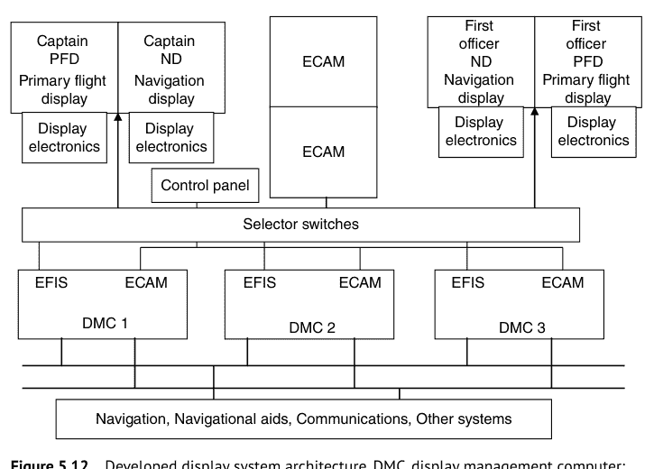

Figure 5.12 Developed display system architecture. DMC, display management computer; ECAM, electronic centralised aircraft monitor; EFIS, electronic flight instrument system; Nav Aids, navigation aids; ND, navigation display; PFD, primary flight display.

## 5.6 Evolution of Avionics Architectures

The application of avionics technology has occurred rapidly as aircraft performance has increased. The availability of reliable turbojet engines gave a huge performance boost to both military and civil operators alike. To utilise these improvements the aircraft avionics system rapidly grew in terms of capability and complexity, as illustrated in Figure 5.13.

This figure portrays how avionics architectures have evolved from the 1960s to the present date. The key architectural steps during this time have been:

- distributed analogue architecture
- distributed digital architecture
- federated digital architecture
- integrated modular architecture, also digital.

The evolution of these architectures has been shaped in the main by the aircraft-level design drivers that were described in Chapter 4. Their capabilities and performance have been both enabled and constrained by the avionics technology building blocks available at the time. There have also been changes in many characteristics throughout the period:

- *increases* in performance and capability, computing power, complexity, reliability, cost
- *decreases* in volume, weight, power consumption, wiring.

Key advances were enabled by the advent of digital computing technology in the 1960s, which first found application in the architectures reaching fruition during the 1970s. The availability of digital computers that could be adopted for the rugged and demanding

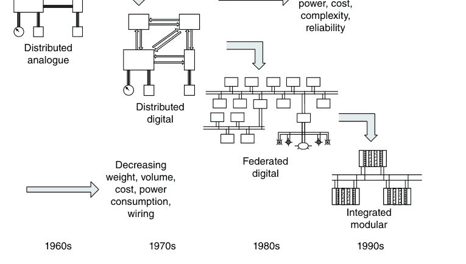

Figure 5.13 Evolution of avionics architectures.

environment of aerospace applications brought computing power and accuracies that had not been available during the analogue era. The development of serial digital data buses greatly eased the interconnection and transfer of data between the major units of the systems. In the early days this was achieved by means of fairly slow half-duplex (uni-directional), point-to-point digital links such as ARINC 429 and the Tornado serial data link.

The arrival of micro-electronics technology and the first integrated circuits (ICs) enabled digital computing techniques to be applied to many more systems around the aircraft. At the same time more powerful data buses, such as MIL-STD-1553B, provided a full-duplex (bi-directional), multi-drop capability at higher data rates. This enabled the federated architectures that evolved during the 1980s where multiple data bus architectures were developed to cater for increased data flow and system segregation requirements. At this stage the aerospace electronic components were mainly bespoke, being dedicated solutions with few if any applications outside aerospace.

The final advance occurred when electronic components and techniques developed in industries outside aerospace in the fields of information technology and personal computing yielded a far higher capability than that which aerospace could sustain. The use of COTS technology became more prevalent and integrated modular avionics architectures began to follow and adapt the technology developed elsewhere. The key attributes of each of the architectures is described below.

### 5.6.1 Distributed Analogue Architecture

The distributed analogue architecture is shown in Figure 5.14. In this type of system the major units are interconnected by hardwiring; no data buses are employed. This results in

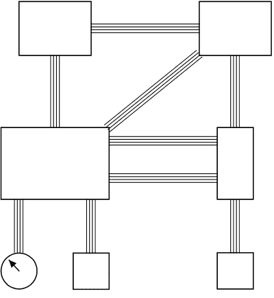

Architecture characteristics:
- Dedicated wiring
- Power supplies
- Sensor excitation
- Sensor signal voltages
- System selection & status indications
- Dedicated LRUs/subsystems
- Dedicated displays & controls
- Some standard interfaces

a huge amount of aircraft wiring and the system is extremely difficult to modify if change is necessary. This wiring is associated with power supplies, sensor excitation, sensor signal voltage, and system discrete mode selection and status signals.

This system has dedicated sub-systems, controls, and displays. The displays are electro-mechanical and often extremely intricate in their operation, requiring instrument maker skills for assembly and repair.

The use of analogue computing techniques does not provide the accuracy and stability offered by the latter systems. Analogue systems are prone to bias or drift and these characteristics are often more pronounced when the aircraft and equipment are subject to a hot or cold soak over a prolonged operating period. The only means of signalling rotary position in an analogue system is by means of synchro angular transmission systems. The older analogue aircraft – termed classic in the industry – therefore contain a huge quantity of synchros and other systems to transmit heading, attitude, and other rotary parameters. Pallet (1987) is an excellent source of information on many of the older analogue techniques, and Chapter 5 in particular encompasses a detailed description of the characteristics of synchronous data-transmission systems (synchros).

The older equipment is very bulky, heavy, and tends to be unreliable as there are many moving parts. This is not a criticism; the designers of the time did their best with the technology available and many very elegant engineering solutions can be found in this type of equipment. Another problem is that the skills required to repair and maintain some of the intricate instruments and sensors are gradually becoming scarcer and consequently the cost of repair continues to rise.

As has already been mentioned, these systems are very difficult to modify and this leads to significant problems when new equipment such as a flight management system has to be retro-fitted to a classic aircraft. This may be required to ensure that such aircraft comply with modern air traffic control (ATC) procedures, which are now far more complex than ever envisaged when the aircraft originally entered service over 30 years ago.

Typical aircraft in this category are the Boeing 707, VC10, BAC 1-11, DC-9, and early Boeing 737s. Many of these types are still flying and some, such as the VC-10 and the KC-135 (a Boeing 707 derivative), fulfil military roles. They will continue to do so for a while but gradually their numbers are dwindling as aircraft structural problems are manifested and the increasing cost of maintaining the older systems takes a toll.

### 5.6.2 Distributed Digital Architecture

The maturity of digital computing devices suitable for airborne use led to the adoption of digital computers, allowing greater speed of computation, greater accuracy, and removal of bias and drift problems. The digital computers installed on these early systems were a far cry from those available today, being heavy, slow in computing terms, housing very limited memory, and difficult to re-programme, requiring removal from the aircraft in order that modifications could be embodied.

A simplified version of the distributed digital architecture is shown in Figure 5.15. The key characteristics of this system as described below.

Major functional units contained their own digital computer and memory. In the early days of military applications, memory was comprised of magnetic core elements that were

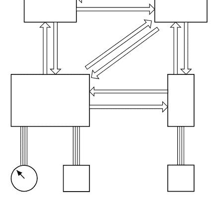

架构特点：

- 各主要单元之间通过串行数据总线通信 - 标准数据总线
- 部分传感器/显示器采用专用布线
- 控制功能采用数字处理
- 软件可重新编程（机外）
- 专用LRU/子系统
- 更加广泛使用标准接口
- 更高精度与性能

图 5.15 分布式数字架构。

非常笨重且只能在维修车间离机重新编程。这一点，再加上在有限内存的实时计算机编程经验不足，以及几乎完全缺乏有效的软件开发工具，导致维护代价很高。

在后期阶段，随着电可重编程存储器的出现，它被优先用于替代磁性存储器，尤其是在民用应用中。

数字处理带来的一个好处是采用了串行半双工（单向）数字数据总线——ARINC 429 和 Tornado 串行总线——这使得重要的系统数据能够以数字形式在飞机上的主要处理中心之间传递。尽管按今天的标准来看速度很慢（ARINC 429 为 110 kbit/s，Tornado 串行数据链为 64 kbit/s），但这已是向前迈出的重大一步，导航和武器瞄准系统通过采用该技术获得了显著的性能提升。

在此阶段，系统仍然在功能上是专用的，尽管数据在各单元之间传输的能力已显著改善。数据总线的采用——尤其是 ARINC 429——催生了一系列 ARINC 标准，这些标准规范了不同类型设备的数字接口。因此，设备开始实现标准化，使得不同制造商生产的惯性导航系统（INS）都会为该系统准备标准接口。这最终导致不同制造商系统之间的标准化，有可能简化系统修改或升级的前景。

驾驶舱内的显示器与其功能一样，专用于其功能，如同前面描述的模拟架构。显示器仍然是之前使用的复杂机电设备，伴随而来的是相应的问题。在后期的实现中，显示器变得多功能，并在民用领域开发了以下显示系统：

- 电子飞行仪表系统（EFIS）
- 发动机指示和机组告警系统（EICAS），波音及其他
- 电子检查与维护（ECAM），空中客车。

空中客车 EFIS/ECAM 顶层系统架构如图 5.12 所示。
数据总线确实减少了飞机的大量布线，但后期在系统上增加一个额外单元的问题仍然很困难。在 ARINC 429 实现中，数据总线被复制，以便单个链路故障不会使系统无法运行。

总体而言，即使是早期数字技术的采用也带来了系统精度和性能的巨大优势，尽管这些早期数字系统的开发和维护远非容易。此系统年代的飞机包括：

- 军用：Jaguar、Nimrod MR1 和 MR2、Tornado 和 Sea Harrier
- 民用：MD-80 系列、空中客车 310 及后续型号、波音 757/767、747-400、以及 737-300/400/500、Avro RJ。

### 5.6.3 联邦式数字架构

下一个发展是联邦式数字架构，如图 5.16 所示。联邦式架构——从现在开始所描述的所有架构均为数字架构——主要依赖于极其广泛使用的 MIL-STD-1553B 数据总线的可用性。最初由当时名为美国空军赖特帕特森发展实验室的机构构想，它经过两次迭代从一个基本标准演变而来，最终形成了 1553B 标准，其中也有英国 Def-Stan 等效标准。

1553B 数据总线标准的最终采用带来了显著的优势和一些缺点。优势在于这是一个可在整个北大西洋公约组织（NATO）成员之间应用的标准，为庞大的军事市场乃至更广范围提供数据总线标准。这是一个极其成功的应用，庞大的电子元件市场意味着数据总线接口设备的价格可以随着产量保持而降低。它还证明——正如之前的总线实现情况一样——设备以及因此而来的数据总线比任何人合理预期的都要可靠得多。因此，所产生的系统架构比前代架构更稳健、更可靠。

联邦式架构通常使用专用可更换单元（LRU）和子系统，但此类系统数据的广泛可用性使得显示器和其他飞机系统（如公用事业或此前未曾应用航电技术的飞机系统）能够取得显著进步。

尽管数据速率更高——大约是 ARINC 429 的 10 倍，约为 Tornado 串行数据链的 15 倍——该标准却因其自身的成功而成为受害者。全双工（双向）、多点下挂协议意味着它迅速被视为数字数据传输的巨大进步（确实如此）。然而，系统设计师很快意识到，在实际系统中，由于数据总线负载的考虑，可能只能使用 30 个可能的远程终端（RT）中的 10-12 个。当时，政府采购机构的政策要求军事系统投入使用时只能利用 50% 的可用带宽，以允许未来系统扩展的增长。处理器吞吐量和内存也存在类似的容量限制，因此系统设计师被禁止使用数据传输或计算能力方面的最后一丝系统能力。

人们还认识到，并非每个数据总线设备都需要与飞机上的每个其他设备通信。事实上，出于系统原因，按数据总线划分系统以使志同道合的系统能够相互交换信息，然后在不同功能区域之间提供总线桥接或链路是有充分理由的。基于这一前提，演变出了许多与图 5.16 所描绘的架构相似的架构。在略有变化的情况下，该架构代表了今天飞行的大多数军用航电系统：F-16 中期升级、SAAB Gripen、波音 AH-64 C/D 等等。

民用界对联邦式方法的适应性较差，因为它们已在已广泛建立并在民用机队中证明其价值的 ARINC 429 标准上投入了大量资金。此外，该群体不喜欢 1553B 的一些详细实现和协议问题，因此决定衍生出一个最终成为 ARINC 629 的新的民用标准。

MIL-STD-1553B 使用“命令-响应”协议，需要一个中央控制实体，即总线控制器（BC），而民用界对这种集中式控制理念表示担忧。面向民用的 ARINC 629 是一个 2Mbit/s 系统，其

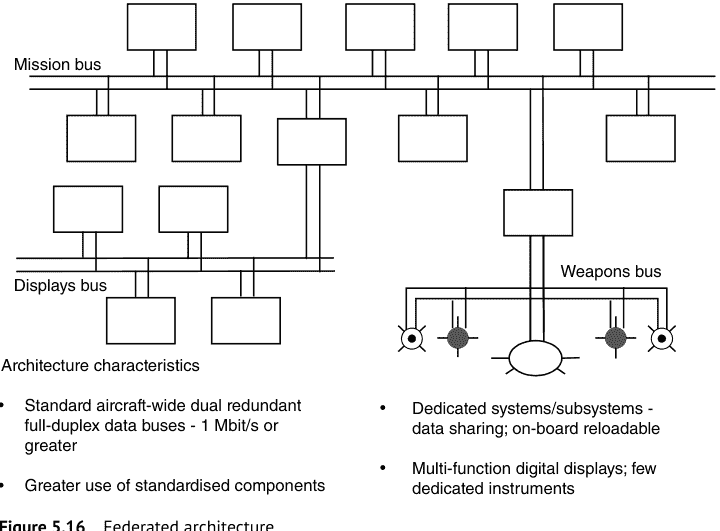

- 标准飞机范围双冗余全双工数据总线 – 1 Mbit/s 或更高
- 更广泛使用标准化组件
- 专用系统/子系统 - 数据共享；机载可重载
- 多功能数字显示；少数专用仪表

**图 5.16** 联邦式架构。

所产生的架构使用加固的商用技术来提供机柜之间的数据总线互连。有趣的是，公务机社区一直是该架构领域早期发展的先驱。

当公务机首次引入市场约 30 年前，它们有点过时——通常用于代表所涉公司首席执行官的地位，且按年飞行小时计的飞机利用率非常低。在过去十年中，分额所有权——拥有公务机部分份额的能力——意味着这些资产持续被利用，往往每年飞行超过 3000 小时。此外，像湾流 GV 和庞巴迪环球快线这样的顶级机型的能力提供了可从大陆飞往大陆、飞行 6000 英里的飞机。这在最快的时间内将政府部长或首席执行官转移到全球各地提供了巨大优势。最后，也是最重要的，在当前环境下，这可以做到极高的安全性。

以用于雷神 Horizon 公务机的 Primus Epic 系统为例，采用了 10 Mbit/s 以太网的改编版本来提供连接模块化航电单元（MAU）的总线，这些 MAU 容纳系统模块。在典型的系统中，总共四个 MAU 容纳与航电功能相关的所有模块以及与燃油、接近开关接口等公用事业相关的模块。其中许多是标准模块。在之前的架构中，系统单元或 LRU 专门用于功能。在此架构中，功能分布在通用系统模块上，系统的操作功能完全由软件赋予。一个高完整性的软件执行系统提供了划分子系统软件功能的能力。

其他系统，例如为空中客车 A380 飞机开发的航电系统，使用一种名为航电快速交换以太网（AFDX）的 100 Mbit/s 快速以太网衍生产品，现已正式定为 ARINC 664。在该系统中，机柜按飞机功能域划分：驾驶舱、客舱管理、能源管理、公用事业管理。这些与功能域相关的机柜由单一供应商提供的标准航电模块填充。图 5.18 说明了现代在役飞机中典型的架构（有关这些架构的进一步解释，请参阅 Moir 等人（2013））。

系统功能嵌入在分区软件中，该软件通过专用下载数据总线下载到通用处理器模块（CPM）上。这需要能够以足够的完整性水平在特定 CPM 内划分各种飞机系统控制律。实现并保证不仅单个系统而且同一功能区域内托管的多个系统的组合关键性影响（硬件和软件）的完整性是不容忽视的。

除了 CPM 之外，许多 AFDX（现被确定为 ARINC 664 数据总线）和飞机系统接口模块输入/输出（I/O）也是标准化的，并由单一供应商提供。该架构的主要特点是：

- 在所有功能域中使用的通用核心模块集
- 标准化的处理元件
- 共同使用软件工具、标准和语言
- 取消了大量专用和定制的 LRU
- 能够容纳专门的飞机系统接口

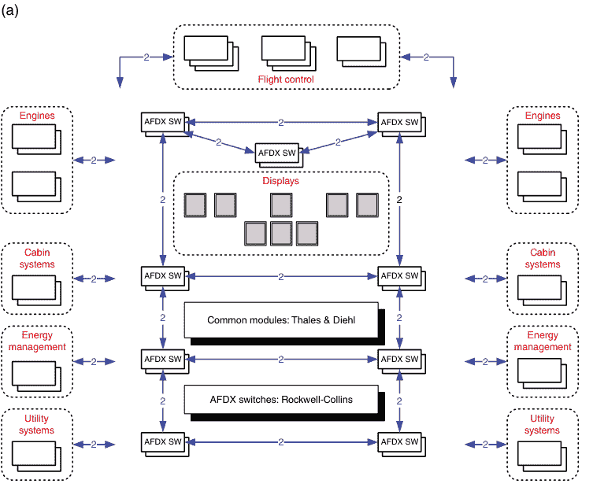

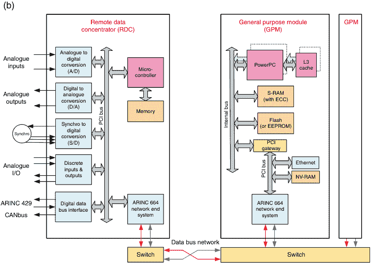

**Figure 5.18** Illustration of integrated modular architecture from two modern aircraft.

- offers benefits of scale across the entire aircraft
- improves logistics for the airlines
- provides a scaleable architecture with scope for application to future projects.

The Boeing 787 uses a different approach with remote data concentrator units (equivalent to remote input/output [RIO]) to condition inputs and outputs, and general purpose modules to perform the processing task.

## 5.7 Example Architectures

This section will make use of the information presented previously in order to show how elements of different system architectures can be used to build architectures for individual and integrated systems. Some examples are given for different systems in the aircraft to illustrate what an architecture represents and how it is used in the design of a system. The architectures shown do not represent any specific aircraft, they are solely for example. No specific formal method is used for their representation and no method is recommended. The systems engineer must decide what is most suitable for their task, but must also ascertain if there is a common tool or method demanded by the project, in which case that must be adopted to ease communication.

### 5.7.1 Example 1: System Architecture

This architecture was shown previously in Figure 5.4 and is shown again here in Figure 5.19 simply to illustrate where the following examples fit.

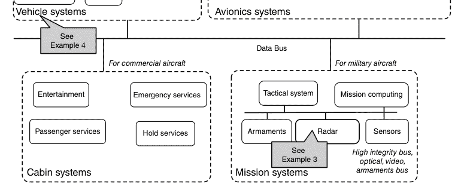

Figure 5.19 A top-level system architecture.

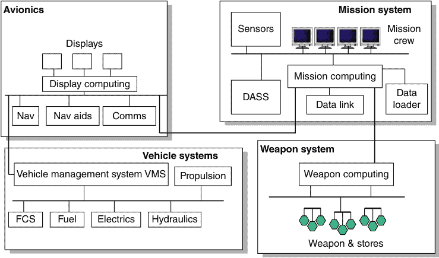

**Figure 5.20** Example of a large military aircraft architecture.

The architecture can be developed further to show more detailed definition and to show how it can be used to further define requirements, responsibilities, and functional segregation. Figure 5.20 shows how the architecture can be used to segregate sub-system architectures in a military aircraft. For reasons of integrity it is necessary to separate the main functions of avionics, aircraft systems, the mission system, and the weapon system, as well as segregating their wiring harnesses. The main reasons are to ensure a suitable integrity for the aircraft systems functions and to apply specific armaments standards to the weapon system.

Usually this leads to use of military standards for the data bus, for example MIL-STD-1553B or STANAG 3910 for all functions. However, in the case of converting an existing commercial platform into a military type, for example for surveillance purposes, there may be sound reasons for keeping the commercial avionics and blending that with military standard systems. Figure 5.21 shows an architecture used as the basis for achieving such a system by using the mission computer as a buffer between the two systems.

### 5.7.2 Example 2: Flight Control System

In Figure 5.19 the flight control system (FCS) is shown as a single box as part of the airframe systems. Figure 5.22 shows the contents of this box as an FCS top-level generic architecture and shows some preliminary interfaces to the aircraft in the form of the displays and controls, the air data system, and the control surfaces.

This has been developed further to the architecture shown in Figure 5.23. This is a historic diagram since it shows a flight control structure developed for an experiment to demonstrate fly-by-wire control in an unstable aircraft, the fly-by-wire (FBW) Jaguar

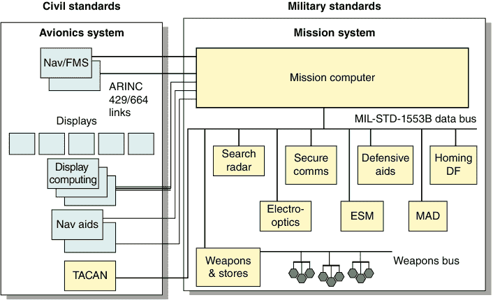

**Figure 5.21** Allocating responsibilities between civil and military systems. DF, direction finding; ESM, electronic support measures; Nav Aids, navigation aids; Nav/FMS, navigation/flight management system; MAD, magnetic anomaly detector; TACAN, tactical air navigation.

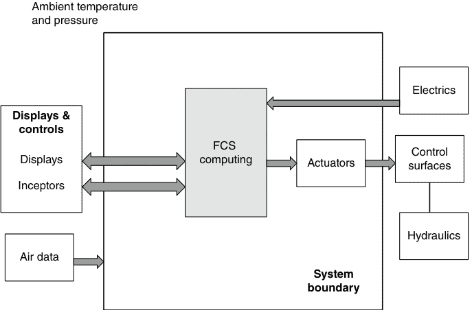

**Figure 5.22** A generic FCS architecture.

(Weller 2018). It records some important decisions made on a quadruplex implementation of a software intensive system designed for high integrity. This architecture led on to a complete design that was successfully tested on a Jaguar aircraft and formed the basis for following aircraft in the UK such as EAP and Typhoon.

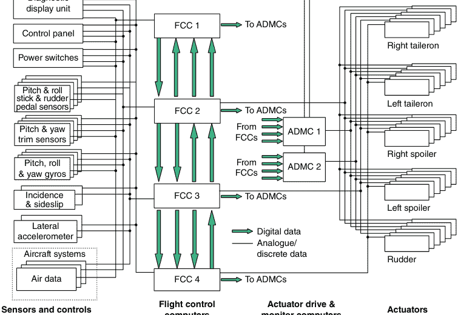

Figure 5.23 Overall FCS architecture prior to design (Weller 2018).

### 5.7.3 Example 3: Radar System

This example has been chosen as it appears to be a relatively simple, although very high value, system and it is used as a verification example in Chapter 7. The customer’s operational requirement will include:

- detecting a particular set of targets
- detecting targets at a particular range
- discriminating target from background clutter
- detecting, classifying, identifying, tracking, and locking on to targets.

Figure 5.24 shows a sketch of a system that will meet these requirements. This is the beginning of an integrated weapon system in which the radar is physically integrated into the airframe and is then integrated with the aircraft avionics, the armaments system, and the cockpit to provide a system that can detect targets, identify, them, track them, and then engage them with missiles with a single pilot to perform these tasks and to fly the aircraft.

Figure 5.25 shows the main elements of the sketch put into an architecture to show the relevant interfaces. This architecture is an interconnection of the basic navigation systems, the radar sensor, and the armaments system – in a military aircraft. Thus there is no need for interconnection of commercial and military standards – all the sensors and data buses are designed to military standards. The resulting system is a comprehensive target acquisition and engagement system in a fast jet military aircraft operated by a single pilot.

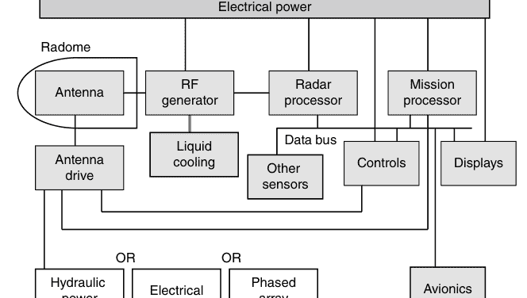

Figure 5.24 Scheme of a radar system.

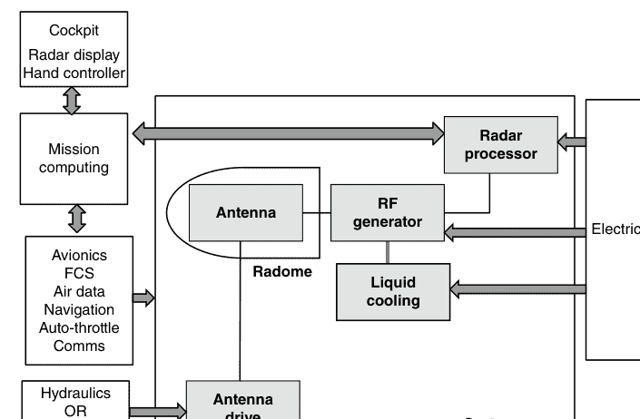

Figure 5.25 Architecture of a radar system.

### 5.7.4 Example 4: Vehicle Systems Management

This rather lengthy example explains how a computing system for the set of power and mechanical systems, known as vehicle systems, was developed for a range of systems that are described in section 12.2. This is a historical example but it illustrates how a whole

system can be developed using different types of architectural examples to arrive at a robust solution. The final system was demonstrated on an experimental aircraft and it formed the basis for systems in use today, albeit in rather more modern implementations. The following terminology has been used:

- vehicle systems – the individual power and mechanical systems of the aircraft
- VMS – the system that controls all vehicle systems
- VMS architecture – the VMS processors and data bus as part of VMS
- VMS processor – the processing units associated with VMS
- processor/memory – the computing system installed in each VMS processor
- I/O – signals associated with the vehicle systems.

The process began with the desire to develop a computing system for the interfacing, control, and management of a number of systems. The nature of the problem is illustrated in Figure 5.26.

These systems were a challenge because they were predominantly mechanical or electrical and usually involved a transfer of significant amounts of energy to perform a function. They were also directly associated with the safe operation of the aircraft. This is in contrast to the avionics systems, which are predominantly managing information. They had a diverse range of input and output characteristics with a wide range of sensor types.

There were some decisions that could be made early in the project based on the integrity of the systems that would determine which system could be entrusted to computer control and which were of a level of integrity that ruled them out of this system. This was decided on the basis of the need for complex functions to be performed balanced against a need for independence for safety reasons, and the result is illustrated in Figure 5.27.

Discussion with the engineers of individual systems led to an agreement on which systems were suitable and which were not, based on the integrity of each system, the

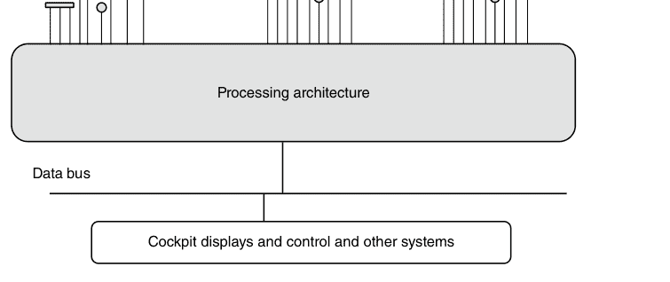

Figure 5.26 Developing an integrated system for the vehicle systems – the start.

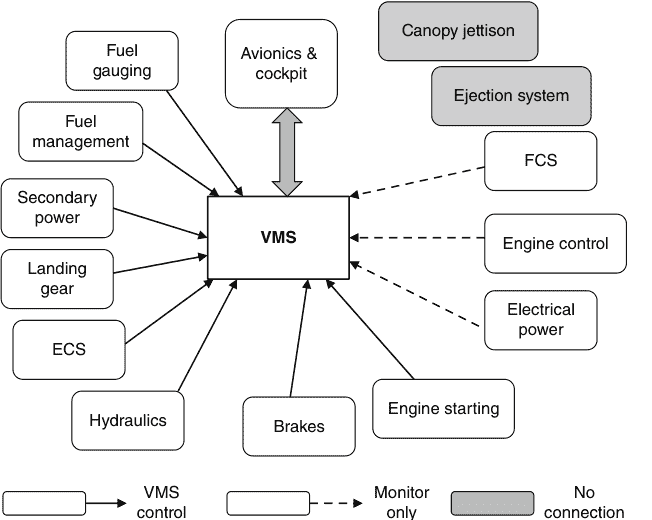

需要更严密地控制系统、减轻重量以及进行工程判断。结果表明，与乘员逃生相关的系统不适合考虑纳入其中，因为那些系统需要简单，以防止意外弹射，并在接到指令时立即工作。发动机控制系统传统上属于发动机制造商的领域，而且越来越趋向于将控制系统集成在发动机上，因此在这种情况下，它应保持独立。该飞机的飞行控制系统已被设计为四余度系统，并且对于一架设计上不稳定的全权电传操纵飞机而言，将其作为一个独立的系统并按要求提供数据接口被认为是明智的。

其余每个系统都使用各种传感器来检测系统内部的状态。这些传感器构成了一组输入类型，其类型、量程、源阻抗和转换速率各不相同。典型示例如下：

- 接近开关 — 模拟量或离散量
- 燃油表探头 — 交流电容
- 齿轮箱转速 — 脉冲探头
- 作动器位置 — 电位计，旋转式或线性式
- 作动器位置 — 可变变压器，旋转式或线性式
- 温度 — 热敏电阻或铂电阻
- 压力 — 压电式
- 压力开关 — 离散量

车辆系统在飞机上执行某种动作的输出也构成了一组输出类型，其类型、量程、负载阻抗/电阻和电抗各不相同。典型示例如下：

- 阀门 — 离散量
- 直流电机 — 直流驱动
- 作动器驱动 — 低功率模拟量
- 力矩电机 — 低电流伺服驱动
- 燃油泵 — 高功率伺服驱动
- 白炽灯 — 灯驱动

需要通过数据总线与飞机上的其他系统连接，这些系统包括：

- 系统中的其他处理器
- 航空电子和任务系统
- 座舱/飞行甲板显示和告警
- 预测与健康告警
- 事故数据记录
- 飞行测试仪表

所有物理输入和输出都将连接到一组输入调理模块，以与飞机布线接口，并将输入信号转换为可供处理器使用的数字信号，同时将处理器的指令转换为适合操作飞机上设备的形式。与其他系统的连接通过一种通用类型的数据总线实现。这种布置如图5.28所示，该图展示了一个通用VMS处理器在采集输入、执行某种处理功能以及生成带有适当反馈的输出方面的结构。

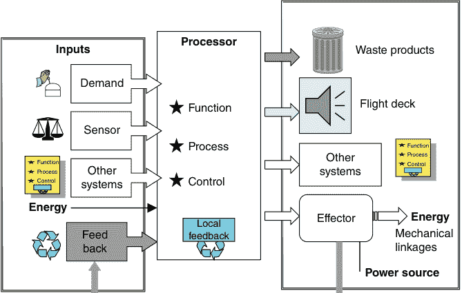

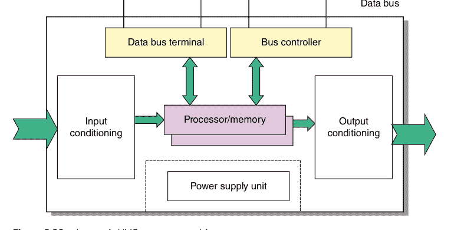

图5.29 通用VMS处理器架构。

为了执行各系统的功能算法，需要处理器和存储器的组合；为了将信息发送给飞机上的其他系统，需要数据总线；并且VMS处理器需要自己的内部电源。所有这些信息促使与供应商进行讨论，最终得出了如图5.29所示的VMS处理器物理架构。

在选择处理器类型之前，我们先尝试了处理器存储模块的通用架构。这样可以将责任归属到软件供应商。对系统内要执行功能的简要分析，使我们对任务规模、处理器负载、所需存储容量和数据总线负载有了初步评估。这引出了如图5.30所示的初步软件处理架构。

随着所有初步工作的完成，现在我们对整个系统的架构、系统内的处理器（包括I/O调理结构）以及初步软件架构有了理解，但尚未选择任何详细部件。这足以向供应行业发布规范，开始处理器的设计。随后，我们开展了以下工作来分析每个系统，以便利用各系统工程师提供的以下信息来定义总体架构：

- 输入特性的定义
- 使用功能需求文档定义要执行的功能
- 输出特性的定义
- 对连接系统完整性的理解
- 到其他系统的数据总线连接的定义

其成果之一就是如图5.31所示的处理器机箱的详细设计，其中每个处理器都分配了一组与每种输入和输出信号类型相关的模块。

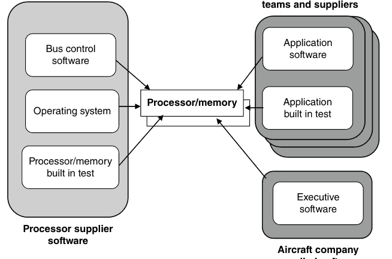

图5.30 通用处理器/存储器架构。

我们进行了一项研究，以决定每个车辆系统如何连接到VMS架构中，以及功能处理任务如何在单台或多台计算机之间分配。这是为了实现通道之间的适当分离，并提供所需的冗余。对所有系统进行此项研究后，得出了最佳的VMS处理器数量。为每个处理器在飞机上寻找一个位置，以优化线束长度（和质量），并提供相对良好的温度和振动环境。这最终决定使用四个VMS处理器，如图5.32所示。该架构中的数据总线应符合飞机的通用标准，并且应使用通用的高级编程语言。这是最终设计，并准备了图纸，以便在适当测试后将系统采购并安装到飞机上。

架构在系统从初始概念到设计阶段的开发过程中发挥了重要作用。项目早期做出了许多决策，但对最终实现并没有确切的了解。利益相关者数量众多，以确保所有车辆系统都能在设计过程中得到代表。各方达成了协议，并且在对设计作出承诺后很少有变更。图5.33展示了架构作为该过程工具的作用。

图5.34展示了飞机的整体系统架构，该架构用作某些单独系统架构的基础。它显示了各个系统如何重新组合到顶层架构中，以产生更高层次的细节。

本次开发成功之后，其他项目也遵循了类似的路径。未来项目系统的一个重要方面是支持I/O处理的开发

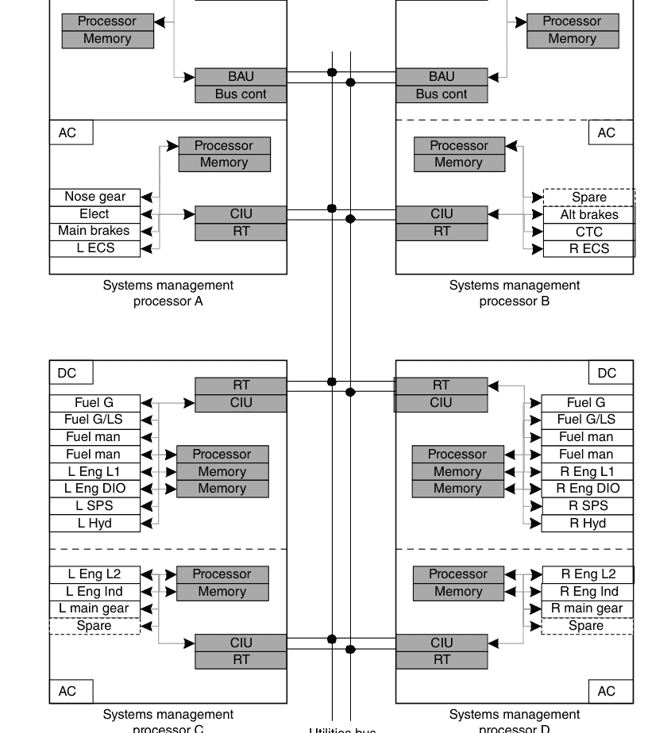

图5.31 输入/输出调理模块。

系统管理处理器 A

系统管理处理器 B

系统管理处理器 C

系统管理处理器 D

航空电子总线

公用总线

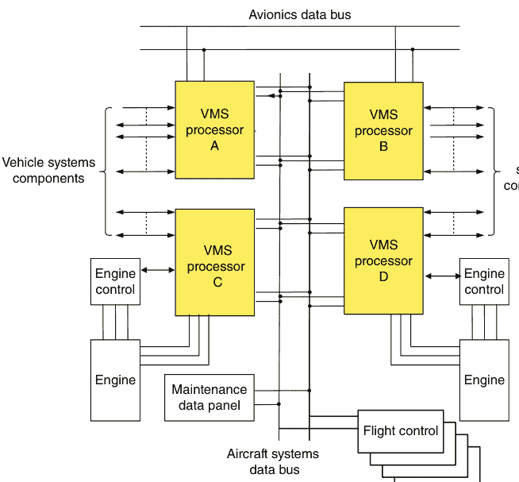

**图5.32** 完整的VMS。

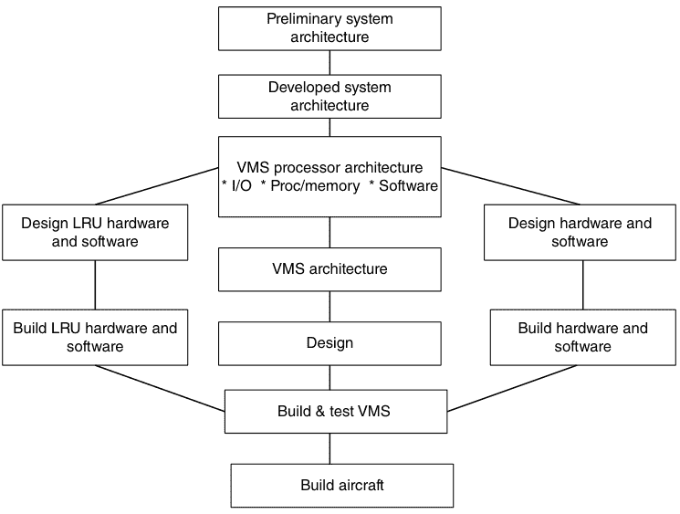

**图5.33** 架构在设计过程中的作用。

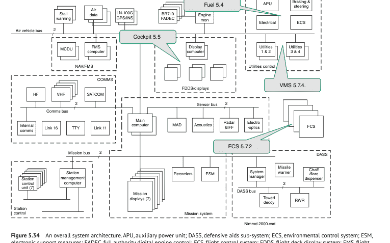

图5.34 整体系统架构。APU，辅助动力装置；DASS，防御辅助子系统；ECS，环境控制系统；ESM，电子支援措施；FADEC，全权数字发动机控制；FCS，飞行控制系统；FDDS，飞行甲板显示系统；FMS，飞行管理系统；GPS/INS，全球定位系统/惯性导航系统；HF，高频；IFF，敌我识别；MAD，磁异探测器；MCDU，多功能控制与显示单元；Nav/FMS，导航/飞行管理系统；RWR，雷达告警接收机；Sat Com，卫星通信；TTY，电传打字机；UHF，超高频。

该处理功能被分离到称为RIO（远程输入输出单元）的设备中。随着技术的发展，RIO得以安装在飞机环境中相对严苛但偏远的区域，从而进一步缩短了线束长度并减轻了重量，同时将处理组件保持在冷却环境中。图5.35展示了如何通过VMS（飞行器管理系统）架构实现这种分离，图5.36展示了一种使用两个RIO的VMS架构。

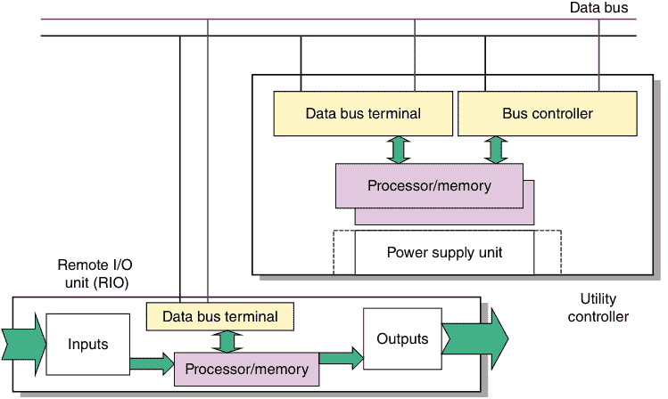

**图5.35** 开发RIO概念。

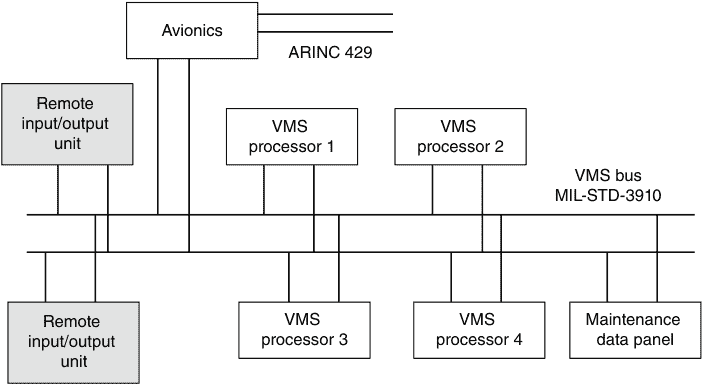

**图5.36** 使用RIO的VMS架构示例。

## 练习

1. 为在乡村环境中运送商业物品的遥控驾驶飞机设计一个架构。识别机上所有基本子系统，并确定地面段和合适的遥测链路。

2. 针对自主系统重复上述练习。

3. 描述您将如何为这些系统的认证准备证据。

4. 假设您是一名负责远程商用飞机数据总线结构的工程师。绘制您提议的数据总线架构图，并确定您需要的所有总线类型。定义关键特性，以便您的架构用户能够进行集成，以满足其系统性能要求以及飞机的安全和性能要求。

5. 考虑第6章中提出的人作为集成系统的概念，设计一个人类的系统架构。其性能与飞机架构有何不同？

6. 比较和对比智能手机与飞机的架构。评论这两种架构之间的异同。

## 参考文献

Chadwick, J. (1987). *The Decipherment of Linear B.* Cambridge University Press.

Moir, I., Seabridge, A., and Jukes, M. (2013). *Civil Avionic Systems*, 2e. Wiley.

Pallet, E.H.J. (1987). *Aircraft Instruments & Integrated Systems.* Longman, ISBN: 0-582-08627-2[1].

Weller, B. (2018). *A History of the Fly-by-Wire Jaguar.* BAE Systems Heritage Department.

## 延伸阅读

Chau, S., Dang, V., Xu, J., and Lu, J. (2006). *An Automatic Technique to Synthesize Avionics Architecture.* *Proceedings of the First NASA/ESA Conference on Adaptive Hardware and Systems (AHS’06).* IEEE Computer Society, Washington, DC.

Maier, M.W. and Eberhardt, R. (2002). *The Art of Systems Architecting*, 2e. CRC Press.

Moir, I., Seabridge, A., and Jukes, M. (2013). *Civil Avionic Systems*, 2e. Wiley.

Salomon, U. and Reichel, R.. (2013). *Automatic Design of IMA Systems.* IEEEAC Paper #2018, Version 3, Updated 19/01/2013.

Seabridge, A. and Leon, S. (2016). *EAP – The Experimental Aircraft Programme: Britain’s Last Manned Aircraft Demonstrator.* BAE Systems Heritage Department.

Stevens, R., Brook, P., Jackson, K., and Arnold, S. (1998). *Systems Engineering – Coping with Complexity.* Prentice Hall.
