# 6

# 系统集成

## 6.1 引言

“系统集成”一词对不同的人和不同的组织而言含义各异。本章将探讨系统集成的一些方面，并向读者指出一些潜在的弊端，以鼓励对设计保持一定程度的谨慎和审视，确保解决方案的安全性。这一点将在第11章进一步讨论。

集成的产生源于工程师希望追求在操作和设备使用方面高效的解决方案。为了实现后者，工程师经常寻求将许多功能整合到单一设备中，例如硬件组件、外场可更换单元（LRI）或软件包。此设计驱动力与成本、重量、飞机上的安装体积、可靠性以及某些情况下的技术挑战有关。此外，大多数计算设备都鼓励多任务解决方案，个人计算机就是例证。

虽然集成结果具有许多切实的好处，但也存在一些缺点。一些集成解决方案表面上看起来简单，并提供简单的人机界面，就像Apple iPod一样。这是通过在设备内部实现相当高水平的复杂性和精密性来实现的。在一个包含所有航空电子和飞机系统的复杂飞机系统中，结果是极其复杂的，硬件、软件、数据和功能的交互遍布整个系统。

也许掌握这个概念的最简单方法是举一个熟悉的集成系统的例子，比如人类自身。

人类是理解系统集成的绝佳范例，因为它体现了工程师希望融入完美系统的所有属性。飞机可以被视为一个复杂的、相互作用的子系统集合，与人类并无太大不同。事实上，随着无人驾驶飞机系统，特别是自主无人驾驶飞机系统的出现，这种以最少操作员干预运行的系统集成理想正在迅速成为未来系统设计师的目标。图6.1展示了在系统层面可以观察到的人类与飞机之间的相似性。

人体有一个由骨骼和周围结构组成的框架。在这个结构中，集成了从适当燃料转换而来的能源、一个复杂的处理系统、将能量转化为运动的机制、感知周围环境条件的能力、对气候条件做出反应和补偿的机制，以及最后进行有目的活动或提供动力的手段。人类可以同时执行多项复杂任务：

-   从各种传感器获取和处理信息
-   思考、分析、计算、判断
-   执行重要功能——呼吸、血液循环、平衡、运动、消化等。
-   以有目的的方式对收到的信息做出反应
-   对外部刺激做出本能反应
-   在决策中运用道德和伦理考量
-   对所有功能进行优先级排序以达到最大效力。

这可以表述为将各个数据源、信息源和知识源进行融合或集成以执行一项功能。人类是一个有效且天生的信息集成者。例如，知道自己身在何处以及需要移动到哪里是一个简单、直观的功能：我们的方向感源于整合内耳平衡器官的信息、发出肢体位置信号的肌肉和关节感受器的信息以及视觉线索（Ashcroft 2000）。这种吸收和整合信息并以多种不同方式做出反应的能力适用于许多人类功能。

因此，人类代表了复杂信息获取和处理成功交互与集成，以及使其达成结果的能量转换手段。这连同补偿物理环境变化的能力以及评估威胁并对其做出反应的能力，是一个核心属性。这种能力确保了人类作为全球环境中“至高无上”动物的地位。这也是飞机武器系统的关键要求。飞机利用传感器信息、外部世界知识并将能量转化为行动，必须通过某种形式的计算系统进行处理，以模拟人类大脑的直觉处理。通过机械和电气/电子手段，在由人类操作员操作的机器中将所有这些行动整合起来以实现预期结果，是系统集成的一项关键技能。根据达尔文的理论，是遗传影响和既有智慧在漫长的进化过程中塑造了人类的智力发展。另一方面，飞机必须在相对较短的时间内设计以满足特定要求。这需要多种技能和流程，才能生产出一架能够在各种操作场景中执行广泛活动的飞行器。这项任务就是系统集成。

## 6.2 定义

系统集成一词可以有多种解释，以下解释在航空工业中常用：

-   *组件级集成：* 组件或LRI确保其提供的离散功能对其所在整体系统有所贡献的能力。
-   *系统级集成：* 将先前由离散控制单元执行的离散功能和控制特性合并到公共控制区域。
-   *过程级集成：* 将产品组件逐步集成为单一的、可工作的且经过测试的产品。
-   *功能级集成：* 识别集成的功能，这些功能是许多单一功能的合并，以形成可验证的性能度量。
-   *信息级集成：* 记录和授权信息，以定义、设计、记录并认证整个系统对其预期用途的适用性。
-   *主合同级集成：* 在整个产品生命周期内设计、开发和制造精确满足客户要求的复杂产品的能力。
-   *涌现属性集成：* 子系统之间相互作用的一种现象，可能并非有意设计，而是由于组成系统的涌现属性而产生的。

## 6.3 系统集成示例

通过实例进行解释将有助于理解上述每种集成情况。

## 6.3.1 组件级集成

组件级集成非常重要，因为它提供了构建子系统或系统的积木。多个电子组件在

组装在电子电路板上，构成一个模块，该模块成为LRI或系统的构建单元。类似地，电动机、旋转阀、相关管路、安装法兰和连接器可以组装成一个电动阀，用于飞机燃油系统。在一架大型飞机上，可能会有30或40个这样的阀门，以各种方式使用，提供所有燃油系统功能，如加油、放油、发动机供油和燃油传输。

在更小的层面上，这种组件集成发生在专门设计的电子设备中，这些设备旨在满足特定的客户规格。这可能需要对设备进行编程或设计基板以包含逻辑功能。这产生了一种专为执行特定功能而设计的设备，通常被称为“固件”，并且需要软件程序作为设计过程的一部分。此类设备也可能被称为专用集成电路（ASIC）。为集成系统设计的ASIC的一个早期例子是MIL-STD-1553B组合远程终端和总线控制器芯片，它由Smiths Industries（现为GE Aviation）的一个部门为下一节所述应用设计和制造。

每个组件在运行环境、飞机上的位置、方向、安装等方面都有其特定的要求。相同的组件在飞机上的不同位置或系统的不同部分安装时，可能以不同的方式运行。

集成机械组件的一个例子是电动静液作动器（EHA），一种以节能方式移动飞行控制面的装置。它由一个封闭单元组成，包含一个电动机、一个液压泵和一个作动筒，无需连接到主液压系统即可提供能量（Moir 和 Seabridge，2008年）。

## 6.3.2 系统级集成

系统级集成的例子已被描述为以下领域的集成：

- 航电集成 – 基于减少分立控制单元，以及在通用计算系统和数据总线互连中执行功能（Warwick，1989年）。这方面的例子可以在实验飞机计划（EAP）中用于控制通用系统的系统开发中看到，这是一个英国计划，于1986年首飞。该系统被称为通用系统管理系统（Moir 和 Seabridge，2008年），在四个通用计算模块中执行了先前由20至25个独立设备承载的功能，如图6.2所示。这不仅减少了飞机上的设备数量，还减少了布线的体积，从而总体上减轻了重量。此后，这一系统进一步发展成为现代车辆管理系统（VMS），在许多新项目上都可以看到；在推进系统中也可以看到类似情况，许多独立的发动机控制装置被集成到一个安装在发动机上的控制单元中（Moir 和 Seabridge，2008年）。在航电领域，各种功能正在集成到少数开放式架构计算单元中。这些单元基于通用计算、存储和具有标准背板互连的接口模块，

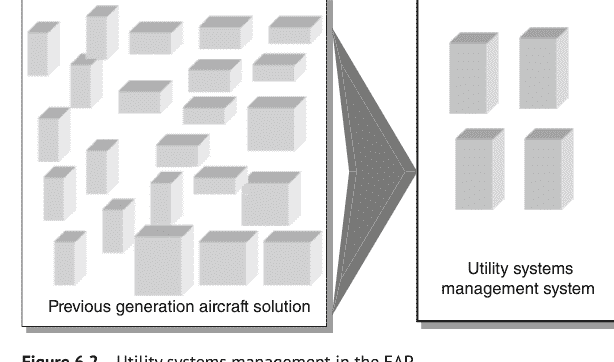

### 图6.2 EAP中的通用系统管理

此类系统允许功能在整个系统架构中分布。这种集成形式的例子可见于波音777的飞机信息管理系统（AIMS）和电气负载管理系统（ELMS），以及波音787、空客A350和A380的飞机系统控制器。在军事领域，欧洲战斗机“台风”和洛克希德·马丁公司的F-35也拥有基于这一原理的VMS。

- 座舱集成 – 基于减少分立、单一用途显示器，以及多功能显示器和基于语音的系统的出现（Warwick，1989年）。驾驶舱和飞行甲板曾经被设计或演变为由单个开关、控制旋钮、指示器和指示灯组成的布局。这些装置以这样的方式分组，使飞行员本能地知道该看哪里或够到哪里。然而，总体印象是一大堆以不同格式和呈现方式提供信息的项目。这可能导致因误读仪表和错误选择控制装置而引发事故（Moir 和 Seabridge，2013年）。大多数现代飞机拥有飞行甲板或驾驶舱，通过基于平板液晶显示器（LCD）屏幕的多功能显示器向机组人员呈现信息。这些显示器能够使用图形和文本以“页面”形式向机组人员提供彩色信息，页面可按需选择。声音和合成语音也用于引起人们对关键状态的注意。

座舱设计的一个重要方面是实现整体设计的一致性。驾驶舱或飞行甲板包含许多不同的子系统，并从飞机系统中的各种来源接收信息。重要的是建立一套共同的原则，必须应用于显示格式、字体和字号、颜色、照明水平以及警告音。这是为了确保呈现的一致性，以减少误解信息的可能性并减少潜在错误。

这一级别的集成产生了一个干净、整洁的座舱环境，系统状态信息仅在需要时呈现。虽然在正常操作期间这很好，但信息可能被“埋藏”在显示页面深处，需要多次按键才能访问。至关重要的是，必须谨慎关注显示器的模式切换，以将这种风险降至最低。

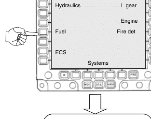

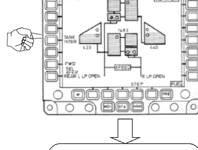

在SYSTEMS页面上按下此键将选择FUEL显示

在FUEL页面上按下同一键将选择TANK INTERCONNECT功能

### 图6.4 “软”键示例

- 控制集成 – 基于减少分立、单一用途的控制装置，以及使用多用途和软键控制装置（Warwick，1989年）。这方面的例子可以从“软”键或可编程键的使用中看到，这些键通常与多功能显示器关联。按键或开关被激活时执行的功能取决于飞机处理系统赋予它的图例。例如，在SYSTEMS页面上，当一个键带有“FUEL”图例时，按下该键将选择显示器的FUEL页面；在此页面上，同一开关旁边的图例可能是“TANK INTER”，按下它将启动油箱互通序列。在图6.4所示的多功能显示器中可以看到一个例子。精心设计键的位置和键标题将有助于降低误选的风险。物理软键的一种替代方案是使用触摸屏功能。

进一步的控制集成示例，用于确保最佳的人因布局，可以在许多作战飞机采用的HOTAS（手不离油门和操纵杆）概念中看到。在这个示例中，在作战情况下驾驶飞机所需的所有控制装置和开关都布置在飞行员无需将手从油门和操纵杆上移开即可执行任务的位置。

在军事项目中，HOTAS有许多固定翼和旋翼应用。图6.5展示了F/A-18C/D“大黄蜂”战斗机，所有关键控制装置都位于油门和操纵杆上，以确保在所有作战任务中一人也能有效执行。这允许在空对空和空对地模式下控制武器、传感器和航电系统。现代军用驾驶舱几乎普遍采用HOTAS，因为它可以在任务最关键的阶段实现更直接、更有效的操作。在战斗中，飞行员不能冒着手离开油门或操纵杆导致控制装置发生非指令动作的风险，低头寻找正确的开关。将功能组合到一组开关和控制装置中是一项具有挑战性的人机工程任务（AGARD，1996年）。

#### 节流阀手柄

#### 控制杆手柄

通讯发射
笼/去笼
速度刹车
目标指示器控制器
干扰弹/箔条发射器
雷达俯仰
外部灯光
突袭模式
自动油门
空对地武器释放
手指抬起
炮/导弹扳机
取消指定/前轮转向
自动驾驶/前轮转向脱开/G限制器超控
配平
侦察事件标记
传感器控制
空对空武器选择

图 6.5 F/A-18 大黄蜂中的 HOTAS（手不离油门和操纵杆）概念（AGARD 1996）。

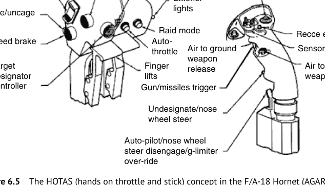

#### 用户

#### 客户

基于网络的网页

#### 工程数据
- 需求
- 规范
- 合格数据

#### 测试信息
- 计划
- 设施
- 结果

#### 配置管理

#### CAD 数据库
- 电气
- 机械
- 结构

制造系统

项目管理

#### 供应商信息
- 规范
- 计划
- 合格数据

财务系统

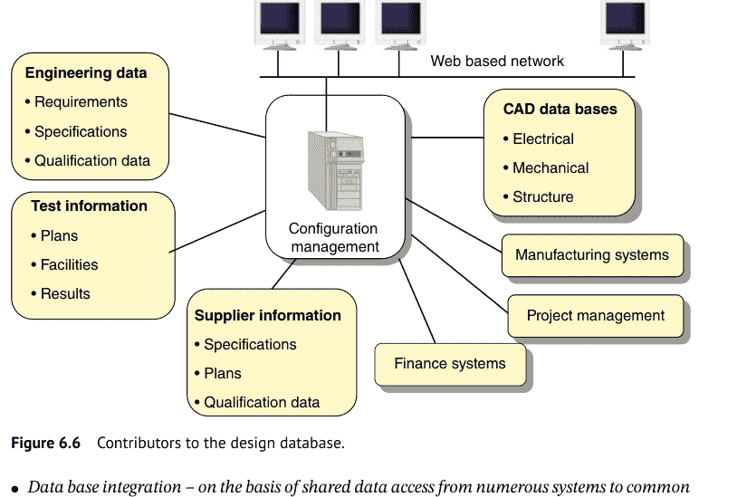

图 6.6 设计数据库的贡献者。

- 数据库集成 – 基于从众多系统对数据公共区域的共享数据访问（Warwick 1989）。复杂系统的设计过程会产生许多数据库，用来定义产品设计为三维模型数据、接口、软件设计、硬件记录等。这捕获了设计基线及其任何变更。图 6.6 显示了对设计数据库的典型贡献者。

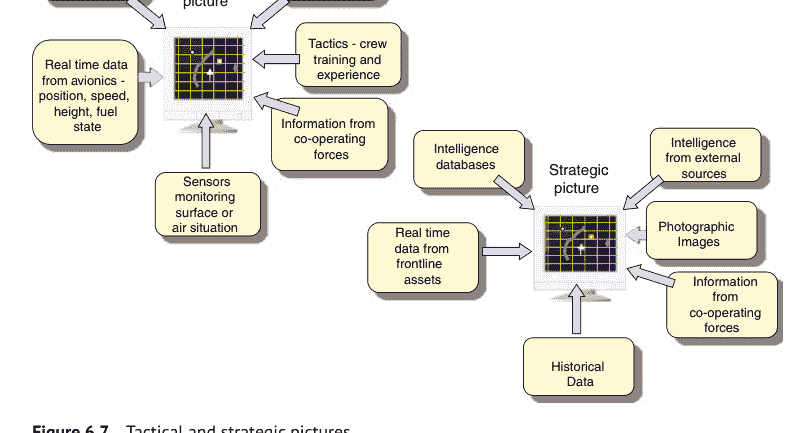

图 6.7 战术和战略态势图。

用于识别故障部件以便进行维修。现代系统收集故障状态信息，并寻找表明潜在故障的趋势；例如，油中碎屑量的增加或泵压随时间的逐渐下降。结合知识数据库和算法来确定从趋势中最可能的故障源，该系统可以更精确地确定故障及其位置到单个部件。这种信息在提供维修和更换准备方面更有帮助，而不是等待故障发生。这类系统通常被称为预测与健康管理系统（PHM）。信息可以存储在可移动盒式磁带中以连接到地面数据库，或在飞行期间通过数据链系统（如 ARINC 通讯和报告系统（ACARS））直接传输到地面。

关于飞机运行的另一类知识是事故数据记录系统（ADR）。一组预先选定的强制性和可选系统参数在整个飞行过程中持续记录，以便在事故后进行查询。

### 6.3.3 过程层面的集成

从子系统或模块级到系统再到完整产品的渐进式测试通常被称为集成。这本质上是图 6.8 中 V 图右侧腿所示的系统构建。集成在此情况下涉及经过充分测试的功能、模块和接口的逐步构建，并最终在完成的产品上进行最终测试。大部分活动在测试实验室进行，最终转移到飞机建造期间，然后进行飞行测试。

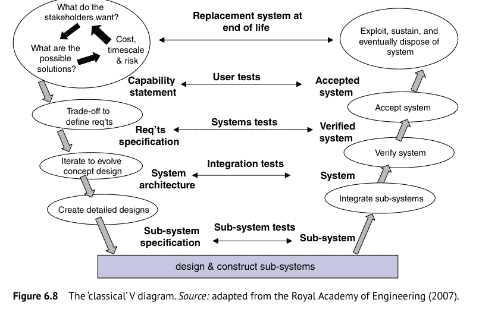

图 6.8 ‘经典’ V 图。来源：改编自皇家工程院（2007）。

V 的右半部分描绘了顶层系统需求的分解和验证，以便向下流向模块设计。左分支显示了一个渐进程序，通过该程序实现模块集成、硬件和软件集成以及系统测试 – 这是验证过程。第一步涉及应用可追溯性矩阵以确认所有原始需求都已得到满足并完全实现。

该活动使系统的每个元素都能得到彻底测试，并在与其他系统连接并作为整体进行后续测试之前对测试结果进行验证。此过程并非旨在查找故障并加以纠正。其主要目的是获得证明系统满足其工作要求的书面证据，并且所有来自渐进测试的证据代表整个系统。

这些过程与主要系统开发里程碑相关联，如第 6.5.2 节所述。

> 过程的另一种表示可在螺旋模型中找到。螺旋开发模型是一种风险驱动的过程模型生成器。它用于指导软件密集型系统的多利益相关方并行工程。它有两个主要区别特征。一个是用于在增量增长系统定义和实现程度的同时降低其风险程度的循环方法。另一个是一组锚点里程碑，用于确保利益相关方对可行且相互满意的系统解决方案的承诺。（Dr Barry W. Boehm）

螺旋模型结合了迭代开发或原型制作的想法与瀑布模型的系统化、受控方面。它允许增量发布

设计师对他们希望车辆提供的功能有一个设想。随着第一个螺旋的展开，使用商用现成技术（COTS）的快速原型制作将使系统的基本特性得以评估，并进行权衡和风险评估。然后可以生产原型系统或仿真以建立‘概念验证’，然后再进入下一个开发阶段。

在令人满意地确定系统的关键特性后，将制定开发计划，为更严肃和昂贵的开发提供框架。螺旋的第二个周期将完善流程，仍考虑到替代解决方案和风险，然后再构建第二个原型，可能使用实验室硬件。

第三个螺旋可以将开发推进到初始飞行测试和开发。随着螺旋的逐步展开，项目的成本也相应成比例增加。螺旋模型允许有序的开发过程，并对项目目标进行递归审查，以便在每个阶段平衡成本和风险以确定可接受的结果。

进一步的螺旋可能涉及传感器套件和任务包线的改进。基本平台能力的进一步发展和扩展也可以被纳入。

该模型适用于相对较小、独立的项目的开发。它对更大、更复杂的‘系统之系统’开发的应用较少。

### 6.3.4 功能层面的集成

飞机必须执行的功能需求来自多个来源。其中一些需求由客户明确说明，而其他需求则源于经验、性能要求或对标准、监管标准、流程和技术的理解 – 全部以一定程度的工程判断提取。该过程在第 2 章中描述。

这些需求‘向下分解’到反映飞机组成系统和子系统的产品分解结构（WBS）中。然后需求向下分解为子系统和设备的规范。非常经常地，为开发这项工作所需的组织结构为团队形式，负责交付产品。图 6.10 说明了需求的这种向下分解。

为了确保由此产生的产品单独开发的功能定义是‘集成’的，会对产品线进行跨视，如图 6.11 所示。此视图考虑了物理和功能接口，并确保由产品团队建立和使用通用标准和惯例。该任务通常由一个单独的团队执行，称为工程集成团队，其任务是确保各个产品组合成一个集成的功能整体。

一个简单的例子是设想为集成系统的系统概念。它将在定义和初步设计的早期阶段继续以这种方式被视为集成系统。然而，出于实际原因，当已识别出各个主要功能并建立边界时，将每个功能分别由不同小组或部门开发成详细设计变得方便。在其余的

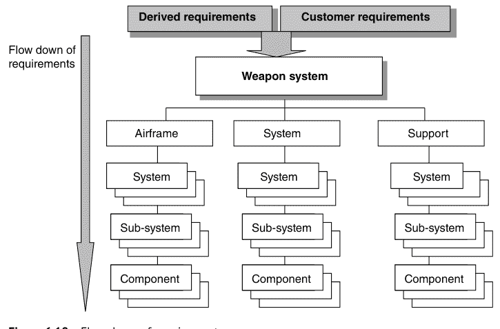

**Figure 6.10** 需求的流转。

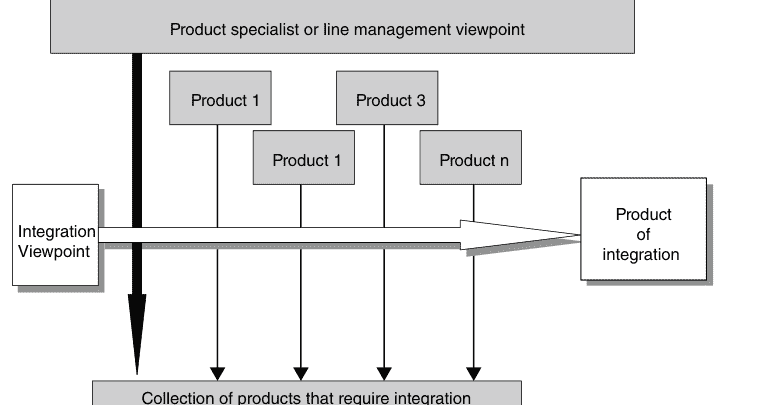

**Figure 6.11** 产品个体视角与集成视角。

lifecycle these responsibilities remain for procurement and test. The task of the system integrator is to ensure that the original concept of an integrated system is maintained so that when the total system is built up during the test phase it is fit for purpose. This means that all agreements made at the concept phase, which include functional separation, functional interfaces, accuracy and resolution of data, timing of data, redundancy, etc., are maintained at all times.

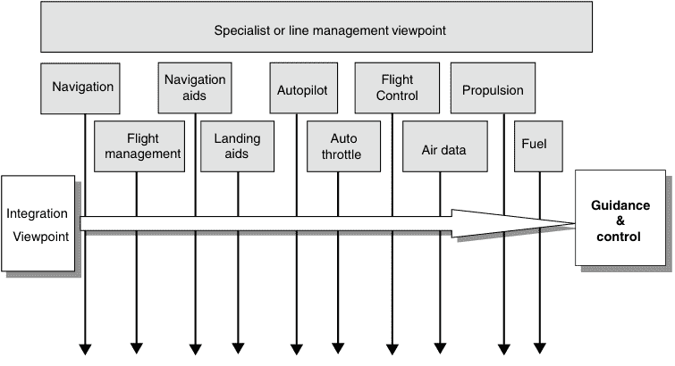

**Figure 6.13** 引导与控制示例。

- Communications management: the management of all internal and external communications.
- Displays and controls management in which the design of the cockpit or flight deck and all its constituent systems is integrated to provide an ideal crew working environment.

### 6.3.5 信息层面的集成

通过记录飞机开发的每个阶段来控制生命周期中的产品。图 6.10 所示流程中的开发每个阶段都必须记录下来，以显示需求的流转、与设计的关联，以及通过测试和建模获得的证据，以证明最终产品是安全、可靠且符合用途的。

以这种方式收集的信息对于向客户和监管机构证明飞机可以安全飞行，不会对操作人员和地面人口构成危险至关重要。通过配置控制来行使对产品的控制。这意味着所有模型、图纸、报告、分析以及机型的零件的发放都被记录在案。任何对机型记录的偏差或修改都以受控的方式引入。该任务通常由总工程师或首席设计师负责。

### 6.3.6 主承包商层面的集成

主承包商对系统集成的理解涵盖了上述所有内容以及更多内容。它关注的是在整个生命周期内管理提供满足客户需求的产品的所有方面。

系统集成商对整个产品及其各部分如何协同工作负责。

飞机的成功关键因素在于其满足其作战角色和环境的程度。这不能通过关注车辆的任何一个属性来实现——它取决于完整的系统包的特性，包括机组人员、车辆及其内部子系统、训练和支持系统，以及在军用飞机的情况下武器和支持的军事基础设施。

军方客户关注的特性包括生存能力、致命性和全生命周期成本。商业客户关注的是可用性、采购价格和运营成本。这些特性很大程度上取决于系统元素以何种详细方式组合在一起。这些任务包括：

- tracking, understanding, and influencing the customer requirement from its earliest conceptual stage
- capturing the requirement in a structured manner and flowing down that requirement through and across all aspects of the product definition, manufacture, and operation
- ensuring that the requirements are correctly interpreted and traceable to the design solution
- ensuring that the design is consistent across all constituent sub-systems and their hardware, software, firmware, and human engineering solutions
- conducting the testing and proving of the design at unit, component, sub-system, and system levels, including models and simulations, to gather evidence that the design is sound, robust, safe, and fit for purpose
- compiling and controlling a complete record of the design, including all assumptions and calculations.

### 6.3.7 源于涌现属性的集成

这里描述了一个涌现属性的例子，以说明飞机的子系统如何通过可能未在初始设计中预见到的相互作用而变得“集成”[Moir and Seabridge 2008]。图 6.14 显示了飞机系统中耗散能量产生的热流。该图的关键如下：

1. Air extracted from the engine fan casing is used to cool engine bleed air.
2. Ram air is used to cool engine oil in a primary oil cooler heat exchanger.
3. Fuel is used to cool engine oil in a secondary oil cooler heat exchanger.
4. The electrical integrated drive generator (IDG) oil is cooled by ram air.
5. Hydraulic return line fluid is cooled by fuel before being returned to the reservoir.
6. Fuel is cooled by an air/fuel heat exchanger.
7. Ram air is used in primary heat exchangers in the air-conditioning packs.
8. Ram air is used in secondary heat exchangers in the air-conditioning packs.

在某些极端情况下，例如以军用隐身飞机为例，这种热能的最终排放可能会损害飞机的热特征。必须寻求替代的抛热机制，以降低被寻热导弹探测的威胁。

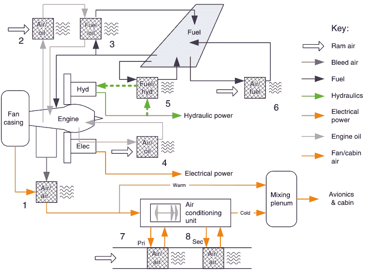

类似的相互作用可以通过分析闪电击中时机身结构和蒙皮中的电流流动、分析机身在系统组件的连接和接地中的电流流动，以及分析结构载荷来观察。这些效应在金属和复合材料混合的结构中尤其有趣。

另一个例子涉及燃油系统以及需求和指示必须流经的计算机和数据总线路径的数量。图 6.15 显示了一个燃油系统传感器向驾驶舱显示器发送信息以及随后机组操作到达执行器的路径的示例，例如油箱燃油不足的指示和飞行员要求转移燃油。

在分层数据总线系统[联邦系统]中集成数据流可能会在数据延迟或“陈旧数据”方面产生一些有趣的结果。每次数据在数据总线之间交换时，数据都可能陈旧，因为数据只能按周期刷新。这种数据“陈旧性”可以在系统设计中解决，但需要认识到该问题。

图 6.15 顶层描绘中显示了三种典型的交易类型。对于燃油系统示例，可以表征如下：

- **Intra-system data transfers:** these are shown as transfers 1 to 4 on Figure 6.15 where data is shared on a system basis without the pilot being involved. Such data transfers could involve a fuel transfer pump being commanded to automatically top-up certain fuel tanks as fuel is expended – an interchange between the fuel gauging and transfer systems.

**Figure 6.15** An example of data latency in an integrated sub-system.

- System to cockpit: transfers 5 and 6 relate to the transfer of data from the system to the cockpit, perhaps relating to fuel on-board (FOB) and the contents of individual fuel tanks when demanded by the pilot.
- Cockpit to system transfers: pilot selections such as demanded fuel transfers 7 and 8 are input into the system via cockpit interface units whereby discrete pilot fuel mode selections are fed into the system computer.

可以很容易地看出，涉及飞行员和系统交互的复杂操作可能依次涉及上述所有交易类型。作为系统时延影响的一个例子，如果每个时延平均为 10 ms，则从传感器到警告再到需求返回到转移泵的潜在总时延可能高达 180 ms。必须在此基础上加上机组人员对警告做出反应、决定做什么然后选择转移所需的时间。在某些情况下，这种延迟可能构成安全隐患。还有其他类型的系统，其中这种数据延迟将完全不可接受，并可能导致系统不稳定。

### 6.3.8 集成系统的进一步示例

#### 6.3.8.1 机身

不出所料，机身是一个相互连接和集成的网络。许多航空航天组织的部门结构倾向于将这些线索视为

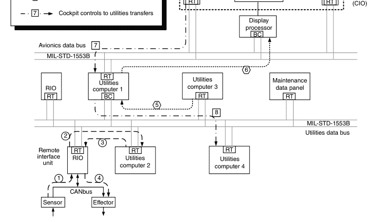

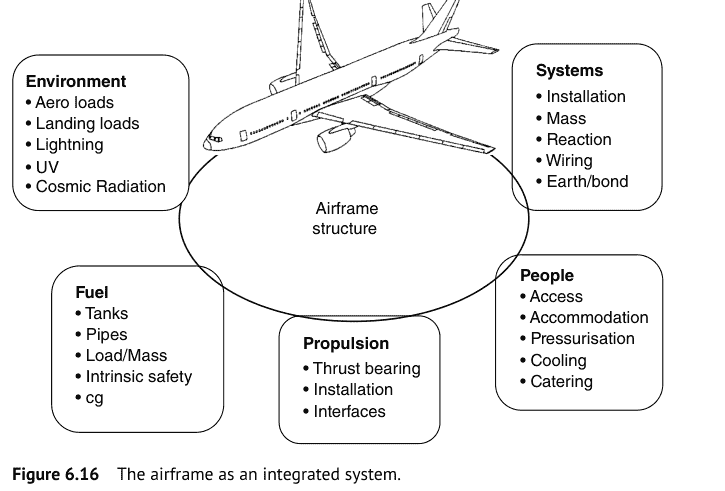

Figure 6.16 The airframe as an integrated system.

单项独立学科。然而，将其作为一个整体实体来处理可以获得很多好处（图 6.16）。

结构旨在承受飞行、着陆和减速、湍流以及振动、气候条件和老化相关的一切载荷。它可能由不同的材料构成，包括铝合金、复合材料、钛和塑料，所有材料在强度、耐腐蚀性、耐火性和导电性方面具有不同的特性。

这些材料被组合成一个压力容器，它是乘员的生命支持系统，提供加压环境以在合适的温度和湿度条件下吸收氧气。

机身是所有电气动力系统的不可分割的一部分，因为结构为所有设备和电缆屏蔽提供了零电位或“地”。它也是所有金属部件的“搭接”连接，例如设备外壳、燃油和液压管路，这对于保持固有安全性至关重要。

结构形成法拉第笼，以保护内部设备免受无线电干扰的影响，并限制飞机向外界辐射的无线电干扰，这是某些军事行动的一个重要方面。

最后，机身是机翼和机身油箱中燃油的储存位置。燃油的持续移动及其温度会对某些机身部件施加载荷。为了最大限度地减少某些载荷变化，燃油在油箱之间的移动方式是按计划进行的，以限制燃油重心的移动范围，实际上是为了将飞机的重心保持在精确的范围内。

#### 6.3.8.2 Propulsion

动力装置本身就是一个复杂的机械和液力机械组件的集成系统。在现代发动机上，有发动机安装的全权限数字发动机控制器和齿轮箱，以便连接电气和液压动力产生装置以及用于飞机气动系统的引气取出口。动力装置与进气道集成在一起，在超音速飞机如协和式飞机和一些军用高速喷气机上，进气道可能相当复杂，进气道具有可变表面，以实现发动机的高效性能。

#### 6.3.8.3 Air Systems

飞机客舱通常通过从发动机中间或高压级引出的空气进行加压，并经过热交换器和制冷系统后用于加压和调节驾驶舱或客舱。在客机中，出于经济原因，空气会被再循环，并通过过滤器去除生物污染源。该系统以简化形式显示在图 6.17 中，该图显示了发动机及其润滑剂、辅助动力装置（APU）、飞机环境调节、客舱和乘员的集成。它还显示了一些存在已知潜在健康风险的区域，系统旨在最大限度地降低这些风险。

然而，人们发现发动机抗磨添加剂会污染客舱空气（《每日电讯报旅行版》，2009 年 2 月 14 日，www.aerotoxic.org）。尽管空气经过环境调节系统的各个阶段

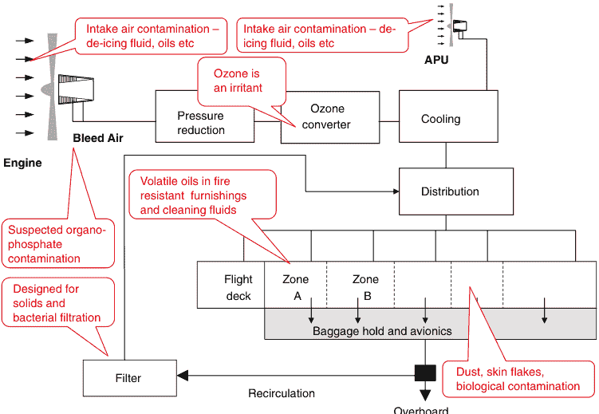

**Figure 6.17** The cabin air system.

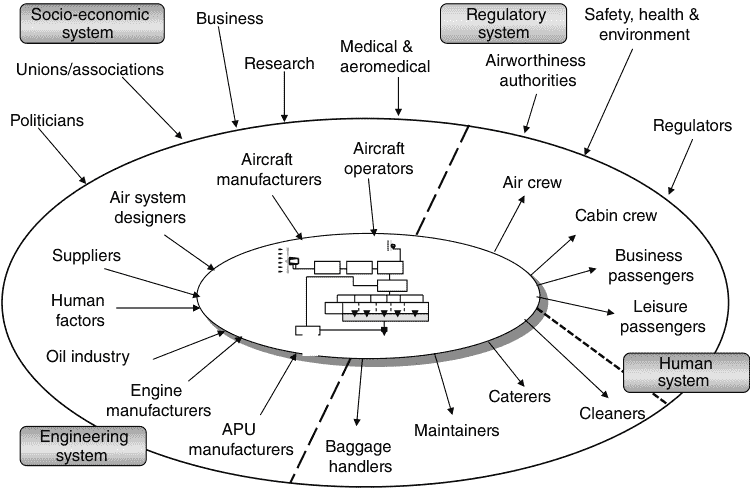

仍有可能含有机油蒸汽或燃烧产物等污染物。这可能会对呼吸道产生不利影响，特别是对于患有暂时性或永久性呼吸系统疾病的机组人员。最近对客舱残留物取样研究发现三甲酚磷酸酯（TCP）含量很高（Michaelis 2011）。接触该物质可能导致嗜睡、呼吸问题和神经系统疾病的症状。也有因润滑系统泄漏导致机油或液压油进入发动机引气而导致客舱出现烟雾和烟雾的事件。这在互联网上被广泛报道（aerotoxic.org），并且有飞行员报告注意力不集中和神经系统疾病的事件，甚至有一些机组人员死亡被归因于此（《星期日快报》2013 年；Learmount 2014）。该病症被称为航空毒性综合征。这是提供舒适客舱环境的一个新兴特性或意外后果的例子。该例子是一个相对简单的技术集成，但新兴特性是一个复杂的状态，正如人们对它是否存在甚至没有达成一致所表明的那样。

这种情况已争论了相当长一段时间，尚未证实该病症确实存在。图 6.18 所示的利益相关者图显示了情况变得多么复杂。

## 6.4 System Integration Skills

系统集成技能与理解总系统在上述术语的所有相应描述中相关。掌握所有接口和交互对于设计、开发和认证系统以及指导参与该过程的各方至关重要。在项目的概念阶段，关键技能是理解和开发需求的能力，使其能够细分为更易于管理的模块。对模块之间连接性和依赖性的把握对于随后识别每个模块的需求至关重要。

总承包商必须保持对系统功能性能的把握——它将如何满足客户的需求并能够证明这一点。认证和鉴定方面的观点是规划和审查所有测试，以确保测试证据的总和证明系统符合其性能和安全标准。

这一技能组合的总和是能够管理复杂系统的端到端开发。

图 6.19 说明了系统的一些复杂性，该图显示了函数如何在大型复杂系统中实现。

感兴趣的系统由客户需求派生的功能组成。这些功能可能由系统处理器中的软件执行，也可能由硬件（如执行器）或机组人员操作飞机来执行。实现这些功能的飞机设备通过硬连线与离散信号或通过合适的总线相互连接。整个系统安装在飞机上，并受到在整个飞行包线和世界各地变化的环境条件的影响。其中一些子系统会以新兴特性的形式相互作用。叠加在这一整体功能之上的是使用开发或日常运营以及维护操作所带来的变化。

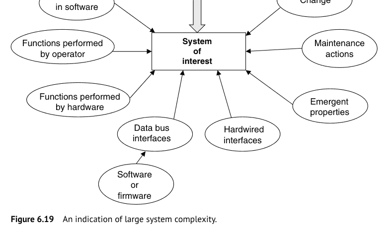

Figure 6.19 An indication of large system complexity.

## 6.5 Management of System Integration

图 6.21 描述了与系统生产相关的系统开发过程。各种项目里程碑显示在图表顶部，随着流程从合同授予到生产阶段推进。

### 6.5.1 Major Activities

与开发过程相关的关键活动是：

- concept and associated studies
- definition
- design
- build
- test
- operate.

这些活动可以与第三章中描述的过程部分相对应。

### 6.5.2 Major Milestones

图 6.22 说明了硬件和软件开发过程的主要里程碑。现代飞机几乎每个子系统都包含嵌入微处理器或微控制器的软件来执行系统的功能。硬件和软件功能的开发必须在开发过程中协调进行。在图 6.22 中，硬件开发遵循上分支，而软件开发遵循下分支。

- *Contract award:* down selection of the system supplier who is to take responsibility for developing the system
- *Master program plan (MPP):* planning of system development activities such that the development timescales are consistent with those for the overall aircraft.
- *System requirements review (SRR):* collection and review of all system requirements. The SRR is the first top-level multidisciplinary review of the perceived system requirements. It is effectively a sanity check on what the system is required to achieve; a top-level overview of requirements and review against the original objectives. Successful attainment of this milestone leads to a preliminary system design, leading in turn to the parallel development of hardware and software requirements analysis.
- *Software specification review (SSR):* performs a similar function for software development. As has been painfully discovered over the years the key to a good software design is to spend a lot of time ensuring that the software requirements are fully understood before progressing to software coding and test.
- *System design review (SDR):* conducted during the requirements analysis phase, ensuring that the design will meet the design objectives as then currently understood.
- *Preliminary design review (PDR):* preliminary review of the system design, presentation of trade studies, and selection of the preferred system design. The PDR process is the first

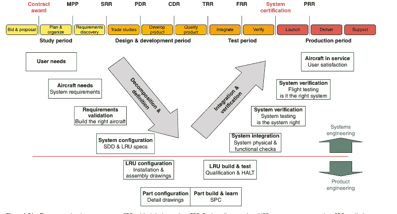

图 6.21 系统开发流程。CDR，关键设计评审；FRR，最终就绪评审；MPP，主计划；PDR，初步设计评审；PRR，生产就绪评审；SRR，系统需求评审；TRR，试验就绪评审。

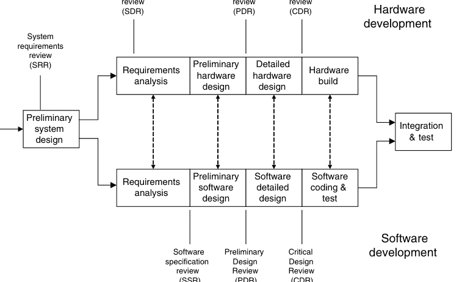

### 图 6.22 硬件和软件流程主要里程碑。

对初始设计（硬件和软件）与派生需求的详细评审。这通常是在投入主要设计资源进行详细设计过程之前的最后一次评审。设计过程中的这一阶段是在投入必要的项目资源和投资之前最后一次做出重大承诺的阶段。

- 关键设计评审（CDR）：在投入建造开发硬件之前对设计进行的关键评审。
- 试验就绪评审（TRR）：对开发所需的试验程序和设备的评审，以确认产品和试验设施均已准备好开始试验阶段。
- 最终就绪评审（FRR）：在开始验证过程之前对试验程序和设备的最终审查。到了 CDR 时，已有大量工作投入到项目设计中。CDR 提供识别最终设计缺陷的可能性，或更可能是在不同实现路径之间权衡风险。CDR 是在做出非常大的投入和最终设计决策之前审查和改变设计方向的最后机会。CDR 之后的设计重大变更在财务和进度损失方面将非常昂贵。
- 系统认证：进行和记录系统性能和试验结果过程的 culmination，以便为适当的认证机构提供认证系统所需的所有必要文件。
- 生产就绪评审（PRR）：对确保系统顺利及时生产所需的所有流程的评审。

图 6.22 的主体部分显示了系统需求的分解和定义以及集成和验证过程，如先前的 V 图（图 6.8 和 6.21）所示。

水平线以上的流程与系统工程相关。线以下的流程与产品或部件工程相关。

### 6.5.3 分解和定义过程

该过程的关键步骤包括：

- 识别用户需求
- 识别飞机需求 – 系统需求
- 验证需求 – 我们是否要建造正确的飞机？
- 建立系统配置，编制系统描述文件（SDD）和可更换单元（LRU）规范。

### 6.5.4 集成和验证过程

随着系统集成和验证过程的进行，执行以下任务：

- 系统集成，包括系统物理和功能检查。
- 地面系统验证 – 系统是否正确？
- 飞行试验系统验证 – 它是否是飞机的正确系统？
- 飞机投入使用 – 系统是否运行良好且用户是否满意？

### 6.5.5 部件工程

在部件层面：

- 建立 LRU 配置；编制安装和装配图
- 部件配置和详细图纸
- 部件制造和学习过程，统计过程控制（SPC）
- LRU 制造和测试，鉴定测试和硬件加速寿命试验。

## 6.6 高度集成系统

设计规则和方法论已通过多年的最佳实践演进。经验丰富的行业专业人士共同制定了当今集成飞机系统设计的主流设计规则。设计指南如图 6.23 所示。

在英国，飞机的法律基础由《航空航行令》所涵盖，这是英国民用适航要求（BCAR）。在美国，联邦适航要求（FARs），在欧洲，联合适航要求（JARs）导致了一套规范（现已被认证规范 [CS] 文件取代），规范特定机型的设计：

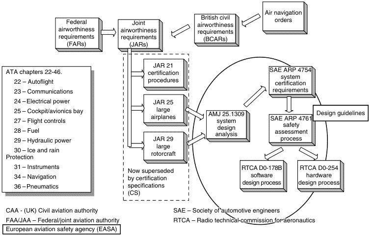

**图 6.23** 飞机系统设计指南。

- 规范认证程序的 JAR 21
- 规范大型飞机设计的 JAR 25
- 规范大型旋翼机设计的 JAR 29。

关键设计指南包含在一系列文件中，这些文件代表行业最佳实践但并非强制性，且如图 6.25 所示。如果系统设计师自行发明规则而不是采用这些指南，他将冒风险。关键文件如图 6.24 所示：

- 系统评估过程指南和方法 – SAE ARP 4761
- 系统开发流程 – SAE ARP 4754
- 硬件开发生命周期 – DO-254
- 软件开发生命周期 – DO-178B/C。

其他文件的等效性如表 6.1 所示。

## 6.6.1 主飞行控制系统的集成

飞行控制系统的高度集成性质有时难以理解。图 6.25 以非常简化的形式显示了一个三级嵌套控制回路，具有以下属性：

- 内环使用高完整性电传飞行（FBW）系统以三重实现方式控制飞机姿态
- 次级环通过双-双自动驾驶系统控制飞机轨迹
- 外环使用双飞行管理系统（FMS）控制飞机从起飞到到达目的地机场的任务。

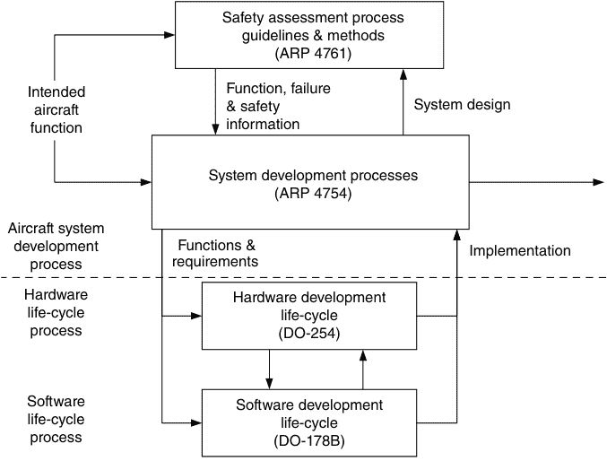

**图 6.24** 复杂系统设计方法。

**表 6.1** 文件的等效性。

| 规范主题 | 美国 RTCA 规范 | 欧洲 EUROCAE 规范 |
|---|---|---|
| 系统开发流程 | SAE 4754 | ED-79 |
| 安全评估过程指南和方法 | SAE 4761 |  |
| 软件设计 | DO-178B | ED-12 |
| 硬件设计 | DO-254 | ED-80 |
| 环境试验 | DO-160 | ED-14 |

EUROCAE，欧洲民用航空设备组织。

ᵃ RTCA Inc.

随着功能从内环向外环迁移，功能性增加而完整性降低，如箭头所示。该图显示了来自自动和手动系统的输入，以及飞行控制系统现在通常执行的函数。

回到图 2.5 中说明的航空运输协会（ATA）章节，并强调与任务管理相关的功能领域，得出图 6.26。请注意 ATA 现已被 JASC 4 位代码取代，因此：

图 6.25 三级嵌套控制回路作为复杂系统示例。

- 自动飞行为 2200
- 通讯为 2300
- 指示为 3100
- 导航为 3400
- 电气为 2400
- 飞行控制为 2700
- 液压为 2900
- 燃油为 2800
- 发动机控制为 7600
- 动力装置为 7100。

这突出了与提供整体任务管理功能相关的所有功能领域：

- 包括自动飞行、通信、记录和指示以及导航的航电功能
- 电力
- 飞行控制和液压动力
- 燃油系统、动力装置和动力控制。

如果没有这些要素的必要贡献，系统将无法运行。

图 6.26 与复杂系统示例相关的 ATA 章节。

## 6.7 讨论

很明显，多层次的集成在现代飞机设计中将继续存在。推动系统自动化以减少机组工作量的趋势意味着系统必须执行更多功能。向无人机尤其是具有高度自主性或独立于地面控制的无人机的转变是进一步推动自动化的驱动因素。为了实现这些自动化水平，需要将更多功能集成到系统中，并采用基于软件的功能设计。

其结果是产生复杂的架构，以至于系统行为无法通过简单检查图表来解释。软件和固件中功能的“隐藏”性质，以及通过各种数据总线类型以数字数据字流交换信息，加剧了这种困难。完整飞机产生的庞大设计和测试数据使得任何人都难以完全理解系统的行为并分析测试证据以证明系统已得到充分测试。然而，必须有人这样做，以便产品能够得到签署并被客户接受。

需要考虑对安全性的潜在影响。上述情况使得难以进行全面的安全分析。图 6.27 所示的系统架构说明了复杂性的要点。该图

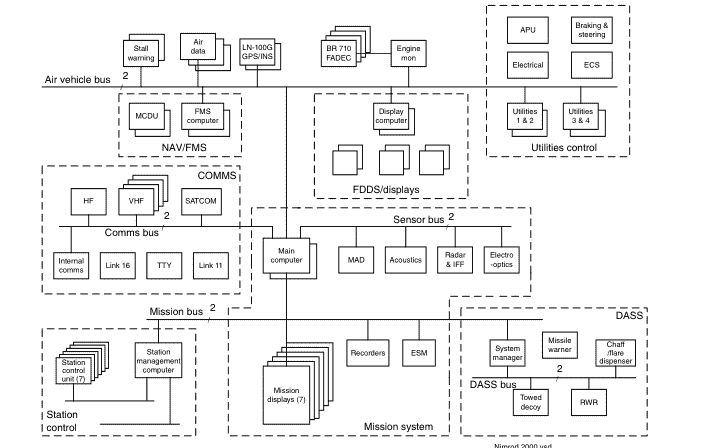

图 6.27 简化的军用监视飞机架构。APU，辅助动力装置；DASS，防御辅助子系统；ECS，环境控制系统；ESM，电子支援措施；FADEC，全权限数字发动机控制；FCS，飞行控制系统；FDDS，飞行甲板显示系统；FMS，飞行管理系统；GPS/INS，全球定位系统/惯性导航系统；HF，高频；IFF，敌我识别；MAD，磁异常探测器；MCDU，多功能控制和显示单元；Nav/FMS，导航/飞行管理系统；RWR，雷达告警接收机；Sat Com，卫星通信；TTY，电传打字机；UHF，超高频。

已被大幅简化——即使如此对读者来说仍难以辨认——而实际上图中每个模块内部还包含更多模块和更多互连。
第 11 章将更详细地探讨集成的影响及其对飞行安全的潜在影响，以便强调理解整个系统的行为以及制定合适的测试来验证其性能的重要性。

## 练习

**1   草坪维护系统。**
本练习旨在通过研究与飞机系统无关的系统，使人们走出舒适区。可以由个人或小组进行。该练习可以延长一段时间，以模拟真实项目。

*顶层需求：* 为家庭用途设计草坪维护系统。

*关键性能参数：*

- 全年提供外观 pleasing 的草坪
- 运行安全
- 需要最少的用户操作
- 对邻居造成最小的困扰
- 对家庭、宠物和邻居无危害
- 使用寿命至少 15 年
- 能够实现回收且无环境影响
- 符合所有必要的法规。

**A**   构思一系列从传统到创新的解决方案。至少考虑以下内容：

- 机械系统
- 基于动物的系统
- 服务提供
- 基因改造。

**B**   对于每个解决方案：

- 提供所选解决方案的简要描述
- 提供利益相关者图
- 讨论并记录你在合格性方面预见的主要问题，使用验证交叉引用文件（VCRM）来说明你将如何计划对系统进行合格性认证。你将如何向监管机构和客户证明其适用性？是否存在任何残余风险？

**C**   进行权衡以确定你认为最优的解决方案，该方案：

- 在适用性方面满足要求
- 在环境方面最有利。

## 需要考虑的问题：基于动物的解决方案

- 是否已考虑附带成本——兽医费用、饲料、剪毛等？
- 当地法规是否允许？
- 是否已考虑疾病威胁和可能限制——口蹄疫、蓝舌病等？
- 是否存在噪音问题？
- 宠物互动如何——尤其是狗？
- 如何避免侵入邻居花园并可能造成损坏？
- 对于挑剔的花园爱好者或草坪发烧友，如何证明修剪质量？
- 如何处理边缘？
- 该解决方案如何区分草与花卉和蔬菜？
- 马厩/庇护的成本是多少？
- 是否有任何有用的副产品？

## 需要考虑的问题：技术型解决方案

- 是否已考虑噪音和污染？
- 该解决方案如何处理不规则形状？
- 如何处理边缘？
- 石头、宠物、装饰品等造成的危险如何？
- 需要什么存储？
- 维护成本是多少？
- 维修平均时间、寿命、过时等的估计是多少？

## 需要考虑的问题：服务提供解决方案

- 服务提供商是否有经验？
- 他们的当地声誉如何？
- 服务提供商是否可靠？
- 是否已达成价格上涨保证？

## 需要考虑的问题：基因改造解决方案

- 技术是否可用？
- 长期影响是什么？
- 污染邻近牧场的含义是什么？

D 系统‘系统架构’在你的系统背景下意味着什么？解释并构建一个具有有意义系统边界的架构。识别该边界外部的利益相关者并解释相互依赖关系。

## 2 输电线路检查系统。

设计一个系统来监控电力输电线杆的绝缘子和导线连接的状态和健康状况。

## 理解需求

- 需要监控哪些条件？
- 有哪些传感器可用于此？

需要在什么时间段内进行监控？
需要承受什么天气条件？
传感器信息如何存储或中继？

## 权衡

- 确定比较的最合适参数。
- 进行权衡研究。
- 选择最佳候选方案。
- 绘制系统架构。
- 描述系统如何进行测试和合格性认证。
- 描述系统如何获得英国和欧洲使用的认证。
- 研究如何将该认证扩展到世界其他地区的使用。

## 性能

- 确定最合适的性能参数。
- 描述你将如何营销该产品。

## 参考文献

AGARD (1996). *Advisory Group Report 349*. Flight Vehicle Integration Panel Working Group 21 on Glass Cockpit Operational Effectiveness.
Ashcroft, F. (2000). *Life at the Extremes – The Science of Survival*. Harper-Collins.
*Sunday Express* (2013). Dead BA pilots’ victims of toxic cabin fumes’. Sunday 27 January.
Learmount, D. (2014) *BA crew autopsies show organophosphate poisoning*. www.flightglobal.com. 31.07.2014
Michaelis, S. (2011). *Health and Flight Safety Implications from Exposure to Contaminated Air in Aircraft*, PhD thesis. http://handle.unsw.edu.au/1959.4/50342 (online)
Moir, I. and Seabridge, A. (2008). *Aircraft Systems*, 3e. Wiley.
Moir, I. and Seabridge, A. (2013). *Civil Avionic Systems*, 2e. Wiley.
Royal Academy of Engineering. (2007). *Creating systems that work: Principles of engineering systems for the 21st century*.
Warwick, G. (1989). “Future trends and developments” from. In: *Avionic Systems* (ed. D.H. Middleton), 247–256. Longman.

## 进一步阅读

Brookes, A. (1996). *Flights to Disaster*. Ian Allen.
Elliott, C. and Easley, P.D. (eds.) (2007). *Creating Systems that Work: Principles of Engineering Systems for the 21st Century*. Royal Academy of Engineering ISBN1-9033496.
