# 7

# 系统需求的验证

## 7.1  引言

对于飞机或军舰这样的大型复杂系统，在不先进行某种形式的分析以提供高度信心——即完工产品将按规格工作——的情况下建造整个产品是不切实际的。如此做所需的时间和成本会对任何项目产生重大影响，然而在没有某种信心系统将按规格工作的情况下继续推进的风险是不可接受的。

为了向客户证明其需求已得到满足，有必要在整个生命周期中对产品进行测试。测试结果是需求可以得到证明的证据。这种测试通常在物理产品例如原型上进行。然而，建造实验系统和原型既耗时又昂贵，特别是如果设计包含必须纠正的错误或操作受环境因素高度影响时。

图 7.1 显示了第 6 章中讨论的 V 图及其评审点。在该版本的图中，左侧已被遮挡，以说明测试通常被认为是在图右侧进行，一旦有硬件可供测试。

然而，应该承认的是，在系统设计过程中会产生大量关于正确理解需求和需求解决方案的证据。这种证据不应被忽视，而应被收集并用于为产品的合格性做出贡献。

工程师需要严谨的方法来分析和观察其系统的性能和行为，以便在不投入昂贵资源或承担过度风险的情况下做出继续沿开发路径前进的决策。理想的方法是在可重复或以受控方式修改的计划实验条件下对系统进行实验。这可用于探索系统的运行极限，也可用于获得可作为需求已得到满足的证据的测试结果。

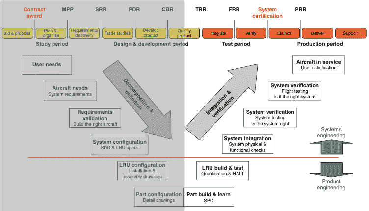

**Figure 7.1** V 图中测试的传统视图。CDR，关键设计评审；FRR，最终就绪评审；MPP，主计划；PDR，初步设计评审；PRR，生产就绪评审；SRR，系统需求评审；TRR，测试就绪评审。

## 7.2 **在生命周期中收集合格证据**

建模、仿真试验台和原型是用于在各种条件下检查飞机系统行为和性能的工具，为设计提供高度可信的基础。测试证据的收集由所有这些工具组合完成。这包括从供应链提供的子系统和组件的试验台收集的所有供应商证据。为了使证据相关，必须控制每个证据来源，并清楚了解来源之间的关系。此过程需要采用稳健的方法来识别每个来源并实施配置控制。

证据来自多个不同的来源和流程。仅从测试流程来看，证据来自图 7.2 所示的来源。

该证据还辅以从设计流程中收集的其他信息，可在生命周期早期阶段向客户展示为合格的合适证据。然后利用这些证据在项目各阶段汇总并提交，以支持发动机地面试车、原型飞行、初步客户验收和完全客户验收的放行，如图 7.3 所示。

规划如何收集这些证据并记录每个测试阶段成功完成的情况非常重要。验证交叉引用矩阵（VCRM）应从一开始就作为测试制度的规划工具。可以构建一个简单的 Excel 电子表格，将飞行划分为认为必要的尽可能多的阶段。然后确定用于验证任务每个阶段的测试类型，需要什么工具、什么设施、什么测试程序和什么仪器。

这将用于形成测试和合格性计划的基础，以便有效管理整个过程。图 7.4 以通用形式显示了一个基于简单电子表格的交叉验证矩阵。列可以扩展以显示详细的测试

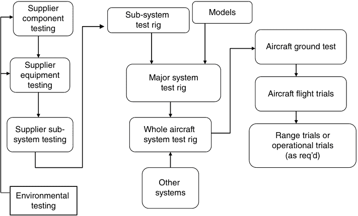

**Figure 7.2** 测试证据来源。

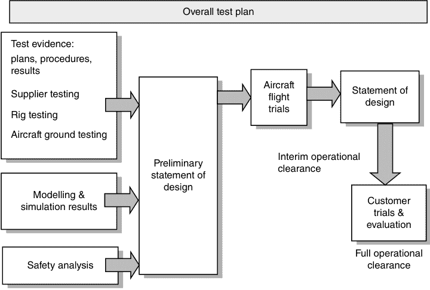

**Figure 7.3** 走向完全产品验收的路径。

| Requirement | Design | Calc | Analogy | Model | Test | Operation |
|---|---|---|---|---|---|---|
| R001.01 | Achieved to plan |  |  |  | Planned |  |
| R001.02 |  | Risk to plan |  |  |  |  |
| R001.03 | Achieved to plan |  | Planned |  | Planned |  |
|  |  |  |  |  |  |  |
| R002.01 |  |  | Late to plan |  |  |  |
| R002.02 |  |  |  |  | Planned |  |
|  |  |  |  |  |  |  |
| R00n.0n |  |  |  |  |  | Planned |

> 每个需求都有一个或多个声明的验证方法，并且可以建立日期以形成计划。此 VRCM 可用于形成证明合规性和与客户达成早期付款计划的基础计划。进度可以用颜色表示，例如：
> 
> - Planned
> - Achieved to plan
> - Risk to plan
> - Late to plan

**Figure 7.4** 验证交叉引用矩阵。

- trials
- operational testing
- demonstrations.

### 7.3.1 Inspection of Design

设计信息有多种不同的形式，从初步方案到详细图纸或三维（3D）计算机辅助设计（CAD）模型、规范、接口控制文件和软件设计文件。随着设计流程的推进，这些文件在通过每个评审阶段时会变得越来越确定。可以商定一个时间点，在该时间点可以认为它们有助于合格性并被接受为值得完成确认的定义点。

一个例子是雷达扫描仪的 3D 模型，该扫描仪在方位角和俯仰角上扫描，以提供用于空对空目标探测的前视搜索模式，并且还可以向下倾斜用于地面监视。可以要求 Catia 模型复制天线扫描包络，以便设计雷达罩的轮廓，使其在整个扫描过程中不会妨碍天线通路。图 7.6 显示了此过程将开始的模型。模型完成后，可以对其进行动画演示，以在设计冻结并做出制造承诺之前展示适当的间隙。扫描仪将在其整个方位角、俯仰角和倾斜范围内进行动画，以为具有适当间隙的雷达罩设计提供包络。图 7.6 显示了出于兴趣的传统空中拦截雷达 AI 23B 以及更现代雷达的 CAD 模型。

### 7.3.2 Calculation

在设计的早期阶段，系统的演进是通过计算来确定的，例如压力、电气负载、飞行包线等，通常借助计算机程序甚至电子表格。必须正式化并保存这些计算。笔记本电脑上随时可以访问计算和计算设施，这使得一些工程师容易在不将

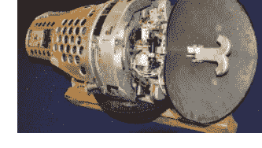

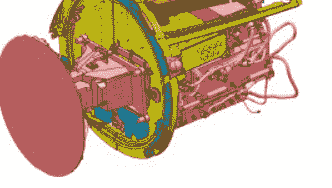

Figure 7.6 Catia 模型示例雷达扫描仪。（a）传统 AI 23B 雷达（照片：Leon Skorczewski）和（b）典型雷达的 CAD 图像（照片：Allan Seabridge 收藏）。

练习作为设计工具的情况下执行计算。换句话说，算法或方法应以与图纸相同的方式存储、在一系列变量下进行测试，然后冻结。这确保了计算可以在任何后续评审或重新设计时重复进行。在谨慎使用时，可以使用不同范围的变量执行计算，以探索设计的极限。

### 7.3.3 Analogy

经常会找到以前使用过并被证明是可靠解决方案的设计方案。只要设计人员确信工程和环境条件相同，就可以将相同的设计转移到新项目中。必须仔细审查之前设计的测试证据，以确保安装条件相同并且证据可用。飞机座椅就是一个例子，因为它们的设计是为了满足众所周知的牢固性要求，可以作为商业现成（COTS）产品购买。许多小型组件可以以这种方式使用，并可能成为项目适用的库存物品的基础。

### 7.3.4 Modelling and Simulation

建模可用于整个产品生命周期，以表示许多设计选项并帮助定义评估这些选项所需的指标。模型是所有分析的基础，无论是为了快速计算还是提供合格证据。仿真是一种计算框架，可以预测和/或复制系统随时间的性能。这使得系统能够在超出试验台运行限制的条件下进行观察。它可以提供非常难以或昂贵地体验或测量的性能趋势。在某些情况下，仿真实际上可以完全取代某些试验台测试。

本章中“建模”一词用于指代用于描述系统行为和性能的多种不同技术，而不使用系统在真实环境中的实际运行。此定义包括使用计算机辅助建模，以便使用系统组件的 3D 表示来进行安装、人机界面和通道分析、纯数学建模或状态分析以及仿真。

最后两个术语之间的区别可以很好地解释为：如果构成模型的关联足够简单，可能可以使用数学建模方法（例如代数、微积分或概率论）来获得有关感兴趣问题的确切信息；这称为解析解。然而，大多数现实世界系统过于复杂，无法进行现实模型的分析评估，必须通过仿真来研究这些模型。在仿真中，我们使用计算机对模型进行数值评估，并收集数据以估计模型所需的特性。Law and Kelton 1991。此仿真可以通过在受控环境中在现实条件下运行来测试。

克服这些困难的一种方法是使用工具来模拟或仿真系统操作。最好这些工具提供系统的“软”表示，可以

可以在不产生过高成本的情况下对系统进行建模和重新建模。现有的工具和技术使这成为可能。通过仿真，可以对不同的系统设计方案进行比较和对照，以确定哪一种最符合特定需求。

生成稳健且经过验证的模型的另一个优势是，可以将这些模型提供给其他团队或供应商，以便他们根据共同商定的接口和性能定义来开发自己的功能。

第 3 章说明了随着产品在其生命周期中推进，变更成本如何增加。建模的一个优势是提高对构成完整系统的解决方案正确性的信心，从而减少变更的可能性。此外，所获得的结果可以用作设计符合要求的证据。在生命周期早期收集这些证据可能是有利的，以便赢得客户的信心，让他们相信设计正在成熟并收敛到一个可通过验证的解决方案。

系统工程中使用的典型模型类型有：

- *简单图示模型*：一种思维过程或智力过程，系统工程师在系统概念演化过程中，通过感知、直觉和推理等心智过程“想象”或设想系统的结构和行为。
- *简单比例模型*：系统或其组件的物理缩放表示。
- *数学模型*：系统行为的简单模型，以具有确定概率的状态变化来描述。
- *仿真*：大多数具有随机元素的复杂现实世界系统无法用可解析求值的数学模型来准确描述。因此，仿真往往是唯一可行的研究类型。仿真允许人们在一组预计的运行条件下估算现有系统的性能。
- *试验台架*：一种模拟产品部分或整体的测试设施，允许在仪器测量条件下进行试验。
- *样机*：产品或系统的全尺寸表示，可在制造前进行详尽测试以确定性能。

试图对产品进行整体建模通常并不实际，甚至可能没有必要。最有用的是对系统中那些了解最少、且在其生命周期后期若运行不当可能带来重大成本或时间风险的方面进行建模。正确使用模型并生成简单模型非常重要：*模型不必是现实的精确表示才有用。事实上，只要仍能提供有用的洞见，降低其真实性通常会让它们更有用。一个与其所表示的事物一样复杂的模型，很可能过于复杂而无法使用。简单的模型更易于使用。*（Stewart，2007年）。

生成简单模型可以通过分析系统并将其分解为可建模的元素，以及理解这些元素与系统其他元素之间的接口和依赖关系来实现。图 7.7 显示了如何在复杂系统中使用多种不同的建模技术。

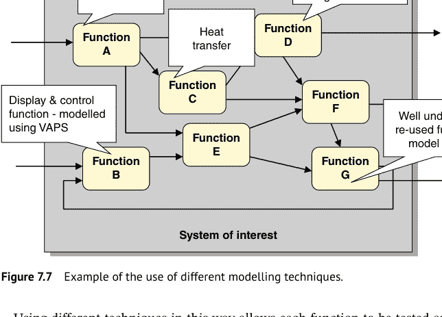

图 7.7 使用不同建模技术的示例。

以这种方式使用不同技术，可以对每个功能进行必要的测试和细化，直到其性能被判定为令人满意。然后可以手动汇总每个已测试功能的结果，以确定组合是否也能令人满意地运行。另一种更好的方法是将不同模型组装到一个框架中，使它们能够连接起来，形成系统完整或近乎完整的仿真。图 7.8 展示了模型的互连示例，并以燃油系统应用为例。

此示例中的油箱模型很重要，因为它用于将在所有横滚和俯仰条件下由多个探头确定的燃油液位转换为燃油体积，然后再转换为燃油质量。在理论上，这种模型应用使得可以设计出一种能够取代物理燃油试验台的燃油模型。事实上，Nimrod MRA4 的燃油系统就是通过这种方式获得认证的。

该模型可以进一步推广，以展示现代燃油系统的复杂性，如图 7.9 所示。燃油系统模型的设计必须代表以下子系统及其相互作用，以完成整个燃油系统的仿真：

- A1 是燃油系统，即油箱、油量传感器探头、泵和阀门的集合，用于测量油箱中的燃油量，并确保燃油在车辆管理系统的燃油管理部分控制下从油箱到油箱、再到发动机的输送。为了准确测量燃油量，必须了解燃油的特性，因为已知燃油会在油箱中按密度和温度分层。
- A2 是飞机在俯仰、横滚和偏航位置及其变化率方面的运动。这可能导致燃油姿态发生变化，因此需要仔细选择

### 燃油系统示例

图 7.8 互联模型的示例。

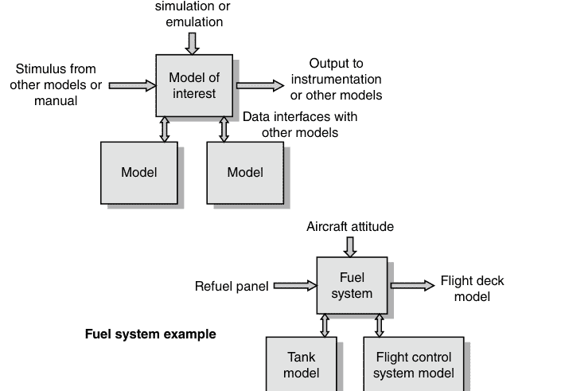

图 7.9 互联燃油模型的示例。

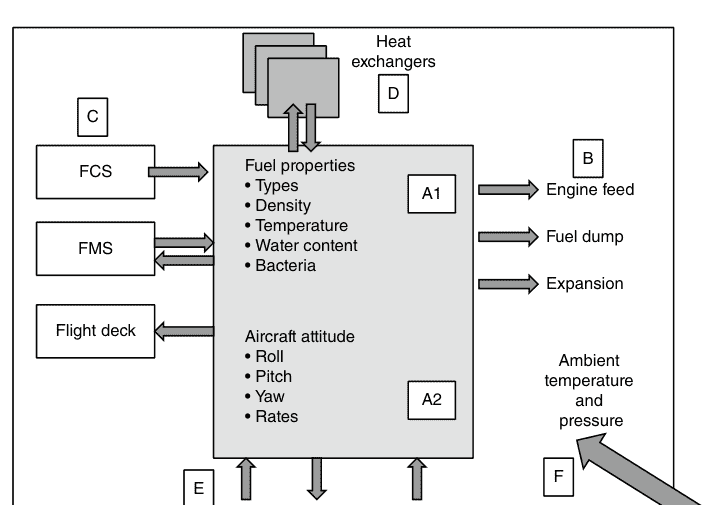

油量传感器探头的位置，以保持测量精度，同时也会导致燃油在大型油箱中晃动。该模型可用于选择挡板或膨胀箱的最佳位置。

- **B** 表示发动机在整个飞行包线内对燃油流量的需求，以及燃油排放和膨胀需求。
- **C** 表示航空电子集成。飞行控制系统（FCS）要求燃油重心保持在预定范围内，以满足机动或燃油经济性要求。飞行管理系统（FMS）需要知道机载燃油量，而驾驶舱显示器将向机组人员提供每个油箱的燃油量、燃油系统组件状态以及剩余燃油的信息。
- **D** 表示用于冷却发动机机油和液压油的热交换器，大量热量可能泄入燃油中。
- **E** 表示在地面或空中装载燃油以及以受控方式卸载燃油的机制。
- **F** 表示外部因素，如环境压力和温度。温度是一个重要因素，因为高温地面环境可能导致燃油膨胀和溢出，而极低温度可能导致燃油在长时间极地航线上冻结——至少一起严重事故中就有这个因素。

这表明燃油系统模型相当复杂，需要不同子系统的所有者之间密切合作。我们可以在物理燃油系统试验台、模型与仿真的组合、甚至三者结合之间做出选择，以清晰了解现代燃油系统的行为。这种权衡通常涉及物理燃油试验台的成本、容纳它的设施和运行成本，与模型和仿真成本之间的比较。对许多人来说，物理试验台具有实实在在的好处——可以观察和测量其工作情况，并且使用真实的飞机部件，而模型则是虚拟世界。在近期项目中，这一权衡过程一直困扰着许多人。答案似乎取决于所需的保真度——模型在多大程度上代表现实世界？物理试验台可以在部件、空间布局、逼真的油箱形状等方面建造得非常接近飞机。然而，试验台只能在有限的俯仰和横滚姿态范围内移动，当然无法复制变化率。仿真只能近似于真实部件，但可以实时改变姿态。

#### 7.3.4.1 建模技术

上文介绍的建模技术将在以下各节中更详细地描述。

#### 7.3.4.1.1 简单图示模型

以图形表示方式呈现的简单模型是设想设计早期阶段的智力过程的一部分。它们主要存在于设计者的头脑中，用于在脑海中设想和解释概念。这可能是对形状、过程或数学表达式的心理可视化。为了达成共同的讨论基础，图示模型是

这些内容常常被转化为草图和大纲笔记。它们制作迅速，在讨论过程中易于修改，并且可以转换为更“正式”的图纸或幻灯片，用于报告或演示文稿。这使得其他人能够共享认知模型。这正是传奇所在——想法迅速跃然纸上——餐馆的餐巾纸、一卷卫生纸、典型的“信封背面”草图。图7.10展示了一些绘制在纸上的图解模型示例。其中包括：在方格纸上绘制的起落架支柱收起草图，并附有计算过程，用以说明支柱与起落架舱门之间的相互作用；一个将飞机弹射数学原理可视化的模型；以及一个任务剖面图，用以展示集成武器系统满足特定任务需求的飞机特性。所有这些都足以表明，我们有信心进入下一阶段的设计。

##### 7.3.4.1.2 简单比例模型

简单模型是系统或单个系统组件的物理诠释，通常以较小比例呈现。典型材料包括纸板、泡沫、模型黏土、塑料、轻木、金属或亚克力。这类模型有助于丰富认知模型所提供的信息，并且因其三维实体和可触摸的特性而更具价值。

通过一种称为激光立体光刻的工艺，可以制作出非常精确的模型。该工艺利用3D CAD工具模型，在亚克力材料中生成小比例模型。

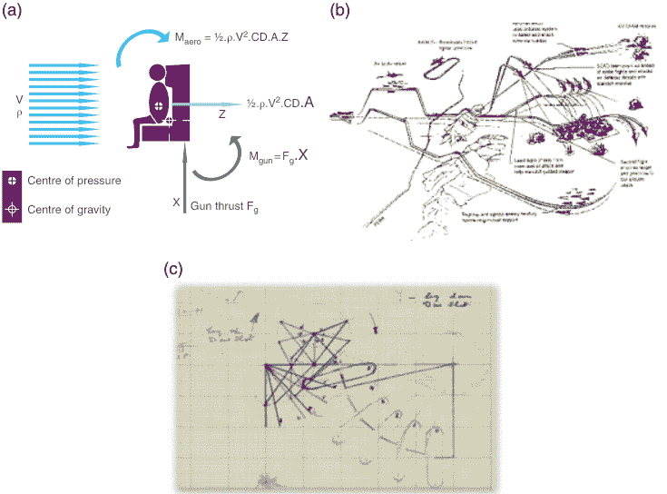

**图7.10** 简单图解模型示例：(a) 弹射力与力矩模型，(b) 用于理解任务剖面的草图，(c) 起落架收起顺序。

由于该过程由CAD工具的输出驱动，因此尺寸与原始模型完全成比例，最终产品具有很高的保真度。由此产生的模型常用于市场展示或支持向客户进行的投标演示。如今，利用市售的3D打印机可以轻松获得这种能力，其塑料或金属制品甚至可用于最终产品。

简单比例模型的另一个用途是风洞模型，用于获取与全尺寸产品相关的真实数据。在这种情况下，整体外形比细节保真度更重要。这样做的好处是，可以让比例模型经历一系列速度，以模拟几乎整个飞行包线。

比例模型的一种极端形式是采用木材或金属制作的全尺寸实体模型。制造飞机整体或部分实体模型通常是为了试验安装方案、验证人机界面或提供营销用途的模型。出于设计目的，可以根据飞机图纸用金属制作实体模型，通常称为一级实体模型。它们为飞行员和测试其概念的工程师提供了良好的熟悉工具，并且可以用作管道和线束形状的模板或成型器。玻璃纤维模型常被用于航空展示——它们比真实飞机更易于运输和维护。

图7.11展示了一些为特定目的而构建的模型示例。Merlin飞行模拟集团的MP521模拟器可用于所有与飞机设计相关的原理，从稳定性和控制评估到座舱人机工程学、系统工程、航空电子和心理学，图中展示的是俄亥俄州代顿大学模拟实验室。飞机模型由3D打印制成，用以展示克兰菲尔德大学飞行器设计课程小组项目中研究生们提出的概念外形。F-35模型是飞机的全尺寸复制品，用作公共关系工具；这种技术如今也被用于制作耐候的“门卫”模型。另一种选择是全尺寸实体模型，它是真实飞机的逼真复制品，用作设计和安装工具。这类实体模型在很大程度上已被3D CAD图像所取代，后者制作成本相对较低，并且可以旋转以查看不同视角。然而，实物模型仍有许多可取之处，通过亲手操作，可以在解决安装、可达性和人为因素等实际问题中发挥良好作用。

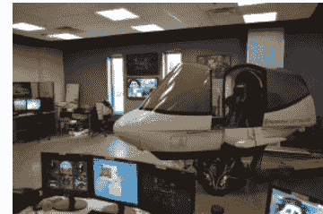

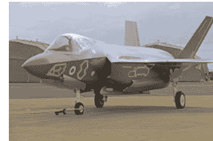

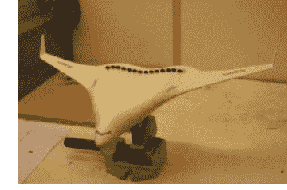

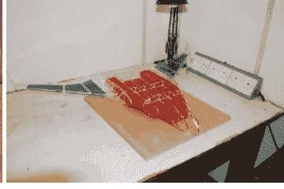

**图7.11** 简单比例模型示例：(a) 俄亥俄州代顿大学模拟实验室中的MP 521模拟器（照片来源：Merlin飞行模拟集团），(b) F-35全尺寸复制品（照片来源：Allan Seabridge），(c) 克兰菲尔德大学的模型（照片来源：Allan Seabridge）。

##### 7.3.4.1.3 数学模型与仿真

现有一些工具可以让设计师在计算机或台式电脑上对其系统的某些方面进行建模或仿真。商用电子表格可用于构建简单模型，而Matlab/Simulink（http://www.mathworks.com/support/learn-with-matlab-tutorials）和FloMaster（http://www.mentor.com/floMASTER/products/mechanical/floMASTER-application-example）等商用工具可用于建立更具领域针对性的模型和仿真。这使得功能得以测试，并以动画显示序列的形式进行可视化，同时辅以实时或快/慢速数据支持。这存在一些缺点，因为某些动画的质量以及所产生的数据量可能会让人们对该仿真的真实性产生错误印象。尽管如此，建模在受控实验条件下测试系统方面仍是一个强大的工具。受益于此类建模的系统示例包括：

- *热/冷却系统*：模拟闭环空气或蒸气循环机的性能，模拟乘客或设备的空气分配。
- *流体流动系统*：模拟燃油系统的油箱高度/容积特性以用于油量指示系统设计，模拟传输顺序，模拟机动条件下的燃油行为，以及模拟燃油和液压系统管道中的流量和压力。
- *电力系统*：对任务各个阶段进行负载分析，计算电阻性和电抗性负载对三相平衡的影响，并进行潜电路分析以查找电路设计中的错误接地或短路。
- *控制系统*：仿真闭环系统在不同相位和时间域下的动态性能。
- *射频天线互操作性*：预测多发射机同时发射环境下的收发性能，以避免相互干扰效应，并研究干扰技术的影响。
- *航线规划*：对商业和军用航线进行建模，以预测理想的经济或准时航线，并规划飞行管理系统的载荷。
- *机场管理*：模拟空中和地面的交通密度与运动，模拟旅客流动，并预测运输需求。
- *易损性/战损敏感性*：预测弹丸或碎片对飞机结构和内部设备的损伤效果，以协助设备间的物理隔离，避免共因损伤效应。
- *数据总线负载*：研究数据密度和传输速率对数据总线负载的影响。
- *武器弹道*：预测武器在不同条件下从飞机分离的特性，并预测或确认达到目标摧毁效果的准确性。

##### 7.3.4.1.4 建模工具及其应用

现已开发出许多工具，以提供现成的建模能力。这些工具在市场上可以买到，并且不断得到改进以提高其性能。采用现成工具对工业界有以下好处：

- 避免了昂贵的工具开发
- 工具开发成本由工具行业承担
- 众多用户的经验被融入到工具开发中
- 可以根据用户数量购买应用许可证，并可随时续期
- 工具提供商提供咨询服务以协助解决应用问题
- 用户社区形成，共同分享经验。

##### 7.3.4.1.5 三维建模

现有多种CAD图形软件包，可以提供结构设计的三维表示。这些数据可以进行操作，以生成可旋转的图像。CAD工具允许将整个产品设计并存储为模型数据库，许多用户可以同时以二维或三维格式使用。图像呈现形式允许查看和测试人机界面和安装界面，而无需构建物理表示。CAD工具可以与其他建模和分析工具相结合，以多种不同方式对系统进行分析。此类技术使工程师能够仔细检查安装间隙，并确认运动机构与结构之间不存在干涉。图7.12展示了一个燃油系统的活跃CAD模型。该模型之所以“活跃”，是因为它可以动画化，以显示燃油从油箱到油箱、从油箱到发动机供油的转移过程。CAD工具可以与计算流体动力学模型结合使用，以研究机动对油箱内燃油“晃荡”的影响（Tooley等人，2002年）。

图中还展示了一个简单的起落架支柱CAD图像，可以对其进行动画化以验证图7.10中所示的简单草图模型。此外，还给出了一个通过3D打印将CAD模型转换为实体模型的示例。图中显示了金属相机支架的两种替代结构。

##### 7.3.4.1.6 FloMaster

FloMaster是一款一维网络流动求解器，允许工程师分析与流体流动相关的各种问题。它可以快速准确地分析几乎任何规模和复杂度的管道网络，以确定设计的完整性。

在复杂、多分支和环形流体系统（如燃油和环境控制系统）中，可以评估其稳态下的流量分布和压力损失。

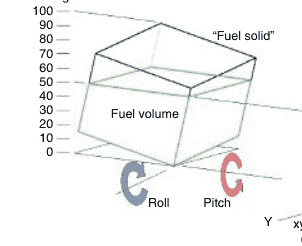

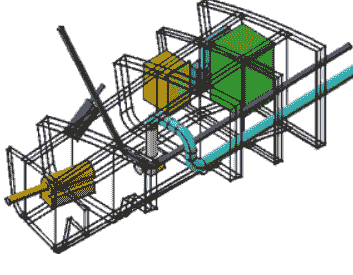

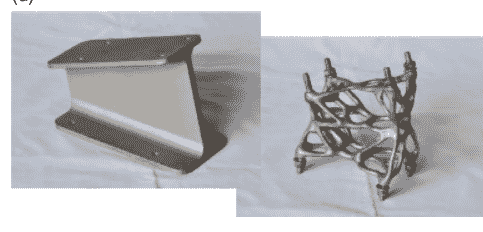

图7.12 计算机辅助设计（CAD）模型：（a）和（b）为燃油系统部件的计算机辅助动画图像，（c）为起落架收起顺序动画模型，（d）为相机支架的3D打印机模型（照片：BAE Systems 公司）。

在这些条件下，通过瞬态仿真可以预测燃油箱油位，并可针对不同飞行剖面定义飞机各油箱之间输油的阀门和泵操作顺序。此外，还可以分析在地面或飞行中的加油场景，以预测快速操作液位控制阀所产生的压力瞬变。

起落架、前轮转向和飞行控制等液压系统的建模可以使用 FloMaster 流体动力软件包进行仿真。施加在液压缸（机械联动或独立）上的可变载荷的瞬态效应，以及方向控制阀的操作，使工程师能够评估系统整体的运行行为和交互。这可以减少大量“铁鸟”测试的需求，并确保更好地实现“一次做对”的原型设计。

##### 7.3.4.1.7 工具能力

FloMaster 工具集包含许多组件，使工程师能够构建适用于航空航天领域的各种模型，包括液压、热管理、环境控制系统和除冰系统。适用于环境控制系统的具体组件包括：

- 热交换器
- 管道
- 压缩机
- 孔板
- 阀门
- 蜂窝式整流器

这些组件可以组合起来代表特定的飞机客舱空调系统，然后对该系统进行建模，以检查在各种运行条件（如地面运行、巡航、爬升、下降等）下的性能表现。然后，可以用稳态或瞬态条件准确预测系统性能，包括：

- 空气流量
- 空气流速
- 空气分布
- 空气压力
- 空气温度
- 湿度
- 空气混合策略，例如再循环空气或与引气或新鲜空气混合。

##### 7.3.4.1.8 使用 VAPS 进行人机界面原型开发

VAPS 是一种商业可用的工具，用于开发实时交互式人机界面（www.presagis.com）。它是 Virtual Prototypes 公司的产品，是一个用于构建数据驱动、交互式、可视化人机界面的工具。这些界面将应用程序数据以图形方式显示，并重新绘制以反映数据的变化。在实时应用中，快速刷新率会给人流畅动画的感觉。同时，可以通过鼠标或触摸屏直接操作图形来提供用户交互（VAPS）。

VAPS 允许系统工程师在台式 PC 上模拟人机界面，例如驾驶舱显示器及其控制机制。这样可以测试和修改图形动态、字体、符号和颜色，直到获得可接受的解决方案。开发出的布局可以轻松传输到测试设施，以便在不同的环境光照条件下和不同用户下重复测试，从而获得最佳解决方案。

VAPS 广泛用于国防、航空航天、医疗和汽车行业，以实现共同商定的人机界面。

图7.13显示了使用 VAPS 在桌面工作站或笔记本电脑上构建的主飞行显示器。该模型可以动画化以模拟实时动态显示，所有字体和颜色都可以更改。

##### 7.3.4.1.9 键合图

键合图是一种符号与方法的结合，为系统建模提供了一种良好途径。键合图本质上是物理对象通过能量连接在一起形成的网络。该方法表示网络中的功率流，其理念是面向对象的。系统与模型之间是一一映射，该方法以图形化方式呈现，并具有底层基于方程的模型和显式关系。该方法特别适用于机械、液压机械和机电系统的建模。

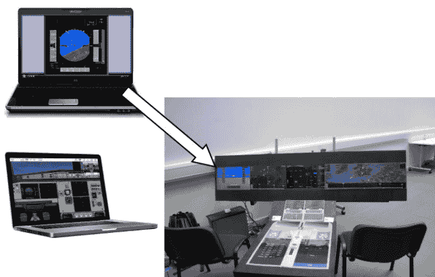

图7.13 VAPS 模型，显示驾驶舱显示器和控件。VAPS 用于开发由克兰菲尔德大学飞行器设计团队项目构建的此模型的显示器（照片：Allan Seabridge）。

##### 7.3.4.1.10 使用 Simulink 的燃油系统模型

Global Express™ 是加拿大庞巴迪宇航公司于20世纪90年代中期研制的一款远程公务机。Parker Aerospace 是一家美国公司，签约负责供应燃油系统，并作为该工作的一部分，开发了一个完整的燃油系统模型，以支持该项目的燃油系统设计和验证工作。

驾驶舱内的燃油控制面板向机组人员显示关键泵和控制阀的状态，并允许在故障情况下手动控制系统。发动机指示和机组告警系统（EICAS）多功能显示器包含一个“燃油页面”，其中包括一个系统概览显示，显示每个油箱的燃油量和飞机总燃油量。EICAS 显示器还显示系统状态、提示和设备故障时的警告。

系统的核心是燃油管理和油量计量计算机（FMQGC），它控制加油（和放油）过程，并测量每个油箱中的燃油量和燃油温度。FMQGC 还控制油箱之间的燃油传输，以协调燃油消耗顺序并保持飞机的横向平衡。

泵和阀门是执行机构，它们确保燃油正确流动，并保证发动机和辅助动力装置有足够高的燃油压力源。这在高空尤为重要，因为在高空燃油蒸气会从溶液中析出，过高的蒸气/液体比可能导致发动机停机。

加油分配系统。因此，该模型被用于研究作战任务场景。此外，还开发了一个单独的模型来评估飞行前加油/分配系统的性能。

此外，虽然俯仰角的影响很重要，因为在后置发动机飞机中，增压泵的入口压力可能会有很大变化，但滚转角的影响可以忽略不计，因此假定其名义上保持为零。

该模型最初运行时，运行速度约为实时速度的三倍，因此为设计团队提供了宝贵的见解。在今天的 PC 上，该模型的运行速度会快得多。

##### 7.3.5 试验台架

试验台架用于构建系统的全尺寸模型，这需要一定程度的高保真测试，也就是说，被测系统的行为必须尽可能接近真实系统的行为。尽管试验台架的设计、建造和维护成本高昂，但其优势在于条件可控，而且试验台架的运行时间比产品运行成本更低，尤其是对于船舶和飞机而言。决定是否需要试验台架的典型因素包括：

- *安全性*：在需要探索系统行为且故障不会导致危险情况的环境中进行测试。例如，在“铁鸟”试验台架上对完整的飞机飞行控制系统（包括全压力液压系统）进行地面测试。
- *耐久性*：需要在受控条件下对系统进行与其使用寿命等效时间的测试，有时还要测试到破坏。例如，对疲劳试验样件进行起落架收放操作，以模拟具有代表性的收放循环次数，或进行襟翼作动测试。
- *人为因素*：需要进行测试来证明人机工程学设计，或需要模拟困难的外部条件，例如高海拔阳光或极端夜间条件，以测试驾驶舱显示器的可读性。
- *集成*：需要逐步组装和测试完整的系统，以探索所有功能和物理接口。

用于开发系统的一些试验台架示例如下：

- *燃油系统*：在一个移动平台上搭建飞机燃油箱及其互连管路的全尺寸部分或完整模拟，可以在逼真的俯仰和滚转姿态下进行燃油传输，但变化速率有限。这将测试传输顺序、控制系统逻辑或软件以及油量测量系统的精度。
- *冷却系统*：一个允许空气/蒸气循环冷却系统在各种条件和冷却负荷下运行的试验台架。
- *发电系统*：在发动机全转速范围内运行发电机，使用负载组模拟一系列阻性和感性负载。
- *液压动力生成*：在系列代表性负载和不同需求速率下操作液压泵。

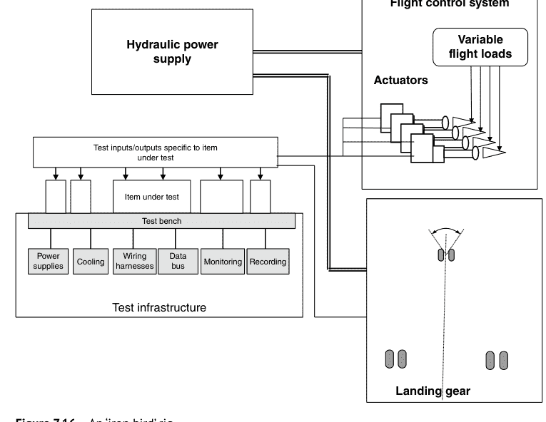

图7.16 一个“铁鸟”试验台。

（在YouTube上）。对于高速喷气式军用飞机，地面试验台会使用火箭动力滑橇来模拟高速条件，并配备带有真实尺寸和重量假人的弹射座椅，通过高速视频演示安全弹射。

- 铁鸟：液压动力、飞行操纵和起落架的组合，允许所有舵面和组件完全运动，以检查行程范围、速率和运动自由度。提供控制和指令信号所需的所有设备，例如飞行控制计算机和起落架计算机，将安装在试验台上，并连接到子系统，例如带有执行机构的飞行控制舵面，以施加模拟飞行载荷。液压动力源可以由地面拖车提供，也可以由运行飞机标准液压系统的试验台提供。铁鸟试验台的框图如图7.16所示。

### 7.3.8 飞机地面测试

当所有单独系统都经过测试、飞机原型机完成组装并安装所有布线时，时机便已到来。布线需进行端到端导通性和电阻测试，并执行绝缘测试（用谷歌搜索“DITMCO for products”）。通常的做法是先安装地面供电系统并通电，以提供合适的飞机电源，然后再安装和连接其他设备。

这样可以测试飞机连接，确保正确的电源和接地连接已连接到设备连接器。将测量电压、极性、绝缘电阻和接地导通性。完成此操作后，便可安全地安装飞机设备，并按照商定的测试程序逐个测试系统。任何缺陷或未满足测试程序的情况都将反馈给设计部门，以便采取适当的纠正措施。

此过程一直持续到所有测试完成，飞机获准进入地面滑跑阶段，由发动机为电气和液压发电系统提供动力。一旦这些测试完成，飞机即可获准进行发动机试车、滑行试验和原型机飞行。

### 7.3.9 飞行测试

在地面测试满意完成后，将审查所有测试证据，以获得进入飞行测试的许可。这通常在一架或多架原型机上进行，以便在真实的飞行和环境条件下进行测试。更多信息请阅读Longworth的系列著作（2012、2013、2014）。

下面介绍一些原型机和量产飞机的试飞示例。

- *原型机飞行测试：* 为了消除批量生产计划中的风险，许多产品制造商生产一架或多架原型机，并对其进行严格的测试计划，以证明性能正确。全尺寸原型机是一种极其昂贵的模型形式，但在未充分了解性能问题的情况下就进入批量生产，其代价可能更为高昂。航空航天工业长期以来一直利用原型机来探索完整的飞行包线，并验证航空电子系统的性能。在此类测试期间获得的结果会反馈到早期模型中，以提高其逼真度并验证模型结果。经飞行测试结果验证的模型建立了对模型的信心，使其可用于支持未来的更改和开发。任何计划中原型机的数量取决于需要完成的测试量；一般和专业系统测试的负载通常分布在可用的飞机上，以便能够同时进行测试。

图7.17展示了欧洲航空航天工业50年历史中的四架不同原型机。P1A原型机是众多原型机中的第一架，用于开发英国首款超音速量产截击机“英国电力闪电”的操纵特性和速度。闪电原型机还证明了该飞机作为集成武器系统的能力，集成了飞行员、AI 23雷达、导弹和飞机航空电子设备的功能。

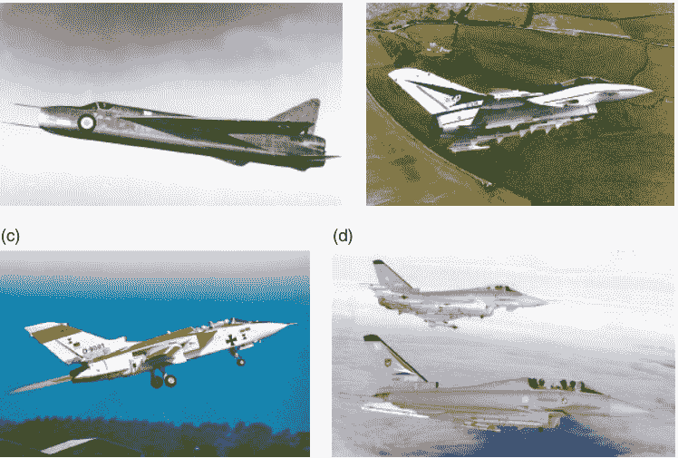

**图7.17** 原型机示例：（a）英国电力P1B，（b）试验飞机计划（EAP），（c）帕纳维亚狂风P01原型机，以及（d）台风英国原型机（照片：BAE系统公司）。

狂风是由三家欧洲航空公司组成的集团（即帕纳维亚）设计的多用途作战飞机（MRCA）。九架原型机开发了这种变后掠翼超音速飞机，使其服役生涯非常成功。狂风P01于1974年8月14日在德国曼兴完成首飞。该机型于2019年以GR4构型从英国皇家空军退役，但仍被其他用户使用。

试验飞机计划（EAP）是一架单架验证机，用于探索设计为气动不稳定且配备四余度电传操纵系统的飞机的操纵特性。其他验证的技术包括复合材料、全彩“玻璃”座舱、计算机控制的车辆系统，以及使用高级语言和首个飞行MIL-STD-1553B数据总线的实时处理系统。经过259次测试和演示飞行后，这架飞机作为教学辅助设备在拉夫堡大学退役。2014年被捐赠给英国皇家空军博物馆（位于科斯福德）。

台风使用了EAP上验证的大部分技术，并对其进行了进一步开发。飞行测试证明了飞机的操纵性及其全面的系统和武器能力，由所有参与国家的飞行员执行。单座型和教练型如图7.17所示。下面介绍一些示例。

- *生产验收飞行测试：* 每架飞机在生产线下线后交付给客户之前，都要进行简短的验收测试。

### 7.3.10 试验

试验由客户的专门机构进行，以评估特定要求以及产品满足这些要求的能力。这可能意味着飞机要在特定的靶场设施上进行测试，例如雷达靶场、武器投放靶场，或者在热带、北极和沙漠等作战地域进行测试。对于商用飞机，可能需要在新航站楼评估飞机，以证明兼容性以及上下乘客的能力。

### 7.3.11 使用测试

当飞机服役并遇到新的情况时，将进行使用测试，以应对不时出现的新局面。这将使产品能够逐步应用于新场景。

### 7.3.12 演示

在某些情况下，在完成某些要求的最终验收之前，需要进行演示。这通常针对具有统计结果的要求。例如可靠性或可用性，在此期间需要在一段时间内收集运行信息。另一个需要操作人员参与的示例是保障性演示。

### 7.4 使用雷达系统的示例

本节总结上述针对简单雷达系统的示例，以说明最终文档的外观。图7.18显示了雷达系统的框图。

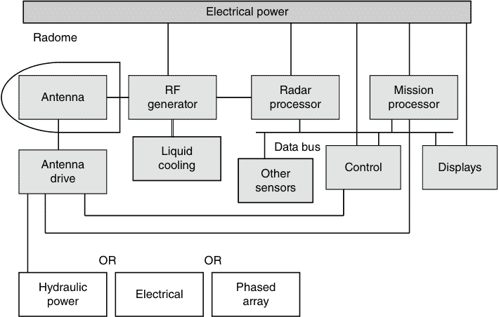

有许多从顶层飞机需求规范下传的需求决定了主要性能特征，例如探测距离、目标尺寸能力、杂波区分、目标分类和识别，以及跟踪和锁定能力。还有一些因将雷达集成到飞机而产生的衍生需求。这些如图7.19所示。

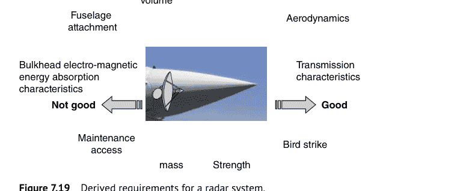

图7.19 雷达系统的衍生需求。

这些衍生需求源于设计雷达罩的需要，雷达罩需要包括天线反射器的扫掠体积，既具有气动合理性，又坚固耐用（以承受鸟击和暴雨），重量轻，可牢固连接但易于打开进行维护，并具有适当的传输特性，以免衰减雷达脉冲及其回波信号。还存在健康方面的考虑，以减少任何旁瓣向座舱内辐射非电离辐射的情况。获取资质信息的计划可以汇总为验证交叉参考矩阵，如图7.20所示。该矩阵标识了需要测试的需求以及通过何种测试机制进行测试，以阴影块表示。在正式计划中，这些块

|  | 设计 | 计算 | 类比 | 模型 | 试验台 | 环境试验 | 集成试验 | 试验 | 使用试验 | 演示 |
|---|---|---|---|---|---|---|---|---|---|---|
| 探测距离 |  |  |  |  |  |  |  |  |  |  |
| 目标雷达截面积 |  |  |  |  |  |  |  |  |  |  |
| 杂波区分 |  |  |  |  |  |  |  |  |  |  |
| 分类 |  |  |  |  |  |  |  |  |  |  |
| 识别 |  |  |  |  |  |  |  |  |  |  |
| 跟踪 |  |  |  |  |  |  |  |  |  |  |
| 锁定 |  |  |  |  |  |  |  |  |  |  |
|  |  |  |  |  |  |  |  |  |  |  |
| 质量 |  |  |  |  |  |  |  |  |  |  |
| 功率 |  |  |  |  |  |  |  |  |  |  |
| 体积 |  |  |  |  |  |  |  |  |  |  |
|  |  |  |  |  |  |  |  |  |  |  |
| 雷达罩扫掠面积 |  |  |  |  |  |  |  |  |  |  |
| 透波率 |  |  |  |  |  |  |  |  |  |  |
| 气动特性 |  |  |  |  |  |  |  |  |  |  |
| 鸟击 |  |  |  |  |  |  |  |  |  |  |
| 暴雨 |  |  |  |  |  |  |  |  |  |  |
| 连接强度 |  |  |  |  |  |  |  |  |  |  |
| 雷击 |  |  |  |  |  |  |  |  |  |  |
| 射频能量健康安全 |  |  |  |  |  |  |  |  |  |  |
| 维护通道 |  |  |  |  |  |  |  |  |  |  |
| 集成 |  |  |  |  |  |  |  |  |  |  |

图7.20 雷达系统的验证交叉参考矩阵。

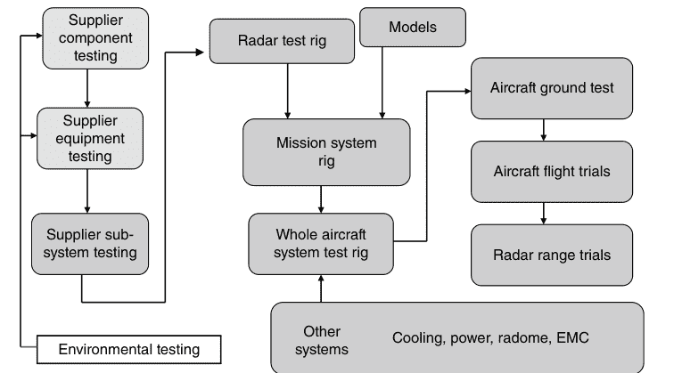

图 7.21 雷达系统的测试信息来源。EMC，电磁兼容性。

其中将包含日期，以便进行适当的项目管理。随着测试的推进，该电子表格用于记录测试报告编号和文件位置，从而形成完整的测试记录。

评估这些衍生需求所需进行的测试简要说明如图 7.21 所示。

## 7.5 小结

尽管初衷良好，但事实上有些系统在服役期间仍会失效。有时是客户发现了故障，有时是可疑的事故趋势凸显了故障，有时是客户同意进行试验。最坏的情况是必须召回产品并修复故障。这不仅代价高昂，而且会影响供应商的声誉。这有时会引发争议，尤其是在媒体介入的情况下。

在承包商组织内部会有这样一个问题：谁有过错？是设计师没有检查验证结果？是质量保证部门没有检查结果和产品质量？是测试制度缺乏稳健性？是标准机构没有审核供应商流程？还是没有应用严格的评审流程？这些都不是承包商需要面对的问题，尤其是当这些问题使产品质量受到质疑并影响销售时。

不幸的是，消费市场中存在大量服役期间失效导致召回的实例，发生在汽车行业和白色家电行业，造成了巨大成本，并降低了客户对公司声誉的认知。飞机行业的失效可能表现为性能下降，最坏的情况下则会导致严重事故。

健全的设计流程（包括稳健的测试和合格鉴定流程）至关重要。必须理解：

-   合格鉴定是设计过程的逻辑终点
-   在最早阶段关注设计对于减少错误和不良设计至关重要
-   测试是为了验证正确运行，而不是为了发现故障
-   客户的接受取决于稳健的设计和卓越设计的有力证据，而这是通过以最恰当的方式运用人员、流程和工具来取悦客户而实现的。

## 练习

1  为你选择的某个系统描述一个物理模型。估计它有多接近真实——其保真度如何（与真实有多接近）？对制造该模型的成本做出粗略估算。然后提出同一系统的仿真或数学模型，并估算其成本。比较并对比这两种模型，并决定哪一种能提供最具成本效益的正确运行证据。

2  查找消费行业中产品召回的案例。尝试确定这些案例是设计不良还是合格鉴定不良的结果。在成本和客户认知方面产生了什么影响？

3  你能找到航空航天行业中的产品召回实例吗？其影响是什么？

## 参考文献

Law, A.M. and Kelton, W.D. (1991). Simulation Modelling and Analysis. McGraw-Hill.

Longworth, J.H. (2012). Test Flying in Lancashire, Vol 1. WW2 to the 1960s. BAE Systems Heritage Department.

Longworth, J.H. (2013). Test Flying in Lancashire, Vol 2. From the 1960s to the 1980s. BAE Systems Heritage Department.

Longworth, J.H. (2014). Test Flying in Lancashire, Vol 3. From the 1980s into the new millennium. BAE Systems Heritage Department.

Stewart, I. (2012). Mathematics of Life: Unlocking the Secrets of Existence, 317–318. Profile Books.

Tookey, Roger; Spicer, Marcus and Diston, Dominic. (2002). Integrated Design and Analysis of an Aircraft Fuel System. NATO AVT Symposium on the Reduction of Time and Cost through Advanced Modelling and Virtual Simulation.

Vassey, K. (1998). Specification and assessment of the visual aspects of cockpit displays. Society for Information Displays International Symposium.

## 延伸阅读

AGARD (1996). *Flight Vehicle Integration Panel Working Group 21 on Glass Cockpit Operational Effectiveness.* Advisory Group Report 349.
Belobaba, P., Odoni, A., and Barnhart, C. (2016). *The Global Airline Industry.* Wiley.
De Neufville, R. and Stafford, J.H. (1971). *Systems Analysis for Engineers and Managers.* McGraw-Hill.
Diston, D. (2009). *Computational Modelling and Simulation of Aircraft and the Environment.* Vol. 1 Platform Kinematics and Synthetic Environment. Wiley.
Garrett, D.G., Wolff, J and Johnson, T.F. (2000). *System Design and Validation through Modelling and Simulation.* INCOSE 10th International Symposium.
Gawthrop, P.J. and Smith, L. (1996). *Metamodelling: Bond Graphs and Dynamic Systems.* Prentice Hall.
Karnopp, D.C., Margolis, D.L., and Rosenberg, R.C. (1990). *System Dynamics: A Unified Approach,* 2e. Wiley.
Middleton, D.H. (1985). *Test Pilots.* Collins Willow.
Thoma, J. (1975). *Introduction to Bond Graphs and their Applications.* Pergammon Press.
