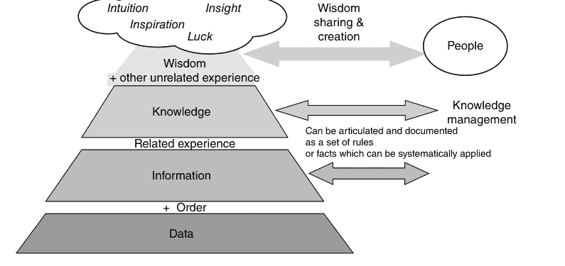
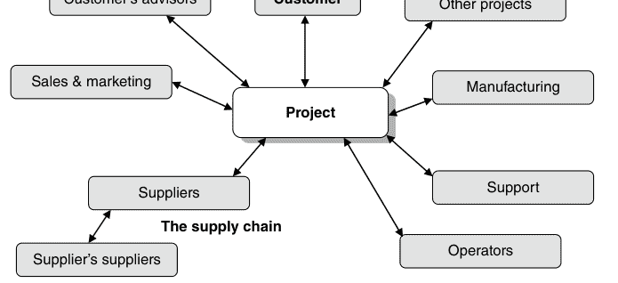
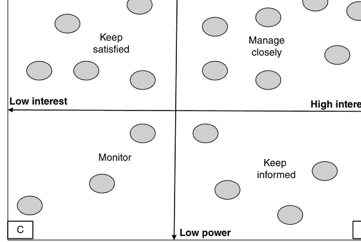
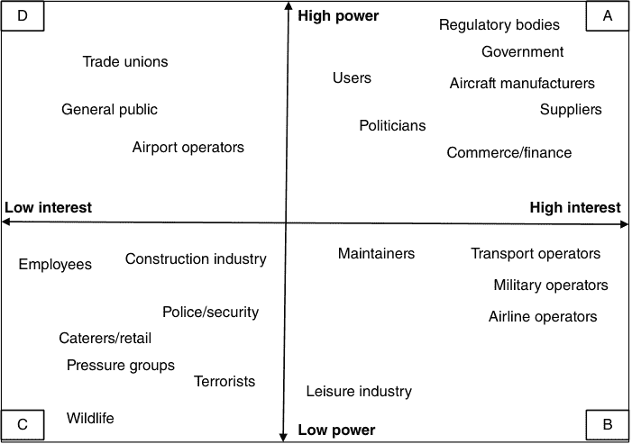
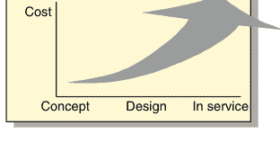
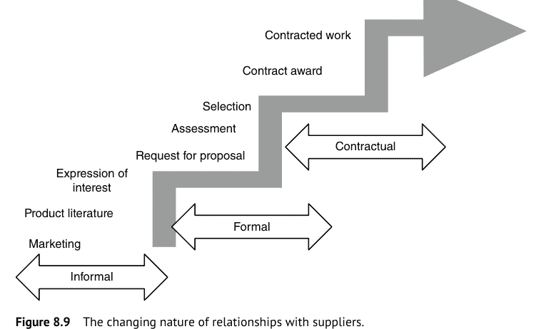
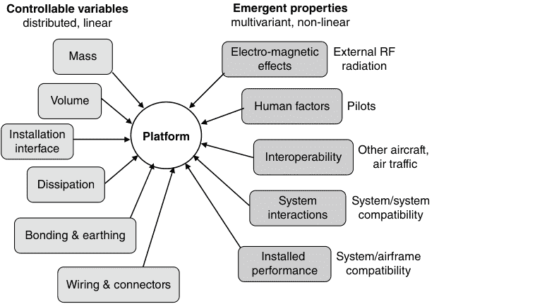
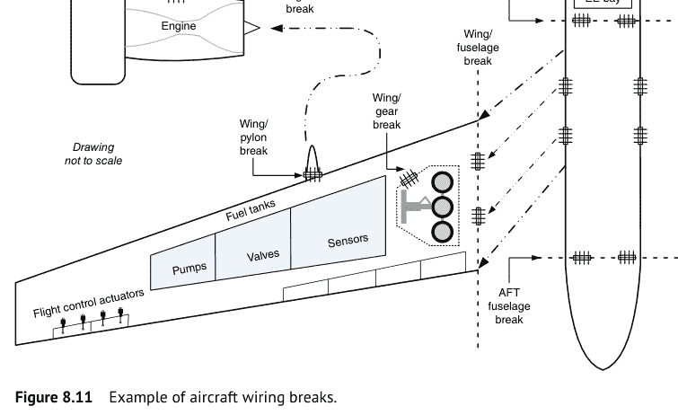
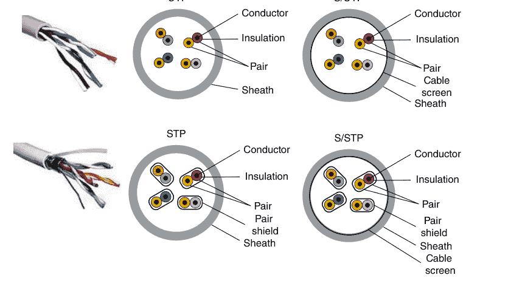
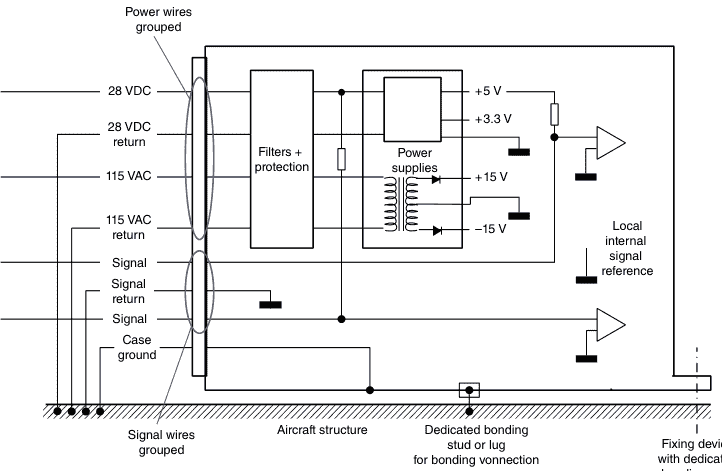

# 8

# 实际考虑因素

## 8.1 引言

飞机系统的设计和开发发生在包括客户、主承包商和供应商在内的各组织集合中。为了使过程正确运行，各组织必须施加一些纪律。本章考察了一些流程，这些流程虽然不涉及技术，但对于最终获得正确的技术产品是绝对必要的。本章首先探讨业务流程，随后几节将考察一些更具技术性的方面。

优秀的系统工程师总是愿意从他人的经验中学习，本章旨在为读者提供对系统工程师实践世界的洞察。从经验中学习、从同行那里学习、从竞争对手那里学习，以及从他人的好坏经历中学习，是务实的学习方法，而且一些研究表明，将正式的学习引入团队的方法可以产生良好的效果（Meakin and Wilkinson 2002）。图 8.1 展示了从经验中学习的模型。该模型表明，从经验中学习不同于知识管理。虽然显性知识可以被收集、存储和操作，但智慧是经验以及其他因素（如运气、洞察力、判断力等）的结果，而新智慧的创造是共享经验的结果，而不是从数据库中提取信息。这一看似琐碎的陈述很重要，因为数据库的广泛使用以及媒体中公布的薄弱统计“证据”正导致人们对计算机生成的数据过于信任。所有数据、信息和“证据”在使用前都必须经过验证。

从经验中学习是一种强大的工具，能够实现知识和经验的共享，通常会使相关各方互惠互利。考虑到这一点，本章只能算是一道开胃菜，读者必须继续学习和提高，寻找有智慧的人，并尽可能在沿途创建从经验中学习的社区。“经验教训”这一短语已经流行起来，但真正学到了多少，或者在项目结束后不久有多少被丢弃，仍有待观察。

图 8.1 从经验中学习的模型。

## 8.2 利益相关者

### 8.2.1 利益相关者的识别

识别系统中所有相关方或利益相关者，对于确保所有相关方都能了解系统开发进展至关重要。利益相关者是指能够影响项目或受项目影响的一方或组织。图 8.2 显示了一个项目中内部和外部利益相关者及其典型信息路径的示例。应告知利益相关者他们已被识别；这确保了他们的角色和沟通需求得到确认。这也使利益相关者能够理解自己在确保项目成功方面的责任。对利益相关者群体的正确管理可以建立起信任氛围，这对项目和所有相关方都有益。利益相关者群体不应被视为固定不变的实体：根据产品生命周期的阶段，新的利益相关者可以加入，利益相关者也可以退出。

除了识别利益相关者之外，理解沟通的性质也很重要——在大多数情况下，沟通是双向且直接的。然而，在某些情况下，沟通不直接才是合适的。在图 8.2 中，项目的主供应商与其自身供应商之间的沟通应始终由主供应商进行。在观察到主供应商与其供应商之间存在紧张关系的情况下，必须抵制直接干预的诱惑，以避免产生合同问题。

可以通过定期会议或直接沟通来管理利益相关者，以确保他们都感到参与其中，并就项目进展和影响他们所有人的关键决策征询他们的意见。良好的利益相关者管理对确保项目顺利进行大有裨益。

图 8.2 利益相关者示例。

关于利益相关者管理，市面上有一些通用的商业教科书。项目管理协会也是一个很好的信息来源（apm.org.uk）。

未来一些项目几乎不可避免地会涉及国际合作。除了带来语言上的困难外，还可能存在需要考虑的文化差异。在表示尊重、考虑饮食习惯、手势和身体姿态，以及容忍粗俗语言方面尤其如此。忽视这些问题会导致项目团队关系不和、相互不容忍。销售和市场团队对这个问题的处理很有热情，但必须将其传递给所有项目团队。明智的做法是审视潜在合作伙伴的文化，并在必要时发布项目指南。市面上有提供这方面指导的通用商业书籍。

### 8.2.2 利益相关者的分类

对利益相关者进行分类，以确保对其进行正确管理，通常很有用。图 8.3 展示了一个简单的四框模型如何对利益相关者进行分类。该模型有四个框，其坐标轴表示每个框中利益相关者的相对重要性。这里的椭圆形代表各个利益相关者。

在 A 框中，是拥有真正决策权并能付诸行动的重要利益相关者。这些利益相关者包括客户及其顾问、认证机构、适航部门和供应商，都需要被密切管理，以确保他们获得关于项目及其进展的最恰当视角。B 框包含那些希望密切关注项目但对技术和项目决策权力较小的利益相关者，例如市场人员、运营人员、维护人员等。

C 框包含兴趣低和权力低的利益相关者，包括普通材料供应商、文具供应商、IT 提供商等。其中包括那些有能力影响项目但兴趣不大的利益相关者，因为该项目可能只是他们参与的众多项目之一。这包括公关、媒体、公众、当地政界人士等。D 框包含处于项目外围的利益相关者，但在需要时可能依靠他们提供支持。

该模型是管理利益相关者的良好起点，但不应被视为一个不变的模型。在项目生命周期的不同阶段，利益相关者的角色很可能发生变化，因此应在每个阶段重新评估该模型。为便于讨论，图 8.4 展示了基于本书图 1.1 的航空系统示例。

图 8.3 利益相关者的分类。

**图 8.4** 第1章中航空系统的利益相关者分类。

## 8.3 沟通

任何组织若要顺利运作，都需要进行沟通；如果不能沟通，那么它还不如不存在。组织就像社区一样，需要保持有效的沟通来确立需求、界定边界、建立基本理解、与其他组织联系以及开展业务。这种沟通发生在组织内部各个层级以及层级之间，组织与外部世界之间也必须有双向沟通。理想情况下，所有沟通都应做到：

- 清晰
- 明确
- 简明
- 准确
- 经授权
- 可追溯

组织由人组成，人们使用其自然语言技能进行沟通。人们使用语言的方式很重要：*正确使用语言几乎在社会各个角落都是一个重要问题。* 没有人愿意被指责为*含糊其辞、晦涩难懂*，或发现自己说话或写作时各执一词。我们对语言了解得越多，成功的机会就越大，无论我们是广告商、政治家、牧师、记者、医生、律师，还是仅仅在家试图理解他人并被他人理解的普通人（Crystal 1995）。

所有人都需要理解自己的语言。关于含糊和晦涩的论述非常值得注意，行业不能容忍可能影响成本或导致客户认知变差的误解。矛盾的是，使用行话往往为“内部人”提供了清晰、简明、准确的沟通，而对“外部人”则不然。现代组织倾向于讲行话；他们这样做通常是为了在组织内部做到清晰、简明、准确，尽管外部各方可能并不立即理解。越来越多地使用缩写词增加了语言的晦涩。

组成组织的所有部门都相互沟通。沟通是双向的，通过多种方式进行，对于确保相互理解至关重要。倾听是沟通的补充，即聆听、吸收并理解所沟通的内容。主动倾听的技能对系统工程师至关重要。鼓励沟通、积极回应，并通过总结来确认理解是一项关键技能。

任何组织离开与外部世界的沟通都无法存在。这个外部世界包括客户和供应商，以及那些仅仅需要与组织共存的各方，例如其邻居或当地社区。与外部机构的沟通往往比内部沟通更正式，采取信件、信息请求或合同文件的形式。然而，如今电子邮件正在取代带有抬头的正式信函的严格格式。

### 8.3.1 沟通的本质

可以说，组织沟通有两个方面：一方面是正式且永久的议事记录，另一方面则不那么正式，可能无需进入设计记录。每种沟通方法对信息接收者都有不同的影响，并产生持续不同时间的印象。

下面列出的沟通方式会留下持久而长远的印象，应妥善归档：

- 报纸文章
- 信件、备忘录和传真
- 电子邮件及附件
- 短信
- 报告
- 目录
- 讲话录音
- 书籍
- 专业期刊
- 合同
- 会议纪要

另一方面，以下列表会留下短暂或转瞬即逝的印象，尽管可以通过日记条目或后续备忘录来保留这些记录：

- 电话和电话会议
- 面对面讲话
- 宣传册
- 海报和传单
- 会议
- 演示文稿（PowerPoint）
- 未保存的短信
- 社交媒体
- 电视和广播节目

持久或长远的印象由书面沟通传递，这是一种可以在闲暇时查阅、复制、展示给他人并多次使用的媒介。它也可以存储起来供将来参考。短暂的印象被广告和有影响力的人士所利用。其最终表现形式是电视广告和政治演讲片段的潜意识影响。

这些方法各有不同的影响，沟通者对其使用方式也不同。短暂沟通往往是非正式、闲聊式、口语化的；会议和演示会强化短暂印象，但有时也传达重要信息。

永久沟通往往更正式、克制，甚至像法律文件一样复杂曲折。

在日常家庭生活中，沟通往往传递信息、闲聊、聊天、家庭新闻——即人们感兴趣的信息。当沟通暗示“契约”时，会通过具体的陈述或正式方式体现出来，这反映在行为的变化上。以下适用于日常生活中的沟通：

- 日常家庭沟通大多传递信息
- 其中大部分信息对对话双方都有兴趣
- 信息或被拒绝、存入记忆，或被使用；通常不会被记录
- 除非有明确陈述，否则不暗示合同安排；如果打算达成合同，通常会有书信往来或握手

但请记住，法律义务适用于广告：广告标准委员会、广播标准、《货物销售法》、《贸易描述法》。世界各地关于口头和书面合同的法律各不相同，例如英格兰和苏格兰之间就不一样。

在报纸和广告中，存在一种“契约”，可以通过议会法案、行业或最佳实践义务在法律上强制执行，尤其是在提供误导性信息方面。

然而，在工作中存在着微妙的差异。许多交流的信息不再仅仅是有趣；它们会被善意地接受并加以使用。换句话说，你对别人说的话可能会被用在他们自己的工作中。而且，别人对你说的话，他们也会期望你用于自己的工作。以下适用于工作生活中的沟通：

- 工作中大部分日常沟通都传递信息
- 其中大部分信息对对话双方都有兴趣
- 信息经常被立即善意地使用并据此采取行动
- 口头和书面内容通常被视为双方之间的契约
- 会议纪要、备忘录、信件、电子邮件将被用作有意图做某事的证据
- 所有书面沟通都应检查准确性并获得发布批准，以保护所有相关方
- 所有文件都应编号、注明日期、受控、签署并存档

### 8.3.2 组织沟通媒介示例

使用短暂或非永久性沟通方法的例子包括电话、会议和演示。然而，这些方式中的每一种都与直接对话一样隐含契约。请记住，会议通常会有会议记录，你需要完成布置的行动，并遵守会议上达成的协议和决策。更永久的沟通方法包括纸质记录，以及越来越多的电子传输信息。

下面列出了一些工程师在工作中使用的文档类型示例。这些文档需要加以维护，以保证其秩序井然，并便于项目中所有利益相关者轻松检索。还应指出，文档记录是客户需求的一部分，并且必须在……之后的一段时间内加以维护。

产品已停止使用。这类文件通常构成数据需求清单（DRL）的内容，并且可能是付款计划的一部分：

- 小册子
- 传单
- 计划
- 规格说明
- 合同
- 图纸
- 工作说明书
- 技术报告
- 财务报表
- 保密协议
- 合作协议。

所有这些文件通常在第一页或封面页上会附有以下信息的引言：

- 标题
- 编号
- 发布日期
- 版本/修订号
- 变更记录
- 编制人签名
- 审批人签名
- 授权签名。

正式文件将受配置控制，以便能够明确识别文件并追溯文件中的变更。这对于就文件内容达成共识至关重要，特别是当文件将被用作开展工作的基础时——换言之，即批准花钱。即使对于非正式的信息交流，尤其是附件，这种纪律也值得遵守，以确保不产生误解。做法应在文件标题以及页眉或页脚中加上版本或修订号。

除了标题、日期、编号和版本记录的行政细节外，还必须获得签名，以赋予文件及其内容一定的真实性。这有利于交易中的所有各方。允许签署文件的人员的身份以及签署授权的授予是设计授权过程中的关键部分。使用电子签名或代码词是一种可接受且更常见的签署方法。

应当注意，本节中“文件”一词包括记录的电子影像——如今文本文件或图纸通常以电子文件形式存在，这些文件是使用计算机（无论是中央计算机还是多台台式机或笔记本电脑）上的文字处理或绘图软件创建的。虽然正式文件将记录在案，但电子邮件极有可能存储在众多笔记本电脑的个人文件中。项目信息的生成、处理和存储的项目流程必须解决这一问题，特别是当这种带有技术附件的通信形式导致设计决策时。

电子通信手段在家庭和商业领域都广泛使用。这在提高通信速度和响应性以及迈向“无纸化办公”方面具有优势。尽管通常被认为是有益的，但有些方面需要仔细考虑，以确保信息正确，并防止信息无意中传播给无权查看的各方，同时确保在商业、专有、公司和国家利益方面的安全性。下面将描述其中一些担忧。

#### 8.3.2.1 信息生成机制

组织将为其员工提供一种生成开发和定义产品所需信息的机制。这通常基于配备适当工具的桌面计算机网络，以便以标准形式生成、存储和合并工作成果。个人通常还会使用其他便携式工具作为补充，这些工具有时由公司提供，但往往由个人自行提供。这些工具包括：

- 笔记本电脑，自带或公司提供
- 具有电子邮件访问功能的手持平板设备
- 具有语音、短信和电子邮件访问功能的电话（智能手机）
- 笔记本和笔/铅笔。

这些机制集合允许以电子邮件、短信、语音和手写笔记形式的信息进行汇编和交换。这些信息应定期整合并输入公司网络。除非每个人都有足够的自律来删除这些信息，否则它可能仍然存在于这些其他便携式设备中。必须有一个合适的安全接口，以防止连接公司网络，因为连接可能为病毒或恶意软件的引入打开大门，从而导致黑客攻击。

图8.5显示了一个集成数字数据管理系统的示例，该系统将所有用户互联，并对系统中注册的所有信息实施配置管理结构。应当注意，电子邮件可以在不进入该系统的情况下发送，从而绕过配置管理工具。

这些设备如果无人看管、丢失、被盗或以其他方式遗失，都会带来风险，因为其中包含的数据会暴露给未经授权的人员。还有一个额外的危险是，这些设备在公共场所（如火车、公共汽车、咖啡馆或酒店）使用时，可能会被他人看到或听到。还存在病毒污染或“黑客攻击”的重大风险，公司系统必须具有足够的安全性来防止这种情况。

#### 8.3.2.2 未授权访问

由于不同类型的存储设备激增，且许多人使用个人便携式计算设备并进行各种形式的出行，使其面临设备被观察的风险，因为这些设备可能包含病毒，因此未授权访问数据难以防止。在没有某种形式的加密的情况下，绝对不应使用这些设备，并且必须注意避免未经授权下载公司信息。数据存储设备及相关风险的示例包括：

- 光盘，如CD或DVD——这些不耐用，读取寿命可能有限
- 闪存驱动器或U盘——这些非常常见，但体积小，容易丢失或被盗
- 外置硬盘——这些也很容易获得，也容易放错地方
- 云存储——这可用，但有一定风险，因为访问由第三方控制。

应当注意，以前的数据存储形式，如软盘和软盘驱动器，也可能需要访问以获取遗留数据。如果存储设备可用，只有在有合适的读取设备时才能提取数据。对于任何大型组织来说，保持此类设备的样本处于可用状态，或随着每种介质过时逐步将数据迁移到更新的可读存储机制，至关重要。

#### 8.3.2.4 数据纪律

随着便携式设备和办公电子邮件账户的普及，需要纪律来确保数据对项目可用并正确存储。一个很大的危险，尤其是电子邮件，是主要收件人倾向于将邮件存储在自己的个人文件结构中，例如在Outlook中。如果这发生在他们的个人设备上，则可能不会上传到桌面设备，即使上传，邮件也可能进入个人文件结构。这意味着它没有被集中存储。对于作为设计决策一部分的信息，这是决策可追溯性方面的严重疏忽。更糟糕的是，如果个人离开项目或公司，他们的数据可能会根据公司安全策略被删除。

通过短信或电话接收或传播的信息同样无法供项目使用。

### 8.3.3 沟通不畅的代价

沟通不畅会耗费金钱。原因很多，但通常会导致生产时间损失或产品报废。然而，文件或陈述对接收者的影响绝不能被低估。除了可能给公司留下不良印象外，这种不良印象也可能对作者不利。

纠正问题的成本总是很高，但随着项目从概念（对纸面设计的修正）过渡到客户使用（对硬件的召回和修改），成本会大幅增加，如第3章所述以及此处图8.6所示。

沟通不畅可能导致内部冲突、不和、不良人际关系、低效率和工作士气低落。许多组织失败都可以追溯到沟通失败。

拼写错误无助于沟通不畅，在某些情况下可能导致严重问题。在国际项目中，英语很可能是项目批准语言的主要竞争者，但即便如此，也会有

- 时间被花费在修正文档或回应澄清请求上。
- 理解一份文档需要更多时间，例如核查、请求澄清。
- 指令可能无法一次就正确执行。
- 缺乏理解导致产品质量低下，进而造成代价高昂的返工或修改。

图 8.6 沟通不畅的代价。

许多参与者需要用他们自己的语言阅读和交流。传统上，从一种语言到另一种语言的翻译由人工译员完成，但如今，自动翻译越来越多地由语音识别机器和用于书面材料的字符识别来完成。英语中包含许多同音词，这些词可能无法被正确翻译成另一种语言。一些常见的误用/拼写错误的词有：

- break 和 brake
- pain 和 pane
- great 和 grate
- sale 和 sail
- red 和 read
- dependent 和 dependant
- its 和 it’s
- there 和 their。

尽管有些人会抱怨，只要一个句子的意思在英语中能被理解，无论拼写如何，但如果翻译是严格按照所写内容进行的，情况就不会如此。

### 8.3.4 一个教训

一个经典的沟通不畅例子已经进入了语言（至少在英国），如图 8.7 和图 8.8 所示，用以说明口头沟通的弱点和书面沟通的优势。这很可能是关于第一次世界大战期间从总参谋部发送到前线的消息的杜撰故事，也是几个类似故事之一。然而，它确实提供了一个不同类型沟通的例子，并且在今天的对话中仍能听到，用以表明缺乏组织或规划。

通过多个阶段口头传递信息需要高超的技巧，包括：

- 清楚地解释要传递的信息
- 清楚地理解所接收的信息

## 8.4 给予和接受批评

给予和接受批评是任何创作过程的重要方面，无论这种批评是自我批评还是公开评审。公开展示作品的艺术家、在观众面前演奏的音乐家，或发表作品的作者，他们都会招致同行或更广泛公众的批评。他们的作品是通过自己的自我批判性评价创作和打磨出来的，但要将其暴露给他人进行批判性审查，需要勇气。

批评也是系统工程的一个基本方面——正如它对任何健全的工程或设计活动一样。虽然自我批评是设计过程中的一个必要阶段，但对外部对工程活动和产品的客观审查无可替代。从来不缺提供批评的志愿者——每个人都相信自己完全有资格这样做。

### 8.4.1 设计过程中批评的必要性

系统工程是按照既定且被接受的过程进行的。这些过程通常根据行业或政府标准来定义，例如 MIL-STD-1521B、MIL-STD-499、DO 15288 等。这些标准和行业过程包括在特定成熟度节点的评审，如投标评审、初步设计评审、关键设计评审、测试就绪评审等。评审可以由其他工作人员（同行评审）、高级管理层（管理评审）、特定领域的专家或来自其他项目且与被评审项目没有技术或业务联系的工作人员进行（通常称为非倡导者评审）。

无论何种类型的评审，主要目标都是邀请批评，以验证评审材料是否适合其用途或提高质量。评审还使组织能够认同产品，并了解可行性、风险和商业潜力。

被评审的工程产品是什么？可以是图纸、定义设计过程或产品的文档、管理计划、测试计划和结果、硬件（如首件验证（FAV）评审中的硬件），或财务和风险分析。评审可以通过演示材料或研究纸质或软格式的材料或产品来进行。在许多现代项目中，评审材料采用 PowerPoint 演示文稿的形式。评审现场的观众可以通过使用 NetMeet 等工具查看相同幻灯片的远程评审者来补充。经验表明，这是一种同时向许多人呈现信息的好方法，但整体效果更为短暂；与可以书写的图纸或文档不同，在评审期间不容易记住图像。必须注意这种评审形式，以确保其足够严谨。如果不可接受，评审者必须要求以替代格式提供信息。

### 8.4.2 批评的本质

批评通常被视为一种负面行为，而词典的定义也无助于改变这种看法。词典中有两个定义，第一个条目是：

*对艺术作品、文学作品等作出不利或严厉判断的行为或实例（柯林斯词典与同义词词典）。该同义词词典包括诸如非难、负面报道、不赞成、贬低、吹毛求疵等术语。*

只有第二个条目具有积极方面，而这个定义是大多数创作者会认可的：*一项旨在评估或分析的作品。* 此处的同义词词典包括分析、评价、欣赏、评估、评论、评述和估价，这些都是积极的术语。

除了先入为主的负面看法外，批评的给予方式往往影响其接受方式——借用马歇尔·麦克卢汉的话说，媒介即信息（McLuhan 1964）。语气、措辞形式和信息的语调都可能具有极大的破坏性。考虑一下评审中经常给予批评的四种方式：

- *破坏性的：* 简短、突兀且没有解释的评论，例如“垃圾”、“浪费时间”或更糟，这类批评具有破坏性，可能对被评审者造成沉重打击，并且不提供任何关于如何修正评审材料的信息。
- *贬低或侮辱性的：* 诸如“我自己都能做得更好”、“你的意思是这是我们花钱买的东西？”以及“当我要求想法时，我指的是好主意”之类的短语根本不相关，只会削弱被评审者的信心。它们对修正也没有任何帮助。
- *不置可否的：* 诸如“好吧，我想还行”或“一般般”之类的短语，或者完全没有评论，表明评审者没有意见。这可能意味着评审材料根本没有被建设性地考虑过，或者评审者没有理解它。同样，这对提高评审材料质量没有帮助。给出一些评论或承认不理解，总比让评审团队束手无策要好。推荐另一位评审者远比假装自己有能力继续下去要好得多。
- *肤浅的：* 在大型 PowerPoint 式评审中，存在一个很大的危险，即所呈现的信息难以阅读和听清。听众的规模和保持时间的氛围常常成为提出评论或问题的障碍。这可能导致没有人提问，或者没有坚持获得正确答案。评审很重要——评审者必须避免陷入这种情况。
- *建设性的：* 诸如“这很好，但我认为如果你在某个特定领域给出更多解释并附上示例，我会理解得更好”或“我相信图表会使解释更清晰”或“这是不正确的，但我可以给你一个正确的解释或示例”之类的意见，为被评审者提供了可用于改进的信息，并为继续讨论以修正评审材料打开了大门。

### 8.4.3 与批评相关的行为

评审团队可能几乎没有时间来准备他们的材料以供发布；他们总是面临满足进度要求的压力，尤其是投标团队，他们必须满足客户的截止日期，否则就会失败。

因此，评审不能损害他们的士气，他们需要以最高效率来考虑评审结果、进行必要的修改并发布材料。接受批评的方式会对个人和团队的行为产生影响。接受批评的人通常会表现出忧虑、不确定、感到受威胁、不适、害怕受到人身攻击以及产生防备心理。这些行为可能会在评审过程中被强化，从而损害人们的信心，进而可能降低评审后的表现。

另一方面，被评审的团队也必须理解如何接受批评。他们必须化解那些破坏性的评论，如果可能的话，可以通过追问批评者来探究其情绪背后的原因。他们必须保持尊严，制定返工和前进的计划，并最大限度地利用评审意见。以往的建议是：承认这些意见，永远不要变得防备，简明扼要地回答，如果一时无法回答，可以要求对方以书面形式提出评审意见，以便日后答复。

评审人员同样也会受到行为变化的影响；提出批评的人常常感到需要表现得咄咄逼人、高高在上或消极负面，常常带有一种“非我所创”综合征，试图根据自身的经验和/或偏见来解读材料。人们往往还会采取一种居高临下的姿态，觉得自己比被评审的团队更优秀。

开展评审最具建设性的方式是，作为一个旨在打造最佳产品的业务团队的一部分来行动。评审人员必须保持客观，同时也必须具有建设性，不是吹毛求疵，而是识别错误或技术不准确之处，同时提供改进建议。现代大型项目中团队的规模、复杂性和地域分散性使得评审过程变得非常重要。这是一个将人们聚集在一起、讨论问题和进展、并引入项目之外的见解和经验的机会。

### 8.4.4 结论

系统工程是一项由众多个人和团队执行的创造性过程，在整个产品生命周期中产生可交付成果。为了确保所有利益相关者都了解可交付成果的进展、内容和标准，对这些成果进行评审至关重要。一个定义明确且稳健的评审过程对于建立高质量的产品至关重要。所有参与评审过程的相关方都必须以公司大局为重，以规范的方式进行评审。

以评估和分析形式出现的建设性批评、工程和商业判断的应用，以及在给予和接受批评时秉持积极态度，都是至关重要的。

## 8.5 供应商关系

复杂飞机产品中有相当大比例是从主承包商组织外部的供应商处采购的，这些供应商通常被称为供应链。这些采购（可能高达合同价值的80%）可能以材料、硬件或软件产品（设备）或服务的形式存在。通常存在一个工业供应商

### 图8.9 与供应商关系的不断变化。

基础，其中有专业公司能够为一个或多个领域提供支持。这些供应商是项目中的关键利益相关者。

了解供应商基础以及如何在产品生命周期中与供应商互动，是与供应商建立良好关系的关键因素。图8.9展示了与供应商的关系如何在整个产品生命周期中发生变化。

非正式关系基于了解市场上可用的产品范围以及关注新兴发展。这种活动通过研究行业文献、参加展览和会议、参与联合研究和权衡研究或研究论文撰写来获得市场认知。这种关系使双方能够在没有任何合同或知识产权约束的情况下获取信息，并对产品开发提出建设性意见。

当信息被要求用于支持更正式的活动（如投标）时，这种关系就变得正式起来，在此过程中可能会要求多家供应商向主承包商提供信息。现在，供应商有义务提供正确且相关的信息，而主承包商则有义务将每家供应商的信息视为机密。这些信息可能构成商业投标的基础，并可能成为双方之间保密协议的主题。

正式关系的性质意味着信息的拥有必须被记录，信息不得泄露给其他方，并且要认识到侵犯版权可能构成刑事犯罪。这种关系通常通过所有相关方签署保密协议（NDA）来正式确立。

如果所要求的信息将用于竞争性投标过程，那么来自多家供应商的技术、计划和成本信息将被正式评估和打分，以判断哪家投标胜出。这些信息将用于选择将业务交给哪家供应商。在这种情况下，与各供应商的所有沟通都受到严格限制，以避免在选择过程中出现任何偏见。

选定供应商后，合同的授予再次改变了这种关系。供应商有义务满足合同的条款和条件，提供合同所涉及的货物或服务。这意味着超出合同范围的工作将被视为额外工作，并产生额外费用。

在整个关系不断变化的期间，主承包商和供应商必须尊重彼此的商業地位，同时为项目的利益而共同努力，这一点非常重要。系统工程方法中对需求的谨慎管理以及与利益相关者的开放关系变得至关重要。

## 8.6 工程判断

判断可以定义为*能够做出关键区分并达成平衡观点的能力*（《柯林斯词典与同义词库》2012）。工程判断是在工程情境中做到这一点的能力，它是许多工程决策过程中宝贵的务实输入。

这种品质常常体现在那些拥有从经验中学习所需的智慧的人身上。工程判断无法教授也无法衡量，它是在众多项目中多年经验以及许多学习经历中获得的品质，但它是值得向往和追求的重要品质。它可以通过理解人们如何得出结论、观察人们如何应用知识、理解人们如何利用其他利益相关者及其观点来形成判断而获得，这些判断本身可能不是最终决定，但有助于他人做出决策。

工程判断帮助系统工程师完成工作并产出良好的系统工程成果。遗憾的是，这种属性无法量化或验证。它不可避免地是个人的、短暂的，并且可能在评审时受到批评；它可能是一种风险。如果它被用作设计的一部分，则必须记录下来，并且需要说明提供者的资格和经验。

## 8.7 复杂性

飞机的系统被设计用于执行日益复杂和艰巨的任务。飞机所处环境中的系统也变得越来越复杂，包括服役保障系统、空勤人员和地勤人员训练系统、机场管理系统以及机场安保系统。系统工程任务要求对所有此类系统有一个集成视图，以产生客户满意度。一些关于复杂性的观察（Maier 和 Rechtin 2002）表明，复杂性对工程有着重大影响：*人们普遍认为，日益增长的复杂性是当今架构师和工程师所面临的最困难问题的核心。*

这一观察与许多大型项目相关——土木、海洋、航空航天、农业和电信项目都曾出现过因无法应对复杂性而导致部分或完全失败的实例。这些失败表现为：

- 成本与进度超支
- 性能不足
- 可用性差
- 启动缓慢
- 人机界面问题
- 维护问题。

任何表现出上述一项或多项特征的大型系统，都会导致客户评价不佳。就大型公共部门资助的项目而言，还可能出现不利的媒体评论。

理解复杂性始于完全理解需求。采用整体性系统方法，仔细分析不同环境中的设计驱动因素，并与利益相关方进行良好沟通，有助于加深这种理解。随后，需要在生命周期的所有阶段对需求的逐级分解进行审查，并加以谨慎管理。坚持采用严谨的方法将不断涌现的设计与需求相匹配，同时明确定义功能分配以及功能、物理和数据接口，是良好的实践。第11章将更深入地探讨这一问题。

## 8.8 涌现特性

涌现特性是指系统那些出乎意料的属性或特征。它们可能是理想的，因为能提高系统性能；也可能是不理想的，因为会降低系统性能。它们之所以出乎意料，是因为它们源于系统内部功能（有时也包括物理）交互的组合。一个系统的功能越复杂、相互依存度越高，就越难预测它们集成到一个可工作的整体后，其组合结果的精确走向。

图8.10显示了一些将涌现特性与正常系统特性区分开来的因素。一般来说，人们期望大多数因素对系统产生线性影响，期望图中所示的可控变量是分布且线性的，并且通常具有单一、独立的影响。例如，增加更多质量会使系统按所增加质量的直接比例变得更重，部件体积的增加可直接测量，等等。这些行为的后果立即可见，并且通常在生命周期早期阶段就得到监测和控制。

当效应呈非线性且多变量时，就会出现涌现特性——多种效应组合的影响大于各单独效应之和。图8.10中显示的示例包括系统之间的电磁干扰（EMI）影响，这种影响可能在很大程度上取决于系统的安装情况、搭接电阻的变化或搭接表面的腐蚀，或发射功率与电噪声的变化。

**图8.10** 受控与非受控交互。

人为因素是一个可能出现某些情况的领域，这些情况可能导致机组人员在压力条件下工作负荷过高，从而增加事故发生的概率。当来自不同运营商或军事力量的飞机无法协同作业时，就可能出现互操作性问题——不同的备件、燃油、无线电频率和协议都可能是导致这种情况的因素。

涌现特性对成本和进度绩效有影响。由于其不可预测的性质，其影响可能直到生命周期后期才会显现，通常是在测试期间，尤其是在整机上进行的外场试验中，例如高温和低温试验、热带试验、航线验证、隐身试验等。如第3章所述，这是不可取的，因为它可能导致代价高昂且耗时的返工和变更。在生命周期早期预测并识别涌现特性的来源，并持续审查相关结果，这一点非常重要。在大型复杂系统中，这是一项具有挑战性的任务，但对于减少生命周期后期的工程量和进度影响至关重要。

第11章提供了一些取自实际使用经验的涌现特性或意外行为的示例。

## 8.9 飞机布线与连接器

### 8.9.1 飞机布线

在飞机的众多不可见属性中，电气布线并非最容易理解，而且其遍布飞机各处的范围也最难领会。本节关于飞机布线的内容将对研究飞机系统的人员有所帮助。飞行控制传动线路、燃油管、液压管路和空调管道在机体内容易观察和识别，而电气布线则较难识别。而因不同电气技术原因所使用的各种不同连接器，又使这一问题更加复杂。一个好的起点是理解飞机的基本结构，以及飞机布线如何与这些基本结构构件相关联。

### 8.9.2 飞机结构分离面

飞机内关键的结构/布线分离面由飞机结构分离面决定，而且在日益全球化的航空航天工业中，这些主要工作领域存在一定程度的业务外包或分包趋势。重要的结构部件越来越可能分配给世界各地的投资风险共担合作伙伴，由他们对飞机结构的相应部件承担责任。这些风险共担伙伴也可能负责安装该部分机体内的系统部件和布线。图8.11显示了一个典型示例。典型的飞机分离面包括以下内容：

- 前机身与后机身分离面：这些分离面将前机身、中机身和后机身段分隔开。
- 机翼/机身分离面：界定了相对温和的增压座舱环境与更具挑战性的机翼区域之间的边界，机翼区域内布置有飞行控制作动器、燃油系统部件（如燃油泵、阀门和油量测量装置）以及温度传感器。机翼区域对飞机布线和电子设备提出了严峻挑战。机翼布线的典型耐受电压是机身舱内布线规定电压的两倍。

图8.11 飞机布线分离面示例。

- **起落架/机翼舱分离面：** 起落架舱呈现出另一个严酷的环境区域。由于在起飞、着陆和进近过程中暴露于恶劣环境，起落架上的线束通常采用铠装，以便在该环境中生存，并承受飞行中外来物的冲击，例如飞机脱落的轮胎胎面或从跑道卷起的物体。
- **机翼/挂架和挂架/发动机分离面：** 这些分离面非常重要，因为相关布线在飞行机组与发动机之间传输关键信息。飞行员将油门指令和其他控制信息传输给发动机。
- **发动机布线：** 毫无疑问，发动机在温度和振动方面是飞机上环境最为严酷的区域。与起落架线束类似，发动机上的线束通常采用铠装，以在严酷的工作条件下提供保护。

除少数关键系统外，大多数飞机系统都受上述分离面的约束。特别的例外情况包括：

- 大功率发电机馈电电缆的敷设，因为可能存在高电阻/高功率耗散触点
- 高完整性布线（如火警和液压关断阀选择线路）的敷设，因为连接器失效的后果严重
- 与飞行控制相关的特定布线。

### 8.9.3 线束定义

在特定区域内，飞机布线可能有所不同，从将两个部件进行电气连接的单根导线，到需要在飞机结构内特定点之间敷设多根导线的导线束或电缆束。与单根导线/导线束/电缆束相关的定义大致如下：

- **开放式布线：** 未包裹在覆盖物中的任何导线、导线组或导线束。
- **导线组：** 两根或更多根导线绑扎在一起，以保持该组的完整性。
- **导线束：** 两个或更多个导线组因在绑扎点处走向相同而绑扎在一起。
- **电缆束：** 一个导线组或导线束绑扎成一个紧凑单元（开放式电缆束），或包含在外护套中（封闭式电缆束）。电缆束通常预制好，并作为单一组件安装到飞机上。
- **电气受保护布线：** 通过保险丝、断路器或其他限流装置获得过载保护的那些导线。飞机大部分电气布线都以此方式受到保护。保护的目的是保护飞机布线，而不是负载。
- **电气未受保护布线：** 没有保险丝、断路器或其他限流装置保护的导线（通常从发电机到主汇流条配电点）。然而，针对电气故障条件的保护将作为发电机控制回路的一部分固有地提供，包括电流和电压故障条件。

这些定义主要摘自澳大利亚民用适航认证机构发布的咨询通告AC21–99，并在图8.12中加以说明（CAA 1999）。

### 8.9.4 线束布线

鉴于前述约束以及需要通过已描述的各种结构和/或电气断点，线束在安装过程中受到非常实际的考虑，即：

- 注意不要超过线材类型的弯曲半径
- 防止线束与飞机结构之间的磨损
- 通过隔舱和结构固定线束
- 在接线盒、面板和线束中固定线束，以实现正确的布线和分组
- 防止可能导致导体和连接断裂的机械应力
- 防止电弧或过热线束导致机械控制电缆损坏的可能性
- 便于维修后重新组装
- 防止线束与其他设备之间的干扰
- 允许更换单根线束而无需移除整个线束
- 防止在高振动区域（起落架和发动机区域的装甲电缆）中出现过度移动

### 8.9.5 线束尺寸

飞机线束通常参考美国线规（AWG）惯例进行分类。在 AWG 惯例中，数字越高，线束尺寸越小。通常，AWG 24（波音）和 AWG 26（空客）是飞机内部因坚固性考虑使用的最小线束。较小的线规——即更高的 AWG 尺寸——可能存在于单个设备中，因为这些设备受到飞机内部一般磨损和撕裂的保护。

较低的 AWG 类别用于高功率馈线，通常来自飞机电气发电机或飞机电气配电系统中的主要电气馈线。选择线束尺寸的一个关键考虑因素是线束运行相关的电压降以及馈线损耗相关的功率耗散。预期电气故障的性质和持续时间，以及可用线束保护装置的能力和响应时间，是重要的考虑因素。

表 8.1 和 8.2 说明了典型飞机线束参数以及典型大型飞机中的线束数量：

- 典型大型民用飞机中飞机线束的电流处理能力。表 8.1 提供了铜（Cu）线束的指示性信息。铝（Al）线束更轻，但电阻率更高，因此在选择铜与铝电源馈线以节省安装重量（以更大的电压降/馈线损耗为代价）方面存在空间。
- 表 8.2 给出了大约 20 年前波音 747 系列大型运输飞机的典型线束重量预算。这代表基本飞机线束，不包括机上娱乐负载。特别值得注意的是线束的范围——近 700,000 英尺的线束，重量约为 6500 磅。此示例已过时，可以预计，较新一代的飞机由于集成模块化航电（IMA）机柜和远程数据集中器（RDC）的影响，将具有更低的线束含量。

### 表 8.1 典型飞机线束电流容量。

| AWG | 直径 (in.) | 欧姆/1000 英尺 (Cu) | 最大电流 (典型) | 典型应用 |
|---|---|---|---|---|
| 0000 | 0.46 | 0.049 | 260 | 主要 |
| 000 | 0.41 | 0.062 | 225 | 电源馈线 |
| 00 | 0.36 | 0.078 | 195 | |
| 0 | 0.32 | 0.098 | 170 | |
| 1 | 0.29 | 0.124 | 150 | |
| 2 | 0.26 | 0.156 | 130 | |
| 4 | 0.20 | 0.248 | 95 | |
| 6 | 0.16 | 0.395 | 75 | |
| 8 | 0.13 | 0.628 | 55 | 次级馈线和高功率负载 |
| 10 | 0.10 | 0.998 | 40 | |
| 12 | 0.08 | 1.588 | 30 | |
| 14 | 0.06 | 2.525 | 25 | |
| 16 | 0.05 | 4.016 | | 中型负载 |
| 18 | 0.04 | 6.385 | | |
| 20 | 0.03 | 10.150 | | 正常使用 |
| 22 | 0.26 | 16.140 | | |
| 24 | 0.02 | 84.22 | | |

### 表 8.2 典型飞机线束重量预算。

| WG | 长度 (ft) | 重量 (lb)ᵃ |
|---|---|---|
| 24 | 162445 | 887.0 |
| 22 | 148239 | 594.2 |
| 20 | 237713 | 1859.4 |
| 18 | 82211 | 732.6 |
| 16 | 26663 | 276.8 |
| 14 | 4998 | 65.4 |
| 12 | 9872 | 256.2 |
| 10 | 4681 | 146.0 |
| 8 | 3981 | 231.9 |
| 6 | 2048 | 115.3 |
| 4 | 2622 | 240.9 |
| 2 | 1140 | 170.2 |
| 1 | 444 | 50.2 |
| *1 | 719 | 196.1 |
| *2 | 2447 | 418.4 |
| *3 | 55 | 12.5 |
| Special | 5574 | 219.0 |
| **Total** | **695852** | **6472.1** |

ᵃ 包括连接器，但不包括机上娱乐。

### 8.9.6 飞机电气信号类型

飞机线束如前所述，复杂且通常安装在恶劣环境中。在许多情况下，飞机初始建造后无法访问飞机线束。线束类型多种多样，以下示例证明了这一点：

- 用于收音机和雷达的 RF/同轴线束；微型同轴线束用于某些位置
- 用于主电气电源的电源馈线；用于低功率电气供应的常规线束
- 用于飞机传感器的信号线束；通常为绞线/屏蔽双绞线、三绞线和四绞线
- 用于数据总线的绞线铜双绞线和四绞线
- 用于数据总线和机上娱乐（IFE）系统的光纤线束

在燃油量测量（油箱线束线束）、起落架和发动机（装甲导管）领域也需要专用线束。油箱中的线束需要特别保护，以限制与燃油含量传感探头相关的能量量，并限制与电动燃油泵相关的故障条件。
与多样的线束配置相关的是大量的连接器类型。

### 8.9.7 电气隔离

由于飞机性质差异巨大，电气信号类型需要隔离，因为某些类型可能会不成比例地干扰其他类型，导致重要飞机系统性能下降。

飞机信号类型的广泛多样性可以通过空客示例来概括。在空客飞机系统中，飞机线束系统通常分为两个主要系统，并进一步细分为路由。这确保了损坏受到限制，并且任何 EMI 干扰都降至最低。

在空客系统中，不同电路有特定的标识符（其他飞机制造商使用类似的惯例）：

- G 发电
- P 电源
- M 杂项
- S 敏感
- R 音频
- C 同轴

### 8.9.8 飞机线束和连接器的性质

迄今的讨论集中在点对点电气线束上，它将机身中的组件连接在一起。各种控制器和传感器的连接方式也值得提及。

这些组件的电气连接主要有三种方式，如图 8.13 所示：

- 机架安装
- 结构安装
- 隔舱或线束断点。

所有这些连接器类型都采用上述描述的不同信号类型的分离。

大多数电子控制器是机架安装的，通常位于机身前部的电气设备舱或隔间中。连接器和安装布置由 ARINC 404 或 ARINC 600 定义，具体取决于设备的年代。ARINC 404 与旧模拟设备相关，而 ARINC 600 与更现代的数字设备相关。有些组件直接安装在飞机结构上。在飞机隔舱或飞机线束断点的情况下，通常使用圆形连接器。图 8.14 显示了所使用的各种连接器示例。

飞机线束

飞机机架

线路可更换单元

机架安装

线路可更换单元或组件

飞机结构

飞机线束

结构安装

飞机线束

飞机线束

隔舱

隔舱

### 图 8.13 典型设备安装布置。

(a)

(b)

外壳尺寸 3 插头

(c)

(d)

外壳尺寸 3

直型 D-小型连接器

### 图 8.14 连接器示例：(a) ARINC 404 机架连接器，(b) 圆形隔舱连接器，(c) ARINC 600 机架连接器，以及 (d) D 型连接器。

### 8.9.9 双绞线和四芯线的使用

在飞机布线中，抵抗电磁干扰（EMI）的手段是采用屏蔽和屏蔽网。这通常用于敏感传感器信号和数字数据总线（后者也可能是显著的干扰源）。从事航空航天工程的工程师往往难以想象飞机上的数据总线实际是什么样子，因此值得简要说明一下。双绞线屏蔽线对分类如下：

- 非屏蔽：双绞线没有金属外护套，UTP
- 屏蔽：非屏蔽双绞线包含在金属外护套内，S/UTP，也称为 FTP（箔式双绞线）
- 屏蔽网：双绞线包含在金属外护套内，STP，也称为 STP-A
- 双绞线同时采用屏蔽和屏蔽网，S/STP，也称为 S/FTP
- 同样，双绞三芯或四芯线排列也可使用。

屏蔽或屏蔽网可根据安装要求进行连接或接地。

屏蔽和屏蔽网技术的示例如图 8.15 所示。

**图 8.15** 屏蔽和屏蔽网示例。

数据总线的安装方式不同——波音和空客采用不同方案，如图 8.16 所示，该图还显示了单个独立四芯轴和双轴连接器的示例。空客倾向于使用图上部所示的四芯轴排列。全双工数据总线——即数据总线同时双向传输数据的总线——在一根自包含电缆中实现，包括两对双绞线。

空客和波音对以太网/AFDX 类型布线采用不同的安装策略：

**四芯轴 – 空客**

- 空客采用四芯轴方案，使用 24 AWG 导线——连接器和导线更少。

**双轴 – 波音**

- 波音采用双轴方案，使用 22 AWG 导线——连接器和导线更多；更重；更坚固？
- 两者正在共同努力，就光纤连接器标准达成一致。

**图 8.16** 数据总线连接示例。

此信息摘自 AC21–99，澳大利亚民航安全局发布的通告通函，特此致谢。

当飞机在飞行时，飞机结构代表“地”，因此飞机结构为流经飞机负载并返回电源的电流提供回路。

飞机仅在特定的地面服务操作期间（如维护、加油和武装）才“接地”。飞机在服务操作期间接地有两种方式：

- 使用专用接地导线将飞机结构上的接地柱与机场上的指定接地点连接。如果飞机连接到独立的外部地面电源车，则会出现这种情况。接地点在机场周围方便地设置，特别是靠近飞机将要接受服务（或武装）的地方。它们专门设计和维护，以确保手头任务所需的高质量接地连接。
- 如果飞机连接到市电产生的电源（或电源），它将通过飞机外部电源连接器自动连接到外部电源（包括接地）。在这种情况下，飞机实际上连接到相关国家的国家电网接地。

有必要区分用于不同电源和信号类型的各种接地连接类型。这可以通过参考图 8.18 来理解，该图显示了安装在飞机上的典型电子控制器，无论是机架式还是独立式单元。

**图 8.18** 电子控制器连接和接地。

安装单元的飞机结构代表“地”，并如前所述提供电流回路：

- 固定或安装装置有其自己的专用连接区域。
- 单元外壳使用专用柱或卡环直接连接到飞机结构。

在此示例中，还显示了另外两个连接连接：

- 28VDC 回路连接
- 115VAC 回路连接。

这两个回路均来自内部单元电源单元，并分别分组在一起。这些很可能是电磁干扰源。

信号连接也分别分组在一起，因为它们更敏感且易受电磁干扰影响：

- 信号回路连接
- 外壳接地连接。

连接点、接地点和接地点都将具有指定的低电阻值，这些值在一定程度上可能取决于飞机类型和航电设备的性质。飞机和设备级设计师需要严格遵守这些要求，如果飞机要具有满意的电磁干扰性能。

## 练习

1. 取第 8.3.3 节中的英语同音词示例，并添加一些你自己的。然后将整个列表翻译成法语和德语，以了解自动文本翻译如何丢失消息的原始含义。

## 参考文献

CAA (1999). AC21-99, Australian Civil Aviation Authority.
Crystal, D. (1995). *The Cambridge Encyclopaedia of the English Language*. Cambridge University Press. ISBN 0 521 40179 8.
Maier, M. W. and Rechtin, E. (2002). *The Art of Systems Architecting*. ARC Press.
McLuhan, M. (1964). *Understanding Media: The Extensions of Man*. McGraw-Hill. “The medium is the message” because it is “the medium that shapes and controls the scale and form of human action.” Frequently Asked Questions. http://marshallmcluhan.com.
Meakin, B. and Wilkinson, B. (2002). *The ‘Learn from Experience’ (LfE) Journey in Systems Engineering*. 12th International Symposium of the International Council of Systems Engineering (INCOSE).

## 延伸阅读

Scholes, E. (1999). *Guide to Internal Communication Methods*. Gower.
