# 9 配置控制

## 9.1 简介

在任何系统的开发、部署和支持中，一个主要考虑因素是引入配置控制（俗称为“配置控制”）。配置控制服务于以下目标：

- 它以一种方式建立系统设计基线，使所有必要元素组织起来，以确保完全系统兼容性。
- 它使以受控方式引入对基线的更改，并使所有更改可见并具有完全可追溯性。
- 它确保当系统通过不同配置或标准演变时，在每个阶段都保持完全兼容性。
- 它在早期和后期系统/产品开发实现之间保持所需的兼容性。

配置控制的关键原则将在下一节中描述。这些目标结合起来，实现对所有用户都通用且一致的基线数据集，并确保对基线的更改或增量受到控制。需要注意的是，产品有多个共存的设计标准贯穿产品生命周期——换句话说，产品的子集可能在组装成完成产品之前在不同时间发生变化。

## 9.2 配置控制过程

配置控制通过建立和控制定义产品设计的所有权威文档和数据库的发布来应用。现代项目中的“文档”涵盖传统的纸质文档以及数据库、模型和软件负载等软产品。通常，产品的设计由以下内容定义：

- 需求说明
- 系统和子系统规范
- 设备和组件规范

- 系统架构
- 软件需求和规范
- 接口控制文件（ICDs）
- 布线图
- 安装图纸或 3D 模型
- 测试程序
- 测试结果
- 安全分析
- 设计说明
- 设备清单
- 产品建造标准
- 间隙标准
- 计划，如工程计划、管理计划、项目计划等。

这些文件将伴随特许权，以记录并授权对基线的偏离，或记录性能上的不足。这些特许权可能导致重大变更或需要重新设计。这通常由变更授权机构批准。这使得文档集可以提升版本，以便将变更纳入新的基线设计。

由此受变更影响的任何其他系统或流程都会因此得到通知并获得授权，以实施其自身的变更以确保兼容性。此过程确保变更为所有利益相关方所理解，并且产品保持适用性。换句话说，正确的设备件号（定义硬件和软件）与正确的布线和安装在正确的产品标准下组合在一起。

## 9.3 系统的简单描述

经典的闭环控制回路通常以其最简单的形式表示，如图 9.1 所示。系统需求被输入到前向通路中，前向通路体现并执行与系统操作相关的控制规律，并产生系统输出。在闭环系统中，系统输出被反馈并与系统输入进行比较

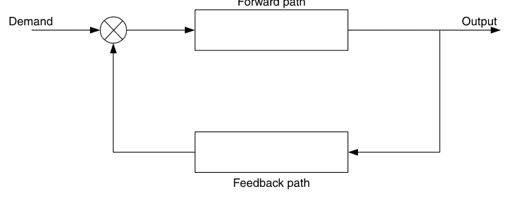

图 9.1 经典闭环控制系统描述。

因此可以看出，对系统物理边界的考虑立即引发了许多额外的问题，这些问题会影响系统设计及其对其他周边系统的影响。图 9.2 中的图表不足以详细检查这些问题，需要考虑进一步的信息。也很明显，随着系统在投入使用前最初开发，或在其使用寿命期间演变为不同形式，这些物理考虑将变得越来越重要。说明这一主题的示例在以下章节中描述。

## 9.4 变化的系统配置

在此讨论中，考察了系统物理问题以及影响系统修改或演进的问题。所给出的示例描述了一个假设系统，其从初始配置系统 A 演变为修改后的系统系统 B，最后演变为第三种变体系统 C。除了检查硬件控制器或“黑盒”变更问题外，还解决了其他同样重要的问题，概述如下：

- *系统布线：* 在许多系统中，互连输入设备（控制器）、输出设备（执行器或效应器）和传感器的电气布线是最难更改的项目。在飞机、船只或机动车辆上，线束在车辆建造和装配期间安装，一旦车辆完成，可能就无法触及。因此，建造后布线极难更改，这可能成为一个重大限制。

- *系统软件：* 当今开发的许多控制系统使用“智能”来实现并维持足够的系统性能。这可能涉及使用计算机、微处理器或微控制器来承载和执行必要的复杂控制规律。系统性能的改变或修改可以通过改变这些控制元件来实现，但将这些变更引入或体现在现有系统中需要格外谨慎。

### 9.4.1 系统配置 A

系统配置 A 如图 9.3 所示。该图表已扩展以显示与系统描述相关的附加功能。此绘图上确定的附加项目包括以下内容：

- 一个输入设备或需求，在此显示为一个操纵杆，操作员可通过它向系统引入需求。假设该输入设备通过两根导线连接到控制器。

- 一个输出设备或执行器，提供“动力”以移动控制面或其他效应器，从而使系统满足操作员的需求。假设该执行器通过四根导线连接，以便执行器需求和反馈信号可以交换。

- 一个控制器，单元 1，用于闭合系统的控制回路。假设该控制器在前向控制通路中具有时变控制规律 F₁(t)，在反馈通路中具有固定增益 K1。

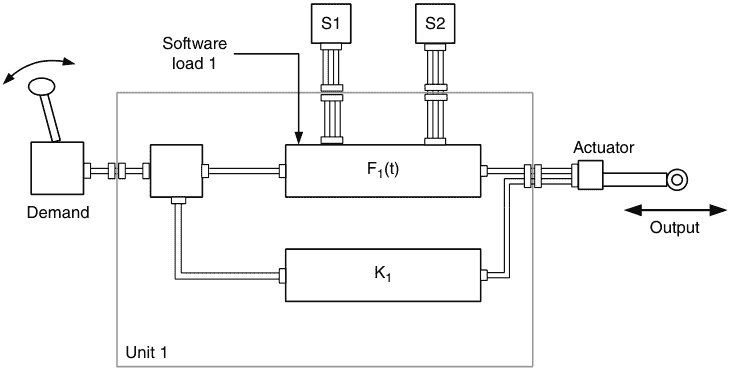

**图 9.3** 系统配置 A。

- 测量外部世界或其它系统中参数的传感器用于修改前向通路控制功能 F₁(t) 的实时性能，并显示为四线传感器 S₁ 和 S₂。
- 假设一个系统软件负载，称为软件负载 1，已加载到执行与 F₁(t) 功能相关联的软件的计算设备中。

该图表有效地以简写形式概括并描述了实现完整系统操作所需的所有要素。在系统开发阶段，设计工作将集中于确保所有这些项目，即硬件、软件和布线，能够同步开发并进行测试，以验证其符合原始系统规范。

### 9.4.2 系统配置 B

系统配置 B 如图 9.4 所示。如果系统从原始配置开发或演进，可以进行变更以增强性能、提高可靠性并提供其他益处和改进。系统 B 与原始配置 A 的不同之处如下：

- 前向控制通路控制规律已从 F₁(t) 修改为 F₂(t)，尽管所需的传感器 S1 和 S2 未变。用于适应控制规律变更的软件负载体现为软件负载 2，并且必须下载该软件以实现新的控制规律。
- 作为反馈通路性能改进的一部分，添加了新的时变控制规律 K₂(t) 和新的传感器 S3。对反馈通路控制规律的变更包含在软件负载 2 中。
- 这些硬件和布线方面的修改效果是为单元 2 增加了一个额外的四线电气输入，以容纳来自新传感器 S3 的输入。这可能需要一个额外的连接器，从而改变硬件配置。

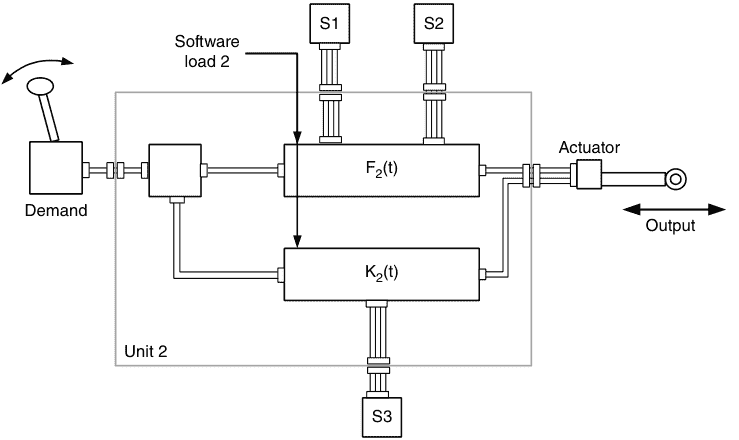

图 9.4 系统配置 B。

- 系统 A 和 B 现在具有不兼容的硬件，因为后者需要额外的四根导线与传感器 3 接口，并且可能需要一个额外的连接器。在当前形式下，与系统 A 和 B 相关的单元 1 和单元 2 将不可互换。对于同时使用两种变体的客户，这将导致额外的支持负担，因为两种变体都需要维护备件、技术手册、技术人员培训等。

### 9.4.3 系统配置 C

考虑最终系统，系统配置 C，如图 9.5 所示。在此系统中假设以下内容：

- 控制规律在前向通路中修改为 F₃(t)，在反馈通路中修改为 K₃(t)。与此实现相关的进一步修改的控制规律体现为软件负载 3。
- 与软件负载 3 相关的改进控制规律已使传感器 2 在前向通路中的持续使用变得多余。该传感器不再需要用于正确的系统操作，因此可以移除。
- 可以看出单元 3 与系统 B 中的单元 2 具有相同的硬件配置，唯一例外是传感器 2 未连接。只要存在正确的软件负载，即单元 2 的情况为负载 2，单元 3 的情况为负载 3，单元 2 和单元 3 即可互换。对于同时使用系统配置 B 和 C 的操作员，这可能导致支持负担的显著降低。

三个系统配置的总结在表 9.1 中给出。

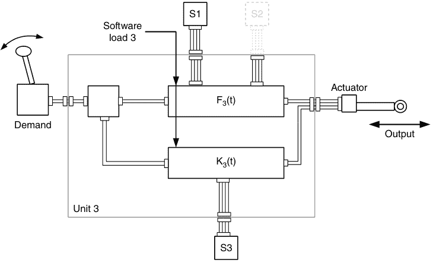

**图 9.5** 系统配置 C。

**表 9.1** 系统配置对比。

|  | **系统配置** |  |  |
|---|---|---|---|
|  | **系统 A** | **系统 B** | **系统 C** |
| 传感器 | 2 | 3 | 2 |
| 变量 | F₁(t) | F₂(t), K₂(t) | F₃(t), K₃(t) |
| 导线 | 14 | 18 | 14 (18) |

## 9.5 前向兼容性与后向兼容性

上述示例说明了前向兼容性与后向兼容性的概念，下文将对此进行更详细的描述。当客户可能采购在不同时间尺度下开发的类似系统，并希望确保早期版本与后期版本之间（或反之）的兼容性时，前向和后向兼容性问题便是一个重要的考量因素。

### 9.5.1 前向兼容性

前向兼容性描述的是最初（可能较早）的系统变体演进到后期系统的情形，如图 9.6 所示。

客户会希望确保后期系统（系统 Y）与早期系统 X 兼容。在这种情况下，他希望确保两个系统在形态、安装配合和功能方面均兼容。

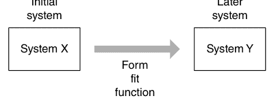

**图 9.6** 前向兼容性。

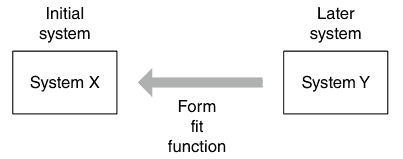

**图 9.7** 后向兼容性。

形态（Form）涉及控制器或“黑盒”的外形；显然，如果盒 X 需要替换盒 Y，那么它的尺寸和形状必须相同。安装配合（Fit）涉及物理属性的其他方面。盒体不仅应具有相同的形状，其他详细参数，如电连接器类型和方向、物理安装和固定装置、冷却通风口和开口的对齐方式等，也都应安排妥当，以确保一个盒体能够在无需修改的情况下物理替换另一个盒体。

功能（Function）涉及设备的性能特性。如前所述，对于许多现代系统而言，这可能受到所加载的软件程序以及其中包含的必要控制律的影响。然而，执行软件的处理器或微处理器的一些详细性能特性也可能对性能产生影响。处理器类型、指令集、时钟速度和内存配置都可能影响软件的正确执行，任何将应用程序从一台计算机迁移到另一台计算机的 PC 或笔记本电脑用户都会明白这一点。

因此，成功实现前向兼容性必须确保从盒 X 到盒 Y 的变更涵盖所有这些问题，并且从一种到另一种的变更在系统性能方面对系统操作员完全透明。

### 9.5.2 后向兼容性

相反的情况称为后向兼容性，如图 9.7 所示。

后向兼容性涉及与前向兼容性相关的所有问题，但在这种情况下，它涉及确保后期系统能够满足早期实现的要求。在实践中，这通常比前向兼容性更难实现。

## 9.6 影响兼容性的因素

对于安装在车辆、汽车、船舶、飞机等中的这类系统，影响兼容性的因素如图 9.8 所示。这些因素可能与系统设计和实现的三个不同领域相关：

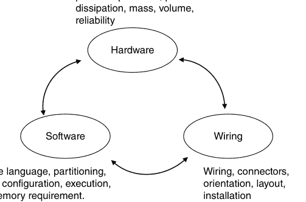

图 9.8 影响车辆中兼容性的因素。

- 硬件
- 软件
- 布线。

这三者必须兼容，才能提供一个满足性能目标且可行的运行系统。

### 9.6.1 硬件

与硬件相关的方面已在前文概述。它们包括：

- 物理形态和安装配合
- 物理方向和安装
- 重量和重心
- 对预期环境的适应性：温度、振动、电磁干扰（EMI）等
- 功耗和冷却需求
- 可靠性。

### 9.6.2 软件

与软件执行相关的考虑因素也很重要：

- 处理器类型
- 指令集
- 软件语言
- 时钟速度
- 内存配置。

可以看出，许多可能影响软件执行的考虑因素都与控制器的详细设计有关，而非某些较高层次的物理形态和安装配合问题。由于这些相互作用，如果控制器内的处理器因元器件过时而被更换，而形态和安装配合保持不变，那么功能（性能）可能会受到微妙的影响。

### 9.6.3 布线

布线问题也很重要。需要解决的主要问题包括：

- 连接到操纵杆、传感器、执行器和作动器的互连布线
- 连接器类型和方向
- 电压降
- 线束——电缆长度、布线路径和安装
- 针对电气故障的布线保护
- 线束散热
- 屏蔽、接地、搭接，以及对 EMI、外部高强度射频（RF）场和雷击的敏感性。

上述列表并非详尽无遗，但它表明了许多需要协调一致的问题，以确保系统的兼容性以及在预期环境中按规定执行的能力。

## 9.7 系统演进

到目前为止，第 9.5 节描述了设计人员如何可能需要考虑前向和后向兼容性，以确保同一系统的早期和后期实现之间的互操作性。第 9.6 节说明了如何必须维护代表整个系统的硬件、软件和布线三位一体的兼容性，以保证每种工作配置。

实际上，必须同时解决这两方面的问题，以确保在系统或产品演进的每个阶段，工作系统都得到验证，如图 9.9 所示。该图展示了硬件、软件和布线等每个关键领域如何随时间从左到右演进。在每个阶段或系统配置中，这些元素也应兼容，以确保规定的系统性能得以维持。

对于大型系统，仅开发和验证一个系统配置就可能需要数年时间。以现代战斗机为例，其开发计划从项目启动到投入使用通常超过 10 年。对于大型计划，生产周期可能持续 10 至 20 年，在生产阶段的不同时期会采用不同的生产配置。最后，服役阶段可能持续数十年，在此期间可能会实施进一步的修改或能力升级。这样的产品可被视为“系统的系统”，而构成整体的许多系统、子系统和组件都将有自己的兼容性问题。

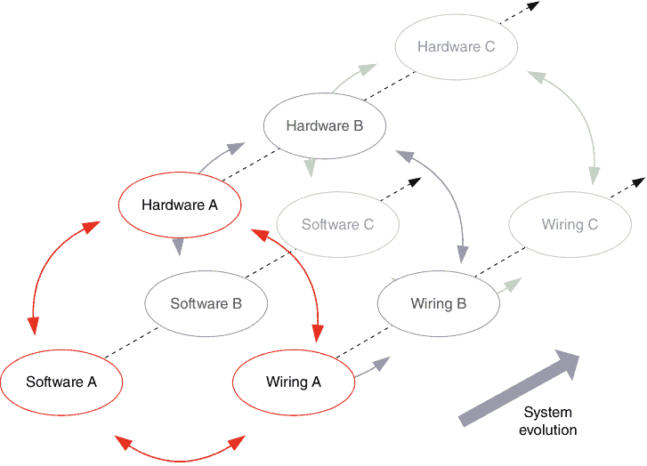

**图 9.9** 长期系统演进。

本节试图强调一些在系统开发和服役阶段实现必要配置控制时必须解决的实际问题。虽然这是一个简化的概述，但可以看到，随着系统在时间推移中经历不同实现方式，必须考虑许多问题。

## 9.8 配置控制

飞机控制系统中使用的任何微处理器或微控制器的通用结构如图 9.10 所示。
中央处理单元（CPU）包含一个算术逻辑单元（ALU）和一个控制元件，后者负责对应用软件指令进行排序。在最简单的形式中，至少会提供两个内存区域：

- 程序存储器或只读存储器（ROM），其中包含可执行软件
- 数据存储器或随机存取存储器（RAM），其中包含执行程序所需的可变数据。

在较新的设计中，很可能包含某种非易失性存储器，用于存储关键系统数据，如故障历史、内建测试（BIT）结果等。将提供输入和输出设备，以便机器与其外围设备接口。在更高层次上，处理器将包含在一个航空电子航线可更换单元（LRU）中，该单元构成一个

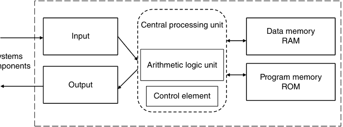

- **输入/输出：** 将数据读入机器并将结果输出到系统组件。
- **控制：** 排序构成计算机程序的指令序列，该程序存储在程序存储器中。
- **算术逻辑单元：** 执行算术和逻辑运算
- **数据存储器：** 存储运算的中间结果和最终结果

**图 9.10** 微控制器的通用架构。

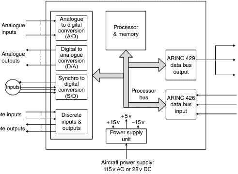

- 典型的机载计算机包括
  - 电源
  - 处理器
  - 实际世界 I/O
  - 数据总线 I/O
- 加上特定应用功能，例如
  - 图形处理器
  - 信号处理器
  - RF RX/TX
- 加上集成传感器
  - RLG
  - 传感器

**图 9.11** 典型的 LRU 架构。

这是一种方便的方法，可以在单元失效时将其从飞机上拆下。这些单元可以架装在舱段的设备舱中，也可以有时直接安装到飞机结构上，如电气布线部分所述。从功能上讲，该单元包含以下元素，如图 9.11 所示：

- 一个或多个电源，用于将飞机交流电或直流电转换为为电子设备提供稳定电源：±15V、+5 V、+3.3 V。
- 输入/输出模块，用于与飞机传感器接口：模拟输入和输出、离散输入和输出以及其他专用信号。

- 该单元还将具有数据总线接口，以实现与其他飞机系统之间的数据交换。图中显示了 ARINC 429 数字数据总线接口，但较新的飞机更可能在飞机级别使用 ARINC 664 总线，在系统内部使用 CANbus，正如 ICD 部分所述。

要使系统作为功能实体运行，所有硬件和软件元素都需要和谐一致地工作，在系统中传递有效的数据集，例如操作软件程序。

数据的正确处理以不同的方式进行，也许最容易描述的方法是举几个例子：

- 对于所示的 ARINC 429 数据总线接口，数据集由相应的飞机设备 ARINC 规范固定。所有预期的数据范围、缩放、精度和刷新率均已指定，使得符合该规范设计的所有设备都将相同。这具有这样的优点：例如由不同设备供应商生产的特定飞机设备，例如 VHF 收发器（按 ARINC 566 定义）可以互换。缺点是它在系统设计师如何配置系统数据方面去除了灵活性。

- 在广泛用于军用飞机的 MIL-STD-1553B 数据总线的例子中，系统设计师可以自由地自行指定所有数据集，前提是数据总线根据 1553B 协议正确运行。在这种情况下，设计师承担了指定和维护连贯数据集的负担。这将包括指定使用哪些远程终端（RT）地址和子地址，以及定义允许 LRU 内的处理器和数据总线元素通信的程序的规范。最后，系统设计师负责设计、编码和测试总线控制器软件，该软件充当整个系统的数据调度器。

- 在 ARINC 664 的例子中，这是像空客 A380 和 B787 这类飞机上使用的飞机级数据总线的典型代表，集成任务更为复杂，值得更详细地研究。特别是，A380 引入了一种模块化航电架构，使用新的通用核心模块通过航电全双工交换（AFDX）互联网（ARINC 664）进行接口，同时仍使用具有有些过时但仍然有效的 ARINC 429 数据总线的旧设备。

### 9.8.1 空客 A380 示例

A380 是引入飞机范围内的通用处理器元素——通用处理器输入/输出模块（CPIOM）——的第一个例子，使用 ARINC 664 的一个版本连接在一起。在空中客车术语中，这称为 AFDX 互联网，它是一种双铜线总线传输系统，使用 COTS 100BaseT 技术（100 Mb/s 数据通过双绞线对传输），该技术最初是为交换式分组数字电话交换机设计的。数据总线在实现上是双冗余的，并通过一系列 AFDX 交换机将核心集成模块架构（IMA）架构连接在一起，如图 9.12 所示。

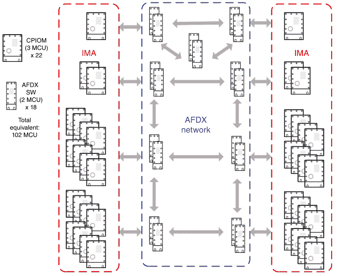

**图 9.12** 空客 AFDX/IMA 架构。

- 在飞机的中央脊梁内是 AFDX 交换网络——总共 18×2 个模块化概念单元（MCU）大小的交换机，以双冗余架构将飞机的关键区域连接在一起。
- IMA 由总共 22×3 个 MCU CPIOM 组成，它们提供了飞机系统处理的处理器核心。实际上，由于不同的输入/输出要求，共有七种不同的 CPIOM 类型，称为 CPIOM A 至 CPIOM G。例如，CPIOM G 专为飞机起落架设计，而 CPIOM F 则针对燃油系统要求量身定制。尽管有七种不同类型的 CPIOM，但每个内部的处理器是通用的，所有类型都由通用的软件开发环境和工具集支持。与以前的架构相比，实现了巨大的通用性。

这种安排对于新的“核心”系统运行良好，但空中客车仍面临如何接口来自以前空中客车系列型号的现有或旧系统的难题，通常是后期的 A320 型号和 A330/A340。许多设备使用 ARINC 429 数据总线接口，对于 A380 来说功能上完全足够，但将这些功能嵌入新的 IMA 核心将是一项冒险且昂贵的任务。所采用的解决方案是将这些旧系统保持不变，本质上是中央核心的周边，并依靠现有的 ARINC 429 数据总线将各个元素集成在一起。该解决方案的关键属性在以下文本中描述。

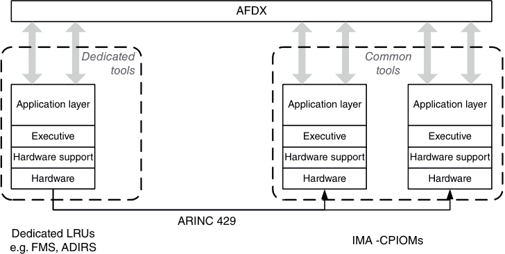

**图 9.13** AFDX 设备示例。

在图 9.13 中，典型的旧系统如飞行管理系统、空速和惯性基准系统等显示在左侧。这些系统没有直接与飞机级 AFDX 总线接口的能力。它们确实拥有从以前架构继承的现有 ARINC 429 数据总线，使它们能够与 CPIOM 通信。与这些单元的硬件/软件配置相关的开发工具将由早期空中客车型号开发时的开发限制所固定。

IMA 通用核心元素显示在右侧。这些元素能够直接与 AFDX 交换机以及飞机级 100 Mbit/s 数据总线接口。硬件/软件组合使用通用工具和最先进的开发方法开发，这些方法超出了本书的范围。简而言之，它是使用“三层堆栈”技术开发的，其双重目的是将硬件实现与淘汰的影响隔离开来，同时为分区软件提供高度的可移植性，以便在不同应用之间移植。

后门 ARINC 429 数据链使专用旧 LRU 能够与 IMA/CPIOM 核心通信。

需要解决的最后一个问题是如何为 AFDX 网络定义和控制数据通信。答案在于使用配置和换接表，如图 9.14 所示：

- 配置表驻留在设备内，确定数据输入/输出以及该数据的格式。
- 换接表驻留在 AFDX 交换机内，控制数据在网络中 LRU 与 CPIOM 之间的移动。

只有当一组连贯的配置表和换接表得以体现时，系统数据流才会正确。正确的配置控制对于确保实现这一点至关重要。

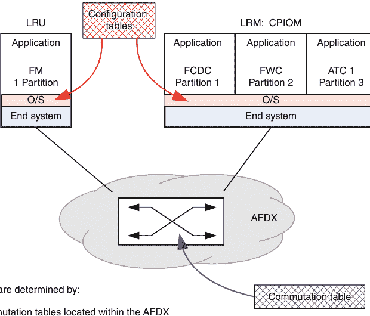

数据流由以下因素决定：

- 位于AFDX交换机内的固定交换表，决定数据交换和虚拟链路（VLs）
- LRU/LRM操作系统（O/S）内的配置表

**图9.14** AFDX数据传输控制。

## 9.9 接口控制

各利益相关方拥有的系统组件之间接口的控制至关重要。需要建立严格的机制来定义接口，并记录各所有者之间的所有权和协议。

### 9.9.1 接口控制文件

现代COTS技术的日益普及提供了更强大的系统功能和性能，但同时也带来了复杂性的增加。所有飞机系统接口都必须加以定义和界定。每个飞机系统都与其他系统交互，因此飞机真正是一个“系统的系统”。图9.15对此进行了说明。

为了定义和控制系统接口，使用ICD来定义所有电气接口。为了说明这一点，这里描绘了一个由四个单元组成的概念系统。图9.15所示的示例可能是大型运输机上的燃油测量与管理系统的典型情况。单元A和B表示燃油测量与管理系统计算机，而单元C和D表示远程数据集中器，它们直接与飞机燃油箱内的组件接口，如燃油测量探头、温度和密度计传感器，以及燃油泵和阀门。

| 飞机数据总线 [ARINC 664] | 飞机系统输入/输出 | 系统内部数据总线 [CANbus] |
| --- | --- | --- |
| **系统输出：** 左翼总油量 右翼总油量 总机载燃油（FOB） 燃油低温警告  **系统输入：** 飞机俯仰姿态 飞机横滚姿态 飞机速度 外部大气温度 | 燃油探头1 燃油探头2 燃油探头n  **功率输出：** 左外增压泵 左内增压泵 传输泵1 | 左燃油箱1 燃油总量 左燃油箱1 燃油温度 左燃油箱1 燃油密度 左燃油探头状态 等。  右燃油箱1 燃油总量 右燃油箱1 燃油温度 右燃油箱1 燃油密度 右燃油探头状态 等。 |

**图9.15** 飞机ICD示例。

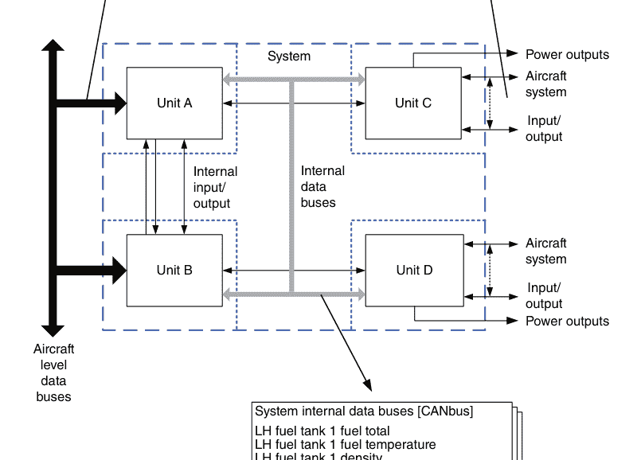

在所选的简化系统示例中，有四大类系统接口：

- **飞机级数据总线：** 对于波音787或空客A380/A350等飞机，飞机级数据总线将以ARINC 664数据总线的形式实现。这些飞机级数据总线通常采用起源于电信行业的COTS技术，以100 Mbit/s的速率传输数据，使用传统的双绞线或光纤技术。
- **系统内部数据总线：** 在系统内部，单元之间需要以较低的带宽交换数字数据。通常使用一种名为CANbus的COTS数据总线，该总线由博世开发，最初用于汽车自动制动系统（ABS），虽然采用确定性和加固形式。典型数据速率约为1 Mbit/s。
- **系统单元之间的内部系统输入/输出信号：** 单元之间的硬接线信号，用于比较数据、同步系统计算机的操作，并确定哪个计算机/通道处于控制状态。
- **系统内部接口，其中远程数据集中器与飞机燃油箱内的组件接口：** 关键问题包括提供电气本质安全接口，其中允许进入油箱为燃油探头供电的功率被限制在极小的能量水平，以确保系统本质安全。

### 9.9.2 飞机级数据总线数据

飞机级数据将包括对飞行机组操作飞机有用的顶层飞机数据。在许多情况下，这些数据是其他飞机系统所需的数据，或需要显示给飞行机组的数据。在图9.15的示例中，系统提供的典型数据可能包括总机载燃油（FOB）或各个燃油箱的油量。还将提供警告和咨询数据。

燃油系统的输入将包括飞机姿态信息，以便准确计算燃油量并根据飞机速度进行修正，以及外部大气温度（OAT），这对于理解在高空长时间低温浸泡期间的燃油低温问题尤为重要。

### 9.9.3 系统内部数据总线数据

许多系统使用内部系统数据总线来交换特定于系统的数据。在图9.15所示的示例中，交换燃油探头和其他传感器数据。系统内置测试（BIT）和其他与传感器健康相关的数据将包含在内。系统还将具有内置监视器，以确保不发生危险事件，并确保飞行机组充分了解任何故障，并获得应采取何种补救措施的建议。

### 9.9.4 内部系统输入/输出数据

系统单元之间将存在一些硬接线接口，这些接口不适合通过内部数据总线传输。

### 9.9.5 燃油组件接口

ICD定义并控制以下所有参数的定义：

- 电气特性
- 导线尺寸和类型
- 接地和屏蔽
- 端接和匹配
- 数据分辨率和精度
- 数据速率和刷新速率
- 功率电平
- EMI（电磁干扰）分类。

## 9.10 日常文件控制

如第8章所述，办公室中的大量日常沟通通过电子媒体进行。纪律对于确保这些沟通以某种方式被记录和控制至关重要。我们很容易将文件发送出去供审查，并在未记录文件已更改的情况下纳入评论。使用多种设备进行文件编制，再加上易于获得的存储驱动器，使这种情况更加容易发生。例如，可以使用公司台式机、便携式笔记本电脑、平板电脑或智能手机来编制报告。需要建立并采用一套最低限度的规则。这些规则应包括以下内容：

1. 应在文件扉页上注册并清晰标示一个唯一编号，最好也放在页眉中。
2. 扉页上应包含标题。
3. 应包含作者姓名，最好还要有检查和授权人姓名。
4. 应包含文件首次发布的日期。
5. 每次版本状态变化都应记录，例如修订版（Rev 1、Rev. 2等）、新版次（Iss 1、Iss 2等），并注明草稿或正式版。
6. 该版本状态变化应包含在文件扉页、页眉、文件名和封面电子邮件中。
7. 最好包含一页，记录配置记录的每个阶段。

在图9.16中，一份报告以Word文件名“Title Issue A.doc”撰写并首次发布为草稿A。该报告发送给若干人征求意见。收到意见后，报告更新并重新发布为“Draft A Rev 1”。文件名更改为“Title Iss A Draft rev1.doc”。报告再次发布，以便人们检查他们的意见是否被正确理解，并在必要时进一步提出意见。如果收到更多意见，报告将再次更新并发布为“Title Issue A Draft Rev 2”，文件名重命名为“Title Iss A rev2.doc”。经过进一步意见或协议后，报告升级为“Iss B Draft”，文件名重命名为“Title Iss B.doc”。经过正式审查或项目批准后，该报告被认为适合使用，并以“First Full Issue Iss 1”正式发布，文件名为“Title Iss1.doc”。

文档进展

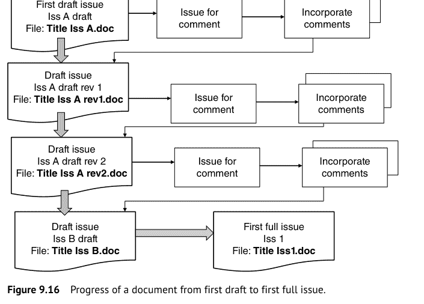

**图9.16** 文档从初稿到首次正式发布的进展。

这些规则不仅仅是出于过程本身而遵守过程，而是一种确保项目设计过程中使用的信息经过仔细编制、严格检查、存储在正确位置，并且易于识别为可信数据的措施。

## 练习

1. 考虑这样一种情况：一份图纸或文件已发布并分发征求意见。意见已收到并纳入，文件已发布用于分发，但其版本状态尚未更新。随着工作的继续进行，当文件再次需要更新时，列出一些影响。你认为这种情况对接收者有何影响？

