# 10

# 飞机系统示例

## 10.1 引言

本章的目标是概述一个具体系统，通过将系统问题置于整体背景中，使读者更好地理解和消化前几章的内容。

一个有助于说明多个系统之间交互的有用示例是考察现代民用飞机上各系统之间的相互关系。民用飞机是一个有趣且或许近乎独特的研究对象，因为许多系统都需要满足高水平的完整性要求，飞机才能成功完成飞行。与此同时，这些相同的系统还必须在高温或低温的恶劣环境中，并且往往在高振动条件下安全可靠地运行。飞机需要满足性能目标的要求对重量和体积施加了额外限制，因此必须平衡并满足这些要求，使飞机既能安全又能经济地执行任务。

图10.1中显示了有助于飞机运行的三大类系统。飞机结构包括机翼、机身和尾翼，提供升力面、操纵面和客舱。飞机系统包括推进系统、飞行控制、燃油、液压和环境控制系统，提供飞行的手段。航空电子系统是飞机的“大脑”，提供导航、通信、自动驾驶和显示功能。本书将讨论飞机系统和航空电子系统。配套卷册将使读者能够更详细地研究这些主题，以帮助理解本章所阐述的原理（Moir and Seabridge 2008, 2013）。

## 10.2 设计考虑

飞机的设计遵循图10.2所示的方法。

首先要定义的是任务需求：在有效载荷、速度和航程以及运营成本方面，飞机需要实现什么？这决定了飞机的角色定位。显然，一架设计用于从伦敦飞往

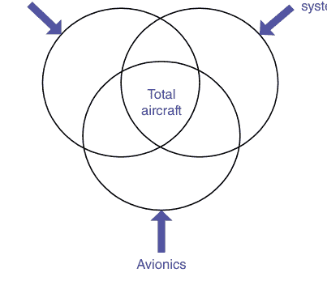

图10.1 飞机主要系统概览。

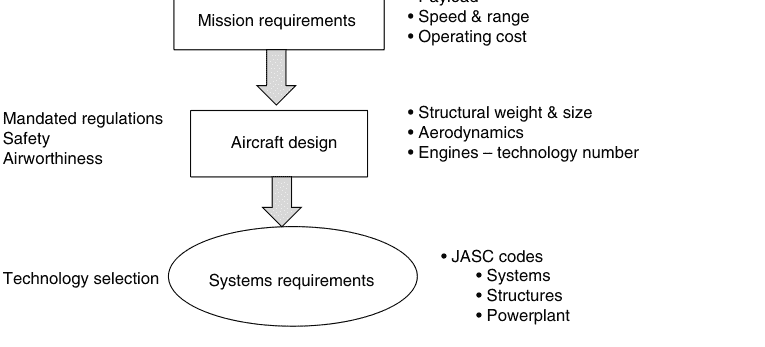

图10.2 顶层设计过程。

芝加哥的远程大型客机，其特性将不同于一架用于从芝加哥飞往大急流城的短程支线客机。

任务需求将决定飞机的总体设计，确定结构重量和尺寸以及空气动力学特性。发动机的数量和类型也将被确定。这些物理参数还受到适用于飞机设计的强制性法规以及安全和适航性考虑的制约。

最后，飞机设计将向下细化为详细的飞机系统需求：所采用的技术以及飞机系统的类型和能力。在民用领域，功能性飞机系统由FAA/JASC（2002）代码定义，该代码对每种系统类型进行分类。在该系统分类中，2400始终对应电源，2700对应飞行控制，2900对应液压动力，依此类推。

## 10.3 安全性与经济性考虑

一个关键要求是平衡安全性与经济性需求，如图10.3所示。自然，在任何交通形式中，安全都必须是首要考虑因素，而在航空旅行中这一点尤为突出。影响安全的因素有若干：

- 系统功能：系统必须执行的任务。在燃油系统中，这可能涉及在飞机上转移燃油，以保持重心处于正确位置，从而减少配平阻力并增加飞机航程。
- 性能：这与系统的真实性能有关；对于某些类型的机动或程序，飞机可能需要以比其他情况更高的导航精度飞行。
- 完整性：系统架构的固有特性，确保系统足够稳健，在一个或多个系统故障后仍能继续安全运行，确保乘客安全送达目的地。
- 可靠性：系统或组件持续正确运行的固有能力，从而确保系统功能和设计完整性水平得以保持。
- 签派可用性：这涉及在存在已知系统缺陷的情况下签派飞机执飞航班的能力。即使某些缺陷可能在飞行开始时及整个飞行过程中存在，飞机仍必须能够满足设计的性能和完整性水平。

航空公司或包机运营商运营飞机必须具有经济性，否则公司将陷入财务失败，无法继续提供服务。运营经济性受以下因素影响：

- 功能、性能、可靠性和签派可用性都可能影响运营经济性，因为它们都会影响系统成本。只有完整性不能因经济原因而妥协，原因显而易见。
- 可维护性：这关系到使系统保持良好状态以提供正确功能的维护便利性。它可以包括部件更换、修理和测试的便利性。

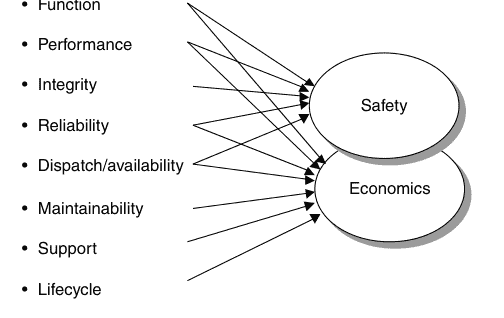

图10.3 安全性与经济性考虑。

- 保障：这是一种提供备件、文档、培训以及专业知识等基础设施的能力，以便在飞机运营期间为系统提供支持。
- 全寿命周期：这涉及“从摇篮到坟墓”的概念，即在系统达到其使用寿命结束之前的所有阶段，对其进行定义、设计、开发、制造和保障。

## 10.4 故障严重性分类

在航空航天工业中，故障严重性等级以明确无歧义的方式普遍规定，如表10.1所定义。

故障严重性主要有四类。最严重的是灾难性故障，它将导致飞机和乘客的损失。此类事件发生的概率被规定为极不可能，并且从分析或定性角度，要求灾难性故障的发生率应小于每飞行小时1×10⁻⁹，即每10亿飞行小时不到一次。其他较不严重的故障是危险的、重大的和轻微的；在每种情况下，风险水平降低，事件发生的概率相应增加，因此，轻微故障——例如航行灯故障——可以被预期为相当可能发生，此类事件的发生率小于每飞行小时1×10⁻³，即每1000飞行小时不到一次。

在初始飞机设计过程中，所有可能导致各种故障严重性等级的故障都会被识别出来，并据此修改飞机系统设计；因此，在飞机制造出来之前很久，所有这些情况就已得到识别，采取了适当的设计步骤，并保证了设计质量。这一过程有助于确定系统架构、控制和电源通道的数量、冗余度等。它还根据故障可能产生的影响规定了设计保证等级。

## 10.5 设计保证等级

表10.2列出了美国无线电技术委员会（RTCA）文件DO-178B和DO-254的设计保证等级；DO-178B用于规定软件设计程序，DO-254用于规定硬件设计程序。其他相关

表10.1 故障严重性定义。

| 故障严重性 | 概率 | 分析 |
|---|---|---|
| 灾难性 | 极不可能 | 每飞行小时小于1×10⁻⁹ |
| 危险 | 极罕见 | 每飞行小时小于1×10⁻⁷ |
| 重大 | 罕见 | 每飞行小时小于1×10⁻⁵ |
| 轻微 | 相当不可能 | 每飞行小时小于1×10⁻³ |

## 表10.2 设计保证等级。

| 设计保证等级（DO-178B软件/DO-254硬件） | 定义 |
|---|---|
| A | 其异常行为（如SSA所示）会导致或促成系统功能失效，进而使飞机处于*灾难性*失效状况的设计 |
| B | 其异常行为（如SSA所示）会导致或促成系统功能失效，进而使飞机处于*危险性*失效状况的设计 |
| C | 其异常行为（如SSA所示）会导致或促成系统功能失效，进而使飞机处于*重大*失效状况的设计 |
| D | 其异常行为（如SSA所示）会导致或促成系统功能失效，进而使飞机处于*轻微*失效状况的设计 |
| E | 其异常行为（如SSA所示）会导致或促成系统功能失效，进而使飞机处于*无影响*失效状况的设计 |

SSA，系统安全分析。

相关文件为 ED 12 和 ED 80，它们分别是欧洲民用航空设备组织（EUROCAE）对应 DO-178B 和 DO-254 的等效文件。

这些设计保证等级根据右栏中的定义从A到E进行分类。可以看出，灾难性、危险性等失效状况与表10.1中列出的失效严重性状况相对应。因此，最高的设计保证等级——A级——对应灾难性失效严重性，其发生频率应低于每飞行小时1×10⁻⁹。这一逻辑延续到B至D级，并且可以看出，当失效无影响时，额外设置E级。

通过这种方式，系统设计受到严格审查，以确保每个系统满足必要的设计目标，从而满足所需的完整性等级。此外，随着系统失效对飞机和乘客的影响和后果变得更加严重，该过程规定了越来越严格的设计保证等级。

支持这一设计过程的文件是由航空航天行业最有经验的设计师制定的，最初作为行业最佳实践，随后被采用并强制用于所有设计过程。通过这种方式，行业设立了统一的高标准，全球航空航天界的所有人员在系统设计期间都必须遵循这些标准。

## 10.6 冗余

现代民航客机系统的复杂性意味着需要采用特殊的设计规则。这些方法在本卷其他地方有所描述，是开发过程中的关键部分。许多对飞机飞行至关重要的系统都需要维护机组人员和乘客的安全与健康。用航空航天界的术语来说，这些是飞行关键系统。

在工程设计阶段，系统架构师采用各种冗余等级来设计系统概念，以提供所需的系统性能、可用性和安全性。这些架构经过精心设计，并使用行业范围的一系列方法、工具和技术进行评审，以便对暂定系统设计进行评估，确保其满足必要要求。

在航空航天界，这些工具提供了多种可能的架构，可用于满足系统设计需求。提供冗余控制通道会带来不同的负担。额外的通道因额外增加硬件而成本更高，同时也不太可靠，因为现在有更多通道可能失效。现代技术——尤其是电子/航空电子方面的技术——会有所帮助，因为随着时间的推移，航空电子技术在航空航天概念的使用中变得更可靠、更坚固。遗憾的是，成本和开发风险并不会同比例降低。

在这一领域中，冗余的多样性从单通道实现（单余度或1倍）到四通道实现（四余度或4倍）不等。至于可以合理采用何种冗余等级，显然存在实际限制。在实践中，四余度实现仅在特定的军事应用中使用过。

以下描述大致概述了主要的候选架构和实现，尽管在实践中，特定实现之间可能存在相当大的细微差别。

### 10.6.1 架构选项

将要概述的主要架构包括：

- 单余度（如图10.4所示）
- 双余度（如图10.4所示）
- 双/双（如图10.5所示）
- 三余度（如图10.6所示）
- 四余度（如图10.6所示）

#### 10.6.1.1 单余度架构

飞机内的许多控制系统相对简单，其失失效不会造成重大后果。此类系统在传感器和控制方面可能以单余度形式实现，如果发生故障，控制功能将丧失。故障将通过内置测试（BIT）功能检测，该功能可以是连续的或间断的。然而，BIT并不完美，传统观点认为其有效性

**图10.4** 单余度与双余度架构。

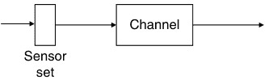

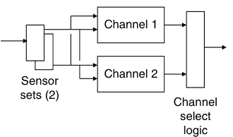

**图10.5** 双/双余度架构。

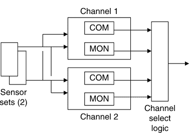

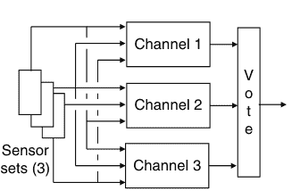

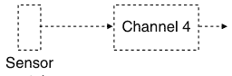

**图10.6** 三余度与四余度架构。

通常用于本质上不稳定、只有高度冗余的飞行控制系统才能使飞机飞行的飞机的飞行控制实现。这种架构的典型例子包括欧洲战斗机“台风”和诺斯罗普B-2“幽灵”隐身轰炸机。

第一次故障后，系统降级为三余度。第二次故障后，系统降级为双余度。在实际使用中，台风战斗机飞行员在第一次失效后能够继续执行任务，而在第二次失效后，最好终止任务并在第一个方便的机会降落飞机。

控制性质：故障工作 故障工作 故障安全

### 10.6.2 系统示例

如前所述，所采用的架构将与系统要求所决定的完整性（冗余）等级相关。下面给出两个示例：

- 基于重大系统效应的系统示例（如图10.7所示）
- 基于飞行关键事件的示例（如图10.8所示）

#### 10.6.2.1 重大系统事件

重大系统事件是指被认为发生概率极小、可能对机组人员和乘客产生显著影响但不一定

**要求**

| 严重程度 | 概率 | 要求（每飞行小时） |
|---|---|---|
| 灾难性 | 极不可能 | 不高于每飞行小时1×10⁻⁹ |
| 危险性 | 极罕见 | 不高于每飞行小时1×10⁻⁷ |
| 重大 | 罕见 | 不高于每飞行小时1×10⁻⁵ |
| 轻微 | 较可能 | 不高于每飞行小时1×10⁻³ |

**架构**

| 通道数 | 单通道失效 | 所有通道失效 |
|---|---|---|
| 1 | P = 1 × 10⁻³ | P = 1 × 10⁻³ |
| 2 | 2P = 2 × 10⁻³ | P² = 1 × 10⁻⁶ |
| 3 | 3P = 3 × 10⁻³ | P³ = 1 × 10⁻⁹ |
| 4 | 4P = 4 × 10⁻³ | P⁴ = 1 × 10⁻¹² |

**图10.7** 重大系统事件的概率。

子系统可能由多个串联连接的项目组成，以形成通道或“车道”。

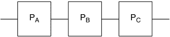

通道或车道故障的概率为 $P = P_A + P_B + P_C$ ........

完整系统很可能由多个并列排列的通道或车道组成。

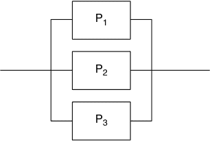

子系统故障的概率为 $P = P_1 \times P_2 \times P_3$ ........

**图 10.9**  概率分析。

液压动力源示例：

- 发动机驱动泵
- 气动泵
- 交流电机泵
- 直流电机泵

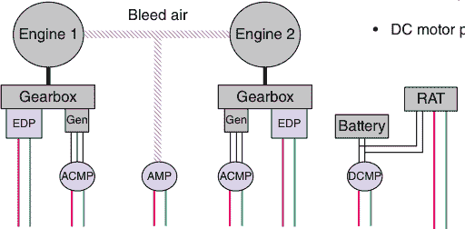

**图 10.10**  备用液压动力源。EDP，发动机驱动泵；Gen，发电机；AMP，气动马达泵；ACMP，交流电机泵；DCMP，直流电机泵；RAT，拉风式涡轮。

迄今为止的讨论主要集中在控制功能的丢失上。然而，飞行控制等系统还需要以液压和电气系统形式的“肌肉”来使其能够运行。在图 10.10 所示的示例中，液压动力源来自：

- 发动机驱动泵 (EDP)
- 使用引气的气动泵 (ADP)
- 交流驱动泵 (ACMP)
- 直流电机泵 (DCMP)
- 拉风式涡轮 (RAT) 甚至电池。

## 10.7 飞机系统集成

许多飞机系统都有助于现代民用客机的正常运行。在所选示例中，将描述以下系统：

- 发动机控制系统：在最新的飞机上，这将使用 FADEC 系统
- 飞行控制系统：如今通常为飞行线控 (FBW) 系统
- 姿态系统，用于检测飞机在俯仰、滚转和偏航方面的姿态运动
- 大气数据系统，为飞机提供其在空中运动的信息：空速、高度等
- 电气系统，为系统计算机提供电力
- 液压系统，为执行器提供“肌肉”，使飞行员能够驾驶飞机。

所有这些系统都是驾驶飞机所必需的（见图 10.11）。

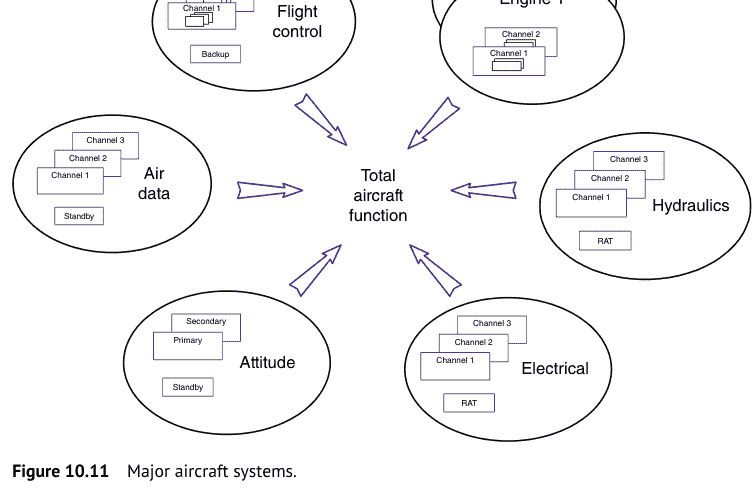

**图 10.11**  主要飞机系统。

所有这些系统都对飞机功能有所贡献。任何一个系统的完全丢失都将导致其他系统无法正常运行，因此，除了对总飞机功能有所贡献外，它们之间还存在相互依赖关系，如图 10.12 所示。

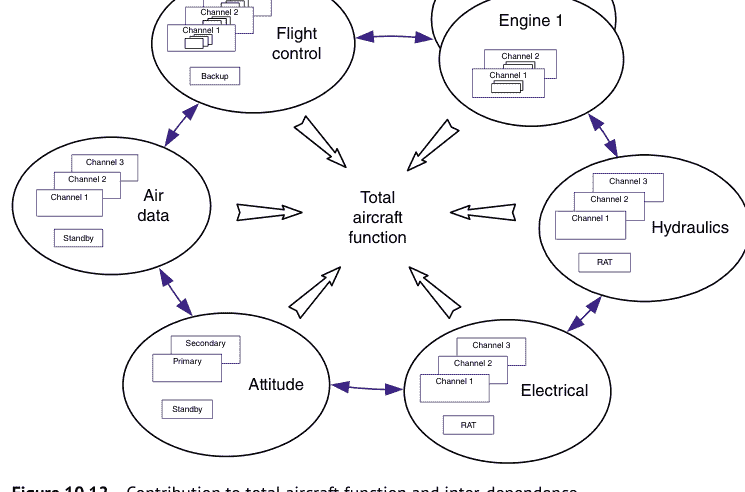

**图 10.12**  对总飞机功能的贡献及相互依赖关系。

如果飞机没有动力或推进系统使其达到飞行速度，则飞行控制系统无关紧要。飞行控制系统在没有电力来激活飞行控制计算机或液压力来为执行器提供“肌肉”的情况下无法运行。如果没有飞机姿态和大气数据信息，飞行机组将无法在飞行包线内安全驾驶飞机，也无法确定飞机正朝哪个方向行驶。此外，与飞机在空中飞行相关的大气数据是执行飞行控制和发动机系统控制律所必需的，因此，即使是这种简化的描述也表明许多飞机系统之间的相互作用有多么重要。还有其他系统，例如燃油系统、驾驶舱显示器和航空电子设备系统，同样重要，其中一些将在后面讨论。

这些系统中的每一个都是为满足高完整性级别而开发的。对于所描述的任何系统，完全灾难性故障都可能导致飞机丢失，所有系统都已根据上述最高设计保证级别开发。随着这些系统的发展，每个系统都发展出了自己的架构，美国联邦航空管理局 (FAA) 或欧洲联合航空管理局 (JAA) 等认证机构认为该架构适合满足苛刻的系统完整性要求。

在以下各节中，将逐一检查民用飞机的每个系统，并确定每个系统可能采用的典型架构：

- 发动机控制系统
- 飞行控制系统
- 姿态测量系统
- 大气数据系统
- 电力系统
- 液压动力系统。

尽管这些系统的工作原理和冗余级别对于大多数飞机来说非常相似——实际上代表了行业对共同设计说明的响应——但不讨论具体实现。本章的核心问题是从顶层来看待每个系统。有关特定飞机或技术的更详细系统架构，需要参考 Moir 和 Seabridge (2008, 2013)。

在系统设计过程中可能适用的航空航天推荐做法 (ARP) 文档可在 SAE ARP 4754 和 4761 中找到。它们不是强制性的，但包含重要建议，选择忽略其内容的系统设计师可能会在为其系统获得认证方面遇到巨大困难。

### 10.7.1 发动机控制系统

许多现代飞机有两台发动机，这是短程、中程和一些远程飞机常见的推进系统配置。图 10.13 所示的示例假设为双发涡扇推进系统。现代涡扇发动机通常由安装在其控制的发动机上的 FADEC 控制。

FADEC 架构通常由两个相同的通道组成，即通道 A 和通道 B，每个通道都能够完全控制发动机。每个通道由两个元素组成：控制车道和监控车道。控制车道控制发动机，而监控车道对控制车道进行检查，以确保其运行正确。如果控制车道发生故障，控制权将移交给另一个通道，该通道仍然拥有完全功能的控制/监控车道对。

每个 FADEC 通道（控制和监控车道）由安装在发动机上并直接由附件齿轮箱驱动的称为永磁交流发电机 (PMA) 的小型专用发电机独立提供电力。

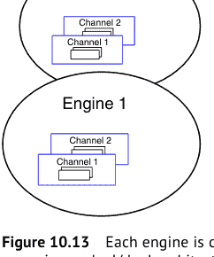

**图 10.13**  每台发动机由电子发动机控制器 (EEC) 控制。EEC 包含双/双架构，并由双重发动机源电力供电。每台发动机和 EEC 相互独立，尽管可能发生单点故障，例如严重冰雹或火山灰吸入可能导致两台/所有发动机同时故障。

因此，每个 FADEC 控制和监控车道都由发动机上专用电源供电，因此 FADEC 不依赖飞机电气系统来获得不间断电源和正确运行。如果飞机电源完全失效，此功能使发动机控制系统能够独立运行。为了充分实现发动机控制律，FADEC 需要从飞机大气数据系统获取大气数据。

在某些情况下，可能可以在监控车道（但不是控制车道）失效的情况下，将飞机派遣有限时间。之所以可能，是因为风险评估表明，在有限运行时间内，失去此监控车道（实际上是飞机四条车道中失去一条发动机控制车道）代表了一段短时间的可接受风险，也许是为了使飞机能够被空运到维修基地以进行维修。

### 10.7.2 飞行控制系统

尽管各个飞机制造商采用的理念可能不同，但大多数 FBW 系统在各种计算通道中使用多车道冗余。图 10.14 所示的示例说明了波音 777 飞行控制系统采用的三重-三倍配置。空客采用了多通道理念，在俯仰、滚转和偏航轴上采用五个独立的指令/监控通道。内置冗余使得通常可以安全地派遣多条车道失效的飞机；具体细节取决于飞机类型和系统架构，以及预定飞行的持续时间。

如果所有 FBW 计算都失效，通常可以将飞机以直接电气链接模式运行作为“回家”功能。即使此直接链接失效，当今所有 FBW 系统在俯仰和偏航通道中也都有直接机械链接，尽管这可能会降低控制权限。

为了执行控制律，飞行控制计算机需要来自飞机姿态测量系统和大气数据系统的信息。需要电力为系统计算机供电，大多数飞行控制系统执行器需要液压力。

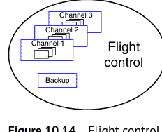

**图 10.14**  飞行控制架构将根据控制权限的程度拥有多条控制车道。在所示示例中，B777 飞行控制系统在俯仰、滚转和偏航方面拥有三个三倍计算通道，并在俯仰和滚转方面具有机械备份。FCS 还严重依赖其他系统提供数据：大气数据、飞机姿态和机体速率，以及控制和执行所需的电力和液压动力。

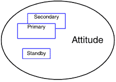

**图10.15** 飞机需要多种姿态信息来源，以便为飞行员提供姿态引导，并满足许多子系统的需求。通常提供主、次和备用姿态源：主姿态源（惯性导航系统或大气数据和惯性参考系统）、次姿态源（姿态航向参考系统）、备用姿态源用于独立备份仪表。

### 10.7.3 姿态测量系统

为了安全飞行，飞机需要俯仰、横滚和偏航姿态信息。姿态系统需要在主飞行显示（PFD）上显示俯仰和横滚信息，并在导航显示（ND）上显示偏航/航向信息，两位飞行员都拥有这些作为其电子飞行仪表系统的一部分。

此外，电传飞行控制（FBW）和自动驾驶系统需要与飞机运动相关的三轴速度和加速度数据。通常飞机具有主、次姿态系统以及某种形式的备用系统，如图10.15所示；具体实现取决于系统架构和所采用的技术。在大多数飞机上，惯性参考系统（IRS）提供主要姿态源，而二次姿态航向参考系统（AHRS）提供姿态信息的替代源。

近年来，采用微惯性传感设备和封装技术的改进技术使得小型2ATI仪表得以出现，提供综合备用仪表系统（ISIS），在主、次姿态源不可用的情况下，为飞行员提供独立的姿态信息来源。

### 10.7.4 大气数据系统

飞机在空气中飞行时，与其速度和高度有关的大气数据至关重要。当飞机作为流体介质在空气中运动时，皮托管和静压探头组合感测总压和静压。在最简单的形式中，这些信息可组合起来得出空速、高度以及升降速率。增加其他传感器，如总温探头和气流方向探测器，可以计算出更有用的导出数据。通过利用数字计算能力，大气数据计算机（ADCs）或大气数据模块（ADMs）能够计算出其他更有用的参数，如指示空速（IAS）、真空速（TAS）、马赫数等。

由于大气数据的关键性，通常设置三个独立通道外加一个备用通道，如图10.16所示。过去，备用通道由专用的小型备用仪表组成，这些仪表由各自专用的皮托管静压系统供压。上述ISIS技术的可用性现在意味着，可以用两台多功能固态备用仪表代替三台专用机械仪表。备用仪表数量的减少部分得益于从传统仪表改为固态仪表带来的可靠性提高，以及新型仪表的多功能显示能力。

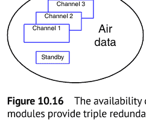

图10.16 大气数据的可用性对安全飞行至关重要。大气数据计算机或大气数据模块提供三重冗余的皮托和静压大气数据信息。计算将基本的皮托压力和静压转换为更有意义的参数，例如指示空速、真空速、马赫数、气压高度等。大气数据被许多飞机系统广泛使用。备份数据提供给备用系统。

### 10.7.5 电源系统

如前所述，电源系统是一个关键系统。绝大多数（如果不是全部）飞机系统都依赖电力供应，这些电力以115VAC三相或由变压器整流器单元（TRUs）产生的28VDC形式提供。

一种常见的发电配置是使用三台发电机，一台由每个飞机发动机驱动，第三台由飞机辅助动力装置（APU）驱动。安装APU的最初目的是在飞机起飞前在地面上时提供电源和中压空气。APU也可用作启动飞机发动机的气源。在当今服役的许多配置中，APU可在飞行中启动，从而提供第三个发电电源。在某些系统中，这可以在超过30 000英尺的巡航高度完成；在另一些系统中，飞机必须下降到中等高度——比如20 000英尺——才能使APU进入启动包线。还有一些系统在延伸航程双发运行（ETOPS）构型下巡航期间连续运行APU，即运营双发飞机（如波音737）时距离备降机场超过60分钟。ETOPS运行有特殊考虑（参见咨询通告AC 120-42A 2008）。

由于电源的重要性，还提供了进一步的备用电源系统。在较小的飞机上，这可以通过调整飞机电池的尺寸来实现，使其在主、次电源丢失的情况下能够提供短期使用（最多30分钟）的足够电力。其他飞机则依靠使用冲压空气涡轮（RAT）为飞机提供应急电源。RAT是一种空气驱动涡轮，通常收藏在飞机机身内。需要时，它被释放到气流中。它由气流旋转，并驱动一个小型内置发电机。一旦展开，RAT不能在飞行中重新收起，必须在飞机降落后由维护人员复位。正如将要看到的，RAT也可用作应急液压动力源。如图10.17所示。

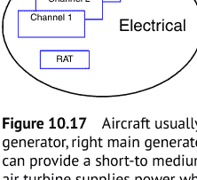

图10.17 飞机通常拥有三个独立的电源通道：左主发电机、右主发电机和辅助动力装置发电机。还提供电池，可提供短期至中期的替代能源。当所有其他电源丧失时，应急电源（如冲压空气涡轮）提供电力。

### 10.7.6 液压系统

液压动力为飞行控制和其他液压系统提供动力的需求已经描述过。通常液压动力来自安装在发动机附件齿轮箱上的发动机驱动泵（EDPs）。然而，液压泵也可由AC或DC电动机驱动。在波音的宽体飞机——波音747/767/777上，一些液压泵是空气驱动的。使用这些不同方式产生液压动力的原因是为了实现更高程度的隔离和冗余，并满足不同系统需求（流量）条件。

典型飞机将有三个独立液压系统，由飞机的EDPs、电动泵和/或空气驱动泵（ADPs）组合驱动。这些系统将被隔离，使得一个主要系统故障（如一个系统内液压油完全流失）不会从一个液压系统级联到另一个系统。有些系统使用称为动力转换单元（PTUs）的装置，可以在一个系统与另一个系统之间传递能量，同时保持它们之间的隔离。

如前所述，另一种液压动力源可由RAT驱动专用液压泵提供，在紧急情况下提供短期动力。如图10.18所示。

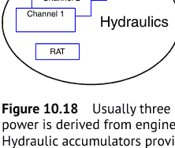

图10.18 通常提供三个独立的液压动力通道。液压动力来自发动机驱动泵、交流电动泵，在某些情况下还有空气驱动泵。液压蓄能器提供短期备用。应急动力由冲压空气涡轮提供。

### 10.8 航空电子系统的集成

前面的讨论涉及了一些飞机系统，但在现代飞机上，航空电子系统同样重要。如前所述，航空电子系统本质上是飞机的大脑，帮助飞行机组精确且安全地应对当今繁忙的空域。航空电子系统的关键要素如图10.19所示。它有四个主要功能组件：

- 导航：飞行管理、惯性导航、卫星导航、导航辅助设备，以及地形避碰警告系统（TAWS）
- 飞行控制：大气数据、姿态系统、电传飞行控制（FBW）、自动驾驶仪和自动油门
- 通信：高频（HF）、进近辅助设备、甚高频（VHF）、S模式与交通避撞系统（TCAS），以及卫星通信（SATCOM）
- 显示：主显示器，包括提供飞行信息的电子飞行仪表系统（EFIS），以及提供系统概览和状态显示的发动机指示与机组告警系统/电子集中式发动机监控系统（EICAS/ECAM）；此外还有飞机系统头顶面板、多用途控制与显示单元（MPDCUs）、设备控制面板和备用仪表。

这些功能彼此之间以及与已描述的飞机系统之间都有显著的交互。

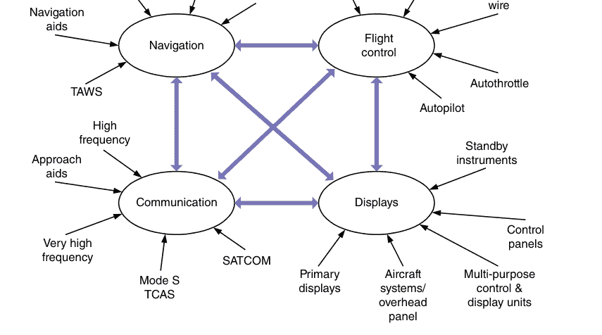

图10.19 航空电子系统的主要功能。

其中一些系统及其相互作用可以被简洁地描述为一系列嵌套控制回路。其他相互作用则更为微妙。图10.20以简化的嵌套控制回路系列形式展示了FBW、自动驾驶仪和飞行管理系统（FMS）之间的交互。

这些控制回路，从最内侧最简单的开始，向外延伸到最复杂的，如下所示：

- **主飞行控制 – ATA 第27章：** 用于控制*飞机姿态*。飞行员操纵设备的输入通过FBW系统控制计算机馈送至飞行控制作动器，作动器根据飞行员的指令改变飞机姿态。飞机动力学和姿态传感器通过视觉或EFIS显示器向飞行员提供反馈。
- **自动驾驶仪 – ATA 第22章：** 一旦自动驾驶仪接通，飞机便由下一个控制回路控制，该回路控制*飞机轨迹*。通过选择速度、高度、航向和速度基准以及导航和进近辅助设备，飞行员能够在飞行中精确管理飞机轨迹，同时大大减少工作负荷。自动驾驶仪的控制通过位于驾驶舱遮光板上的飞行控制单元（FCU）或方式控制面板实现。
- **FMS – ATA 第34章：** FMS有效协助飞行机组实现*飞机任务*。对于民用客机，这包括执行离场和进场程序，并在飞机从离场机场飞往目的地机场时，引导飞机沿一系列航路点进行导航。飞行机组与FMS的主要交互界面是多用途控制与显示单元（MCDU），驾驶舱中有三个这样的单元。

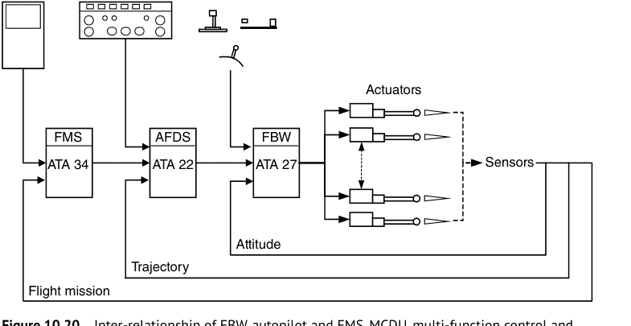

图10.20 FBW、自动驾驶仪和FMS之间的相互关系。MCDU，多功能控制和显示单元；FCU，飞行控制单元；FMS，飞行管理系统；AFDS，自动驾驶和飞行指引系统；FBW，电传飞行控制系统。

可以认识到，协调所有这些系统的总体规范（包括在不同时间尺度、不同技术基础上生产的一系列设备）是一项艰巨的任务。工业界通过采用一系列由本行业制定并供全球使用的设备和技术规范来解决这一问题。这些规范由美国航空无线电公司（ARINC）组织管理，截至撰写本书时目前存在的规范层级如图10.21所示。

ARINC规范有四个系列：

- **ARINC 400系列：** 这些被称为设计基础，涉及最早的航空电子规范。该系列中的典型包括ARINC 429（用于规定第一款民用串行航空电子数据总线）和ARINC 404A（一种早期的封装标准）。目前，ARINC 400系列中仍有21项规范在使用。
- **ARINC 500系列：** 随着电子设备在飞机设备中的日益广泛应用，人们制定了一系列规范来处理较老式模拟飞机（现称为“经典”飞机）中使用的模拟设备，如DC-9、MD-10、A300以及早期的波音737和波音747飞机。典型例子包括ARINC 578和579，它们分别用于定义仪表着陆系统（ILS）和甚高频全向信标（VOR）设备的特性。该系列中仍有约21项规范存在。
- **ARINC 600系列：** 当数字电子在民用飞机上的应用规模变得清晰时，该系列成为规定使能数字技术的载体。例如ARINC 629定义了在波音

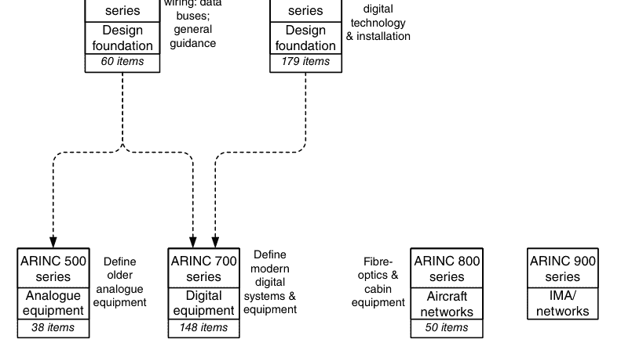

图10.21 ARINC规范层级。

777上使用的2Mb/s数字数据总线，而ARINC 600则规定了超越早期ARINC 404A标准的先进封装技术。目前约有70项ARINC 600系列规范在使用。
- **ARINC 700系列：** 为了定义当前现代数字飞机中所使用的新型数字设备，ARINC 700系列应运而生。典型例子包括用于数字气象雷达的ARINC 708，以及用于多模接收机（MMR）的ARINC 755，该接收机将GPS、ILS和其他射频接收机集成在一个单元中。目前约有66项ARINC 700系列规范在使用，毫无疑问，其他一些规范正在以草案形式制定，用于规定新的和新兴设备。这些规范的详细信息可在ARINC网站上找到。
- **ARINC 800系列：** 规范和报告定义了支持网络化飞机环境的使能技术。该系列涉及的主题包括用于高速数据总线的光纤、用于光纤电缆的A802-1，以及用于客舱分配系统的A808-1。
- **ARINC 900系列：** ARINC特性规范定义了集成模块化和/或网络化结构中的航空电子系统。它们包括详细的功能和接口定义。

## 参考文献

适航通告 AC 120-42A（2008）双发飞机延程运行，1988年12月30日。

FAA/JASC（2002）。FAA联合飞机系统/部件代码表和定义。2002年2月发布。通过Google搜索“JASC Codes PDF”获取。2019年3月访问。

Moir, I. 和 Seabridge, A. (2008)。飞机系统，第3版。Wiley。

Moir, I. 和 Seabridge, A. (2013)。民用航空电子系统，第2版。Wiley。

RTCA DO-178B，（1992）机载系统和设备审定中的软件考虑。

RTCA DO-254，（2000）机载电子硬件设计保证指南。

SAE ARP 4754，高度集成或复杂飞机系统的审定考虑，汽车工程师协会。

SAE ARP 4761，民用机载系统安全评估过程实施指南和方法，汽车工程师协会。
