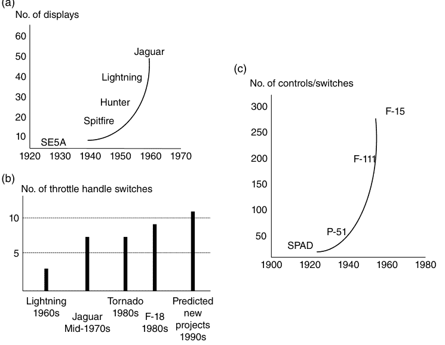
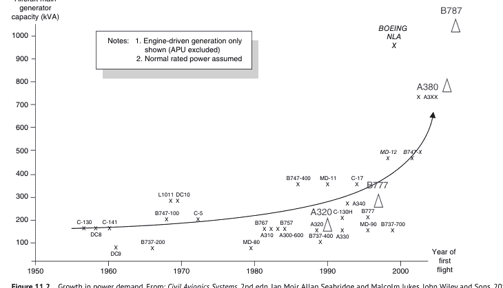
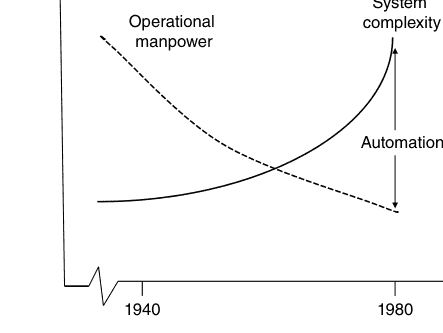

# 11

# 集成与复杂性

对飞行安全的潜在影响

## 11.1 引言

迄今为止，在本书以及莫伊尔和西布里奇的其他航空航天系列著作中，人们普遍假设飞机系统是作为独立实体设计的。这种情况在大组织中并不少见，通常是其部门或组织结构的结果，而这些结构往往围绕各个系统职责而建立。“互联性”或系统间交互的主题被引入，是为了警示设计师注意其系统性能以及飞机总体设计中与其他系统直接或间接发生的交互可能产生的意外后果。

第6章将系统集成作为系统过程持续发展的正常组成部分进行了介绍；第5章介绍了集成系统架构的主题，并给出了一些不同的系统示例。这些章节的内容仍然具有现实意义。本章考察了物理系统、功能方面以及与自动化（以及潜在的自主无人运行）相关的功能整合的结果。本章的目的是讨论这种持续的功能集成是否可能对飞机持续安全运行构成威胁。考察这一问题的原因并非要对这类创新加以限制，而是要让系统集成的管理者——总工程师、系统集成商、系统经理和系统工程师——反思这一过程，并采取行动确保不构成此类威胁。

接下来是一些观察结果和示例，有的基于经验，有的基于已发表的资料，同时还有一些警告，旨在为系统工程师和集成商提供指导。

## 11.2 集成

集成的特征在于用少量单元执行多种功能。它更常见于航空电子类系统，但也出现在主要结构和机械系统中，例如飞机动力装置和推进系统，甚至机身本身。在集成系统中，各个系统彼此交互。

- *高级语言：* 早期选择 Pascal 和 Ada 等语言，是基于其固有的严格结构以及使用有限指令集来形成安全关键软件所必需的确定性结构。随着时间的推移，这种结构在速度方面被认为具有限制性，在其固有的软件设计不优雅方面甚至显得笨拙，计算机游戏行业开始催生出更适合图形、视觉效果和高速操作的语言。首选语言变成了 C++，该语言至今仍普遍存在，并在早期抵制之后被用于航空航天应用。其使用存在潜在问题，除非强制规定有限指令集，否则可能导致非确定性结构。

- *高速数据总线：* 类似的事件序列导致从最初选择 MIL-STD-1553B 因其简单且确定性而被选择，转向广泛使用高速数据总线结构，如果设计不当，这些结构也可能表现出非确定性。

- *多功能显示器和控制装置：* 这些装置通过使用颜色和易于理解的数据和信息格式，释放了驾驶舱面板空间并提高了飞行员的态势感知能力。其中许多进步来自桌面计算和游戏世界。 perceived 需要在飞行特定阶段仅在需要时向机组人员提供信息，这意味着数据可能只有在查看了数页信息屏幕后才能访问。Cummings 和 Zacharias 将此描述为 *玻璃显示器并不总是能保证促进最佳的人类表现... 因为信息来源更多，通常隐藏在多层分层软件菜单中。很难以动态方式整合所有所需信息，使其跟上操作员不断变化的需求，同时避免不必要信息的杂乱。* 在紧急情况下，这可能成为一个问题，因为决策中信息清晰至关重要。同一作者还引用了一起事故，机组人员在忙于解决问题时将一个警报误认为是另一个警报，并指出当存在多个提示时，人类很难记住或清楚区分警报。

- *触摸、语音和开关控制：* 这些增加了将视觉屏幕信息与其他提示（如语音和听觉音调）叠加以表示事件的机会。它们还增加了飞行员对这些提示做出本能反应的机会。在受控环境中，这被视为优势，但在紧急情况下可能导致信息过载，而这些信息并非永久显示——需要记住。本能反应也可能导致反应不如面板上的开关操作那样经过深思熟虑，开关可以由第二名飞行员检查，而不是“手指一抖”。

其结果是系统端到端行为的感知遮蔽。这可能被视为无法以简单的方式追溯输入信号到输出执行器的路径——曾经检查系统行为的方式。这种遮蔽具有严重影响：

- 观察者难以设想任何单个系统和整个系统的正确行为，更严重的是，审查员在检查和签署操作正确性时也难以做到。
- 难以设计一系列测试，使其深入到不仅仅是检查适当的输入组合产生预期输出且不产生意外输出。
- 几乎不可能验证系统的健全性和隔离性，并检测任何意外交互。
- 难以确定整个系统的正确操作，而不仅仅是功能已正确执行，而是理解其机制。
- 很有可能严重问题会一直潜伏，直到特定事件组合、需求、数据结构和软件指令导致其启动。

所有这些都导致除非采取措施改善设计的视觉化和理解，否则整个设计的不确定性。

## 11.3 复杂性

现代飞机系统似乎变得更加复杂，无论是作为单个系统还是作为整体系统。其原因包括以下几点：

- 技术进步使得在高速处理架构中更容易在软件中实现更多功能。
- 工程进步的愿望：工程师和设计师将新功能纳入并应用新技术的简单需求。
- 为减少机组工作量而需要更多自动化。
- 为无人驾驶飞行器实现自主操作以及飞行甲板机组人员进一步减少而产生的愿望。
- 希望从更少的设备中获得更多功能性能。

随着计算技术使包含新功能变得更容易，客户需求因其结果而得到增强，他们的需求变得更加复杂。这可能由飞行员驾驶新机型并学习新技术而推动，从而基于他们的经验提出更多要求。工程师通常很乐意接受这种情景，因为他们自然倾向于应用新技术。

这种愿望不仅限于飞行操作方面。航空公司和军用机队维护和后勤支持也在承受提高周转时间的压力。实现这一目标的一种方法是提高故障的准确定位并向理想的维修和更换基地提供提前通知。这导致引入更复杂的算法以实现监控和机载分析以及通过数据链下载信息。这也导致了偶然的场景，即故障可以在冗余系统中“携带”，直到到达最具成本效益的维修基地。

其结果是与飞机控制和任务相关的系统与维护功能紧密相连，进一步增加了复杂性。

复杂性在工程中几乎从来都不是好事 因此有“保持简单”的格言，它也曾被特别指出 Maier 和 Rechtin 2002 并警告了复杂性对系统间互联性的影响：

- 当建筑师和建造者被要求解释成本超支和进度延误时， by far 最常见的...解释是系统比原先认为的复杂得多。
- ... 随着系统变得更加复杂，元素之间的相互关系增长的速度远快于元素本身。
- 通常认为，复杂性增加是当今建筑师和工程师面临的最困难问题的核心。

这里至少有两个重要信息。第一个是，尽管经过需求捕获、分析、仔细设计和健全评审，许多项目仍因成本和时间超支而失败。其中很大一部分与复杂性的影响有关。复杂性增加了设计和测试过程的时间，因为需要返工，并且任务被低估。重要的是要尝试评估或衡量任何趋向于增加复杂性的趋势，并将注意力集中在其解决方案上或修改估计。

第二个信息与系统元素之间关系增加有关。如果复杂性局限于有界系统，这已经够糟糕了，但当集成的影响模糊了各个系统的边界时，情况就变得难以控制。因此，集成的范围扩大到涵盖维护和空中交通管理等外部系统，这需要在设计上更加谨慎。

因此，对新系统设计进行评估以查看其是否比前代产品更复杂是好的。这种评估可用于多个目的：

- 确定将需要什么额外的设计和测试工作
- 确定将需要在新设计工具上投入多少额外投资
- 确定将需要什么新的或额外的技能
- 确定将需要什么培训
- 确保从以前项目中延续的工作或成本估计得到适当调整
- 作为确定项目可行性的辅助。

复杂性增长的迹象可以通过检查当前项目设计并将其与前代项目进行比较来估计。图 11.1 是作者在 1986 年进行的一项工作的摘录，试图估计即将到来的项目的前景，该项目将成为实验战斗机 EAP。工作是为了检查引入用于控制飞机系统的集成计算系统的可行性。

必须确定系统的复杂程度，以确保拟议的集成解决方案确实可行。任务从人机界面开始，作为飞机新功能的合适指标。图 11.1a 显示显示参数的数量正在增加，图 11.1b 显示油门手柄所需本能开关控制的数量也是如此，图 11.1c 显示驾驶舱预计的开关和控制数量。很明显，这

图 11.1 相似项目中的增长迹象。来源：转引自 Seabridge (1984)。

未来机舱可用空间中无法容纳增长，除非出现显示器、控制装置和计算能力的重大新技术——否则将没有足够的面板面积可用。虽然这些测量本身很简单，但对未来项目提出的问题包括：

- 需要多少个独立开关，以及这对控制面板面积会产生什么影响？
- 需要多少个新的显示项目，以及这对面板面积会产生什么影响？
- 正在出现哪些替代技术，可能导致更多的显示器和开关？

这些都是重要问题，最终导致了在技术允许的情况下采用彩色显示屏和“软”或多功能开关的决定。随着时间的推移，这导致了平板显示技术和触摸屏的引入。

从那时起，所采用的技术发生了重大变化，导致机组人员数量减少。这导致对飞机系统依赖于执行自动飞行、系统性能和故障监测等常规任务。

另一个例子是观察功率需求的增长。图 11.2 引自《民用航电系统》第二版（Moir et al. 2013）。它显示，随着综合航电系统的引入，功率需求开始增加，并且随着对更多乘客娱乐系统需求的增长而进一步增加。更大的飞机和更多的乘客也刺激了对更多电力的需求。一个有趣的现象是 B787 的大幅增长。这源于该飞机通过移除可变引气需求并用外部空气加压的电驱动压缩机以及电气防冰装置来取代它，从而提高发动机性能的策略。

飞机主发电机容量（kVA）

首次飞行年份

注：1. 仅显示发动机驱动发电（不含 APU）  
2. 假设为额定功率

图 11.2 功率需求增长。转引自：《民用航电系统》第2版，Ian Moir、Allan Seabridge 和 Malcolm Jukes，John Wiley and Sons，2013 年。

对于今天的类似项目，可以使用其他衡量指标，包括：

- 软件负载的大小，以千行代码（kLoC）计
- 软件中实现的功能数量
- 显示信息的页数
- 需要多少层屏幕才能到达特定显示
- 常规警告、警报和显示的数量
- 安全关键警告、警报和显示的数量
- 需要什么组合的图形显示、文本显示、语音和音调
- 机组工作负荷分析

目前正在进行进一步研究这一问题的工作。美国交通部/联邦航空管理局（DOT/FAA 2017）已发布了一份最终报告，该报告应要求制定适当的复杂性定义，并提出一种衡量航电系统复杂性的方法。

### 11.4 自动化

综合系统使得能够向基本设计添加功能，这些功能可以被视为改进。基本飞行任务多年来已从完全手动操作发展到引入自动驾驶仪和飞行指引器，再到今天的飞行控制、飞行管理和着陆的完全自动操作。这导致了一种情况，即飞行员能够从起飞到着陆“脱手”完成整个任务。这引发了关于无人操作的严重问题，或者如果不可接受，则是单飞行员操作。为了成功实现这一点，可能需要人工智能（AI）输入来协助单飞行员并提供独立的检查功能。

引入自动化功能的一个原因是它似乎减少了机组工作负荷。正是日益增加的自动化引入，导致飞行工程师从驾驶舱中移除，并使飞行员数量减少到通常的仅两人。然而，已注意到工作负荷减少并不总是正确的结果（Billings 1991）：虽然自动化带来了许多方面的飞行员工作负荷方面的进步，但它并不总是减少工作负荷，在大多数情况下只是改变了任务的性质。

图 11.3 显示了自动化是如何成为在飞行任务复杂性持续增加的情况下减少机组人员数量这一冲突的可能解决方案的。这种情况在英国战斗机项目的早期概念阶段（Seabridge and Skorczewski 2016）中被预测到，通过观察过去项目的趋势并向前展望。

图 11.3 复杂性增加而机组减少导致自动化。

该项目旨在满足一套特别严格的作战要求，并由一名机组成员操作。这将导致多用途平台中日益复杂的系统和传感器架构，飞行员的任务将集中于执行任务。预测到对传统上监测和管理飞机上每个系统、同时安全飞行并在限制范围内飞行的任务，将导致前所未有的自动化水平以减轻飞行员工作负荷。这可能会导致系统更深层次的集成和更复杂的软件。这种风险因此被纳入设计任务中。

在所有关于自动化的讨论中，一个重要点是，自动化系统会出现故障，飞行员必须接管的情况。现代的显著例子包括哈德逊河迫降（Langewiesche 2009）和 2010 年澳航 A380 事件（ATSB 2010）。设计人员必须注意，自动化系统必须可配置以使这种情况发生。它必须清晰易懂，并且不得与飞行员的操作冲突。

必须避免机组人员对自动化过度信任或对其产生依赖的情况。设计一个要求人类协助的自动化系统是否可行，甚至明智，还是这会增加复杂性并对系统产生怀疑？

### 11.5 对飞行安全影响的讨论

系统行为可能出现影响飞行安全的情况。虽然迄今为止尚未积极确认此类事件，但对异常行为的认识正在增长，报告开始出现。这些描述了事故和事件，其中可以访问机组人员和事故数据记录器记录以解释事件。不幸的是，一些事件没有解释，因为飞机从未被回收。一些已发表的报告在以下说明中描述。

注 1  国家运输安全委员会（NTSB）已报告了其自身任务以跟上未来发展的性质。

NTSB 调查的性质及其未来工作量将受到航空环境变化的影响，特别是技术复杂性增加、通用和商业航空交通增长，以及运输机队构成的重要变化。飞机系统复杂性的增长在许多领域呈指数级增长，最显著的趋势是系统的互联性。当前一代飞机作为高度集成的系统运行，具有广泛的互联。随着系统复杂性的增长，人们对隐藏设计缺陷或可能设备缺陷的担忧也在增加。涉及复杂系统和事件的事故为调查人员带来了新的不同故障模式，增加了他们必须考虑的潜在情景数量。历史上常见的事故原因发生的频率越来越低，留下更具挑战性的事故需要诊断。作为回应，NTSB 必须开发新的调查程序和培训程序，以应对系统复杂性快速增长带来的挑战。

注 2  Cummings 和 Zacharias 将人类监督控制描述为人类操作员间歇性与机载计算机交互的过程，接收反馈并向控制过程或任务环境提供命令，该环境通过执行器和传感器连接到计算机。这意味着控制装置、显示器和计算机将机组人员与他们本应管理的飞机和子系统隔离开来。（Cummings and Zacharias 2010）

注 3  Lintern 等人（1999）讨论了人机界面中的复杂性，将一些问题与为新技术设计相关联，而不是技术本身。

人们越来越担心现代玻璃驾驶舱会造成信息过载。这有时被认为是在向高技术过渡时，复杂性增加和自动化需求增加的必然结果。我们在此认为，玻璃驾驶舱造成的人类性能问题并非硬件复杂性增加或自动化的必然结果，而是非功能性设计增加驾驶舱界面复杂性的结果。计算机化界面的本质危险在于，许多物理设计约束被移除，设计人员被允许在新信息和控制格式方面获得未经宣布的机会。低技术迫使在界面上使用功能属性，但计算机技术并不强制。另一方面，计算机技术并不排除功能设计。计算机技术可能为功能设计提供更广阔的机会，因为它使设计人员摆脱了许多物理约束。

注 4  复杂性与机组人员与自动化系统交互的一个例子。在此示例中，很明显飞机系统具有大量操作模式。

2013 年亚航 B-777 事件促使《航空周刊与太空技术》在 2015 年 7 月发表评论：撇开复杂性和干扰不谈，对自动化系统的过度依赖似乎压倒了基本飞行技能和机组资源管理。

- 航电制造商正在努力简化复杂且常常令人困惑的人机界面，这些界面阻碍了飞行员而不是帮助飞行员。

也存在“模式意外”，即在某些特定条件下，模式会在飞行员不知情的情况下发生转换。
- Rockwell Collins 正在开展一个项目，旨在减少添加到驾驶舱中的联邦自动飞行控制模式的数量。通过将自动飞行模式与飞行员的“目标”相对齐——在特定时间以特定燃油量抵达某个地点——研究人员设计了一个原型模型，将模式选择从 38 个减少到 7 个。

Note 5 值得注意的是，现代集成系统和高度自动化使得自动化飞行路径遵循更加精确。应当注意的是，重复且自动飞行航线的飞机倾向于精确地飞行相同的路线。现代导航系统的精度足以使航向和高度被精确飞行，而不会出现人类飞行员的变异性。由于这种情况，在自由天空模式下近距离飞行的飞机发生碰撞的可能性增加。

Note 6 机组人员与自动化系统交互的一个示例，其中产生混乱并存在事故风险。

在任何既高度自动化又允许操作员在各个运行阶段进行干预的系统中，都存在操作员“模式混淆”的重大风险（Billings 1997; Sarter and Woods 1994）。正如 1990 年代众多航空事故所证明的，在向高度自动化飞行控制和导航系统过渡期间，当操作员试图控制高度自动化系统，但不了解当前的自动化模式，即自动化试图实现的目标或目的时，就会发生模式混淆。这种缺乏理解可能导致灾难性的人机系统故障，因为对谁在控制——是人还是系统——存在混淆，尤其是当操作员的期望目标与自动化的目标不同时。

给出一个示例：
……1992 年斯特拉斯堡恩茨海姆机场附近致命的 A320 坠机事件，机组人员将下滑道角度指令输入计算机，而计算机处于垂直下降模式，导致飞机坠地（Hughes 2005）。（Cummings 和 Zacharias 2010）。

Note 7 另一个涉及系统集成的示例在第 6 章中讨论过。这是与受污染的客舱空气相关的问题，这是一个复杂且尚未得到证实的问题，据说是由发动机、润滑剂和空调系统的集成引起的。据称，飞行员患有神经系统疾病，导致被迫退休，并报告了死亡事件。对飞行安全的影响在于，一些飞行员报告了飞行中经历的状况，例如疲劳、注意力不集中、脾气暴躁和头晕。

Note 8 Masako Miyagi（2005）在一系列事故中描述了若干事件，其中一些是致命的，涉及飞行员切换模式以及自动系统与飞行员反射性操作之间的冲突。这些事件涉及 MD-11 和 A300，时间在 1991 年至 1994 年之间，因此非常早期就出现了严重问题的迹象。一个有趣的观察是，本书包含诸如“科学技术的进步与新型危险”和“计算机控制的陷阱”等章节标题。

上述示例绝非详尽无遗；通过研究还会发现更多，还有些可能未被识别，因此也未被报告。有足够的警示，足以促使设计者保持谨慎。

随着飞机系统向与外部系统更紧密的集成发展，并考虑自主运行，设计和系统认证需要日益严谨。

### 11.6 单飞行员操作

自 20 世纪 50 年代以来，商业航空飞行机组人员数量已从五人减少到目前的飞行驾驶员（PF）和非飞行驾驶员（PNF）人员。Harris（2007）称这一过程为“精简机组”，这一过程多年来得益于技术的进步，现在被认为两名飞行员完成过去五个人所做的工作是可以接受的。飞行工程师、领航员和无线电操作员的任务现在大多由高度自动化来确保。Harris 报告称，商业航空历史上的机组人员削减事件并未对飞行安全构成威胁，现在航空界有些人认为单飞行员操作的概念是可能的。

目前，根据《联邦法规》的强制性规定，所有大型商用飞机必须由不少于两名飞行员的驾驶舱机组人员驾驶。尽管如此，这些规定也规定所有飞机必须能够由任一座位上的单飞行员操作。有些人将此理解为，当前的驾驶舱设计已经隐含地准备好进行单飞行员操作。当前地区飞机的另一个限制是，它们不仅必须能够飞进和飞出大型机场，还必须能够飞进和飞出小型机场，这些机场可能缺乏支持自动着陆的导航和着陆辅助设备。此外，两名飞行员能够驾驶商用飞机的一项重要运行政策是机组资源管理（CRM）。确实，要求两名飞行员根据 CRM 政策进行协调、合作和沟通，以确保安全飞行程序。

因此，由定期航空公司进行客运飞机单飞行员操作的概念已成为一个严肃的辩论话题。它出现在克兰菲尔德大学硕士课程中，作为飞行器设计硕士课程课程项目的一部分。参加该课程的学生已将其纳入他们的小组设计项目。作为对项目初步设计评审中提出的意见的回应，制作了一份操作概念文件，以解释拟议解决方案的依据。该文件和课程材料描述了一种检测飞行员失能并安全恢复飞机的潜在解决方案。一个潜在的过程，从中可以推导出一组要求，如下所示：

- 1) 为飞机配备一个系统，使用非侵入式传感器监测飞行员的生命体征，例如监测心率、呼吸、瞳孔运动，或提供定期刺激以要求飞行员做出反应。
- 2) 测量这些输入，并使用现有的机上系统（如机上维护系统）在检测到任何恶化时提供警告。
- 3) 警告提醒客舱乘务员，高级成员被授权覆盖驾驶舱门安全并进入驾驶舱以确认失能，并使用商定的代码向空中交通管制（ATC）发出警报。
- 4) 警告指示飞行管理系统（FMS）保持当前飞行条件。
- 5) ATC 确认收到警告，识别飞机，并使用适当的安全措施，通过 FMS 接管控制，将飞机引导至合适的机场进行着陆。

该过程预设了当前操作方法的一些补充：

- 1) 非侵入式传感器和机上系统的集合可以设计为以非常低的误报率可靠地宣告飞行员失能。现代专为测量运动员和健身爱好者健康状况而设计的休闲穿戴设备可能提供合适的解决方案。
- 2) 该系统必须被声明为安全关键系统，并需要声明合适的架构。
- 3) 飞机必须配备一个系统，以允许 ATC 进行远程操作干预。
- 4) ATC 将需要访问工作站和上行链路以允许远程操作，以及经过培训（并可能持证）的人员。
- 5) 在检测到飞行员失能和 ATC 接管之间的期间，飞机实际上是一架无人驾驶飞行器，因此需要作为此类飞行器进行认证。
- 6) 需要监管机构、航空公司、乘客和保险承保人的接受。
- 7) 系统需要安全且防恐怖主义。
- 8) 飞行员、客舱乘务员、ATC 以及可能接收此类飞机的机场需要接受培训。

### 11.7 后记：混沌讨论

飞机系统的当前状况是，它们已达到如图 11.4 所示的集成状态。这说明了飞机的“核心”或基本系统本身紧密集成，并正在成为

**Figure 11.5** Increasing integration. GPS, global positioning system; RNP, required navigation performance; SESAR, Single European Sky air transport management; NextGen, next generation; ACARS, aircraft communications addressing and reporting system; GNSS, global navigation satellite system.

navigation and air traffic management systems aimed at providing efficient navigation. In part this is being driven by environmental issues aimed at reducing fuel burn and potential pollution of the atmosphere.

Figure 11.5 takes this further to illustrate how advances in external systems, many of them ground-based and in continuous operation, are also embracing the aircraft. In this way the controlled operation of systems, with regular and relatively frequent power-up and power-down phases, are now a part of a continuously operating aviation system. Thus there are fewer opportunities for system clocks to be reset and for memories to be refreshed.

The ‘core’ systems can be represented by their own individual sub-system architectures and can be visualised as a combined architecture. This illustration can be extended to encompass a complete aircraft architecture to give an example of the complexity of modern systems, as shown in Figure 11.6.

This extension can be illustrated as a federated architecture or an integrated modular architecture. Each functional block in the extension should be considered as performing one or more functions which can be implemented in individual avionics boxes or integrated into some form of computing architecture with interconnecting data bus links. The functions are implemented in software and interconnected with some form of data bus. The message is the same no matter how it is implemented — it is complex. The system should be perceived as many functions performed in many computers, with instructions and data in software, and inter-functional data embedded in data bus messages. These systems will probably run asynchronously, there will many data items and many non-linearities. It is likely that some processing structures and some data bus mechanisms will be non-deterministic, which may lead to variability in system timing.

**Figure 11.6** Extension to a complete aircraft system. APU, auxiliary power unit; DASS, defensive aids sub-system; ECS, environmental control system; ESM, electronic support measures; FADEC, full authority digital engine control; FCS, flight control system; FDS, flight deck display system; FMS, flight management system; HF, high frequency; IFF, identification friend or foe; MAD, magnetic anomaly detector; MCDU, multi-function display unit; NAV/FMS, navigation/flight management system; RWR, radar warning receiver; SatCom, satellite communications; TTY, teletype; VHF, very high frequency; ATC, air traffic control; GNSS, global navigation satellite system; NextGen, next generation.

The system is also the recipient of random inputs from the human operators and maybe from external sources.

This situation leads one to pose a question about complex real-time systems: Are there any conditions in which the system can become chaotic? Is there a risk that the whole system can enter a state of chaos situation?

At one time the aircraft systems operated for a short time only in any one flight and were then powered down, and thus all conditions were re-set. For fast military jets the power-up time might only be an hour or so, for long-haul commercial airliners it might be 8 hours. Now with air-to-air re-fuelling even fast jets are powered up for many hours, and airliners routinely remain powered up for days at a time. This situation arises on long-haul flight of up to 20 hours where the systems are not shut down during the aircraft turnaround interval. They are operating within an air transport management system that itself operates continuously.

As a result of some unexplained behaviours it has been necessary to impose a mandatory re-boot for the B787 and A350. This was reported in http://MRO-Network.com under the header ‘EASA orders periodic reset of A350 internal clock’. The report describes the issue of an EASA airworthiness directive AD 2017-0129 mandating that operators power-down the aircraft systems after a continuous period of operation of 149 hours. This was issued as a response to reports of loss of communications between avionic systems and networks. According to EASA different consequences have been observed by operators from redundancy loss to a specific function hosted on the remote data concentrators and core processing I/O modules. Shutting down and powering-up (power re-boot) has had some success in previous incidents. In 2015 an FAA directive directed a re-boot of all B787s that had been powered-up continuously for more than 248 days to prevent a computer internal counter overflow. A year later, software issues were reported to have re-surfaced when flight control modules were found to reset automatically after 22 days of continuous power-up.

There are a number of reasons why the question about chaos arises: aviation systems have moved from relatively short time-scale durations to a situation in which some parts of the systems are in use continuously, and now airborne systems have moved to long duration power-up. In this way they have closely approached the operating scenarios for ground-based commercial systems, which have been known to produce unusual results.

The complexity of systems means that it is difficult to guarantee that some or all of the precursor conditions for chaos will not arise. In its ‘normal’ state the total system operates with many transactions, iterations, rates, and asynchronous conditions. Inputs to the system will be provided by the operators on board such as first pilot, second pilot, and cabin crew. There are situations in which some use of non-deterministic software and data bus applications may arise. When installed in the aircraft there are many interactions between software and data buses, and many systems contain non-linearities. These are all conditions in which chaos can arise.

- Is it possible for a transition to occur that will disturb the ‘normal’ state?
- Could this lead to unexpected system behaviour?
- Consider the MH370 incident. Could this be an example of an unexpected event?

## Exercises

1. This chapter provides some examples of how the complexity of systems has increased over successive generations. Look at the current literature and see if you can add to these. Do you think that this trend is likely to diminish in the near future? Give your reasons.

2. This chapter has postulated that complex avionic systems may be verging on chaotic behaviour. What is your view? How would you challenge or defend this view?

3. Take a systems architecture that you are familiar with. Can you envisage any circumstances in which conditions for chaos will emerge in the system?

4. Examine the literature surrounding the issue of cabin air quality. What is your own view? How do you think this controversy can be resolved?

## References

ATSB. (2010). *Investigation report AO-2010-089. In-flight uncontained engine failure, Airbus A380–842, VH-OQA, overhead panel at Dam Island, Indonesia, 4 Nov 2010.* Available: atsb.gov.au/publications/investigation reports/2010.

*Aviation Week & Space Technology*, July 15 2013.

Billings, C.E. (1991). *Human-Centred Aircraft Automation Philosophy: A Concept and Guidelines.* Moffet field, CA: NASA.

Cummings, Mary L & Zacharias, Greg L. (2010). Aircraft Pilot and Operator Interfaces. In: *Wiley Encyclopaedia of Aerospace Engineering, Vol 8, part 38*, Chapter 398. Wiley.

DOT/FAA. (2017). *Definition and measurement of complexity in the context of safety assurance, Final Report DOT/FAA/TC-17/26.*

Harris, D. (2007). A human-centred design agenda for the development of single crew operated commercial aircraft. *Aircraft Engineering and Aerospace Technology 79 (5): 518–526.*

Langewiesche, W. (2009). *Fly by Wire: The Geese, the Glide, the Miracle on the Hudson.* Penguin.

Lintern, G., Waite, T., and Talleur, D.A. (1999). Functional interface design for the modern aircraft cockpit. *International Journal of Psychology 9 (3): 225–240.*

Maier, M.W. and Rechtin, E. (2002). *The Art of Systems Architecting.* ORC Press.

Miyagi, M. (2005). *Serious Accidents and Human Factors.* AIAA.

Moir, I., Seabridge, A., and Jukes, M. (2013). *Civil Avionic Systems, 2e.* Wiley.

Sarter, N.B. and Woods, D.D. (1994). Decomposing automation: autonomy, authority, observability and decision fidelity in the supervisory control of multiple UAVs. *Presence II (4): 335–351.*

Seabridge, AG. (1984). *Study of an Integrated Computing System for the Control and Management of Aircraft Utility Systems,* M. Phil. thesis Lancaster University.

Seabridge, A. and Skorczewski, L. (2016). *EAP: The Experimental Aircraft Programme.* BAE Systems Heritage Department.

## 进一步阅读

以下出版物已被咨询以协助本章的撰写。还有更多来源，任何对本文讨论的主题感兴趣的读者都应该进一步阅读。

Ballin, MG, Sharma, V, Vivona, RA, Johnson, EJ and Ramiscal, E. (2002). A flight deck decision support tool for autonomous airborne operations. In *Proceedings of the AIAA Guidance, Navigation and Control Conference*, Monterey, CA, USA.

Billings, C.E. (1996). *Aviation Automation: The Search for a Human-Centred Approach*. Lawrence Erlbaum Associates Publishers, November 1996.

CAA (2012). *CAP 722: Unmanned Aircraft System Operations in UK Airspace – Guidance*. Civil Aviation Authority.

Comerford, D, Lachter, J, Feary, M, Mogford, R, Battiste, RV and Johnson, W. (2012) *Task allocation for single pilot operations: A role for the ground.* Technical Report, NASA.

Croft, J. (2013). Asiana crash puts focus on training, automation. *Aviation Week and Space Technology* http://www.aviationweek.com/Article.aspx?id=/article-xml/AW07152013p22-596107.xml.

EASA. (2013, May) Air ops and amc/g annex iv part-cat. EASA. Available: http://easa.europa.eu/agency-measures/docs/agency-decisions/2012/2012-018-RAnnex%20to%20ED%20Decision%202012-018-R.pdf.

EASA. (2017) Airworthiness directive CE 2017-0129.

Gleick, J. (1998). *Chaos: Making a New Science*. Vintage Books.

Hansman, J. (2012). *Single pilot operation: Motivation, issues architectures and con-ops*. NASA. Available: http://humansystems.arc.nasa.gov/groups/FDDRL/SPOdownload/presentations/JohnHansman-Single%20Pilot%20Operations.pdf.

Hersman, DA. (2012) *Safety recommendation*. NTSB. Available: http://www.ntsb.gov/doclib/recletters/2012/A-12-050-051.pdf.

Hughes, D. (2005). Incidents reveal mode confusion. *Aviation Week & Space Technology*, January 30, 2005.

ICAO (2005). *ICAO Annex 2 Rules of the Air*. International Civil Aviation Organization.

Longworth, JH. (2014). *Test Flying in Lancashire, Vol 3*. BAe Systems Heritage Department.

Petroski, H. (1992). *To Engineer Is Human*. NY: Vintage Books.

MRO-Network. https://www.mro-network.com/safety-regulatory/easa-orders-periodic-reset-a350-internal-clock. Accessed March 2019.

NASA. (2012). *Single pilot operations technical interchange meeting*. Available: http://human-factors.arc.nasa.gov/groups/FDDRL/SPO/agenda.php.

NTSB: *Emerging aviation trends: potential impact on aircraft accident investigations*, 38 – improving the safety and efficiency of aviation. Available: www.rand.org/pubs/monograph_reports MR1122.1.

Schutte, PC, Goodrich, KH, Cox, DE et al., (2007). *The naturalistic flight deck system: an integrated system concept for improved single-pilot operations*, Technical Report. NASA, Hampton, VA.

Seabridge, A. and Morgan, S. (2010). *Air Travel and Health: A Systems Perspective*. Wiley.
