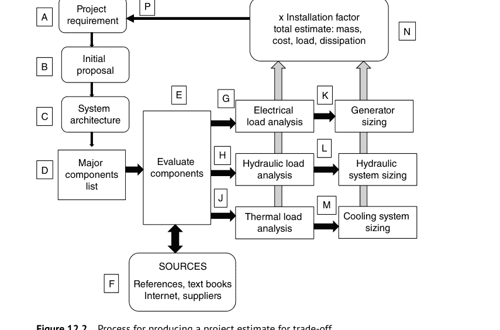
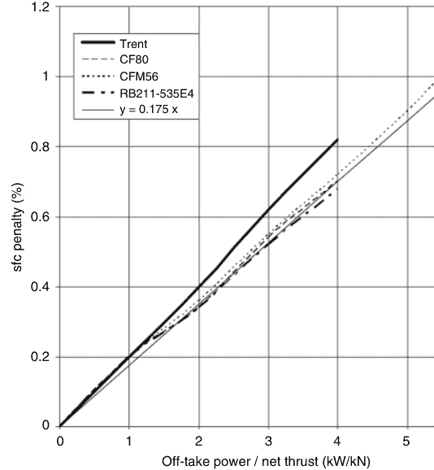
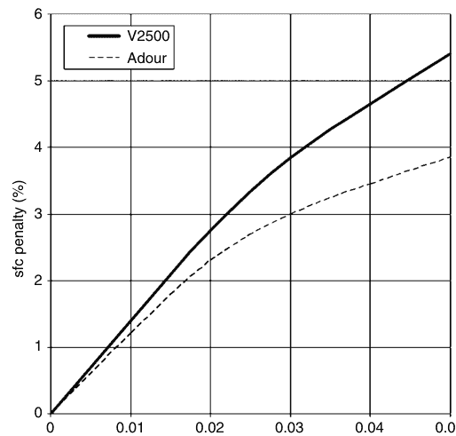

# 12 航空器系统的关键特性

## 12.1 简介

本章对典型航空器和车辆系统进行了简单描述，并将强调每个系统中影响接口、集成、设计驱动因素和建模机会的关键设计因素。这些信息将以表格形式针对每个系统提供，旨在作为系统工程师的指南。表格中的参考行指本章末尾的进一步信息来源。应当注意，出版物领域不断有新材料或新版本涌现。鼓励学生根据需要寻求更多信息。表 12.1 提供了系统特性呈现方式的模型。

还提供了一种过程描述，该过程将使学生能够对系统进行大约“尺寸”估算。这将对涉及项目工作的学生有用，该项目要求他们按质量、功率需求和耗散来模拟航空器项目，以便在不同设计之间进行权衡。这将提供近似但足够的定量数据，以获得系统对整个航空器影响的第一阶近似。更详细的信息必须从设备供应商处获取。由于航空航天行业供应商基础不断因合并和收购而变化，建议进行互联网或图书馆搜索。

为了帮助读者理解飞行甲板与本章中描述的主要航空器系统之间的相互关系，图 12.1 提供了一个概览，尽管只是非常高层次的概览。

航空器系统通常由一系列开关和按钮控制，这些开关和按钮按系统分组在顶部面板上。基本系统配置和状态信息显示在顶部面板上，但更多信息可以按需显示（发动机显示除外），作为两个中心多功能显示器上的系统概览显示。飞行机组人员可以将概览显示用于操作目的；它们还允许访问更详细的系统信息以用于维护活动。

航空电子和任务系统的输入由一系列位于机长和副驾驶之间中心控制台上的控制面板和显示单元提供。这些包括飞行管理系统（FMS）控制和显示单元（CDU）、电子飞行仪表系统（EFIS）控制面板，以及通信系统和导航辅助设备的其他控制装置。

飞行机组人员对自动驾驶仪和飞行指令系统（AFDS）的输入由位于眩光挡板下方中央的专用控制面板管理。

紧急警告和指示灯通常位于主飞行显示器（PFD）和导航显示器（ND）上方的显眼位置。

所有航空器和航空电子系统都通过一系列数据总线网络相互连接，以便于数据交换。

部分航空电子数据通过防火墙提供给乘客服务，以将飞行和任务关键数据与向乘客提供数据这一相对不重要的任务隔离开来。

## 12.2 航空器系统

表 12.2–12.31 显示了各种航空器系统的特性。

表 12.2 推进系统特性。

| 系统标题 | 推进 |
|---|---|
| 系统目的 | 为车辆提供推力，并为电力生成、液压动力生成以及气动系统和环境冷却系统的放空气提供动力抽取源。 |
| 描述 | 主推进单元、推进控制系统、与进气道和机身的接口、空气和机械动力抽取。 |
| 安全/完整性方面 | 安全关键。 |
| 关键集成方面 | 推进单元与进气道、发射管和喷气管/喷嘴的完全集成。集成抽取驱动装置，以防止车辆载荷对发动机产生影响。在高度敏捷的航空器中，可能与飞行控制系统集成。 |
| 关键接口 | 机身安装、推力轴承、概览显示器以及油门和反推控制。 |
| 关键设计驱动因素 | 航空器性能：军用 – 推力、操纵性、航程/续航时间；民用 – 推力、经济性、可靠性和可用性、成本、运行成本。 |
| 建模 | 推进试验台、高空试验设施。 |
| 参考文献 | Moir and Seabridge (2002, 2008), MacIsaac and Langton (2011), Langton (2006, 2010), (Jackson (2010), Schutte Jeff et al. (2016), Bomani and Hendricks (2016), Pornet (2016), Agarwal (2016). |
| 尺寸考虑因素 | 作为飞行甲板一部分的油门杆，将发动机控制单元视为发动机的一部分。发动机油冷却及其对燃油系统的影响。 |
| 未来考虑因素 | 环境（绿色）问题正在推动对替代推进方式的考虑，例如电力、开式转子和齿轮涵道风扇。氢气、液化/天然气和生物燃料等替代燃料也在考虑之中。这些将影响安装接口和驾驶舱指示。降噪措施可能导致设计以降低噪音，或采取运行限制以限制机场附近的噪音。 |

## Table 12.4 (Continued)

| 系统标题 | 电力生成与分配 |
|---|---|
| 关键集成方面 | 驾驶舱顶部面板和概览显示器。与发动机动力抽取负载的集成。 |
| 关键接口 | 电气地面电源供应。 |
| 关键设计驱动因素 | 总电气负载、电气功率质量、安全性、可靠性。 |
| 建模 | 按飞行阶段进行的电气负载分析 – 电子表格。 SABER 用于建模系统。发电机测试台架。 |
| 参考文献 | Moir and Seabridge (2008), Pallett (1987), Moir (2010), Pornet (2016), Xue et al. (2016), Agarwal (2016)。 |
| 尺寸考量 | 发电机和控制单元、电池、TRU、母线、配电面板、接触器。 |
| 未来考量 | 集成到发动机轴上的未来发电机。用于产生电力和氢燃料电池的热回收装置。由于使用非发动机引气环境控制系统和电液静力驱动而产生的更高需求。更高的机上娱乐负载。电池技术的进步。 |

## Table 12.5 液压系统特性。

| 系统标题 | 液压系统 |
|---|---|
| 系统目的 | 为驱动机构提供高压动力能源源。 |
| 描述 | 液压泵、油箱、蓄能器、管道和耦合器的集合。 |
| 安全性/完整性方面 | 安全关键系统。冗余度将与最高完整性系统相匹配 – 通常是飞行控制系统。液压系统冗余度通常为三重。泵动力源的多样性很重要 – 发动机齿轮箱、电气、气动和应急源。 |
| 关键集成方面 | 控制和监测可以集成到公用设施/车辆管理系统中。也可以集成到 IMA 的车辆域中。 |
| 关键接口 | 推进系统动力抽取、驾驶舱顶部面板和概览显示器，以及警告系统。 |
| 关键设计驱动因素 | 执行器功率和速率、安全性。 |
| 建模 | Matlab/Simulink，液压测试台架。Iron Bird 台架。 |
| 参考文献 | Moir and Seabridge (2008), Hunt and Vaughan (1996) Seabridge (2010)。 |
| 尺寸考量 | 液压泵、油箱、阀门、动力传输单元、管道、蓄能器、换热器。 |
| 未来考量 | 减少对液压动力生成的需求，更多使用电液静力和电动执行器。 |

## Table 12.6 副动力系统特性。

| 系统标题 | 副动力 |
|---|---|
| 系统目的 | 主推进系统的启动，在地面操作且无发动机运行时提供空气和电力以实现自主运行 – 快速周转。 |
| 描述 | APU、启动器以及与机身系统的连接。 |
| 安全性/完整性方面 | 任务关键。 |
| 关键集成方面 | 与地面设施的集成。 |
| 关键接口 | 驾驶舱顶部面板和概览显示器，电气和液压动力的次级源，以及冷却空气回路。 |
| 关键设计驱动因素 | 质量、成本、效率、噪音。 |
| 建模 | 测试台架。 |
| 参考文献 | Moir and Seabridge (2008), Freeh (2016)。 |
| 尺寸考量 | APU、防火保护、进气/排气舱口及驱动机构。 |
| 未来考量 | 更多强调飞行中可操作的 APU。地面 APU 对机场噪音和污染的贡献。 |

## Table 12.7 应急动力系统特性。

| 系统标题 | 应急动力 |
|---|---|
| 系统目的 | 在主推进系统故障期间提供电气和/或液压动力。 |
| 描述 | 应急动力单元，例如单燃料（肼）或空气可操作的 APU，RAT，电液泵，液压蓄能器，一次性电池。 |
| 安全性/完整性方面 | 安全关键分析的一部分 – 必须在需要时运行。 |
| 关键集成方面 | 与机身集成以实现最佳进气性能，部署 RAT 以从气流中提取最佳能量。 |
| 关键接口 | 与电气和液压动力的次级源接口。 |
| 关键设计驱动因素 | 可用性，有效运行。 |
| 建模 | 3D 建模 (Catia)。 |
| 参考文献 | Moir and Seabridge (2008), Giguere (2010)。 |
| 尺寸考量 | 动力单元和能源源。 |
| 未来考量 | 燃料电池。 |

## Table 12.8 飞行控制系统特性。

| 系统标题 | 飞行控制 |
|---|---|
| 系统目的 | 将飞行员的指令转换为驱动初级和次级控制面所需动力的需求，以响应自动驾驶仪的自动控制和稳定性需求。对于不稳定的军用飞机，确保需求得到快速响应，将需求限制在安全操作包线内，并不断响应外部空气动力学条件。 |
| 描述 | 需求输入传感器、计算系统、执行器、位置和速率反馈传感器。 |
| 安全性/完整性方面 | 安全关键。 |
| 关键集成方面 | 与空气数据系统、自动驾驶仪、飞行管理、推进和着陆辅助系统集成以完成制导和控制集成。与燃油系统集成以实现不稳定飞机的重心控制。 |
| 关键接口 | 电气系统、液压系统；空气数据和惯性传感器；飞行员执行器、自动驾驶仪、FMS 和飞行员显示器：PFD、ND、概览显示器和顶部面板。 |
| 关键设计驱动因素 | 安全性、结构限制、飞行包线和性能。 |
| 建模 | 控制回路建模，Iron Bird。 |
| 参考文献 | Moir and Seabridge (2002, 2008), Lloyd and Tye (1982), Bryson (1994), Raymond and Chenoweth (1993), Pratt (2000), Langton (2006), Weller (2018)。 |
| 尺寸考量 | 飞行控制计算机、执行器、飞行甲板上的控制杆、冗余方面。 |
| 未来考量 | 全电动驱动，将控制集成到 IMA 中。 |

## Table 12.9 起落架系统特性。

| 系统标题 | 起落架 |
|---|---|
| 系统目的 | 使飞机在地面上能够移动，包括前轮转向。 |
| 描述 | 前起落架、主起落架、油气支柱、收放机构、舱门、锁定装置和位置监测装置。 |
| 安全性/完整性方面 | 安全关键 – 通常提供一种机制，以便在正常手段失效时手动放下起落架。 |
| 关键集成方面 | 与机身集成以提供起落架的高效收纳。用于其他系统的轮载信号，驾驶舱警告系统用于指示起落架安全位置。 |
| 关键接口 | 起落架与机身的安装。液压和电气系统，飞行员控制和概览显示器。 |
| 关键设计驱动因素 | 质量、飞机最大起飞重量、中止起飞质量、机场状况（跑道 LCN 和制动条件）。 |
| 建模 | 起落架伸出和收回的 3D (Catia) 建模。Iron Bird 测试台架。 |
| 参考文献 | Moir and Seabridge (2008), Conway (1957), Currey (1984)。 |
| 尺寸考量 | 起落架、连接件、车轮、刹车和轮胎，制动和中止起飞载荷。 |
| 未来考量 | 全电动驱动。 |

**Table 12.10** 刹车/防滑系统特性。

| 系统标题 | 刹车/防滑 |
|---|---|
| 系统目的 | 允许飞机在地面上减速，吸收制动能量，并在制动过程中防止车轮牵引力丧失。 |
| 描述 | 刹车盘和刹车片，制动控制系统，防滑控制系统，传感器。 |
| 安全/完整性方面 | 安全关键。 |
| 关键集成方面 | 在高带宽/刹车控制中高度动态集成。 |
| 关键接口 | 与刹车踏板、轮载传感器、液压和电气系统的接口。 |
| 关键设计驱动因素 | 飞机全重、最大拒绝起飞间隙、着陆特性、滑行离开坡道的刹车能量耗散——冷却风扇。 |
| 建模 | 动态着陆试验台。 |
| 参考文献 | Moir and Seabridge (2008)。 |
| 尺寸考量 | 制动系统和能源、制动过程中的能量、能量耗散和冷却机制。 |
| 未来考量 | 全电动执行。利用刹车热量用于扫除设备。 |

**Table 12.11** 转向系统特性。

| 系统标题 | 转向 |
|---|---|
| 系统目的 | 提供飞机在自力更生或被拖曳时转向的手段。 |
| 描述 | 转向操纵杆或踏板，作用于前轮的执行器。 |
| 安全/完整性方面 | 安全受影响——高速下无法正确转向可能导致飞机偏离跑道或滑行道。 |
| 关键集成方面 | 人因工程。液压系统、飞行员显示器，包括视频和车轮监控摄像头（部分机型）。 |
| 关键接口 | 与飞行控制系统集成，以确保着陆滑跑阶段从方向舵转向正确交接。 |
| 关键设计驱动因素 | 滑行道曲线半径、着陆速度。 |
| 建模 | CAD。 |
| 参考文献 | Moir and Seabridge (2008)。 |
| 尺寸考量 | 转向机构和能源来源。 |
| 未来考量 |  |

## Table 12.12 环境控制系统特性。

| 系统标题 | 环境控制系统 |
|---|---|
| 系统目的 | 为乘客、机组人员和航空电子设备提供供暖和/或制冷空气。 |
| 描述 | 热交换器、冷却系统、空气分布。 |
| 安全/完整性方面 | 安全受影响——失去所有冷却可能导致设备故障。 |
| 关键集成方面 | 在不影响发动机性能的情况下提取空气的能力。 |
| 关键接口 | 与发动机空气抽取口接口。由环境控制系统控制。飞行员顶部面板和概览显示器。 |
| 关键设计驱动因素 | 机组和乘客舒适度，环境运行条件——地区或全球。良好的过滤以降低生物污染风险并产生清洁客舱空气。 |
| 建模 | 使用 CFD 对风道内气流进行建模。 |
| 参考文献 | Moir and Seabridge (2008)，Lawson (2010)。 |
| 尺寸考量 | 客舱体积、乘员数量、加压、进气口（阻力）、空气分布系统、冷却空气装置、过滤器、冗余、紧急空气供应。 |
| 未来考量 | 减少对发动机引气的需求，趋向电动压缩机，交流电力需求增加。 |

## Table 12.13 火灾防护系统特性。

| 系统标题 | 火灾防护 |
|---|---|
| 系统目的 | 检测发动机或辅助动力舱中的火灾或过热，并提供灭火剂来源。 |
| 描述 | 安装在舱内以提供广域覆盖的过热或紫外线探测器，灭火剂液体和喷雾喷嘴。 |
| 安全/完整性方面 | 重大——休眠系统，测试覆盖有限，必须在需要时运行。 |
| 关键集成方面 | 局部系统集成。 |
| 关键接口 | 驾驶舱警告系统。 |
| 关键设计驱动因素 | 快速且明确的检测机制。 |
| 建模 | 简单模拟。 |
| 参考文献 | Moir and Seabridge (2008)，Giguere (2010)。 |
| 尺寸考量 | 检测回路和控制单元，灭火器。 |
| 未来考量 |  |

## Table 12.14 冰检测系统特性。

| 系统标题 | 冰检测 |
|---|---|
| 系统目的 | 检测进入可能导致机翼、尾翼或进气口前缘结冰的结冰条件。 |
| 描述 | 冰探测器探头。 |
| 安全/完整性方面 | 重大。 |
| 关键集成方面 | 与冰防护系统集成。 |
| 关键接口 | 驾驶舱警告。 |
| 关键设计驱动因素 | 飞机运行包线和运行条件。 |
| 建模 | 简单模拟。 |
| 参考文献 | Gent (2010)。 |
| 尺寸考量 | 探测器，控制单元。 |
| 未来考量 |  |

## Table 12.15 冰防护系统特性。

| 系统标题 | 冰防护 |
|---|---|
| 系统目的 | 防止冰的积聚和/或去除已形成的冰。 |
| 描述 | 电加热或热空气加热表面，通常是机翼前缘内表面热空气加热，充气橡胶靴。 |
| 安全/完整性方面 | 涉及安全——必须在需要时工作，否则飞机必须迅速离开结冰条件。 |
| 关键集成方面 | 与冰检测系统集成。 |
| 关键接口 | 用于静态空气温度计算的航空电子设备。 |
| 关键设计驱动因素 | 质量，电气负载，阻力。 |
| 建模 | 简单模拟。 |
| 参考文献 | Moir and Seabridge (2008)，Gent (2010)。 |
| 尺寸考量 | 冰防护机制类型和潜在电气负载。 |
| 未来考量 | 减少对发动机引气的依赖，可能趋向电动防冰（参考 B-787）。 |

## Table 12.16 外部照明系统特性。

| 系统标题 | 外部照明 |
|---|---|
| 系统目的 | 确保飞机对其他空域使用者可见，并为着陆和滑行提供照明。还为公司标志提供照明。 |
| 描述 | 机翼端高强度频闪灯，机身频闪灯或防撞灯，标志灯。军事用户将包括编队灯和空中加油探头灯。 |
| 安全/完整性方面 | 涉及安全。 |
| 关键集成方面 | 结构。 |
| 关键接口 | 飞行员顶部面板。 |
| 关键设计驱动因素 | 法规，对其他飞机的可见性。 |
| 建模 | 简单模拟。 |
| 参考文献 | Moir and Seabridge (2008)。 |
| 尺寸考量 | 灯具类型，安装。 |
| 未来考量 |  |

## Table 12.17 探头加热系统特性。

| 系统标题 | 探头加热 |
|---|---|
| 系统目的 | 提供加热飞机外部皮肤上的皮托-静压和温度探头的手段，以确保它们保持无冰状态。 |
| 描述 | 内置于探头中的电加热器。 |
| 安全/完整性方面 | 安全关键。加热器故障将影响空气数据感应的准确性，并将影响驾驶舱指示以及飞行和推进控制系统输入数据。 |
| 关键集成方面 | 飞行控制系统，驾驶舱显示器和控制装置。 |
| 关键接口 | 空-地/轮载信号到其他系统。 |
| 关键设计驱动因素 | 飞行控制和导航的空气数据准确性——可能受到航道最小高度分离要求的驱动。 |
| 建模 | 简单模拟。 |
| 参考文献 | Moir and Seabridge (2002)。 |
| 尺寸考量 | 电气负载。 |
| 未来考量 |  |

**Table 12.20** 机舱罩抛弃系统特性。

| 系统标题 | 机舱罩抛弃 |
|---|---|
| 系统目的 | 提供去除或破碎机舱罩材料的手段，以便逃生机组人员撤离。 |
| 描述 | 火箭辅助抛弃机构或嵌入机舱罩材料中的微型起爆索。 |
| 安全/完整性方面 | 安全关键。如果在地面未隔离，对地面人员构成危险。 |
| 关键集成方面 | 与机组逃生启动集成。 |
| 关键接口 |  |
| 关键设计驱动因素 | 必须允许机组人员在不受伤的情况下撤离飞机。 |
| 建模 | 物理模型或原型。 |
| 参考文献 | Moir and Seabridge (2008)。 |
| 尺寸考量 | 机舱罩，抛弃类型和机构。 |
| 未来考量 |  |

**Table 12.21** 生物和化学防护系统特性。

| 系统标题 | 生物和化学防护 |
|---|---|
| 系统目的 | 保护机组人员免受化学或生物污染的毒性影响。 |
| 描述 | 过滤空气和氧气供应，防护服和呼吸器，冲洗设施。 |
| 安全/完整性方面 | 任务关键。 |
| 关键集成方面 | 人因工程，戴手套操作控制装置的可操作性。 |
| 关键接口 | 不可用。 |
| 关键设计驱动因素 | 操作员安全。 |
| 建模 | 复杂模拟。 |
| 参考文献 |  |
| 尺寸考量 | 威胁物质，过滤器，机组人员服装，呼吸器机构。 |
| 未来考量 | 新威胁材料。 |

**Table 12.22** 拦阻钩系统特性。

| 系统标题 | 拦阻钩 |
|---|---|
| 系统目的 | 如果刹车失效，通过接触跑道拦阻索停止飞机，是海军舰载飞机的正常停止方法。 |
| 描述 | 收放在飞机尾部并在紧急情况下展开的拦阻钩。 |
| 安全/完整性方面 | 安全关键——必须在需要时运行。 |
| 关键集成方面 | 机身质量和速度（能量）要求。 |
| 关键接口 | 与军用机场和航空母舰上的现役拦阻装置接口。 |
| 关键设计驱动因素 | 安全，紧急操作。 |
| 建模 | 应力计算，3D（例如 Catia）建模。 |
| 参考文献 | Moir and Seabridge (2008)。 |
| 尺寸考量 | 能量要求，钩，锁定/释放机构，连接。 |
| 未来考量 |  |

## Table 12.23 刹车伞系统特性。

| 系统名称 | 刹车伞 |
|---|---|
| 系统用途 | 用于军用机型和某些商用原型机，以便在超短停止距离或短跑道上减速飞机。 |
| 描述 | 伞通常存放在飞机后机身的容器中，以便在需要时可以抛弃伞或容器。 |
| 安全性/完整性方面 | 次要 – 休眠系统，测试覆盖有限，必须在需要时运行。 |
| 关键集成方面 | 单一系统 – 没有冗余机会。 |
| 关键接口 | 飞行员简单的手动操作。 |
| 关键设计驱动因素 | 飞机着陆速度，停止距离。飞机支持 – 伞重新包装。 |
| 建模 | 简单模拟。 |
| 参考文献 | Moir and Seabridge (2008)。 |
| 尺寸考虑因素 | 能量需求，钩子，锁定/释放机构，连接。 |
| 未来考虑因素 | |

## Table 12.24 空中加油系统特性。

| 系统名称 | 空中加油 |
|---|---|
| 系统用途 | 使军用飞机能够从空中加油机获取燃料并延长航程/空中作业能力。 |
| 描述 | 来自加油机燃油软管的接收口 – 通常是安装在英国/欧洲飞机上的可伸缩探针，以及与美国飞机上的加油机探针配合的接收口。 |
| 安全性/完整性方面 | 任务关键。由于飞机保持紧密编队，存在一些安全方面的问题。 |
| 关键集成方面 | 连接到燃油系统，以允许控制向接收机加油。 |
| 关键接口 | 与加油机加油设备接口 – 药筒/探针。 |
| 关键设计驱动因素 | 提供的燃油量，加油站上的接收机数量，所需的传输速率。 |
| 建模 | 飞行测试。 |
| 参考文献 | Moir and Seabridge (2008), Purdy (2010)。 |
| 尺寸考虑因素 | 探针类型，驱动机构，能源来源。 |
| 未来考虑因素 | 可能出于环境原因考虑用于民用飞机应用。 |

## Table 12.25 厨房系统特性。

| 系统名称 | 厨房 |
|---|---|
| 系统用途 | 为乘客和机组人员提供安全卫生的食品准备和烹饪方法。对于冷藏产品，必须应用非常精确的健康和安全要求。 |
| 描述 | 存储、冷藏和烹饪（加热和微波）设备。 |
| 安全性/完整性方面 | 对于长途航班可能是任务关键。应尽量降低健康和安全法规、机组人员触电和火灾风险。 |
| 关键集成方面 | 与主电气系统接口，该系统包括精确的故障保护方案（厨房是航空公司提供的物品）。长途客机的厨房/乘客设施电力需求可能约占总连接负载的 40–50%。 |
| 关键接口 | 与标准航空公司设备供应商接口，用于滚装/滚卸模块和食品包装。 |
| 关键设计驱动因素 | 健康和安全以及乘客舒适度/偏好。 |
| 建模 | 由厨房供应商进行负载分析。 |
| 参考文献 | Moir and Seabridge (2002)。 |
| 尺寸考虑因素 | 乘客数量和客舱区域，厨房数量，厨房设备和餐车，电气负载。 |
| 未来考虑因素 | 短途廉价航班对厨房的需求减少。 |

## Table 12.26 乘客疏散系统特性。

| 系统名称 | 乘客疏散 |
|---|---|
| 系统用途 | 当飞机在地面上或迫降在水面上时，允许乘客从客舱安全疏散。 |
| 描述 | 紧急出口门、疏散滑梯、救生衣和完全装备的救生筏。 |
| 安全性/完整性方面 | 必须在需要时可用。 |
| 关键集成方面 | 门和滑梯操作。驾驶舱意识。 |
| 关键接口 | 乘客和疏散要求及演示。与机场接口，适用于超大型飞机和大量乘客。 |
| 关键设计驱动因素 | 可用性，乘客安全。 |
| 建模 | 模型和疏散测试架。 |
| 参考文献 | Giguere (2010)。 |
| 尺寸考虑因素 | 乘客数量，出口数量和逃生设备。 |
| 未来考虑因素 | |

## Table 12.27 机上娱乐系统特性。

| 系统名称 | IFE 系统 |
|---|---|
| 系统用途 | 为乘客在座位处提供音频和视频娱乐。 |
| 描述 | 网络化的音频和视频信号传输到客舱屏幕或座位上的设备。 |
| 安全性/完整性方面 | 出于乘客偏好原因，属于放行关键。 |
| 关键集成方面 | 大规模集成 COTS 系统，该系统需要与用于飞行飞机的航电设备之间设置防火墙。 |
| 关键接口 | 乘客、飞行机组人员和内容提供商。 |
| 关键设计驱动因素 | 乘客满意度，营销吸引力。 |
| 建模 | 机外模拟和集成。 |
| 参考文献 | Moir and Seabridge (2002)。 |
| 尺寸考虑因素 | 座位数量，客舱等级变化，电气负载，对客舱热负载的影响。 |
| 未来考虑因素 | 提供电子邮件和短信。 |

## Table 12.28 电信系统特性。

| 系统名称 | 电信 |
|---|---|
| 系统用途 | 允许乘客在飞行中拨打电话并访问互联网。可能提供流媒体视频/电视。 |
| 描述 | 座位上的电话手柄和个人电脑/便携式电子设备充电功能。 |
| 安全性/完整性方面 | 无。 |
| 关键集成方面 | 飞机通信天线。 |
| 关键接口 | 乘客座位，通信，客舱乘务员。 |
| 关键设计驱动因素 | 乘客满意度，营销。 |
| 建模 | 与 IFE 集成。 |
| 参考文献 | Moir and Seabridge (2002)。 |
| 尺寸考虑因素 | 座位数量，客舱等级变化，电气负载，对客舱热负载的影响。 |
| 未来考虑因素 | 提供电子邮件和短信。 |

## Table 12.29 厕所和废水系统特性。

| 系统名称 | 厕所和废水 |
|---|---|
| 系统用途 | 提供卫生的厕所和废水管理。 |
| 描述 | 提供冲水马桶、冷热水和处置。 |
| 安全性/完整性方面 | 放行关键，因为乘客无法使用厕所设施的影响。 |
| 关键集成方面 | 人体工程学，客舱装潢，安全。 |
| 关键接口 | 地面废物处理和水补充系统。 |
| 关键设计驱动因素 | 乘客满意度，卫生，健康，安全和环境法规。 |
| 建模 | 简单模拟。 |
| 参考文献 | |
| 尺寸考虑因素 | 乘客数量，客舱等级变化，健康和安全。 |
| 未来考虑因素 | |

## Table 12.30 氧气系统特性。

| 系统名称 | 氧气 |
|---|---|
| 系统用途 | 为机组人员和乘客提供可呼吸的氧气源。 |
| 描述 | 商用 – 以应对失压情况下下降到安全高度：飞行员使用快速戴上面罩的瓶装气态氧气。乘客使用氧气面罩和瓶装氧气或氧气蜡烛。军用 – 来自液态氧或机上氧气生成系统的连续压力呼吸。 |
| 安全性/完整性方面 | 商用 – 必须按需可用，以使飞行员能够将飞机飞往安全高度，必须为乘客安全和舒适提供。军用 – 战斗机必须随时可用压力氧气。弹射座椅上也可用。 |
| 关键集成方面 | 商用 – 与紧急系统集成。军用 – 与 ECS、人体工程学和机组逃生系统集成。 |
| 关键接口 | 人体工程学。 |
| 关键设计驱动因素 | 自主操作或在偏远地点可用 LOX 或气态氧气。 |
| 建模 | 简单模拟。 |
| 参考文献 | Moir and Seabridge (2008), Giguere (2010)。 |
| 尺寸考虑因素 | 乘客数量，呼吸空气供应类型，紧急来源。 |
| 未来考虑因素 | |

**Table 12.31** 客舱和应急照明系统特性。

| 系统标题 | 客舱和应急照明 |
|---|---|
| 系统目的 | 为客舱和厨房提供一般照明、阅读灯、出口照明和应急灯，以提供通往出口的可视路径。 |
| 描述 | 客舱天花板上的一般照明，每个座位上方带有个人控制的阅读灯，应急照明。 |
| 安全/完整性方面 | 必须可用于紧急疏散 – 发运关键。 |
| 关键集成方面 | 与其他应急系统集成。 |
| 关键接口 | 正常和应急电源系统及电池。 |
| 关键设计驱动因素 | 照明的人体工程学、安全性、乘客满意度、健康和安全法规。 |
| 建模 | 疏散模型。 |
| 参考文献 | Moir and Seabridge (2002), Ciguere (2010)。 |
| 尺寸考虑因素 | 客舱大小，出口数量。 |
| 未来考虑因素 |  |

## 12.3 航空电子系统

Tables 12.32–12.50 显示各种航空电子系统的特性。

**Table 12.32** 驾驶舱显示和控制系统特性。

| 系统标题 | 驾驶舱显示和控制 |
|---|---|
| 系统目的 | 为机组人员提供操作飞机所需的信息和警告。 |
| 描述 | 驾驶舱将配备正常和应急显示器、控制操纵杆和控制开关，以使机组人员能够访问和控制所有飞机功能。 |
| 安全/完整性方面 | 取决于相关显示器/单元和显示冗余级别，从安全关键到安全相关不等。 |
| 关键集成方面 | 人体工程学。对于军用飞机，可能需要与夜视仪兼容。 |
| 关键接口 | 驾驶舱设计和结构。请参阅 Figure 12.1。 |
| 关键设计驱动因素 | 人体工程学、安全性、飞行员工作量。 |
| 建模 | 快速原型，VAPS，高度照明测试设施。航空电子集成架。 |
| 参考文献 | Moir and Seabridge (2002), Jukes (2003), Pallett (1992), Rankin and Matolak (2010), Atkin (2010)。 |
| 尺寸考虑因素 | 显示单元数量，显示计算机，接口，冗余，应急显示器，抬头显示器。 |
| 未来考虑因素 | 合成视觉，更多自动化和集成。手势控制。 |

**Table 12.33** 通信系统特性。

| 系统标题 | 通信 |
|---|---|
| 系统目的 | 允许飞机与空中交通管制、其他飞机和合作部队之间进行双向通信。 |
| 描述 | 发射和接收系统，天线，个人设备 – 耳机，麦克风，扬声器。对于数据链路应用 – 终端，加密设备。 |
| 安全/完整性方面 | 任务关键。 |
| 关键集成方面 | 天线可操作性，阻力，与 FMS 集成以实现自动调谐。 |
| 关键接口 | 结构 – 天线的加压密封。 |
| 关键设计驱动因素 | 全天候通信，与应急频道接口。 |
| 建模 | 与 FMS 集成。 |
| 参考文献 | Burberry (1992), Hall and Barclay (1980)。 |
| 尺寸考虑因素 | 无线电类型，控制面板，天线，散热，电气负载。 |
| 未来考虑因素 |  |

**Table 12.34** 导航系统特性。

| 系统标题 | 导航 |
|---|---|
| 系统目的 | 提供全球高精度导航能力。 |
| 描述 | 基于惯性、激光或全球定位系统。 |
| 安全/完整性方面 | 任务关键，具有安全影响。 |
| 关键集成方面 | 与航空电子和任务系统集成。 |
| 关键接口 | 结构，航空电子。 |
| 关键设计驱动因素 | 准确的全球导航 – ATM（民用）或 GATM（军用）。 |
| 建模 | 航空电子集成架，任务系统集成架。 |
| 参考文献 | Moir and Seabridge (2002), Kayton and Fried (1997), Galotti (1998)。 |
| 尺寸考虑因素 | 导航传感器，导航辅助设备，冗余，天线。 |
| 未来考虑因素 |  |

**Table 12.35** 飞行管理系统特性。

| 系统标题 | 飞行管理系统 |
|---|---|
| 系统目的 | 提供输入和执行飞行计划的手段，并允许飞机按照这些计划自动运行。 |
| 描述 | 飞行管理计算机和控制显示单元，用于输入和修改飞行计划并调谐导航辅助设备。 |
| 安全/完整性方面 | 任务关键。 |
| 关键集成方面 | 导航系统和导航辅助设备，驾驶舱照明，人体工程学。 |
| 关键接口 | 驾驶舱位置。 |
| 关键设计驱动因素 | 易用性，可访问性，飞行员工作量，高效路线管理。 |
| 建模 | 集成架。 |
| 参考文献 | Moir and Seabridge (2002), Cramer et al. (2010), Gradwell (2010)。 |
| 尺寸考虑因素 | 飞行甲板上的飞行管理控制和显示单元，冗余。 |
| 未来考虑因素 |  |

**Table 12.36** 自动着陆辅助系统特性。

| 系统标题 | 自动着陆辅助 |
|---|---|
| 系统目的 | 提供在世界各地机场自动/辅助着陆的手段。 |
| 描述 | 地面天线提供标准无线电频率波束，其角度和方向有助于安全进近和着陆模式，相关信标和标记。空中系统用于检测波束并警告偏离波束。地面系统包括 ILS 或 MLS。也使用基于 GPS 的空间系统。 |
| 安全/完整性方面 | 非安全关键。 |
| 关键集成方面 | 与飞行管理系统、自动驾驶仪或飞行指令、地面着陆系统集成。 |
| 关键接口 | 飞行管理系统，飞行控制系统。 |
| 关键设计驱动因素 | 涉及决策高度和能见度的进近的安全性和类别。 |
| 建模 | 航空电子集成架。 |
| 参考文献 | Moir and Seabridge (2002)。 |
| 尺寸考虑因素 | 着陆辅助类型，天线。 |
| 未来考虑因素 |  |

**Table 12.37** 天气雷达系统特性。

| 系统标题 | 天气雷达 |
|---|---|
| 系统目的 | 商用 – 天气。 军用 – 空中或地面目标，空中、地面或海上监视，天气。 |
| 描述 | 合适的天线和雷达罩，发射器/接收器，雷达处理，冷却系统。 |
| 安全/完整性方面 | 任务/发运关键。 |
| 关键集成方面 | 商用 – 驾驶舱显示器。 军用 – 驾驶舱显示器，任务系统控制台，武器系统，任务计算机。 |
| 关键接口 | 具有所需传输特性的雷达罩。 |
| 关键设计驱动因素 | 操作要求，所需的搜索模式。 |
| 建模 | 航空电子集成架。 |
| 参考文献 | Moir and Seabridge (2002)。 |
| 尺寸考虑因素 | 天线，发射器/接收器，显示器。 |
| 未来考虑因素 |  |

**Table 12.38** 应答机系统特性。

| 系统标题 | 应答机，IFF/SSR |
|---|---|
| 系统目的 | 对地面询问作出响应，以识别飞机并提供有关位置和高度的信息。对配备 TCAS 模式 S 应答机的飞机作出响应。 |
| 描述 | 接收器，应答机，天线。在军用中称为 IFF，在民用应用中称为 ADS-B。 |
| 安全/完整性方面 | 任务关键 – 操作丢失将导致空中交通违规。军用飞机将被要求离开航道。 |
| 关键集成方面 | 与 TCAS 集成。天线可能与使用相同频率的其他射频设备共享。 |
| 关键接口 | 通信系统，空中交通管制。 |
| 关键设计驱动因素 | 用于空中交通管制的飞机识别和高度，对于军用飞机 – 战斗区域的合作行动。 |
| 建模 | 航空电子集成架。 |
| 参考文献 | Moir and Seabridge (2002, 2006)。 |
| 尺寸考虑因素 | 天线。 |
| 未来考虑因素 |  |

## Table 12.39 交通防撞与避撞系统特性。

| 系统标题 | 交通防撞与避撞系统 |
|---|---|
| 系统目的 | 降低与其他飞机相撞的风险。 |
| 描述 | 基于应答机的控制单元，用于询问载机一定球形体积内的飞机，并提供指示和警告系统。 |
| 安全性/完整性方面 | 某些航线的发行关键。 |
| 关键集成方面 | 驾驶舱显示器、任务计算、导航系统、导航辅助设备、人因工程。 |
| 关键接口 | IFF/SSR 模式 S、驾驶舱显示器。 |
| 关键设计驱动因素 | 机场终端区和指定航线内的安全运行。 |
| 建模 | 航空电子集成试验台。 |
| 参考文献 | Moir 和 Seabridge (2002)。 |
| 尺寸考量 | 显示器类型、控制单元。 |
| 未来考量 | 对碰撞警告的自动响应。 |

## Table 12.40 地面接近警告系统/地形避撞警告系统特性。

| 系统标题 | GPWS/TAWS |
|---|---|
| 系统目的 | 降低飞机飞入地面或高地的风险。 |
| 描述 | 当飞机接近危险情况时，为飞行机组提供一系列建议性警告。 |
| 安全性/完整性方面 | 安全影响。 |
| 关键集成方面 | 驾驶舱显示器、任务计算、导航系统、导航辅助设备、人因工程。 |
| 关键接口 | 雷达高度表、GPS 以及飞行员显示器和警告系统。 |
| 关键设计驱动因素 | 降低因飞行机组失去情境意识并随后导致可控飞行撞地事故的风险。 |
| 建模 | 航空电子集成试验台。 |
| 参考文献 | Moir 和 Seabridge (2002)。 |
| 尺寸考量 | 显示器类型、控制单元。 |
| 未来考量 | |

## Table 12.41 距离测量设备系统特性。

| 系统标题 | DME |
|---|---|
| 系统目的 | 提供来自已知信标的距离测量。 |
| 描述 | 飞行管理系统调谐到航线沿线适当信标的接收机。 |
| 安全性/完整性方面 | 可能是任务关键。 |
| 关键集成方面 | 驾驶舱显示器、任务计算、导航系统、导航辅助设备、人因工程。 |
| 关键接口 | 当安装集成系统时，由 FMS 进行调谐。 |
| 关键设计驱动因素 | 导航精度以及 DME 信标的位置/可用性。 |
| 建模 | 航空电子集成试验台。 |
| 参考文献 | Moir 和 Seabridge (2002)。 |
| 尺寸考量 | 控制单元、天线。 |
| 未来考量 | |

## Table 12.42 自动测向系统特性。

| 系统标题 | ADF |
|---|---|
| 系统目的 | 提供来自已知信标的方位。 |
| 描述 | 天线和控制单元。 |
| 安全性/完整性方面 | 非安全关键。 |
| 关键集成方面 | 驾驶舱显示器、任务计算、导航系统、导航辅助设备、人因工程、通信。 |
| 关键接口 | 当安装集成 FMS 时，由 FMS 进行调谐。 |
| 关键设计驱动因素 | 法规、导航便捷性。 |
| 建模 | 航空电子集成试验台。 |
| 参考文献 | Moir 和 Seabridge (2002)。 |
| 尺寸考量 | 控制单元、天线。 |
| 未来考量 | |

## Table 12.43 雷达高度表系统特性。

| 系统标题 | 雷达高度表 |
|---|---|
| 系统目的 | 提供相对于地面或海面的绝对高度读数。 |
| 描述 | 一个或多个天线向地表发送信号并读取返回信号以计算高于地表的高度。这用于显示或由其他系统使用。 |
| 安全性/完整性方面 | 涉及安全。低空飞行、机动性强的飞机需要将天线安装在能够确保在高 g 转弯时始终有一个天线可操作的位置。 |
| 关键集成方面 | 驾驶舱显示器、任务计算、导航系统、导航辅助设备、人因工程。 |
| 关键接口 | 结构 – 天线。 |
| 关键设计驱动因素 | 高度测量精度、独立于气压条件。 |
| 建模 | 航空电子集成试验台。 |
| 参考文献 | Moir 和 Seabridge (2002)。 |
| 尺寸考量 | 天线、显示器。 |
| 未来考量 | |

## Table 12.44 自动飞行控制系统特性。

| 系统标题 | 自动 FCS |
|---|---|
| 系统目的 | 在常规航线、自动着陆期间提供自动飞行手段，并执行标准任务剖面和搜索模式。 |
| 描述 | 连接到 FCS 和发动机控制的控制单元和执行器。可能是 FCS 和发动机控制系统中的直接需求。 |
| 安全性/完整性方面 | 主飞行控制是安全关键。AFDS 是任务关键。 |
| 关键集成方面 | FCS、发动机控制系统、飞行管理系统、人因工程。 |
| 关键接口 | 人因工程。 |
| 关键设计驱动因素 | 飞行员工作量减少、飞机经济性。 |
| 建模 | 航空电子集成试验台、铁鸟。 |
| 参考文献 | Pratt (2000)。 |
| 尺寸考量 | 控制面板、执行器、冗余。 |
| 未来考量 | |

## Table 12.45 大气数据系统特性。

| 系统标题 | 大气数据系统 |
|---|---|
| 系统目的 | 向飞机系统提供大气压力（总压和静压）信息，并将这些压力转换为代表空速、高度和马赫数的信号。 |
| 描述 | 位于气流中的皮托管和静压口（可能组合在一起）。 |
| 安全性/完整性方面 | 安全关键 – 由飞行控制系统、推进系统、导航和驾驶舱显示器使用。 |
| 关键集成方面 | 与导航系统、制导和控制集成，是关键大气数据的唯一来源。 |
| 关键接口 | 机身、阻力、探头加热。 |
| 关键设计驱动因素 | 大气数据精度。 |
| 建模 | |
| 参考文献 | Moir 和 Seabridge (2002, 2008)。 |
| 尺寸考量 | 探头、电气负载。 |
| 未来考量 | |

## Table 12.46 事故数据记录系统特性。

| 系统标题 | ADR |
|---|---|
| 系统目的 | 连续记录指定飞机参数，用于严重事件分析。 |
| 描述 | 与相关系统的数据采集接口以及连续记录或固态大容量存储。定位信标以帮助回收。 |
| 安全性/完整性方面 | 发行关键。 |
| 关键集成方面 | 数据总线类型。 |
| 关键接口 | 相关系统传感器。 |
| 关键设计驱动因素 | 法规、抗撞记忆 – 冲击、浸水和火灾。 |
| 建模 | 航空电子集成试验台。 |
| 参考文献 | Moir 和 Seabridge (2002)。 |
| 尺寸考量 | 记录单元、特殊传感器。 |
| 未来考量 | |

## Table 12.47 驾驶舱语音记录系统特性。

| 系统标题 | CVR |
|---|---|
| 系统目的 | 提供指定机组人员语音的连续记录，用于严重事件分析。 |
| 描述 | 驾驶舱麦克风和记录系统。 |
| 安全性/完整性方面 | 发行关键。 |
| 关键集成方面 | 驾驶舱环境、通信、人因工程。 |
| 关键接口 | |
| 关键设计驱动因素 | 法规、抗撞 – 冲击、浸水和火灾。 |
| 建模 | 航空电子集成试验台。 |
| 参考文献 | Moir 和 Seabridge (2002)。 |
| 尺寸考量 | 记录单元、麦克风。 |
| 未来考量 | |

## Table 12.48 预测与健康管理系统特性。

| 系统标题 | PHM |
|---|---|
| 系统目的 | 提供系统性能和故障的连续记录。利用这些信息确定趋势和系统健康状况下降。 |
| 描述 | 连接到数据总线和系统 LRI 的功能，用于提取信息、执行适当算法，并将结果输出到数据存储或用于传输到地面。 |
| 安全性/完整性方面 | 非安全关键。 |
| 关键集成方面 | 所有系统和维护管理的地面方面。与数据链集成以将数据传输到地面。 |
| 关键接口 | 所有数据总线和系统、维护的地面方面、用于下载的数据链。 |
| 关键设计驱动因素 | |
| 建模 | 航空电子集成试验台。 |
| 参考文献 | Moir 和 Seabridge (2002)，Srivastava 等人 (2010)。 |
| 尺寸考量 | 记录单元。 |
| 未来考量 | |

**Table 12.49** 内部照明系统特性。

| 系统标题 | 内部照明 |
|---|---|
| 系统目的 | 在不良或明亮的环境光照条件以及夜间，为驾驶舱面板提供均衡照明以辅助飞行。 |
| 描述 | 集成面板照明、泛光照明、游走灯。 |
| 安全/完整性方面 | 需要应急照明。 |
| 关键集成方面 | 集成到驾驶舱设计和照明控制系统中。可能需要与夜视仪兼容。 |
| 关键接口 |  |
| 关键设计驱动因素 | 人因工程。 |
| 建模 | 在照明测试设施中通过仿真或模型进行。高度照明测试设施。 |
| 参考文献 |  |
| 尺寸考量 | 电气负载。 |
| 未来考量 |  |

**Table 12.50** 集成模块化架构。

| 系统标题 | IMA |
|---|---|
| 系统目的 | 为航电系统提供计算框架，通常分为舱内系统、能源管理和公用系统等领域。 |
| 描述 | 带有远程数据集中器的计算系统，用于基于数据总线（通常为 ARINC 664）对系统进行接口和控制。 |
| 安全/完整性方面 | 根据需要进行隔离和冗余，以保持冗余系统的完整性。 |
| 关键集成方面 | 作为所有航电和公用系统的集成介质和控制。 |
| 关键接口 | 所有航电和公用系统的模拟、离散、数字接口。 |
| 关键设计驱动因素 | 安全、控制。 |
| 建模 | 单个系统建模及测试台上的集成模型。 |
| 参考文献 |  |
| 尺寸考量 | 接口数量、处理要求、吞吐量。 |
| 未来考量 |  |

## 12.4 任务系统

表 12.51–12.64 显示了各种任务系统的特性。

Table 12.51 攻击或监视雷达系统特性。

| 系统标题 | 攻击或监视雷达 |
|---|---|
| 系统目的 | 为攻击、空中预警或地面监视提供敌方和友方目标信息。 |
| 描述 | 雷达天线和发射器/接收器，配有相应的显示器。攻击机将天线安装在机头，而监视机可能将天线安装在机头、机头和机尾，或安装在飞机上表面的雷达罩中。主动传感器。 |
| 安全/完整性方面 | 任务关键。 |
| 关键集成方面 | 与任务计算、显示系统、武器瞄准系统集成。扫描仪电源——液压或电动机。 |
| 关键接口 | 雷达罩。 |
| 关键设计驱动因素 | 任务成功、成本、性能。 |
| 建模 |  |
| 参考文献 | Skolnik (1980), Schleher (1978), Walton (1970), Oxlee (1997), Airey and Berlin (1985), Stimson (1998), Rigby (2010), Moir and Seabridge (2006)。 |
| 尺寸考量 | 天线、天线驱动机构、雷达罩、发射器/接收器、冷却系统、显示器。 |
| 未来考量 | 电子扫描（E-scan）将需要大量电力，并可能需要冷却。 |

Table 12.52 电光系统特性。

| 系统标题 | EOS |
|---|---|
| 系统目的 | 提供目标的被动监视。 |
| 描述 | 安装在机身安装的可转向炮塔或机翼下吊舱中的电光传感器。红外、紫外和电视传感器能够在能见度差的情况下提供图像。被动传感器。 |
| 安全/完整性方面 | 任务关键。 |
| 关键集成方面 | 与任务计算和显示集成。 |
| 关键接口 | 炮塔与机身或吊舱与吊架站之间的接口。 |
| 关键设计驱动因素 | 任务成功、成本、性能。 |
| 建模 | 任务系统测试架。 |
| 参考文献 | Moir and Seabridge (2006)。 |
| 尺寸考量 | 传感器炮塔（阻力）、冷却系统、展开和转向机构。 |
| 未来考量 |  |

## Table 12.53 电子支援措施系统特性。

| 系统标题 | ESM |
|---|---|
| 系统目的 | 提供发射器信息、敌方发射机的距离和方位。 |
| 描述 | 一组用于检测雷达和射频传输的天线，用于分析检测到的信号以确定其最可能来源的设备，以及检测信号到达方向的能力。机载数据库允许分析信号以确定发射机类型，以及携带发射机的最可能平台。被动传感器。 |
| 安全/完整性方面 | 任务关键。 |
| 关键集成方面 | 与任务计算和数据链集成，以访问远程情报数据库。 |
| 关键接口 | 武器系统操作员；屏蔽主机射频设备以避免干扰。 |
| 关键设计驱动因素 | 情报、自保。 |
| 建模 | 任务系统测试架。 |
| 参考文献 | Schleher (1999), Bamford (2001), Van Brunt (1995), Poisel (2003), Adamy (2003)。 |
| 尺寸考量 | 天线、工作站/显示器。 |
| 未来考量 |  |

## Table 12.54 磁异常探测器系统特性。

| 系统标题 | MAD |
|---|---|
| 系统目的 | 在攻击前确认海下大型金属物体（潜艇）的存在。 |
| 描述 | 安装在远离可能引起干扰的机身部件的灵敏磁传感器。用于海上巡逻飞机确认潜艇的存在。 |
| 安全/完整性方面 | 任务关键。 |
| 关键集成方面 | 任务计算和显示。 |
| 关键接口 | 位置，以确保不会干扰灵敏传感器。 |
| 关键设计驱动因素 | 任务成功、成本性能。 |
| 建模 | 任务系统测试架。 |
| 参考文献 |  |
| 尺寸考量 | MAD 传感器头、杆、显示器/图表记录仪。 |
| 未来考量 |  |

## Table 12.55 声学系统特性。

| 系统标题 | 声学传感器 |
|---|---|
| 系统目的 | 提供检测和跟踪水下物体通过的手段。 |
| 描述 | 被动和主动声纳浮标从海上巡逻飞机投放，用于声学探测潜艇。信号传回飞机进行分析。 |
| 安全/完整性方面 | 任务关键。 |
| 关键集成方面 | 与任务计算和显示集成。 |
| 关键接口 | 机身中的声纳浮标投放器及潜在的减压风险。 |
| 关键设计驱动因素 | 任务成功、性能。 |
| 建模 | 任务系统测试架、声学测试靶场。 |
| 参考文献 | Urick (1982, 1983), Gardner (1996)。 |
| 尺寸考量 | 声纳浮标存储、声纳浮标（任务配置）、投放器、工作站、天线。 |
| 未来考量 |  |

## Table 12.56 任务计算系统特性。

| 系统标题 | 任务计算 |
|---|---|
| 系统目的 | 汇总传感器信息，并向驾驶舱或任务机组站提供融合的数据图景。 |
| 描述 | 合适的架构计算和接口系统，适当的数据传输系统、记录、数据加载。 |
| 安全/完整性方面 | 任务关键。 |
| 关键集成方面 | 与航电系统、驾驶舱、传感器集成。人因工程。 |
| 关键接口 | 航电和任务系统数据总线。 |
| 关键设计驱动因素 | 任务成功、性能。 |
| 建模 | 运营分析建模、任务系统测试架。 |
| 参考文献 | Moir and Seabridge (2002), Jukes (2003)。 |
| 尺寸考量 | 任务计算机和记录仪。 |
| 未来考量 |  |

## Table 12.57 防御辅助系统特性。

| 系统标题 | 防御辅助 |
|---|---|
| 系统目的 | 提供检测导弹攻击并部署对抗措施的手段。 |
| 描述 | 一套用于检测导弹接近、导弹尾焰或导弹制导雷达的传感器，警告系统以及对抗措施，如箔条和焰筒、拖曳雷达诱饵和主动干扰。 |
| 安全/完整性方面 | 任务关键。 |
| 关键集成方面 | 任务计算、驾驶舱、对抗措施。 |
| 关键接口 | 结构。 |
| 关键设计驱动因素 | 任务成功、自保。 |
| 建模 | 任务系统测试架。 |
| 参考文献 | Moir and Seabridge (2006)。 |
| 尺寸考量 | 天线、天线吊舱、工作站/显示器、对抗措施投放器。 |
| 未来考量 |  |

## Table 12.58 武器系统特性。

| 系统标题 | 武器系统 |
|---|---|
| 系统目的 | 从飞机武器站武装、指引和投放武器。 |
| 描述 | 用于管理外部或内部挂载物、机身、机翼或炸弹舱载具或吊架以携带武器，以及紧急释放的安全方法的系统。 |
| 安全/完整性方面 | 任务关键。武器安全以防止意外释放。必须符合军械安全标准。 |
| 关键集成方面 | 导航、任务计算、空气动力学，将布线与所有其他布线或能源隔离以防止意外释放。 |
| 关键接口 | 机翼、机身和炸弹舱上的强力点，武器装载和武装。 |
| 关键设计驱动因素 | 任务成功、军械安全、杀伤概率。 |
| 建模 |  |
| 参考文献 | Rigby (2010)。 |
| 尺寸考量 | 吊架（机翼、机身或炸弹舱）、武器（任务配置）、驾驶舱控制。 |
| 未来考量 |  |

## Table 12.59 编队保持系统特性。

| 系统标题 | 编队保持 |
|---|---|
| 系统目的 | 在能见度差的条件下提供安全保持编队的手段，特别是针对大型运输机。 |
| 描述 | 检测系统和分离警告。 |
| 安全性/完整性方面 | 涉及安全。 |
| 关键集成方面 | 通信。 |
| 关键接口 | |
| 关键设计驱动因素 | 安全、机组和飞机的安全运行、任务成功。 |
| 建模 | |
| 参考文献 | |
| 尺寸考虑因素 | 显示器。 |
| 未来考虑因素 | |

## Table 12.60 电子战系统特性。

| 系统标题 | 电子战 |
|---|---|
| 系统目的 | 检测和识别敌方发射机，收集和记录通信流量，并在必要时提供干扰传输的手段。 |
| 描述 | 用于检测宽频谱信号以进行 COMINT 以及识别雷达以进行 SIGINT 的天线。 |
| 安全性/完整性方面 | 任务关键。 |
| 关键集成方面 | 天线集成、任务计算、机载情报数据库。 |
| 关键接口 | |
| 关键设计驱动因素 | 检测和定位的精度，需要获取新发射机和当前资产部署的情报。 |
| 建模 | 任务系统测试台。 |
| 参考文献 | Schleher (1999), Bamford (2001), Van Brunt (1995), Poisel (2003), Adamy (2003)。 |
| 尺寸考虑因素 | 天线、天线吊舱、接收机。 |
| 未来考虑因素 | |

## Table 12.63 头盔装载显示系统特性。

| 系统标题 | 头盔装载显示 |
|---|---|
| 系统目的 | 在允许头部自由移动的同时，向机组人员提供主要飞行信息和武器信息。 |
| 描述 | 安装在飞行员头盔上的显示表面，也可能包含瞄准机制。 |
| 安全性/完整性方面 | 任务关键。 |
| 关键集成方面 | 与任务计算和航电集成。人体工程学。 |
| 关键接口 | 与标准机组头盔接口。 |
| 关键设计驱动因素 | 战斗性能、低工作量、健康与安全（用户）。 |
| 建模 | 任务系统测试台。 |
| 参考文献 | Jukes (2003)。 |
| 尺寸考虑因素 | 视为飞行员角色设备。 |
| 未来考虑因素 | |

## Table 12.64 数据链路系统特性。

| 系统标题 | 数据链路 |
|---|---|
| 系统目的 | 在安全通信下使用数据而非语音提供消息的发送和接收。 |
| 描述 | 具有编码/解码设施、任务数据上传能力和加密设备的终端。 |
| 安全性/完整性方面 | 任务关键。 |
| 关键集成方面 | 与合适的无线电发射机集成，适合协同工作的数据链路协议。 |
| 关键接口 | 通信、任务数据载荷。 |
| 关键设计驱动因素 | 传输安全性。 |
| 建模 | 任务系统测试台。 |
| 参考文献 | Schleher (1999)。 |
| 尺寸考虑因素 | 发射机/接收机、消息工作站、天线。 |
| 未来考虑因素 | |

## 12.5 系统尺寸与范围

有时需要快速估计项目的规模和范围。一个例子是学生项目，团队竞争制定项目的初步设计，并需要进行一些权衡研究以确定最具成本效益的解决方案，或者至少了解其解决方案的功能，并粗略了解成本和质量。本节将简要介绍这一过程，利用前几节中列出的关键特性。该过程在图 12.2 中说明。

+ A) 项目要求将提供关键参数，如目标重量、航程、续航时间、运行高度等。

+ B) 对要求的分析将产生一个或多个可供比较的解决方案。

+ C) 这将使能够制定顶层架构，以定义主要系统、其子系统以及最可能的电源来源。

+ D) 从架构中可以列出各个系统的主要组件。对于这种分析水平，这意味着主要组件；不需要包含所有组件，尤其是如果它们质量低且能耗低。此阶段的输出是设备清单。

+ E) 现在可以对清单上的组件进行评估，以确定权衡所需的关键参数。通常，这将包括质量、功率需求、耗散、成本等。

+ F) 这些可以从多个来源获得。本章表格中的参考文献将提供一些信息，还有教科书列出了设备的参数（请注意，教科书信息会过时，可能不是最新的）。互联网是宝贵的信息来源，可以针对组件、系统或供应商进行搜索（请注意，并非所有信息都可以验证）。供应商可能会提供帮助，其网站可能包含相关信息。或者，向其宣传部门发送电子邮件或致电通常会得到回复。

+ G) 电气负载信息可以通过编制负载分析来很好地利用，如图 12.3 所示。在此示例中，飞机任务或典型飞行被分为各个部分或飞行阶段，以记录负载以及负载处于活动状态的近似时间，即占空比。

+ H) 以类似的方式，可以估计和记录流向液压系统组件的流量，以提供关于完整液压系统的信息，如图 12.4 所示。

+ J) 每个系统的主要组件如果由电力驱动或将能量从一种形式转换为另一种形式（例如液压执行器），都会耗散热量。泵、发电机和电机的效率不是 100%，低效率通常会导致产热。热负载分析将确定系统中耗散了多少能量，以及其中多少需要冷却。人员是相当大的热能来源，每位乘客和机组成员通常产生 200 W 的热量，并且还需要在飞行娱乐系统和厨房上花费更多能量。

图 12.2 制作项目估算以进行权衡的过程。

| 负载 | 服务 | 启动 | 滑行 | 起飞 | 爬升 | 巡航 | 战斗 | 下降 | 着陆 |
| DC 负载 | | | | | | | | | |
| | | | | | | | | | |
| | | | | | | | | | |
| AC 负载 | | | | | | | | | |
| | | | | | | | | | |
| 紧急 | | | | | | | | | |
| | | | | | | | | | |
| | | | | | | | | | |
| | | | | | | | | | |
| 等等 | | | | | | | | | |
| | | | | | | | | | |

图 12.3 电气负载分析示例。

| 负载 | 服务 | 启动 | 滑行 | 起飞 | 爬升 | 巡航 | 战斗 | 下降 | 着陆 |
| 刹车 | | | | | | | | | |
| 起落架舱门 | | | | | | | | | |
| 起落架 | | | | | | | | | |
| 襟翼 | | | | | | | | | |
| 前缘襟翼 | | | | | | | | | |
| 前翼 | | | | | | | | | |
| 副翼 | | | | | | | | | |
| 方向舵 | | | | | | | | | |
| 升降舵 | | | | | | | | | |
| 炸弹舱 | | | | | | | | | |
| | | | | | | | | | |
| 等等 | | | | | | | | | |
| | | | | | | | | | |

图 12.4 液压负载分析示例。

K) 了解占空比可以估计发电机上的平均负载和峰值负载——这些信息用于选择最合适的发电机尺寸，并确定主母线的最合适线径。进一步的设计分析将导致关于电池和辅助动力装置（APU）要求的决定。

L) 液压负载分析可用于确定泵、储液罐和管道的最合适尺寸。对系统鲁棒性的分析将指示所需的冗余程度，这将指示所需的泵和系统数量。

M) 热负载分析将导致确定客舱和驾驶舱的冷却系统、航电设备冷却以及特殊系统（如专用传感器的液体冷却）的冷却系统。如果需要冲气式主换热器，这也可能对阻力产生影响。

N) 可以将这些数据汇总，以形成对整个项目的看法。可以通过应用安装系数来细化系统质量，以考虑设备安装、连接器和布线。从供应商数据表中获得的质量通常是未安装质量，乘以例如 1.25 的系数，可使质量更接近实际情况。

P) 然后将收集到的信息与项目要求中定义的目标进行比较。

## 12.6 飞机系统燃油损耗分析

了解系统及其关键组件的质量（示例见表格）可用于估算燃油损耗，从而评估对性能的影响。本节在克兰菲尔德大学的机身系统设计短期课程中使用，并经 C.P. Lawson 博士许可转载。

### 12.6.1 简介

机身系统对整体飞机性能有非常显著的影响。因此，除了设计合适优化的单个机身系统外，机身系统设计师还应考虑在整机层面上优化系统选择。机身系统会直接由于以下三个因素导致飞机燃油消耗增加：

+ 1) 系统重量

+ 2) 系统功率抽取要求（轴功率和/或引气）

+ 3) 系统导致的飞机直接阻力增加。

机身系统还会因间接影响导致飞机燃油消耗增加。例如，为了克服直接损耗而可能需要的额外燃油容量，可能导致更大容量的油箱，这可能需要额外结构来支撑。这会因额外燃油和结构造成的重量增加，以及更大油箱（特别是如果需要外挂油箱）造成的阻力增加，而带来进一步的燃油损耗。因此，可能需要更大的发动机来提供更多推力，

进一步增加了飞机重量和阻力。这些因素相互关联，因此由飞机系统引起的燃油惩罚可被视为呈滚雪球效应般增加。

本节将介绍一种简化方法，用于计算向飞机增加系统所直接导致的燃油重量惩罚。虽然存在更复杂的方法，但此处提出的方法易于应用，并能很好地理解所用参数，因为这些参数在很大程度上可以单独分析。

### 12.6.2 系统燃油重量惩罚的基本公式

本节基于第 12.6.1 节中确定的三个因素，建立了一种基本方法，用于预测单一飞行阶段飞机系统的燃油重量惩罚。推导燃油重量惩罚方程的第一步是对飞机阻力做出假设。因此，使用以下关系来表示阻力：

$$\mathrm{阻力}=\frac{\mathrm{重量}}{\mathrm{升阻比}}$$  \hfill (12.1)

事实上，方程 (12.1) 是一种简化，因为它仅在升阻比恒定时成立。

考虑一架重量为 $W_A$（不含系统重量）的飞机以马赫数 $M$ 飞行。则飞机在时段 $dt$ 内飞越的航程 $dR$ 由下式给出：

$$dR=aMdt$$  \hfill (12.2)

其中 $a$ 为声速。

在时段 $dt$ 内，飞机消耗的燃油质量可表示为：

$$(f+\Delta f_W+\Delta f_P+\Delta f_D)\,dt=-d(M_F=\Delta M_F)$$  \hfill (12.3)

其中负号表示随着飞行时间 ($t$) 的增加，燃油重量减小，且：

- $f$ = 不带系统时飞机的燃油消耗率
- $\Delta f_W$ = 因系统重量而增加的燃油消耗率
- $\Delta f_P$ = 因系统动力抽取而增加的燃油消耗率
- $\Delta f_D$ = 因系统阻力而增加的燃油消耗率
- $M_F$ = 不含系统影响时消耗的燃油质量
- $\Delta M_F$ = 因系统影响而额外消耗的燃油质量。

方程 (12.2) 可重排并代入方程 (12.3) 以消去 $dt$ 项，进而重排得到方程 (12.4)：

$$dR=\frac{-aM\left[d\left(M_F+\Delta M_F\right)\right]}{f+\Delta f_W+\Delta f_P+\Delta f_D}$$  \hfill (12.4)

在此情况下，假设推力比燃油消耗率 (sfc) ($c$) 为常数，可表示为：

$$c = \frac{f + \Delta f_W + \Delta f_P + \Delta f_D}{\text{总阻力}}$$  \hfill (12.5)

推力比燃油消耗率定义为单位推力的燃油流量，且在此情况下阻力等于推力。因此，回顾用于写出方程 (12.1) 的假设，不含系统影响的飞机阻力可写为：

$$\text{阻力} = \frac{\text{重量}}{\text{升阻比}} = \frac{W_A + W_F}{r}$$  \hfill (12.6)

其中：

- $W_A$ = 不含系统的飞机空重
- $W_F$ = 不含系统影响时消耗的燃油重量
- $r$ = 升阻比。

因此，包含系统重量影响的飞机阻力可表示为：

$$\text{重量阻力} = \frac{W_A + \Delta W_A + W_F + \Delta W_F}{r}$$  \hfill (12.7)

其中：

- $\Delta W_A$ = 系统重量
- $\Delta W_F$ = 因系统影响而额外消耗的燃油重量。

包括因系统直接阻力增加 ($\Delta D$) 以及系统所需发动机动力抽取导致的有效阻力增加 ($\Delta f_P / c$) 在内的飞机总阻力，可表示为：

$$\text{总阻力} = \frac{W_A + \Delta W_A + W_F + \Delta W_F}{r} + \Delta D + \frac{\Delta f_P}{c}$$  \hfill (12.8)

将方程 (12.8) 代入方程 (12.5) 得：

$$c = \frac{f + \Delta f_W + \Delta f_P + \Delta f_D}{\left[ (W_A + \Delta W_A + W_F + \Delta W_F)(1/r) + \Delta D + \Delta f_P / c \right]}$$  \hfill (12.9)

重排方程 (12.9) 得：

$$f + \Delta f_W + \Delta f_P + \Delta f_D = \frac{c}{r} \left( W_A + \Delta W_A + W_F + \Delta W_F + r \Delta D + \frac{r \Delta f_P}{c} \right)$$  \hfill (12.10)

将方程 (12.10) 代入方程 (12.4) 得：

$$dR=\frac{r}{c}\cdot\frac{-aM\left[\mathrm{d}(W_F+\Delta W_F)\right]}{\left(W_A+\Delta W_A+W_F+\Delta W_F+r\Delta D+\frac{r\Delta f_p}{c}\right)}$$  \hfill (12.11)

代入 $M_F=W_F/g$ 和 $\Delta M_F=\Delta W_F/g$ 并对方程 (12.11) 积分，得到飞机航程 $R$：

$$R=aM\frac{r}{cg}\ln\left(\frac{W_A+\Delta W_A+W_{FO}+\Delta W_{FO}+r\Delta D+\frac{r\Delta f_p}{c}}{W_A+\Delta W_A+r\Delta D+\frac{r\Delta f_p}{C}}\right)$$

其中：

- $W_{FO}$ = 飞越航程 $R$ 所消耗的燃油重量（不含系统）
- $\Delta W_{FO}$ = 因系统而额外消耗的、用于飞越航程 $R$ 的燃油重量
- $g$ = 重力加速度常数。

此时定义 $t$ 为飞越航程 $R$ 所需的时间 ($R=aMt$) 很方便。方程 (12.12) 可简化为：

$$t\frac{cg}{r}=\ln\left(\frac{W_{FO}+\Delta W_{FO}}{W_A+\Delta W_A+r\Delta D+\frac{r\Delta f_p}{C}}+1\right)$$

最后，方程 (12.13) 可重排得出装有系统的飞机总共消耗的燃油重量 $W_{FO}+\Delta W_{FO}$：

$$W_{FO}+\Delta W_{FO}=\left(W_A+\Delta W_A+r\Delta D+\frac{r\Delta f_p}{c}\right)\left(e^{\frac{ctg}{r}}-1\right)$$  \hfill (12.14)

由方程 (12.14) 可简单求得不带系统时飞机消耗的燃油重量 ($W_{FO}$)，令 $\Delta W_{FO}=\Delta W_A=\Delta D=\Delta f_p=0$，得：

$$W_{FO}=W_A\left(e^{\frac{ctg}{r}}-1\right)$$  \hfill (12.15)

同样，由方程 (12.14) 可简单求得因系统而增加的燃油重量 ($\Delta W_{FO}$)，令 $W_{FO}=W_A=0$，得：

$$\Delta W_{FO}=\left(\Delta W_A+r\Delta D+\frac{r\Delta f_p}{c}\right)\left(e^{\frac{ctg}{r}}-1\right)$$  \hfill (12.16)

由方程 (12.16)，第 12.6.2 节中确定的三个分量导致的燃油重量增加可分别写成三个方程，如下所示：

**因系统重量导致的燃油重量增加：**

$$(\Delta W_{FO})_{\Delta W_A}=\Delta W_A\left(e^{\frac{ctg}{r}}-1\right)$$  \hfill (12.17)

**因系统动力抽取导致的燃油重量增加：**

$$(\Delta W_{FO})_{\Delta f_p}=\frac{r}{c}\Delta f_p\left(e^{\frac{ctg}{r}}-1\right)$$  \hfill (12.18)

**因系统阻力导致的燃油重量增加：**

$$(\Delta W_{FO})_{\Delta D}=r\Delta D\left(e^{\frac{ctg}{r}}-1\right)$$  \hfill (12.19)

只要所需数据可用，即可直接使用方程 (12.17)–(12.19) 计算系统的燃油重量惩罚。

### 12.6.3 多阶段飞行燃油重量惩罚公式的应用

第 12.6.2 节推导了计算单一飞行阶段系统燃油重量惩罚的方程。当然，任何实际飞机飞行都将涉及不同作业条件下的多个飞行阶段。因此，本节将探讨如何将这些方程应用于多阶段飞行。首先，假设飞行阶段之间条件发生突变。然后定义一个变量 $F$ 很方便，它代表系统在所有后续飞行阶段引起的燃油重量惩罚。因此，$F$ 是当前考虑阶段之后所有飞行阶段系统燃油重量惩罚之和。显然，在最后一个飞行阶段 $F=0$。将此重量惩罚应用于方程 (12.16)，可得到多阶段飞行中单一飞行阶段 $i$ 的系统燃油重量惩罚方程。

$$(\Delta W_{FO})_i=\left(\Delta W_A+F_i+r\Delta D+\frac{r\Delta f_p}{c}\right)\left(e^{\frac{ctg}{r}}-1\right)$$  \hfill (12.20)

若定义 $n$ 为飞行的总阶段数，则整个飞行过程中系统导致的燃油重量惩罚为：

$$\Delta W_{FO}=\sum_{i=1}^{n}(\Delta W_{FO})_i$$  \hfill (12.21)

### 12.6.4 多阶段飞行燃油重量惩罚公式的分析

对方程 (12.20) 关于时间求导，可得给定飞行阶段 $i$ 下因系统导致的瞬时燃油流量增加 $\Delta f$ 方程：

$$\Delta f_i=\left(\Delta W_A+F_i+r\Delta D+\frac{r\Delta f_p}{c}\right)\frac{c}{r}e^{ctg/r}$$  \hfill (12.22)

方程 (12.22) 可拆分为三个方程，分别描述系统重量、抽取动力和直接阻力增加的贡献，如下所示：

$$\left(\Delta f_{\Delta W_A}\right)_i=\left(\Delta W_A+\left(F_{\Delta W_A}\right)_i\right)\frac{c}{r}e^{ctg/r}$$  \hfill (12.23)

$$\left(\Delta f_{\Delta f_p}\right)_i=\left(\frac{r\Delta f_p}{c}+\left(F_{\Delta f_p}\right)_i\right)\frac{c}{r}e^{ctg/r}$$  \hfill (12.24)

$$\left(\Delta f_{\Delta D}\right)_i=\left(r\Delta D+\left(F_{\Delta D}\right)_i\right)\frac{c}{r}e^{ctg/r}$$  \hfill (12.25)

考虑方程 (12.24) 中因系统动力抽取导致的瞬时燃油流量增加，可知在最后一个飞行阶段结束时（$t = 0$ 处），因系统导致的瞬时燃油流量增加仅等于系统动力抽取直接导致的增加量。在所有更早的飞行阶段，该值均高于此直接增加量，这是由于发动机推力需更高以克服携带必要燃油所产生的额外阻力。

### 12.6.5 利用燃油重量惩罚对比系统

对比系统时，应使用总系统重量惩罚 $W_T$，其中 $W_T$ 为系统重量加上因系统影响而额外携带的燃油重量：

$$W_T=\Delta W_A+\Delta W_{FO}$$  \hfill (12.26)

将方程 (12.16) 代入方程 (12.26) 得：

$$W_T=\Delta W_A+\left(\Delta W_A+r\Delta D+\frac{r\Delta f_p}{c}\right)\left(e^{ctg/r}-1\right)$$  \hfill (12.27)

通常情况下，质量较大的系统（较大的 $\Delta W_A$）所招致的燃油重量惩罚 ($\Delta W_{FO}$) 比质量较小的系统要小，从而可能导致较低的总系统重量惩罚 ($W_T$)，尤其是在远程任务中。因此，系统选择将取决于该型飞机最常执行的航程。最优系统的选择有可能在航程和载荷能力方面提供更好的飞机性能。这在图 12.5 中以示意图形式表示。

在这样的权衡情况下，次要效应往往很重要。燃油箱及支撑结构的质量，以及载荷支撑结构和外部载荷引起的

#### 12.6.6.2 特定燃油消耗率

特定燃油消耗率取决于飞机的飞行状态。获取 sfc 粗略值最快的方法是查阅发动机制造商关于未安装发动机性能数据中的表格或图表。通过使用发动机计算机模型，可以获得更高精度的结果。例如，克兰菲尔德大学的 Turbomatch 程序允许构建发动机模型并执行仿真。

#### 12.6.6.3 系统质量

在飞机设计的早期阶段，系统质量可以使用基本方法进行估算，例如 Torenbeek (1982) 和 Roskam (1990) 中所介绍的方法。因此，可以通过使用方程，根据飞机质量和设计过程早期已知的其他参数来估算系统质量。这些方法为常规系统提供粗略的质量估算。因此，可以将替代系统与这些估算质量进行比较，分析显示替代系统相对于常规系统会增加或减少多少百分比的重量。此处比较中可能存在的准确性不足问题，可以通过进行灵敏度研究来部分缓解。

#### 12.6.6.4 系统阻力增加

系统引起的阻力常见来源是冲压阻力，由吸入空气引起，通常用于冷却目的。可以通过假设发生完全动量损失来（悲观地）估算这一点。在影响飞机外部的系统情况下，阻力应使用近似几何形状进行估算。计算流体动力学阻力的方法在该主题的众多教科书中有介绍（Hoerner 1965）。

#### 12.6.6.5 由于系统动力抽取导致的 sfc 增加

由于系统动力抽取导致的 sfc 增加通常难以准确获得，因此通常进行估算。在轴功率抽取的情况下，sfc 的增加与轴功率抽取与净推力之比对于所有不太可能的大轴功率抽取来说，大致呈线性变化。这在图 12.6 中得到说明，其中绘制了旁通比约为五的几款民用涡扇发动机的数据。

旁通比较低的军用涡扇发动机也显示出与图 12.6 所示相似的趋势。由此可以写出描述线性趋势的方程：

% increase in sfc = 0.175 (kg / sN) × shaft power off-take/net thrust                                              (12.28)

其中功率单位为瓦特 (Nm/s)，推力单位为牛顿。对于放气抽取功率，sfc 增加与放气流量与净推力之比在相对较低的抽取水平下呈线性关系。然而，在常用的较高抽取水平下，它呈非线性关系。因此，对于放气抽取，通常不能使用类似于轴抽取（公式 (12.28)）的简单方程。需要绘制百分比 sfc 增加与放气与净推力之比的图表，如图 12.7 所示，以进行燃油重量惩罚分析。

图 12.6 民用涡扇发动机轴抽取功率与净推力之比随百分比 sfc 增加的变化。

图 12.7 涡扇发动机放气抽取率与净推力之比随百分比 sfc 增加的变化。
