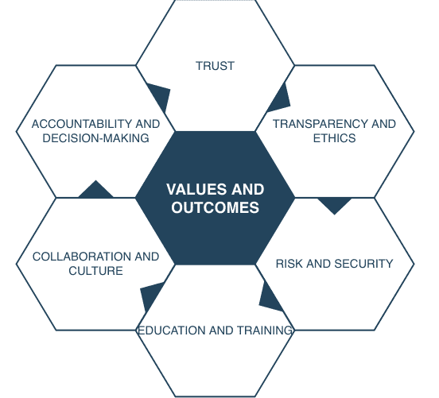

### 前言

我不必告诉你数据有多么重要。如果你拿起了这本书，那么你已经知道数据驱动着当今最盈利的企业。随着像 Google 和 Meta 这样以数据为基础的商业模式的公司，2021 年有 99% 的企业表示计划投资 AI 和数据也就不足为奇了。¹

虽然数据可以带来巨大的价值，但大多数企业尚未释放其潜力。糟糕的数据质量每年让企业花费数百万美元，有些企业支付的费用接近其年收入的四分之一。² 如果这还不足以成为改变的理由，请考虑坏数据带来的文化影响。

2021 年对 C 级高管进行的一项调查发现，虽然对 AI 和大数据投资不断增加，但表示自己是数据驱动的受访者数量却在下降。只有四分之一的受访者认为自己的组织是数据驱动的，比前一年 37.8% 的比例有所下降。³ 受访者一致认为文化上的困难是比技术限制更大的阻碍。员工技能差距、过时的业务流程、抵制变革以及工具选择不当会随着时间的推移而累积。如果你想知道为什么只有 13% 的机器学习模型能够进入生产环境，原因不胜枚举。

我在自己的工作中亲眼见证了这一点。我在 Gartner 担任分析师期间花费了数年研究 AI 技术。我的工作是为客户提供最新的技术趋势建议，帮助他们发展业务。我很快意识到，即使大多数企业明天就开始使用 AI，他们的努力也是徒劳的。大多数企业的数据成熟度如此之低，以至于他们还不准备利用机器学习等技术。

- 1. https://c6abb8db-514c-4f5b-b5a1-fc710f1e464e.filesusr.com/ugd/e5361a_76709448ddc6490981f0cbea42d51508.pdf
- 2. https://sloanreview.mit.edu/article/seizing-opportunity-in-data-quality/
- 3. https://hbr.org/2021/02/why-is-it-so-hard-to-become-a-data-driven-company

当我开始在一支技术团队工作时，我看到即使是存在于传播数据的组织也无法免疫治理问题。我见过客户拥有数百万个独特数据点和数个世纪的数据集。他们也缺乏任何文档显示这些数据存储在哪些服务器上，这些服务器如何相互集成，以及这些数据如何通过工作流程与用户共享。因此，他们的数据传播流程并不顺畅，完成需要数天时间，并且每次发布涉及多个人，没有任何自动化。

不必如此。考虑一下将新产品推向市场所需的努力。你会写一份上市计划，概述产品如何帮助用户的总体战略。你会与销售、营销、工程和客户成功等部门的同事合作，收集有助于构建该产品的情报。你会写一份路线图，显示每个利益相关者必须完成的各项关键任务和里程碑，以便在正确的时间将产品带给正确的客户。然后，你会在整个生命周期中持续治理该产品。

你的数据战略值得与产品战略同等程度的关注。好消息是，构建优秀产品所需的许多技术同样适用于数据治理。掌握基础知识——找到一个框架、选择数据管理员、建立你的数据治理委员会、编写路线图——可以帮助你将数据项目提升到成熟度的下一阶段。

这本书是你将数据项目带过生产的蓝图。通过制定并执行利用数据进行决策的计划，你将获得构建数据治理计划所需的最初六个步骤，以改善业务成果并吸引同事参与。通过付诸实践，你将建立信任、增加合作，并在数据使用方面提高效率。我的目标是让你在从洛杉矶飞往纽约的航班上开始阅读这本书，并在降落时拥有明天开始构建数据治理计划所需的步骤。

### 这本书适合我吗？

我写这本书是给中大型组织（100+ 员工）的决策者，尤其是那些在数据治理在法律上是强制要求的高度监管行业工作的决策者。我相信所有组织都应实践数据治理，无论规模或行业大小。从零开始建立项目比修复破损实践所产生的技术债务更容易。话虽如此，如果你已经在拥有足够员工人数来执行治理的组织中工作，你将从这本书中获得最大收益。虽然你不需要庞大的团队，但你无法独自完成所有这些工作。

我写这本书是给那些知道自己需要帮助利用数据，但不确定如何启动治理的读者。它是给那些在组织中拥有决策权，并被要求为业务问题寻找解决方案的读者。如果你会计师事务所的 CEO 想要建议如何将你的机器人流程自动化项目推向生产，或你的高等教育客户询问如何管理元数据，这本书将为你提供论据。

这个读者定义是有意广泛的。确实，我写这本书是给商业和技术领域的资深领导者，帮助他们为数据治理构建蓝图。但如果一名初级数据工程师或中层经理读完这本书后仍不知道如何在组织中利用数据——以及如何让同事参与其中——我认为我没有完成我的工作。在当今的组织中，没有任何角色不受数据影响。你可能不是工程师或 CTO，但我们同样需要你成功。

如果你在金融、教育或医疗等高度监管行业工作，这一点尤其正确。虽然所有组织都必须负责任地使用数据，但全球标准要求某些行业实践更多的数据谨慎。你会发现这本书在你工作的行业受一系列治理规则控制时特别有帮助。数据保护在世界各地差异很大。如果你的组织希望服务全球市场，你的数据治理必须符合全球标准。

最后，如果你是一名就读于数据科学或分析专业的学生，我希望这本书能帮助你带着自信走进下一个角色，领导关键对话。我曾在一次数据科学会议上发言，涉及我们将在本书中涵盖的一些原则。当我问拥有数据科学硕士学位的与会者他们在数据治理方面接受了多少指导时，他们都说：“没有。”

他们曾就读于顶尖学术项目，并在毕业后在有吸引力的公司获得数据科学职位。然而，我与他们交谈得越多，就越听到他们被期望在没有推动实质性变革所需知识的情况下做所有数据相关的事情。这些对话教会我，数据科学现在对一个同事来说负担太重。没有整个组织的帮助，今天的数据科学家将在其重量下崩溃。

现在我告诉了你这本书适合谁，值得一提的是书中没有的内容。我们不会争论数据科学是什么，讨论线性回归等数据训练技术，或解释如何进行集成建模，因为这些知识在其他地方已存在。我写这本书是因为你可以随手扔出一个

proverbial stone online and hit a blog post about data science, but results for data governance searches are scarce. This book fills the void I found when I searched for data governance resources that I could use in my own work. I wrote the book I wished I’d had, based on knowledge I learned the hard way.

I’ll reference technical tools and methods where applicable, like Hadoop software utilities and two-factor authentication. The last two chapters are more technical than the first four; they’ll cover how to practice data governance once your project is in development and production environments. You’ll gain the most value from this book if you’re familiar with these concepts. That said, you shouldn’t need to hold a traditionally technical role (like data engineer or front-end developer) to learn something from these chapters and this book. If you’re a designer, program manager, or quality assurance engineer working on data projects, I hope you’ll bring this book’s knowledge back to your teams.

### What’s in This Book?

When you finish this book, you’ll have the first six steps you’ll need to build a data governance plan that aligns your efforts to clean, collect, and secure the data you’ll need to power pipelines. Here’s what you’ll find in each chapter:

#### Chapter 1: Find Your Data Framework

How will your organization control data access, implement new regulatory policies, and track activity for data models? If you lack answers to any of these questions, it’s time for a data governance framework. This chapter will show you how to use one, and write a mission statement for data use to guide your work through the rest of this book.

#### Chapter 2: Select Data Stewards

Data governance isn’t one sole person or team’s job. This chapter will share how to find the best data stewards in your business to own specific types of data and metadata so that data governance is truly a team effort.

#### Chapter 3: Build Your Data Governance Council

Data stewards can’t collaborate if they stay in silos. Chapter 3 shares how to create and manage a data governance council that keeps colleagues engaged for the long haul.

#### Chapter 4: Write Your Data Roadmap

Roadmaps build business-wide consensus for how to use data, approve tools, prioritize projects, and more. This chapter will show you how to write a roadmap for your data governance work.

#### Chapter 5: Practice Governance-Driven Development

Data governance is futile if it doesn't improve your development work. Using a case study from Netflix, you will learn how to embed data governance principles into your data projects.

#### Chapter 6: Monitor Data in Production

Data governance doesn't stop once your models reach production. This chapter shares the steps your stewards must take to keep data's quality and security aligned with your governance standards.

### How Will This Book Help Me Reach My Goals?

This book shows you how to build a foundation for collecting, securing, and managing your organization's data. You can't progress your data projects without doing some essential groundwork first.

Establishing data governance that's strategic, follows a framework, engages stewards, and uses a roadmap is hard work. It takes time, resources, and company-wide buy-in. This book will show you how to do it right the first time and set yourself up for long-term success.

#### Find Your Data Framework

Frameworks are like the foundation of your house. If your house is not built on a strong structure that can withstand storms, the whole house will collapse. That's why you must use a framework to design data governance: it's the building block of successful data projects. If you've never used a data framework before, you don't need to reinvent the wheel. You can use existing frameworks to help guide your efforts. The key is knowing your organization well enough to apply a data framework that will help them meet their goals.

This chapter will show you how to define why your business exists and how each data project will fulfill the business mission. From there, you'll connect that mission statement to a data framework that addresses core aspects of data governance, from transparency and ethics to trust and security. When you're done, you'll have a blueprint to manage all your business data from the top down, rather than feeling overwhelmed by doing it piecemeal.

##### Define Data Governance

Before you select a data governance framework, go more granular and define data governance. It's an admittedly nebulous term that can seem to mean everything and nothing. Depending on your background, business, and a range of other factors, data governance can seem academic or irrelevant, even if you work in a data-focused role.

Data governance is a multidisciplinary approach to making and upholding standards that manage data at scale. It helps organizations assess data sourcing, quality, and security at all stages of the data pipeline, from receiving the first spreadsheets with raw data to monitoring that data's quality once it's in production.

Data governance engages employees across organizations to co-create the standards, techniques, and metrics that measure success. This is perhaps the most crucial aspect of strong data governance: bringing data management beyond your IT and DevSecOps teams. By building a data governance council comprised of data stewards that own aspects of your data framework, you give a sense of shared ownership for data that transcends roles. You'll learn how to do this in the next few chapters.

Strong data governance teams do deep, foundational work before diving headfirst into data projects. Each team member knows why they're pursuing each project, which training techniques they'll use, how they procure data, and which metrics they'll use. In short, they have a strategy for why and how they want to use data, guided by a roadmap to help them hit key benchmarks. But this strategy doesn't start with data; it goes higher up to the heart of your business.

Most data-based initiatives fail when leaders don't invest in choosing success metrics, selecting data stewards, starting with small-scale projects, and doing data quality assurance. You can't do any of these things if you don't know why your business exists, or how you want data to help achieve your business goals.

Investing in the “Why?” of data governance early yields long-term success when it's time to tackle more ambitious projects. I learned early in my career that when companies made these investments, it didn't take long for them to start seeing returns. Those investments start by completing a few key tasks.

##### Clarify Your Company’s Mission Statement

When I was a research analyst at Gartner, I surveyed several hundred employees at North American businesses with 500 or fewer employees. I wanted to learn how they used data to make business decisions and how confident (or not) they were in doing so. I also wanted to know if having tools and colleagues devoted to data increased employee confidence in using this data to make business decisions.

Across the sectors surveyed, I found the following facts:

- Employing data scientists makes business leaders more confident that they have the right data and insights to make business decisions.
- Companies with full-time employees who analyze data also use business intelligence (BI) software more often.
- Business leaders that use BI software rate the data-based decisions they make as more impactful.
- A positive correlation exists between how confident people are in their data decision-making and how important they believe data is to their businesses.

Two things struck me as I reviewed these results. The first is that investing in tools and employees to govern data improves business outcomes. The businesses that feel most comfortable with data are the same ones that create roles devoted to governing it. They also invest in software and other data science tools to help employees govern said data.

That said, it is equally important for businesses to decentralize their data. This involves giving each team leader, even those in non-technical roles, the autonomy to own data within their domain. Whether you manage a sales team or a hospital, leaders across all lines of business should be empowered to boost their teams’ outcomes using data. It helps everyone contribute to the bigger business picture.

If you aim to achieve these outcomes, you’ll need to do some foundational work first, and that work doesn’t start with data. To use data effectively, start by clarifying why your business exists. Put another way, ask yourself this question:

> "What’s my company’s mission statement?"

I know what you’re thinking: “Isn’t it obvious what my company does? Why do I need to bother writing it down, let alone writing a mission statement?”

Here’s the thing: you likely do know what your business does on a daily basis. Hopefully, you know how your own role fulfills that work as well. If you’re a CTO, that means you manage the purchase decisions and rollouts of all tech across your organization. On any given day, you assess security risks, report updates to stakeholders, and research ways to improve your company’s IT.

Now, ask yourself why these daily tasks are part of your job. As CTO, you’re responsible for managing all aspects of your company’s technology. Your mission is to ensure that all the technology your company uses and deploys, internally and externally, advances company goals. If you’re unsure whether a specific technology or strategy helps achieve these goals, it’s time to revisit your company’s mission. How can you ensure that you’re making the right decisions without knowing what your business’s north star is?

This might sound like a philosophical exercise that you can’t spare time for. Time and money constraints can prevent senior leaders from asking these

questions as often as they should. But without knowing the answers to these questions, you can’t affect meaningful change in your role. Likewise, without knowing why your business wants to invest in data projects, you won’t write a successful plan to govern data over the long term. You can’t use data to grow revenue, improve products, increase customer satisfaction scores, or lower supply chain costs without knowing how data impacts your company’s mission. And if you can’t explain why you want to invest resources in data efforts, you’ll waste time and money that could be spent elsewhere.

So, the first step on your path to using data is to ensure that you know your company’s mission statement. If you are unsure what your organization’s mission statement is, this is your cue to ask senior leadership. You are searching for a single sentence that captures why your company exists, and how its existence adds value to the world. If you look up some of the world’s most famous brands, you’ll find succinct statements of purpose:

- Warby Parker: “To offer designer eyewear at a revolutionary price, while leading the way for socially conscious businesses.”
- Workday: “To put people at the center of enterprise software.”
- Tesla: “To accelerate the world’s transition to sustainable energy.”
- TED: “Spread ideas.”
- Invisible Children: “To end violence and exploitation facing our world’s most isolated and vulnerable communities.”

These brands have clear reasons for existing. They know the unique value they bring and what they aim to offer the world. If these famous brands are also exceptional companies, they ensure that every team member knows why they exist, and how these mission statements drive each colleague’s daily work. If TED’s Head of Product knows that the brand’s mission is to spread ideas, they’ll approach their product management work through that lens.

Now, it’s time to take the mission statement concept one step further. Let’s review Warby Parker’s mission statement through a data-focused lens:

- How might Warby Parker use data to offer designer eyewear at a revolutionary price?
- What data would they need to achieve this goal?
- Why do they need this specific data to achieve their mission?
- Who would collect, clean, and manage this data?

Where would these colleagues store the data? An on-premise server? An Amazon Web Services (AWS) environment? Neither?

With those questions in mind, apply the same data-focused lens to your own company’s mission statement. This clarity will help you answer a crucial question: “What’s the point of using data at all?”

To write a mission statement for data, clarify how you want data to enhance your business in one or two written sentences. The more specific you can be, the better. It’s not enough to say, “Our company will give all teams the tools and training they need to make data-based decisions.”

Instead, try something like this:

“Our organization will enable all team leads to access data within [BI/analytics software of choice, like Tableau]. This will empower everyone to achieve our shared business goal of increasing customer satisfaction scores by 10 percent by 2025.”

Once you’ve drafted your data’s mission statement, you’ll use a data governance framework to execute that mission.

#### Find Your Data Governance Framework

Think of data governance frameworks like you would software frameworks. Software provides functionality for all, while frameworks make that software specific to diverse applications. Data provides information, while frameworks help you manage that data in unique business contexts.

Data on its own has minimal value if you don’t know how or why you want to use it. For instance, let’s say that your digital marketing director gives your data scientists a set of statistics about user behavior on your company website. Your data science team wants to build an algorithm predicting which user demographics are more likely to buy certain products, and which webpages each user segment will most likely visit. Before your data science team can achieve this goal, they’ll need to answer several questions:

- Which data sources does the marketing team use? Did they collect this data from Siteimprove? Google Analytics? A secondary source, like a contractor?
- Which format is this data in? Will your data scientists need to convert the format before they’re able to use the data?
- Did someone on the marketing team clean this dataset? Are there duplicates, incorrect labels, and so on? There’s a reason why some estimates say that 80 percent of data science is cleaning spreadsheets:¹ if you feed an algorithm bad data, you can’t expect great results.
- Does the marketing team “own” this dataset, its quality, and decisions about how this data is used? If not, is this the data science team’s responsibility? The answer itself matters less than having one. Regardless of what you want to do with this data, someone must be responsible for it.

In this scenario, data is the statistics which share information about user behavior. A governance framework helps your team apply that data in an accountable, business-specific context. Since frameworks are support structures to build upon, your colleagues in this example situation have the highest chance of success if they do the marketing-to-data-science handoff with a framework in mind.

You do not have to reinvent the wheel when it comes to using a data governance framework; several frameworks already exist. Gartner’s data governance framework² is especially helpful because it covers the key areas your data governance efforts will need to address:

- Values and outcomes
- Trust
- Accountability and decision rights
- Transparency and ethics
- Risk and security
- Education and training
- Collaboration and culture

You’ll learn how to implement these sections in future chapters. For now, let’s review each section in more detail to see how they all enhance your mission statement.

##### Values and Outcomes

Without clear metrics, rationale, and conversations about how to use data, your colleagues won’t see how it applies to their daily tasks. They are more likely to infer that you’re putting more work on their already full plates.

To avoid this, center all conversations about data on both your business mission statement and your mission statement for using data. When someone in your organization proposes a new machine learning operations (MLOps) project, map it back to your organization’s business values, priorities, and processes. Likewise, when you write down metrics for success using data, make sure you attribute each metric to a certain colleague, and that those colleagues are bought in.

Sound overwhelming? It doesn’t have to be. Start with one data project before trying to do too much at once. Use it as a model for additional projects by taking the following steps:

- Map the project back to your business mission statement. (Again, why are you doing this? You shouldn’t prioritize flashy new efforts without a clear reason for doing so.)
- Write a mission statement for using data in this project, including success metrics to gauge how well you fulfilled that statement.
- Pick metrics to measure based on your most pressing business problems (decreasing the length of a task’s duration, increasing the number of user logins, and so on).
- Keep the project’s stakeholders informed before, during, and after development.
- Meet regularly (at least weekly) to track project progress and highlight value-adds/blockers.

Your data governance councilmembers will fulfill these tasks to keep each data project aligned with bigger business objectives. The next two chapters will cover the role data stewards play in fulfilling this work, and how to build a data governance council that measures value-based outcomes per project.

##### Trust

Trust is the backbone of any strategy, especially when dealing with data. You already know that owning lots of data is not valuable unless you manage and use it strategically. The full picture is even less rosy. Left ungoverned, having lots of data is a liability that can decrease trust not just in your data, but in your business writ large.

A 2021 survey analysis by the Bank for International Settlements (BIS)³ revealed that Americans have several concerns about how various sectors use their personal data. The COVID-19 pandemic made Americans even less willing to share personal data with a range of actors, from big tech firms (the least trusted sector) to local governments. When asked which risks they’re

1. https://hbr.org/2018/08/what-data-scientists-really-do-according-to-35-data-scientists
2. https://www.gartner.com/smarterwithgartner/7-key-foundations-for-modern-data-and-analytics-governance

尤其令人恐惧的是，身份盗窃排名最高，其次是数据滥用和人身安全风险。

这就是为什么你的数据框架必须以两种不同的方式提升信任：最大化数据的价值，同时最小化其危害。你所做的每一件事，从为你的数据治理委员会招募同事到设定安全标准，都应回溯到这些关键目标。

##### 问责制和决策权

一旦你知道你的数据框架必须建立信任，下一步就是确认哪些人将做出关于数据的每个决策。这项任务需要你与业务各部门的同事进行沟通。因此，在你审阅本框架的每一步时，请考虑哪些同事最有资格拥有这些步骤。

你希望在你的计划中使用数据并就数据做出决策时纳入组织各部门的同事。这就是你将建立你的数据管理团队的方式，你将在下一章中探讨这一点。

关于数据问责制和决策权的问题应回答一些关键问题：谁拥有各相应领域的数据？哪个团队或个人负责它，谁决定哪些团队或个人可以访问它？

例如，你的销售总监可能会使用 Salesforce 等软件管理你组织关于销售线索的数据。在这种情况下，销售总监拥有销售领域的数据并决定如何访问它。如果组织中其他任何人需要查看线索数据，他们应该确信可以向你的销售总监提出请求。

##### 透明度与伦理

> “价值观和伦理并不是一个完全独立的努力……数据清洗本身的活动本质上就是需要做出伦理、道德和规范性选择的行为。”

我在都柏林大学学院复杂软件实验室认知科学博士候选人 Adeba Birhane 的一条推文中找到了那句引言。多年以后，我还没有看到比这更准确的评估，说明为什么伦理位于数据工作的核心。工作的每个方面，从收集和清洗数据到你为算法使用的训练技术，都强化了你组织的价值观。因此，等待在团队回顾中讨论数据伦理本身就是不道德的。

算法偏见的已有充分记录的后果影响着——并且在某些情况下毁掉了⁴——用户的生活。我们在法律、医学和其他有影响力的领域的同事宣誓不造成伤害。我们必须对数据做出同样的承诺。

与治理本身一样，太多人仍然认为数据伦理是一个独立的项目，领导者会在方便时“处理”。现实远非如此。伦理，以及关于你的团队如何做出基于数据的决策的透明度，必须位于你的数据治理的核心。这是因为没有透明度就没有信任。

为了向客户表明你将他们的最佳利益放在心上，你需要一个清晰的理由，说明你的组织如何以及为何收集、清洗、组织和呈现数据。你可以通过一份数据伦理准则取得很大进展，该准则：

- 清晰
- 可辩护
- 有记录

任何数据伦理准则都必须与你各自的公司和数据使命宣言保持一致。它还应说明谁负责做出关于数据的哪些决策。你将在本书中看到本框架的每个部分如何相互交织。通过分配问责制并优先考虑信任，你证明了你的业务将伦理融入数据工作，并对你如何做出基于数据的决策保持透明。

##### 风险与安全

未经治理的数据会带来一系列安全风险。截至 2021 年 10 月，身份盗窃研究中心（ITRC）⁵报告称，与 2020 年相比数据泄露增加了 17%。其中许多泄露破坏了供应链，例如 DarkSide 对 Colonial Pipeline 的勒索软件攻击导致美国东海岸出现汽油短缺。

保持数据安全涉及通过数据治理进行风险意识。你不想成为一个因数据管理不善而不断道歉的品牌。虽然你无法预防每一个可能出现的问题，但如果你以风险意识的方式治理数据，你可以避免潜在问题，或至少减轻其影响。

拥有这样一个由跨部门团队领导的多步骤框架，是保持风险意识的第一步。它通过提高团队间的透明度来降低风险。它还让团队负责人有机会评估他们的数据使用是否符合组织的使命宣言，并帮助你将组织的企业信息安全框架整合到一个环境中。

4. https://www.brookings.edu/research/police-surveillance-and-facial-recognition-why-data-privacy-is-an-imperative-for-communities-of-color/
5. https://fortune.com/2021/10/06/data-breach-2021-2020-total-hacks/

##### 教育与培训

实施数据治理涉及新的、不熟悉的政策和标准。为了正确推广数据治理，你需要为所有数据管理员提供培训和发展资源。这将教会他们成功是什么样的，并使他们能够共同领导数据治理。

与人力资源部门合作将帮助你为业务和技术角色中的数据管理员制定长期培训计划。这还有额外的好处，即你可以将数据管理目标融入每个管理员的角色描述和员工评估中。

这至关重要，因为你希望对每个管理员在帮助你的业务实现目标方面取得的工作给予认可。如果管理员知道他们将因自己的努力而获得正式认可，他们将更倾向于提供帮助。

##### 协作与文化

你已经知道，组织各部门的领导应参与数据治理决策。诀窍在于让治理不仅仅是一项合规检查。如果你的组织将治理工作视为官僚主义，或视为超出其日常角色的额外工作，你将更难获得认同。要取得持续的影响，数据治理应采取知识共享、讲故事和人员之间的参与形式。

这可能是你的数据框架中最棘手的一步。取决于你的同事和客户今天如何看待数据，你可能需要推动一些重大的文化变革。这就是拥有一个传播负责人发挥作用的地方。他们可以将你的公司和数据使命宣言转化为一个更大的故事，讲述业务各团队如何以正确的方式使用数据来执行该使命。

这也是让组织中的设计师参与进来的一个绝佳机会。他们可以通过同理心网格、服务蓝图和其他设计资产让这个故事栩栩如生，你的治理委员会可以用这些资产来指导他们的工作。

##### 你的下一步

在考虑了框架的七个步骤如何帮助你更全面地管理数据之后，请使用以下模板在你自己的组织中实现这些原则。该模板将指导你的下一步，即将本框架的每个部分的管理分配给你组织中的一位（或多位）同事。

你可能会意识到你内部没有足够多的同事让一个人拥有框架的每个方面。在这种情况下，请根据员工技能集标明框架的哪些部分可以合并。

例如，如果你是政府承包公司的首席技术官，你可能会将整个框架分配给你的数据实践负责人，他们可以在客户项目中实施该框架。如果你的组织规模太小而没有完整的数据实践，这可能是引入分包商的好机会，他们可以根据项目需要填补框架空白，例如聘请一家具有网络安全专业知识的公司来支持客户项目，如果你缺乏足够的内部人才。这份数据领导者名单将成为你的数据管理计划的基础，我们将在下一章中介绍。

任何大目标中最困难的部分就是开始。完成本章及其中的工作后，你已经取得了令人惊叹的开端。你确认了你组织的使命宣言并考虑了数据如何实现它。你撰写了使用数据的拟议使命宣言，并在你自己的业务背景下开始应用数据治理框架。这是一项大量而必要的艰苦工作。它充分体现了你使用数据的坚韧和决心。

你刚刚审阅的七步框架的好坏取决于将它付诸实践的人。你的下一个任务是让他们参与进来。

#### 选择数据管家

Andrew Ng 是机器学习（ML）领域的先驱。他共同创立并担任 Google Brain 的负责人，在百度组建了人工智能团队，并与斯坦福大学的兼职教授工作同时共同创立了 Coursera。当 Ng 对 ML 发展状况提出建议时，人们会倾听。而他对行业未来的评估显示仍有一些需要填补的空白。¹

“当系统表现不佳时，许多团队本能地试图改进代码，”Ng 写道。“但对于许多实际应用而言，更有效的做法是专注于改进数据。”Ng 进一步阐述，历史上，机器学习是通过改进代码而取得进展的，同时研究人员将数据固定在基准数据集上。为了在未来取得显著进展，团队必须把数据质量放在首位。Ng 表示，科技领导者不应优先考虑以代码为中心的模型，而应对驱动这些模型的数据做出系统性改变。

虽然这是一个值得称赞的目标，但也充满挑战。今天的企业拥有超出其处理能力的数据。此外，平均而言，首席技术官的日程安排已十分满员。如何在每个数据管道的各个阶段确保数据质量？

好消息是，你不必独自完成。拥有成功数据项目的企业会组建数据管家团队来帮助他们实现这一目标。在所有业务线中选择并[content]

#### 选择数据管家

Andrew Ng 是机器学习（ML）领域的先驱。他共同创立并担任 Google Brain 的负责人，在百度组建了人工智能团队，并与斯坦福大学的兼职教授工作同时共同创立了 Coursera。当 Ng 对 ML 发展状况提出建议时，人们会倾听。而他对行业未来的评估显示仍有一些需要填补的空白。¹

“When a system isn’t performing well, many teams instinctually try to improve the Code,” Ng writes. “But for many practical applications, it’s more effective instead to focus on improving the Data.” Ng elaborates that historically, ML progressed through efforts to improve code while researchers held the data fixed in benchmark datasets. To see significant progress in the future, teams must put their data quality first. Rather than prioritizing code-centric models, Ng says tech leaders must make systemic changes to the data that powers these models.

While this is an admirable goal, it’s also challenging. Today’s businesses have more data than they know what to do with. On top of that, the average CTO’s schedule is full as-is. How can you ensure data quality at all stages of every data pipeline?

The good news is you don’t have to do it alone. The businesses with successful data projects build teams of data stewards to help them reach this goal. Choosing and engaging data stewards across all lines of business yields diverse teams that give colleagues agency and autonomy. In this chapter, you’ll become familiar with the key role data stewards play in your data governance strategy, and how they’ll help you fulfill the framework discussed in Chapter 1, Find Your Data Framework, on page 1.

1. https://read.deeplearning.ai/the-batch/issue-84/

Before we go on, I want to address the agile elephant in the room. As someone who works in environments that prize continuous development,² I'm aware that finding data stewards for a company-wide council can seem bureaucratic. Worse than that, it can seem fully divorced from your daily execution.

In Chapter 4, Write Your Data Roadmap, on page 43 you'll explore tactics to bake data governance into your roadmap, requirements, and other key tasks you will execute per sprint. Done well, data governance is how your organization delivers data projects faster and of higher quality than your competition. It's also the series of strategic steps your teams take to make each sprint more productive than the last. But you can't make each sprint look flawless without the right data stewards to lead them.

By the end of this chapter, you will be able to identify colleagues in your organization who are experts in various data domains and can help bring your data governance to life. These colleagues will be your data stewards.

##### What Are Data Stewards?

Data stewards own the strategic and tactical decisions for data within their respective business domains. Stewards serve as trusted advisors for their data, providing key context and nuance as needed. For example, a director of customer success could serve as a data steward by owning and offering key insights about customer data that your business prioritizes, like average response time and the number of new accounts per month.

You might wonder if data stewards must hold technical roles. After all, data scientists, engineers, and similar roles work with all types of data each day. Aren't they most qualified to serve as stewards? The answer is sometimes, but not always.

Data stewards bring their own unique value to your business. This includes deep knowledge of the company strategy, customer pain points, collaboration processes, and cultural nuances. By working in a diverse range of roles, they lead areas of the business that your data team might touch tangentially, if at all. Perhaps most crucially, data stewards are experts in their unique domains, whether that be sales, marketing, product, or legal. This knowledge is invaluable to colleagues in data engineering, data science, and data architecture; they need those insights to support their own work.

For example, let's say your data team must re-design the taxonomy within a database about cars. Before that content reaches its database, a team of statisticians collects, downloads, cleans, and analyzes the data for their specific products. This expertise varies per statistician. Whereas one statistician owns the data for BMWs, another owns the data for Audis.

Database users tell your user research team that it's too hard for them to find the data they need within this database. To help users get more value from your database, your data team must redesign the taxonomies for BMW and Audi products. Before your data team can start this crucial work, they'll need several questions answered:

- How is the data for these commodities collected?
- Who collects this data, and where is it stored before it reaches the user database?
- How many databases does this data live in? Are they on-premise or cloud databases?
- How often is new commodity data released to the public?
- How are these car-specific data releases prepared, and who prepares them?
- Is this preparation process automated, manual, or both?
- Which quality assurance checks do statisticians use, and which colleagues participate in these processes?

To find accurate answers to these questions, your team will rely on statisticians who can steward their respective data. (In this case, data about Audi and BMW vehicles.) These stewards will work with your data team to help them learn the answers. Data stewards could help your data team do the following tasks:

###### Define attributes

Data attributes (also known as metadata) define properties of objects, elements, or files. Data stewards are often the best people to write, manage, and share attributes for the data in their domains. For example, a customer service director might manage details such as customer IDs, addresses, and purchase histories. If this director serves as a customer data steward, they can keep clean, organized, secure records of this data to share with colleagues as needed.

###### Build data models

If data stewards lack a data architect's expertise, they can still help architects with their work. For example, a data architect who's redesigning a database will need to understand the IT systems that this database must integrate with. A steward who manages these systems can give crucial context to help the architect build better architecture that supports the right integrations, taxonomies, and so on.

###### Create data dictionaries

Think of data dictionaries as centralized spots for information about data. A great data dictionary helps a system’s users find all the details about data that they need in one place. Data stewards can play a key role contributing to these dictionaries as writers, editors, and advisors.

Not all data stewards serve the same function. Where possible, it helps to categorize data stewards as serving either business or technical roles. Separating data stewards into business vs. technical stewards might sound intuitive, but it’s often a big roadblock on organizations’ data governance journeys.

No matter how nimble a business thinks it is, the truth is that all but the smallest teams have more silos than they think. This leaves most teams with little to no knowledge of how their colleagues in other departments work, or what they work on. And nothing reveals those gaps quite like searching for the right subject matter experts to fill decision-making roles about data.

This is also a hard task because many data stewards lack the autonomy to make organizational change. Despite their status as experts of the data in their domains, they often lack the power to make choices that affect the business strategy. At best, they’ve built strong relationships with those who have organizational sway, and they can effectively persuade these colleagues to consider their advice. At worst, their advice languishes. To avoid this, a big part of your job will involve giving your stewards the visibility and recognition they deserve.

You’ll get some tips on how to do that soon. For now, here’s a quick overview of how business data stewardship roles differ from technical roles:

Business stewards own data for business processes and workflows. They own the data classification scheme for data and metadata which falls under their areas of expertise. For example, in our car database, a statistician who produces data releases for BMWs would serve as a steward for BMWs’ taxonomic hierarchies. This involves these tasks:

- Collaborating with colleagues to make sure that these hierarchies are accurate, organized, informative, and intuitive
- Collecting data and confirming that this data/metadata meets organizational quality standards

2. https://www.atlassian.com/continuous-delivery/principles/continuous-integration-vs-delivery-vs-deployment

- 审查和评估商品条目的当前分类法
- 编写这些商品条目所需的文档
- 为其部门主导数据治理培训
- 定义、开发并根据预定义的业务指标开展数据质量评估

*技术管护员* 负责系统、管道和实施的数据。这些管护员帮助同事学习如何在系统之间建模、创建、维护和传输数据。技术数据管护任务可能包括以下内容：

- 维护所有系统实施的要求。
- 管理数据集市、数据仓库、数据湖和数据网格。
- 构建并集成前面提到的系统。
- 定义元数据的参数。
- 确认需要为不同类型的内容或资产分配哪些数据。
- 设定哪些数据用户和管理员可以操作的数据限制。
- 将数据从本地环境迁移到云环境，或从一个云环境迁移到另一个云环境。
- 构建实现业务优先事项的数据模型和算法。

在这些广泛的业务和技术类别之内，数据管护角色会变得更加具体。当你阅读以下角色描述时，请将它们全部置于你在第1章《找到你的数据框架》第1页中引用的数据框架的背景下考虑。你的数据管护团队将通过拥有特定业务和技术领域的数据来履行此框架。

所有产生和/或管理独特数据的业务线都应指定数据管护员。销售、营销和客户成功是三支管理着维持业务运营的数据的团队。因此，你应该至少让每个团队的一名高级成员担任数据管护员，能够拥有其各自业务领域的数据。

你的业务可能需要的管护员比此列表多或少，这很正常；根据你自己的业务需求和限制调整管护员即可。关键要点是，任何管护角色都应与七部分数据框架的至少一个方面保持一致。基于此，以下是数据管护员可以担任的非详尽角色列表：

##### 委员会主席数据管护员

你的数据管护委员会主席发挥其关键领导作用。主席领导所有与管护员的会议，并在整个业务的会议中代表数据治理委员会。委员会主席批准启动项目或购买新数据工具的请求，领导数据治理委员会关于其方向的会议，并拥有数据治理战略。在高层面上，他们执行以下任务：

- 为数据治理委员会成员执行而构建和实施战略数据管理计划。
- 监督与组织数据相关的所有项目和计划。
- 为数据管护员分配各自技术和业务角色的职责。
- 分享关于数据计划变更的沟通信息。
- 在 C-suite 和跨部门会议上代表数据治理委员会。
- 解释组织对安全漏洞的响应。
- 定义贵组织中“质量数据”的含义，包括使用和避免哪些数据源。

##### 安全数据管护员

安全数据管护员与数据治理委员会主席和 C-suite 合作制定数据使用和安全政策。安全数据管护员在组织业务和技术层面之间进行联络，以在更广泛的业务中设定和分享安全更新。

安全管护员执行以下任务：

- 监督保护数据的所有安全要求。
- 根据敏感性为所有公司数据分配适当的安全分类。
- 收集旧项目和新项目的全部安全相关数据制品。
- 根据需要创建安全制品。
- 评估当前安全要求，并对其要求的遵守情况进行评估。
- 根据请求提供安全发现结果。
- 定义数据锁定要求。
- 对所有新的安全要求进行差距和影响分析。
- 将安全要求与当前和拟议的数据环境进行比较。
- 根据安全风险审计并批准所有拟议的生产变更。

你的安全数据管护员应审查委员会批准的任何新项目或工具。他们会根据组织的安全标准评估每个请求，尽早提供指导以避免技术债务。

##### 伦理与透明度数据管护员

该管护员确保你的数据治理政策符合第8页《透明度与伦理》中讨论的数据使用所要求的清晰、可辩护且有据可查的标准。你的伦理与透明度数据管护员直接与数据团队合作，帮助数据分析师、科学家、架构师和工程师考虑他们的工作可能以非预期方式影响客户的方式。

伦理与透明度数据管护员如果具有数据科学或工程背景可能会亲自动手处理数据，但这并非推动该角色变革的必要条件。你的伦理与透明度数据管护员需要针对每个数据项目考虑广泛的数字伦理风险，然后将这些风险与数据治理委员会分享。伦理与透明度数据管护员应执行以下任务：

- 编写组织存储、共享、收集和保护数据的合规标准。
- 将每个数据项目可能出现的伦理风险映射回组织的业务和数据使命声明。
- 记录数据管理决策的方式，包括这些决策如何同时服务于业务和客户的理由。 （这尤其重要，因为客户福祉通常与对业务“最好”的情况相冲突。）
- 培训组织各层员工践行数据伦理，从 C-suite 领导到个人贡献者。
- 确保组织的数据伦理实践符合更广泛的法律和立法合规标准。
- 确认业务购买和使用的所有技术均符合组织自身的合规标准。

许多伦理与透明度管护员具有法律和/或合规背景，这有助于他们评估风险并预测哪些数据使用可能侵犯公民权利。

##### 文档数据管护员

你的文档数据管护员是委员会的驻场撰写者。他们管理委员会的文档存储库，其中存放从委员会会议记录到每个项目用户验收测试的业务需求等所有内容。在此管护角色中，他们执行以下任务：

- 编写一致的数据定义。
- 培训组织各地的同事记录数据相关工作的最佳实践。
- 将此文档存储在适当区域。
- 为所有基于数据的决策和计划编写、编辑和管理文档。
- 管理数据架构图、数据模型和数据字典等制品。
- 根据需要与技术管护员合作编辑数据制品。
- 组织所有高级数据资产，例如数据字典和元数据目录。

该数据管护员可能不会亲自撰写所有文档；数据治理委员会的价值之一在于让业务各方拥有数据特定工作，以免落到一个人身上。在他们不亲自撰写文档的情况下，文档数据管护员仍拥有存储库并适当存储文档。

##### 合规数据管护员

合规数据管护员通常为其数据治理工作带来法律背景。该管护员跟踪涉及数据的监管变化并确保数据使用符合这些变化。他们与数据管护委员会的所有角色密切合作，从为文档数据管护员编写合规标准到与你的伦理数据管护员一起审查数据透明度要求。合规数据管护员执行以下任务：

- 审查贵业务服务用户的市场中数据的监管框架。

- 解释多样化的法律，以确认企业和消费者的数据特定权利。
- 确保您的业务根据项目和供应商选择遵循数据管理的基本法律。
- 与数据管理员和数据团队沟通，确保在资源分配前每个人都考虑合规性。
- 在数据使用生命周期中审查模型，确保数据团队在生产前、中、后都遵循数据质量标准。

如果其中一些头衔听起来很熟悉，那是因为关键的管护角色与你在《Find Your Data Governance Framework》第5页中探索的数据治理框架相一致。在组建自己的数据管护团队时，确保管护角色与数据框架的相应部分保持一致。将同事分配为共同拥有你的框架将有助于使其落地。

根据贵组织的规模，您可能没有足够的管护人员来填补涵盖框架所有方面的角色。在这种情况下，请寻找一个管护人员具备专业知识来负责框架两个部分的契合点。例如，伦理与透明度数据管护员与合规数据管护员之间存在很多自然的重叠。如果您有一名律师在职担任合规管护员，伦理与透明度也可以由他们负责。

在尝试按框架的每个部分填补角色时，请考虑谁已经在做这项工作。负责客户成功的 数据管护员可能是您教育与培训数据管护员角色的理想人选。这能让他们帮助组织内所有同事了解数据治理是什么、为什么与每个人的角色相关，以及如何向数据管护员寻求帮助。客户成功团队每天都在与客户交流、处理问题，并向不同的人展示如何使用您的产品。教育和培训本就是他们工作的重要方面。这种能力使他们自然适合负责数据治理的教育与培训。

同样，营销负责人可以担任您的协作与文化数据管护员。营销人员探索、创造并主导寻找产品合适受众的机会。最好的营销人员都是天生的讲故事者，能够无缝分享他们的产品如何满足您的需求。您需要这种讲故事的能力来分享为什么数据治理是团队运动，并引导公司文化进行实现长期效果所需的变革。

当数据管护委员会的七个部分框架的每个方面都得到覆盖时，您就会知道数据管护委员会走在正确的轨道上。但如果您仍处于早期阶段，您可能会想知道如何聘请数据管护员。好消息是，您不需要。

##### 用合适的人填满委员会

数据管护员不需要从外部招聘；这也是他们最大的优势之一。与通常需要高价招聘的数据科学家不同，数据管护员已经是您业务的一部分。因此，他们将对您的技术栈、战略和客户痛点的深入了解带入日常工作。数据管护员不仅仅是锦上添花，也不应该取代受过训练的数据科学家。他们为您的业务带来独特的价值，同样必不可少。

这一点值得重申，因为现在已不再足够让一名员工拥有所有基于数据的决策——或让您的业务避免投资能够将数据使用提升到下一个水平的工具、培训和员工。实现这一点需要一个更大、更跨职能的团队，对数据做出共同决策并跨越部门协作。

因此，您不需要聘请数据管护员，但您需要找到他们。这所需的时间和资源将根据贵组织的规模以及每个人的角色范围而有所不同。

例如，初创公司员工在早期同时负责营销和产品并不罕见。根据这名营销/产品负责人团队的规模，一个人可能会同时负责营销和产品部门的数据。因此，您可能会很容易找到一位强大的管护员，却发现那个人没有足够的时间来提供帮助。

如果您在一家大型组织工作，那么您的知识专家团队更可能在彼此分离的部门中工作。在这些情况下，一个人通常掌握其领域的特定知识。如果该领域是安全等主题，那么它可以很容易地与您的管护团队的专业知识匹配。但找到这种匹配可能需要通过无休止的电子邮件、介绍和日历邀请来花费时间。您可能以为找到了所需的 数据管护员，却在会面后意识到您需要与别人交谈。

因此，您需要对如何找到合适的数据管护员进行战略规划。在内部开始寻找他们之前，请回答以下问题：

##### 我的组织的产品组合有多大？

在贵组织更大的背景下考虑您的数据需求。您的业务提供多少产品和服务？每个产品或服务是否有自己的客户群？这些问题的答案将让您了解数据管护委员会应该有多大。

让我们回到汽车数据库的例子。如果您的数据团队被要求重新设计数据库分类法，这看起来像是您正在改进一个具有固定截止日期和短期工作的员工/数据管护员的单一项目。但要对该数据库做出持久、有意义的改变，您首先需要回答以下问题：

- 哪些系统与此数据库集成并从中提取数据？
- 此数据库内的数据层级如何？
- 此数据库内是否存在多个分类法？
- 此数据库重新设计是否属于更大的数字化转型工作的一部分？

如果最后一个问题的答案是“是”，那么您的数据管护需求就急剧增加。这不是坏事；它让您对自己被要求解决的挑战有了现实的认识，并更强烈地感受到您将需要多少数据管护员。

##### 我最需要哪些数据的帮助？

考虑在阅读本书时您最关心的 数据。您会将其归类为更技术性的，还是在组织业务侧的，或两者兼有？一旦您评估了您正在处理的数据类型，您就可以在各部门之间寻找最适合拥有此数据的管护员。

如果您已经与他们建立了牢固的关系，那么您寻找管护员的努力将最成功。理想情况下，这些管护员是您曾合作并建立了良好关系的同事。他们知道自己的工作如何为更大的业务做出贡献，并且希望帮助您的数据管护工作，因为这项工作与他们自己的工作一致。

没有单一的答案来说明您的业务可能需要多少数据管护员。您的答案将取决于贵公司产品组合的大小、您计划的参与时长，以及您手头的数据项目是独立的还是数字化转型工作的一部分的一部分。万一有疑问，从小开始。您可以始终请求管护员的帮助六个月，并在工作继续时重新评估您的需求。由于敏捷项目以增量方式进行，因此在需要时将管护员纳入您的团队是自然的。

在询问您需要多少管护员时，开始写下所有未解答的问题会有帮助：

- 最大的安全风险是什么？
- 在通往生产的过程中，您预见到哪些阻碍？
- 您需要业务中谁的支持？

一旦您写下这些问题，就按组织领域对其进行分类，从业务和技术到安全和项目管理。您识别出的领域数量将让您对最初需要多少数据管护员有一个强烈的概念。万一有疑问，请记住我们使用的 数据框架有七个部分。因此，目标是七名管护员来启动您的数据治理委员会，并将七个框架步骤的拥有权分配给每位管护员。

虽然管护员可以在数据治理委员会中担任双重角色，但让管护员负担过重并不理想。您可以根据需要合并管护领域，但避免让他们负责三个以上的领域。这会让人不堪重负，并增加数据质量可能受损的风险。

写下您需要每位这七位管护员提供的见解和专业知识。要尽可能具体。每个管护员将负责您数据治理框架的哪些部分？这项工作如何补充他们的日常任务？他们是否负责管理您组织中的特定数据？如果是，他们管理哪些数据，这些数据存储在哪里，您可能需要它用于哪些数据管道？

请记住，您是根据他们的专业知识选择管护员，您的目标是利用这些知识而不为他们创造更多工作。为实现这一目标，请参考第1章《Find Your Data Framework》第1页中的数据框架和数据使命声明。在选择负责伦理、安全、文档等的管护员时，请在整个业务中查看谁履行这些角色。

如本章前面所述，您的企业律师可能是担任伦理和/或合规数据管护员的强有力候选人。同样，您的技术写作者也是担任文档数据管护员的强有力候选人。

无论他们的业务或技术技能如何，每位管护员应具备的最基本能力是有效推动组织文化变革的意愿。您和您的管护团队即将领导重大的组织工作。下一章将分享如何建立和维持数据

拥有专业知识来改变你的业务的治理委员会。与此同时，你可能有一个更紧迫的问题。

##### 下一步

你知道与数据管理员协作的好处。信不信由你，这部分其实很容易。一旦你找到了合适的同事担任管理员，你将面临一个更关键的问题：“我如何激励他们提供帮助？”

作为组织领导者，找到数据管理员对你来说有明显的好处。它帮助你建立一个多面、跨职能的团队，共同承担数据所有权责任。你的数据团队在营销到工程等各个领域获得了盟友。而且你将获得更多资源来帮助你的数据工作。

但如果无法回答管理员心中的关键问题：“我能得到什么好处？”这一切都毫无意义。

数据管理员为你的组织带来巨大价值。起初不太清楚的是，数据管理如何使管理员本人受益。你可能要求你的销售主管、高级统计学家或临床实习生做更多工作，而对他们没有任何明显好处。

你的数据管理计划最大的风险是给管理员增加更多工作，从而滋生怨恨和不愿帮忙的情绪。为了让管理员长期保持参与，你需要尊重他们的时间并奖励他们的贡献。这涉及给予他们应得的认可，认可他们为这项计划付出的工作。

因此，本章的作业是审阅你的管理员名单，并制定奖励他们努力的计划。这些奖励应该是切实的，无论是通过奖金、增加/折扣的股票期权，还是正式将管理任务添加到他们的职位描述中。最后一个选项使管理员能够在当前角色中超越期望，更有可能获得晋升。它奖励他们已有的专业知识，并使他们能够通过分享宝贵的知识来推进职业生涯。

一如既往，要现实地考虑你可以用现有资源做什么。如果你的团队的年度预算要到每年秋季才会重置，请提前计划重新分配部分预算用于数据管理员奖金。也许你正在招聘一名新的技术作家；如果是这样，请与该员工的主管合作，将数据管理职责添加到其职位描述中。这使得数据治理成为其角色的核心部分，而非附加项。

这两个例子都假设你在工作中处于可以监督预算和/或影响大型业务职能（如招聘）的位置。如果不是，这就是你向上管理的机会。无论你是变革管理顾问还是内部数据科学家，你都处于影响权威的位置。你的客户或组织聘请你帮助他们建立更好的明天，因为他们无法独自做到。

这并不意味着你不会遇到阻力。对于你正在进行的深度工作来说，这在所难免。但如果你担心为数据管理员倡导并公平奖励他们是越界了，请提醒自己，这就是领导者所做的事情；他们组建最好的团队，然后奖励他们所贡献的辛勤工作。

在她对失败的 AI 项目的颂歌中，谷歌决策智能负责人 Cassie Kozyrkov 分享³ 称，寻找独角兽是大多数机器学习模型无法面世的关键原因。Kozyrkov 说，即使你找到了能同时处理架构、工程、UX 和 QA 的独角兽，他们也无法独自完成如此庞大的工作量。她提供了另一种选择：

> “与其试图独自完成所有事情，不如学习如何检查接力棒是否在你的团队成员之间正确传递。”

如果你的组织真正以数据为驱动，仅仅雇佣少数专家让他们远离业务运作是不够的。以数据为驱动意味着优先考虑数据质量并让每个人参与共同拥有数据。如果今天的每个公司都是数据公司，那么每个员工都是数据管理员。而如果每个员工都是数据管理员，你就需要他们的认同来传递接力棒。

你已朝着实现这一目标迈出了巨大步伐。你在业务中挑选数据管理员所做的工作使你处于有利地位来建立你的数据治理委员会。在合适的管理员团队到位后，你就可以组建一个能够利用数据推动持久变革的委员会。第 3 章将向你展示如何做到这一点。

#### 建立你的数据治理委员会

2021 年 10 月，美国农业部（USDA）发布了一项应对气候变化的计划。长达 40 页的该机构气候适应和韧性计划解释了该机构将如何帮助农业生产者为日益不稳定的气候建立韧性。

在宣布该计划的新闻稿中，USDA 表示，“该计划是 USDA 对第 14008 号行政命令《在国内和国外应对气候危机》做出的回应，该命令要求所有联邦机构准备行动计划，将气候适应整合到其使命、项目、运营和管理中。”

当我了解这项新计划将如何影响该机构时，我被行政命令要求所有机构将气候适应融入其 DNA 的法令所震撼。由于我正深入研究数据治理，我不禁注意到这项新计划可能成为优秀数据治理的典范。

首先，该计划回应了总统关于《在国内和国外应对气候危机》的行政命令。美国总统宣布气候变化是一个政府应自上而下在所有 USDA 机构中解决的广泛问题。为了确保这一目标始终保持在首要位置，领导层要求所有机构将气候适应作为其工作的关键部分。

虽然气候变化本身可能与数据关系不大，但 USDA 的治理模式确实相关。其方法强调了获得自上而下支持对于跨团队扩展的计划至关重要。值得强调，因为这种工作方式仍然不是常态。

通常，当公司启动新计划时，他们会把该计划的所有工作放在一个团队或部门。他们聘请一位新负责人，责成他们在权力有限的情况下改造整个业务，通常给予该负责人令人失望的预算，并将计划局限于该团队。这种方式进行数字化转型确保了其工作的影响力最小。

本章将向你展示如何做相反的事情。你将学习如何组建一个跨职能的数据管理委员会，在你的组织中推动真正的变革。在本章结束时，你将知道合适的赞助人如何决定委员会的成败，你新成立的委员会何时应该开会，以及应优先考虑哪些数据工作。你将拥有解决障碍、衡量成功并在通往生产的过程中治理数据的方法。

记住，建立数据治理的最大障碍不是技术性的，而是文化性的。在一项调查中，92% 的主流公司表示，就在组织中启动数据项目而言，他们仍然在从学习新业务流程到抵制变革等一系列挑战上挣扎。¹ 你正在为你的组织设计第一个数据治理计划，这意味着你正在引入大量变革。以下是如何创建一个将推动这种变革的委员会。

##### 寻找最有效的赞助人

我们都经历过会议疲劳，同事们试图通过在日历上填满“快速通话”邀请来解决问题。如果会议缺乏目的、议程、明确的领导者或后续行动，它们本可以是电子邮件，从而节省无数小时。另一个鲜少被讨论的时间黑洞？房间里没有合适的人来做出关键决策。

你迄今为止为你的数据治理委员会挑选合适的数据管理员做了大量工作。如果没有组织的高级成员来赞助该委员会及其数据治理工作，所有这些都将停滞不前。因此，你的第一步是确认你需要谁的赞助。

想象一下你自己就是 C 套房角色中的首席数据官（CDO）。你可能向首席信息官（CIO）或首席执行官（CEO）汇报。你的角色涉及制定收集、存储和管理组织数据的战略。所有这些工作都是数据治理，而由于你是执行团队的一员，你可能是通过担任我们下面将讨论的董事会主席管理角色来领导数据治理委员会的合适人选。

如果你自己处于 C 套房角色，你是否需要更多的高管支持？答案取决于你的独特业务、公司文化和你的

1. https://hbr.org/2021/02/why-is-it-so-hard-to-become-a-data-driven-company

own relationship with the rest of the executives. If you report to the CIO, your boss owns the infrastructure for your organization. Their tasks include signing off on procurement for new tech, implementing new IT across the organization, and ensuring that all IT decisions support the business strategy.

Now, consider the work your data governance council will do. You'll start by selecting a specific, data-focused project to shepherd through production. To achieve this goal, your data stewards will need to choose the right tech stack, build processes to confirm data quality, ensure that all data meets security standards, and document a strategy to prevent data drift post-production, amongst other tasks.

Since this work falls under the CIO's domain, your data governance council will need the CIO's buy-in. But you've glimpsed your boss's calendar and know how slammed they are. Adding council chairperson duties to their list won't likely go well. In this case, asking them to serve as your council's sponsor is a great option.

Sponsors are discussed less often than mentors, but their role is more essential. Sponsors advocate for your work by ensuring that it gets the resources and visibility to thrive. This saves huge amounts of time in the long run. Rather than spending months searching for buy-in only to realize you've recruited the wrong people, you'll confirm that your data governance council's work has support from someone with the power and connections to advocate for that work, even when your councilmembers are not in the room.

Whoever your council sponsor is, you will need to sell them on your data governance efforts. Remember the data mission statement that you wrote in Chapter 1? It's going to come in handy here. Since you'll be appealing to business leaders, you'll need to show that your data governance efforts support their goals. All the work you did in Chapter 1, from writing your mission statement for data to assigning stewards per section of your framework, should reinforce a bigger business goal. Whatever that goal is, from decreasing overhead to boosting customer satisfaction, you'll find the right sponsor for your data governance council if you show that your work will improve theirs.

If you're not sure how to choose the right sponsor for your council, it helps to follow this guidance from Sylvia Ann Hewlett: “Would-be sponsors in large organizations are ideally two levels above you with line of sight to your role; in smaller firms, they're either the founder or president or are part of his or her inner circle.”²

2. https://hbr.org/2013/09/the-right-way-to-find-a-career-sponsor

As you read this advice, consider your own organizational structure. Whether you're in the C-suite or below, finding the right sponsor for your council will require you to manage up. The best way to do that is to find senior leaders in your organization who grasp how crucial data is for your business, are familiar with your work, and have strong relationships with colleagues across the business. Most crucially, they're committed to giving your council the buy-in, resources, and sponsorship to succeed. Their help is essential to not letting your work languish.

##### Convince Colleagues to Join Your Council

Remote work's rise during the Covid-19 pandemic further blurred the thin line between work and home. Six months into the pandemic, Harvard Business School research found that the average workday was now 48.5 minutes longer.³ The average employee surveyed in this study joined 13 percent more meetings than they did pre-pandemic. I know that these constant check-ins, scrum standups, and Slack pings distract me like nothing else. I'm doing my best to join fewer meetings, not more.

This matters because employees are exhausted, including your colleagues. Between work and family obligations, their calendars are likely overbooked already. When colleagues already struggle to do heads-down work during business hours, you'll need to show them what they'll gain by joining the council. Luckily, this doesn't have to be as hard as you might think.

To start, don't underestimate the fear of missing out (FOMO). It's why we attend all these meetings to start with.⁴ In an increasingly globalized workforce, Western work culture still equates presence with productivity. People worry that if they decline meetings invites, they will lose their abilities to influence the business.

This is not an excuse to triple book your colleagues with data governance meetings. That said, the psychological importance placed on meetings means that folks want their voices heard, especially when it affects their own work.

That raises my second point: data is a team sport that all colleagues must join. I recall completing my journalism internships in high school and college, giddy at the thought of not needing to measure my work's worth in numbers. Less than a decade later, my digital articles lived and died by Google Analytics. No matter your role, data plays a part, even if your work is more qualitative.

3. https://hbswk.hbs.edu/item/you-re-right-you-are-working-longer-and-attending-more-meetings

4. https://hbr.org/2021/11/the-psychology-behind-meeting-overload

But to quote Maximilian Faschan, formerly of the Oxford Internet Institute, not everyone has equal say over data's impact on their work:⁵

> "In the current reality, data exploration is in the hands of a small group of specialists crunching data on everybody else's behalf while most employees have to watch from the side-line until their analytical demands are being served. In this largely transactional setup, the confidence with which employees rely on data, the speed with which analytical requests are executed and the number of analytical requests that can be served at any given point in time are strictly dependent on the number of specialists available."

The traditional hierarchy involves data flowing down from the CIO's office, with the IT security team controlling all departments' access to it. This approach often fails because folks are less open to rules thrust upon them, especially if they had no say in creating them and can't see how these rules improve their own work. So, when you approach prospective data stewards to join your council, emphasize the power that joining offers them. Each data steward serving on the council should have these things:

- Recognition that they're experts of their functional domains. If colleagues have questions about specific types of data, they should know whom to ask and acknowledge each steward's unique expertise.
- Input regarding decisions about data that affect the organization. Each steward should also have clearly defined freedom to work with the council's chair on matters that impact their own data domains.
- Autonomy to build data quality standards within their data domains
- Freedom to collaborate cross-functionally with colleagues who own different data domains
- Rewards for assuming a leadership role advancing data governance in the organization

If you manage a budget, consider allotting some of it to bonuses per steward. Likewise, find alignment between each steward's role and their work on the council. If their data governance contributions go beyond each steward's scope of work, you can offer to write mid-year and/or year-end reviews per steward. This formally recognizes the work each steward does and positions them to advance in their careers. For instance, if a steward who holds a business role wants to pursue a data-based role full time, your review of their stewardship work can speed up their transition.

The common threads are leadership, visibility, and the autonomy to do impactful work. The point is not to make these data governance council meetings the only place where stewards are seen and heard. Rather, your goal as council chair is to give each data steward the resources they need to own data each day, throughout their data domains’ life cycles.

##### Clarify the Cadence for Your Council Meetings

I once pitched a data governance council as part of my team’s data strategy proposal. During the first meeting with our client, we shared why a council of cross-functional data stewards is the best way to manage data standards and lead agency-wide adoption of those standards. Upon sharing our pitch, my team was thrilled to hear our client say that they agreed with our approach. Still, they had a few questions about the execution: how much time would stewards spend on this work, and how could we ensure that they’d make meaningful contributions while taking care not to burn out?

I think this question should be top-of-mind as you build your own data governance council. My client asked these questions because they needed to sell data governance—and a council to lead it—across their agency. Although my client held a C-suite data role, they didn’t manage the business writ large. They needed to lead without direct authority. And, knowing their colleagues as they did, my client had to share the time commitment that stewards could expect.

I bet you’ve faced this challenge as well. Maybe you’re a CIO who must persuade all colleagues to use company technology in appropriate ways. Perhaps you’re a junior consultant who must persuade your client why tech adoption sans strategy won’t work in the long run. No matter your role, you will need to lead without authority at some point. To do this well, you must design solutions that answer your colleague’s key problems.

When convincing data stewards to join your data governance council, lack of time is likely a big blocker. If colleagues decline to serve stewardship roles, it’s often because they don’t believe it’s worth their time or they think they don’t have time. You must account for this in your pitch to prospective stewards. You’ll succeed if you are honest about the time commitment and share how joining the council will improve their current roles.

When building your council from the ground up, it’s ideal to meet at least every other week. The lion’s share of policy, process, and procedural work occurs in this early stage, and you’ll need commitment from all stewards involved. This work sets the stage for all data governance efforts from now on.

假设你的数据团队明年想将数据集从本地环境迁移到云端环境。他们需要一套可以遵循的标准来维护数据质量、隐私和完整性。例如，如果你的数据工程师发现某个数据集的元数据中包含个人身份信息，他们就需要知道该如何处理这个问题。虽然他们可以在没有这些标准的情况下完成这次迁移（大多数团队都是这样做的），但这会增加数据质量不佳的风险。

所有担任数据治理委员会成员的负责人都必须将这项工作视为对业务及其在其中的角色的投资。一旦委员会奠定第一块基石，就会产生回报，为所有同事提供一套清晰的标准供其使用。在此之前，确保你的委员会给予这项工作应有的时间。这应该包括每隔一周至少开会 60 分钟。在会议之间，负责人应预期投入一到四小时的工作，以完成本章中涵盖的关键任务。

在分享这一消息时，请记住，你之所以选定数据负责人，是因为他们的角色与在各自领域对数据做出关键决策所需的工作相契合。虽然担任委员会成员需要投入，但这项工作应与负责人的当前任务和目标保持一致。如果你的高级市场总监将担任负责人，领导数据框架的协作与文化方面的工作，这就融入了他们为组织产品吸引合适用户群的工作中。每位负责人的工作都存在于推动组织成长和改进之中。由于强大的数据治理实现了这一目标，每位负责人的经理都应调整负责人的工作量，以优先考虑此项工作。

明白委员会赞助者为何如此关键了吗？要让该委员会拥有茁壮成长所需的时间和资源，你需要让治理成为自上而下的努力。数据负责人及其主管不会在没有确认该数据治理委员会已获得高级领导层批准并被优先考虑的情况下提供支持。如果你优先考虑赞助者的认可，确保每位负责人都适合领导数据框架的各个方面，并说明负责人委员会工作如何提升他们自身的工作，你就可以设计出应对时间紧迫问题的方案。

##### 为你的委员会确认关键原则

如果你从这本书中只获得一条信息，我希望那就是：你所有的數據治理工作都应有更高的目的。围绕数据的炒作，加上数据产生的速度之快，导致大多数组织在没有正确策略的情况下就批准数据项目，使其成功。NewVantage Partners 在 2021 年进行的一项高管调查⁶发现，虽然 92% 的受访企业报告称投资大数据和人工智能计划的速度更快，但大多数公司在将数据作为业务资产进行管理方面要么未能取得进展，要么甚至失去了进展。只有 29% 的企业通过数据实现了变革性的业务成果，而不到四分之一的人表示其公司在过去一年中是数据驱动的——较前一年 37.8% 的比例有所下降。

有了你的数据治理委员会，你就准备好击败这些几率了。下一步是写下你的委员会将做什么。这些原则定义了委员会及其负责人的工作范围。它们帮助每个人了解该委员会为何存在以及它将开展的工作。这些原则还有助于不担任委员会成员的同事为特定数据问题找到关键联系人。

如果你不确定从哪些原则开始，可以考虑其他组织如何管理数据。大学通常都有已发布且定义明确的数据治理原则，因为它们拥有大量数据。其中一些大学，如华盛顿大学圣路易斯分校，设有专门的网站供任何人阅读数据治理。Wash U. 在定义谁担任其数据治理委员会成员以及他们的职责方面做得很好。⁷

> “数据治理委员会由数据管理员和其他高级官员组成，他们在其职能领域内对数据具有规划、政策层面和管理责任。数据治理办公室将为当然成员。

数据治理委员会将：

- 审查和批准数据治理政策、标准、指南和程序
- 推进数据治理的总体愿景和指导原则
- 解决数据负责人上报的问题
- 将问题上报至执行 IT 委员会
- 监控和审查总体数据治理计划
- 举行持续会议”

华盛顿大学的数据治理网站显示他们还设有执行 IT 治理委员会。如果你的组织也有类似的委员会，这是寻找赞助的理想场所。该执行委员会可以通过担任负责人角色或在需要时帮助你找到负责人来推动你的数据治理工作向前发展。他们还可以消除完成委员会工作的障碍，并为新项目提供绿灯。

6. https://c6abb8db-514c-4f5b-b5a1-fc710f1e464e.filesusr.com/ugd/e5361a_76709448ddc6490981f0cbea42d51508.pdf

7. https://data.wustl.edu/data-governance/stewardship/

利用你内部已有的资源；一个组织委员会的原则可能与你自己的不匹配。重点是写出清晰定义数据治理委员会做什么以及为何存在原则。

将你的数据使命声明纳入原则中是一个强有力的起点。同样，在撰写委员会原则时，请考虑让每个原则反映数据治理框架的一部分。如果你遵循此模式，你将根据第 1 章的框架写出七项原则：

- Trust
- Transparency and Ethics
- Values and Outcomes
- Risk and Security
- Accountability and Decision Rights
- Collaboration and Culture
- Education and Training

一套服务于该框架的数据治理原则可能如下：

- “以清晰、一致的方式使用和维护数据，赢得同事和客户的信任。”
- “对我们的数据使用保持透明，并将伦理置于数据标准的最前沿。”
- “考虑数据使用的最终结果（好坏皆有），以确保数据维护我们的价值观。”
- “提前规划风险，并在每个管道的各个阶段保护我们的数据安全。”
- “对数据决策的为何、何时、如何以及谁来做出负责。”
- “协作以建立全公司范围的文化，优先考虑数据。”
- “教育我们的同事了解大数据，并培训每个人在其领域内管理数据。”

你组织中任何使用业务数据的人都需要原则来指导他们如何使用数据以及谁拥有数据。为了帮助他们，请在所有同事都可以访问的共享空间中发布你的数据治理原则。由于你的框架的一部分涉及风险和安全，你将与数据负责人合作，为每个数据域定义安全级别。但在分享你的数据治理框架和原则时，没有人应该怀疑这些是什么或难以访问它们。

你的原则越透明，你的数据治理委员会就越值得信赖。由于你旨在赢得客户和同事的信任，我建议效仿 Wash U. 的做法，将你的数据治理原则发布在你组织的网站上。当每个人都知道你的组织使用哪些价值观来保持数据干净、安全和准确时，他们就可以做出更明智的选择，是否与你开展业务。

##### 定义数据域

现在你已回顾了数据的使命声明，请回忆你在第 2 章中创建的数据负责人名单。Select Data Stewards. on page 13. 你已确定哪些同事最适合担任每个潜在的负责人角色，以便大家都能将这一使命声明付诸实践。这些负责人应了解公司文化、目标以及他们的工作如何维护这些目标。一旦他们同意担任数据治理委员会成员，你的下一步就是与每位负责人合作，定义他们将拥有的数据域。

数据域是解决共同目的、概念或对象的逻辑数据组。把组织的每个部门都视为自己的数据域，每个部门都有自己的子域，这有助于思考。例如，人力资源（HR）是一个数据域。⁸ 在该域内，HR 数据有几个子域，如招聘、入职、时间跟踪和福利。⁹ 数据域的确切数量取决于你的行业。George Firican 的文章“什么是数据域”提供了以下示例：

在教育领域，你可能有：

- Student
- Research
- Faculty
- Alumni
- Advancement

在医疗保健领域，你可能有：

- Patient
- Facility
- Medical procedure

8. https://www.lightsondata.com/what-is-a-data-domain-examples-included/

9. https://data.wustl.edu/data-governance/data-domains/

在保险行业，你可能会遇到：

- Provider
- Member

这些行业中的任何一个也都可能包含之前的数据域。例如，我相信这三个行业都会有“Location”、“Transaction”和“Legal”作为数据域。

数据域为每个相应的业务领域定义模型架构和其他属性。你可能会选择为客户、员工和产品设置数据域。负责监督每个域的管理员将定义属性、格式和元数据，以确认域应如何期望存储数据。这最后一点至关重要，因为你的数据治理委员会必须标准化系统之间交换数据的方式。

在数据库中，数据元素是数据元素可能包含的值的集合。你的数据库必须知道如何在整个业务中存储和分类数据。因此，你的数据治理委员会必须制定二进制标准，使数据能够适配其中。

让我们重新审视医疗保健数据域。如果你把这些数据域想象成一个下拉菜单，你会看到以下列表：

- Patient
- Facility
- Medical procedure
- Location
- Transaction
- Legal

在数据库中，所有数据都应与这六个数据域中的一个保持一致，任何新数据都应映射到这六个中的一个。数据治理的一个关键部分是在所有组织系统中正确对数据进行分类，并在系统之间保持一致。因此，每个数据管理员都需要通过选择如何对数据进行分类来构建其数据域。这包括根据域和相关子域对数据进行分类。

子域有助于数据管理员在更细粒度级别上对数据进行分类。如果你选择了 Patient 作为数据域，你可以根据患者类型创建子域（婴儿、儿童、老年等）。每个数据域的管理员需要定义每个相关的子域，确保子域与其父域之间存在关系。

可以将子域视为数据域的类型。如果你选择了 Facility 作为数据域，请考虑你的业务所涉及的设施类型。这将帮助你选择合适的子域来对设施数据进行分类。

不同行业和组织中每个域和子域的具体细节各不相同。不管你和你的数据管理员选择什么，请记住你的目标是为适用于企业范围内业务单元（文化）和系统（技术）的关键数据类型创建一致的分组约定。

在我从事科技行业的职业生涯中，我遇到过团队在同一组织内对同一数据定义不同的障碍。我也见过命名约定因所接触的部门而异，即使我们都在讨论相同的数据。让你的数据治理委员会定义数据域和子域对于避免这一障碍至关重要。它确立了你的数据治理委员会和管理员作为此信息的单一可信来源。

根据 Wash U.，在定义数据域时应遵循以下原则：

- 每个域都与业务职能保持一致，如 Research、Clinical 等。
- 不是系统或应用程序（Workday、Epic、RMS）
- 每个域有一个管理员
- 每个域将确定谁有权访问该域中的数据

一旦你和你的管理员定义了数据域和子域，你就需要把所有内容写下来。这就是数据字典发挥作用的地方。

##### 编写数据字典

数据字典存储了存在于你组织所有系统中的数据信息。它为每个人提供了一个共同的词汇来讨论组织中的数据。无论是首席执行官、开发人员还是客户服务代表，每个人在不确定某些数据项的含义时都应参考数据字典。该字典是定义组织数据规则、法规和定义的综合空间。

数据字典在你的治理工作中发挥关键作用。它们强化数据域/子域并帮助团队避免数据不一致。数据越一致，分析起来就越容易，因为它让每个人对不同术语的含义有共同的理解。数据字典还有助于你的数据治理委员会与组织中的每个人分享数据标准——解释如何收集、记录和传播数据的规则。

你可能会想知道数据字典与业务术语表有何不同。术语表包含带名称和定义的关键词。主题专家会以业务用户为目标编写术语表，因此读者不需要高水平的专业知识。业务术语表可以记录与字典中术语相关的元数据。也就是说，数据字典与这些术语表有一些关键区别。

数据字典记录数据元素之间¹⁰的关系，如数据的来源、描述以及它们彼此之间的使用方式。数据字典中的细节允许技术团队成员，如开发人员和数据科学家，相互分享知识并快速沟通。这些细节包括数据结构、类型、格式和长度。

作为你数据治理委员会的主席，你将跟踪人们提交新术语的时间，并确保你的整个组织可以访问对数据字典的这些更改。每个数据管理员将通过征集术语、确保其正确性、将其提交到数据字典并根据需要进行编辑来管理其各自数据域的术语。作为委员会主席，你将定义元素之间的关系；管理员定义这些元素是什么。

如果你不确定从哪里开始，请查看组织使用的数据库。数据字典就像目录一样，显示数据库内数据如何相互关联。随着你构建分析堆栈，这些字典的重要性会与日俱增。一旦你开始集成数据系统和仓库，你就需要知道哪些数据存在于每个环境中，以及它与其他数据有何关联。

我曾参与过数据字典不完整或不存在的项目。由于我们团队的工作是为客户构建新的数据模型，客户对数据存在于何处、新数据部署到不同环境的时间以及某些术语的含义缺乏了解，造成了噩梦。我们的团队在获得系统访问权限后才弄明白，但如果他们更早获得这些信息，我们就可以更快地进入生产环境。

为了避免这种情况，请检查你的数据库是否具有数据字典。许多系统内置了数据字典的空间。如果有，请使用该空间记录你自己的工作，而不是将数据字典存储在单独的工具中。如果你在尽可能少的地方存储工作，你的数据治理委员会的工作将最顺利地进行。

数据项目有很多 moving parts，你的数据管理员也有很多工作要做。因此，请审查你的业务用于存储数据的每个数据库，并确认它们是否具有数据字典。如果有，请使用这些空间记录每个相应数据库中的数据元素。

10. https://web.stanford.edu/dept/pres-provost/cgi-bin/dg/wordpress/knowledge-nugget-business-glossary-vs-data-dictionaries/

完成这项工作后，你的委员会应确认这些元素的定义在系统之间是否一致，并在数据字典中存储这些定义。如果你审计系统间的数据定义并发现同一术语在一个数据库与另一个数据库中的定义不同，你的数据治理委员会将需要解决这个问题。一旦你的委员会完成创建数据标准的工作，下一步就是在整个业务中使用的每个团队和系统中维护这些标准。

如果这些数据库提供参考数据的空间，也请利用它。这项功能可以让你在系统之间协调数据，这有助于你在系统之间移动数据时找到缺失的记录。由于这是大型数据项目的常态，你希望确保你的数据治理委员会在每个项目开始前尽可能多地记录参考数据。缺乏前期信息会导致项目开始后出现延误。更糟的是，它可能导致持续的数据质量风险。提前记录你的数据可以为你和你的同事在长期内节省大量麻烦。

##### 你的下一步

本章要求你做很多事情。你被要求为你的委员会找到一名高层赞助人，确认委员会应遵守的关键原则，说服同事担任数据管理员，按数据管理员定义数据域，并编写数据字典，在可能的情况下考虑每个数据库中的参考数据。

如果你感到不知所措，我不怪你。组建你的数据治理委员会将花费最多时间，也是这项工作的最困难方面。

如果你曾经买过一块地并在上面建新房，你就知道最初几个月会多么缓慢。随着时间和金钱的积累，看起来什么都没进展。你可能会考虑止损，认为你的最终目标过于雄心勃勃，最好见好就收。然后，在数月（如果不是数年）的等待后，有一天你参观新家，看到一切都逐渐成形。

当你审视许多人投入到这个项目中的工作时，你意识到虽然你的家还未完工，但你可以看到更大的图景。你了解到具有这种范围的项目会遇到不可避免的障碍，在你的家完工之前你还会遇到更多。但你也知道，有了坚实的基础，你就有能力克服它们。

我在序言中告诉你，我希望你带着在洛杉矶开始这本书并在抵达纽约时建立数据治理的计划。虽然这

目标是真实的，我并不是想暗示这是一件容易的工作。事实是，将数据治理引入你的组织需要时间、耐心，以及愿意从小做起的意愿。试图做太多、做得太快可能会导致整个大厦崩塌。

因此，本章的作业是，在你完成本章所有步骤后，为你的数据治理委员会挑选一个初始项目来开展。为了获得赞助方的认可，请确保该项目与其优先事项保持一致。这将给你机会建立一个可扩展的数据项目治理流程，以可控的速度让数据管理员参与进来，并展示为什么治理是管理大数据最有效的方式。

在为你的数据治理委员会选择第一个项目时，请考虑组织对数据治理的当前接受度。即使你的组织拥有大量数据，也不要假设高级领导层看到了治理的必要性。即使他们知道这是需要的，事实是他们可能尚未准备好或不愿意领导所需的文化变革。如果这听起来像你的业务情况，并非一切都已失去，但这使得采取增量方法变得更加重要。

请记住，你的工作是规模化地管理数据。你被期望领导同事完成成功数据项目所需的工具、结构和战略。如果你能证明数据治理是实现这一目标最有效的方式，你将获得 C-suite 和潜在数据管理员更多的认可。获得数据治理认可的最佳方式是从小开始，并领导一个具体的数据项目取得成功。你将在下一章学习如何做到这一点。
