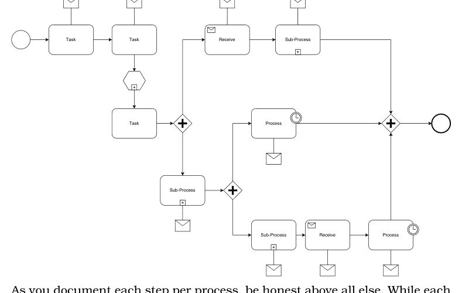
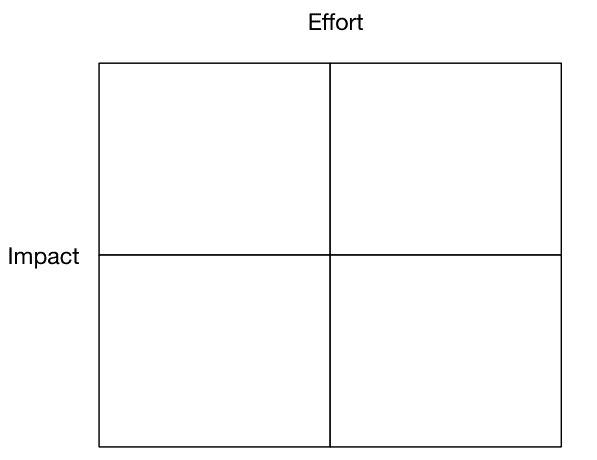
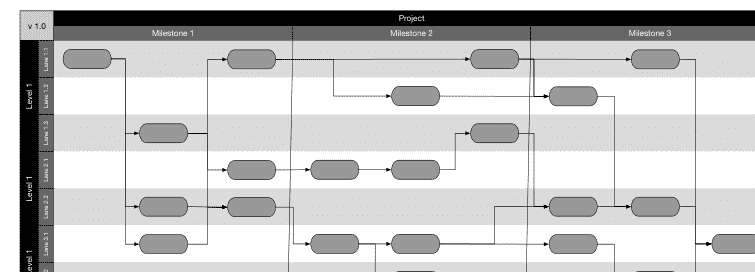
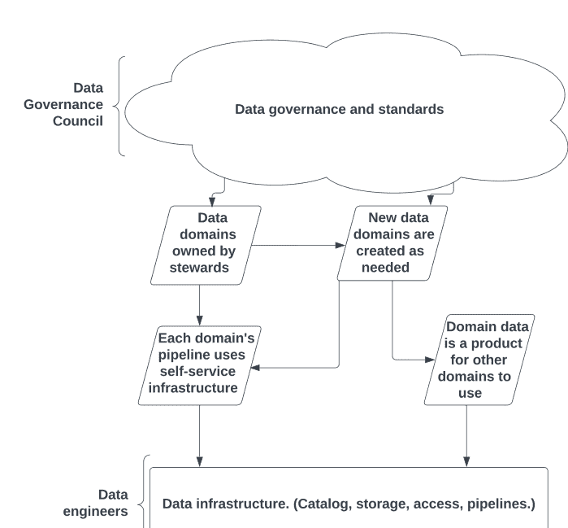
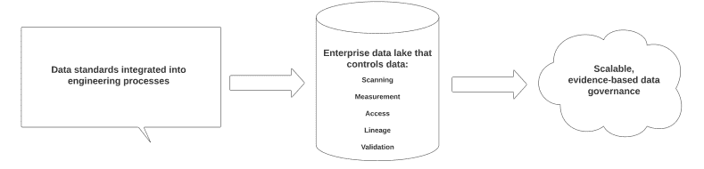
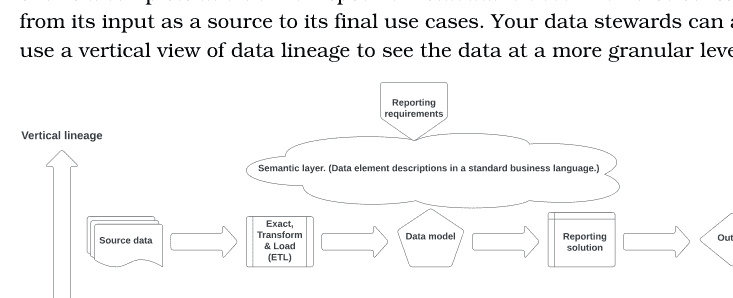
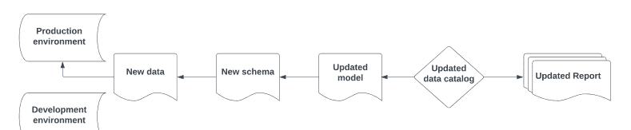

#### 第 4 章

##### 编写你的数据路线图

2000 年初，里德·哈斯廷斯想出售公司。当哈斯廷斯和他的联合创始人马克·兰道夫坐在百视达达拉斯办公室时，哈斯廷斯低声说，由于这家视频租赁巨头是他们规模的千倍，出售他们的初创公司以 5000 万美元对他们来说是最好的选择。当百视达 CEO 约翰·安蒂奥科进入房间时，哈斯廷斯提议如果百视达收购他们的业务，他们可以运营 Blockbuster.com 作为其在线视频租赁部门。但当他听到收购的成本时，安蒂奥科拒绝了。

你知道接下来发生了什么。那家初创公司 Netflix 两年后上市，20 年后市值达到 2388.9 亿美元。百视达，曾是全球首屈一指的视频租赁服务，在 2010 年申请破产，并在四年后关闭所有公司自营商店。它的最高市值？30 亿美元。

作为视频租赁行业市场的昔日领导者，百视达坐拥一座可以用来保持增长的数据山。如果领导层看到了在线服务需求的增长，他们拥有压制竞争对手的资源。相反，他们不得不多年后才开设自己的在线视频租赁商店，而 Netflix 早已占据了该市场。到那时，他们建立数据优先文化的时机已经太晚，而这正是 Netflix 成为新领导者的原因。

就数据而言，大多数组织更像百视达，而不是他们愿意承认的那样。Gartner 研究将 87% 的组织归类为在 BI 和分析技术方面的成熟度较低。¹ 同项研究发现，成熟度低的组织很少在 IT 和

1. https://www.gartner.com/en/newsroom/press-releases/2018-12-06-gartner-data-shows-87-percent-of-organizations-have-low-bi-and-analytics-maturity#:~:text=More%20than%2087%20percent%20of,a%20survey%20by%20Gartner%2C%20Inc

业务用户之间共享数据。他们也没有将数据与明确的业务成果联系起来，而且中央 IT 团队的瓶颈经常阻碍数据模型准备。

无论你的业务是想利用客户数据来提供定制化推荐，还是构建新的机器学习模型，如果没有实现目标的计划，你就无法实现任何基于数据的目标。本章将分享如何使用数据治理路线图作为你基于数据的项目和产品的蓝图。

你已经知道路线图是多么重要。它们将你的产品战略付诸纸面，将每个产品与更大的目标和举措相定义，例如你在第 1 章《澄清你的公司使命宣言》第 2 页中撰写的使命宣言。有效的路线图描绘了产品方向的清晰图景，将每个功能的每个冲刺映射到关键绩效指标（KPI）。

最先进的产品路线图会邀请新想法。我曾在一家路线图软件公司工作，该公司提供了一个想法门户。该门户帮助用户收集新功能反馈，然后根据公司目标对其进行优先级排序。

现在，将这种思维方式应用于你的数据治理战略。到目前为止，你已经为你的业务如何使用数据撰写了使命宣言。你还找到了将该使命宣言付诸实践的数据管理员，并成立了数据治理委员会以确保所有管理员协同工作。在本章中，你将学习如何编写和管理数据治理路线图上的所有内容，使其成为你数据战略的活的、单一事实来源。为开始，将这项工作分解为不同的阶段。

###### 评估你数据的当前状态

如果你不知道自己站在哪里，就无法取得进展。这就是为什么编写数据路线图的第一个步骤可能是最痛苦的：你需要对你的业务今天如何使用数据进行一次完整、诚实的审计。大多数企业高估了自己在数据方面的能力，而这种（缺乏）能力影响了企业使用数据的所有方式。你的审计如果从一些关键考虑开始会更有效。

首先是数据隐私法的合规性。其中许多法律相对较新，从欧洲的《通用数据保护条例》（GDPR）到加州的《加州消费者隐私法案》（CCPA）。政府制定这些法律是为了保护消费者数据免受企业的滥用，例如将数据出售给第三方。无论你的业务总部在哪里，这些法律很可能影响到你。

例如，GDPR 限制了企业收集欧盟（EU）公民的关键数据的能力，例如年龄、位置和社会经济地位。根据 GDPR，想要使用这些细节的企业必须告知用户其意图以及他们计划如何收集数据。他们还必须给予每个人明确选择加入数据分析的权利，并且不能让客户接受自动分析。如果你的业务拥有任何欧盟公民的个人身份数据，即使你的业务设在其他地方，你的业务也必须遵守 GDPR。

合规性是一个因素，但并不止于此。你还必须在数据架构的背景下理解数据。让我们重温《数据管理员是什么？》第 14 页中重新设计数据库的案例研究。回顾一下，在这个案例研究中，你必须重新设计数据库分类，因为用户很难在数据库中查找内容。为实现这一目标，你团队的数据架构师会问你某个数据集位于何处。她需要此信息来构建一个准确显示数据如何从一个系统流向下一个系统的数据模型，然后该数据才会出现在数据库前端。

如果她询问该数据集，你会知道它存储在哪里吗？如果你记不起来，你是否在某个地方记录了它以供她参考？我从经验中了解到，对许多企业来说，答案是双重否定。他们不知道所有数据在哪里，也没有记录。这使得改进你的数据基础设施变得不可能。

最后但同样重要的是，数据质量是一个问题。相同的数据集是否存放在两个不同的位置？你的同事是否自动化了任何数据管理，还是全部手动？如果你的企业发布专有数据，谁来交叉核对其准确性？

要完成准确的数据审计，你需要找到并写下关于数据合规性、数据架构和数据质量的几个问题的答案。将它们按部分分解会有所帮助，如下所示。

数据合规性：
- 你收集谁的数据？
- 你收集哪种类型的数据？
- 这些人住在哪里？
- 哪些（如果有）数据隐私法保护他们居住的地理区域的人？

数据架构：
- 你的组织在哪里存储数据？
- 这些数据库是否相互集成？如果是，如何集成？


- 这些存储解决方案是本地部署的？在云端？两者都有？
- 谁有权访问这些系统以及其中的每个数据域？
- 权限是如何按系统授予的，谁来授予？
- 谁负责这些系统的安全？

数据质量：

- 贵组织是否产生独特数据？如果是，哪些同事负责管理它？
- 谁对这些数据进行交叉检查以进行质量控制？
- 从收集到传播，完整的数据生产过程需要多长时间？
- 贵组织如何在部门之间共享数据（如果有的话）？
- 如果贵组织发布的数据被证明不正确或不符合要求，纠正流程是什么？
- 该流程适用于数据收集/共享的所有方面，还是会因数据集或数据域而变化？
- 您以哪种格式存储数据？这种格式会改变吗？如果会，什么时候？

由于你正在写下这些问题的答案，现在是提醒你文档对于良好数据治理至关重要的时候。保持你当前正在编写的文档在一个所有数据管理员都会使用和访问的可访问空间中。在考虑使用哪种文档工具时，首先要问贵组织已经在使用哪些产品。

例如，如果你的技术团队使用 Jira 来管理冲刺，你可以使用 Confluence 进行数据治理文档。同一家母公司（Atlassian）制作了这两个工具，这意味着 Jira 和 Confluence 可以相互集成。这对你有利，有助于你的数据分析师、科学家和工程师将他们当前的任务映射到你的数据管理员的工作。

假设你在 Jira 中有一个史诗，它涵盖了设计数据模型所需的所有子问题。这些子问题可能包括编写验收标准、构建节点图、实施数据模型以及将数据迁移到你的数据库服务器等任务。你可以将此史诗和 Jira 中的相应子问题链接到 Confluence 中的数据治理文档。这将为设计数据模型的架构师和工程师提供一个在工作时随时可以参考的指南。

理想情况下，其中一些数据架构师和工程师担任你数据治理委员会的管理员，并参与编写了进行质量评估的文档。使用正确的集成工具可以让他们轻松地将技术任务与你的数据治理计划联系起来，使他们能够看到他们的工作如何影响大局。

到目前为止，你已经评估并记录了你当前的数据治理与合规性、质量和架构的对比。现在它已经成文，下一步是构建一个流程图来说明你所收集的知识。

###### 创建当前状态流程图

你的流程图将可视化你试图通过数据为重点的项目来修复的流程的各个方面。做得好的话，它是数据管理员之间的协作努力，打破团队之间的壁垒。

数据共享的 breakdown 源于缺乏信任和透明度。这就是为什么你应该有一个单一的数据治理委员会，而不是为每个团队创建单独的委员会。当你全面记录你当前的数据状态，然后与数据治理委员会的所有成员分享时，你确保每个人都有相同的可见性。这将有助于你的管理团队编写准确且全面的流程图。

当你的数据管理团队构建当前状态流程图时，请牢记一些关键的 ground rules。我们到目前为止所做的工作，从制定你数据的使命宣言到构建流程图，都是文化性的。如果你不知道为什么以及如何希望你的企业使用数据，任何以数据为重点的项目都无法产生最大的可能影响。

同样，如果你的同事担心因为说真话而受到惩罚，他们就不会对当前问题诚实，也不会为解决方案做出贡献。为了鼓励心理安全感，新罕布什尔大学建议在整个过程中使用以下 ground rules：²

- 对变革保持开放的心态并保持积极的态度。
- 把职位留在门外；一人一票，不论职位。
- 团队中的每个人都参与。
- 保持专注。
- 不要在沉默中表示不同意。
- 实践相互尊重 - 不要打断；没有愚蠢的问题或想法。
- 提供诚实。
- 无指责 - 这是一个无指责的环境。

2. https://www.unh.edu/lean/phase-3-develop-current-state-process-map

一旦你设定并分享了这些 ground rules，这个流程图就是你的数据管理员共同拥有的理想任务。根据你的组织使用数据的方式，以及你组织正在进行的项目数量，你的数据管理员可能需要制作多个流程图。在这种情况下，你可以根据他们对这些项目的专业知识和参与程度，将流程图分配给你的数据管理员。

使用以下模板为你在第 3 章中选择的项目创建数据治理委员会的流程图。构建你的数据治理委员会。 第 27 页。选择一个你试图改进的具体流程，并添加完成该流程所需的所有步骤，无论多小。你的目标是展示完成一个特定流程所需的所有工作。你的最终结果将是下一步的蓝图。



当你记录每个流程的每一步时，诚实最重要。虽然每个流程都会有例外和/或期望的流程，但制作准确反映实际情况的流程图至关重要。如果这让你感到紧张，我理解。即使组织说它们想要更有效地使用数据，它们也并不总是愿意做所需的艰难的内省工作。

如果你对当前的流程图没有感到不舒服，很可能它不够诚实。而没有之前建立的心理安全感，你的管理员就不会感到舒适地说出真相。这会从长远来看破坏你所有的努力。

与本书中的所有模板一样，使用此流程图来指导你制作一个独属于你组织的流程图。从这里，你可以更详细地说明每个部门拥有流程的哪些部分。这是找到可能存在的障碍并开始为你的未来状态解决方案的绝佳机会。那就是你接下来要做的。

###### 设计数据治理的期望未来状态

一旦你确认了数据的当前状态，接下来就是有趣的部分：定义你希望数据的未来状态是什么样的。

当你完成流程图后，你将拥有一个可以从中进行有效更改的基线。这将给你的数据管理员机会找到流程改进的机会。如果你在构建流程图时灵感迸发，请将这些想法写下来。使用 Confluence 等共享工具效果最好，因为它可以让你写下你的想法并与更广泛的治理委员会分享。这些想法可以构成你的数据治理待办事项的<|message|>，这使你的团队能够定期审查数据问题。

例如，假设你是非营利组织的 CTO，该组织为多个社会服务分发州政府援助，从学前教育到紧急住房。构建你的流程图揭示了你的非营利组织在多个分散的服务器上存储相同的客户数据。大多数客户使用不止一种社会服务，但你的数据服务器之间没有任何集成。因此，你的组织在多个服务器上存储客户数据，你的社会工作者无法了解每个客户使用多少个项目。这可能会导致你的社会工作者建议客户已经使用的服务，或无法追踪不再需要帮助的客户。

在这种情况下，你需要设计一个未来状态，将你的数据管理与数据架构、质量和合规性保持一致。从每个支柱下问自己一些问题开始：

数据架构：

- 你能否将数据整合到更少的位置，而不是存储在多个服务器/云环境中？
- 你是否依赖 Excel 公式进行大部分数据管理？如果是，哪些工具可以帮助你自动化部分工作？
- 将数据从一个系统迁移到另一个系统的现实时间表是什么？你使用的软件或数据库供应商是否包含数据迁移在他们的服务中？


- 同事是否尤其依赖某种软件工具或数据库而非其他？
- 你能使用 Zapier 之类的工具来构建集成吗？

###### 数据质量：
- 谁负责管理每个数据集？这个人/团队是在内部还是外包承包商？
- 你的同事使用哪些方法来收集和清理数据？
- 同事是否抱怨过特定数据类型，例如没有客户的正确地址？如果是的话，你注意到哪些数据问题最多？
- 你的数据是什么格式？这种格式是否会发生变化？

###### 数据合规：
- 谁来交叉检查你的数据是否符合安全和法律合规要求？这些合规任务是否更适合由不同的同事来处理？
- 你有哪些合规记录？谁存储这些记录，存储在哪里？
- 如果你仍然主要依赖印刷纸质副本，你如何将它们迁移到安全服务器？
- 客户保密性是否令人担忧？如果是，你是否发现数据泄露可能发生的场合？
- 哪些同事向组织传达有关数据合规的变更？你的流程图是否发现这些沟通应该更频繁发生的案例？

一如既往，将这些问题的答案存储在你的数据治理委员会使用的共享存储库中。按文档类型创建单独的类别作为“父”页面，以便你的团队能够快速找到。可以在每个父页面下添加“子”页面，其中包含针对这些问题各部分的答案。如果你不能一次性回答所有问题，可以创建占位页面，并在找到答案时添加。这是一个理想的任务，适合你的文档数据管理员。

一旦你写下这些问题，你就需要一种方法来知道自己是否正朝着回答它们的方向前进。这涉及定义成功是什么样的。

###### 选择你将用于衡量成功的成果

我们这个痴迷于数据的世界同样痴迷于指标。在某种程度上，这是一件好事。我们衡量我们所重视的东西，如果你没有衡量某件事，很可能它对你来说并不重要。

也就是说，如果没有上下文，数据和指标就毫无意义。如果你注意到你的社会服务客户退出你的项目，这可能意味着他们不再需要那么多持续的帮助。这也可能意味着你的客户无法确认如何续订会员资格，了解他们可能使用的其他项目，或查找他们当前注册的项目。如果不进行用户研究来确认客户为何退出你的项目，你只是在用数据来强化你希望为真的一切。

与其衡量投机取巧的指标，或选择任何指标，不如问问自己你真正想要的成果是什么。假设你的数据使命宣言包括提高客户保留率的努力。你应该以衡量代表你预期成果的具体事件的方式来构建你的工作。在这种背景下，如果你注意到客户通过移动设备搜索服务的次数增加，这本身并不能衡量成功。但如果你的指标是增加移动设备上的项目报名，你就可以开始确认你的移动体验是否满足这一更具体的目标。

接下来，是时候问问自己，未来状态的路线图应该衡量哪些成果。选项可能包括改进对客户元数据的分段实践，将数据从本地服务器迁移到基于云的存储，审计用于训练算法的数据是否存在可能的偏见，以及升级数据安全，例如启用双因素认证（2FA）。

如果尚未实施，2FA 应该到位，因此请将该选项作为你的案例研究。启用 2FA 可以保护你的组织数据并防止安全漏洞。为了实现这些成果，你需要完成以下类似的一系列步骤：

- 获得 CEO 的支持。2FA 不能是“IT 问题”。要成功在整个组织中推广，高层领导必须致力于使其成功。这就是为什么你的数据治理委员会的赞助如此至关重要。
- 确认你已使用的哪些企业系统已内置 2FA。如果你使用 Office 365 或 Google Workspace，很可能你可以通过该工具的管理员权限实施 2FA。
- 选择你希望在整个企业中推广用于 2FA 管理的云产品套件
- 确认你希望为哪些场景启用 2FA。你需要选择所需的情况和频率，以在数据安全与用户生产力之间取得平衡。
- 为终端用户启用警报，以便在有人在新设备上使用其凭据时收到通知
- 在整个组织中传达使用 2FA 的意图，包括同事在设备上启用 2FA 所需的说明

一旦你确认了实现目标所需的步骤，你将根据工作量和重要性对步骤进行分类。例如，你可能会创建一个矩阵，根据业务影响和专业工作量来跟踪任务。考虑到这一点，尝试将之前的步骤放入矩阵图。它将帮助你的数据治理委员会将预算分配给能带来最大价值的任务。以下矩阵图为你提供了空间，可根据拟议的影响和工作量将启用 2FA 的步骤分为四个象限。

这个矩阵图是一张空白画布，这正是重点所在。它为你和你的数据管理员提供了空间，将你必须采取的步骤分类到象限中，帮助你将低影响、高工作量的任务与高影响、低工作量的任务区分开来。一旦你完成此练习，你将拥有一份高影响任务清单，可列入你的数据路线图。



首先，写下使你的项目得以实现的关键标准和考虑因素。一旦你全部写下并请你的数据管理员也添加他们的意见，就根据预期影响和工作量对每个方框中的任务进行排序。你会在每个方格的中心看到提示框，提醒你如何对卡片进行排序。一旦大家提出的任务都已放入其中，就召开会议审查每个人的补充内容，并作为团队优先考虑最高影响的任务。这是在数据治理委员会会议期间进行的一项理想活动，因为大家都已在同一房间。

一旦你承认了当前的数据使用状态并定义了理想的未来状态，你的下一个任务就是制定实现理想未来状态的计划。本章迄今为止的所有工作都为你撰写数据路线图做好了准备。

###### 将优先事项放在你的数据路线图上

是时候列出你希望数据项目实现的所有关键成果，写下实现每个目标所需的步骤和资源，并指派数据管理员负责工作的每个方面。一旦你确认了每个目标的每一步，你就可以将所有内容放在一个路线图中。

该路线图涵盖人员、流程和技术。实现数据目标所需的任何技术都应帮助你的团队共享、存储和/或分析数据。你选择参与的数据管理员因其领域专业知识而被选中，这将帮助你的组织提高数据效能。而每个数据管理员使用的流程应帮助你的团队尽可能快地实现每个目标。

重要的是要记住，路线图不是静态的。产品路线图会随着业务需求和客户要求的变化而变化。同样，敏捷的企业会根据清晰、一致的反馈经常迭代。你的数据路线图也不例外。数据管理员会离职，业务需求可能会演变，你会获得更多可能影响决策的数据。这都是正常且必要的。

也就是说，你的数据使命宣言不应改变。实现该使命的“如何”会演变，但你进行此数据项目的理由不应改变。始终将这个“为什么”放在路线图的前沿，也许作为顶部的摘要。即使你已获得高层赞助，该赞助人也会要求你向新受众介绍你的数据治理工作。你需要一个清晰、一致的陈述来为新读者构建你的路线图并产生最大影响。


在撰写实现每个成果所需的步骤时，请问自己这些变化将对谁影响最大。当然，你会将关键任务和成果分配给合适的数据管理员。但你也在提出新的成果，这些成果很可能会影响数据治理委员会以外的人。如果你曾经尝试将新软件引入企业，你就知道说服人们采用它有多难。你也知道，员工抵制使用新工具是大多数新软件未能产生重大业务影响的关键原因。

当然，软件并非适合每个组织，有些工具确实不适合你的业务。但也有可能，虽然软件在纸面上满足了所有条件，但其用户界面对同事来说太 confusing，他们宁愿继续使用非官方工具来完成工作，而不是使用你试图推广的新软件。如果不加以解决，你在整个组织中扩展数据治理时可能会遇到类似问题。

为了避免这种情况，从一开始就思考这种变化可能来自哪里会产生阻力。你的组织中哪些群体将受到数据治理推广的影响？你需要哪些同事的支持，谁可能最抵制这项工作？你将从哪里获得这些数据项目的预算，谁（如果有的话）必须批准你的数据治理委员会开会的时间？

你不需要立即回答这些问题，但提前开始与你的路线图同步创建解决方案会有所帮助。例如，你的首席营销官可能不会高兴地听到，由于 GDPR 立法，她的团队无法利用欧洲用户的数据。不使用和收集这些用户的数据可能会阻碍你的数据治理合规、信任和透明度要求。它也可能阻碍你的 CMO 实现她自己的团队目标。你不能间接妨碍其他同事的工作并期望他们支持你。

这不是你的工作替你的 CMO 做她的工作，但你有责任撰写一份路线图，提出实现共同业务成果的新改进方式。因此，如果你在数据治理路线图上的项目是加密欧洲用户数据的计划，请邀请你的 CMO 在你撰写路线图时持续提供反馈。

至少，她需要知道即将发生什么，以便她能够相应地计划。在理想状态下，她将就这一具体挑战提供自己的反馈，你可以在最终解决方案和路线图本身中予以考虑。这也是拥有跨职能数据治理委员会的众多好处之一。当企业各部门的同事拥有数据治理的某些方面时，他们可以帮助为自己的工作定义数据治理是什么样的。这也强化了数据对每个人的角色都至关重要，即使他们不在数据团队。

在工作中考虑这些问题，可以让你有时间考虑同事的需求并提前解决他们的顾虑。理想情况下，许多将受此工作影响最大的人都担任你的数据治理委员会成员。在可能的情况下让他们参与进来，解释他们自己的工作可能如何改变并共同创建新的流程。在路线图工作的开始阶段，计划每周召开一次会议来审查路线图的进展并互相沟通。随着路线图变得更加成熟，你可以降低会议频率。在此之前，过度沟通比另一种选择更重要。

##### 你的下一步

正如 always，章节的结尾是反思你走了多远的好地方。到目前为止，你已经写下了你的组织将如何使用数据的使命宣言。你还选出了实现该使命的数据管理员，并建立了你的数据治理委员会。现在你已经有了数据治理路线图的作用的模板，你的作业是为你自己的业务撰写一份数据治理路线图。

用你自己的数据项目目标、成果和负责人填写以下模板。思考你想要完成的数据驱动项目，考虑为此必须达到的目标，并指定相应的管理员领导每个具体目标。要填写此图表，请在顶部列出关键里程碑，并在下方列出每个里程碑的相应任务。你可以使用左侧的列来表示过去的时间（以月或季度为单位，灰色框）和你正在衡量的指标（黑色框）。你的路线图的读者应该大致了解你打算何时实现每个里程碑，但不要把自己锁定在具体日期上。那些将在你有发布计划时出现。



在进行此练习时，请问自己，“最坏的情况会怎样？”换句话说，在通往数据成熟的道路上，你可能在何处走错？也许一位拥有客户成功数据的数据管理员将技术同事排除在关键对话之外。也许你的 CEO 在季度中途大幅改变业务优先事项。如果是时候决定需要哪个数据湖时，你的数据治理委员会陷入僵局怎么办？

想象最坏的情况并不是为了吓唬你；这是一种务实的方式来规划和避免风险。从可能的数据泄露到为重大决策所需的 data silo-ing，每个路线图上的任务都带来了自己的风险。你无法提前发现每一种潜在风险，但你可以有远见地看到可能发生的情况。这是构建弹性路线图过程的一部分。

变化是你唯一可以指望的事情，你实现良好数据治理的计划将随着你的业务而演变。撰写包含关键任务和里程碑的数据路线图并不会使你的所有计划变成石头；它恰恰相反，通过在计划演变时为你提供一条出路。正如你能回答为什么要撰写这份路线图一样，你的数据治理团队就走在正确的轨道上。

当你撰写路线图时，我猜想你的许多目标都涉及开发工作。你可能会想知道数据治理在开发和生产环境中是什么样的。这是你在数据治理之旅上的下一步。

#### 实践治理驱动的开发

看着客户说他们会在确认数据项目失败的原因后再“着手”数据治理，这启发我写这本书。世界上最流行的工具都无法拯救你的工作，如果你没有正确团队和路线图来领导它。好消息是，你已经领先了好几步。

在撰写数据使用使命宣言、选择数据管理员、组建数据治理委员会并为委员会的首个项目撰写路线图之后，你已经做出了将战略放在首位的承诺。现在你已经奠定了这一坚实的基础，是时候将这项工作应用于你的开发流程了。

与普遍看法相反，数据治理并非与开发分离。它在你花时间将其整合到整个开发流程中时才会成功。这不仅确保你能进入生产，而且你的数据产品能够长期蓬勃发展。

在本章中，你将使用 Zhenzhong Xu 在 Netflix 扩展实时数据基础设施方面的经验作为案例研究，以使数据治理操作化。

Xu 关于此主题的完整博文非常值得一读，他在 O’Reilly Velocity 大会上的演讲也值得一读。² 他的演讲和博文都详细分享了他的工程团队扩展实时数据基础设施的完整流程。对于本章，你将学习 Xu 如何将数据治理应用于这一问题，并在帮助 Netflix 成为我们今天都知道并使用的流媒体巨头方面发挥了关键作用。你将看到数据治理原则、实践和人员如何在开发过程中出现。

1. https://zhenzhongxu.com/the-four-innovation-phases-of-netflixs-trillions-scale-real-time-data-infrastructure-2370938d7f01#95d1
2. https://www.oreilly.com/library/view/velocity-conference-2017/9781491976340/video314554.html

当你阅读案例研究中的每个步骤时，良好的治理是多么 essential 会变得越来越清晰。你不能在没有治理计划的情况下成功管理这种规模的数据。虽然 Netflix 可能看起来与你的组织太不同，但 Xu 的情况表明数据治理如何帮助即使是最困难的项目取得成功。

##### 询问你是否拥有正确的数据基础设施

2015 年对 Netflix 来说是伟大的一年。该流媒体服务在当年第四季度结束时新增了 433 万名订阅用户，超过了分析师的预期。这一增长使公司股价飙升至上年同期的 121% 以上。记者还注意到其内容成本也迅速上升，从 2012 年的 60 亿美元增至 2015 年的 100 亿美元。在同一时期，Netflix 用于制作内容的花费超过了其获得的收入。尽管如此，订阅用户增长非常强劲，尤其是在国外，其未来看起来光明。

Netflix 的软件工程团队知道其管道无法满足这一需求。 当时，Netflix 有 500 个微服务每天产生超过 10 PB 的数据。这种格式意味着 Xu 的软件工程团队无法大规模进行按需分析。为了构建使该品牌闻名的预测分析，Netflix 需要将其日志从在线事务处理 OLTP 边缘移动到在线分析处理数据仓库 OLAP。³

为什么？这些工具支持不同类型的数据。OLTP 支持行式访问模式，而 OLAP 支持列式访问模式。Xu 了解到，如果 Netflix 尝试使用 OLTP 来查找数百万用户的平均会话长度，其全表扫描可能会锁定数据库。这将使 Netflix 对用户不可用。

更复杂的是，Netflix 的日志量从 2011 年每天 450 亿次事件增加到 2015 年每天 5000 亿次事件。其日志基础设施——Chukwa、Hadoop 和 Hive 的混合——并非为按需受众分析或 Netflix 设想的以流媒体为先的解决方案而构建。在这一点上，Xu意识到他的团队有六个月的时间成功地将 500 个微服务的数据迁移到以流媒体为先的数据架构。

虽然这看起来像是一个技术问题，但它是一个数据治理做得很好的绝佳例子。Netflix 对使用实时数据有一个明确的使命：了解哪些类型的内容能让用户保持最大参与度，以便它能更多地投资于能让观众着迷的娱乐。

3. https://www.ibm.com/cloud/blog/olap-vs-oltp


Xu 的软件工程团队在评估是否能用当前的技術棧實現目標時就已經意識到這項任務。他們在得知實現目標需要從日誌（OLTP）遷移到數據倉庫（OLAP）時就給自己做出了回答。這為 Xu 的團隊帶來了幾項行動要點：

- 研究哪種數據倉庫最適合 Netflix 的數據特定目標。
- 問 Netflix 是否已經擁有所需的倉庫類型，還是需要購買。
- 澄清 Netflix 的技術採購流程，以了解購買和實施新倉庫可能需要多長時間。
- 撰寫遷移計劃，將 500 個微服務的數據遷移到新倉庫。
- 確認此遷移是否能在必要的時間範圍內完成。
- 撰寫包含關鍵任務和里程碑的路線圖，說明誰將負責哪些任務以滿足遷移截止日期。
- 審查哪些數據管理員將協助此工作並獲得其經理的支持。

Xu 的挑戰表明，在開始大型項目之前擁有數據治理策略、數據管理員和委員會是多麼重要。它也說明了為什麼你應該一次專注於一個項目。一旦這個問題的範圍變得清晰，Xu 就知道他的團隊必須快速行動。他還意識到，看似簡單的目標涉及很多變動因素和人員。

這就是為什麼開發數據治理的第一步是確認你是否擁有實現使命宣言所需的基礎設施。如果沒有，你的數據管理委員會將需要根據項目的需求進行採購或從頭開始構建。這會增加項目的範圍，你需要考慮到這一點，儘管你來自第 4 章的工作應該能讓你在項目啟動前就能回答這個問題。

###### 將技術合作夥伴納入你的數據治理

Netflix 知道流式架構將最好地支持其在大規模下攝取和分析大數據的最終目標。但在當時，這種架構是新穎的，因此使用它會帶來一定的風險。如果架構最終無法擴展怎麼辦？如果它缺乏足夠的維護人員來解決架構中的安全漏洞怎麼辦？如果 Netflix 選擇使用它，可能會危及大量數據。

Xu 知道這些風險並建立了數據治理計劃來克服它們。與放棄流式架構不同，他的團隊精心挑選了用於流式架構和容器化的合作夥伴。Xu 安排與這些合作夥伴的雙週電話會議，分享雙向更新，查看哪些目標即將到來，並討論/移除阻礙。雖然不是數據管理員，但這些技術合作夥伴在治理過程中發揮了關鍵作用。在詳細介紹數據遷移的博客文章中，Xu 這樣解釋他們的合作關係：

> 在外部，我們與在行業中引領流處理工作的合作夥伴合作，例如 LinkedIn（Kafka 和 Samza 團隊）、Confluent、Data Artisan（Apache Flink 的構建者，後來更名為 Veverica）。這樣做使我們能夠為自己的需求貢獻開源項目，同時利用社區的工作。

> ...在 2015 年，容器虛擬化技術仍處於早期階段。我們需要一種快速部署的策略。內部，我們與新成立的容器基礎設施 Titus 團隊合作。Titus 建立在 Apache Mesos 之上，並通過抽象 API 提供計算資源管理、調度和隔離部署。Titus 後來在 2020 年初演進為利用 K8S，其團隊成功透明地遷移了所有工作負載。得益於這種合作夥伴關係，我們在構建數據平台時不必擔心底層計算基礎設施。

這個故事對數據治理有一個關鍵的啟示：要非常清楚哪些合作夥伴最適合你的數據工作。這看似顯而易見的目標實際上很難實現。堅持認為應用機器學習只能在 PyTorch 中進行，或“fastai 只是一個玩具”的工具狂熱者可能會成為真正的阻礙。過去十年大數據的快速崛起產生了各種管理它的工具。如果你開始尋找工具卻不知道項目需要什麼才能成功，你就有可能為項目選擇錯誤的技術合作夥伴。我說“合作夥伴”，因為儘管一些供應商可能聲稱，沒有任何工具可以管理大數據的所有方面。

你的數據治理委員會需要為你的項目和組織的數據目標選擇正確的技術棧。這種大規模選擇數據治理工具的需求使得選擇不僅僅是正確類型的技術，而且是作為承諾合作夥伴的正確供應商變得更加重要。無論你的用例如何，一些經過驗證的技巧適用：

- 首先確認你擁有哪些資源。你需要尋找可以提供幫助的供應商，但不要忘記在尋找外部資源之前先在內部尋找。例如，假設你需要幫助解析嵌套在數千個 PDF 中的數據。根據項目的預算和時間框架，你可能需要聘請外部供應商來解析這些 PDF 中所需的元數據。但在開始安排演示之前，審查你目前團隊中的人員。如果你的團隊中有一些機器人流程自動化（RPA）專家，你可以讓他們在項目基礎上幫助你，或加入你的數據治理委員會。儘管很想看看外面有什麼，但不要忽視你內部擁有的資源。
- 問問你聘請新技術來做哪個工作（們）。假設你有一個數據湖來管理你的元數據、存儲和計算能力，讓你能夠通過 SQL 表達計算。如果缺乏結構和模式，數據倉庫可能是一個強大的補充。根據你已經使用的雲供應商，許多供應商都銷售與其雲環境集成的數據倉庫。（例如在 Amazon Web Services 之上使用 Amazon Redshift，或在 Google Cloud 之上使用 Google BigQuery。）另外，像 Snowflake 這樣的數據倉庫讓你可以在不綁定專有雲的情況下使用倉庫。了解你必須填補哪些數據基礎設施空白將有助於你縮小搜索範圍。
- 在開源空間中尋找合作夥伴。想像一下，你審查了目前的數據棧，發現需要一個新穎的補充。（就像 Xu 意識到 Netflix 需要流式架構時，這項技術還很新。）在這種情況下，做研究以找到具有響應迅速的維護人員和活躍社區的技術合作夥伴。如果你發現一個強大的社區正在領導一個滿足你數據需求的開源項目，你可以提供商業支持以換取為項目做出貢獻並塑造項目。這使你的數據管理員能夠塑造即將到來的開源項目，同時將社區的工作納入你自己的工作。

找到合適的外部合作夥伴可以對你的數據項目產生決定性的影響。無論你有同事在你的數據治理委員會之外工作，還是有可以依靠的開源社區，這些人都可以填補急需的空白，並幫助你的項目更快地投入生產。關鍵在於知道你需要他們填補哪些空白，以便他們可以立即開始工作。如果你的項目願景和路線圖清晰，找到實現它們的合適合作夥伴就更容易了。

###### 以少數高層客戶為目標構建

Netflix 的 Xu 團隊選擇追求流式優先架構，以便公司能夠支持快速的用戶增長。鑑於此事實，你可能會期望建議告訴你用盡可能大的用戶群測試你的模型，以便獲得具有代表性的樣本量。雖然我作為研究人員希望這是真的，但在這種情況下這不是良好的治理。

考慮 Netflix 為什麼要將其整個數據架構轉移到流式優先倉庫：為了滿足快速的用戶增長。Netflix 知道其服務的需求很高。事實上，高到足以嘗試一種顯示出強大潛力來滿足其需求但又新穎且不成熟的架構。這個選擇帶有流式優先倉庫可能失敗的風險。但這次遷移的原因基於對 Netflix 服務的已證實需求。

這個案例研究為你自己的項目提供了幾個數據治理的經驗教訓。第一個是澄清你首先需要解決哪個問題。如果你覺得需要用大用戶群測試你提出的數據治理項目，這可能是你的數據治理委員會需要確認項目本身是否有足夠的客戶需求的信號。

它也有助於你的委員會澄清這個項目旨在實現什麼。這個建議可能聽起來很基本，但很重要。在當今的數據環境中，存在強烈的誘惑去“因為可以”而開始玩最新的數據工具。（你將在本章後面處理這個挑戰。）在 Netflix 的案例中，他們知道在倉庫上取得長期成功的最佳機會是將其測試在少數精心挑選的用戶上，這些用戶可以提供優質的反饋並在數據遷移期間評估項目的結果。

Netflix 能夠進行用戶測試，因為他們已經有了商業案例。在考慮為你自己的項目納入哪些人時，問自己以下問題：

- 誰是你的產品和/或業務的關鍵用戶？
- 你多久與這些用戶溝通一次？
- 這些用戶是否有持續的機會提供反饋？如果有，你如何捕捉這些反饋？
- 哪個人或團隊最適合與這些關鍵用戶聯繫並管理產品驗證流程？

這是你下一次數據治理委員會會議的理想討論主題。你已經為你自己的項目記錄了商業案例，並制定了執行項目的路線圖。一旦這些就位，你將使用數據治理委員會會議來通過更新和分配來管理項目的後勤。

最接近你的客戶的同事可能不從事數據或 IT 團隊的工作。但如果你有設計、產品和/或客戶成功團隊，納入一些同事作為數據管理員將有助於你找到合適的測試


让用户更快上手。例如，让设计师加入委员会，就能让他们进行用户访谈并负责这些访谈产生的定性数据。这包括与委员会其他成员分享访谈记录，并将它们存储在你们共享的通讯工具中。

###### 给你的数据管理员犯错的空间

记住，你现在处于受治理驱动的开发阶段，而不是生产阶段。一旦进入生产阶段，实验的时间就结束了。在此之前，利用开发作为你的沙盒，学习哪些方法对你的数据项目有效，哪些无效。

如果使用的是新技术或不成熟的技术，这一点尤其关键。管理大数据需要底层有大量协同运作的组件。Xu 在解释 Netflix 如何将其数据平台迁移到容器化云基础设施时描述了这一挑战：

> “在每个数据中心的底层，有数十万台物理机器为云提供动力。在这种规模下，硬件故障是不可避免的。当这些故障意外出现时，系统很难保持可用性和一致性的预期。在无界低延迟流处理环境中，任何故障恢复都可能导致反压积聚。面向流的架构的云原生弹性意味着巨大的工程挑战。”

Xu 是如何克服这些工程挑战的？他没有回避它们，而是设计系统来监控、检测和容忍它们。如果这听起来很像 DevOps，你是对的。

还记得你在第 4 章《撰写你的数据路线图》第 43 页撰写路线图时问自己最坏的情况会怎样吗？现在重新审视那个最坏情况。如果你真的在用项目开拓新领域，我保证你会在预期和出乎意料的方式下失败多次。Xu 及其团队也确实如此。

在 Netflix 上线当天，他团队构建的 Kafka 集群证明过大。一旦该集群达到扩展限制，在 200 多个 broker 之一宕机后就无法恢复。这导致 Netflix 出现大规模数据丢失，尽管 Xu 的团队正确预测了流量。得益于团队的心理安全感，他知道他们可以从这次失误中恢复。他也知道这种错误不能再次发生。⁴

4. https://kafka.apache.org/intro

Kafka 流技术当时是新的。虽然它引领了流处理架构市场，但很少有组织能在 Netflix 拥有的数据量下大规模使用它。用新架构解决大数据规模的新业务挑战，注定会在某个点失败。Xu 意识到，为了帮助团队成功，他必须让他们更多地直接接触 Kafka，以便他们了解其工作原理。

他通过每周 Kafka 集群故障转移演练来实现这一点。每周值班的同事会模拟一次 Kafka 集群故障。作为回应，团队会在不影响用户的情况下将所有流量迁移到另一个健康的集群。这种回应就是数据治理的实践。它为管理员提供了一个安全、可控的环境，让他们弄清楚应对不可预见问题的最佳工具和响应方式。

这可能听起来违反直觉。如果你习惯于使用瀑布方法⁵ 的项目，或仅名义上使用敏捷的项目，你可能更熟悉“失败不是选项”这句格言。如果每一步都不成功，整个项目就会失败。

也许最关键的是，在这种环境中，反馈要等到生产后才出现。正如 Alex Bunardzic 所解释的：“我们在压力下工作，每一步都必须是完全合格的成功。我们竭力避免获得任何反馈。反馈被保留到划时代的大爆炸事件；也就是我们所有人听取系统我们构建的系统与目标相差多远的时刻。简而言之，这就是我们失败的传统学习方式。”⁶

你不能用这种方式学习大数据项目。听到你通过生产推送了错误数据到公众，会产生现实影响。人们可能基于错误信息交易、因工作而遭受不必要的歧视、贷款申请被拒，或得到错误的诊断。

伦理债务就是技术债务。当模型中发现错误数据时，你唯一的补救措施就是废弃模型并从发现错误数据的点重新训练。避免这种情况的最佳方法是让数据管理员熟悉他们使用的工具，并在生产前给他们空间在开发中尝试新技术。

这给了他们动手培训和职业自由，以获得避免生产中出现问题的经验。这也是文档在数据治理中发挥如此关键作用的重要原因之一：你只能在给数据管理员提供所需工具的情况下，才给他们犯错的空间。框架、路线图和数据字典是你为管理员构建的工具，帮助他们完成工作、学习新技能，并通过让你的使命宣言变为现实来不断建设业务。

###### 开始超越超级用户进行扩展

Xu 的团队克服了最初的障碍，发布了 MVP 并迁移了参与早期用户测试的关键客户。接下来是他们迄今为止最艰巨的挑战：将这种成功扩展到 Netflix 的工程团队，并迁移其全部客户群。

他们很快确认这将是一项艰巨的任务。超越最初几个 MVP 后，他们面对了两种截然不同却相互对立的客户痛点。一组用户偏好完全托管、易于使用的服务，而另一组则希望有灵活性来解决更高级的业务问题。

在他们努力大规模满足两种客户需求的过程中，Xu 团队触及的一切似乎都坏了。Titus 他们的托管容器基础设施和 Spinnaker 他们的持续部署平台，都在试图以编程方式扩展数百个客户部署的残骸中。

无论你的工具包如何，你都可以预期自己的数据项目会出现问题。这就是你为数据路线图完成的所有工作如此重要的原因。如果你能以可能出现故障的部分为重点审视路线图，你就可以提前规划以避免或至少减轻它。无论你的数据项目是什么，Netflix 的一些战略赌注都适用：

- 从最简单的选项开始。Xu 没有向 Netflix 暴露其整个复杂基础设施，而是优先提供高度抽象、完全托管的服务来满足通用流媒体需求。这是将基础设施扩展到 Xu 自己的团队之外、在 Netflix 工程范围内扩展的关键选择。每个团队都可以用数据路由作为构建其自身平台服务的构建块。它还允许用户通过将数据路由应用于其业务用例来优先考虑自己的需求。
- 为现有架构寻找新机会。你能否在团队已使用的基础设施上构建新的产品入口点？如果是这样，你最好使用它，而不是孤立地构建新产品。在推出初始 Keystone 产品后，Xu 希望构建一个新平台，能够利用 Apache Flink 的流处理。他希望在重构当前架构的同时构建一个新的内部客户细分。通过减少 Keystone 和 Flink 平台之间的冗余，Xu 配置了 Flink 平台以支持现有的 Keystone 和新的自定义用例。引用 Xu 的话：“简单性吸引了 80% 的用例。灵活性有助于更大的用例。”

##### 你的下一步

本章为你提供了引导数据通过开发所需的一系列步骤。以 Netflix 为北极星，你了解了使用合适的工具来实现使命宣言的重要性，以及如何将技术提供商作为数据治理合作伙伴参与。你发现了以关键用户为中心构建的价值，并获得了将最小可行产品扩展到更大用户群的指导。

最重要的是，你了解了在开发中给数据管理员犯错空间为何如此关键，以及如何防止这影响生产。还记得你学习如何编写流程图时，以及在无责备环境中让数据管理员这样做为何至关重要吗？做得好，这种 ethos 会让团队进入生产并延续下去。

当你为自己的项目准备开发时，你的下一步是避免许多数据治理工作陷入的陷阱：未能将治理整合到开发活动中。数据治理不是你在回到数据科学之前通过的测试。如果你不将数据治理整合到你的数据项目中，你所做的一切工作都是无用的。

我知道治理看起来很抽象，而且你迄今为止的工作似乎与日常活动无关。事实是，将治理设计到数据项目中可以避免日后需要这样做。它也有助于避免技术债务，因为你在开始时就做好了准备。

为了实现下一步，审阅你在数据路线图中概述的项目中的数据。每个元数据都被考虑了吗？数据与数据库之间的关系是否已定义？项目中的数据是否有每个人都可以访问的词典中记录的一致定义？您将批准多少个数据对象供重复使用？

记住，无论你的数据项目是什么，你都需要根据数据治理委员会预先定义业务和技术规则来评估数据。这些规则赋予元数据意义，将其从原始输入转变为可操作的洞察。因此，在推送到生产之前，花时间根据你的数据治理标准评估你正在为模型提供的数据。它将确保你产生的工作与所有管理员一致同意的预定义目标保持一致。它也为本六部分流程的最后一步做好准备：在生产中管理数据。


#### 生产环境中的数据监控

我订阅了几份新闻通讯。2022 年 1 月，作者 Anne Helen Petersen 的一份周刊新闻通讯分享了政策漂移的概念。该概念最早由 Jacob Hacker 提出，政策漂移描述了当为满足特定社会需求而制定的政策未能更新以解决现代问题时所产生的问题。¹

以一个例子来说，第 230 条是一项美国立法，保护网站平台免于因第三方内容而承担法律责任。² 该立法于 1996 年 2 月签署，其本意是区分网站提供商与传统出版商。姑且不论，它未能考虑到社交媒体、大数据以及当今存在的各种现实。这就使得像 Meta 这样的公司基本不受监督和监管，从而导致了剑桥分析数据泄露等丑闻。³ 第 230 条在克林顿总统签署成为法律时或许契合了当时的需求，但它已不足以应对当今的问题。

在阅读 Petersen 的新闻通讯时，我看到了政治中的政策漂移与数据中的模型漂移之间的相似之处。机器学习团队常认为达到生产环境就等于成功。其思路是：“只要我能一直监控数据到那时，我就会知道我的数据治理是有效的。”

以下是更复杂的真相：如果你的数据治理计划未解决数据漂移问题，最终将无法奏效。

数据漂移发生在数据结构、语义和基础设施发生意外、未记录的变化影响数据质量时。在机器学习中，环境变化会影响用于训练算法模型的数据在整个训练过程中如何相互作用。⁴ 鉴于公司今天拥有的数据量之大，以及数据模型在其生命周期中暴露于数据之多，数据漂移是不可避免的。好消息是，如果团队能及时发现数据漂移并且管理者有计划在每个生命周期中治理数据，模型失去预测能力远非死刑。

在本章中，你将探索数据项目进入生产环境后数据治理是什么样子的。你将看到如何将你的数据治理框架应用于数据监控流程，从在生产环境中发现瓶颈，到确保模型持续消费的数据符合质量标准。当你完成本章——我们书籍中的最后一章时，你将拥有一个计划来正面迎战数据漂移。

本章中的资料扩展了每个主题，是在你翻到最后一页后继续学习理想的场所。本章的目标是为你提供无论你的数据工作有何独特之处都必须采取的步骤。无论你的项目是什么，你都需要生命周期计划、生产监控和法规跟踪才能成功。本章将向你展示如何构建它们。

1. https://annehelen.substack.com/p/what-a-rugged-resilient-society-demands
2. https://crsreports.congress.gov/product/pdf/R/R46751
3. https://www.wired.com/story/cambridge-analytica-facebook-privacy-awakening/
4. https://streamsets.com/why-dataops/what-is-data-drift/#:~:text=Data%20Drift%20Defined&text=Data%20drift%20is%20unexpected%20and,new%20opportunities%20for%20data%20use.

##### 制定计划在整个生命周期中治理数据

你从阅读本书中了解到数据类型的差异有多大，更不用说数据项目了。因此，可以推断数据生命周期因上下文而异。你已设立数据治理委员会来管理每个相应生命周期中的数据。这意味着仅通过处理和存储来治理数据是不够的。你还需要制定计划来在每个生命周期的关键后期阶段治理数据：数据使用、数据归档和数据销毁。⁵

##### 数据使用

此阶段既是数据治理的最大机会，也是最大风险，因为此阶段是组织内部和外部人员以多样化方式消费你的数据的地方。如果你的数据团队为客户部署分析仪表板，将这些仪表板发布在公司网站上就能让客户为其自身利益使用此数据。如果你的数据集存在未受控制的问题，你将在数据使用阶段发现。

这也是你测试数据治理委员会决策是否有效的地方。由于数据使用涉及访问需求，你的数据安全将在此阶段受到考验。如果第三方审计你的数据是否存在偏见，最有可能也是在此阶段进行，尤其是如果你的组织将数据作为产品出售。

数据使用展示了你的组织如何共享数据，以及人们如何消费它。对委员会数据治理的任何限制都将在此阶段显现。

5. https://www.oreilly.com/library/view/data-governance-the/9781492063483/ch04.html

##### 数据归档

如果你曾经做过数据迁移，那么你就熟悉数据归档。它是将数据从一个活跃环境复制并移动到另一个环境的过程。假设你在一台本地服务器中托管公司拥有的面向公众的数据，并希望将其迁移到云计算平台。数据归档涉及数据工程师通过以下步骤管理迁移过程：

- 将原始数据从本地环境移动到云环境
- 将此原始数据放入 ETL 中
- 在 ETL 中清理此数据，然后将精炼数据移动到开发/测试数据库
- 将测试数据库连接到 API 和用户界面
- 在云环境中打开数据管道，以便数据在数据库前端显示
- 在整个迁移过程中加密和解密数据以满足数据治理安全标准

如果一切顺利，你的用户不应察觉到你已切换环境。为了顺利高效地管理此过程，你的数据归档治理计划应回答三个关键问题：

- 你的团队将保留此数据多长时间？
- 你的团队将在何处存储此数据？
- 你将对该数据应用哪些控制？

在归档过程中不应进行任何使用或维护。一旦你的数据进入你选择的云平台，你的团队必须销毁归档存储中的数据。

##### 数据销毁

我从经验中知道这一步有多痛苦。许多组织存储他们曾经拥有的一切数据。我曾参与过一个项目，要求我的团队在网站迁移前自动化从超过 52,000 份 PDF 中提取数据的过程——而且这 52k 是审计后的数量，意味着之前还有更多。

你的企业无法负担保留所有这些数据。数据中心和服务器花费巨大且需要持续维护。除此之外，无限期托管数据会产生合规问题。这就是为什么数据销毁是你的合规数据管理员的理想任务。他们可以明确你不需要的数据，同时优先考虑你需要的数据。这涉及提出以下问题：

- 你的组织是否需要保留数据特定时间？
- 所有数据都受此强制要求约束吗？如果不是，你可以销毁哪些数据，哪些数据必须保留？
- 你将把必须保留的数据存储在哪里，此数据将以何种格式保存？
- 你的组织需要遵守哪些政府和/或行业标准？
- 你将如何确认数据销毁已发生？

要回答这些问题，请让你的合规数据管理员为数据销毁计划制定时间表。他们是最适合承担此任务的管理者，因为他们的角色要求跟踪你需要遵循的所有政策，从州法规到行业最佳实践。它需要回答一些关键问题，你的管理者可以以模板格式跟踪。

MIT 有一个创建数据管理计划的模板可供使用。⁶ 虽然其中一些问题是 MIT 特有的，但你可以将其中大部分应用于自己的数据项目。

你也可以使用 DMPTool，这是一种构建定制数据管理计划的开源方式。⁷ DMPTool 会提示你添加项目详情、合作者、研究成果等。该工具的“撰写计划”部分要求你回答关于数据收集、文档、伦理、存储和保存的问题。

6. https://libraries.mit.edu/data-management/plan/write/
7. https://dmptool.org/


##### 实践 Data Mesh 原则

随着大数据量的不断增长，传统的管理工具可能力不从心。数据科学需求的推动下，许多组织尝试将数据仓库与大数据工具结合起来。挑战在于，以这种方式部署数据可能会导致巨大的积压，尤其是在大型组织中。如果单一团队同时拥有数据平台和所有集成，其他需要分析的团队在等待结果时可能会浪费时间。

即使数据团队拥有所有基础设施，他们处理的数据量往往也超过了许多 BI 工具的处理能力。数据源的数量也往往众多。这强烈说明不应由一个团队在一个平台上管理所有数据。除非你的组织规模很小，否则这种选择必然会导致孤岛、积压和生产力损失。采用数据网格——一种允许跨职能团队将数据域作为产品管理的架构模式——可以降低这些风险。⁸

不确定数据产品是什么？你今天已经在使用它们了。如果你的销售主管将公司的采购订单历史保存在一个 JSON 文件中，那么该 JSON 文件就是一个数据产品。你的数据团队可以自动化文件上传流程，使数据每天刷新，并且最新数据位于云架构中的特定位置。数据产品也可能是存在于某人笔记本电脑上的已发布数据集，或预测各种成本的机器学习模型，从发货日期到营销活动。数据产品并不是你的管理员必须创建的新发明；它们是对你现在所拥有的数据进行改进管理的方式。

Zhamak Deghani 于 2019 年创立了数据网格概念，该概念推广了四个原则：⁹

- 数据所有权是领域特定的：数据网格架构需要拥有特定数据域并负责分布式数据沟通的数据管理员。与其让一名数据科学家承担接收、聚合和清理数据的全部工作，数据管理员对其各自的域拥有此流程。他们确保其数据可供你选择的 BI 分析工具使用，从而为同事和客户准备干净的数据。
- 数据即产品：这对许多数据从业者来说是一种思维转变。与其将数据作为服务来管理，数据网格对数据管理采取产品态度。当数据管理员将数据作为产品管理时，他们能够以更多样化的方式使用它。例如，与其在单一业务背景下使用客户交互数据，你可以在多种方式中使用客户数据以惠及业务。
- 数据作为自助式基础设施可用：数据网格架构将所有域数据保存在一个中央平台上，该平台管理存储、流处理、管道等。这防止数据存在于分散的系统中，并减轻构建集成、API 等的需求。它允许每个数据管理员从同一来源管理其域数据。
- 生态系统治理：治理是成功数据网格的核心原则。它强化了你在第 1 章中撰写的框架和使命宣言，确保所有数据都按照统一标准进行格式化、标准化并被发现。这些标准让每个人确信他们使用的数据在质量上得到控制。



通过共享的责任感向分布式架构的转变，是执行数据治理的一种方式。在你可以使用这种架构技术之前，你必须有明确定义的跨职能数据域，并将每个域分配给拥有它的管理员。你还必须确保你的数据平台允许领域专家使用服务其受众的工具、技术和仪表板，而无需依赖单一工具或团队。

虽然数据网格是实践数据治理的理想方式，但它并非适合所有团队的架构。如果你的组织和技术团队规模很小，数据网格可能会使你的工作更加复杂。但如果你的组织拥有独立的业务单元、自主独立工作的团队，以及跨这些单元/团队的数据/分析需求，那么数据网格值得一看。

做得好，数据网格让团队能够自主访问、开发和管理数据。它也为你的数据管理团队提供了一种更简单的方式来保护数据安全。但有一个前提：只有在你已付出艰苦努力创建数据驱动文化并能自动化该文化的标准时，它才有效。

##### 自动化联邦数据治理

Deghani 数据网格框架的最后一部分强调生态系统治理。它强调需要在整个数据网格架构中自动化数据治理标准。这样做可确保你的整个数据生态系统符合你和你的数据治理委员会决定的数据质量和合规标准。

你可能会想知道数据管理员应如何将各自域的数据作为独特产品来管理。这是否与标准化数据的需求相矛盾？事实上，数据管理员需要一致的标准来指导他们创建自助式数据产品。关于数据合规、伦理、安全和文档的政策有助于数据管理员查找、解释和使用数据以实现其目标。同样，管理员在不知道使用哪些工具、并确信同事也使用这些工具的情况下，无法构建和开始管理其数据产品。



为确保你的数据项目在生产中得以延续，你的数据治理委员会应有一套定义数据网格规则的标准。这些规则解释了数据管理员应如何构建各自的数据产品，这些产品通常是其他域管理员可通过数据网格访问的已发布数据集。联邦数据治理政策应关注四个因素：

- 互操作性，定义了管理员在数据网格中利用数据产品的参数。例如，关于互操作性的联邦治理政策可以规定，管理员应将数据产品作为 CSV 文件共享在 AWS S3 上，由每个各自域数据管理员拥有的存储桶中。¹⁰
- 文档，有助于每个人学习如何查找和使用数据产品。如果你的团队使用 wiki 来记录信息，你可以编写一个页面，分享每个产品的元数据。这可能是数据产品、超链接到其位置的 URL，以及每个 CSV 字段的描述。保持此格式简单且一致有助于每个人找到所需数据并熟悉其格式。
- 安全，涉及通过在云平台内创建身份和访问管理策略来设置基于角色的访问。
- 合规，自动化数据网格中从法律权利到个人身份信息等所有数据的要求。

联邦数据治理是双重的：数据管理员定义所有提供数据产品的团队必须使用的标准。然后，你的数据平台在整个架构中自动化这些标准。每个提供域数据产品的团队都对其产品的构思阶段到生产阶段的履行和遵守这些标准负责。这让每个人对数据质量负责。

##### 执行数据安全标准

成功的数据治理工作不会将风险与工程分开管理。回顾 Gartner 在解释其七步数据治理框架时指出，企业必须在评估成果时纳入安全风险。与数据治理本身一样，你的委员会不能将风险和安全作为事后考虑。相反，你的委员会应在定义理想未来状态时权衡相关风险和机会，然后在生产中根据这些标准监控数据。

8. https://docs.microsoft.com/en-us/azure/cloud-adoption-framework/scenarios/cloud-scale-analytics/architectures/what-is-data-mesh
9. https://www.oreilly.com/library/view/data-mesh/9781492092384/


还记得你在第2页《Clarify Your Company’s Mission Statement》中为数据使用所写的使命宣言吗？你的数据治理委员会必须为安全做同样的事。该声明应是一句清晰简洁的句子，说明你的组织在每个项目的各个阶段如何致力于数据安全。最好由你的安全数据管理员来撰写该声明，并征求你的意见，以确保其体现组织目标并与你的数据使命宣言保持一致。强有力的数据安全政策必须说明以下三件事：

- 你的组织的关键安全需求
- 你的组织必须满足该需求的情形
- 满足该需求至关重要的运营标准

正如始终一样，具体情况会因业务而异。一个组织的数据安全政策会与另一个组织不同，这取决于两个组织的需求和标准。如果贵组织的关键安全需求是保密性，那么你就需要确保所有行动、标准、程序和情形都满足这一要求。这直接影响你如何在生产中治理数据。例如，如果你想使用患者数据训练算法，你就需要确保使用能够屏蔽个人身份信息（PII）的工具和技术。

因此，你的数据安全政策会影响你和你的数据管理员将采取的每一个行动，从根据该声明评估供应商到使用正确的算法训练技术。等到你的数据项目进入开发阶段时，你的数据架构师、工程师、科学家和分析师团队应已知道哪些安全标准规范其工作。这通过让安全尽早获得应有的席位，确保了管理团队之间的协调。

在战略项目规划中纳入你的安全数据管理员，并在整个生产过程中保持其参与。尽早在流程中尽可能早地让安全管理员参与至关重要。还记得在第4章中你为当前工作流程绘制流程图时吗？最好让你的安全管理员参与这些工作，以便他们能够解释安全现状如何运作，并分享可能影响生产的限制/要求。这使管理员能够就可行性提供建议，获得正确利益相关者的认可，并确保你的团队在部署到生产期间能够在正确的时间履行安全标准。

尽早收集安全需求。收集安全需求与收集业务需求不同。捕获这些需求复杂、全面且可能耗时。最好在流程尽可能早的阶段就开始收集安全需求，远在开始数据迁移或将数据部署到生产之前。这样，负责生产环境的团队就知道应遵守哪些安全标准。

安全需求大致分为三类：¹¹

- 保密性：控制谁可以读取信息
- 完整性：确保信息和程序仅以指定的、授权的方式被更改
- 可用性：确认授权用户持续访问信息和资源

使用安全需求可追溯性矩阵（SRTM）来跟踪这些安全需求会有所帮助。该矩阵显示安全需求、其实施时间表以及你为成功所需的重要资源。SRTM 是你的安全管理员在项目工作进展过程中拥有和维护的有用工具。它应显示测试用例、测试运行、测试结果、错误和缺陷解决状态。¹²

根据你的项目，你还会添加特定案例的最佳实践。如果你在管理数据库，你将添加诸如将数据与网站相同服务器隔离、为网站加密实施 HTTPS、生成备份、实施防火墙以及部署全栈可观测性系统等任务。

安全包括在整个生产过程中管理元数据。你的数据团队需要跟踪包含每个数据集的数据共享、使用和权限的指标。除了 SRTM 你的安全数据管理员还可以使用委员会创建的数据目录来跟踪哪些元数据可用于哪些目的。元数据管理是数据治理中至关重要但经常被忽视的一部分。它被视为存在于手头数据之外的附加信息。

事实是，当被管理为战略资产时，元数据会在关键方面提升安全。编目元数据使其集中存储，不太可能丢失或存在于多个服务器上。它还将使用限制和数据许可与特定数据绑定，从而创建数据所有权记录。从安全角度来看，元数据编目为数据使用、访问和更新创建了记录。

11. https://nap.nationalacademies.org/read/1581/chapter/4
12. https://oasas.ny.gov/system/files/documents/2022/04/requirements_traceability_matrix.pdf

当你的数据治理委员会在生产过程中管理元数据时，你提升了公司数据透明度和信任度。反过来，你的数据框架的一个部分（风险和安全）会影响另一个部分（信任和透明度）。这种共生关系有助于所有数据管理员在生产前和生产期间朝着同一目标努力。

##### 为你的生产监控设定具体目标

迄今为止你所做的一切工作，从寻找数据治理框架到撰写路线图，旨在通过在整个组织中建立可扩展的管理方式来实现数据民主化。你通过将所设定的标准嵌入到数据管道和生产流程中来实现这一点。这样，你就可以自动化你的数据治理标准，并在模型进入生产后维护这些标准。

得益于你在第一章开始使用的数据框架，你已经知道使用哪些标准来衡量数据治理的成功。现在你的第一个数据项目已投入生产，是时候将该框架付诸工程实践了。

微软的博客文章“Creating a modern data governance strategy to accelerate digital transformation”很好地概述了他们是如何实现这一点的。¹³ 鉴于其产品套件，他们将自己的数据治理标准嵌入到微软工具中，特别是其 Azure 云计算平台和 Visual Studio 开发环境。¹⁴

你（当然）没有义务为数据管理选择微软。有许多产品可以帮助公司治理数据，还有多个云计算平台。话虽如此，微软在行业中的影响力和庞大的产品套件使其成为数据治理领域的关键参与者。无论你选择哪个选项，请记住，工具远不如将治理框架实施到适合你业务的正确工具中重要。以下是微软是如何做的示例。

首先，微软在前期投入创建数据标准。他们将治理标准正式化，正如你在本书中一直所做的那样。一旦这些标准被写下并共享，微软的数据管理员就针对这些标准设定了合规衡量指标。然后，管理团队在其开发环境中嵌入了这些合规标准，在他们的情况下是单一的企业数据湖平台。

为了跟踪对治理标准的合规性，微软自动化了其审查流程。他们让 Azure 在其数据湖中生成、分配和跟踪数据治理标准。当工程团队达到某些里程碑时，拥有该数据的管理员会进行治理评估。他们通过提出几个关键问题来审查控制、扫描、衡量和访问控制：

- 存在哪些冗余/过时的数据？
- 谁有权访问这些数据？
- 有权访问这些数据的管理员如何使用它？

到此时，你的数据治理委员会应已选择了一个企业数据湖（EDL），你可以在其中将来自不同来源的数据移动到单一事实来源。使用 EDL 进行数据治理工作有两个关键好处。

首先，它将你的数据集中在一个所有数据管理员都可以访问的地方。当所有管理员都知道数据存在于何处，以及如何贡献和查找所需数据时，关于数据位置和如何访问的问题会大大减少。EDL 还解决了数据存在于何处和源自何处这一常问问题。至关重要的公司数据常存在于某人本地机器上的 Excel 表格中。如果数据管理员需要追踪该数据的来源，寻找它通常会是一场徒劳的追逐。将公司使用的所有数据放入 EDL 可节省宝贵时间。

其次，它为你的管理员提供了一个单一来源进行数据扫描。我想我们都曾与在无数系统和数据库中存储数据的组织合作过。在这些混乱的开发环境中，数据治理变得困难得多。EDL 为你的团队提供了一个单一空间，在每个项目的生命周期中查看和治理数据。反过来，这种基础设施有助于防止数据漂移。

尽管有这些好处，EDL 只有在其中数据干净且有记录时才有效。为了了解不同团队如何使用相同数据，你需要设置血缘追踪。

##### 使用数据血缘追踪

数据血缘在将数据治理嵌入工程的计划中发挥关键作用。它确认数据来自何处，记录其随时间推移的路径，并可视化其从一个系统到下一个系统的流动。在大多数组织中，相同的数据跨越多个项目和管道。数据血缘帮助数据科学家追踪错误并找到这些错误的根本原因。这

13. https://www.microsoft.com/en-us/insidetrack/driving-effective-data-governance-for-improved-quality-and-analytics
14. https://www.microsoft.com/en-us/insidetrack/driving-effective-data-governance-for-improved-quality-and-analytics


在数据治理中发挥关键作用，尤其是在实现透明度和减少偏见方面。

例如，假设你的数据团队构建了一个算法，旨在帮助人力资源部门审查 C 级职位的简历。部署后，你的人力资源总监告诉治理委员会，她没有收到女性的申请。她想确认算法是否在筛选掉女性，从而阻止申请被人工审查。

为了调查，构建并部署该算法的数据团队进行了数据血缘评估。在审查算法的数据来源后，他们了解到由于间接偏见——敏感属性（如性别）与非敏感属性（如邮政编码）相关的副产品——算法将 C 级领导者与男性关联起来。因此，算法会降低女性的申请评分，因为由于一系列社会文化因素，女性在历史上并不像男性那样经常担任这些职位。

这就是数据血缘在减少技术债务方面发挥关键作用的地方。当你的同事或客户发现算法偏见时，解决方案是回滚算法到团队首次发现偏见之前的版本。然后，你必须重新启动数据训练过程。在 EDL 中自动化数据血缘可以帮助你的数据团队在问题出现时及时发现。 如果你的团队自动化数据血缘流程，你就可以减少同事和客户事后发现问题的需求。

成功的血缘跟踪很大程度上取决于你的元数据管理。你需要定义元数据参数，并且需要一支承诺为其各自数据域更新元数据的管家团队。这将帮助你定义为数据血缘跟踪所需的元数据量，以及你需要的血缘跟踪类型。端到端数据血缘显示了特定元数据在不同上下文中的使用情况的完整审计，从其作为源的输入到最终的使用场景。你的数据管家还可以使用数据血缘的垂直视图，以更细粒度的级别查看数据。



这有助于团队在数据到达分析处理阶段之前发现数据不一致并及时捕获。让我们回到我们的招聘算法示例。如果数据团队使用了用于训练该算法的数据的垂直视图，他们本可以发现用于训练的数据对女性存在间接偏见。这将使他们能够在发布前及早发现问题并重新训练模型。

数据血缘帮助团队找到报告中的根本错误、遵守数据隐私法律、有效迁移系统等等。就像它依赖于强大的元数据管理一样，其他技术也依赖于强大的数据血缘。特征存储是数据血缘跟踪的一个例子。

##### 使用特征存储防止数据漂移

如果你使用数据来训练机器学习模型，你可以使用特征存储来编目所有可用特征。它为数据科学家提供了一个单一位置，让他们找到所需的原始数据，以便将其转换为机器学习模型可用的特征。15 这些特征可以是离线的，作为批处理作业的一部分计算（例如平均月支出），也可以是在线且需要在实时计算的（例如欺诈检测）。SQL 等框架支撑离线特征，而跟踪在线数据则需要像 Kafka 这样能够实时跟踪的平台。

无论你需要哪种类型的跟踪，特征存储都为数据团队提供了一个单一位置，在那里他们可以找到每个机器学习项目所需的 数据和元数据。它们还通过展示每个特征是如何生成然后在不同的数据项目中使用的，来跟踪每个特征的数据血缘。 而不是手动跟踪你的数据团队如何使用每个特征，你和你的数据管家可以使用特征存储来回答关于合规性、准确性、使用案例等的问题。

如果你正在从事这种类型的数据项目，尝试运行 Iguazio 产品副总裁 Adi Hirschtein 的这条命令。运行它可以为你的工程师节省数小时的编码时间：

```
df = feature_store.get("transaction_volume").filter_by (transaction_id)
```

你的数据团队还可以通过在至少六个月前生成的数据上训练模型，然后将结果与在当前数据上训练的模型进行比较，来验证你的模型。比较结果有助于确认是否发生了数据漂移。同样，你可以构建一个考虑质量期望的特征数据管道，然后通过更新数据管道的一部分来纠正验证错误。

Srikanth Machiraju，微软的云解决方案架构师，撰写了一篇关于如何查找数据漂移的优秀概述。¹⁶ 他在这篇文章中概述的步骤提供了更多关于如何配置你的环境以搜索数据漂移并在漂移扩散前捕获漂移的细节。

阅读这篇文章，然后在你自己的生产环境中设置他概述的步骤。鉴于 Machiraju 在微软的角色，这篇文章以 Azure 为中心。对于你的目的，工具的重要性不如技术。你必须跟踪数据血缘并防止数据漂移，无论你使用哪些工具或从事哪些项目。

特征存储并不是将数据集中跟踪的唯一方法。将数据作为可部署单元进行分发是另一种大规模摄取新数据的技术。

##### 将新数据作为可部署单元分发

处理数据很大一部分工作涉及构建能够持续摄取新数据并使其符合治理标准 的系统。你需要确保管道中的新数据符合安全标准，其血缘得到跟踪，符合你的数据治理委员会的质量标准，并映射到你的数据目录。你的数据治理工作永无止境；它会随着不断变化的需求而扩展。

例如，假设你的工作涉及创建每月报告，分享德克萨斯州和俄克拉荷马州的商品生产数据。你的同事——制作这些报告的统计学家——每月第一个星期五从其现场办公室收到最新数据。将此数据添加到你的系统涉及以下步骤：

- 添加新的数据表
- 更新你的数据模型
- 将新数据纳入你的目录

你可以通过已建立的治理来自动化这些步骤。一旦你的数据项目进入开发阶段，治理活动就开始作为代码运行。你对数据管道所做的任何更改都将通过你的持续部署流程进行，该流程支持自动管道更新。此流程同时更新这三个操作，因此

当你的数据管家之一同时添加这些更改时，你的系统会将新数据作为其自己的单元部署到生产环境。¹⁷

通过可部署单元视角查看此摄取过程，降低了同事会将数据目录更新降级的风险。这降低了数据质量、安全等方面问题的风险。考虑到这一点，以下是当在管道中将新数据作为单元部署时所描述的过程的样子。



请记住，在此阶段，你正在根据预定义的数据治理标准评估新数据。此图表强调了在数据目录级别进行这些更改是多么重要。这些更改，你的统计学家将在其下一份报告中发布，会触发对你的模型的更新以及新的模式。反过来，你的团队会将新数据部署到生产环境，并确信它通过了你的团队建立的数据治理标准。

如果这个过程看起来很手动，不必担心。你已经在本书中完成了大量艰苦的工作来建立你的第一个数据治理标准。我猜想这项工作感觉很手动，甚至很艰难。好消息是，一旦完成，你就可以将其自动化。一旦你建立了支持和衡量你的治理工作的生产管道，这些管道不仅执行你的数据治理委员会制定的标准；它们还通过获得新见解来帮助你的团队改进治理。

例如，摄取新数据资产的过程提供了在你的数据目录中创建新类别、更新元数据标签、分配新数据给管家等的机会。¹⁸ 为了使这项工作奏效，你需要明确你正在治理的数据、谁对其负责，以及你的数据治理委员会如何衡量成功。针对这些基准，问问自己：你收到的所有新数据是否安全、透明，并且符合你组织的质量标准？

你在本书中完成的所有工作使你能够自信地回答这个问题。一旦你进入生产阶段处理数据，你

17. https://medium.com/data-ops/governance-as-code-6b1e26c81f25

18. https://tdan.com/steps-to-continuous-data-governance-improvement/29208#


可以自动化你的框架的实现。这就是如何执行成功的数据治理：把你的策略变成可在 EDL 中自动化的可部署单元。随着你知识和经验的积累，你可以随着时间的推移不断改进数据治理。这势在必行，因为你需要紧跟监管变化，并在生产环境中体现这些变化。

##### 跟踪监管变化

免费数据采集的时代已经结束。监管机构和消费者对企业把消费者数据当作自由竞争的态度容忍度都大大降低了。¹⁹ 对于包含个人身份信息的数据，如社会安全号码而言，这一点更是如此。随着 GDPR 在欧洲和 CCPA 在加州等更多立法出台，如果你从事高度监管的行业，你的业务就不能再像以前那样管理数据了。

这对你的数据治理有何影响？你的数据管理委员会不仅需要跟踪影响你业务的监管变化，还需要将其嵌入到整个工作流程中。这会影响到从同事如何收集数据，到在训练算法时可能使用哪些匿名化技术等方方面面。所涉及的复杂性是另一个原因，说明为什么将数据集中在单一 EDL 中进行管理如此重要：你可以一次查看所有数据，并明确哪些数据受新法规或即将出台的法规约束。

自 2023 年 1 月 1 日起，《弗吉尼亚州数据消费者保护法案》（VDCPA）适用于在弗吉尼亚州开展业务的所有人，“并且 (i) 控制或处理至少 100,000 名消费者的个人数据，或 (ii) 从出售个人数据的毛收入中获得超过 50% 的收入，并且控制或处理至少 25,000 名消费者的个人数据。”²⁰ 该法案赋予消费者“访问、更正、删除个人数据、获取个人数据的副本，以及选择退出为定向广告目的处理个人数据”的权利。

现在，假设你是弗吉尼亚州麦克莱恩一家中型银行的首席技术官。你的内部法律顾问通知你这一即将到来的法规，以及你的业务必须在法律生效后如何遵守。

这对你的数据管道有何影响？你需要首先知道以下几点：

- 你有哪些数据
- 它存储在哪里
- 它用于哪些产品以及用于训练它的哪些技术
- 你保留它多长时间
- 何时以及如何销毁它

我把跟踪法规放在最后，因为做好这项工作取决于成熟的数据治理计划。如果你不知道自己拥有哪些数据、数据存储在哪里或如何使用，你就无从得知是否符合法规。这就是为什么你的数据目录和 EDL 技术——包括使用、归档和销毁数据的流程——能够确认合规性。

在你的 EDL 中，指定你的合规数据管理员负责根据新法规审计系统中的数据。虽然该管理员不需要是数据从业者，但他们应该能够看到相关数据如何在系统之间流动，并在数据血缘中发现问题。

作为弗吉尼亚银行示例的一部分，你可能会想知道如何将这种问责制编程到你的数据工作中。你的合规数据管理员可以为你的数据工程师提供扫描 EDL 以符合 VDCPA 的脚本参数。你的数据工程师随后将实现该脚本并定期运行扫描，以确保所有新数据和当前数据均符合 VDCPA 标准。

如果被审计和/或客户询问你关于他们的哪些个人数据，这将使你的业务处于有利地位。通过证明你以合乎道德的方式治理数据，可以建立信任和透明度。

##### 你的下一步

回顾一下你在整本书中所取得的成就。当你第一次拿起它时，你知道你需要一个数据治理计划，并且必须从零开始。在短短六章中，你找到了一个用于治理数据的框架，选择了执行该计划的合适数据管理员，建立了数据治理委员会，编写了执行第一个数据治理项目的路线图，将数据治理应用于你的开发流程，并了解了如何在生产过程中自动化治理。

在本书记名页中，我说我的目标是让你在从洛杉矶起飞的飞机上拿起这本书，并在降落在纽约时拥有一个数据治理计划。虽然目标保持不变，但我并不是想暗示数据治理工作是快速或轻松的。相反，我想承认它可能感觉多么困难，甚至是得不到感激的。

大多数组织没有数据治理的原因是：做好它，做对它，需要的耐心比许多领导者所拥有的更多。将治理添加到数据项目中可能会导致这些项目在开发中停留更长时间，或在生产中发现合规问题。鉴于已经存在如此多的困难，为什么还要暴露更多风险，尤其是在你已经部署了模型之后？

我希望答案已经很清楚：你无法置之不理。如果你从事金融等高度监管的行业，美国法律已经要求你治理数据。当我写这篇文章时，无数的城市、公司和个人正在起诉 Meta 等科技巨头滥用数据。而这是在美国，公民的数据隐私权比其他国家少得多。如果你从事欧洲业务，未能向客户提供你收集的关于他们的信息可能会让你损失年收入的 6%。

当治理是手动和孤立的时，治理就会失败。今天产生的数据太多，一个人、一个团队或一台机器无法管理所有数据。让你的跨职能同事共同拥有和管理数据，从选择使用哪些工具到在生产中查找特征存储，是前进的正确方式。

这并不意味着把你的市场总监扔进生产环境。这意味着你的市场总监有权拥有并对部门内的数据做出决策——如何使用它，谁可以访问它，何时保护个人身份信息，以及使用哪些定义。

在我多年来作为服务设计师的经历中，我了解到人们更有可能接受他们共同创建的解决方案。如果你的跨职能同事对他们的数据有更多控制权，并且因帮助你的团队治理数据而获得奖励，他们就更有可能提供帮助。

在你需要的所有工具的帮助下，你现在最后的任务是，对你管道中的某项数据进行数据血缘评估。具体细节取决于你使用的工具。在 SQL 中进行数据血缘与使用 ETL 流程不同。无论你的工具包如何，此任务都需要几个关键步骤：

- 回顾使用此数据的主要原因。记住你为数据使用编写的使命宣言？将这种宏观思维也应用于此过程。答案将影响以下步骤。
- 确认数据来自哪个部门，以及哪个管理员拥有它。
- 查询你的 EDL，在你的数据目录中找到你要搜索的数据。
- 明确此数据位于哪些系统以及你使用了哪些转换函数。你的测试环境与生产环境不同吗？如果是，数据如何在这些系统之间流动，谁拥有它？
- 询问数据质量是否在血缘跳转过程中发生变化。如果是，这种数据如何满足合规标准（或不满足）？

如果你不确定从哪里开始，请重温你在第 4 章中编写的路线图。如果你按顺序完成每章的下一步以完成一个数据项目，你可以将之前的步骤应用于手头的项目。你用于大规模管理数据的工具应该具有血缘可视化功能，这使数据管理员能够查看数据如何从源头移动到最终报告。像 Collibra 这样的工具还允许你通过点击查看数据作为代码，按表、列和查询级别过滤数据。此步骤至关重要，因为它让你可以看到可能的风险，例如可能会影响最终结果的条件语句。

无论你从哪个项目开始或使用哪些工具，我希望你带着领导数据治理的信心放下这本书。数据治理确实是工作，但你并不 meant to do that work alone。当你将数据治理在组织中共享，编写路线图以跟踪实现使命宣言的进展，并自动化数据质量标准时，你就正在掌握数据治理的艺术。我迫不及待地想看看你将取得什么成就。


