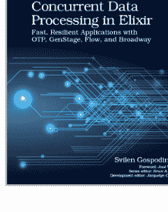
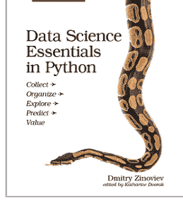
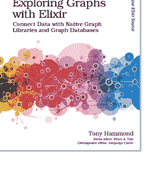
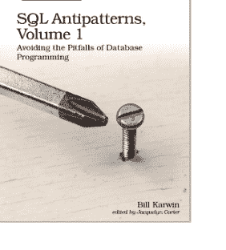
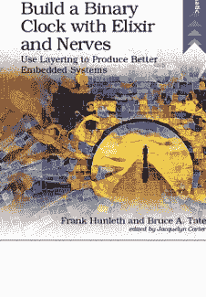
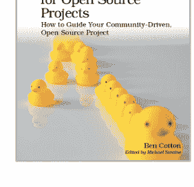

### 感谢！

我们希望你喜欢这本书，并且已经开始思考下一步想学习什么。为了让这个决定更容易，我们为你准备了这份礼物。

现在就前往 https://pragprog.com，并使用优惠码 BUYANOTHER2023 在你下一本电子书上节省 30%。此优惠在禁止或限制地区无效。此优惠不适用于任何版本的 *The Pragmatic Programmer* 电子书。

如果你想与世界分享自己的专业知识，为什么不向我们提出一个写作想法呢？毕竟，我们许多最好的作者最初都是我们的读者，就像你一样。最高可达 50% 的版税、世界级的编辑服务，以及一个值得信赖的名字，让你没有任何损失。今天就访问 https://pragprog.com/become-an-author/ 了解更多信息并开始吧。

我们感谢你持续的支持，并希望很快再次收到你的消息！

The Pragmatic Bookshelf

### Concurrent Data Processing in Elixir

学习在 Elixir 中编写并发代码的不同方法，在不牺牲可扩展性或容错性的前提下提高应用程序的性能。大多数项目都受益于运行后台任务和并发处理数据，但 OTP 世界和各种库可能具有挑战性。应该使用哪种 Supervisor 和什么策略？GenServer 呢？也许你需要反压，但 GenStage、Flow 还是 Broadway 是更好的选择？你将学习回答这些问题所需的一切知识，立即开始构建高度并发的应用程序，并编写不仅快速，而且对错误具有弹性且易于扩展的代码。

Svilen Gospodinov
(174 pages) ISBN: 9781680508192. $39.95
https://pragprog.com/book/sgdpelixir

### Data Science Essentials in Python

从存储在 SQL 和 NoSQL 数据库中的混乱、无结构的数据中入手，到拥有整洁、井然有序的数据集，这是一本面向忙碌数据科学家的快速参考手册。了解文本挖掘、机器学习和网络分析；使用 NumPy 和 Pandas 模块处理数值数据；使用统计和网络理论方法描述和分析数据；并查看数据分析的实际示例。这一个解决方案涵盖了你在 Python 中需要的核心数据科学知识。

Dmitry Zinoviev
(224 pages) ISBN: 9781680501841. $29
https://pragprog.com/book/dzpyds

### Exploring Graphs with Elixir

数据无处不在——只是连接得不太好，这使得关联数据集变得非常困难。使用图作为底层粘合剂，你可以轻松地将数据连接在一起，并在多样化的数据集之间创建导航路径。加上 Elixir 强大的并发能力，你很快就能掌握数据网络。学习如何从 Elixir 内部访问和使用不同的图模型，以及如何在图数据结构之上构建强大的语义覆盖层。我们将从基础开始，检查主要的图范式。准备好拥抱连接数据的世界吧！

Tony Hammond
(294 pages) ISBN: 9781680508406. $47.95
https://pragprog.com/book/thgraphs

### SQL Antipatterns, Volume 1

SQL 是结构化数据软件开发人员的通用语言。大多数依赖 SQL 的开发人员是他们最喜欢的语言（如 Java、Python 或 Go）的专家，但他们不是 SQL 专家。他们经常依赖反模式——看起来正确但随着你发现其隐藏成本而变得越来越痛苦的解决方案。学习识别和避免许多这些常见错误。将继承的噩梦重构为真正有效的数据模型。更新为 MySQL 和 Python 的当前版本，本新版增加了十几个全新的迷你反模式以实现快速改进。

Bill Karwin
(378 pages) ISBN: 9781680508987. $47.95
https://pragprog.com/book/bksap1

### Modern Front-End Development for Rails, Second Edition

使用丰富的、引人入胜的客户端交互改善你的 Rails 应用用户体验。学习使用 Rails 7 工具并简化复杂的 JavaScript 生态系统。使用 Hotwire、Turbo 和 Stimulus 构建用户交互从未如此简单。你可以在不增加太多复杂性的情况下添加出色的前端效果。使用 React 构建更复杂的客户端功能集。使用这些强大的选项为不同级别的客户端需求构建代码结构。今天就为你的工具包增添新内容吧！

Noel Rappin
(408 pages) ISBN: 9781680509618. $55.95

https://pragprog.com/book/nrclient2

### Build a Binary Clock with Elixir and Nerves

想提高 Elixir 编程水平吗？用 Nerves 做一个硬件项目吧。在构建这个二进制时钟的过程中，你将使用 OTP 构建弹性，就像为许多商业电话交换机提供动力的库一样。你将像专家一样应对复杂性，采用分层方法。你将通过朝着目标迈出小而易于验证的步骤来磨练调试技能。完成后，你将拥有一台可工作的二进制时钟，并对硬件系统的工作原理有良好的认识。你还将能够把这种理解应用到你编写的每一行 Elixir 代码中。

Frank Hunleth and Bruce A. Tate
(106 pages) ISBN: 9781680509236. $29.95

https://pragprog.com/book/thnerves

### Program Management for Open Source Projects

每个组织都会发展出官僚体系，开源项目也不例外。当你的结构是有意的并服务于项目时，它可以带来成功且可预测的结论。但仅靠项目管理还不够。迈出下一步，实现完整的项目集管理。成为促进团队之间沟通、管理日程和项目生命周期、协调变更流程以及保持会议富有成效方面的专家。做出让所有相关方都认可的决策。学习如何以恰到好处的结构指导你的社区驱动开源项目。

Ben Cotton

(190 pages) ISBN: 9781680509243. $35.95

https://pragprog.com/book/bcosp

### Build Talking Apps for Alexa

语音识别终于来了。Alexa 等语音助手现在已普及并成为主流。你的应用准备好进行语音交互了吗？学习如何为 Amazon Alexa 开发自己的语音应用。从构建对话用户界面和对话管理的技术开始。集成现有应用和视觉界面以补充语音优先应用。人类与计算机交互的未来是语音，我们将帮助你做好准备。

Craig Walls

(388 pages) ISBN: 9781680507256. $47.95

https://pragprog.com/book/cwalexa

### The Pragmatic Bookshelf

The Pragmatic Bookshelf 由专业开发者为专业开发者撰写书籍。书目延续了著名的 Pragmatic Programmer 风格，并继续获得奖项和好评。随着开发变得越来越困难，Pragmatic Programmers 将继续推出更多书籍和产品帮助你保持领先。

### Visit Us Online

#### This Book’s Home Page
https://pragprog.com/book/lmmlops
本书的源代码、勘误表和其他资源。欢迎来给我们反馈！

#### Keep Up-to-Date
https://pragprog.com
加入我们的公告邮件列表（低频率）或在 Twitter 上关注我们 @pragprog 获取新书、促销、优惠券、热门技巧等。

#### New and Noteworthy
https://pragprog.com/news
查看最新的 Pragmatic 动态、新书和其他产品。

### Buy the Book

如果你喜欢这本电子书，也许你会想要一本纸质版。平装本可在你当地的独立书店和任何销售优质书籍的商店购买。

### Contact Us

Online Orders: https://pragprog.com/catalog
Customer Service: support@pragprog.com
International Rights: translations@pragprog.com
Academic Use: academic@pragprog.com
Write for Us: http://write-for-us.pragprog.com
Or Call: +1 800-699-7764

