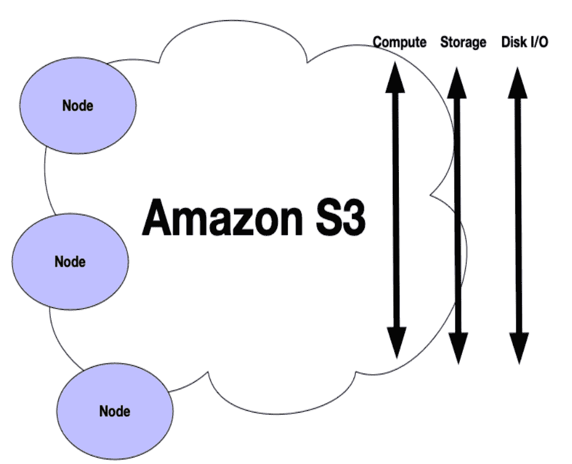
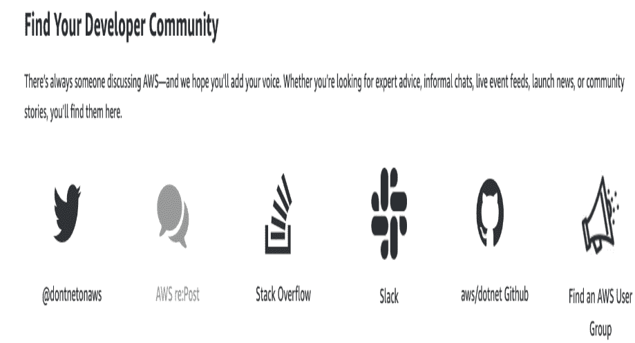
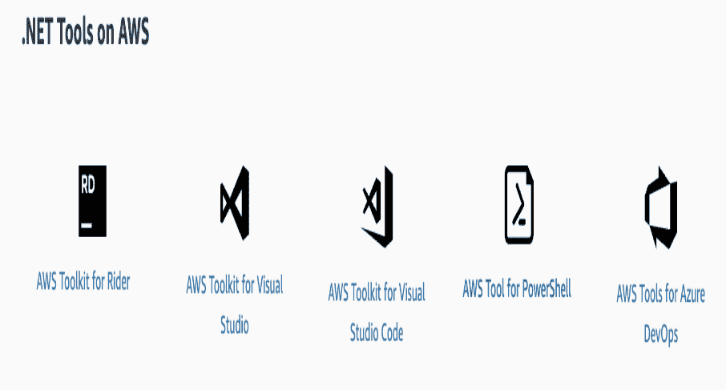
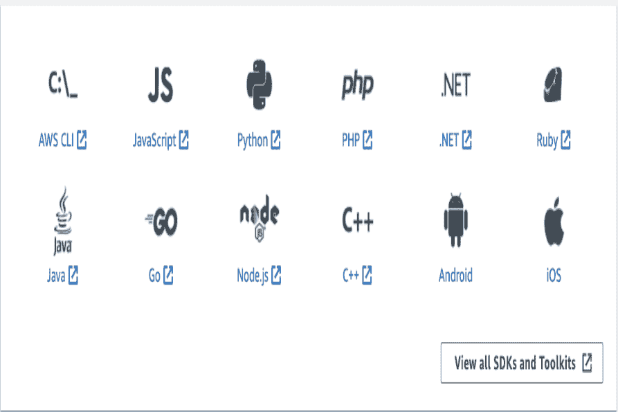
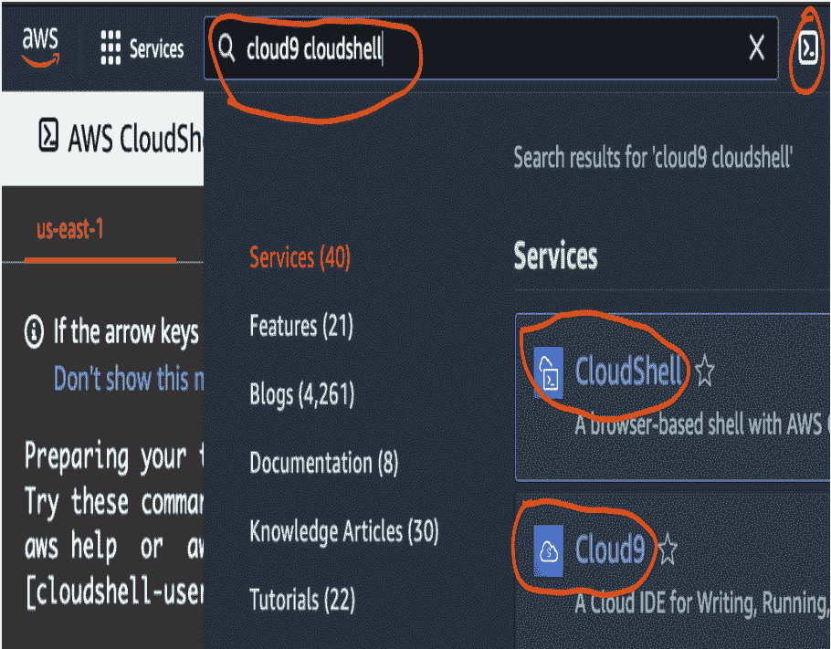
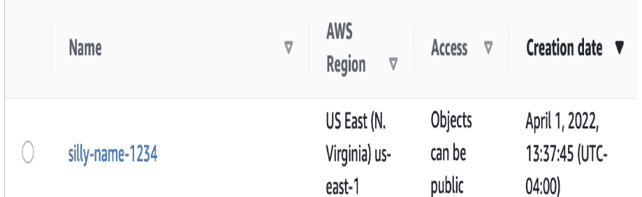
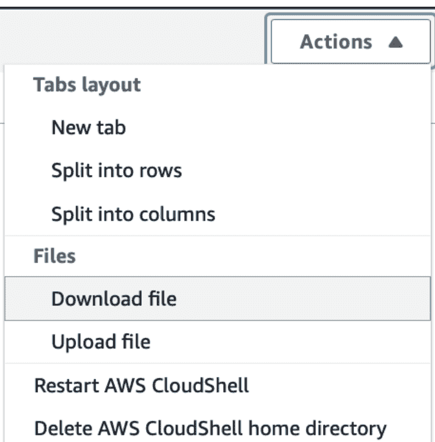
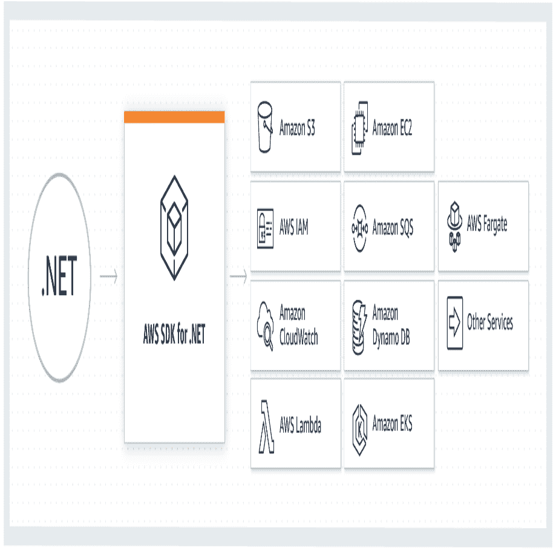

## Chapter 1. Getting started with .NET on AWS

### A NOTE FOR EARLY RELEASE READERS

通过早期发布电子书，您可以在作者撰写时获得书籍的最早形式——作者的原始未编辑内容，以便您在这些书籍正式发布之前就能利用这些技术。

这是最终书籍的第 1 章。请注意，GitHub 仓库将在稍后激活。

如果您对如何改进本书的内容和/或示例有任何意见，或如果您注意到本章中缺少材料，请联系编辑 mpotter@oreilly.com。

本章涵盖了您在 AWS 和 C# 上工作的第一天所需的基本框架。这些基础包括使用基于云的开发环境，如 AWS CloudShell，以及利用 AWS SDK 的传统 Visual Studio 开发环境。

本书的材料通过提供许多在 AWS 上进行 .NET 6 开发的代码示例来帮助您取得成功。您可以在本书的源代码仓库中查看这些代码示例。此外，还涵盖了传统的开发方法，如 Visual Studio，以及新的云原生策略，如使用 AWS Cloud9 进行开发。对于所有类型的 .NET 开发者来说，这里都有内容。

对于脚本爱好者来说，还有使用 AWS 命令行界面和 PowerShell for AWS SDK 的示例。在本章末尾，有讨论问题和练习，您可以用它们来扩展所学内容。这些练习是创建一份全面作品集的绝佳工具，有助于您获得聘用。让我们先简要深入了解云计算。

### What is Cloud Computing?

云计算是通过互联网以公用事业型方式交付 IT 资源，并采用公用事业型定价。您无需购买和维护物理数据中心和硬件，而是可以按需从云厂商按需访问 IT 服务，例如计算、存储和数据库。

也许描述云计算的最佳方式是采用加州大学伯克利分校可靠自适应分布式系统实验室或 RAD Lab 的观点。在他们的论文“Above the Clouds: A Berkeley View of Cloud Computing”中，他们提到了云计算的三个新关键方面，“无限计算资源的幻觉”、“云用户前期投入的消除”以及“按需短期支付计算资源使用的能力”。让我们更详细地讨论这些内容。

NOTE
在教授数千名学生和职场专业人士云计算后，我对尽快学习有强烈的看法。一个关键绩效指标，或 KPI，是每周能犯多少错误。实际上，这意味着尝试事物、感到沮丧，然后找出解决困扰你的问题的最佳方法，然后尽可能快地反复进行。

我在课堂上鼓励这种做法的一种方式是促进学生每周演示他们正在进行的进展并建立作品集。同样，在本书中，我建议建立一系列 GitHub 项目来记录您的工作，然后制作演示视频来解释您的项目如何工作。这一步在学习云计算时实现了两件事：教自己更好的元认知技能，并建立一个使您更具市场竞争力的作品集。

The illusion of infinite computing resources

机器学习是“近乎无限”计算资源的理想用例的绝佳示例。深度学习需要访问大量存储、磁盘 I/O 和计算资源。特别是，数据湖开启了以前不存在的工作流程，因为它允许在数据存储的位置进行数据操作。请注意图 1-1 中，Amazon S3 存储系统可以无缝处理计算、存储和磁盘 I/O 的扩展，无论有多少个 worker 访问该资源。

NOTE
机器学习的一种定义是根据历史数据学习以创建预测的程序。您可以使用 AWS Sagemaker Studio 在不知道任何数据科学知识的情况下训练自己的机器学习模型，其功能称为 Amazon SageMaker Autopilot。您可以在此处了解有关该服务的更多信息。

NOTE
数据湖通常与云对象存储系统（如 Amazon S3）同义。它们允许“就地”数据处理而无需移动数据，而数据湖正是通过近乎无限的容量和计算特性来实现这一点的。数据湖是一个集中式存储库，允许您以任何规模存储所有结构化和非结构化数据。当我在《阿凡达》等电影的电影行业工作时，数据是巨大的；它确实需要通过一个过于复杂的系统进行移动。现在有了云，这个问题就消失了。

深度学习是一种使用神经网络从大量数据中学习以进行预测或发现隐藏模式的机器学习类型。深度学习由于需要大量数据和强大的 GPU 而非常适合通过数据湖进行云计算。根据 AWS 的说法，“与传统机器学习不同，深度学习试图通过创建可以从数据中提取复杂概念和关系的‘人工神经网络’来模拟我们大脑学习和处理信息的方式。深度学习模型通过对图像、文本、声音和其他数据的复杂模式识别来改进，从而产生更准确的洞察和预测。”您可以在我撰写的 O’Reilly 书籍《Practical MLOps》中了解更多关于数据湖和深度学习的信息，这里。




图 1-1. 近乎无限的计算

### 云用户前期投入承诺的消除

对于许多初创公司来说，花费数十万美元购买设备来尝试一个想法是不可行的。云通过消除云计算之前典型的固定高成本，为以机会主义方式开发软件提供了可能。

### 能够按需短期支付计算资源使用费的能力

通过转向可变成本，公司只需为所需付费。结果是更高效的架构，能够响应事件并根据需求扩展。如你所见，关键的云优势是能够使用弹性能力，即计算和存储。其中一种资源是 AWS 上的弹性文件系统 Elastic File System，简称 EFS。根据 AWS 的说法，EFS 是“简单、无服务器、设置后即忘、弹性的文件系统”。它与 AWS 的核心弹性能力配合良好，因为它允许开发人员为某项任务配置或拆除临时资源，如 Spot 实例，同时与所有使用它的机器都可用的持久存储进行交互。Spot 实例是你可竞标并以最高 90% 的成本节省获得的计算实例，使其非常适合可在任何时间运行或为瞬态的工作流程¹。

### NOTE

AWS 非常重视成本优化，并将其作为其 AWS Well-Architected Framework 支柱之一。根据 AWS 的说法，“AWS Well-Architected Framework 帮助你了解在 AWS 上构建系统时所做决策的利弊。” Spot 实例是成本优化故事的重要组成部分，因为它们允许你竞标未使用的容量，从而以最高 90% 的折扣获得常规按需定价。对于正在学习某项技能的开发人员来说，这一资源非常宝贵，因为你只需“为所需付费”。

像 EFS 这样的完全托管的网络文件系统很有帮助，因为它们提供了统一的网络体验，如持久的主目录或数据共享。根据官方 AWS 文档，“Amazon Elastic File System（Amazon EFS）会在你添加和删除文件时自动增长和缩小，无需管理或配置。”

处理大数据时最麻烦的瓶颈之一是需要更多计算、磁盘 I/O（输入/输出）和存储来处理任务，例如为拥有数 TB 数据的公司统计网站访问次数。特别是，能够无缝使用可由机器集群挂载的文件系统，即 EFS，并随集群整体工作量的 I/O 需求增长的能力，是在云计算之前不存在的巨大效率。

另一种弹性资源是 EC2 虚拟计算环境，也称为实例。EC2 实例是 AWS 提供的可扩展计算能力的基础层。它们具有许多功能，包括使用打包完整服务器安装的 Amazon Machine Images（AMI）。它们非常适合扩展 Web 服务、尝试原型，或竞标空闲容量，如 AWS Spot 实例。Spot 实例开辟了全新的工作方式，因为虚拟机可以是可丢弃的，即在不需要时丢弃，并在成本足够低以证明其使用时使用。

### 云计算的类型

需要了解的一个考虑因素是云计算的类型：IaaS（基础设施即服务）、PaaS（平台即服务）、FaaS（函数即服务）和 SaaS（软件即服务）。让我们详细讨论每一种。

### *IaaS*

此选项提供云计算的基本构建块，包括网络、存储和计算。它提供了最接近传统 IT 资源且最灵活的抽象。

### *PaaS*

此选项是一种托管服务，负责所有 IT 管理，让开发人员只需专注于构建业务逻辑。AWS PaaS 的一个绝佳示例是 Amazon Lightsail，它允许 WordPress（一种流行的内容管理系统）开发人员专注于开发可上传到 AWS 以运行 WordPress 实例托管的 WordPress 应用程序。此类服务消除了管理 IT 基础设施的需求。它使组织能够专注于应用程序的部署和管理。

### *FaaS*

FaaS 作为一种开发范式非常有趣，因为它允许开发人员以思维的速度工作。AWS Lambda 是这种模型的典型示例，因为它自动管理计算资源²。对于 .NET 开发人员来说，这是将逻辑部署到云中最有效的方式，因为代码仅在响应事件时运行。

### SaaS

此选项提供可购买的完整产品，使组织无需托管或开发此产品。日志和监控分析服务是此类产品的绝佳示例。

### 其他（“即服务”）

云计算提供了更新的“即服务”产品。这些服务将在本书稍后更详细地讨论。

总体直觉是 IaaS 意味着你付费更少但要做更多，SaaS 意味着你付费更多但做更少，而 PaaS 处于中间³。这一概念类似于走进一家大型仓储商店，要么买面粉自己做披萨，要么买冷冻披萨，要么在离开时在柜台买一块现烤披萨。无论谈论的是披萨还是软件，在你拥有专业知识和时间自行完成的事情上，你付费更少但做更多。或者，更高级别服务的便利性，即一块热披萨，值得利用专家的优势。

虽然 IaaS 的原始成本可能更低，但它也更接近物理数据中心中传统做法的方式，这并不总是意味着更便宜。IaaS 可能并不总是更实惠，因为总投资回报率（ROI）可能更高，因为你需要在 IaaS 之上支付高技能员工来开发和管理应用程序。此外，一些传统范式，如在虚拟机中运行 Web 服务，可能比仅在调用时运行的事件驱动 AWS Lambda 函数花费更多资金。

另一种描述 AWS Lambda 等高效事件驱动服务的方法是称其为云原生服务。云原生服务是由于云计算带来的效率而创建的新产品，提供传统 IT 基础设施中不可用的范式，例如响应 Web 事件 vs. 24/7 运行 Web 服务器。具体来说，AWS Lambda 函数每天的总计算时间可能只有几秒钟。与此同时，传统 Web 服务无论是每秒接收数千个请求还是每天只有十几个请求，都会 24/7 运行。这一概念类似于停车场的灯；你可以浪费电力照亮空荡的车库，也可以使用仅在运动触发时才亮起的感应灯。在这种情况下，当充分考虑构建它所需的资源 ROI 和应用程序运行时的效率低下时，IaaS 可能是更昂贵的解决方案。

另一种指代几乎无需你管理服务的说法是“托管服务”。托管服务的绝佳示例是 Amazon CloudSearch。AWS 云中的托管服务使为你的网站或应用程序设置、管理和扩展搜索解决方案变得简单且经济高效。托管服务与需要专家设置、运行和维护的 IaaS 相反。

### NOTE
AWS 使用托管服务一词来指代 IaaS、PaaS 等服务。你可能只会在 AWS 文档中看到托管服务一词。

接下来，让我们深入了解如何开始使用 AWS。

### 开始使用 AWS

开始使用 AWS 的理想场所是注册 Free Tier 账户。当你最初创建账户时，请注意，你需要同时设置账户名称和根用户的电子邮件地址 图 1-2。


### 注册 AWS

Root user email address

用于账户恢复和部分管理功能

AWS account name

为您的账户选择一个名称。注册后，您可以在账户设置中更改此名称。

Verify email address

OR

Sign in to an existing AWS account

Figure 1-2. Sign up for AWS

创建账户后，首先要做的事情就是将 AWS 账户 root 用户访问密钥安全保存起来。您不想将 root 用户用于日常任务，而应创建 IAM 管理员用户。

这是因为如果泄露账户凭证，您可能会失去对 AWS 账户的控制权。一个基本的安全原则是最小权限原则（PoLP），其规定您应“从最小权限集开始，并在必要时授予额外权限”。此外，root 用户账户应为 AWS root 用户账户启用多因素身份验证（MFA），以便查看有关如何使用 MFA 保护账户的分步说明。

NOTE
值得注意的是，在快速掌握云计算时，一个常见的障碍是术语。幸运的是，AWS 提供了详细且更新的术语表，值得收藏。

一种直接使用 AWS 的方式是通过 AWS 网页控制台。让我们接下来处理这个问题。

### 使用 AWS 管理控制台

AWS 管理控制台，如图 1-3 所示，是通过 Web 浏览器控制 AWS 的中心位置。Services 选项卡显示了平台上每个服务的分层视图。相邻的选项卡旁有一个搜索框，可让您搜索服务。我经常使用搜索框，因为它通常是导航到服务的快捷方式。搜索框旁边是 AWS CloudShell 图标，其外观为黑白终端图标。该服务是快速在 AWS 平台上尝试命令的好方法，例如列出您账户中的 S3 存储桶、对象存储容器，或对托管自然语言处理 API 如 AWS Comprehend 运行命令。

NOTE
从概念上讲，S3 存储桶类似于 Dropbox、Box 或 Google Drive 等消费级云存储。

### 控制台主页

Info

### 最近访问

Info

- S3
- AWS App Runner
- Cognito
- CloudTrail
- IAM
- Cloud9
- AWS Cost Explorer
- EC2
- Amazon Comprehend
- Amazon Machine Learning
- Amazon Rekognition
- Route 53
- Config
- Amazon Simple Email Service

Figure 1-3. Using the AWS Console

被圈出的 *N. Virginia* 选项卡显示当前使用的 AWS 区域。通常会切换到不同区域以启动虚拟机或在其他区域尝试服务。经常，但并非总是如此，新服务首先出现在 N. Virginia 区域，因此根据您组织的使用的区域，他们可能需要切换到 N. Virginia 以尝试新服务，然后再切回。同样，假设新服务出现在 US West（俄勒冈）等不同区域。您可能会在该区域尝试该新服务，然后需要切换回主要区域。

最后，*Recently visited* 选项卡显示最近使用的服务。长时间使用 AWS 后，通常会让日常服务都出现在本节中，提供一个方便的快捷菜单来使用 AWS。另一点需要注意的是，您可以在控制台中“星标”一项以将其添加到收藏夹选项卡中，如图 1-4 所示。此过程可以方便地访问您经常使用的服务。

Figure 1-4. Favorites in AWS Management Console

接下来，让我们看看如何利用 AWS 社区和文档资源。

### 利用 AWS 社区和文档

有大量各种形式和深度的文档可用于学习 AWS 平台。让我们接下来讨论这些资源。

### .NET on AWS 网站

.NET on AWS 网站是关于使用 .NET 与 AWS 的信息的中心位置。从这里，读者可以找到服务和 SDK 文档、AWS 工具包和迁移工具、入门教程、开发者社区链接以及其他内容。

对于 .NET 开发者来说，收藏此网站是明智的，因为它提供了精选的有用资源。我最喜欢的部分之一是 .NET Community 选项卡。该部分链接到许多流行的开发者社区，如图 1-5 所示，包括 Twitter、re:Post、Stack Overflow、Slack、GitHub 和 Global AWS User Groups。



Figure 1-5. Developer Communities for .NET

社区门户中最有价值的部分之一是 YouTube 频道和开发者博客的链接。最后，有指向 AWS 投资的开源 .NET 项目的链接，包括 .NET on AWS GitHub 和 AWS SDK for .NET。

接下来，让我们看看 AWS SDK for .NET 文档。

### AWS SDK for .NET 文档

您可以在官方网站上学习使用 AWS SDK for .NET 开发和部署应用程序。该网站包含多个重要指南，包括开发者指南、API 参考指南和 SDK 代码示例指南。

另一个重要资源是 AWS 上的必要开发 .NET 工具，如图 1-6 所示。这些包括 AWS Toolkit for Rider、AWS Toolkit for Visual Studio、AWS Toolkit for Visual Studio Code 和 AWS Tools for Azure DevOps。



Figure 1-6. Explore .NET Tools on AWS

我们将在本章后面深入探讨 AWS SDK。接下来，让我们看看 AWS 服务文档。

### AWS 服务文档

AWS 拥有如此多的服务，以至于起初很难理解哪项服务适合手头的任务。幸运的是，有一个集中的网页，即 AWS 文档网站，

包含指南和 API 参考、教程和项目、SDK 和工具包以及通用资源，如常见问题解答和案例研究链接。

需要指出的一点是，AWS 拥有许多 SDK 和工具包 图 1-7 包括 AWS CLI。对于 .NET 开发者来说，查看多种语言的示例以获取可构建 .NET 解决方案的灵感会很有帮助。AWS 命令行界面通常是最有效的服务文档，因为它以易于理解正在发生什么的方式抽象概念。此概念的一个绝佳示例是以下将文件夹递归复制到 AWS S3 对象存储的命令。

```
aws s3 cp myfolder s3://mybucket/myfolder --recursive
```

每个空白分隔命令的操作，即 aws 然后 s3 表示服务，操作 s3，以及命令的其余部分。在许多情况下，没有比从命令行调用它更快地学习 AWS 服务的方法了。

### SDKs and Toolkits



Figure 1-7. Explore AWS SDK and Toolkits

接下来，让我们谈谈安装 AWS 命令行。

### 使用 AWS 命令行

根据官方 AWS 文档，“AWS 命令行界面（CLI）是管理 AWS 服务的统一工具。只需下载并配置一个工具，您就可以从命令行控制多个 AWS 服务并通过脚本自动化它们。”

有四种基本方法可以与 AWS 命令行交互。让我们简要讨论每一种。

### AWS CloudShell

AWS CloudShell 是一种云原生基于浏览器的 shell，意味着它利用云的独特属性为您预先安装了 AWS CLI。您可以选择 Bash shell、PowerShell 或 Z shell。

### AWS Cloud9

AWS Cloud9 是一种云原生交互式开发环境（IDE），它深度集成 AWS，并具有独特的开发工具，适用于不仅为云开发，而且在云内部开发。

### Linux shells

使用 Amazon Linux 2 AMI，您会自动获得 AWS 集成的命令行工具。或者，您可以在任何 Linux 系统上安装 AWS CLI。

### Windows command line

托管的 AWS Windows AMI 自带 AWS CLI。或者，您可以下载并运行 64 位 Windows 安装程序。

接下来，让我们讨论每种方法的安装说明。

> NOTE
> 您可以在 YouTube 或 O’Reilly 上观看更详细的 AWS CloudShell 使用演示，包括与 Bash、ZSH、PowerShell、S3、Lambda、Python、IPython、Pip、Boto3、DynamoDB 和 Cloud9 的交互。

### 如何安装 AWS CloudShell 和 AWS Cloud9

AWS CloudShell 和 AWS Cloud9 无需安装过程，因为它们已包含在 AWS 控制台体验中，如图 1-8 所示。请注意，搜索这两个工具都会在搜索结果中显示它们，让您可以“星标”，即将其添加为收藏，或单击它们。最后，终端图标也可以启动 AWS CloudShell。这些云原生工具的一个关键优势是


terminals is they are fully managed and up to date and automatically manage your credentials.



Figure 1-8. Selecting AWS Cloud9 and AWS CloudShell

### How to install the AWS CLI

The AWS CLI installation comes with AWS Cloud9 or AWS CloudShell. If you need to install the AWS CLI locally on Windows, a detailed guide is on the AWS website.

### How to install AWSPowerShell.NETCore for AWS

If you need to run PowerShell for AWS locally on Windows, Linux, or macOS, you can refer to the PowerShell Gallery to find the latest version of AWSPowerShell.NETCore and installation instructions for Windows, Linux, and macOS here. AWSPowerShell.NETCore is the

recommended version of PowerShell for working with AWS because it has comprehensive cross-platform support. Generally, though, you can install the following PowerShell command Install-Module -Name AWSPowerShell.NetCore.

An alternative to installing PowerShell on a local operating system is using AWS CloudShell since it comes pre-installed. Next, let’s talk about how this process works.

### Using PowerShell with AWS CloudShell

An excellent guide for using AWS Tools for Powershell lives on the AWS website. Let’s look at a simple example to supplement the official documentation. In the following example, as shown in Figure 1-9, I create an AWS Bucket by invoking the Get-S3BucketLocation cmdlet to create a new Amazon S3 bucket.

```
PS C:\Users\noahgift> New-S3Bucket -BucketName silly-name-1234

CreationDate        BucketName
------------        ----------
4/1/2022 5:37:44 PM  silly-name-1234
```

Figure 1-9. Create AWS Bucket in AWS PowerShell

Next, I can go to the AWS Console, select S3 and verify it appears, as shown in Figure 1-10.



Figure 1-10. Show AWS Bucket in AWS S3 Console

It is worth mentioning that PowerShell for AWS offers a sophisticated and high-level interface to control and interact with services on AWS, including EC2, S3, Lambda, and more. You can further explore those topics here.

The AWS CloudShell supports three shells: PowerShell, Bash, and Z shell. To use PowerShell, you type `pwsh`. You can explore all AWS CloudShell features using the official documentation. The AWS CloudShell comes with 1 GB of persistent storage in `/home/cloudshell-user`. The action menu, as shown in Figure 1-11, allows you to perform many practical actions, including downloading and uploading files, restarting the terminal, deleting the data in the home directory, and configuring the tabs layout of the terminal.



Figure 1-11. AWS CloudShell Action Menu

Fortunately, the AWS CloudShell PowerShell is straightforward, similar to local PowerShell. First, to use the `AWSPowerShell.NetCore`, import it

as shown in the following sequence, echo content into a file, and write it to the bucket created earlier. Finally, run Get-S3Object to verify the file’s creation in S3, which you can see in Figure 1-12.

```
Import-Module AWSPowerShell.NetCore
echo "This is data" > data.txt
Write-S3Object -BucketName silly-name-1234 -File data.txt
Get-S3Object
```

```
PS /home/cloudshell-user> Import-Module AWSPowerShell.NetCore
PS /home/cloudshell-user> echo "This is data" > data.txt
PS /home/cloudshell-user> Write-S3Object -BucketName silly-name-1234 -File data.txt
PS /home/cloudshell-user> Get-S3Object
```

cmdlet Get-S3Object at command pipeline position 1
Supply values for the following parameters:
BucketName: silly-name-1234

ChecksumAlgorithm : {}
ETag               : "bd7090333ff9eabec6a4c1f9461aaaff"
BucketName         : silly-name-1234
Key                : data.txt
LastModified       : 4/1/2022 6:51:54 PM
Owner              : Amazon.S3.Model.Owner
Size               : 13
StorageClass       : STANDARD

Figure 1-12. AWS CloudShell Create File S3

Another feature of the CloudShell and PowerShell environment is invoking C# code. To get started using PowerShell with C#, you can create a C#

snippit and embed it in a script called ./hello-ps-c-sharp.ps1. The C# code comes after the $code = @" block and then terminates at "@. The general idea is that if you are using PowerShell inside of AWS CloudShell, you can use existing snippets of helpful C# to enhance a PowerShell script without needing a full-fledged editor.

```
$code = @"
using System;
namespace HelloWorld
{
    public class Program
    {
        public static void Main(){
            Console.WriteLine("Hello AWS Cloudshell!");
        }
    }
}
"@

Add-Type -TypeDefinition $code -Language CSharp
iex "[HelloWorld.Program]::Main()"

Install-Module -Name AWS.Tools.Installer -Force
```

Next, run it in your PowerShell prompt.

```
PS /home/cloudshell-user> ./hello-ps-c-sharp.ps1
Hello AWS Cloudshell!
PS /home/cloudshell-user>
```

Consider using Bash and Powershell, depending on which one makes more sense in a given context. If you are doing something with pure .NET capabilities, then Powershell is an easy win. On the other hand, you may find some documentation for scripting a solution with Bash on the AWS website. Instead of rewriting the example, simply use it and extend in Bash, saving you time.

In the following example, I use a Bash Hash to store a list of Cloud9 IDs and then get information about them.

```
#!/usr/bin/env bash
## Loop through a list of Cloud9 Environments to find out more information

declare -A cloud9Env=([env1]="18acd120518340df8a73ccaab641851e"\
    [env2]="2c9eb66bf53b4083b9ab6345bae70dad"\
    [env3]="f104b0141c284a41af0c75fea7890770" )

## now loop through the above hash to get more information
for env in "${!cloud9Env[@]}"; do
    echo "Information for $env: "
    aws cloud9 describe-environments --environment-id "${cloud9Env[$env]}"
done
```

I don’t have to use Bash, though, in this particular situation because this particular problem has excellent documentation on how to solve the problem in PowerShell for AWS. PowerShell can do the same thing as Bash and has deep C# integration. Notice the following example shows the PowerShell method of looping through several ids stored in a Hash.

```
## Powershell script that loops through Cloud9 to get environment information

$cloud9Env = @{
    env1 = "18acd120518340df8a73ccaab641851e";
    env2 = "2c9eb66bf53b4083b9ab6345bae70dad";
    env3 = "f104b0141c284a41af0c75fea7890770" }

foreach ($env in $cloud9Env.GetEnumerator()) {
    Write-Host "Information for $($env.Key):";
    Get-C9EnvironmentData $($env.Value)
}
```

To summarize, the AWS CloudShell is a great companion for the C# developer, and it is worth having in your toolkit. Now let’s use Visual Studio for AWS, a preferred environment for experienced .NET developers who use AWS.

### Using Visual Studio with AWS and AWS Toolkit for Visual Studio

Getting set up with Visual Studio with AWS is a straightforward process. The required components are an AWS account, a machine running a supported version of Windows, Visual Studio Community Edition or higher, and AWS Toolkit for Visual Studio. Please refer to this official AWS Documentation for further details on setting up Visual Studio for AWS if this is your first time configuring it.

### NOTE

If you want to use the latest .NET 6 features, you need to use Visual Studio 2022. In practice, your best experience for Visual Studio with deep AWS integration is a Windows environment running the latest version of Visual Studio. For example, a Mac version of Visual Studio exists, but the AWS Toolkit does not work on Mac.

The AWS SDK for .NET has deep integration with the Visual Studio Environment, as shown in Figure 1-13. It includes interacting with AWS Core Services, including Amazon S3 and Amazon EC2, through the AWS Explorer integration installed as part of AWS Toolkit for Visual Studio.



Figure 1-13. AWS SDK for .NET

According to the official AWS documentation, the AWS Toolkit for Visual Studio is an extension for Microsoft Visual Studio running Microsoft Windows that makes it “easier for developers to develop, debug, and deploy .NET applications using Amazon Web Services.” This integration includes multiple ways to deploy applications and manage services. A component of this integration manifests itself in the Server Explorer Toolbox, or AWS Explorer, as shown in Figure 1-14. The AWS Explorer lets you manage and interact with AWS resources like Amazon S3 or EC2 instances within a Microsoft Windows Visual Studio environment.


注意只需单击鼠标即可轻松深入使用众多流行的 AWS 服务。

### AWS Explorer

凭证：Profile:default

区域：US East (N. Virginia)

- Amazon CloudFront
- Amazon CodeArtifact
- Amazon DynamoDB
- Amazon EC2
  - AMIs
  - Elastic IPs
  - Instances
  - Key Pairs
  - Security Groups
  - Volumes
- Amazon Elastic Container Service
- Amazon RDS
- Amazon S3
- Amazon SimpleDB
- Amazon SNS
- Amazon SQS
- Amazon VPC
- AWS CloudFormation
- AWS Elastic Beanstalk
- AWS Identity and Access Management
- AWS Lambda
  - bucket-counter

图 1-14. AWS SDK for .NET

Visual Studio 之所以成为 .NET 的流行开发工具是有原因的；它既是出色的编辑器，也是 .NET 开发人员的丰富生态系统。AWS Toolkit for Visual Studio 利用了这一生态系统。它通过 AWS Explorer 以及用于在 AWS 上发布应用程序的其他集成，构建了一个令人难以置信的与 AWS 交互的工具包。您可以通过查看安装程序的官方文档来了解可用的完整功能列表。

NOTE
请注意，Visual Studio 和 JetBrains Rider 均提供 AWS Toolkit。

AWS Explorer 的安装需要三个关键步骤。

1. 安装 AWS Toolkit for Visual Studio
下载 AWS Toolkit for Visual Studio 2022 并在安装了 Visual Studio 本地安装的 Windows 机器上安装该软件包。

2. 创建 IAM 用户并下载凭证
在 AWS 控制台中创建 IAM 用户并应用最小权限原则。确保选择访问密钥选项，如图 1-15 所示，然后在提示时以 CSV 格式下载凭证。

### Add user

### Set user details

You can add multiple users at once with the same access type and permissions. Learn more

User name*

vs-aws-explorer

+ Add another user

### Select AWS access type

Select how these users will primarily access AWS. If you choose only programmatic access, it does NOT prevent users from accessing an assumed role. Access keys and autogenerated passwords are provided in the last step. Learn more

Select AWS credential type

Access key - Programmatic access

Enables an access key ID and secret access key for the AWS API, CLI, SDK, and other development tools.

图 1-15. 为 Visual Studio 创建 IAM 用户

a. 将凭证添加到 Visual Studio 最后，将您以 CSV 形式下载的凭证添加到 AWS Explorer，如图 1-16 所示。

### Figure 1-16. Add Credentials

安装 AWS Toolkit for Visual Studio 后，保持警惕并更新该工具也很重要，如图 1-17 所示，因为它正在积极开发中，并不断获得来自 AWS 的新功能。您将在 Visual Studio 中看到 AWS Toolkit for Visual Studio 的新更新通知。

图 1-17. 升级 AWS Toolkit for Visual Studio

接下来，让我们开始使用 AWS SDK。

### Getting started with the AWS SDK

学习新技术的最佳方法是构建一些东西。让我们通过使用 NuGet 上的 AWSSDK.S3 包制作一个以 .NET 6 为目标的控制台应用程序来开始使用 AWS SDK。步骤如下：

1. 创建一个以 .NET 6 为目标的新控制台应用程序
在 Visual Studio 中创建一个新的控制台应用程序，作为开发 AWS S3 工具的载体。
2. 通过 NuGet 安装 AWSSDK.S3
在加载新创建的控制台应用程序后，选择 Tools，然后 NuGet Package Manager，然后 Manage NuGet Packages for Solution。搜索 AWSSDK.S3 并将其安装到您的控制台项目中。
3. 创建代码
通过将 Program.cs 文件替换为以下示例中显示的内容来构建以下控制台应用程序。

> **NOTE**
> 
> 另一种安装 NuGet 包的方法是右键单击项目并选择 Manage NuGet Packages。

```
using System;
using System.Threading.Tasks;

// To interact with Amazon S3.
using Amazon.S3;
using Amazon.S3.Model;

// Create an S3 client object.
var s3Client = new AmazonS3Client();

// Display Prompt
Console.WriteLine("AWS Bucket Lister" + Environment.NewLine);

// Process API Calls Async List AWS Buckets
var listResponse = await s3Client.ListBucketsAsync();
Console.WriteLine($"Number of buckets:
{listResponse.Buckets.Count}");

// Loop through the AWS buckets
foreach (S3Bucket b in listResponse.Buckets)
{
    Console.WriteLine(b.BucketName);
}
```

## NOTE

对于命令行爱好者来说，值得注意的是，您也可以使用 `dotnet` 命令行工具来创建控制台应用程序，如以下代码片段所示：`dotnet new console --framework net6.0`。

控制台应用程序的结果显示了 AWS 账户中的存储桶，如图 1-18 所示。

AWS Bucket Lister

Number of buckets: 74
alfredo-noah
aws-sam-cli-managed-default-samclisourcebucket-1odwjh0m3msn1
cloud9-561744971673-sam-deployments-us-east-2
cloud9-hugo-duke
config-bucket-561744971673
cp-course-transcribed
cpcourse-videos
databricks-workspace-stack-lambdazipsbucket-1qrvdf3hx2gkg
db-adcab7abb8ee9b09a75678c0bdd97bd1-s3-root-bucket
deeplens-sagemaker-20891741-f3ab-4443-aa2b-497132f93a7c
deeplensecmay22
edge-input-bucket-feb15
elasticbeanstalk-us-east-1-561744971673
elasticbeanstalk-us-east-2-561744971673
elasticbeanstalk-us-west-2-561744971673
essentialml
fangsentiment
hellocdkstack-helloworldcdkfun time2307b55d-w4cn5dc5mz14
hugo-duke-jan23
hugo-screencast-duke
hugocddemo
hugoduke
imdb185
lambda-trigger-demo-duke
logs.mcintel.com
logs.noahgift.com
mcintel.com

图 1-18. 异步列出存储桶

> NOTE
> 您还可以观看在 O’Reilly 或 YouTube 上从头开始构建此 S3 控制台应用程序的演练。

此控制台应用程序的后续步骤是扩展其功能以创建存储桶，而不仅仅是列出它们，如本 AWS 教程中 AWS SDK for .NET 所示。

接下来，让我们总结本章所涵盖的所有内容。

### Conclusion

云计算是技术创新的关键驱动力，因为它提供了更高效的工作方式。通过利用近乎无限的资源和云原生托管服务，开发人员可以通过专注于手头的问题而不是与构建解决方案无关的问题，例如系统管理，来提高生产力。本章介绍了如何开始使用 Amazon Cloud Services，首先使用 CloudShell，然后过渡到功能齐全的 Visual Studio 代码环境。

Visual Studio 环境受益于 AWS Toolkit，后者具有用于与 AWS 云交互的高级功能。AWS SDK 可直接通过 Visual Studio 中的 NuGet 包管理器使用。AWS SDK 允许轻松集成到 Visual Studio 解决方案中，例如控制台应用程序。我们使用 AWS SDK 构建了使用低级服务（如 AWS S3）和高级 AI API（如 AWS Comprehend）的控制台应用程序。

建议读者下一步查看批判性思考讨论问题，以反思您如何利用 AWS 的全部功能。您可以将这些问题与团队或正在学习 AWS 的同事讨论。此外，下面列出的几个挑战练习建议也是构建针对 .NET 6 的 AWS 服务的好练习。其中一些服务尚未详细介绍，因此您可以在后续章节中介绍后再进行。

下一章第 2 章中，我们将介绍 AWS 核心服务。这些包括 AWS 存储、EC2 计算以及 DynamoDB 等服务。这些服务是构建利用 .NET 生态系统强大功能的云原生应用程序的基础。

### Critical Thinking Discussion Questions

- 在 AWS Cloudshell 中使用 Bash 与 PowerShell 之间有哪些关键区别？
- 在什么情况下使用 PowerShell 比 Bash 更有利，反之亦然？
- 精通命令行 `dotnet` 工具如何提高您的工作效率？
- AWS Toolkit for Visual Studio 是否也能惠及组织中的非开发人员，例如运维团队？为什么或为什么不？
- 直接从 Visual Studio 部署 C# Web 服务进行原型设计的优势是什么。

### Challenge Exercises

- 构建一个 C# 或 F# 控制台应用程序并部署到 AWS CloudShell。考虑云端开发环境的独特属性如何帮助您在 AWS 云上自动化工作流程，考虑到它们不需要 API 密钥，并且无需部署到 AWS 计算服务即可运行。
- 参考 AWS CDK in C# 文档并通过 CDK 创建一个 S3 存储桶。


- 使用 Visual Studio 和 Visual Studio Code 的 AWS Toolkit 构建并部署 Elastic Beanstalk 应用程序。
- 在 Visual Studio 内部使用 NuGet 安装可用于 AWS 的 600 多个软件包中的一个。
- 使用 AWS 控制台创建可在任何受支持语言中使用的 hello world AWS Lambda，然后通过 VS Code 和 Visual Studio Code 的 AWS Toolkit 调用它。

1. 你可以在 O’Reilly 出版的《Python for DevOps》一书的第 6 章中阅读更多关于 EFS 和 spot 实例的内容。
2. AWS 白皮书《Developing and Deploying .NET Applications on AWS》解释了 AWS Lambda 的机制
3. 你可以在 Amazon Web Services 白皮书概述中阅读有关 AWS 如何看待云计算的更多详细信息
4. AWS Identity and Access Management 指南提供了有关如何锁定 AWS 账户 root 用户访问密钥的详细说明列表
5. 要创建管理员 IAM 用户，请遵循官方 AWS 指南
6. 查看多因素身份验证指南
7. 你可以在官方文档中阅读有关 AWS 管理控制台的更多信息
8. 此外，还有指向著名 .NET 开发人员 Norm Johanson、François Bouteruche、Josh Hurley 和 Steve Roberts 的链接
9. 在以下 AWS 网站上有一份关于如何与 AWS 命令行界面交互的详细用户指南
10. 在此处可获得 AWS Toolkit for Visual Studio 的详细设置指南
11. 在 AWS 文档中有一份关于 PLP、最小权限原则概念的详细指南。PLP 的核心思想是仅在需要时授予权限
12. 其他服务如 AWS Lambda 也提供了一种通过命令行创建应用程序的便捷方式
13. 部分原因在于亚马逊是云计算的领导者，这归功于其文化，该文化在其领导力原则中进行了描述。这些原则包括节俭、客户痴迷以及发明与简化等。你可以阅读更多关于亚马逊领导力原则的内容
14. AWS CDK 是一个库，可自动化在 AWS 中部署资源
