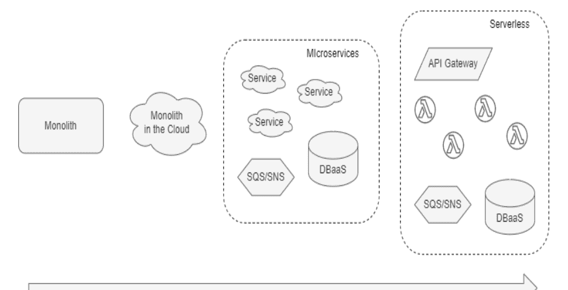
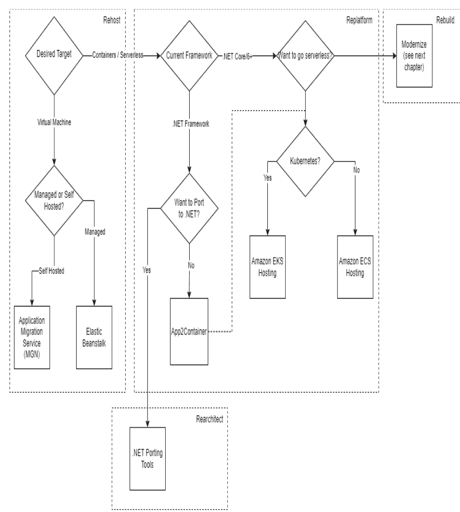
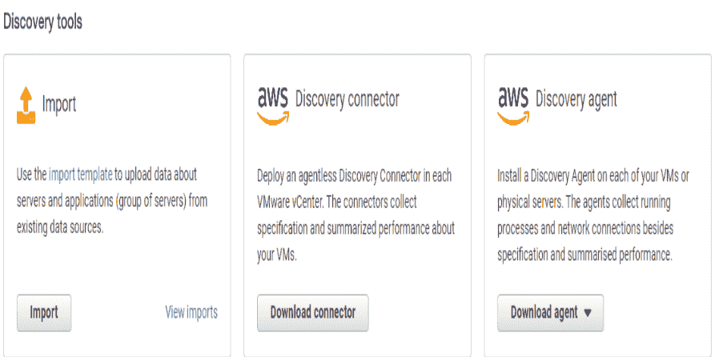
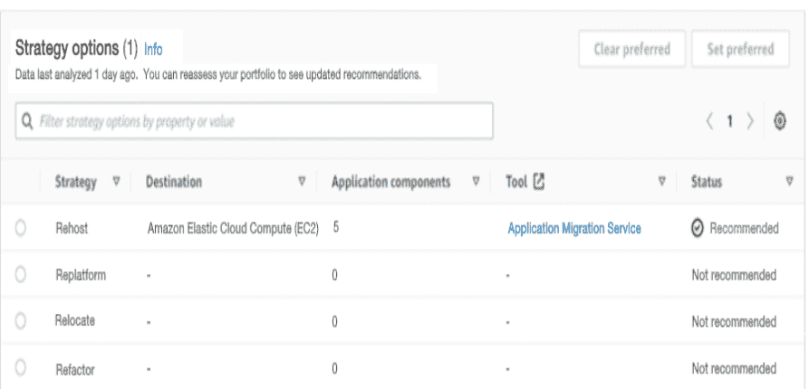
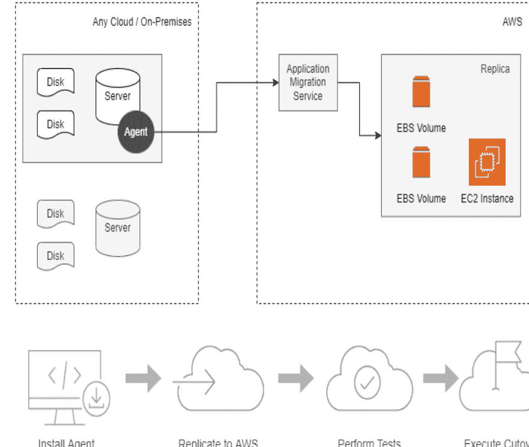
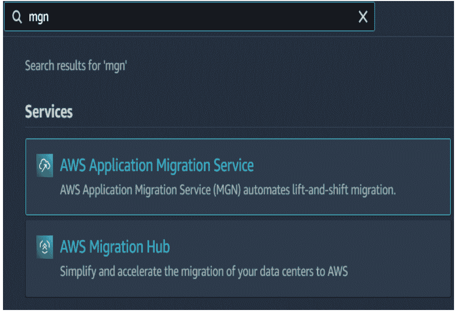
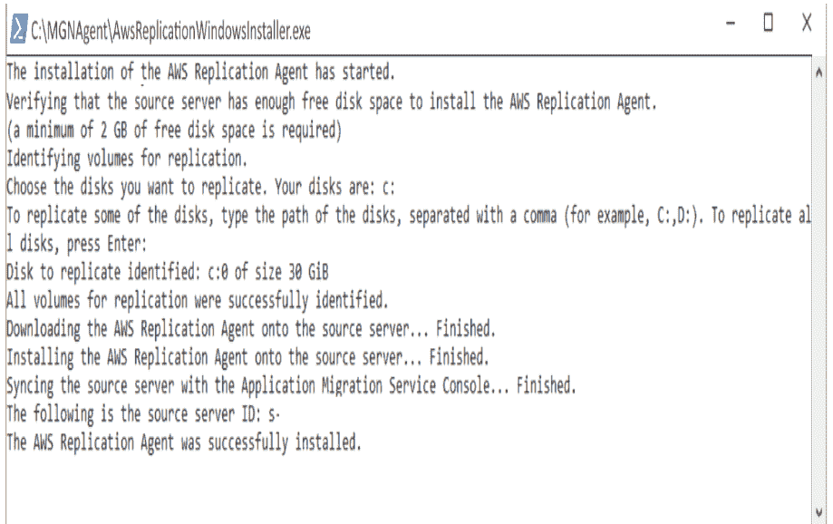
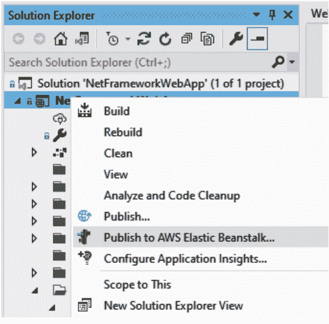
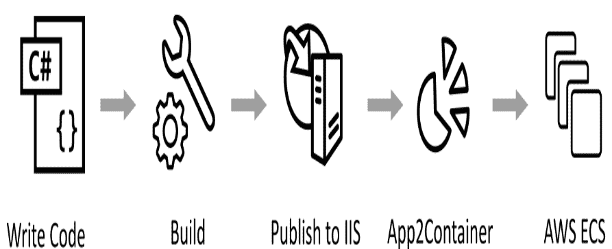
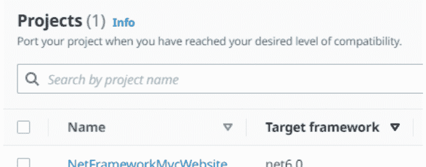

## 第 2 章. 将遗留的 .NET Framework 应用程序迁移到 AWS

### 早期发布读者须知

使用 Early Release 电子书，您可以在官方发布这些书名之前很久就利用这些技术——作者在撰写时提供的原始和未编辑内容，以便您尽早获益。

这将是最终书籍的第 3 章。请注意，GitHub 仓库将在稍后激活。

如果您对如何改进本书的内容和/或示例有任何意见，或者如果您注意到本章中缺少材料，请联系编辑 mpotter@oreilly.com。

在之前的章节中，我们已经看到了 AWS 为我们作为开发人员提供的一些令人兴奋的工具和服务。接下来我们将看看对于一些遗留的 .NET 应用程序我们可以做什么，以及将它们迁移到云中会带来什么可能性。

软件开发并不是，如您可能不舒服地意识到的那样，仅仅是全新项目、干净的代码库、最新工具集和整洁的待办事项的追求。各种规模的组织都可能拥有遗留代码，其中一些可能仍在本地运行；内部工具、API、工作流、应用程序，这些应用程序正在积极使用但未积极维护。将这些迁移到云中可以为您的组织提供成本节约、性能提升以及大幅改善的扩展能力。

在本章中，您将学习如何选择、计划和执行将运行在 IIS 上并构建于 .NET Framework 或 .NET Core/6+ 的 Web 应用程序的迁移。

> **NOTE**
> 
> 在 2020 年 11 月发布 .NET 5 后，微软将 .NET Core 更名为“.NET”。在接下来的章节中，我们将把 .NET Core 及所有未来版本称为 .NET，而将之前的遗留框架版本称为 .NET Framework

### 选择迁移路径

每个 .NET 应用程序到云的路径都不同，虽然我们无法为迁移遗留 .NET 应用程序创建一个一刀切的框架，但我们可以从前人的迁移经验中学习。2011 年，技术研究公司 Gartner 识别出 5 种将本地软件迁移到云的迁移策略¹。这些被称为 5 个 R，随着时间的推移，它们已被完善、调整和扩展，以涵盖您在迁移和现代化遗留 Web 应用程序时可能面临的所有挑战。

对于将部分代码迁移到 AWS，我们现在有 6 个 R，任何一个都可应用于运行在 IIS 上并构建于 .NET Framework 或更新版本 .NET 的遗留 .NET Web 应用程序。

- Rehosting
- Replatforming
- Repurchasing
- Rearchitecting
- Rebuilding
- Retaining

这四种策略的前四种具有不断增加的努力和复杂性，但这会带来不断增加的价值和未来迭代的能力。我们将在本章后面深入探讨其中一些方法。

### Rehosting

Rehosting 是将应用程序从一个主机迁移到另一个主机的过程。它可能是将应用程序从公司现场的服务器机房迁移到云中的虚拟机，也可能是从一个云提供商迁移到另一个云提供商。作为迁移策略，rehosting 不会更改（甚至不需要访问）源代码。它是将资产以最终构建或编译状态移动的过程。在 .NET 世界中，这意味着 .dll 文件、.config 文件、.cshtml 视图、静态资源，以及为服务您的应用程序所需的一切。正因如此，rehosting 有时被称为迁移的“lift and shift”方法。您的整个应用程序按原样被整体迁移到新主机。

重新托管应用程序的优势包括能够利用云托管虚拟机上可能的成本节约和性能改进。它还可以使您更容易管理基础设施，如果您可以在 AWS 上将维护较少或遗留的应用程序与更积极开发的代码一起重新托管。

有关可用的工具和资源的概述，如果您选择遵循此迁移路径，请参阅“Rehosting On AWS”。

### Replatforming

replatforming 方法比单纯的 rehosting 更进一步，不仅改变了应用程序托管的位置，还改变了托管方式。与 rehosting 不同，replatforming 可能涉及对代码的更改，尽管这些更改应保持最小以保持策略可行。

“平台”构成的定义有很多，但作为 .NET 开发人员我们都熟悉的一个平台是运行在 Windows Server 上的 Internet Information Services（IIS）。Replatforming 将是迁移您的应用程序 *离开* IIS 并进入更云原生的托管环境，如 Kubernetes 的过程。本章后面我们将探讨一种 replatforming 类型：“Replatforming via Containerization”。

### Repurchasing

当您的应用程序依赖于无法在云基础设施上运行的许可第三方服务或应用程序时，此策略才相关。也许您在应用程序中使用了用于客户关系管理（CRM）或内容管理系统（CMS）功能的自托管产品，该产品无法迁移到云中。Repurchasing 是依赖于这些产品的应用程序的迁移策略，涉及终止现有的自托管许可，并购买云端替代品的新许可。这可以是类似产品的云端版本（例如 Umbraco CMS 到 Umbraco Cloud），或 AWS Marketplace 上的替代产品。

### Rearchitecting

顾名思义，rearchitecting 处理应用程序的整体架构，并要求您思考如何进行更改以促进其迁移到云中²。对于遗留的 .NET Framework 应用程序，这几乎肯定意味着迁移到 .NET。微软在 2019 年宣布版本 4.8 将是 .NET Framework 的最后一个主要版本，虽然它将继续随 Windows 的未来版本一起得到支持和分发，但微软将不再积极开发它³

历史塑造出一个相当线性的单体 Web 应用程序 rearchitecting 旅程，如图 2-1 所示




图 2-1. 单体 Web 应用的演进

我们将在“重构：迁移到 .NET（Core）”一节中更深入地探讨将 .NET Framework 移植到 .NET 的过程

### 重建

有时你的遗留代码库无法通过迁移的投入与价值评估标准，你别无选择，只能从头重建。当然，你并不是完全从零开始。你将能够迁移部分业务逻辑；遗留代码库历经多年解决的所有问题都可以在新代码库上重新实现。然而，代码本身、架构、库、数据库、API 模式和文档⁴ 将不会随你迁移。

### 保留

此列表上的最后一种迁移策略实际上就是以上皆非。也许你的遗留应用有一些特殊要求，不能连接到互联网，需要经过漫长且成本高昂的重新认证流程。有许多独特且往往不可预见的原因会导致某些遗留代码库无法迁移到云端，或在当前时间点无法迁移。你应仅迁移那些能够做出可行商业案例的应用，如果不可能，那么选择 *以上皆非* 有时是最佳选择。

### 选择策略

你选择的迁移策略将取决于应用当前架构、你希望达到的目标，以及为实现目标愿意做出多少改变。图 2-2 中的图表总结了你可以在做出决策时选择的迁移路径，以便为你的特定使用案例选择最合适的迁移路径。



图 2-2. 选择策略

### AWS Migration Hub 策略建议

为了进一步帮助你选择迁移策略，AWS 提供了一个名为策略建议服务 的工具。该服务收集你现有服务器的数据，并结合对源代码和 SQL 模式的分析，然后从我们之前介绍过的策略中推荐一种迁移策略。

### 提示

策略建议服务是 AWS Migration Hub 的一部分：用于分析基础设施、规划迁移到 AWS 并跟踪迁移的一组工具。Migration Hub 可免费使用，你只需支付使用工具的费用以及迁移过程中消耗的任何 AWS 资源费用

要开始使用策略建议服务，我们首先需要尽可能多地向其提供现有基础设施的数据。我们可以通过 AWS Application Discovery Service 来实现，这也是可从 AWS Migration Hub 访问的另一项服务。要开始应用发现，请导航到你主区域的 AWS 管理控制台中的发现工具⁵，并从图 2-3 所示的数据收集方法中选择一种。



图 2-3. Application Discovery Service 收集方法

让我们使用发现代理快速进行一次设置。在开始之前，请确保已安装 AWS CLI，并且你拥有 IAM 用户访问密钥（和密钥）。你可以使用以下命令将这些值保存到 AWS 配置文件中。这些设置随后将被本章中的所有工具使用。

```
$ aws configure set aws_access_key_id <your-key-id>
$ aws configure set aws_secret_access_key <your-key-secret>
$ aws configure set default.region <home-region>
```

接下来，在你想要开始收集数据的其中一台 Windows 服务器上打开 PowerShell 终端，然后下载代理安装程序。

```
PS C:\> mkdir ADSAgent
PS C:\> cd .\ADSAgent\
PS C:\ADSAgent> Invoke-WebRequest https://s3.us-west-2.amazonaws.com/aws-discovery-agent.us-west-2/windows/latest/ ADSAgentInstaller.exe -OutFile ADSAgentInstaller.exe
```

接下来设置 AWS Migration Hub 的主区域、你的访问密钥 ID 和密钥。

然后在此服务器上运行发现代理安装程序

```
PS C:\ADSAgent> .\ADSAgentInstaller.exe REGION=$AWS_REGION KEY_ID=$KEY_ID KEY_SECRET=$KEY_SECRET INSTALLLOCATION="C:\ADSAgent" /quiet
```

这将把代理安装到你新建的文件夹 C:\ADSAgent 中。回到 AWS 管理控制台的 Migration Hub 部分，你可以导航到 Discover > Data Collectors > Agents，如果一切顺利，你安装的代理应会出现在列表中。选择该代理并点击“Start Data Collection”，以允许 ADS 开始收集有关你的服务器的数据

> 警告
> 
> 如果你的代理未显示，请确保你的服务器允许代理进程通过 TCP 端口 443 向 https://arsenal-discovery.<your-home-region>.amazonaws.com:443 发送数据

发现代理大约每 15 分钟轮询一次其主机服务器，并报告数据，包括 CPU 使用率、可用 RAM、操作系统属性以及发现的正在运行进程的进程 ID。你可以通过在仪表板上导航到 *Discover > Servers* 来查看你的服务器。一旦将所有服务器添加到 ADS，你就可以开始汇总策略建议所需的数据。

策略建议服务提供了一个自动化的无代理数据收集器，可用于分析你现在已在 ADS 中的服务器上运行的 .NET 应用。要开始使用，请在迁移中心控制台中导航到 *Strategy > Get Started*，并按照向导下载数据收集器作为 Open Virtual Application（OVA）。然后可将其部署到你的 VMware vCenter Server。有关设置数据收集器的完整说明，请参阅 https://docs.aws.amazon.com/migrationhub-strategy/latest/userguide/getting-started.html。

设置好数据收集器后，你可以进入向导的下一页并选择迁移优先级。图 2-4 显示了策略建议服务中的优先级选择屏幕。这将允许 AWS 推荐最符合你业务需求和未来计划的迁移策略。选择最符合你迁移原因的选项。

### 优先业务目标

通过拖放按你的优先级顺序对列出的目标进行排序。

| 优先级 | 目标 |
|---|---|
| 1 | 迁移速度 |
| 2 | 许可成本降低 |
| 3 | 使用云原生技术现代化基础设施 |
| 4 | 通过托管服务降低运营开销 |

图 2-4. 策略建议服务目标

在对服务器运行数据分析后，该服务将为每个应用提供建议，包括指向任何相关 AWS 工具的链接，以帮助你进行该类型的迁移。在图 2-5 中，你可以看到该工具建议我们使用 Rehosting 作为迁移策略，将应用迁移到 Elastic Compute（EC2）并使用 Application Migration Service，我们将在下一部分介绍。



图 2-5. AWS 推荐“Rehost”策略

### 在 AWS 上进行 Rehosting

将遗留 .NET 应用重新托管到 AWS 的方法取决于应用当前托管方式。对于部署到运行 IIS 的单台服务器的 Web 应用，你可以轻松地在 AWS 上的 Amazon Elastic Compute Cloud（EC2）实例上复制此环境。如果你的 .NET 应用当前部署在托管环境中（其他云提供商可能称之为“App Service”），那么 AWS 上的等效产品是 *Elastic Beanstalk*，你会发现使用 Elastic Beanstalk 的体验很熟悉。我们将在“Elastic Beanstalk”一节中介绍将托管主机迁移到 Elastic Beanstalk，但在那之前，让我们先看看将运行 IIS 的虚拟机重新托管到 EC2 的情况。

### Application Migration Service（MGN）

AWS 用于执行向 EC2 的平移迁移的最新产品称为 *Application Migration Service* 或 MGN⁶。该服务源自 AWS 于 2018 年收购的产品 CloudEndure。CloudEndure 是一种灾难恢复解决方案，通过创建和


在 AWS EC2 和 Elastic Block Store (EBS) 上维护生产服务器的副本。这种复制概念可以被重新用于执行 lift and shift 迁移。你只需设置到 AWS 的复制，然后在准备就绪时，切换到完全从 AWS 副本运行你的应用程序，从而允许你退役原始服务器。Application Migration Service 如何复制你的服务器的概述如 Figure 2-6 所示

### Application Migration Service Replication



Figure 2-6. Overview of the Application Migration Service

可以通过 AWS 管理控制台访问 Application Migration Service，在搜索中输入“MGN”或在 Migration Hub 的菜单中找到它，如 Figure 2-7 所示



Figure 2-7. Access MGN through the AWS Management Console

Application Migration Service 的设置始于在你的服务器上安装复制代理，类似于我们为 Application Discovery Service 安装发现代理的方式。首先登录你的 Windows 服务器并以管理员身份打开一个 PowerShell 窗口以下载 Windows 的代理安装程序。将 <region> 替换为你希望迁移服务器进入的 AWS 区域。

```
PS C:\> mkdir MGNAgent
PS C:\> cd .\MGNAgent\
PS C:\MGNAgent> Invoke-WebRequest
https://aws-application-migration-service-<region>.s3.
<region>.amazonaws.com
/latest/windows/AwsReplicationWindowsInstaller.exe
-OutFile C:\MGNAgent\AwsReplicationWindowsInstaller.exe
```

接下来如果尚未设置，请将你的区域、访问密钥 ID 和密钥放入变量中并执行安装程序

```
PS C:\ADS Agent> $AWS_REGION="<region>"
PS C:\MGNAgent> $KEY_ID="<your-key-id>"
PS C:\MGNAgent> $KEY_SECRET="<your-key-secret>"

PS C:\MGNAgent> .\AwsReplicationWindowsInstaller.exe --region $AWS_REGION
--aws-access-key-id $KEY_ID --aws-secret-access-key $KEY_SECRET
```

代理安装程序会询问你在这个服务器上想要复制哪些磁盘，然后开始将你的磁盘同步到 AWS。你可以在控制台窗口中看到代理安装程序操作的状态，如以下 Figure 2-8 所示。



Figure 2-8. MGN Replication Agent Console Window

如果返回 MGN 管理控制台，你将能够在菜单的 Source Servers 下看到你的服务器。点击你的服务器名称，你可以看到该服务器复制的状态，如 Figure 2-9 所示。完成所有阶段可能需要一段时间，但完成后控制台中的状态将更改为“Ready For Testing”。Application Migration Service 的一个不错的功能是能够从副本启动服务器实例并测试一切是否符合你的预期，而不会中断或以其他方式干扰复制本身。

### Replication initiation steps

- Create security groups
- Launch Replication Server
- Boot Replication Server
- Authenticate with service
- Download replication software
- Create staging disks
- Attach staging disks
- Pair Replication Server with AWS Replication Agent
- Connect AWS Replication Agent to Replication Server
- Start data transfer

Figure 2-9. MGN Replication Status in the Management Console

要测试服务器，请从源服务器的 Test and Cutover 操作菜单中选择 Launch test instances。这将启动一个新 EC2 实例，该实例应镜像你复制的原始 Windows 服务器，许可证的转移由 Application Migration Service 自动处理。你可以通过在管理控制台中从 EC2 实例列表中选择它，并在其准备就绪后使用远程桌面 (RDP) 连接到 EC2 实例。当你对测试实例的工作方式感到满意时，你可以执行迁移的最后阶段：Cutover。

如果参考回 Figure 2-6 中通过复制进行应用程序迁移的阶段，你可以看到最后阶段是 Execute Cutover。在这里我们为所有源服务器创建资源（即为每台服务器启动一个新的 EC2 实例），停止旧服务器的复制，并允许我们退役我们安装了复制代理的原始服务器。

所以现在我们所有的服务器都在 EC2 上以相同的方式运行，我们已经完成了 lift and shift 迁移，接下来是什么？在 *rehosting* 的范围内，我们可以更进一步，利用 AWS 用于运行 Web 应用程序的托管环境：Elastic Beanstalk。

### Elastic Beanstalk

Elastic Beanstalk 是你 Web 应用程序的 *managed* 托管环境。它支持多种后端栈，如 Java、Ruby 或 PHP，但我们最感兴趣的是 .NET Framework 支持。将我们的应用托管在 EC2 上的 Windows 服务器上，如上一节所述，与使用 Elastic Beanstalk 之间的区别可以归结为一个关键差异：

对于非托管服务器，你将编译和打包的网站文件上传到服务器，然后调整该服务器的设置以处理 Web 流量。对于托管服务，你将包上传到云，服务会为你处理其余工作，设置负载均衡器并水平动态扩展虚拟机。托管服务是部署应用程序到云的真正吸引力，你越依赖 AWS 为你管理基础设施，就越能专注于编写代码和为你的业务解决问题。本书后面我们将介绍无服务器编程以及如何将你的 .NET 应用程序架构得更具无服务器性，这一概念根植于尽可能多的托管服务。你可以将 Elastic Beanstalk 视为“App Service”的等价物，你可能从一个稍微 *bluer* 的云提供商那里熟悉它。

所以让我们开始在 Elastic Beanstalk 上使用我们的第一个托管服务。部署代码最简单的方法是使用 Visual Studio 的 AWS Toolkit。安装了 AWS Toolkit 后，部署到 Elastic Beanstalk 真的就像在 Solution Explorer 中右键单击你的解决方案并选择“Publish to Elastic Beanstalk”一样简单。Figure 2-10 显示了工具包在 Visual Studio 的 Solution Explorer 中的使用情况。



Figure 2-10. Publishing to Elastic Beanstalk Directly from Visual Studio

当然，你也可以在 CI 管道中使用 CLI 工具。要开始使用 Elastic Beanstalk CLI，请参阅 GitHub 上的 EB CLI Installer。CLI 工具允许你直接从 AWS CodeBuild 或 GitHub 将代码发布到 Elastic Beanstalk。

最后，如果你考虑尝试 Elastic Beanstalk，还有一个最终工具值得提及，那就是 Windows Web App Migration Assistant (WWMA)。这是一个 PowerShell 脚本，你可以在任何运行 IIS 主机 Web 应用程序的 Windows Server 上运行，以自动将应用程序迁移到 Elastic Beanstalk，而完全不需要源代码。这在你有一个不再维护的遗留 .NET 应用程序，并且你想利用 Elastic Beanstalk 的好处但不再为此应用发布版本时非常有用。这是一个真正的 rehosting 工具，它只是将编译的网站资产从服务器上的 C:\inetpub 文件夹移动到由 Elastic Beanstalk 管理和扩展的 EC2 实例中。

### Replatforming via Containerization

作为迁移策略，replatforming 关注的是我们 .NET 应用程序运行的 *platform*，并探索迁移到其他地方。对于 .NET Framework Web 应用程序而言，该 *platform* 将是运行 IIS 的某个版本的 Windows Server。虽然之前我们将 Elastic Beanstalk 视为从该基础设施中获得更多收益的一种方式，但 Elastic Beanstalk 仍然在 IIS 上的 Windows Server 上托管你的应用程序，只不过以更可扩展和高效的方式。如果我们想在不触及原始源代码的情况下真正推动可扩展性和性能的极限（毕竟这些是“遗留”应用程序），那么我们需要远离 IIS 转向其他东西。这就是容器化发挥作用的地方。

我将跳过容器化到底是什么以及为什么重要，因为本书后面第 5 章专门讨论 .NET 的容器化，简单来说，将你的遗留 .NET 应用程序从 Windows Server Web 托管迁移到容器可以在不触及任何遗留代码的情况下为你的组织带来性能和成本效益。

### App2Container

App2Container 是 AWS 的一个命令行工具，它针对运行在 Windows Server 上的 IIS 上的 .NET 应用程序运行。它分析你的应用程序和依赖项，然后创建可部署到云中的编排服务（如 Elastic Container Service (ECS) 或 Amazon Elastic Kubernetes Services (Amazon EKS)）的 Docker 容器镜像。因为 App2Container 在已部署到服务器的应用程序上运行，所以它不需要访问你的源代码，并且位于部署管道的末端。因此，对于快速重新平台化一个不再积极开发且你不想重建的旧应用程序，App2Container 是完美的，只需跳过 Figure 2-11 中显示的管道的最后两个步骤并将生产文件容器化。




图 2-11. 使用 App2Container 部署 .NET Framework 应用的部署管道

要将 .NET 应用容器化，首先需要在运行应用的服务器上下载并安装 App2Container。你可以在 AWS 的网站上找到安装包，网址为 https://docs.aws.amazon.com/app2container/latest/UserGuide。 从应用服务器上的管理员 PowerShell 终端下载、解压并运行 .\install.ps1。这将安装 app2container 命令行实用工具。 如果尚未安装，请确保你的应用服务器已安装 AWS Tools for Windows PowerShell，并且已配置默认配置文件，使你能够从应用服务器管理 AWS 资源。 如果你的服务器运行在 EC2 实例上（例如你使用 Application Migration Service 进行重托管，参见“在 AWS 上重托管”），则这些工具已预先安装，因为它们包含在 EC2 中使用的基于 Windows 的机器映像中。 在确认你拥有具有管理 AWS 资源权限的 AWS 配置文件后，你可以通过运行以下命令初始化 App2Container

```
PS C:\> app2container init
```

该工具会询问是否收集使用指标，并要求提供用于上传制品的 S3 存储桶，但这完全是可选的，你可以跳过这些选项。 初始化完成后，你就可以开始分析应用服务器，以查找可容器化的正在运行的 .NET 应用。 运行 inventory 命令以获取正在运行的应用的 JSON 格式列表，然后将 JSON 键作为 --application-id 传入你想要容器化的应用，如图 2-12 所示

```
PS C:\> app2container inventory
PS C:\> app2container analyze --application-id iis-example-d87652a0
```

```
PS C:\> app2container inventory
{
  "iis-example-d87652a0": {
    "siteName": "ExampleSite",
    "bindings": "http/*:8080:",
    "applicationType": "iis",
    "discoveredWebApps": []
  }
}
PS C:\> app2container analyze --application-id iis-example-d87652a0
✓ Created artifacts folder c:\a2c\iis-example-d87652a0
✓ Generated analysis data in c:\a2c\iis-example-d87652a0\analysis.json
Analysis successful for application iis-example-d87652a0

Next steps:
1. View the application analysis file at c:\a2c\iis-example-d87652a0\analysis.json
2. Edit the application analysis file as needed.
3. Start the containerization process using this command: app2container containerize --application-id iis-example-d87652a0
```

图 2-12. 列出可容器化的 IIS 站点

我们被鼓励查看为我们生成的 analysis.json 文件，我也认同这一点。 analysis.json 中出现的字段的完整列表可以在 App2Container 用户指南⁷ 中找到，但花时间探索分析输出是值得的，因为这些设置将用于配置我们的容器。 如有需要，你可以在容器化之前编辑 analysis.json 的 containerParameters 部分。 同时也值得打开同一文件夹中的 report.txt，因为 analyze 命令会在其中添加任何连接字符串。 准备就绪后，运行 containerize 和 generate 命令来构建 docker 镜像，然后生成部署到 ECS 或 EKS⁸ 所需的所有制品。

```
## Create a Dockerfile
PS> app2container containerize --application-id iis-example-d87652a0

## Generate a deployment
PS> app2container generate app-deployment --application-id iis-example-d87652a0
```

这里的第二个命令（generate app-deployment）会将你的容器上传到 Elastic Container Registry（ECR），并创建一个 CloudFormation 模板，你可以用它将应用部署到（本例中）Elastic Container Service（ECS）。 该工具会显示此 CloudFormation 模板的输出位置（见图 2-13），并为你提供将其部署到 AWS 所需的命令。

```
PS C:\> app2container generate app-deployment --application-id iis-example-d87652a0
✓ AWS prerequisite check succeeded
✓ Created ECR Repository
✓ Registered ECS Task Definition with ECS
✓ Uploaded CloudFormation resources to S3 Bucket: a2c-artifacts
✓ Generated Cloudformation Master template at: C:\A2C\iis-example-d87652a0\EcsDeployment\ecs-master.yml
✓ CloudFormation templates and additional deployment artifacts generated successfully for application iis-example-d87652a0

You're all set to use AWS CloudFormation to manage your application stack.

Next steps:
1. Edit the CloudFormation template as necessary.
2. Create an application stack using the AWS CLI or the AWS Console. AWS CLI command:

aws cloudformation deploy --template-file C:\A2C\iis-example-d87652a0\EcsDeployment\ecs-master.yml --capabilities CAPABILITY_NAMED_IAM --stack-name a2c-iis-example-d87652a0-ECS
```

图 2-13. App2Container 部署生成的結果

这只是对 AWS 的 App2Container 的简要概述，但该工具的功能远不止我们在此介绍的这些。 除了在应用服务器本身执行容器化之外，App2Container 还允许你将工作机部署到 EC2 或你的本地虚拟化环境。 如果你希望保护可能正在生产中提供 Web 应用的应用服务器，避免其在执行容器化过程时消耗资源，这将很有用。 由于 App2Container 是一个 CLI 工具，因此将其集成到你仍在积极开发和发布更改的代码的完整部署管道中也非常简单。 如果你回顾图 2-11，你可以看到 App2Container 如何在不触及任何上游内容，包括你的代码的情况下，将现有的 .NET 部署管道扩展到容器化。

关于 App2Container 的最后一点说明是框架版本支持，随着工具的新版本发布而不断扩展。 你可以在 Windows 上运行的 .NET Framework 和 .NET Core/5/6+ 应用上使用 App2Container，以及最近的 Linux。 对于 .NET Framework，最低支持版本为在 IIS 7.5 上运行的 .NET 3.5。 Java 应用也可以以与我们在此探索类似的方式使用 App2Container 进行容器化，因此受益的不仅仅是我们 C# 开发者。

### 重新架构：迁移到 .NET（Core）

到目前为止，我们已经研究了不涉及代码更改的 .NET 应用的迁移方法，但如果更改代码是可以接受的，我们还能做什么？ 在下一章中，我们将研究将 .NET 应用现代化为无服务器的方法，然而，如果你的应用仍基于 .NET Framework，那么通往每条现代化路径的第一步几乎肯定是迁移到 .NET 6+。 对于 .NET Framework 应用而言，前路并不长，除了我们在本书中介绍的重托管和再平台化方法之外，你最终将面临迁移框架版本的话题。 毕竟，.NET 是微软框架的完全重写，功能对等并不是目标。 API 已发生变化，像 `System.Web.Services` 这样的命名空间已不再存在，你所依赖的一些第三方库可能尚未迁移，迫使你用替代方案替换它们。 出于这些原因，尽可能多地进行调查以评估将遗留的 .NET Framework 应用迁移到现代 .NET 所需的工作量至关重要。

虽然不存在能够自动重构整个解决方案并将 .NET Framework 单体转换为 .NET 6+ 的工具，但确实存在一些非常有用的工具来分析你的项目、执行小型重构任务，并让你了解兼容性问题出现的位置。 我将简要介绍其中两种工具：来自微软的 .NET Upgrade Assistant，以及来自 AWS 的 Porting Assistant。

不过，在开始之前，值得熟悉一下在 .NET 6+ 上不可用的 .NET Framework 技术⁹。 这些包括几乎所有使用组件对象模型（COM、COM+、DCOM）的技术，例如 .NET Remoting 和 Windows Workflow Foundation。 对于严重依赖这些仅限 Windows 的框架的应用，我们在本章前面讨论的迁移策略之一可能更合适。 使用 Windows Communication Foundation（WCF）的应用可以利用 CoreWCF[https://github.com/CoreWCF/CoreWCF] 项目，以便在现代 .NET 上继续使用 WCF 功能。

### Microsoft .NET Upgrade Assistant

随着 .NET 5 和 6 的发布，微软巩固了其对未来统一单一框架的愿景，其中 .NET 6 是该平台的长期支持（LTS）版本。 为了协助将 .NET Framework 应用迁移到这个新的统一框架版本，微软开发了一个名为 .NET Upgrade Assistant 的命令行工具。 Upgrade Assistant 旨在作为引导你完成迁移之旅的单一入口点，并在其中封装了


更久远的 .NET Framework 转换工具 *try-convert*。在升级助手（Upgrade Assistant）的上下文中使用 *try-convert* 是一个好主意，因为你将获得更多分析以及针对你的项目最适用的策略指导。

截至撰写时，此工具可用于以下类型的 .NET Framework 应用程序：

- .NET 类库
- 控制台应用
- Windows 窗体
- Windows Presentation Foundation (WPF)
- ASP.NET MVC Web 应用程序

.NET Upgrade Assistant 具有可扩展的架构，鼓励社区贡献扩展和分析器 / 代码修复程序。你甚至可以编写自己的分析器，根据你定义的规则执行自动代码重构。升级助手附带一组默认分析器，用于查找代码中常见的与之不兼容的情况并提供解决方案。例如，`HttpContextCurrentAnalyzer` 会查找对静态 `System.Web.HttpContext.Current` 的调用，这种模式常用于 .NET Framework 应用程序的控制器操作中，需要重构，因为 `HttpContext.Current` 已在 .NET Core 中移除。在图 2-14 中，你可以看到当在代码中找到 `HttpContext.Current` 时此分析器发出的消息示例。

那么让我们开始升级吧。对于此示例，我在 Visual Studio 2019 中使用 .NET Framework 版本 4.7.2 创建了一个非常简单的 ASP.NET MVC Web 应用程序。有一个控制器操作会从 Web 请求中获取查询字符串，将其添加到 `ViewBag`，然后在 *Index.cshtml* Razor 视图上显示它。该网站的输出可在图 2-14 中看到

这是一个使用 .NET Framework 4.7.2 的简单 MVC 应用程序

查询字符串是 hello_world

© 2022 - My ASP.NET Application

图 2-14. 在浏览器中运行的示例 ASP.NET MVC 网站

### HomeController.cs

```
using System.Web.Mvc;

namespace NetFrameworkMvcWebsite.Controllers
{
    public class HomeController : Controller
    {
        public ActionResult Index()
        {
            ViewBag.QueryString =
System.Web.HttpContext.Current.Request.QueryString;

            return View();
        }
    }
}
```

### Index.cshtml

```
@{
    ViewBag.Title = "Home Page";
```

```
}
<div class="jumbotron">
    <p class="lead">This is a simple MVC application using .NET Framework 4.7.2</p>
    <h2>The query string is <strong>@ViewBag.QueryString</strong></h2>
</div>
<hr />
@WriteIndexFooter("Footer written using a Razor helper")
@helper WriteIndexFooter(string content)
{
    <footer>
        <p>@content</p>
    </footer>
}
```

我有意在此示例中添加了一些我 *知道* 与 .NET Core 及框架后续版本不兼容的内容。首先，如前所述，我们在 *HomeController.cs* 的第 9 行有一个对 HttpContext.Current 的调用。这需要替换为对 .NET 6 中等效 HTTP 上下文属性的调用。我们还在 *Index.cshtml* 中有一个 Razor 助手，其 @helper 语法在 .NET 的后续版本中不存在。我已将此代码检入 Git 仓库并保持工作树干净，这将有助于使用 Git diff 工具查看 .NET Upgrade Assistant 对代码所做的更改。

要开始使用 .NET Upgrade Assistant，首先将其作为 .NET CLI 工具安装：

```
dotnet tool install -g upgrade-assistant
```

接下来，在包含解决方案文件的目录中运行升级助手并按照说明选择要用作入口点的项目。

```
upgrade-assistant upgrade NetFrameworkMvcWebsite.sln
```

根据你拥有的 .NET Framework 项目类型（WebForms、WPF 等），升级助手会为你提供不同的步骤集。我有一个 ASP.NET MVC Web 应用程序，因此我们被提供了一个如图 2-15 所示的 10 步升级流程。大多数步骤都是自解释的，我示例中的第 2 步是“Convert project to SDK style”。这意味着将 `.csproj` 文件重新格式化为以 `<Project Sdk="Microsoft.NET.Sdk">` 开头的新 .NET 格式。在进行这些步骤时，使用源代码控制差异工具（例如 KDiff、VSCode 或 Visual Studio 中的“Git Changes”窗口）来查看对代码和项目文件所做的更改。

```
[12:29:48 INF] Initializing upgrade step Move to next project

Upgrade Steps

Entrypoint: D:\Code\CSharpBookExamples\NetFrameworkMvcWebsite\NetFrameworkMvcWebsite.csproj
Current Project: D:\Code\CSharpBookExamples\NetFrameworkMvcWebsite\NetFrameworkMvcWebsite.csproj

1. [Complete] Back up project
2. [Complete] Convert project file to SDK style
3. [Complete] Clean up NuGet package references
4. [Complete] Update TFM
5. [Complete] Update NuGet Packages
6. [Complete] Add template files
7. [Complete] Upgrade app config files
   a. [Complete] Convert Application Settings
   b. [Complete] Convert Connection Strings
   c. [Complete] Disable unsupported configuration sections
   d. [Complete] Convert system.web.webPages.razor/pages/namespaces
8. [Complete] Update Razor files
   a. [Complete] Apply code fixes to Razor documents
   b. [Complete] Replace @helper syntax in Razor files
9. [Complete] Update source code
   a. [Complete] Apply fix for UA0001: ASP.NET Core projects should not reference ASP.NET namespaces
   b. [Complete] Apply fix for UA0002: Types should be upgraded
   c. [Complete] Apply fix for UA0005: Do not use HttpContext.Current
   d. [Complete] Apply fix for UA0006: HttpContext.DebuggerEnabled should be replaced with System.Diagnostics.Debugger.IsAttached
   e. [Complete] Apply fix for UA0007: HtmlHelper should be replaced with IHtmlHelper
   f. [Complete] Apply fix for UA0008: UrlHelper should be replaced with IUrlHelper
   g. [Complete] Apply fix for UA0010: Attributes should be upgraded
   h. [Complete] Apply fix for UA0012: 'UnsafeDeserialize()' does not exist
10. [Next step] Move to next project

Choose a command:
  1. Apply next step (Move to next project)
  2. Skip next step (Move to next project)
  3. See more step details
  4. Configure logging
  5. Exit
> |
```

图 2-15. Microsoft .NET Upgrade Assistant Complete

升级助手的日志以紧凑日志事件格式（CLEF）存储在你运行该工具的目录中。它还会创建你项目的备份，但如果你已将所有内容检入源代码控制（你确实已将所有内容检入源代码控制，对吧？），这就不是特别有用。

你可以看到从此完成的升级截图中，第 9c 步为 *Do not use HttpContext.Current*。这来自我们之前介绍的 HttpContextCurrentAnalyzer，而该分析器的修复将更改代码中对 `HttpContext.Current` 的所有使用，改为 `HttpContextHelper.Current`。我们仍然会收到关于 `HttpContextHelper.Current` 已过时并应改用依赖注入的警告，然而，这并不会阻止我的升级后代码编译。升级助手还重构了我 Razor 视图中的 `@helper` 语法（图 2-15 中的第 8b 步）并将其替换为 .NET 6 兼容的帮助程序方法。运行升级助手后的代码如下所示：

### HomeController.cs

```
namespace NetFrameworkMvcWebsite.Controllers
{
    public class HomeController :
Microsoft.AspNetCore.Mvc.Controller
    {
        public Microsoft.AspNetCore.Mvc.ActionResult Index()
        {
            ViewBag.QueryString =
HttpContextHelper.Current.Request.QueryString;

            return View();
        }
    }
}
```

### Index.cshtml

```
@using Microsoft.AspNetCore.Mvc.Razor
@{
    ViewBag.Title = "Home Page";
}

<div class="jumbotron">
    <p class="lead">This is a simple MVC application using .NET Framework 4.7.2</p>

```

```
<h2>The query string is <strong>@ViewBag.QueryString</strong></h2>
</div>

<hr />

@WriteIndexFooter("Footer written using a Razor helper")

@{ HelperResult WriteIndexFooter(string content)
    {
        <footer>
            <p>@content</p>
        </footer>
        return new HelperResult(w => Task.CompletedTask);
    }
}
```

### AWS Porting Assistant

另一个可用于帮助你从 .NET Framework 迁移的工具是由 AWS 本身提供的 Porting Assistant。这是一个 Windows 应用程序，你将其下载到托管 .NET Framework 解决方案的机器上。虽然移植助手在本地运行在你的代码上，但它需要连接到 AWS 以从 S3 存储桶中检索 NuGet 包升级信息，正因如此，你需要使用如图 2-16 所示的本地 AWS 配置文件进行设置。不会在你的 AWS 配置文件上创建任何资源。移植助手可以从 AWS Porting Assistant 页面[https://aws.amazon.com/porting-assistant-dotnet]下载。移植助手可以从 AWS Porting Assistant 页面[https://aws.amazon.com/porting-assistant-dotnet]下载。


## 设置 .NET 的 Porting Assistant 信息

Porting Assistant for .NET > 设置 Porting Assistant for .NET

### Porting Assistant for .NET 设置

目标框架
选择一个目标框架以允许 Porting Assistant for .NET 评估您的解决方案是否与 .NET Core 兼容。

.NET 6.0.0

AWS 命名配置文件
选择一个 AWS 配置文件以允许 Porting Assistant for .NET 评估您的解决方案是否与 .NET Core 兼容。您也可以使用 AWS CLI 添加一个 AWS 命名配置文件。了解更多

添加命名配置文件

Porting Assistant for .NET 数据使用共享
当您共享使用数据时，Porting Assistant for .NET 仅会收集有关公共 NuGet 包、API、构建错误和堆栈跟踪的信息。此信息用于改进 Porting Assistant for .NET 产品，例如改进包和 API 替换建议。Porting Assistant for .NET 不会收集任何关于您的身份识别信息。了解更多

我同意将我的使用数据与 Porting Assistant for .NET 共享 - 可选
您可以在 Porting Assistant for .NET 设置页面随时更改此设置。

取消 下一步

图 2-16. 从 AWS 运行 .NET Porting Assistant

如果我们逐步完成向导并使用与 Microsoft Upgrade Assistant 相同的 ASP.NET MVC Web 应用程序，我们可以看到它已正确识别解决方案的目标是 .NET Framework 4.7.5，我们有七个不兼容的 NuGet 包和十五个不兼容的 API。这是图 2-17 中突出的 17 个值中的 15 个。您可以在 Porting Assistant 的相关选项卡中看到有关这些的更多信息，包括指向已识别为不兼容的代码的链接。

### 项目 (1) 信息

在您达到所需的兼容性级别时移植您的项目。

按项目名称搜索

|  | 名称 | 目标框架 | 引用的项目 | 不兼容的包 | 不兼容的 API |
|---|---|---|---|---|---|
|  | NetFrameworkMvcWebsite | net472 | 0 | 7 of 14 | 15 of 17 |

Porting Assistant for .NET > 已评估的解决方案 > NetFrameworkMvcWebsite > NetFrameworkMvcWebsite > BundleConfig.cs

### BundleConfig.cs 信息

App_Start/BundleConfig.cs

### 代码

```
1 using System.Web.Optimization;
2 
3 namespace NetFrameworkMvcWebsite
4 {
5     public class BundleConfig
6     {
7         // For more information on bundling, visit https://go.microsoft.com/fwlink/?LinkId=301862
8         public static void RegisterBundles(BundleCollection bundles)
```

不兼容的方法调用
BundleCollection

NuGet 包
Microsoft.AspNet.Web.Optimization 1.1.3

图 2-17. AWS Porting Assistant 分析结果

准备就绪后，单击 Port Solution 开始对项目文件进行更改。应用程序会询问您希望将移植的解决方案保存到何处，如果您的代码在源代码控制中，您可以选择“就地修改源代码”。与 Microsoft 的工具不同，AWS Porting 确实允许您在 UI 中微调希望将 NuGet 包升级到的版本。对于此示例，我只是为所有包保留了默认值并逐步完成助手。现在您可以看到图 2-18 中项目文件已被升级，并且项目现在在移植助手显示为 .NET 6。



图 2-18. AWS Porting Assistant 完成

如果您单击链接在 Visual Studio 中打开，您将看到解决方案已加载，并且您的 NuGet 包已被升级为与 .NET Core/6+ 兼容的版本。然而，Porting Assistant 的帮助到此为止，即重构所有不受支持的代码。当我尝试构建时，我仍然会收到 System.Web.HttpContext 不存在和“助手指令不受支持”的错误，因此可能值得尝试所有可用工具并比较结果。总的来说，AWS 的 .NET Porting Assistant 确实为可视化和评估将 .NET Framework 代码重构为可在现代 .NET 上运行所需的工作量提供了一个非常快速且易于访问的 UI。

### 结论

本章介绍的策略和工具将帮助您将在 IIS 上运行的现有应用程序迁移到 AWS。从不触及原始源代码的应用程序“在 AWS 上重新托管”的基本方法，到“重新架构：迁移到 .NET（Core）”并在代码库现代化方面取得进展。无论您选择哪种策略，您都将受益于在 AWS 云中运行 .NET 的至少一些优势，然而，值得考虑应用程序的下一步。 我们在此介绍的一些方法会使您的代码在迁移后与迁移前完全相同。如果您在迁移前并未积极开发代码库，那么在选择其中一条路径后，您也无法更好地进行开发。对于您打算继续开发、迭代并添加功能的代码库，您应计划对遗留应用程序进行现代化。现代化不仅涉及迁移到 .NET 6+（尽管这将是先决条件），还涉及替换第三方依赖项、替换外部服务，以及重构应用程序的架构以使用更能利用您现在运行的云环境的设计模式。所有这些都将在下一章中介绍，在那里我将向您推销“无服务器”这一术语，以及它如何适用于您作为 .NET 开发人员。

- 1 Migrating Applications to the Cloud: Rehost, Refactor, Revise, Rebuild, or Replace?
- https://www.gartner.com/en/documents/1485116/migrating-applications-to-the-cloud-rehost-refactor-revi
- 2 此迁移策略有时被称为“重构”，然而，这可能是一个变色龙般的术语，所以我将在本书中坚持使用“重新架构”。
- 3 您可以在 https://dotnet.microsoft.com/en-us/platform/support/policy/dotnet-framework 找到 .NET Framework 支持策略
- 4 我承认在添加“文档”到此列表之前，我抬头看了看屏幕并长饮了一口咖啡。我的猫正用同样的了然的目光看着你。
- 5 AWS Migration Hub 中的主区域是存储用于发现、规划和迁移跟踪的迁移数据的区域。您可以在 Migration Hub 设置页面设置主区域
- 6 有趣的是，Application Migration Service 的三个字母缩写 MGN 是一个缩合词，而不是首字母缩写。也许 AMS 与 AWS 太相似了。

7 https://docs.aws.amazon.com/app2container/latest/UserGuide/config-containers.html

8 我们将在本书后面重新讨论这两个容器编排服务，但简而言之，ECS 是一种更简单、更“托管”的服务，用于在无需处理 Kubernetes 额外复杂性的情况下运行容器。

9 https://docs.microsoft.com/en-us/dotnet/core/porting/net-framework-tech-unavailable
