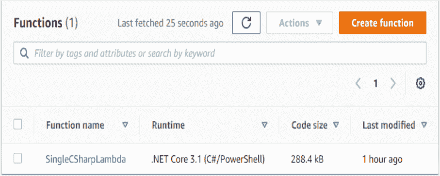
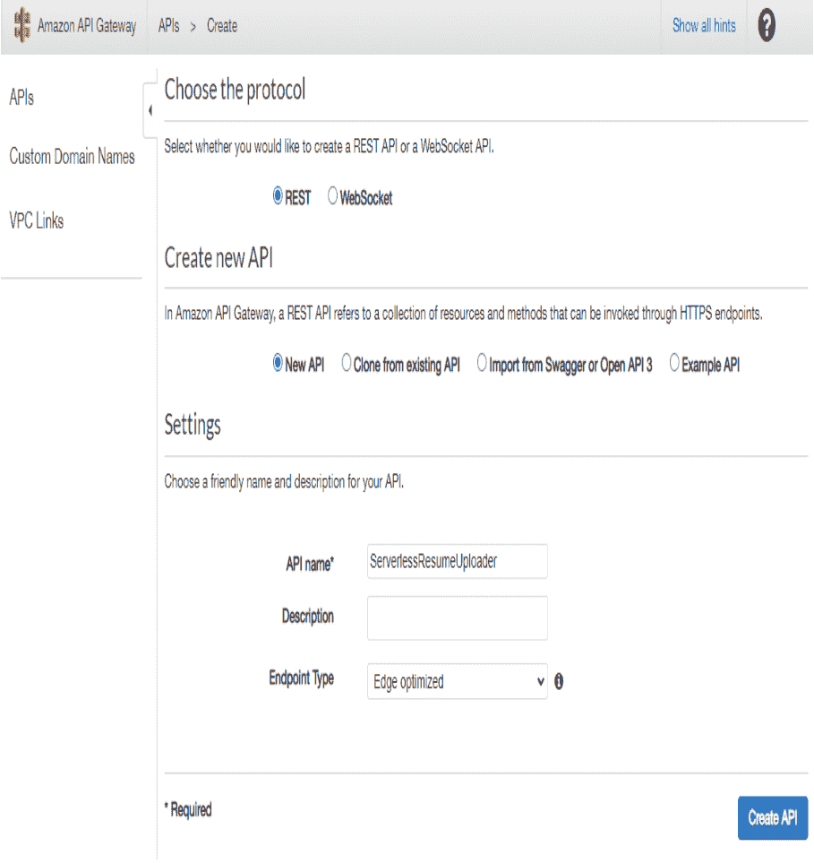
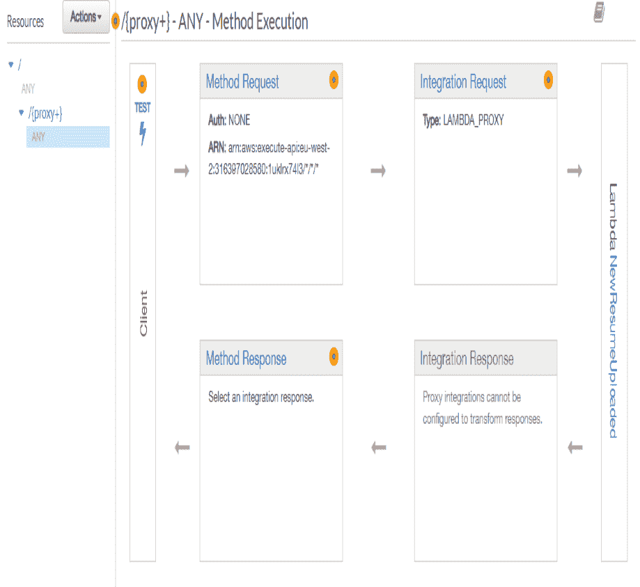
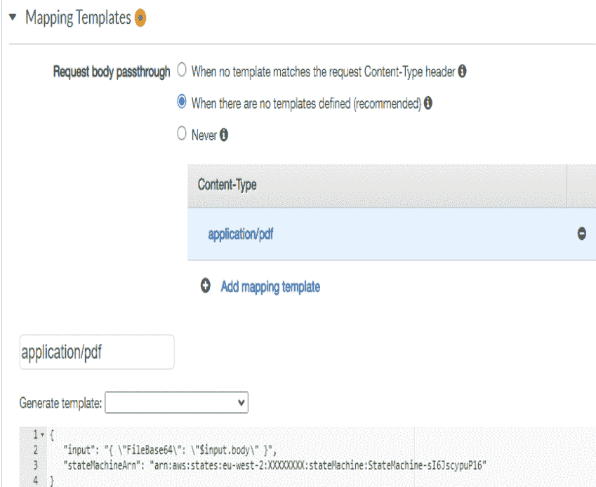
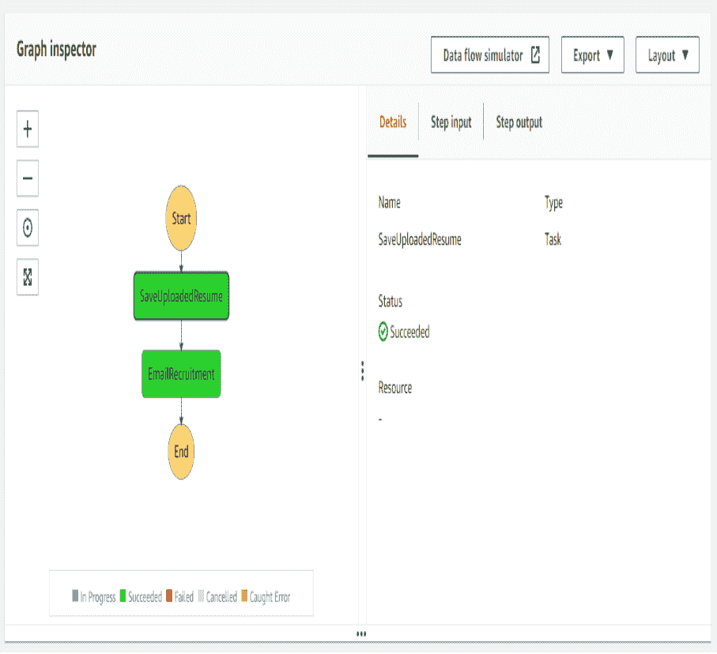
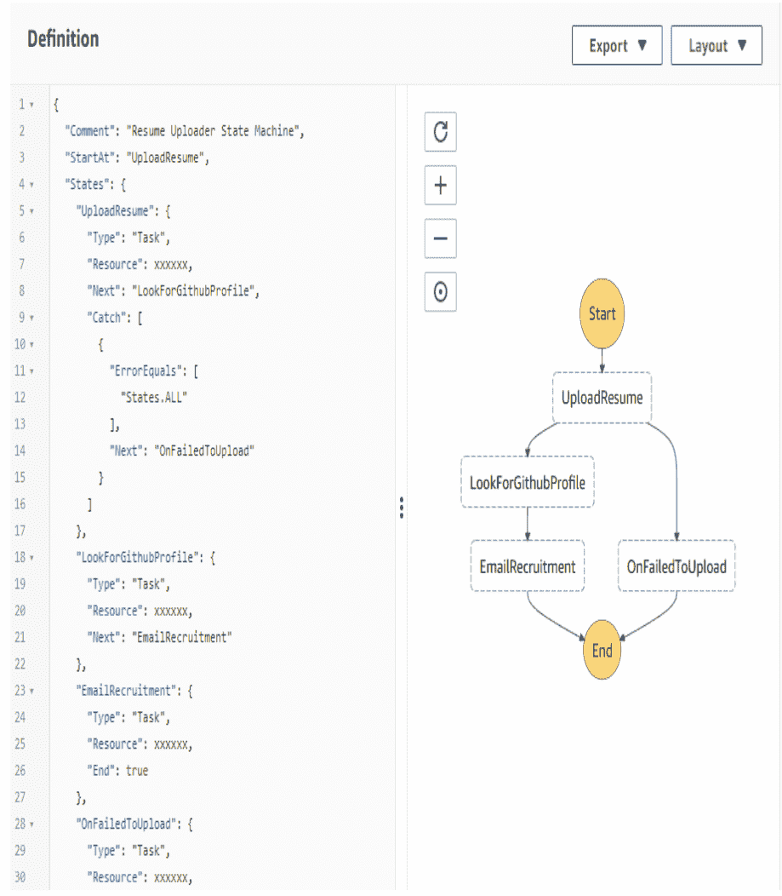
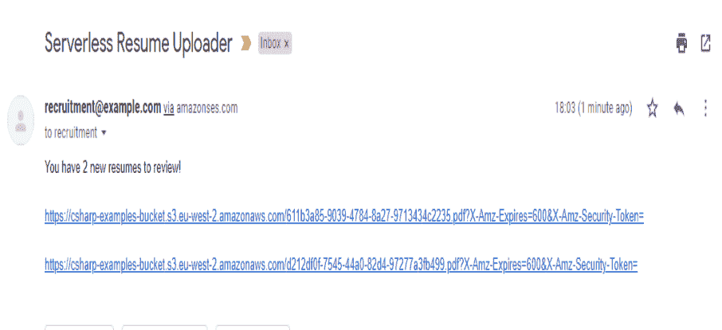
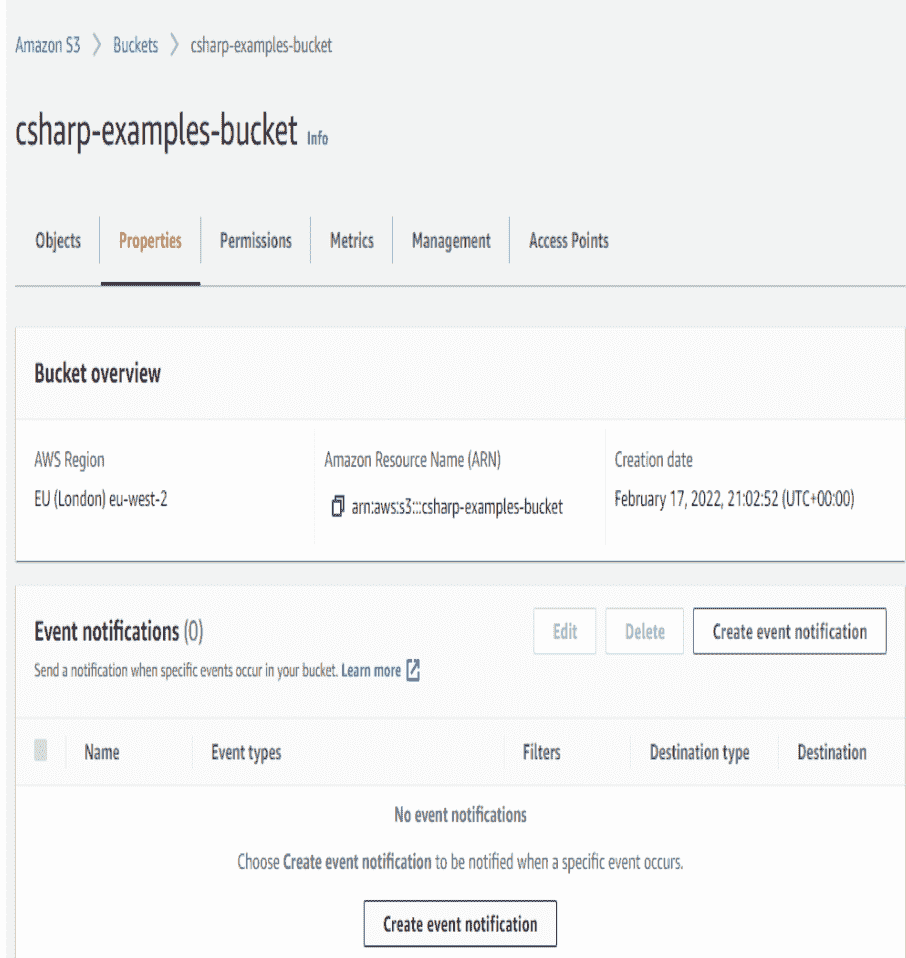

## 第 3 章. 将 .NET 应用程序现代化为无服务器

### 早期发布读者的说明

使用 Early Release 电子书，您可以在官方发布这些标题之前很久就获得书籍的早期形式——作者在撰写时的原始未编辑内容——以便您能够尽早利用这些技术。

这将是最终书籍的第 4 章。请注意，GitHub 仓库将在稍后激活。

如果您对如何改进本书的内容和/或示例有任何意见，或者如果您注意到本章中缺少材料，请联系编辑 mpotter@oreilly.com。

“无服务器”一词在软件工程圈中可能是一个令人困惑的来源。如何在没有服务器的情况下运行 Web 应用程序？这真的只是营销用语吗？嗯，在某种程度上，是的。无服务器计算是后端系统的广义术语，其架构设计为使用托管服务而不是手动配置的服务器。无服务器应用程序的“无服务器”与无线手机充电器“无线”相同。无线充电器仍然有线；它从充电器出来并插入市电插座，将能量从墙壁传输到桌面。无线部分只是充电器与手机之间的接口。“无服务器”一词在无服务器计算中以相同的方式使用。是的，有服务器，但它们都在幕后由 AWS 管理。服务器就像将无线充电器连接到墙上插座的电源线。另一侧，对我们开发者可见的部分，在部署和运行代码时真正重要的部分，


这部分不涉及任何服务器的配置或管理，因此是 *serverless* 的。

你很可能已经在某些任务中使用了无服务器计算。考虑三种流行的服务器类型：

- Web 服务器
- 电子邮件服务器
- 文件服务器

在这三种中，后两种是我们很早就开始用托管的无服务器解决方案替换的服务器。如果你曾经通过 API 调用向 Mailchimp、Mailgun、SendGrid、SparkPost，或确实是亚马逊的简单电子邮件服务（SES）发送过电子邮件，那么你就已经使用过无服务器的电子邮件解决方案了。对于许多组织来说，自行或在云中运行 SMTP 服务器的日子早已牢牢地留在过去了。文件服务器也正在逐渐过时，被无服务器文件存储解决方案所取代。许多现代 Web 应用程序完全依赖于云原生服务，例如亚马逊简单存储服务（S3）作为其文件的主要存储机制。上面列表中最后要倒下的那块石头是 Web 服务器。在本章中，我们将向你展示如何用无服务器的云原生实现替换你的 .NET Web 服务器，以及这对你编写代码的方式意味着什么。

### 无服务器 Web 服务器

Web 服务器是一台物理或虚拟的计算机，它永久连接到互联网，并且 24 小时随时准备响应 HTTP(S) 请求。HTTP 请求在 Web 服务器内部的生命周期涉及许多步骤，并且执行由许多不同方编写的代码以读取、转换和执行每个请求。就在这段旅程的正中间，是由你、应用程序开发者编写的代码。

为了复制 Web 服务器的功能，我们需要一种按托管且按需的方式运行该自定义逻辑的方法。AWS 为我们提供了几种方法，我们将查看一种服务，它允许我们在无需担心服务器的情况下部署完全托管的容器化应用程序。AWS Fargate 是另一种无服务器解决方案，用于按需付费定价模式运行 Web 服务器。这些服务将你的 Web 服务部署到云中，采用无服务器方式。然而，我们可以更进一步，将服务本身拆分为独立部署到云中的各个函数。为此，我们需要函数即服务（FaaS）。

FaaS 解决方案，例如 AWS Lambda，是由事件触发的无状态计算容器。你上传在事件发生时要运行的代码，云提供商将为你处理资源的配置、执行然后取消配置。这带来了两个主要优势：

- 1. FaaS 允许你的代码缩减到零。你只需为 *函数执行期间* 使用的资源付费，而中间的时间则无需付费。这意味着你可以编写遵循真正的按需付费定价模型的应用程序，只为每次函数执行付费，而不为两次执行之间的未使用时间付费。
- 2. FaaS 迫使你思考关注点的分离，并对你编写应用程序的方式施加限制，这通常会导致更好的代码。

> *简单是困难的工作。但回报巨大。拥有真正简单系统的人——一个由真正简单部分构成的系统——将能够以最少的工作产生最大的改变。他会击败你。他会在前期花费更多时间简化事物，从长远来看他会彻底击败你，因为他有在你挣扎着推动大象时改变事物的能力。*
> 
> —Rich Hickey，Clojure 编程语言的创建者

简单性与为 FaaS 编写代码相关意味着要针对事件，你希望保持上面第 1 点为真，以便句子“当 X 发生时执行 Y”对每次事件 X 发生时都成立。你还需要保持你的函数无状态（上面第 2 点）。这既是运行你的函数在托管 FaaS 上的限制，也是其特性。因为 AWS 可以并且会在你的函数执行之间取消配置资源，所以无法共享静态变量。如果你想在 FaaS 函数中持久化数据，你必须有意将其持久化到共享存储区，例如通过保存到数据库或 Redis 缓存。

将你的代码架构为这种无状态且无副作用的函数可能是一个需要纪律的挑战。它迫使你思考如何编写逻辑以及代码的每个区域实际被允许控制多少范围。它也迫使你思考关注点的分离。

当多个 FaaS 函数使用事件连接在一起并通过其他无服务器服务（例如消息队列和 API 网关）增强时，就有可能构建一个后端应用程序，它能够执行传统服务器上运行的传统 Web API 可以执行的任何功能。

这使你能够在 AWS 上编写完全无服务器的后端应用程序。最好的部分是，你可以用 C# 完成所有这些！AWS 提供了许多服务，你可以用它们作为此类无服务器应用程序的构建块，让我们来看看他们提供的一些组件。

### 为 .NET 在 AWS 上选择无服务器组件

我们将向你介绍 AWS 上最有用的一些无服务器服务，以及如何使用 AWS SDK for .NET 的各种包在你的代码中与这些服务交互。让我们在剩余的本章中逐步构建一个无服务器 Web 应用程序，随着每个新概念的引入而添加功能。

想象一下，我们经营一家软件开发咨询公司，正在招募最优秀、最聪明的 C# 开发者！为了让他们申请，我们希望他们访问我们的网站，在那里他们会找到一个 HTML 表单，允许他们上传简历的 PDF 文件。提交此表单会将他们的 PDF 简历发送到我们的 API，在那里它将被保存到文件服务器，并向我们的招聘团队发送一封电子邮件，请求他们审阅。 我们将称之为无服务器 C# 简历上传器。图 3-1 显示了架构的高级概述。

www.example.com

## 欢迎来到我们的网站！

在此上传你的简历

上传文件...

PDF 文件

C#

Web API

S3 存储桶

电子邮件

### 图 3-1. 无服务器 C# 简历上传器架构

我们后端当前实现使用 Web API 控制器操作来接受 PDF 文件上传，将其保存到云存储并向我们的招聘团队发送电子邮件。代码如下所示：

```
[ApiController]
[Route("[controller]")]
public class ApplicationController : ControllerBase
{
    private readonly IStorageService _storageService;
    private readonly IEmailService _emailService;

    public ApplicationController(IStorageService storageService, IEmailService emailService)
    {
        _storageService = storageService;
        _emailService = emailService;
    }

    [HttpPost]
    public async Task<IActionResult> SaveUploadedResume()
    {
        Request.EnableBuffering();
        using var fileStream = new MemoryStream();
        using var reader = new StreamReader(fileStream);
        await Request.Body.CopyToAsync(fileStream); ①

        var storedFileUrl = await
        _storageService.Upload(fileStream); ②

        await _emailService.Send("recruitment@example.com",
            $"Somebody has uploaded a resume! Read it here: {storedFileUrl}"); ③

        return Ok();
    }
}
```

① 从请求中读取上传的文件。
② 将其保存到云存储。
③ 向我们的招聘团队发送一封包含文件链接的电子邮件。

IStorageService 的代码如下所示：


```csharp
public class AwsS3StorageService : IStorageService
{
    const string BucketName = "csharp-examples-bucket";

    public async Task<string> Upload(Stream stream)
    {
        var fileName = Guid.NewGuid().ToString() + ".pdf"; ①

        using var s3Client = new AmazonS3Client(RegionEndpoint.EUWest2);

        await s3Client.PutObjectAsync(new PutObjectRequest()
        {
            InputStream = stream,
            BucketName = BucketName,
            Key = fileName,
        }); ②

        var url = s3Client.GetPreSignedURL(new GetPreSignedUrlRequest()
        {
            BucketName = BucketName,
            Key = fileName,
            Expires = DateTime.UtcNow.AddMinutes(10)
        }); ③

        return url;
    }
}
```
① 创建一个唯一 S3 键名。
② 将文件上传到 S3
③ 生成指向我们新文件的预签名 URL。¹

这使用了 AWSSDK.S3 NuGet 包将文件保存到 AWS S3 存储桶中。在此示例中，存储桶名为“csharp-examples-bucket”²，并且文件将被上传并使用 Guid.NewGuid() 赋予唯一键。

我们示例中的第二个服务是 IEmailService，它使用 AWS Simple Email Service (SES) 向招聘团队发送电子邮件。此实现使用了 AWS SDK 中的另一个 NuGet 包，名为 Amazon.SimpleEmail。

```csharp
public class AwsSesEmailService : IEmailService
{
    public async Task Send(string emailAddress, string body)
    {
        using var emailClient = new AmazonSimpleEmailServiceClient(
            RegionEndpoint.EUWest1);

        await emailClient.SendEmailAsync(new SendEmailRequest
        {
            Source = "from@example.com",
            Destination = new Destination
            {
                ToAddresses = new List<string> { emailAddress }
            },
            Message = new Message
            {
                Subject = new Content("Email Subject"),
                Body = new Body { Text = new Content(body) }
            }
        });
    }
}
```

我们将在本章其余示例中使用这两个实现。如前所述，通过使用 S3 保存 PDF 文件并通过 SES 发送电子邮件，我们已经在使用无服务器解决方案进行文件存储和电子邮件服务。那么让我们也去掉这个 Web 服务器，并将我们的控制器操作迁移到托管的云函数中。

### 使用 AWS Lambda 和 C# 开发

AWS 的 FaaS 产品称为 Lambda。AWS Lambda 由 Amazon 首席技术官 Werner Vogels 于 2014 年推出，我们认为以下总结很好地概括了 AWS Lambda 的动机和价值。

> 这里的重点是事件。事件可能由会触发这些事件的 Web 服务驱动。你将编写一些代码，比如用 JavaScript，然后它会在无需为其预配硬件的情况下运行。
> 
> ——Werner Vogels

自 2014 年以来，AWS Lambda 在采用率和功能方面都获得了巨大的增长。他们为触发函数添加了越来越多的事件选项，提供了像 Lambda@Edge 这样前沿的能力，该能力在离用户最近的 CDN 服务器上运行你的函数（即“边缘计算”），自定义运行时、用于库的共享内存层称为“Lambda 层”，以及对我们至关重要的，在 x86_64 和 ARM64 CPU 架构上都内置支持 .NET。

AWS 提供了大量关于用 C# 编写 Lambda 函数以及重构现有代码以便部署到 AWS Lambda 的示例。以下是利用 Amazon.Lambda.Templates nuget 包中的模板快速创建并部署 C# 简单 Lambda 函数的示例。该包包含可与 .NET Core CLI 上的 dotnet new 命令一起使用的项目模板。

```
dotnet new -i Amazon.Lambda.Templates

dotnet new lambda.EmptyFunction --name SingleCSharpLambda
```

这将创建一个名为“SingleCSharpLambda”的文件夹，其中包含函数的源项目和测试项目。示例函数位于名为 Function.cs 的文件中。

```csharp
[assembly: LambdaSerializer(typeof(Amazon.Lambda.Serialization.SystemTextJson.DefaultLambdaJsonSerializer))]

namespace SingleCSharpLambda
{
    public class Function
    {
        public string FunctionHandler(string input, ILambdaContext context)
        {
            LambdaLogger.Log("Hello from" + context.FunctionName);

            return input?.ToUpper();
        }
    }
}
```

模板创建了一个带有公共函数 `FunctionHandler(input, context)` 的类。这是 AWS Lambda 中每个 C# Lambda 函数入口点的 方法签名。两个参数是输入，其形状将根据我们将 Lambda 函数挂钩到的事件而定，以及 `ILambdaContext context`，该上下文由 AWS 在执行时生成，并包含有关当前正在执行的 Lambda 函数的信息。

我们还在上面的模板函数中添加了一行用于打印日志消息，以便我们可以在 AWS 上运行时检查其是否执行。这里的静态类 `LambdaLogger` 是 `Amazon.Lambda.Core` 包的一部分，该包随模板一起添加。你也可以在此处使用 `Console.WriteLine()`，AWS 会将写入 `stdout` 或 `stderr` 的任何调用发送到附加到你的函数的 CloudWatch³ 日志流。

现在我们可以将函数部署到 AWS。如果尚未安装，现在是获取 AWS Lambda .NET 全局工具的好时机。全局工具是一种特殊的 NuGet 包，你可以从 `dotnet` 命令行执行它。

```
dotnet tool install -g Amazon.Lambda.Tools
```

然后部署你的函数。

```
dotnet lambda deploy-function SingleCSharpLambda
```

如果 `aws-lambda-tools-defaults.json` 配置文件中尚未设置，你将被要求提供 AWS 区域以及你希望函数在执行时使用的 IAM 角色的 ARN。IAM 角色可以由 `Amazon.Lambda.Tools` 工具即时创建，其中包含所需的所有权限。你可以通过访问 IAM 控制台来查看和编辑此（或任何其他）IAM 角色的权限。

图 3-2 显示了我们在部署到的区域的 AWS 管理控制台中的示例函数。你可以从下一屏幕的“Test”选项卡直接在控制台中测试该函数。



图 3-2. AWS Lambda 控制台中的函数列表

此测试窗口（如图 3-3 所示）允许你在输入参数中输入一些 JSON 以传递给函数，该参数我们在前面定义过。由于我们将输入值声明为 `FunctionHandler(string input, ILambdaContext context)` 中的 string 类型

```
FunctionHandler(string input, ILambdaContext context)
```

我们应该将其更改为任意字符串，我们就可以直接在管理控制台中测试该函数。

Lambda > Functions > SingleCSharpLambda

## SingleCSharpLambda

Function overview Info

Code Test Monitor Configuration Aliases Versions

Execution result: succeeded (logs)

Details

The area below shows the last 4 KB of the execution log.

```
"TEST"
```

## Log output

The section below shows the logging calls in your code. Click here to view the corresponding CloudWatch log group.

```
START RequestId: 962f432c-d59a-4be2-be22-833dad082c3e Version: $LATEST
CONTEXT:
{"FunctionName":"SingleCSharpLambda","FunctionVersion":"$LATEST","LogGroupName":"/aws/lambda/SingleCSharpLam
```

## Test event

Invoke your function with a test event. Choose a template that matches the service that triggers your function, or enter your event document in JSON.

New event

Saved event

Template

hello-world

Name

MyEventName

```
"test"
```

图 3-3. 测试已部署的 Lambda 函数

你的执行结果会被插入到页面中，其中包括一个内联的“Log output”窗口，如图 3-3 所示。这使你能够快速查找和调试 Lambda 函数中的错误并进行手动测试。

### C# 简历示例：AWS Lambda

现在我们熟悉了 AWS Lambda，让我们将其应用到我们的无服务器示例中。我们将把 C# 简历上传器示例中的 Web API 控制器变成一个 AWS Lambda 函数。任何 Web API 控制器都可以使用 AWS 的一个名为 Amazon.Lambda.AspNetCoreServer.Hosting 的包部署到 AWS Lambda。该包使用 makes 使包装 .NET 控制器在 API Gateway 调用的 Lambda 函数中变得容易

> NOTE
> 
> API Gateway 是 AWS 的一项服务，使构建由 Lambda 函数组成的 API 成为可能。它提供了 HTTP 请求与 Lambda 函数之间的管道，使你能够配置一组单独的 Lambda 函数，以便在 API Gateway 中配置的 API 路由的 GET、PUT、POST、PATCH 和 DELETE 请求上运行。我们在此示例中使用 API Gateway 将路由 POST:https://our-api/Application 映射到 Lambda 函数。

要使用此方法将 ASP .NET 应用程序部署到 AWS Lambda，请安装 Amazon.Lambda.AspNetCoreServer 包，然后在应用程序的 services 集合中添加对 AddAWSLambdaHosting() 的调用⁴。这允许 API Gateway 和 AWS Lambda 在 Lambda 上运行时充当 Web 服务器。

```
var builder = WebApplication.CreateBuilder(args);

builder.Services.AddRazorPages();
```


// Add AWS Lambda support.
builder.Services.AddAWSLambdaHosting(LambdaEventSource.HttpApi);

app.MapRazorPages();

var app = builder.Build();

This is the only line we need to add.

Just as we did in “Developing with AWS Lambda and C#”, deploy this Lambda function to AWS using our new class as the entry point. We will have to create a JSON file for settings. If you have Visual Studio and the AWS Toolkit for Visual Studio installed, there are template projects you can try out that demonstrate how this JSON file is configured, so I’d urge you to give those a go. For our example here however, we are just going to deploy it straight to AWS Lambda.

```
dotnet lambda deploy-function UploadNewResume
```

Figure 3-4 shows the steps dotnet lambda deploy-function will take you through if you do not have all these settings configured in your JSON file. For the IAM role, we need to create a role with the policies in place to do all the things our resume uploader function will need to do (saving to S3, sending email via SES) along with invoking a Lambda function and creating CloudWatch log groups.

```
PS C:\> dotnet lambda deploy-function UploadNewResume

Created publish archive (D:\Code\CSharpBookExamples\Chapter4Example\PartOne-Lambda\ServerlessResumeUploader\bin\Release\netcoreapp3.1\ServerlessResumeUploader.zip).

Creating new Lambda function UploadNewResume
Select IAM Role that to provide AWS credentials to your code:
1) ResumeUploaderLambdaRole
2) *** Create new IAM Role ***
1
Enter Memory Size: (The amount of memory, in MB, your Lambda function is given)
256
Enter Timeout: (The function execution timeout in seconds)
30
Enter Handler: (Handler for the function <assembly>::<type>::<method>)
ServerlessResumeUploader::ServerlessResumeUploader.LambdaEntryPoint::FunctionHandlerAsync
New Lambda function created
```

Figure 3-4. Execution of dotnet lambda deploy-function in the console

Next we have to create an API Gateway service to attach our Lambda to the outside world. Later on in this chapter we will explore the AWS Serverless Application Model (SAM), which is a great way of creating and managing serverless resources such as API Gateway, using template files that can be checked in to source control. For now, however, I would recommend creating the API Gateway service using the AWS Management Console as shown in Figure 3-5. The AWS Management Console is a great way to explore and familiarize yourself with all the different settings and options of these managed AWS services so when you do come to keep these settings in template files you have an anchor point in your mind to how everything fits together.

### Choose the protocol

Select whether you would like to create a REST API or a WebSocket API.

### Create new API

In Amazon API Gateway, a REST API refers to a collection of resources and methods that can be invoked through HTTPS endpoints.

### Settings

Choose a friendly name and description for your API.

API name* ServerlessResumeUploader

Description

Endpoint Type Edge optimized

* Required



Figure 3-5. Creating an API in the API Gateway console

Figure 3-6 shows how we have set up an API Gateway service with a Lambda function proxy that forwards all routes to the AWS Lambda function we just deployed, UploadNewResume. You can test this out either by using the TEST tool in the console (shown on the left in Figure 3-6) or, better yet, by making an actual HTTP POST request with the PDF file in the body to the public URL of your API Gateway service. You can find the URL of API Gateway in the “Stages” setting in the management console. For example, my API Gateway instance has the id xxx1rx7413

and is in the eu-west-2 region. To upload a resume to our API we can execute a POST request to this using curl.

```
curl https://xxx1rx7413.execute-api.eu-west-2.amazonaws.com/Prod/Application
  --data-binary @MyResumeFile.pdf
```

This will upload our PDF file to API Gateway, which will pass it on to our Lambda function where our code will save it to S3 and send out an email.



Figure 3-6. API Gateway Lambda proxy setup

All this has been possible by wrapping our API controller in the APIGatewayProxyFunction class and deploying to AWS Lambda as a cloud function, next we are going to explore what is possible when we add multiple Lambda functions to perform more complex and granular tasks in our applications.

### Developing with AWS Step Functions

By this point we have deployed a web API controller to a Lambda function and hooked it up to API Gateway so it can be called via HTTP requests. Next let’s think about what we can do to really take advantage of our new function as a service execution model. Remember how we spoke about FaaS forcing you to be more intentional about separation of concerns? The function in our example is doing quite a lot. This is often the case with API controller actions in any language, not just C# - they do tend to assume multiple responsibilities at once. Our UploadNewResume() is doing a lot more than simply uploading a resume, it is emailing the recruitment team and it is creating a new file name. If we want to further unlock some of the flexibility of serverless and FaaS we need to split these operations out into their own functions. AWS has a very neat tool for managing workflows involving multiple Lambda functions (and more) and it is called AWS Step Functions.

AWS Step Functions abstracts away the plumbing between steps in your workflow. We can take a look at the controller action from our previous example and see how much of this code is just plumbing.

```
[HttpPost]
public async Task<IActionResult> SaveUploadedResume()
{
    Request.EnableBuffering();
    using var fileStream = new MemoryStream();
    using var reader = new StreamReader(fileStream);
    await Request.Body.CopyToAsync(fileStream); ①

    var storedFileUrl = await _storageService.Upload(fileStream);
    ②
```

```
await _emailService.Send("recruitment@example.com", $"Somebody has uploaded a resume! Read it here: {storedFileUrl}");

return Ok();
```

- 1. Moving bits around between memory streams.
- 2. Executing a function on the storage service.
- 3. Executing a function on the email service.
- 4. Creating an HTTP response with code 200.

This function is doing four things, none of which are particularly complex, however all of which make up the business logic (or “workflow”) of our back end API. It also does not really respect the single responsibility principle. The function is called SaveUploadedResume() so you could argue that its single responsibility should be inserting the resume file into S3. Why then, is it sending emails and constructing HTTP responses?

If you were to write unit tests for this function it would be nice to simply cover all the cases you would expect to encounter when “saving an uploaded resume”. Instead, you have to consider mocking out email sending and the boilerplate needed to execute an API controller action in a unit test. This increases the scope of the function and increases the number of things you need to test, ultimately increasing the friction involved in making changes to this piece of code.

Wouldn’t it be nice if we could reduce the scope of this function down to truly having one responsibility (saving the resume) and split out email and HTTP concerns into something else?

With AWS Step Functions you can move some or all of that workflow out of your code and into a configuration file. Step Functions uses a bespoke JSON object format called Amazon States Language to build up what it calls the State Machine. These state machines in AWS Step Functions are triggered by an event and flow through the steps configured in the definition file, executing tasks and passing data along the workflow until an end state is reached.

We are going to refactor our Serverless C# Resume Uploader to use Step Functions in the next section but suffice to say, one of the major advantages of using step functions is the ability to develop the *plumbing* of your application separately to the individual functions. Figure 3-7 is a screenshot from the AWS Step Functions sections in the AWS management console with the section “Execution event history” showing the operations this execution of the state machine took to arrive at the end state.


## StateMachineExecution0001

编辑状态机

新建执行

停止执行

详细信息

执行输入

执行输出

定义

执行状态

成功

开始时间

Feb 18, 2022 06:01:00.070 PM

结束时间

Feb 18, 2022 06:01:00.410 PM

### 执行事件历史

| ID | 类型 | 步骤 | 资源 | 经过时间 (ms) | 时间戳 |
|---|---|---|---|---|---|
| 1 | ExecutionStarted |  | - | 0 | Feb 18, 2022 06:01:00.070 PM |
| 2 | TaskStateEntered | UploadResume | - | 71 | Feb 18, 2022 06:01:00.141 PM |
| 3 | LambdaFunctionScheduled | UploadResume | Lambda | CloudWatch Logs | 71 | Feb 18, 2022 06:01:00.141 PM |
| 4 | LambdaFunctionStarted | UploadResume | Lambda | CloudWatch Logs | 119 | Feb 18, 2022 06:01:00.189 PM |
| 5 | LambdaFunctionSucceeded | UploadResume | Lambda | CloudWatch Logs | 278 | Feb 18, 2022 06:01:00.348 PM |
| 6 | TaskStateExited | UploadResume | - | 278 | Feb 18, 2022 06:01:00.348 PM |
| 7 | TaskStateEntered | QueueEmail | - | 289 | Feb 18, 2022 06:01:00.359 PM |
| 8 | TaskScheduled | QueueEmail | - | 289 | Feb 18, 2022 06:01:00.359 PM |
| 9 | TaskStarted | QueueEmail | - | 300 | Feb 18, 2022 06:01:00.370 PM |
| 10 | TaskSucceeded | QueueEmail | - | 340 | Feb 18, 2022 06:01:00.410 PM |
| 11 | TaskStateExited | QueueEmail | - | 340 | Feb 18, 2022 06:01:00.410 PM |
| 12 | ExecutionSucceeded |  | - | 340 | Feb 18, 2022 06:01:00.410 PM |

图 3-7. 管理控制台中的 Step Functions 执行日志

### C# 简历上传示例：Step Functions

为了演示我们使用 AWS Step Functions 能做什么，让我们取出上一部分简历上传示例中创建的 AWS Lambda 函数，并将其从一个拆分为多个 Lambda 函数。UploadNewResume Lambda 函数可以仅负责将文件上传到 S3，然后我们再有一个第二个 Lambda 来发送电子邮件（EmailRecruitment）。HTTP 部分也可以完全抽象出来并由 API Gateway 处理。这给了我们在这两个函数开发、测试并部署之后，仍然能够在后端更灵活地更改或优化工作流

```
[assembly:
LambdaSerializer(typeof(Amazon.Lambda.Serialization.SystemTextJson.
    DefaultLambdaJsonSerializer))]

namespace ServerlessResumeUploader
{
    public class LambdaFunctions
    {
        private readonly IStorageService _storageService = new AwsS3StorageService();
        private readonly IEmailService _emailService = new AwsSesEmailService();

        ①
        public async Task<StepFunctionsState>
UploadNewResume(StepFunctionsState state,

ILambdaContext context)
        {
            byte[] bytes =
Convert.FromBase64String(state.FileBase64);
            using var memoryStream = new MemoryStream(bytes);

            state.StoredFileUrl = await
_storageService.Upload(memoryStream);

            state.FileBase64 = null;
```

```
return state;
}
public async Task<StepFunctionsState>
EmailRecruitment(StepFunctionsState state,
ILambdaContext context)
{
    await _emailService.Send("recruitment@example.com",
        $"Somebody uploaded a resume! Read it here:
{state.StoredFileUrl}\n\n" +
        $"...and check out their Github profile:
{state.GithubProfileUrl}");

    return state;
}
}
```

第一个 Lambda 函数接收文件并保存到 S3。
第二个 Lambda 向我们的招聘团队发送文件链接的电子邮件。

你可以看到这段代码与本章前面 ApplicationController 代码非常相似，只是被重构为 LambdaFunctions 类上的两个方法。
这将作为两个独立的 AWS Lambda 函数部署，使用相同的二进制文件，这是一种部署共享代码的多个 Lambda 函数的常见方式。实际的上传和发送电子邮件仍然由 AwsS3StorageService 和 AwsSesEmailService 执行，不过我们不再使用依赖注入⁵。另请注意，对于这两个函数，第一个参数现在是 state，并且两者都是 StepFunctionsState 类型。AWS Step Functions 通过在每个任务之间传递状态对象来执行你的工作流（在此情况下任务即函数）。函数会向状态添加或删除属性。我们上面函数的状态看起来像这样：

```
public class StepFunctionsState
{
    public string FileBase64 { get; set; }

    public string StoredFileUrl { get; set; }
}
```

当此状态输入传递给第一个函数 UploadNewResume() 时，它将具有由 API Gateway 从我们前端的 HTTP POST 请求设置的 state.FileBase64。函数会将此文件保存到 S3，然后在传递状态对象到下一个函数之前设置 state.StoredFileUrl。它还会从状态对象中清除 state.FileBase64。状态对象在 AWS Step Functions 中在每个步骤之间传递，由于此 base 64 字符串会相当大，我们在读取后将其设为 null 以减小传递的状态对象的大小。

我们可以像之前一样将这两个函数部署到 AWS Lambda，不过这次我们需要为每个函数指定 --function-handler 参数。函数处理程序是我们代码中充当 Lambda 入口点的 C# 函数，如“使用 AWS Lambda 和 C# 开发”中所述。

```
dotnet lambda deploy-function UploadNewResume
  --function-handler
  ServerlessResumeUploader::ServerlessResumeUploader.
    LambdaFunctions::UploadNewResume
```

```
dotnet lambda deploy-function EmailRecruitment
  --function-handler
  ServerlessResumeUploader::ServerlessResumeUploader.
    LambdaFunctions::EmailRecruitment
```

现在如果我们进入 AWS Step Functions，我们可以创建一个新的状态机，将这两个 Lambda 连接起来并连接到 API Gateway。AWS 管理控制台确实为我们提供了图形用户界面来构建这些工作流，不过，我们是工程师，所以我们将以 Amazon States Language 在 JSON 文件中编写它。这也具有至关重要的好处，即利用可以签入源代码控制的纯文本 JSON 文件，为我们提供了一个很好的基础设施即代码（IaC）部署模型。这里我们简单工作流的 JSON 配置如下所示：

```
{
  "Comment": "Resume Uploader State Machine",
```

```
"StartAt": "SaveUploadedResume",
"States": {
    "SaveUploadedResume": {
        "Type": "Task",
        "Resource": "arn:aws:lambda:eu-west-2:00000000:function:UploadNewResume",
        "Next": "EmailRecruitment"
    },
    "EmailRecruitment": {
        "Type": "Task",
        "Resource": "arn:aws:lambda:eu-west-2:00000000:function:EmailRecruitment",
        "End": true
    }
}
```

Lambda 函数的 ARN（Amazon 资源名称）可以在管理控制台的 AWS Lambda 部分找到，它允许我们从 AWS 中的任何地方引用这些 Lambda 函数。如果我们将上面的 JSON 复制到 AWS Step Functions 状态机的定义中，你可以在控制台中看到它为我们创建了工作流的图形表示。本章稍后的图 3-11 显示了它看起来是什么样子。

此示例的最后一步是将我们状态机的开始连接到 API Gateway。以前 API Gateway 配置为将所有请求代理到我们的 AWS Lambda 函数，现在我们希望在 API Gateway 中指定确切的路由并将其转发到我们的 Step Functions 工作流。图 3-8 显示了名为 /applications 的 POST 端点的设置，其 AWS 服务设置为“Step Functions”。你也可以在图 3-8 中看到我们已将内容处理设置为“Convert to text (if needed)”。这是专门针对这里简历上传示例的一个选项。由于我们将以原始二进制形式向 API POST PDF 文件，此选项告诉 API Gateway 将其转换为 Base64 文本供我们使用。然后它可以轻松地添加到我们的状态对象（前面显示的 StepFunctionsState.cs 所表示）并在 AWS Step Functions 工作流的 Lambda 函数之间传递。

## /application - POST - 设置

选择新方法的集成点。

集成类型
Lambda Function
HTTP
Mock
AWS Service
VPC Link

AWS 区域
eu-west-2

AWS 服务
Step Functions

AWS 子域

HTTP 方法
POST

操作类型
使用操作名称
使用路径覆盖

操作
StartExecution

执行角色
arn:aws:iam::XXXXXXXXXX:role/MyLambdaRole

内容处理
Convert to text (if needed)

使用默认超时

保存

图 3-8. 用于触发 Step Functions 的 API Gateway 配置

最后，我们可以在 API Gateway 中设置一些请求映射，以将请求转换为告诉 AWS Step Functions 哪个状态


machine to execute. That is shown in Figure 3-9 as a mapping template linked to the application/pdf content type header.



Figure 3-9. Content type mapping for PDF file

We now have everything in place to send a file to our API and watch the step functions workflow execute.

```
curl https://xxx1rx7413.execute-api.eu-west-2.amazonaws.com/Prod/Application
  --data-binary @MyResumeFile.pdf
```

If we navigate to the Executions tab of the AWS Step Functions state machine in the management console we will be able to see this upload trigger an execution of our state machine. Figure 3-10 shows a visual representation of the execution as it goes through our two steps, you can see this graph by clicking on the latest execution.

## Graph inspector

Data flow simulator

Export

Layout

Details

Step input

Step output

Name

Type

SaveUploadedResume

Task

Status

Succeeded

Resource

-



Figure 3-10. Successful execution of our state machine

We will admit, this has seemed like a lot of work just to save a file to S3 and send an email. By this point you might be from this will be an array of text blocks that were extracted from the PDF file. If any of these text blocks contains the string “github.com” we add it into our state object for use by a later Lambda function. This allows us to include it in the email that is sent out, for example.

```
public async Task<StepFunctionsState>
EmailRecruitment(StepFunctionsState state,

ILambdaContext context)
{
    await _emailService.Send("recruitment@example.com",
        $"Somebody uploaded a resume! Read it here:
{state.StoredFileUrl}\n\n" +
        $"...check out their Github profile:
{state.GithubProfileUrl}"); 

    return state;
}
```

① The stored file URL has still been left in the state object from the first function that saved it to S3

② This new field was added by LookForGithubProfile() when Textract found a GitHub URL in the PDF

We can deploy our new LookForGithubProfile() function as a third AWS Lambda and add it into our state machine JSON. We have also added an error handler in here that calls off to a function to notify us that there was an error uploading the resume. There are many different steps and ways to

create complex paths in your workflow using Amazon States Language JSON definitions. Figure 3-11 shows all of this together in the AWS Management Console with our definition JSON on the left and a visual representation of our workflow on the right.



Figure 3-11. Workflow definition and graphical representation in AWS Step Functions

We can also update our architecture diagram to remove the web server shown in Figure 3-1 and make the application completely serverless as illustrated in Figure 3-12

www.example.com

## Welcome to our Website!

Upload your resume here

Upload File...

PDF File

API Gateway

Step Functions

Lambda

Textract

Lambda

S3 Bucket

Email

Figure 3-12. Serverless C# Resume Uploader Architecture

Now we have a truly serverless application in which the individual components can be developed, tested and deployed independently. But what if we don’t want to rely on AWS Step Functions to bind all this logic together?

## Developing with SQS and SNS

AWS Step Functions are not the only way to communicate between AWS Lambda invocations and other serverless services. Long before Step Functions state engines existed we had message queues and the publisher/subscriber pattern. These are the two services offered by AWS, which are spelled out in detail below.

Amazon Simple Notification Service (SNS)

SNS is a distributed implementation of the pubsub pattern. Subscribers attach themselves to an SNS channel (called a “topic”) and when a message is published all subscribers will instantly be notified. You can have multiple subscribers listening to published messages on any given topic in SNS and it supports several endpoints such as email and SMS, as well as triggering Lambda functions or making HTTP requests.

Amazon Simple Queue Service (SQS)

SQS is AWS’s message queue. Instead of being pushed to subscribers, messages sent to SQS are added to the queue and stored there for a duration of time (up to 14 days). Message receivers poll the queue at a rate suitable for them, reading and then deleting the messages from the queue as necessary. SQS queues make it possible to delay actions or batch up messages until the subscriber is ready to handle them.

These two services allow us to think in terms of messages and events, which are important concepts for building serverless systems. They will allow us to implement a publisher/subscriber pattern in our example system.

## C# Resume Uploader Example: SQS

Think about what we can do with our Serverless C# Resume Uploader application to take advantage of SQS or SNS. We know users can upload their resume to our API (via API Gateway) which will store it in S3 and then use Textract to read the candidate’s GitHub profile. How about instead of immediately then emailing our recruitment team we add a message to a queue? That way we can run a job once every morning and send *one* email for *all* the messages that have built up on the queue during the past 24 hours. This might make it easier for our recruitment team to sit down and read all of the day’s resumes at once instead of doing it piecemeal throughout the day. Can we do all of this without having to touch the rest of our code? Without having to rebuild, re-test or redeploy the entire application? Yes, and here’s how.

Since we are using AWS Step Functions we can simply create a task in our definition JSON file that posts a message to an SQS queue. We don’t need another Lambda function to do this, instead we can specify the message body directly in the JSON and then update our state engine definition. Here we have the task called "QueueEmail" that posts a message to an SQS queue we have set up called UploadedResumeFiles, referenced here by its ARN.

```
{
  "Comment": "Resume Uploader State Machine",
  "StartAt": "SaveUploadedResume",
  "States": {
    "SaveUploadedResume": {
      "Type": "Task",
      "Resource": "arn:aws:lambda:eu-west-2:00000000:function:UploadNewResume",
      "Next": "QueueEmail"
    },
    "QueueEmail": {
      "Type": "Task",
      "Resource": "arn:aws:states:::sqs:sendMessage",
      "Parameters": {
        "QueueUrl": "https://sqs.eu-west-2.amazonaws.com/00000000/UploadedResumeFiles",
        "MessageBody": {
```


```
"StoredFileUrl.$": "$.StoredFileUrl"
}
},
"End": true
}
}
}
```

现在当我们从文件上传触发状态机时，EmailRecruitment Lambda 将不会被执行，我们只会得到一条发布到队列的消息。我们现在需要做的就是编写一个新的 AWS Lambda 函数，每天运行一次，读取队列中的所有消息并发送一封包含所有文件 URL 的电子邮件。这样的 Lambda 代码可能如下所示：

```
public async Task<string> BatchEmailRecruitment(object input, ILambdaContext context)
{
    using var sqsClient = new AmazonSQSClient(RegionEndpoint.EUWest2);
    var messageResponse = await sqsClient.ReceiveMessageAsync(
        new ReceiveMessageRequest() ①
        {
            QueueUrl = queueUrl,
            MaxNumberOfMessages = 10
        });

    var stateObjects = messageResponse.Messages.Select(msg => Deserialize(msg.Body));

    var listOfFiles = string.Join("\n\n", stateObjects.Select(x => x.StoredFileUrl)); ②

    await _emailService.Send("recruitment@example.com", ③
        $"You have {messageResponse.Messages.Count} new resumes to review!\n\n"
        + listOfFiles);

    await sqsClient.DeleteMessageBatchAsync(new DeleteMessageBatchRequest() ④
    {
        QueueUrl = queueUrl,
        Entries = messageResponse.Messages.Select(x => new DeleteMessageBatchRequestEntry()
```
```
{
    Id = x.MessageId,
    ReceiptHandle = x.ReceiptHandle
}).ToList()
});

return "ok";
}
```

- 1. 连接到 SQS 队列并读取一批消息。
- 2. 拼接我们在每条消息中发布的状态对象的 file URLs。
- 3. 发送一封包含所有链接的电子邮件。
- 4. 从队列中删除消息 - 这不会自动发生。

可以通过 AWS EventBridge 如图 3-13 所示每天触发一次此 Lambda。此 *Add Trigger* 表单可从 AWS 管理控制台中我们新 Lambda 函数的 *Function Overview* 窗口访问。

## Lambda > Add trigger

## Add trigger

## Trigger configuration

EventBridge (CloudWatch Events)
aws events management-tools

## Rule

Pick an existing rule, or create a new one.

Create a new rule

Existing rules

## Rule name*

Enter a name to uniquely identify your rule.

OncePerDayTestRule

## Rule description

Provide an optional description for your rule.

## Rule type

Trigger your target based on an event pattern, or based on an automated schedule.

Event pattern

Schedule expression

## Schedule expression*

Self-trigger your target on an automated schedule using Cron or rate expressions. Cron expressions are in UTC.

cron(0 12 * * ? *)

Lambda will add the necessary permissions for Amazon EventBridge (CloudWatch Events) to invoke your Lambda function from this trigger. Learn more about the Lambda permissions model.

Cancel

Add

Figure 3-13. Adding a scheduled EventBridge trigger to a Lambda function

现在我们的系统将每天发送一次电子邮件，其中包含队列中所有简历的链接，就如图 3-14 所示。



Figure 3-14. Email sent from our scheduled Lambda function

通过添加 SQS 队列，我们在运行时修改了系统的行为，并通过将所有链接汇总到一封每日电子邮件中提高了其提供的服务。所有这些仍然是由对我们 API 的 HTTP 请求触发的。接下来我们将探索可以触发状态引擎中逻辑和函数运行的其他类型的事件。

## Developing Event-Driven Systems with AWS Triggers

想象你与某人交谈，他有一个构建应用的绝妙想法，想让你为他构建。你请他描述功能，他说类似这样的话

> “当用户上传照片时，我想通知他们的关注者，当他们向我的支持邮箱发送电子邮件时，我想打开一个支持工单”

这些“当 X 发生时执行 Y”的陈述描述了一个事件驱动系统。所有系统在底层都是事件驱动的，问题在于对于许多后端应用程序来说，那些事件只是 HTTP 请求。不是“当用户上传照片时，我想通知他们的关注者”。我们通常实现的是，“当我们的服务器收到指示用户已上传照片的 HTTP 消息时，通知他们的关注者”。

这可以理解，在无服务器计算出现之前，实现这一点的唯一方法就是监听 API 上的 HTTP 事件。但如果我们可以去掉这一步，并实现我们的架构以响应真正发生的事件，而不是某些中间实现细节，例如 HTTP 请求，那不是很好吗？

这是事件驱动无服务器系统的核心原则。你在真正对解决问题有意义的变更上执行函数并触发工作流。不是编写一个监听人类操作然后发送 HTTP 请求到 API 以触发效果的应用程序，而是让 AWS 处理所有这些，并直接将事件附加到操作上。在上面的示例中，你可以监听 S3 中的 s3:ObjectCreated:Post 并在该事件发生时运行代码，完全绕过 API 步骤。

## C# Resume Uploader Example: Event-Driven

让我们最后一次访问我们的无服务器简历上传器。如果回顾图 3-12，你可以看到 PDF 文件从我们的网站通过 API Gateway 进入 Step Functions 任务。API Gateway 完全没有必要，它只是一个实现细节，允许我们的前端在上传文件时轻松进行 HTTP 调用。如果我们能摆脱这个 API，让网站直接将文件上传到 S3 存储桶，不是很好吗？这也将使我们能够丢弃 UploadNewResume Lambda 函数，而在软件开发中，没有什么比在保留系统所有功能的同时删除不再需要的代码更令人振奋的感觉了。

通过移除 API 步骤并让前端直接将文件上传到 S3，我们也为系统打开了新的可能性。例如，如果除了在网站上上传简历外，我们还想接受发送到 application@ouremail.com 的电子邮件简历？使用 SES，设置一个电子邮件转发器相对简单，它将提取附件的 PDF 文件并保存到 S3。这将触发后端相同的 workflow，因为我们已将逻辑连接到 S3 事件，而不是某个中间 HTTP API 调用。语句“当我们在 S3 中看到新的 PDF 文件时，启动我们的 workflow”对我们解决的业务问题来说自然得多。PDF 文件如何进入那里已经不再重要，我们的系统以相同的方式做出反应。

就直接将 PDF 文件上传到 S3 而言，我们有选择。如果我们已经在前端使用 AWS Amplify⁷，那么我们可以使用 Storage 模块和 "protected" 上传方法，基于经过身份验证用户的 Cognito Identity 限制对 S3 存储桶中路径的访问：

```
amplify add storage
```

用于将文件上传到 S3 的前端 JavaScript 看起来像这样：

```
import Amplify, { Auth, Storage } from 'aws-amplify';

Amplify.configure({ Storage: { AWSS3: {
    bucket: '<bucket-name>'
  } } });

async function uploadFile(fileName, file) {
  await Storage.put(fileName, file, { level: 'protected',
    contentType: file.type });
}
```

即使没有 AWS Amplify 和前端的经过身份验证的用户，仍然有一种方法可以直接上传到 S3 存储桶，使用 Pre-Signed URL。此过程是创建一个位于 API 网关后面的 Lambda 函数，当执行时，将调用 AmazonS3Client.GetPreSignedURL() 并将其返回给前端用于上传文件。当然，在这种情况下你仍然有一个 API，但此 API 的功能更符合执行一个通用任务。你毕竟可以使用预签名 URL 在前端上传其他类型的文件并将多个 step function workflow 挂钩到每个文件上。


一旦前端直接将文件上传到 S3 而不是通过 Web API 发送，添加 S3 存储桶的触发器就可以直接在管理控制台中，在 S3 存储桶配置的 Properties 选项卡上完成，如图 3-15 所示。



图 3-15. 向 S3 存储桶添加事件通知

将 Step Functions 状态引擎添加为此事件的目的地，我们就得到了最终形式的事件驱动、无服务器 C# 简历上传服务！最终架构如图 3-16 所示。

www.example.com

## Welcome to our Website!

Upload your resume here

Upload File...

PDF File

S3 Bucket

s3:ObjectCreated Event

Step Functions

Textract

Lambda

Email

图 3-16. 我们简历上传示例的最终事件驱动架构

正如你所见，我们现在拥有一个简洁、描述性强且事件驱动的系统，其动态性足以让我们在不冒着在其他地方引入错误或问题的风险的情况下扩展或修改工作流的各个部分。最后需要考虑的是，我们如何管理所有这些 moving parts 并在同一位置轻松配置它们。

### Serverless Application Model (SAM)

到目前为止，我们一直通过登录 AWS 管理控制台并在 UI 中点击来完成所有配置更改。这对于实验来说是可以的，但并不是特别适合运行生产系统的方法。一次错误的点击就可能导致应用程序的一部分出现中断。这就是基础设施即代码（IaC）可以提供帮助的地方。

基础设施即代码是通过机器可读的定义文件配置你的无服务器基础设施的过程。CloudFormation 是 AWS 中使用的 IaC 工具，允许你将整个云配置保存在 YAML 或 JSON 文件中。你 AWS 中的几乎所有内容都可以在 CloudFormation 模板中建模，从 DNS 设置到 S3 存储桶属性再到 IAM 角色和权限。当需要更改设置时，你只需更改 CloudFormation 模板中的值并告诉 AWS 将更改应用到你的资源。最明显的好处是，你可以将模板 JSON/YAML 文件检入版本控制，并像对任何其他代码更改一样，对每次更改进行代码审查、审计，并在沙箱/暂存环境中进行测试。

然而，CloudFormation 的一个缺点是它可能相当复杂且冗长。由于可以在 AWS 资源中修改的设置数量庞大，当尝试配置由多个 Lambda 函数、消息队列和 IAM 角色组成的无服务器系统时，CloudFormation 模板可能会变得难以管理。有各种工具在 CloudFormation 周围添加抽象层并帮助配置无服务器系统。诸如 Serverless Framework 和

Serverless Application Model (SAM) 等工具就是为了解决这个问题而创建的。

你可以将 SAM 视为 CloudFormation 顶层的层，将无服务器应用程序最相关的设置带到前面。你可以在 AWS SAM 文档 上线找到 SAM 的完整规范，但为了给你一个概述，这里是我们 C# 简历上传系统的 SAM YAML 文件的一部分。

```
AWSTemplateFormatVersion: '2010-09-09'
Transform: AWS::Serverless-2016-10-31
Description: Resume Uploader Serverless C# Application.
Resources:
  SaveUploadedResumeLambda:
    Type: AWS::Lambda::Function
    Properties:
      Handler:
ServerlessResumeUploader::ServerlessResumeUploader.
      LambdaFunctions::SaveUploadedResume
      Role: arn:aws:iam::0000000000:role/ResumeUploaderLambdaRole
      Runtime: dotnetcore3.1
      MemorySize: 256
      Timeout: 30
  LookForGithubProfileLambda:
    Type: AWS::Lambda::Function
    Properties:
      Handler:
ServerlessResumeUploader::ServerlessResumeUploader.
      LambdaFunctions::LookForGithubProfile
      Role: arn:aws:iam::0000000000:role/ResumeUploaderLambdaRole
      Runtime: dotnetcore3.1
      MemorySize: 256
      Timeout: 30
```

你可以看到我们如何定义 SaveUploadedResumeLambda 和 LookForGithubProfileLambda Lambda 函数，指明 C# 代码中入口点的位置，并为其执行配置内存、超时和权限设置。

使用这样的 SAM 文件配置你的基础设施后，你可以轻松部署用于测试或暂存的新环境。你受益于代码审查，并且可以为你的 *resources* 创建与应用程序代码类似的自动化部署管道。

### Conclusion

无服务器计算允许你构建复杂但灵活且可扩展的解决方案，采用按需付费的定价模式，并且可以缩减到零。个人而言，每当我们需要快速构建东西来验证一个想法、解决业务问题或预算有限时，我们都会使用无服务器执行模型。因为你只为所使用的付费，以 AWS Lambda 为中心的无服务器架构可以成为构建最小可行产品（MVP）或部署移动应用后端的一种极低成本的方式。AWS 提供每月高達 100 万次 Lambda 执行的免费额度，这足以让一家初创公司走出想法阶段或对产品进行 Beta 测试。本章中我们介绍的其他服务也都有非常慷慨的免费层，允许你在不破产的情况下尝试想法和架构。

话虽如此，无服务器并不会自动使你的系统运行成本更低。你需要考虑设计应用程序，避免不必要的大量 AWS Lambda 调用。仅仅因为两个函数 *可以* 是两个独立的 Lambda，并不总是意味着从成本和性能角度来看它们 *应该* 是。实验并测量。在较高负载下，函数即服务也可能很昂贵，如果你的应用程序没有架构成高效利用每次调用。 因为你按执行付费，在非常高的负载下，你可能会发现成本飙升远远超过简单地在 EC2 或 ElasticBeanstalk 上运行 `dotnet` 进程的成本。无服务器的成本应始终与可扩展性等其他优势相权衡。

无服务器架构的另一个巨大优势是灵活性，正如本章的示例所示。在每一步中，我们都通过非常小的更改彻底改变了 Serverless C# Resume Uploader 的一部分架构——大多数时候甚至无需重新部署应用程序的其余部分。这种系统 moving parts 之间的分离使增长变得更加容易，并解锁了开发团队内部人才的多样化。无服务器架构中没有任何内容规定各个组件使用什么版本、技术，甚至编程语言。你是否曾经想尝试 F#？在构建在 AWS Lambda 上的系统上，没有任何东西阻止你用 F# Lambda 编写最新功能并将其插入到你的无服务器架构中。需要将一些 HTTP 调用路由到第三方 API？如果需要，你可以直接从 API Gateway 代理它，而无需在代码中创建接口和“管道”。通过采用基础设施即代码工具，如 SAM（或第三方框架，如 Serverless Framework 和 Terraform），你可以自动化对基础设施的更改，并在基础设施配置本身上运行代码审查、拉取请求和自动化测试管道。对无服务器系统的拉取请求通常由两部分组成：一个简单、易于审查的 AWS Lambda，以及 SAM/Terraform/Cloudformation 模板中的一个条目，显示该 Lambda 如何与系统的其余部分集成。

1 预签名 URL 是指向 S3 资源的链接，可以从任何地方用于匿名下载其内容，即在浏览器窗口中输入它。URL 使用发出此请求的 IAM 角色的身份验证权限进行预签名。这有效地允许你与任何与此预签名 URL 共享的人共享对受保护 S3 资源的访问权限。

2 S3 存储桶名称在某个区域的所有 AWS 账户中都是唯一的。因此，你可能发现想要的存储桶名称不可用，因为它已被另一个 AWS 账户使用。你可以通过在存储桶名称前加上产品或组织名称来避免这种情况。

3 CloudWatch 是 AWS 的一项服务，为你的整个云基础设施提供日志记录和监控。AWS Lambda 连接到 CloudWatch 并发布日志消息，你可以从 CloudWatch 控制台查看，或集成到下游的另一个 AWS 服务中。

4 此方法使用在 .NET 6 中引入的 Minimal APIs 风格来配置 ASP .NET 应用程序。Amazon.Lambda.AspNetCoreServer 也支持基于早期 .NET Core 版本构建的 .NET 应用程序，但配置略有不同，并且涉及实现 Amazon.Lambda.AspNetCoreServer.APIGatewayProxyFunction。更多信息可在 Amazon.Lambda.AspNetCoreServer 找到

5 在 C# 中使用 AWS Lambda 函数进行依赖注入是可能的，可以手工编码设置或使用第三方库。然而，你可能会经常发现


are so simple they really do not need to be decorated with it.

6 作为一名软件开发人员的一个缺点是这种情况往往会发生很多，无论你是否要求。

7 AWS Amplify 是一个用于移动和 Web 应用的前端框架，它允许我们快速围绕无服务器 AWS 服务构建 UI，例如 S3 Simple Storage Service。

### 关于作者

**Noah Gift** 是 Pragmatic A.I. Labs 的创始人。他在许多顶尖大学授课，包括 Duke 数据科学和 AI 项目。他教授并设计研究生机器学习、MLOps、AI 和数据科学课程，并为学生和教师提供机器学习和云架构咨询。他也是 AWS ML Hero 和 Python 软件基金会 Fellow。作为前 CTO、个人贡献者和顾问，他拥有超过 20 年的经验，在电影、游戏和 SaaS 等多个行业交付创收产品。他也是数百篇技术出版物、课程和书籍的作者。

**James Charlesworth** 是一名软件工程师、经理、博主、公众演讲者和开发者倡导者。James 的职业生涯始于工业控制系统，他于 2011 年左右乘着云计算的浪潮进入基于 Web 的应用。他是云原生架构的坚定倡导者，摒弃服务器，依靠托管服务提供可扩展性、可靠性和安全性。
