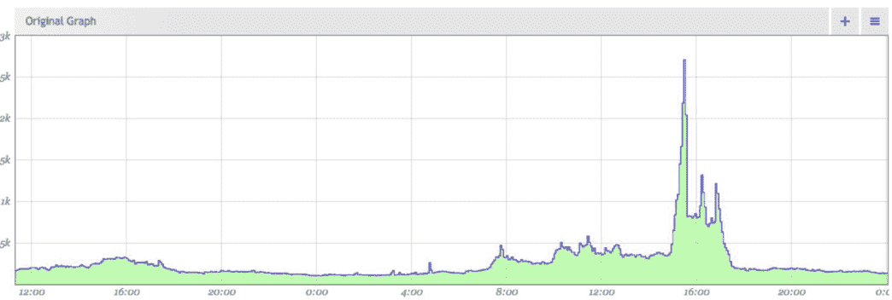
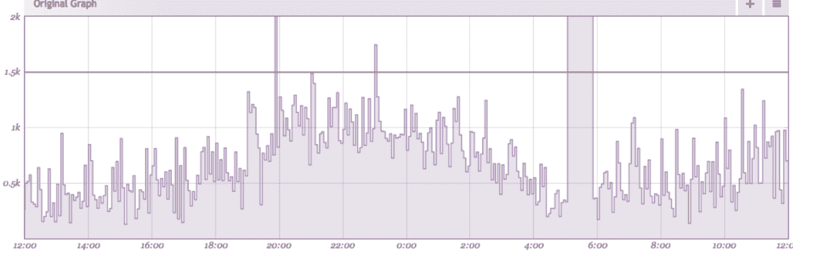
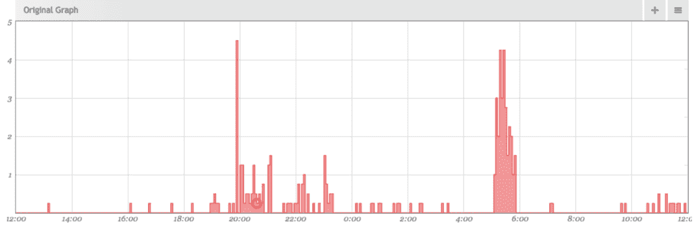

## 第 5 章 改善沟通

在以 DevOps 为中心的组织中，沟通与协作是成功的基础。当组织专注于敏捷性时，准确、完整的信息传递必须与交付速度相匹配——这反过来又会增加所交付的价值。然而，许多组织在改善沟通方面投入不足。例如，项目管理协会（PMI）报告称，平均有 40% 未达成原始目标和业务意图的项目之所以失败，是因为沟通不畅[1]。与日常沟通相关的失败数量惊人。

更好、更精简的沟通渠道和反馈循环使团队能够更快地做出更高质量的决策，并识别和应对错误，从而提高服务交付效率。这些领域的改进能为运营成本和利润率等业务关键绩效指标（KPI）带来切实的提升。从组织价值的角度来定义问题，使改进沟通效率变得更加紧迫。正如我们在第 4 章中讨论的，朝着正确方向迈出的第一步是跨团队沟通共同目标。

下一步是确保不同团队仍然能够说同一种语言。在本章中，我们探讨了缩短反馈循环的重要性，并介绍了最适合持续沟通渠道的流程节点。

### 教育

每个人都是各自领域的专家。专业人士一直是备受追捧的资源。然而，同样狭窄的专业化知识孤岛往往成为整个交付过程的障碍。打破团队之间那道众所周知的壁垒，在保持专业化同时扩展知识广度以模糊硬性的交接线，这正是 DevOps 文化的意义所在。然而，技术团队与非技术团队之间的领域知识差距，远比开发团队与运维团队之间的差距要大。对一个团队来说理所当然的概念，对另一个团队可能完全是陌生的，甚至违背直觉，这可能导致团队之间的摩擦。如果没有适当的上下文，即使是最好的想法，也可能被其他团队的人视为“不适用”。此外，基于不完整或缺失上下文做出的改进决策，可能会对期望结果产生有害影响。

你必须努力分享领域知识，这将有助于协调不同团队的目标，并为支持决策提供所需的上下文。

#### 教育 IT 团队

工程师非常擅长构建问题的解决方案。但要这样做，他们需要理解他们需要解决的问题；否则，结果将是针对别人问题的优秀解决方案。关键在于确保工程师不仅理解需要解决的问题，还理解定义该问题时的思考过程。当你理解工作的原因时，结果总是更好。

世界上最大的数字彩票公司每天向其庞大的用户群发送超过 100,000,000 封电子邮件，它一直在尝试不同的方法来提高点击转化率，并最终通过这些电子邮件提高收入。他们尝试了多目标 A/B 拆分来评估用户反应，让收集到的信息为未来的决策提供依据。

营销团队提出请求，要求设计并构建一个新的电子邮件模板，并给出明确的规格，以便在部分用户子集上进行测试。数字团队遵循公司的品牌指南和用户体验（UX）行业最佳实践，设计了一个精美的模板，其中包含一些旨在吸引目标受众的创新想法。邮件发出后，转化率与其他变体相当，又取得了一次成功。该团队正准备将模板推广到更大的受众群体，这时它收到了新任营销总监的邮件。

邮件中包含了对模板的一堆风格修改，其中一些违反了公司的风格指南，许多修改违背了行业最佳实践。此外，从美学角度来看，所要求的设计将明显不如设计团队创建的方案。按照团队的专业意见，“糟糕”的设计会让用户对邮件敬而远之，从而降低点击率。

营销总监对反馈表示感谢，并乐于分享他做出这一决定的原因。他认为，他提出的修改虽然看起来“丑陋”，但会使收入增加 3%——不是点击率或转化率，而是最终收入。这是基于他经验的合理推测。

团队并不完全认同总监的解释，他们认为这更像是直觉而非真正的合理推测；团队的集体经验和行业知识使他们相信，这些修改会产生连锁的负面效应，导致收入下降而非上升。但营销总监坚持认为这些修改是必要的，而且由于营销部门是内部客户，团队不情愿地决定实施这些修改。团队还决定密切关注新邮件推广的效果，准备在数据出来时来一场“我早就告诉过你”的时刻。然而，令他们非常惊讶的是，在最初的 24 小时内，数据显示收入与“简洁”版本及其他同类历史邮件相比增长了 2.6%。

尽管结果如此，UX 团队并没有错。他们根据可用的信息提供了他们能提供的最佳解决方案。团队并不知晓营销部门拥有的信息——除了营销领域公认的最佳实践外，还有对收集数据的确定性分析。因此，基于不完整的数据，团队提出了一个很好的通用解决方案，但对于特定问题并非最优。持续分享营销分析摘录和决策的领域特定原因，将为设计团队提供决策所需的上下文，并缩短反馈循环，使其能够按需提出支持性问题以澄清不确定领域。

##### 提示

“最佳实践”或“行业标准”并未考虑本地上下文。将它们用作指导原则而非僵化准则，并根据你的具体用例进行调整。

#### 教育业务部门

正如 IT 并不总是理解业务一样，业务部门自然往往也缺乏对技术的理解。要进行有效沟通，你需要使用共同的语言。考虑到业务运营的性质，这意味着每个人——无论是技术人员还是业务人员——都需要用金钱的语言来交流。

围绕变更的价值来展开讨论，能更有效地引起业务部门的共鸣。“我们已在生产环境中安装了[插入产品名称]，以缓解[插入技术问题名称]”——这种说法对非技术人员来说提供不了多少背景信息，也无法传达变更的价值。“我们花费了[插入小额美元金额]，以缓解因周期性系统中断造成的[插入大额美元金额]损失”——这种表述则用所有人都能理解的语言呈现了价值。

多年前，我曾有幸与一位完全不懂技术的 CEO 共事，他经营着一家成功的、价值数百万美元的数字化企业，他用最简洁的方式总结了这一点。那是在一次特别严重的宕机期间，团队正在努力恢复系统；我试图解释代理设备上的一块磁盘故障是如何引发连锁反应导致系统宕机的，但除了一小段时间外，用户基本未受影响。我接着解释了接下来要如何修复这一技术问题，讨论了冗余、经过测试的故障转移等等。他对我的解释的回答是：“就算我的整个数据中心着火了，我他妈的也不在乎，只要我还在赚钱。”这句话颇有道理。正如前面章节所讨论的，关注任何变更的业务价值应该是技术团队的重点。但 IT 并不是唯一一个会错误地用技术术语来描述问题的群体。

第 4 章讨论了非技术人员如何倾向于从技术目标的角度来描述他们需要的解决方案。一个很好的例子就是始终难以企及的 99.999%，也就是“五个九”。这指的是对系统和服务的高可用性要求。你经常会听到高管向技术团队下达指令，要求加固系统以达到这一标准。而技术团队有责任让这位高管了解该请求的影响、成本和价值。

首先需要问的问题是“为什么？”。然而，问“我们为什么需要这个？”往往得不到你想要的答案。相反，试着围绕投资回报率（ROI）的具体细节来提问。在这种情况下，问“我们的业务能否承受每年总计超过 5.26 分钟的宕机？”会把对话引向讨论由业务决定的需求，进而决定“五个九”是否是一项硬性要求。

其次，要记住每一项变更不仅带有潜在的期望结果价值，也带有相关的成本。每个人都想像 Netflix 一样具有弹性，但并非每个人都有实现这一目标的预算，而且通常也并非有这种需要。将技术成本要求引入业务讨论，会提供额外的背景信息，从而改变对所请求变更 ROI 的认知。

技术领域知识的价值，往往体现在以最优解决方案支持业务定义的目标。让非技术利益相关者了解当前的技术能力，并提供计入成本因素的可选方案，为从实际 ROI 角度评估想法价值提供了缺失的背景信息。

在提出解决方案时，请遵循以下准则：

- 定义你的业务需求，而不是定义技术问题。
- 设定现实的目标。
- 始终考虑成本。
- 构建你需要的东西，而不是你认为你需要的东西。

每个人都是自己领域的大师，在其他领域则是新手。通过打破知识孤岛并分享专业知识和经验，你可以打造一个熟悉其他运营领域的专家型组织，从而基于最完整的信息做出最优决策。

### 持续沟通

在 DevOps 环境中，正如我在前几章中所述，变更是持续不断的。因此，组织需要一个与变更速度相匹配的沟通框架。敏捷方法论强调信息交换的简洁性，并推动迭代反馈循环，已经朝着正确方向迈出了一步。然而，为了最大化 DevOps 原则的价值，你必须在交付和管理过程的每个阶段整合并优化业务反馈循环。

#### 交付周期开始之前

技术团队与非技术团队之间最常见的交汇点，或许就是流程中的需求收集阶段。然而，需要记住的重要一点是，需求定义的第一步是定义*业务需求*。而这正是流程中经常被忽视的地方。

工程师往往在完全理解问题之前就开始思考解决方案。他们常常认为自己的任务是开发软件，但实际上，那只是达到目的的手段。目的是赋能业务实现目标。解决方案从技术角度看可能非常优雅，但如果不能满足业务目标或时间约束，它就行不通。而消费者（内部或外部）正是以此来判断结果的。

> IT 的责任不是构建和运营更好的软件，而是赋能业务。

为了统一关注点，工程师必须理解目标，同样重要的是，还要理解需求背后的原因。

提出正确的问题（并获得完整的答案）是关键。请记住，如前所述，技术人员往往不具备提出解决方案请求的非技术群体所特有的专业知识和背景。这种背景信息的缺失，会让他们基于手头*不完整*的信息，做出设计或“改进”解决方案的局部决策——这反过来又会导致一个不尽如人意的解决方案。

让我们再看另一个例子：工程团队在未能完全理解变更范围的情况下，就试图主动做出改进。

财务部门注意到，它定期运行的数十份报告中，有一份变得越来越慢，有时甚至没有响应。于是它创建了一个工单，要求 IT 调查这个性能问题。一位数据库工程师进行了排查，并做了多项更改以改善当前和未来的性能，同时为数据库端和查询端的增长做了规划。此外，在调查过程中，她注意到生成该报告的查询语句是错误的。

在一个鼓励员工尽可能主动改进系统和流程的组织中，这位工程师修复了生成报告的查询，并在工单中做了记录，以确保该报告的使用者知晓这个长期存在的问题已被修复。

工单中的下一条信息是请求撤销更改，并立即让那个缺陷复现。

经过一番讨论后，原因是依赖关系。该报告中的数据被用作许多其他财务报告和分析的基础。“修复”该报告会改变某些计算，导致依赖该报告数据的各部门之间出现混乱。该组织不得不将两份报告并行运行数月，以便在保持稳定性的同时逐步核对数字。

如果向财务部门询问该报告的用途及其背后的历史，工程师就能获得识别所发现的“缺陷”背后复杂性所需的背景信息。拥有持续沟通的文化，还将在开发过程中提供更短的反馈回路，以便在发现潜在问题时向领域专家提出，并共同讨论最佳的补救行动方案。

提示

始终询问每个请求的目的。这些信息不仅有助于更好地理解问题，而且理解最终目标有助于提出最佳解决方案。

#### 交付周期期间

有效沟通的主要目的之一，是持续统一每个人的当前观点，使大家始终看到同一个全局。敏捷通过推动定期同步点、审查当前状态和影响项目的变更，并让所有相关团队有机会根据新现实调整行动计划，从而采纳了持续沟通的模式。即便如此，DevOps 方法推动整个组织以更高的变更速度前进，将反馈机会限制在每个交付周期结束时——无论周期多短——都不足以实现有效沟通。沟通策略必须与业务同步演进。

DevOps 的一个关键前提是持续交付（CD）。这种方法允许更小、增量式的变更，从而帮助更快地交付价值。更多功能更快触达消费者，收集到更多行为数据，业务需求的变化速度也因此加快。如果你的团队发布的功能，其实时分析每天为未来的业务决策提供信息，而你与业务团队讨论潜在变更的唯一机会是在一个为期两周的周期结束时

图 5-2. 营销活动拉动力与用户感知的延迟峰值的关系

如果关于预期增量流量增加的信息已经传达给IT部门，那么IT不仅能对系统做出补偿性更改，还能在流量开始攀升之前就准备好扩展架构——而不是在流量达到临界阈值之后团队才收到警报。

虽然应对意外事件是运维团队的职责，但如果能提前通知团队预期事件，让其有时间准备支持和缓解计划，那么对业务的干扰就会显著减少。正如我在本章前面提到的，业务部门需要认识到向支持其计划的技术团队传达变化的价值，即使这些变化不需要立即采取行动。

> 贡献应根据其带来的价值来判断，而非根据其来源。

然而，要注意的是，开放和持续沟通的责任并不完全落在业务团队身上。工程师在开发或故障排除过程中往往回避所有非技术性沟通。许多技术团队制定了“仅限开发人员”和“不允许管理者”的沟通政策，以免干扰交付流程。尽管某些频道应只关注技术主题，但将团队成员与业务的其他领域隔离开来，是一种错误的文化方法——它会促进孤岛隔离和跨部门的不信任。最主要的错误在于根据传递信息者的角色或头衔来忽视信息。贡献应根据其带来的价值来判断，而非根据其来源。不同的视角极具价值，即使在回顾中也是如此。

#### 交付周期之后

跨团队沟通的最大挑战之一，往往是在业务利益相关者中建立并保持对技术工作价值的理解。相反，IT部门通常缺乏对其成败对组织底线影响的了解。在技术成果与业务成果之间提供可理解且可见的价值关联，能够对双方群体进行交叉教育。而在理解成功与失败价值的过程中，关键的反馈循环之一就是回顾会议。

回顾会议是一种定期的团队审查，或者是对某个事件（如服务中断、“未遂事件”或未达成的交付目标）的审查，并得出对后续改进有价值的可执行结果。回顾会议为理解变更的影响（无论预期与否）、教育团队以及最大化前瞻价值提供了绝佳的平台。然而，受邀参加回顾会议的人员名单往往仅限于技术团队。与开发周期沟通类似，回顾会议也被视为纯技术的反馈循环。但如果我们认同技术的目的是支持业务，那么*理解变更影响*这一目标，无论其技术性多强，如果不对事件可能对业务造成的影响有实际理解，就不可能实现。邀请拥有领域知识的人来教育团队其他成员，不仅从教育角度有价值，而且从确定优先行动事项（以获取最大业务价值）的角度也有价值。此外，协作式回顾会议是鼓励协作、建立强大文化、提高透明度并建立团队内部及团队间信任的绝佳工具。

##### 提示

即使事件结果是正面的，也要进行回顾会议。无论结果如何，所有团队都有有价值的信息可以分享和学习。

让我们来看一个常见事件：延迟峰值。由于发生了某些运维团队不知情的事情，导致用户性能下降，于是触发了警报。团队迅速响应，将服务中断时间控制在最短。总体而言，平均恢复时间（MTTR）值得称赞。尽管如此，服务中断仍是一个值得进行回顾的事件。

根据所收集的遥测数据，大约有20分钟的时间段内，用户体验下降，或者完全无法与任何网站功能交互，原因是由内容服务延迟导致的连接超时（图 5-3）。这是一次相当严重的中断。然而，在审查了整体事件率和性能趋势后，发现在较长时间间隔内，整体性能完全在第99百分位（该团队的一个可衡量KPI）以内，这意味着其服务级别协议（SLA）未被违反，进而意味着尽管未来应该进行改进以平滑峰值，但这并不被视为需要优先处理的主要中断。

图 5-3. 图表显示因内容服务延迟导致的用户体验下降峰值

从技术角度看，回顾会议的结果是可行的。团队根据SLA验证了系统当前状态，并基于所掌握的信息对后续任务进行了合理排序。然而，回顾会议是另一个需要上下文背景的决策点。

事件检查的范围仅限于局部KPI。由于无法访问其他遥测数据，也不了解事件关联性，团队只能根据手头的信息做出决策。如果有专人负责监控转化率和收入趋势，情况将会大不相同。

图 5-4 显示了受到前述延迟变化影响的实际用户。对于任何负责财务的人来说，每个用户都代表着一定的货币价值。在这次部分中断期间——技术团队根据自己的影响认知认为这只是一次小事件——公司遭受了数千美元的收入损失。更值得注意的是，过去一次因延迟导致的收入损失，从财务角度看几乎同样严重，但因恢复迅速而被运维团队视为误报而不予理会。

图 5-4. 受系统延迟影响的实际用户

在持续变化的世界中，理解变更的影响至关重要。同一个事件，对于组织内不同团队而言，可能具有不同的感知价值（正面或负面）。让所有团队的代表共同协作，以了解事件的整体影响，有助于理解变更的真正价值。不要犹豫，为组织中的每个团队都发出长期有效的回顾会议邀请。这既是一个向不同团队传授技术挑战与成功经验的机会，也是一个向技术领域以外的专家学习的机会。混合的代表构成能够实现DevOps文化中常被提及的两个目标：接触与持续教育。

##### 提示

不要犹豫，为组织中的每个团队都发出长期有效的回顾会议邀请。这既是一个向不同团队传授技术挑战与成功经验的机会，也是一个向技术领域以外的专家学习的机会。

业务与IT之间的沟通与协作是高效且有效的DevOps文化的基石之一。信息交换的敏捷性和频率必须与组织试图实现的价值交付的敏捷性和频率相匹配。你应该将反馈循环整合到交付管道的每个阶段。这些不应仅仅作为当前的信息交换，而应作为持续交叉教育和向前发展的机会。如果不同团队聚集讨论的唯一场所

