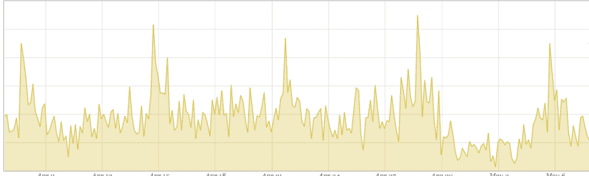
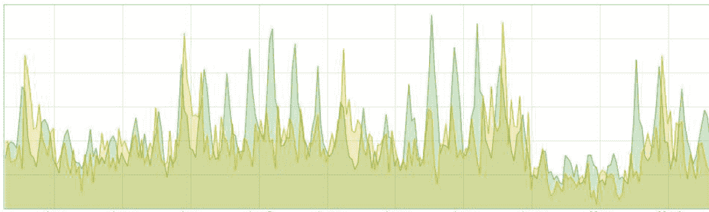
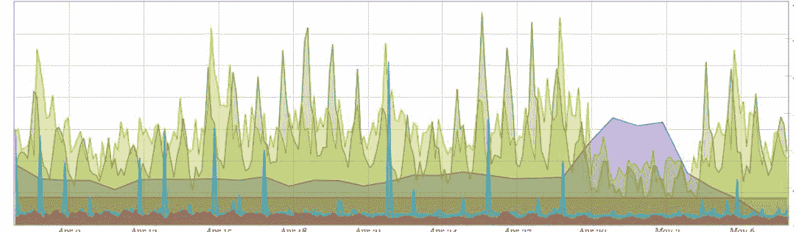

## 第6章 提升可见性

即使在沟通透明的情况下，你在每个项目的开发阶段和运营阶段都会遇到阻碍和问题。问题可能源于流程不足、错误、边界情况或不可预见的用户行为。作为负责管理生产环境中应用程序和系统的团队，你的团队应该问的问题是：“我们如何最大程度地减少错误或不可预见事件的影响？”

在前一章中，我讨论了降低平均恢复时间（MTTR）的重要性。在该过程中，第一步是识别出需要解决的问题。第二步是快速了解事件的相关信息。这就是可观测性发挥作用的地方。它使组织能够在每一步检查系统的状态并检测变化，从而让你评估并对次优流程和行为变化提供反馈。监控应被视为一个持续的反馈循环，用于确定任何给定时间每个指标的性能。

然而，由于系统的目的是支持业务目标，仅关注系统的健康状况不足以保证业务的绩效。虽然重大问题，例如严重破坏用户体验的停机，对业务绩效有明显影响，但更微妙的问题尽管在技术上看起来成功，却可能对业务运营产生更大的影响。例如，业务逻辑中的错误未能正确处理故障条件，可能会导致一小部分 Web 应用程序用户在一段时间内无法完成购买。尽管财务部门最终可能会注意到收入趋势的变化，但系统指标如正常运行时间和网络延迟仍会显示在正常水平，从而使问题持续存在，可能导致比大规模但短暂的停机更大的收入损失。

缺乏上下文的数据会导致对实际影响系统和业务的因素产生不准确的理解。本章涵盖了对业务绩效持续洞察的重要性——包括应考虑哪些监控和告警指标——以及数据关联的重要性。

### 全面监控的重要性

监控传统上是 IT 的职能，关注 *系统健康*。然而，系统的健康作为独立衡量标准并无价值。对于依赖技术实现业务成功的组织而言，仅限于技术症状的监控工作很容易出现持续性故障。关注与业务成功相关的指标对于负责支持系统健康的团队至关重要。

> *我不在乎我的整个数据中心是否着火，只要我还在赚钱。*
> 
> CEO

运营团队需要能够访问业务成功指标，以便对 *业务的健康状况* 有整体的了解，并能够正确地检测、诊断、解决（并可能）预测业务中断问题：

合适的团队会立即收到通知。已经建立了“一切正常”标准的广泛规则集，包括目标 API 检查返回 200 代码的 HTTP 检查、系统健康状况在正常范围内，以及用户浏览趋势在定义阈值内。假设是，只要这些指标在正常范围内，从系统运营的角度来看，网站就是可操作的。该标准一直有效，直到团队遇到的一个问题是事件数据的静默丢失。

网站可以正常浏览，API 接受 post 请求并向用户返回成功代码，但由于有缺陷的代码部署，帖子本身从未在数据库中注册。从负责运营稳定性的团队角度来看，可用数据显示网站正在运行；沮丧的用户和业务分析师的体验则完全不同。

在这种特定情况下，问题在于负责服务可用性的团队专注于监控系统和应用程序指标。尽管这些指标对于隔离和排除故障问题很重要，但问题的第一个症状应该是业务指标趋势的变化。将系统设置为收集每秒平均事件数的数据并为其设置适当的阈值告警，就会在部署后立即发出警报，从而更快地实现平均检测时间（MTTD）。

### 自上而下的监控策略

有效的监控策略有益的原因有很多。首先，由于软件永远不可能没有错误，持续观察系统行为是及早发现生产问题的唯一方法。现代系统的复杂性是另一个原因，其中架构中某一部分的故障可能在整个系统中产生连锁效应，表现为完全不同的原因。当然，有效的监控还能让你主动检测潜在问题，例如用户检测到的故障、安全漏洞和性能峰值。

但也许监控和跟踪系统行为最重要的原因是事物会发生变化。而变化会影响业务。

组织中任何地方的变化都可能涉及完全不同团队的流程产生连锁效应。作为负责维护支持业务的底层系统健康的人，你需要能够检测变化并理解其完整的影响范围。在定义监控策略时，请遵循以下小节中列出的步骤。

#### 了解业务目标

如第 3 章所述，建立有效监控计划的第一步是了解组织的业务目标。明确识别这些目标有助于列出需要持续观察变化的业务关键指标。了解这些指标的成功基线值可以使数据模式的变化根据变化的价值进行评估。

例如，一个依赖网站注册（Beta 签名、会员服务）的组织可能希望从业务检查开始，确保每小时注册人数不会低于设定的阈值。同样，电子商务应用程序可以从监控信用卡交易成功与失败比率的业务指标中受益，以确保销售流程按预期工作。诸如此类的指标不仅为前瞻性决策提供了宝贵的业务情报，还为支持这些基准的技术指标提供了关注框架。

#### 映射业务和技术指标

在映射业务目标后，下一步是识别影响相关业务指标的技术指标。映射技术指标与业务目标之间的关系提供了上下文并突出了相互影响。例如，电子商务业务衡量的信用卡交易成功与失败比率取决于应用程序服务器的可用性、与第三方授权服务的连接性以及该服务本身的可用性和性能。如果授权服务发生停机，它将转化为信用卡交易失败比率的升高。相反，更高的信用卡交易失败比率可能是由相关技术指标突出显示的问题引起的。

#### 相关数据

持续监控可以（并且应该）收集大量数据用于分析。在为每个层级建立指标集后，请确保相关指标可以轻松关联。收集多个业务和技术指标有助于确保必要的信息 *可用*，但能够将相关指标一起查看有助于确保必要的信息 *有用*。理解关系可以加速故障排除，使通过业务指标识别的问题能够映射到相关技术指标（反之亦然）。不要低估跨部门关联的重要性。更常见的是，解释一个指标变化的原因需要通过多个指标追踪影响链，这些指标通常通过不同的渠道收集。能够按需轻松遍历依赖树的能力将改善 MTTR。

让我们通过一个实际例子来检验这些前提。大多数事件响应都始于一次呼叫（或一次寻呼），这次也不例外。在这种情况下，一次呼叫来自一家大型在线营销公司的 CEO，该公司运营着一个非常复杂的系统，拥有多个收入生成点，支持超过 1 亿用户。当他查看业务健康仪表板时，CEO 注意到来自在线渠道的收入比正常日阈值下降了超过 20%。他立即将问题升级给他的 Web 运营团队。

正如任何工程师都知道的，排除故障的第一步是确认问题，因此查看收入趋势似乎是一个很好的起点。幸运的是，WebOps 团队可以访问业务 KPI 指标，因此能够在其监控系统中调出信息，如图 6-1 所示。

图6-1. 一个月内的收入数据

图中清楚地显示，从4月30日左右开始，趋势与前几周相比看起来异常。收入似乎确实出了问题，而不仅仅是报告中的偶然波动。潜在问题可能出在支付处理器或系统的其他位置。然而，也可能是非技术性问题的结果，例如营销活动不成功或销售流程枯竭。下一步合乎逻辑的做法是将收入与从Google Analytics收集的用户流量进行关联，查看是否存在共同趋势，如图6-2所示。

图6-2. 同期的收入与用户流量数据

尽管流量与收入在同一时间出现明显下降，但收入/访客比率保持不变，因此团队可以将支付处理器和其他应用特定逻辑从首要嫌疑列表中排除。

##### 注意

通常，这是过程中第一个潜在的断裂点。人们很容易只看比率，将收入下降归因于自然流量减少，然后停止调查。

团队提出的下一个问题是：“导致网站整体流量下降的合理原因是什么？”大量研究表明，即使延迟只有极小增加，也可能导致转化率、交互率以及随后的收入显著下降。任何Web系统中都存在许多潜在的性能瓶颈，而这个DevOps团队可以访问当前

##### 注意

这是调查过程中第二个可能断裂的点，原因在于人们假设问题没有已知的系统来源。

许多工程师会得出结论：所报告的问题没有得到确认；报告的问题只是异常，因为技术系统监控没有显示任何问题。这正是技术团队必须理解业务至关重要的原因。

在确认没有明确的系统问题迹象后，团队将集体目光转向收集到的业务指标，尤其是营销指标。如果公司停止推广或营销活动效果不佳，网站购买量下降并不罕见：网站流量放缓，交易数量随之减少。尤其这家公司每天发出数千万封电子邮件，吸引新用户和回访用户访问网站，并引导他们进入创收渠道。因此，查看从公司邮件引擎收集的邮件送达率和退信率是一个很好的下一步，如图6-5所示。

图6-5. 收入、用户流量、用户感知性能、数据库负载和邮件退信的数据

找到了！在流量和收入流下降的同时，退信率也飙升。经过仔细调查，发现一家主要的电子邮件服务提供商（ESP）意外屏蔽了发送域名，导致营销邮件无法送达收件人。在与该ESP进行一番激烈讨论之后，问题得到解决，趋势恢复到预期水平。

幸运的是，公司的政策是透明的，DevOps团队在故障排查期间有足够的数据进行定位和关联。跨领域指标的可用性，以及负责事件响应的团队能够跨业务和技术领域合并并比较趋势，使得问题得以快速解决，各团队几乎不浪费精力。

##### 注意

如果邮件送达率不是问题所在，那么待验证清单上还有超过1,500个其他开发、运维和系统指标。能够访问这些指标会大大加快故障排查速度，进而缩短解决时间。

问题持续了两天。IT和营销团队继续分析日志并收集数据以寻找异常，但毫无结果——直到会计部门打电话给开发人员，要求他们从结账页面移除美国运通（American Express）的标识，因为他们正在重新谈判费率，目前不接受美国运通卡。

这又是一个流程变更，表现为技术问题，最终导致收入损失。

暂且不提需要在组织层面解决的明显沟通缺失，IT部门不应因未收集信用卡类型使用指标而受到指责。没有人能够预见到这个问题以这种方式显现。然而，事件发生后，团队增加了一项检查，以便在将来捕获类似的条件，例如每小时使用阈值或信用卡分布比率。

在这些例子中，事件发生时团队都有超过1,500个指标可供审查。其中许多指标是随着时间推移，在初次问题发生后或为响应业务驱动的变化而添加的。

当发现新的变量条件或基础假设发生改变时，应将新的数据点添加到收集系统中。将可见性覆盖评估和改进纳入任何事件回顾或新需求实施，作为标准操作流程的一部分。

如前所述，监控策略不应只关注所提供服务可用性和成功率的测量。内部流程的低效率往往比系统中断代价更高。变化不仅发生在软件中。在组织层面，KPI、流程甚至人事变动都可能引发改变价值的连锁反应。

### 监控流程

监控对任何组织都很重要的主要原因在于，你无法改进无法衡量的东西。这句箴言不仅适用于系统，也适用于流程。观察流程的能力不仅有助于响应变化引发的问题，也有助于发现低效之处。在整个组织内实施关键指标，有助于识别最需要改进的领域。如果指标显示某些工作流由于流程臃肿或多个团队之间的交互而效率低下，就需要审查并修改这些工作流。对跨部门流程效率的洞察，能够提供一个关于需要改进领域的整体视图。

> 你无法改进无法衡量的东西。

与技术指标非常相似，监控流程时应采用级联方法。流程实际上就是工作流。工作流由多个步骤组成，这些步骤最终产生期望的结果。从指标收集的角度来看，该结果就是需要观察和衡量的顶级业务价值。工作流中的每个单独步骤也都应被监控，并作为支撑指标对待。

将价值流映射应用于流程中的每个可衡量点，有助于隔离最需要关注的领域。将流程中各个步骤的成功程度与所交付价值进行衡量，并创建可操作的反馈回路反馈给团队，将有助于持续优化这些流程。确保不断评估任何行动的价值。如果它对整体流程产生净负价值，就改变它。

一个具有多个可优化独立步骤的明显例子是开发流程。这是衡量团队运作效率的好方法，并且涵盖了广泛可能需要改进的领域。收集顶级标准指标，如上市时间和缺陷率（参见第3章），可以给出开发流程的基线性能指标。然而，要改进结果，就需要在该流程的各个步骤中注入效率。收集的指标反映每个步骤的效率。

#### 提示

将每个流程分解为尽可能小的可测量事件，并针对每个事件收集数据。

如果上市时间是需要优化的KPI之一，则需要检查支持性指标（如反馈循环和从提交到部署的时间）。假设提交到部署的时间是表现突出的负面指标，则可以进一步将其分解为更小的可测量事件。进一步挖掘后，效率低下的原因可能是功能审批流程的众多步骤之一依赖一个经常出差的人。如果你能消除该步骤或将授权委托给委员会，将会显著缩短提交到部署的时间，进而改善上市时间这个总体指标。

本章专门讨论监控，但组织的可观测性策略不应仅限于系统和应用程序监控。每个团队都应负责收集（或使可收集）其领域特定的数据。由此产生的超集应提供对任何流程（无论技术与否）的可见性，这些流程有助于整体价值交付，并通过监控器、日志或任何其他手段关注业务优先的指标。此外，你的告警策略也应遵循同样的路径。

### 告警

整体式监控方法鼓励将监控策略扩展到IT之外的领域，并自然地促使团队增加所收集指标的数量。随着现代系统复杂性的逐步增加和可观察行为范围的扩大，“监控一切”这句箴言可能会使收集的指标数量呈指数级增长。从表面上看，这是件好事。拥有更多数据可支配，能为分析提供更细粒度的信息，从而加快改进速度。理论上如此。

然而在实践中，将数据收集原则应用于通知会产生告警量，这对许多团队来说是一种诅咒。你能想象对前面例子中的1,500多个指标（从IOPS到组件指标，再到单个用户页面浏览量）中的每一个都设置告警吗？除了数量庞大之外，误报和错放的告警会给负责支持业务的团队带来沉重负担，而不是帮助他们更快地检测和修复问题。更糟糕的是，不分青红皂白的告警增加了……

关键告警被错误地排定优先级，甚至被完全遗漏。正因如此，“可操作”告警的概念在运维领域早已是常用术语。

监控一切。只针对对业务重要的事项发出告警。

可操作告警原则为每一条新的生产环境告警设定了一项基线要求。任何新增告警的人都必须回答两个首要问题：

这条告警的业务影响是什么？

这是为潜在故障条件添加生产环境告警之前，需要回答的最重要的问题。当故障发生时，它是否会对业务产生实质性影响？如果答案是否定的，那它就不应该成为一条凌晨 3 点把人吵醒的告警。举例来说，Web 服务器集群中的一个节点发生故障，虽然需要调查和修复，但并不会对业务运营造成关键影响。

能否采取某些措施来补救这个问题？

如果立即修复或实施临时解决方案的方法并不明确，或者超出了凌晨 3 点被叫醒的人所能控制的范围，那它就不应该成为告警。让我们回顾一下美国运通拒绝率的例子。虽然如果数据可用，在问题再次出现时能显著缩短发现时间，但针对该故障的即时告警并不具备可操作性，因为解决方案不在值班团队的控制范围内。对于只能由非运维人员处理的问题，应定义单独的告警联系组或升级上报链，以确保相关人员能获知潜在问题。

还有一些对团队有益的其他问题，例如：“这个问题能否以极小或零负面影响拖到明天再处理？”以及“是否有人更适合解决这个问题？”这些问题会通过不同的告警渠道向指定团队发送通知——但首要问题将决定系统中每条告警的必要性和有效性。

让告警可操作，能显著改善团队的生活质量和服务水平。将自上而下的设计作为告警结构的指导原则，也能让你把精力集中在业务重要的事情上。此外，与 DevOps 文化中的大多数事物一样，持续改进你的告警也很重要。事件事后复盘和“险肇事件”回顾是发现监控（尤其是告警）改进机会的好时机。通过过滤掉某些告警、让告警更清晰、把告警定向发送给更有可能处理它们的人来提高信噪比，这是让团队持续聚焦于正确目标所必需的。

请记住：监控一切。只针对对业务重要的事项发出告警。

目标：不要假定恶意，而要假定是信息有误，并致力于纠正这一点。这正是同理心发挥作用之处。

假定每个人都在努力把事情做好。

同理心，本质上是一种能够理解他人、并愿意从他人角度看问题的能力。在 DevOps 的背景下，与他人共情之所以重要，原因有很多：

- 更好地理解跨部门团队和队友所面临的挑战
- 更深入地理解决策背后的动机和背景
- 减少因缺乏理解而导致的跨部门冲突
- 持续洞察组织中其他部分的情况

透明且协作的跨部门环境能在不同团队之间建立同理心。同理心增进了理解，使人们更能体会其他团队的问题。通过与他人共情，你会成为更好的队友。

提示

与客户共情，与与本组织内部的人共情同样重要。客户满意度是最终的成功标准，真正努力去理解他们的需求，应该能提升你交付的价值。

## 建立信任

著名 DevOps 专家杰夫·苏斯纳（Jeff Sussna）在接受 DevOps.com 采访时提出了一个有趣的观点：敏捷 + 同理心 = 质量。他认为，质量与参与执行的所有团队的有效性和文化直接相关。跨部门团队协作除了会受到目标一致（或不一致）、沟通不畅和缺乏透明度的影响外，还可能受到不同激励因素以及各团队间信任的影响。

部门间的不信任，无论理性与否，都由多种因素造成，并可能产生连锁的负面影响。除了质量之外，可能受到影响的还有沟通、共享和对能力的认知。要赢得其他团队的信任，你需要提供缺失的数据，让你的意见具有可信度。

保持透明。透明是建立信任的关键。当决策在闭门状态下做出，缺乏充分的数据支撑时，往往会被视为无效，尤其是当这些决策来自领域知识有限的团队时。

用接收者能理解的语言来展示价值。如第 5 章所述，在熟悉的语境中看到数据会产生一种关联感，并建立起情境判断能力，从而增进信任。

你还必须理解文化变革对不同团队的影响。例如，项目经理是一个经常被其他群体（无论是技术人员还是业务人员）反感和不信任的群体。即使是优秀的项目经理，也很难在敏捷组织中获得信任，并且不被视为阻碍者。原因在于目标相互冲突。

按照敏捷原则，DevOps 组织中技术和执行团队的目标是持续创新和改进。持续改进意味着频繁变化。相比之下，项目管理办公室（PMO）的首要职能是维持稳定并控制变化速率。这并不是说管理者不想要创新，而是他们的职能是在创新过程中管理风险，并确保一致性和可预测性。然而，他们为实现这一目标所做的决策，往往被其他群体视为对变革的抵制，导致人们对他们支持组织愿景的信任度下降。

除了目标天然冲突之外，在制定 DevOps 采用战略时，组织通常只结合技术和业务团队的输入来关注驱动因素、激励措施和协作方法，而将中层管理的需求排除在讨论范围之外。孤立一个群体会引发不满和信任丧失，这不仅会降低该团队的贡献价值，还会削弱整个组织的价值。

从各团队的激励和增值角度重新聚焦目标，有助于获得每个团队的认可和合作。在这个例子中，让管理者了解精益流程的好处以及他们在推动流程成功中的作用，将有助于统一目标，并表明他们的团队在整体计划中的重要性。让管理者参与有关变革日常实施细节的讨论，会让他们感到被接纳，同时你也能从他们的视角中受益。

所有参与交付组织价值的团队，都需要被纳入文化变革之中。在尝试建立信任文化（或恢复、加强信任）时，请遵循以下步骤：

- 识别信任差距
- 理解不信任的根源
- 通过认同团队目标来展示价值
- 对目标保持坦诚
- 营造信息透明

还要记住，上述清单只是一份蓝图，而不是解决信任问题的万能方案。事情可能会出错，而且一定会出错。当问题发生时，关注点必须是问题本身，而不是人。问题出现时，信任会瓦解，而这时恰恰是你最需要信任的时刻。建立无指责文化能创造安全的环境，使人们能够并愿意共同寻找前进之路，而不是把责任推给别人。

建立同理心和信任的最佳方式，是让人们朝着共同目标一起工作，共同解决问题——寻找机会，让跨团队的人们在头脑风暴、回顾和庆祝活动中聚在一起。同样，没有相互尊重和协作的文化，大多数改进举措都会归于失败。DevOps 关乎的是人，而不是工具。

请记住，作为 DevOps 领导者，你的职责不是提供最佳技术方案并优化团队产出，而是让你的组织蓬勃发展。我希望本报告中的信息不仅能帮助你为组织引入 DevOps 文化与流程，还能助你取得成功。祝你好运！

