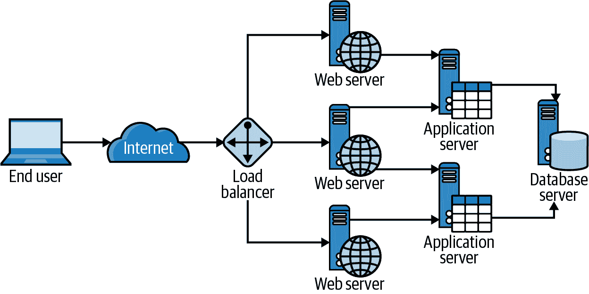
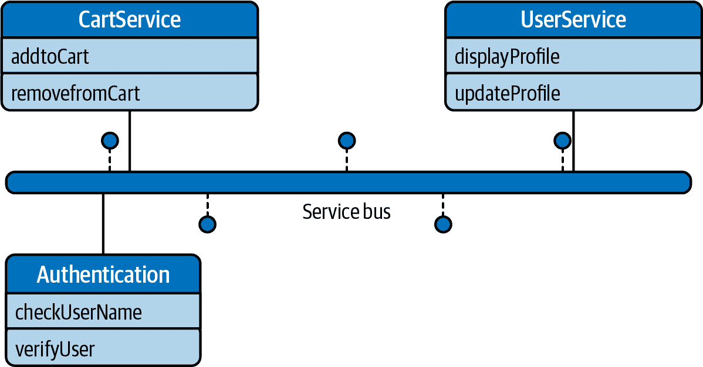
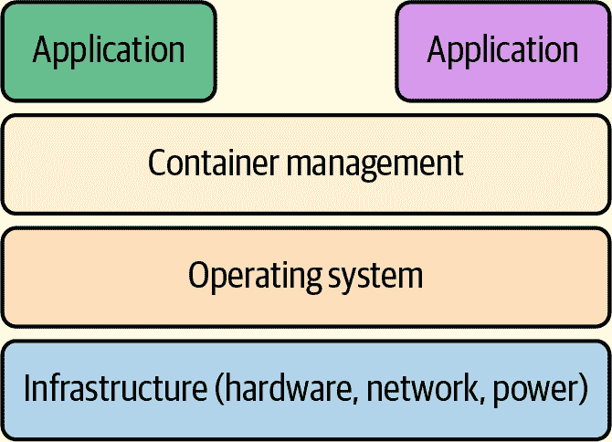

## Chapter 2. Architectural Designs

软件应用程序是复杂的存在。组件很多。谈到基于 Web 的应用程序时，除了基于软件的元素之外，可能还涉及很多系统。当公司开发基于 Web 的应用程序时，他们需要负责的远不止软件开发，因为他们还必须关心交付平台。这与开发原生应用程序相比是一个重大的变化，即在桌面上直接运行的应用程序，其中最终用户负责软件运行的平台。

传统上，基于 Web 的应用程序使用一种称为 n 层设计的东西，这是软件开发的常见方法。一般来说，即使在原生应用程序中，你也可以看到 n 层设计的使用。然而，在过去十年多里，应用程序开发中出现了向不同模型的推动。随着越来越多的公司使用云服务来交付应用程序，无论是专门通过 Web 浏览器交付还是通过具有基于 Web 的后端的移动应用程序交付，都出现了向面向服务架构的转变。这种转变改变了应用程序的交付方式以及它们的设计和开发方式。它还改变了 Web 应用程序的安全态势以及它们的管理和部署方式。

在本章中，我们将研究一些传统的应用程序设计以及一些更现代的开发大型系统和应用程序的方法。这些更现代的方法在 Web 应用程序中尤其常见，我们看到它们在许多领域取代了原生应用程序。每种设计都有一些安全考虑，我们也会看一下这些。

### Traditional Application Design

n 层应用程序设计具有多个组件，它们以你可以认为是层级或层的方式进行良好定义的通信。n 层应用程序设计的一种常见方法是模型-视图-控制器，MVC，设计模式。模型是数据在应用程序中存储和表示的地方。视图是同一数据向用户展示的方式。这可能与模型中使用的表示方式非常不同，因为模型必须从编程角度来看是有意义的，而视图需要是视觉的。也就是说，用户需要能够查看它并知道应用程序中发生了什么。最后，控制器是中间层，它将数据从模型中取出并进行转换，无论是从模型中出来还是进入模型。业务逻辑可能存在于这一层，它防止视图直接与模型通信。这使你能够创建与接口无关的程序。例如，你最终可能会为不同类型的应用程序使用相同的模型。视图可能会改变，但只要接口、函数、方法和属性的调用在视图之间保持相同，模型和控制器就可以保留在原位。

传统的 Web 应用程序使用与此设计模式类似的东西。然而，它可能不被称为 MVC，而是被称为三层或 n 层设计。这是因为可能存在多个层，但它们可能无法很好地与 MVC 的描述对齐。Figure 2-1 显示了一个为弹性而构建的传统 Web 应用程序设计。图表左侧是用户。你可以将其视为表示层，在这里显示应用程序的输出并接受用户的任何输入并将其发送回应用程序的其余部分。图表显示用户通过互联网与应用程序通信。实际上可能并非如此，因为应用程序可能托管在企业数据中心，用户通过企业网络进行通信。无论如何，用户都在向他们没有直接连接的网络发送流量，即他们的本地网络，无论谁拥有该网络。

在应用程序内部可能存在多个网络。分层网络设计通常是首选，因为从理论上讲，它使攻击者更难深入到存储更敏感数据的应用程序内部。在 Figure 2-1 的中心，你会看到一个负载均衡器。这不仅是为了提高弹性，也是为了更轻松地处理大量负载。负载均衡器的任务很简单：它接收网络请求并将其分发到一组定义的服务器。几乎没有任何处理涉及。服务器则必须处理请求做一些工作，因此从处理器利用率的角度来看，它们可能会变得繁忙。相比十年前可用的处理器而言，这在今天的更快的处理器上并不常见，但应用程序设计仍可能遵循这种模式。

在 Web 服务器后面，Web 服务器提供任何静态内容并将动态请求传递下去，是应用程序服务器。这里存放着业务逻辑。应用程序服务器可能是一个 `.NET` 服务器，可以运行使用任何 `.NET` 语言编写的程序，例如 `VB.NET` 或 `C#`。使用基于 Java 的 Web 应用程序服务器也很常见，例如 `JBoss`、`Oracle WebLogic` 和 `Apache Tomcat`。应用程序服务器处理所有需要程序化处理的动态请求。来自用户的输入由应用程序处理，而返回给用户的任何响应主要由应用程序服务器生成。

应用程序服务器还管理与数据库服务器的接口，你可以将其视为 `MVC` 应用程序设计方法中的模型。传统上，数据库服务器是一个关系数据库，其中数据以行和列的形式存储在表中。列定义表中的属性，而行是属性实例的集合。它们被称为关系数据库，因为每个表可能与另一个表相关，因为这两个表中的一列可能包含相同的数据。这就是你可以在不使每个表过于复杂或难以处理的情况下拥有复杂数据集的方式。

在实践中，传统架构需要为每个层提供一个单独的系统。事实上，每个层可能有多个系统，如 Figure 2-1 所示，其中三个 Web 服务器位于负载均衡器后面。曾经，这使用物理系统完成，但最近，通常使用虚拟机完成。虚拟机是由软件定义的一个系统：有一段软件拦截操作系统发出的所有请求，这些请求通常会发送到硬件。访客操作系统不知道有一段中间软件充当硬件。这使你能够在单个操作系统之上运行多个“系统”，从而节省硬件和其他支持成本。

所有这些来自操作系统的额外开销以及所有所需的支持应用程序都需要工作。你可能需要管理操作系统及其所包含的一切（更新、补丁、配置等）的人员。你可能需要管理应用程序的人员。理想情况下，每个部署的系统，无论是虚拟还是物理，都已被加固，这意味着它已以一种方式配置，使得攻击者从外部很难入侵。所有这些工作以及所需的人员是公司，尤其是对于云部署，正在远离传统应用程序设计的一个原因。

### Service-Oriented Architecture

在刚刚讨论的传统设计中，应用程序由多个协同工作的服务组成：你有一个 Web 服务器、一个应用程序服务器和一个数据库服务器。所有这些服务器，无论是物理还是虚拟，实际上只是向网络的其余部分公开接口以按需交互的服务。如果你将每个服务器分解为其底层提供的功能，你最终会在应用程序内部得到大量服务。传统应用程序有一个中央处理节点，例如应用程序服务器。在面向服务的架构中，一切都更加公开。Figure 2-2 显示了它可能是什么样子的简单图表。

在面向服务的设计中，有一个称为服务总线的中央通信方式。消息被放到总线上，总线负责将每条消息传递给正确的服务以供消费。例如，如果你想从配置文件服务调用身份验证函数，你只需将消息（基本上是方法调用，包括名称和该方法可能需要的任何参数）放到总线上，总线就会负责调用它。对方法的响应也会放到总线上，并返回给正确的调用方。

你可能会想知道为什么这是设计事物的一种有用方式，因为我们只是调用函数/方法并从中获取响应。这就是编程的正常工作方式。这种设计的区别在于总线可以管理分布在多个系统上的服务。你不再受制于必须拥有一个单体应用程序设计，所有组件都在一个系统上。你也不再受制于有时需要使用笨重的远程应用程序服务，例如远程方法调用（`RMI`）或远程过程调用（`RPC`）。服务总线是另一块负责所有通信管理的软件。

理论上，你可以在传统应用程序设计内部使用面向服务的架构。你的应用程序服务器可以在幕后托管面向服务的架构，同时仍然向外界公开传统的应用程序服务器接口。对应用程序的调用会被传递给服务总线，并由连接到总线的不同方法处理。

在实践中，面向服务的架构成为一个 `API`。整个应用程序可以通过简单地调用可用的不同方法，从应用程序内部之外进行管理。这为所谓的微服务打开了大门。在不需要拥有单体软件应用程序的情况下，应用程序可以被解构为其他组件或服务可能以不同方式交互的各个部分。这可能意味着你最终会拥有多个应用程序，因为功能以不同的方式组合在一起。应用程序的流程不再由单一实体控制。

面向服务的架构还可以帮助强制执行一种称为契约式设计的编程实践，其中整体应用程序空间中的每个方法或函数都有一组必须满足的期望（契约），然后才能调用它。如果你有任意实体调用应用程序空间中的方法，可能必须建立这些契约。如果契约未满足，即函数或方法定义的先决条件未满足，对函数或方法的调用将失败。这有助于推动更好的编程行为，通过确保只向函数发送“正确”的数据。这减轻了函数的负担，使其能够专注于它应该做的事情，而无需确保传入的数据在可接受的范围内。

一旦你开始解构应用程序，你就不再需要那么多服务器了。你也不关心传统设计中每个服务都有物理或虚拟服务器。你关心的只是应用程序的各个组件，即构成应用程序接口的函数或方法。

### Cloud Native Design

#### 云原生设计

云原生设计建立在服务导向架构所采取的远离传统单体应用各自拥有自己的服务器方法之上。云原生设计利用了传统服务与服务器的解耦。它使用虚拟化部署，但与其虚拟化整个系统，不如虚拟化一个应用。从安全角度来看，这是一件好事。在此之前，让我们先看看容器是什么样的。

Figure 2-3 显示了容器的示意图。最底部是使任何计算机系统运行所需的所有基础设施——电力、硬件、网络等。其上是运行在硬件之上的操作系统。下一层是容器软件，它负责所有应用虚拟化，意味着它管理应用与操作系统之间的交互。

其工作原理是通过在实际操作系统中标记内存。容器化应用生活在这个标记的空间中，只能读取或写入具有相同标记的内存。这是操作系统负责执行此控制。这意味着容器化应用及其空间内的任何内容都无法与操作系统的内存空间通信。它也不能与任何其他应用的内存交互。这种设计对安全有好处：任何设法入侵已容器化应用的攻击者将只能访问该应用的空间。如果他们设法获得了该应用所在空间的交互访问权限（通常称为 `shell` 访问，因为用户与操作环境交互的部分称为 `shell`），他们就无法进入底层操作系统。他们只能看到非常有限的文件和正在运行的进程视图。这并不是说容器是完美的解决方案；容器软件中的漏洞可能会允许比理论上建议的更多访问。

虚拟化应用的另一个优点是启动非常容易且快速。启动容器化应用可能如此之快，以至于可以在响应用户请求时启动，仅在请求处理期间存在，然后消失。如果请求来自设法入侵虚拟化应用的攻击者，对该容器的访问就会消失。即使攻击者能够维持对容器的访问，该容器也只存在于为攻击者服务——不会有其他请求通过该容器，因此攻击者几乎无法访问任何内容。

你可以进一步推进这种虚拟化，一些云提供商已经这样做了。如果你要构建自己的应用，你将从应用开发人员编写的许多函数或方法中构建它。应用开发团队只关心他们正在编写的函数。为什么不虚拟化函数本身，使其仅在被调用时存在呢？在那时，理论上函数下面真的没有任何东西可以被入侵。你会得到一块属于该函数的内存，就像函数在原生应用中会得到一个栈帧一样。

你可以使用这些技术通过云提供商来开发应用。诸如 `Microsoft Azure`、`Google Cloud Platform (GCP)` 和 `Amazon Web Services (AWS)` 等提供商都提供可用于开发和部署应用的无服务器函数。这也可以使安全专业人员以及系统管理团队的生活变得轻松许多。

##### 管理考虑

一旦你开始将函数与应用解耦，并将应用与服务器解耦，意味着应用不再生活在单个应用服务器空间内，你就有大量移动部件需要管理。当谈到大规模应用时，这也是事实，其中不同的应用服务器，例如 Web 服务器、应用服务器，甚至数据库服务器，都是在容器内运行。突然之间，你有大量的虚拟化可能性和许多需要管理的不同部件。

如前所述，一旦你开始虚拟化应用甚至函数，你就有许多需要处理的事情。应用虚拟化加快了部署速度，这意味着你可以轻松设计应用以利用这种速度。你可以通过按需启动虚拟组件的单个实例来非常快速地响应负载，即请求量。

与此能力并存的是维护应用内容和配置的问题。你需要能够轻松管理每个虚拟化应用的生命周期。例如，Web 服务器空间内的内容可能会发生变化。如果内容存储在容器内，对内容的任何更新都需要拆除容器并替换它。同样，如果应用发生变化，你需要在更新应用时能够关闭正在运行它的所有容器。毕竟，使用基于 Web 的应用的一个优势是你对已部署版本的控制。如果你无法管理运行代码的容器的生命周期，你就开始对应用及其向用户展示的版本控制力减弱，这会导致应用内部行为不一致，并可能导致用户不满。

一种常见的容器运行时实现是 `Docker`。`Docker` 提供了操作系统与被虚拟化的应用之间的接口。它可以在常见的操作系统如 Linux 和 Windows 上运行。虽然你可以开发自己的应用并在 `Docker` 中对其进行容器化，但你也可以利用 `Docker Hub` 注册表，它存储了许多常见应用的实现。`Docker` 会自动为你下载最新版本，初始化它，然后运行应用。

虽然你绝对可以使用 `Docker`、`containerd` 或 `CRI-O` 来管理容器，但你可能会发现你需要另一块软件来管理容器的部署和配置。另一个软件平台，例如 `Kubernetes`，可以使此过程更轻松，因为除了提供容器实现外，它还提供了一个完整的编排系统来管理容器的部署和生命周期。Google 最初于 2014 年开发了 `Kubernetes`。它提供了管理容器化应用在容器整个生命周期中广泛的能力。这包括安排实例和管理正在执行的镜像的能力。

当你拥有容器的大量管理能力时，你就可以访问云提供商提供的几乎所有内容。你可以更好地管理你的应用和所有组件。当管理良好时，容器化可以减少攻击者在你的应用中可能拥有的立足点。有一类攻击者称为高级持续性威胁，他们的目标是获得对你的环境的访问权限，本质上是在你的系统中安家，可能长达数年。事件响应公司 `Mandiant` 每年发布一份名为 `M-Trends` 的报告，其中列出了每年调查中攻击者已存在多年所占的百分比。每年都有一个很小的百分比，驻留时间超过五年。

### 使用 Kubernetes 的云原生设计

正如前面提到的，云原生设计使用虚拟化作为重要的基础。然而，云原生设计远不止虚拟化，甚至也不仅仅是使用微服务模型进行组件设计。云原生设计在很大程度上关乎对用户需求的响应能力。这正是 Kubernetes 所要解决的问题。当你转向将应用程序本身容器化的设计时，你提高了应用程序的响应能力。应用程序或其实例可以非常快速地启动，因为它不需要先启动整个操作系统。一旦这成为现实，就会出现其他可能性。

任何应用程序都面临的一个挑战是升级。无论升级是针对应用程序底层软件，例如操作系统或任何依赖项，还是针对应用程序软件本身，Kubernetes 都会确保为应用程序或其组件的任何实例部署最新的软件。在微服务模型的情况下，其中有多个组件各自需要自己的虚拟化空间，存在大量移动部件和大量依赖项。Kubernetes 可以在不让使用服务的用户察觉到替换正在进行的情况下，负责替换每个微服务的实例。任何正在使用的实例在退出使用后即可立即被替换。

由于 Kubernetes 能够快速启动应用程序组件或微服务的实例，因此它成为实现快速扩展的绝佳平台。Kubernetes 可以根据用户需求，确保在需要时部署应用程序组件的新实例。在使用服务提供商的云计算情况下，按需付费，启用按需服务可以节省大量资金。在容器化之前，像超级碗期间广告这样的大型营销活动就需要提前做大量工作。例如，必须构建新的物理系统或虚拟机，然后将其添加到现有的负载均衡策略中。这需要在活动前很久就完成，因为执行所有这些工作需要时间。在当今世界，只要你使用正确的组件构建了应用程序，例如使用 Kubernetes 进行编排管理，你就可以在无需额外工作的情况下按需扩展。

### Summary

云原生设计去除了传统 n 层设计所施加的大量限制，为更具弹性且响应更快的应用程序架构打开了大门。使用云原生设计，同一个后端应用程序既可以支持使用客户端浏览器访问的 Web 界面，也可以支持在手机或平板电脑上运行界面的移动应用程序，同时仍使用后端应用程序公开的应用程序编程接口来驱动移动应用程序的功能。

选择 Kubernetes 等编排管理平台可以使使用云原生应用程序设计变得更容易，因为你更有能力按需扩展。Kubernetes 可以承担大量工作，因为它旨在能够在无需开发人员额外管理资源的情况下支持这种应用程序扩展。
