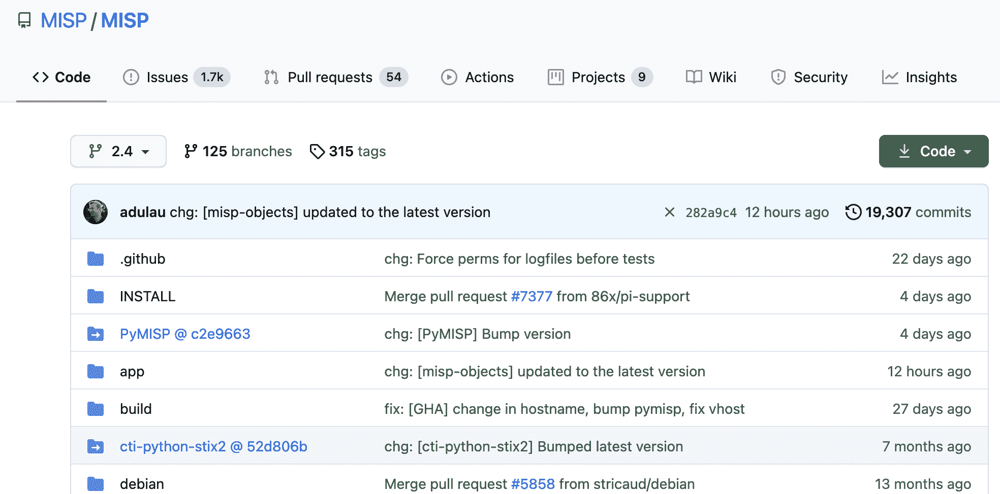

## Chapter 3. DevOps and DevSecOps

虽然 DevOps 和 DevSecOps 的价值、重要性和采用率可能还有很多其他原因，但一个重要原因是 Web 应用程序的兴起。当你开始使用 Web 交付应用程序时，你的开发流程结构开始发生变化，因为部署可以并且经常比传统方法更快，而传统方法可能需要数月时间。一旦你的部署节奏开始加快，运维团队就需要承担支持该部署的负担——毕竟，现在是你的运维团队必须处理部署，因为客户不再执行安装。

随着运维团队在整体开发流程中拥有更多发言权，DevOps 已成为越来越普遍的一套实践。对其他人来说，使用 DevOps 也有优势。从业务角度来看，当然有降低总体成本的潜力。从开发团队的角度来看，有在产品生命周期内提高整体质量的潜力。

DevSecOps 是另一套正在获得大量关注的实践，同样由专注于 Web 应用程序开发的开发团队推动。尽管如此，简单地说 DevSecOps 只是将安全插入现有的 DevOps 文化是不够的。由于安全本身在很大程度上是一种文化，所以不仅仅是说“我们与其他事情一起做安全”那么简单。DevSecOps 是关于在整个开发生命周期中引入安全的实践。

本章将介绍 DevOps 是什么，以及它与 DevSecOps 有何不同。它还将介绍在组织内引入或支持这些理念可能需要的文化变革。

### DevOps

有句老话说，你只能在以下三个特征中选择两个：好、快、便宜。你不能同时拥有全部三个。想法是，如果你走快而好的路线，成本会很高。如果你追求好而便宜，交付就需要时间。快而便宜会产生质量低下。至少一直以来都是这种想法。暂不评论便宜，因为确定总体成本涉及更多因素，DevOps 重点非常放在好和快上。这不一定会带来成本。实现好和快的一种方式是尽可能自动化。很容易看出这如何带来速度，因为自动化应该比人工执行任务快得多。可能更难看出如何实现“好”。我们可以在继续讨论 DevOps 的好处时更详细地研究这个问题。

DevOps 文化可能围绕工具或工具链构建。正如名称所示，工具链从 SDLC 的开发部分开始，而不是更早的需求和设计阶段。DevOps 文化在很大程度上围绕自动化展开。从工具角度来看，开发阶段与实际开发关系不大，意味着工具不在使用的编辑器或开发环境中，而更多是关于源代码仓库，在那里源代码在多个开发人员之间进行管理。管理文件需要智能，以确保一名开发人员不会覆盖另一名开发人员所做的更改。

旧的源代码管理或版本控制解决方案可能要求开发人员在进行任何更改之前检出文件。这实际上会锁定文件，使其他开发人员无法检出。服务器上的某个版本被存储为记录版本。虽然在现代源代码管理解决方案中这本质上仍然是正确的，但出于你很快就会看到的原因，更多的控制权交给了开发人员，并且它变得更像一个分布式过程。

例如，如果两位开发者 Jon 和 Tom 使用像 `Git` 这样的常用现代源代码管理解决方案在同一个软件项目上工作，他们可以同时在同一个源代码文件上工作。这之所以可行，是因为如果项目管理得当，Jon 和 Tom 不会在同一时间处理同一行代码。相反，他们会对文件的不同部分进行更改。当他们完成更改并完全测试了自己的工作后，他们会将更改推送到 `master` 仓库。假设 Jon 先推送。当 Tom 推送他的更改时，`Git` 软件会告诉他已经存在一组他没有的更改。他随后可以将自己的更改与已存在于 `master` 仓库中的更改合并。Figure 3-1 显示了使用公共仓库 `GitHub` 管理的一组文件夹和文件。

一旦源代码的更改已提交到 `master` 仓库，软件就可以构建了。这是将源代码编译成计算机处理器原生形式的过程。并非所有软件都需要编译。有些软件会保持其原始的源代码形式。这对于解释型语言来说就是这种情况，例如 `Python` 或 `JavaScript`。对于解释型语言而言，构建是对源代码进行一次运行，以确保最近的更改不会导致失败。这在寻找语法错误方面与编译类似，但它不会像编译过程那样产生可执行文件。

此构建或构造步骤可以自动完成。如果开发者值得信赖，整个签入过程可以实现自动化，以至于一旦冲突合并，服务器可能能够将所有更改推送到软件的当前分支，准备好进行构建和测试。一旦构建完成并且所有文件和组件都已就位，测试也可以自动化。一种方法是确保在任何功能开发的同时编写测试用例。如果你要为软件添加功能，你需要开发一个测试用例来验证该功能。这应包括一个将实现该测试用例的小函数。然后可以执行这些测试用例以验证软件按预期运行。

除了由开发者编写的这些功能测试外，测试工程师也会编写可以自动执行测试用例。自动测试的一个优点是，通过/失败结果可以轻松绘制图表，以显示你在软件开发健康状况方面的进展。构建失败和测试失败都可能导致向相关方发出警报，以及在显示绿色/红色健康状态的仪表板上报告，让项目经理或业务领导者即时了解软件的状态。

一旦软件构建完成，检查可能导致用户体验后期出现问题的语法错误，然后进行测试后，它就可以部署了。这可能需要将所有必要的文件拉入一个可以安装的包中。也可能简单到只是将文件复制到指定位置。在许多情况下，应用程序的管理不仅是应用程序文件，还包括系统。部署计划可能包括如何构建组件的说明，这些组件可能是虚拟机或容器。

这时像 `Kubernetes` 这样的系统就可以通过管理整体应用程序构建和部署过程来提供帮助。你可能有多个包含整体应用程序不同方面的容器。`Kubernetes` 可以采用构建指令并创建容纳所有应用程序组件的容器。

所有这些自动化都是像 `Etsy` 这样公司每天进行 50 次部署的方式。开发和部署的这种速度有明显的优势——错误不会在生产环境中存活很长时间，因为快速的开发和部署会迅速用修正后的代码替换它们。你也可以在不必等待更长的开发周期来创建完整包的情况下快速引入新功能。可以在其他功能并行开发的同时开发和部署新功能。你需要在工具集中进行可靠的编排才能在 DevOps 世界中取得成功，但你会因此受益，因为你始终能够响应用户需求和市场要求。

### Cultural Change

正如我所说，DevOps 是一种文化。它要求项目团队中的每个人都认同应用程序的开发方式。DevOps 文化的两个重要要素是全方位的测试和自动化。自动化要求流程被写下来。一旦你将流程写下来以便自动化，通常以某种脚本的形式，该流程或脚本就可以被测试。这要求有人至少勾勒出流程，以便可以编写一些代码。对于一些喜欢临时操作的团队来说，这可能很困难。临时操作是质量的敌人，因为你永远不确定会做什么或如何做。仅仅让人们接受必须记录流程以便自动化的要求就可能具有挑战性。然而，一旦流程被自动化，该自动化就可以被测试。它是否做了它应该做的事情？同时，使用自动化，你既能获得速度又能获得质量。质量来自于测试的一致性和可重复性，而速度则来自于无需人工执行任务。

一些开发者习惯于软件的单体构建。DevOps 倾向于关注协同工作的较小组件，通常使用 Agile 开发流程。同样，容器化也支持这一点。从这个角度来看待开发和部署的一个很棒的方面是，更改可以是增量的而不是普遍的。你可能只需要重新部署一个容器即可对整体应用程序进行更改，而不必像单体软件开发方法那样构建和重新部署整个系统。

DevOps 方法的另一个方面是速度。传统的开发实践要慢得多。它们也不包括 DevOps 所期望或要求的沟通水平。DevOps 环境的速度意味着协调至关重要。更改需要沟通，这意味着需要打破信息孤岛。开发者需要与运维团队成员交谈。此外，开发者需要与测试人员交谈。测试人员需要向开发者提供反馈，以确保做出必要的更改来提高解决方案的整体质量。像 `Slack` 这样的沟通工具会很有帮助。它不仅能实现个人之间的直接沟通，还能实现群组对话以及其他能够实现协作的功能。

DevOps 中缺乏信息孤岛可能是需要克服的最大挑战之一，因为传统的软件开发更具信息孤岛性。幸运的是，至少开始向 Agile 开发迈进的团队可能已经开始打破一些信息孤岛。

### Critical Roles

随着对速度和质量的关注度不断提高，自动化变得至关重要。这意味着具备脚本编写能力的工程师对软件开发团队至关重要。自动化任务贯穿开发生命周期的几乎所有方面，包括软件构建和测试，正如前面提到的。除此之外，对系统构建的自动化也愈发重视。每个应用程序组件可能都需要自己的运行空间，这可能是一个虚拟机或一个虚拟化应用程序，托管在容器中。在任何一种情况下，应用程序在正确运行前都需满足某些要求。你可以从仅包含操作系统的基础虚拟机开始，也可以有一个空容器。在任何一种情况下，你都需要一些帮助来正确构建你的各个组件。

再次，这就是选择工具可以提供帮助的地方。然而，你也需要确保将工具与人员相匹配。`Kubernetes`可以帮助你在应用程序生命周期内进行大量的系统管理自动化，但你需要确保团队中有能够正确管理`Kubernetes`的人员。仅仅部署工具是无济于事的，如果没有合适的人员来管理它。

DevOps 的另一个重要要素是测试，因为质量是 DevOps 哲学的核心重点，并且通过坚实的测试策略可以实现更高质量。测试应从开发过程的非常早期就开始，由开发人员执行，这也是文化层面的问题之一，因为开发人员通常没有接受过编写测试或测试用例的训练。熟练的测试工程师将必不可少。他们要么需要能够自行自动化测试，要么需要与自动化工程师密切合作来完成自动化。

这并不意味着所有测试都必须自动化，但部署速度依赖于这种自动化。任何需要手动完成的测试可能发生在部署之后。这长期以来一直是软件开发中的常见做法，尤其是在安全测试方面。DevOps 模型的优势在于，在部署后测试中发现的问题可以迅速得到解决。

### Cattle and Pets

并非所有系统或容器都是一样的。这就是你在 DevOps 圈子里经常会听到的“牛群与宠物”类比背后的思想。谈论这个问题的人可能从未与农民或牧场主交谈过，但基本原则是你对待宠物的方式与对待牛群或牲畜的方式不同。你期望宠物能陪伴很长时间，因此你会好好照顾它。牛被视为可消耗品，你可能不会像对待猫或狗那样在意牛。

应用于应用程序部署模型时，宠物是应用程序中必须始终可用且无法轻松搭建或拆除的核心要素。你拥有经过精心管理的固定基础设施。宠物的想法，或固定系统，就是你会给宠物命名，就像你可能会给永久系统提供有意义的名称一样。你不会随意拆除基础设施系统，就像你不会在任何事情发生变化时就丢弃宠物来替换它一样。

另一方面，牛不会以任何有意义的方式命名。牛也是可消耗的。如果你损失了一头牛，你会用另一头牛来替换它。将此应用于应用程序部署领域，你可能拥有大量易于按需搭建和拆除的虚拟化组件。

再次，工具在这里很有帮助，以便以适当的方式管理生命周期。你需要在应用程序设置中区分你的宠物和牛群。你应用程序的某些组件可能需要设置为永久性的。其他组件则不是永久性的，而是按需构建。一些 DevOps 倡导者可能会争辩说，你的整个应用程序都应该像使用牛群一样开发。记住，当你使用云提供商基础设施等外包模式工作时，你为系统每运行一分钟、使用资源的时间付费。如果你能开发应用程序，使组件仅在需要时实例化，你就可以节省一些费用。

这要求你拥有能够快速实例化组件的机制。这也要求组件设计为快速部署。这意味着在前期做出设计决策，以便每个元素尽可能精简。记住，系统上线以响应用户请求所花费的任何时间，都是用户等待该请求得到满足的时间。

### DevSecOps and Shifting Left

现在将你所学到的关于 DevOps 的一切加上安全。听起来很容易，对吧？好吧，安全也是一种文化。归根结底，安全是一种文化。技术并不能解决安全问题。人们解决安全问题。如果一切都关乎技术，到处部署防火墙就能阻止持续的数据泄露发生。然而，事实并非如此。这意味着要实现 DevSecOps，你不仅需要增加安全人员，还需要让整个团队具备安全意识和实践。

DevSecOps 必须从软件开发生命周期的最开始就启动，如 Figure 3-2 所示。传统上，安全甚至不是软件开发的一个要素。几十年前，系统之所以受到保护，是因为只有少数人会接触软件。然后，突然间，一切都互联了，系统和应用程序可以被怀有不良意图的其他人访问。保护人们的个人数据以及企业的信息，如知识产权，正缓慢地变得更加重要，这意味着软件开发必须改变以减少软件被滥用的可能性。

向左移意味着尽可能早地在软件开发过程中引入安全。查看 Figure 3-2 并想象你如何在软件开发过程的每个阶段引入安全，同时记住这些是软件开发项目的核心要素，而非绑定于任何特定方法论。以下是你可以考虑将安全引入开发过程的一些方式。

#### Requirements

引入安全的最佳时机是在需求阶段。在后期阶段修复问题会带来显著的成本增加。在需求阶段解决安全问题可能有多种方式，但一个简单的方法是威胁建模，然后确保已识别的威胁有缓解措施。

#### Design/development

在设计和开发阶段，应始终牢记需求阶段已识别的相同威胁。产品运行方式的设计不应引入新的威胁，同时也应限制无法消除的现有威胁的影响。此外，开发人员应始终遵循针对其所使用语言的 secure 编程实践。这可能包括使用诸如风格指南等技术，以确保所有开发人员以相似的方式编写代码，这可能减少漏洞，同时也使源代码更易于阅读和日后修复。此外，在开发人员被期望编写测试用例的情况下，他们应接受培训以编写误用案例并针对这些案例进行测试，从而使他们的软件更能抵抗传递给他们编写的函数的错误或格式不良的数据。

#### Testing

所有需求都应在测试期间得到解决，但特别是在需求阶段识别出的任何威胁缓解措施都应进行测试，以确保缓解措施已到位并且有效。这绝对是一个应该测试误用和边界的情况。应引入违反规范的数据，以确保任何应用程序故障都是安全的，这意味着它不会给攻击者提供操纵程序空间或引入并运行代码的机会。

#### 部署

部署阶段可能是最关键的阶段之一，尤其是在 Web 应用程序或任何托管在网络环境中的应用程序的情况下。部署的所有系统和容器都应得到加固，这意味着应删除不必要的软件或服务，并且所有访问要求都应经过审查并严格控制。部署的目标始终应该是限制攻击面，这意味着攻击者无法从互联网或部署团队控制的网络空间中看到任何服务。

虽然我们谈论的是向左转移，但现实是，在向后推移开发生命周期时，安全应引入到每个阶段中。理想情况下，你应该从需求阶段开始，但在你拥有根深蒂固的开发流程和团队的情况下，将安全引入早期阶段可能具有挑战性。同样，你正在进行重大的文化变革，人们可能会抵制这种变革。可能更容易从最右侧慢慢向后推进，确保至少进行安全测试，然后慢慢向开发人员引入安全编程实践，然后再尝试在需求阶段引入威胁建模。值得注意的是，安全通常需要专门的人员，你可能找不到一个同时从所有阶段的角度理解安全的人，因此你将为开发团队增加额外的人手。

安全专业人员可能会对 DevOps/DevSecOps 模式感到不满。他们有时会觉得开发和部署的速度会牺牲安全。现实是，速度最终有助于应用程序的整体安全性，因为安全漏洞可以更快地修复并部署更新的软件。此外，转向一切虚拟化的部署模式也有助于安全。正如前面提到的，在系统永久运行的情况下，攻击者可以在其中永久驻留。如果你拥有更灵活的系统，例如容器模型，其中应用程序是虚拟化的，并且攻击者几乎没有其他可利用的东西，即使攻击者获得了对应用程序的访问权限，当该容器关闭时——因为它不再需要或已部署更新，因此现有容器被移除并启动新实例来代替——攻击者必须从头开始重新入侵该应用程序。

### 使用 Kubernetes 的 DevSecOps

就其本质而言，转向 DevOps/DevSecOps 只是为了让人类从那些最好由软件处理的流程中退出。一旦你将人类从方程式中剔除，你就消除了因错误、打字错误、无流程、跳过指令或人类容易出现的其他各种问题而导致的错误。这并不是说所有错误都是由人类造成的，自动化可以消除所有错误。毕竟，如果自动化系统收到的指令中存在错误，你只会让软件一遍又一遍地重复同样的错误。

随着自动化而来的是一致性，当然。你制定一个计划，让你的编排系统为你处理，你测试它以确保它按预期运行，然后让你的编排系统一遍又一遍地以完全相同的方式继续处理它，直到你改变想要完成的事情。

幸运的是，这正是 Kubernetes 擅长的领域。实现自动化有很多方法，包括大量基础设施即代码 IaC 软件，如 Ansible、Puppet、Chef 和 Terraform。然而，一旦你开始转向基于容器的模型，这些软件平台带来的额外复杂性可能就不再必要了。IaC 是关于构建系统并将软件部署到系统上，而 IaC 软件管理平台。如果你使用容器，你可以跳过系统构建，因为你不是使用系统：你使用的是容器，它们不一定需要 IaC 系统。相反，容器管理系统管理容器的定义，包括将驻留在容器中的应用程序以及该应用程序成功运行所需的所有依赖项。

减少复杂性通常是一件好事，尤其是在安全方面。运行的软件组件越少，尤其是从管理角度来看，可被利用的攻击面就越小。此外，这意味着出错的事情更少，这意味着系统或应用程序故障的可能性更小。故障通常意味着用户无法使用该服务。虽然你仍然可以使用你喜欢的所有 IaC 软件，如果这是你的 DevOps 工程师的偏好，但如果 Kubernetes 被广泛用于应用程序开发和部署，那么对于 Kubernetes 实现来说，这并不是严格必要的。

操作人员的另一项工作通常是监控应用程序的性能、负载和健康状况。Kubernetes 会处理这些问题，让操作人员的生活更轻松。Kubernetes 会密切关注其管理的容器，以确保它们按预期运行，并在需要时替换容器或添加额外的容器以支持应用程序的整体健康。

由于 Kubernetes 处理了操作人员通常关心的许多问题，整个开发团队可以专注于最重要的事情——确保应用程序满足用户需求——而不是花费大量时间解决操作人员高效支持应用程序的需求。与许多其他事情一样，让另一个系统处理低级任务，以便专注于最重要的事情，这是一个好主意。

### 总结

向现有开发团队引入 DevOps 可能需要重大的文化变革。确保所有团队成员接受差异需要大量工作，因为开发的重点转向速度和质量。仅速度的变化对某些开发团队来说可能令人震惊。实现速度和质量需要大量自动化。这对一些开发团队来说也是一个重大的变化，他们可能依赖于临时或严格的手工流程。转向自动化需要流程的正式化，因为你无法自动化临时流程。但并非所有开发人员或工程师都喜欢坐下来明确定义他们的工作。

同样，安全也是一种文化转变。安全通常被视为别人的问题。确保应用程序以使其能够抵御外部攻击的方式进行开发是最好的安全方法。这需要在需求阶段引入安全，在此阶段，安全成为每个阶段每个人的工作，直到软件开发生命周期的其余部分。

工具对于自动化至关重要。你需要确保所选择的工具集能够支持从源代码仓库开始，贯穿构建过程、测试和部署的开发。你还应考虑如何部署你的应用程序。你是在使用宠物——即你持续保留和维护的机器，无论是虚拟的还是物理的？还是在使用牲畜，其中没有任何东西是神圣的，一切都可以虚拟化，这意味着你可以根据需要将其移除。选择诸如 `Kubernetes` 之类的管理与编排平台可以帮助从宠物转向牲畜的过程，并保证部署的一致性。

在整个生命周期中牢记安全可能具有挑战性，但也很有益。安全专业人员应对 DevOps/DevSecOps 模式的可能性保持开放思维。通过对应用程序进行定期且一致的更新，以及测试和部署的自动化，能够抵御攻击具有很多优势。最后，任何部署模型中如果没有组件具有很长的生命周期，因为一切都已容器化并且不断被重新实例化，这将使攻击者的生活变得困难。

`Kubernetes` 再次成为 DevOps/DevSecOps 实践的绝佳补充，因为它允许运维人员必不可少的自动化，同时也有助于确保软件和依赖项的最新更新得以实施，这对应用程序的整体安全和健康是有益的。使用 `Kubernetes` 之类的工具可以帮助将重点从操作应用程序的底层方面转移到关注以用户为导向的应用程序方面，以改善整体用户体验。
