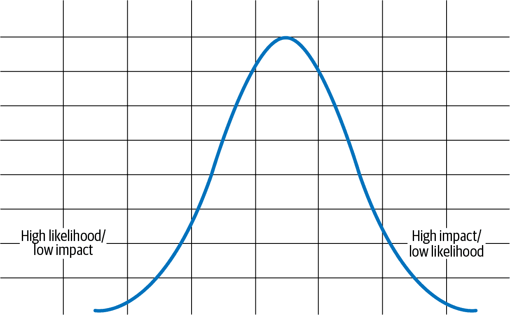
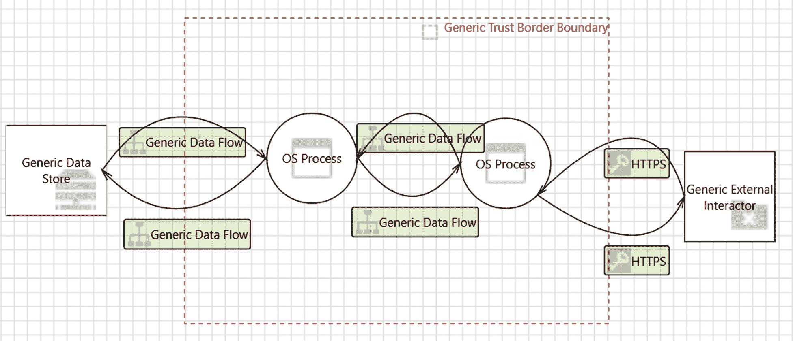
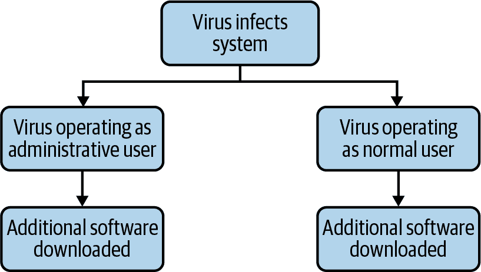

## 第 4 章 安全与需求

将安全引入系统开发过程的最佳起点是在需求收集阶段。虽然我们到目前为止一直在谈论软件开发，但实际上这是系统开发，因为当涉及到 Web 应用程序甚至移动应用程序的后端时，我们不再谈论单一的软件包。我们谈论的是多个组件，这些组件安装在虚拟机或虚拟容器中。这实际上使其成为系统开发，即使完整系统的目的是部署并提供对应用程序的访问。

在处理系统开发安全时，很容易惊慌并害怕一切。最好的方法不是试图解决可能出现的所有问题，特别是如果这种情况发生的可能性非常低。最好的方法是遵循在部署加固和安全编程方面的良好实践，但也要理性地思考可能残留的威胁。即使遵循最佳的加固和安全编程实践，也仍会存在被攻击的暴露，因为攻击者总会有入侵的方法。一旦有程序在运行，该程序就可能被滥用。出于这个原因，一些技术提供商，如 Microsoft，主张“假设已遭入侵”原则，即你在默示假设已经发生入侵的前提下运行，你的工作是找到它并阻止其扩散。

改进任何系统开发项目整体质量和安全态势的一种方法是先进行威胁建模练习。威胁建模的目的是识别可能被攻击者滥用的区域。一旦这些区域被识别出来，你就可以制定需求以消除潜在威胁，或者你可以专注于减轻威胁，这意味着你试图将威胁实际化后可能产生的潜在影响降到最低。

本章将更深入地探讨如何提取安全需求，主要通过查看威胁。一旦你识别出威胁，你就可以将这些威胁的缓解措施转化为需求。

### 风险与威胁与漏洞

软件开发组织可能会定期谈论风险，但当你在软件项目或系统项目的背景下听到风险时，风险通常与发布的时机有关，也就是说我们是否会按承诺的发布日期交付。从某种意义上说，这误用了该术语。风险的概念在信息技术社区中经常被误解，这导致该词被错误使用。

让我们从风险的明确定义开始。风险是基于事件发生的可能性而面临的损失。换句话说，当你说今天有下雨的风险时，你实际上只是在谈论风险计算的一半。你是在谈论高可能性，也许吧。你遗漏的是损失。如果下雨，今天你会蒙受什么损失？如果你正在举办一个户外活动，人们为门票支付了大量费用，而你也在准备上花费了大量资金，雨可能要求你退还门票，同时准备成本仍然损失。这就是损失。当你考虑到下雨的高可能性，即该损失发生的可能性很高时，你就有了高风险。你需要知道你将损失多少钱才能确定实际风险。

有两种类型的风险评估。第一种，也是更可取的类型，是定量的。这意味着你为可能性和损失分配数值，你会得到一个数字。有些人发现这很难，因为他们要么没有寻找或无法确定可能性值，要么发现为损失分配实际货币价值很困难。这种定量方法通常表示为将年发生率，即概率的表达方式，意味着一年中事件预计发生的次数，乘以单次损失期望值，你最终得到的是年化损失期望值。这是一个你可以分配给任何给定事件的数值，以便评估该事件与其他事件的风险。

由于他们发现为概率和损失分配值很困难，人们经常采用第二种类型的风险评估，即定性方法。例如，他们可能会使用 T 恤尺码——小号、中号、大号和特大号——来界定概率和影响。然后你取这两个因素的 T 恤尺码，最终得到一个你分配给事件的新 T 恤尺码。然后你可以使用这些 T 恤尺码来比较一个事件与另一个事件的风险。

比较一个事件与另一个事件的风险的原因是，任何情况下的资源都是有限的；你无法解决或补救每一个风险。这意味着你应该优先处理高风险事件。这也意味着你需要以理性的方法评估风险。人类有灾难化的倾向。他们认为高影响的事件是高风险，即使概率极低。想想在飞机上飞行吧。例如，有些人会说这是一个高风险事件，因为他们可以想象飞机在空中解体的创伤经历，这会导致死亡。现实是该事件发生的概率极低，但人们无法摆脱可怕的感觉，所以它“感觉”像是一项高风险活动。

这让我们来理解威胁。风险评估如果试图评估每一次潜在事件的风险，即使是那些极不可能发生的事件，也会变得枯燥乏味。正如前面提到的，企业资源有限，更理性的做法是关注更可能发生的事件。如果你想想钟形曲线，比如 图 4-1 中的那一个，高概率/低影响事件在一端，高影响/低概率事件在另一端，你需要关注钟形曲线中间的事件，因为损失最可能在那里发生。

找到钟形曲线中间的那些事件归结为识别威胁。由于我们受限于自己的想象力——只关注我们可能立即意识到的威胁，因为我们很难想象自己没有接触过的事件——威胁建模可能不是一件容易的事。这就是为什么拥有一个用于识别威胁的框架会很有帮助。我们稍后会研究一些常见的威胁建模框架，但我们应该先明确定义什么是威胁。威胁是由于漏洞被利用而可能导致负面事件发生的潜在事件。

漏洞由此延伸，指的是系统或软件中的弱点。人们可以通过触发它们来利用漏洞。然而，利用漏洞不一定是恶意行为。事实上，可能最好不要严格地将思维局限于恶意性质的行为。虽然恶意行为是坏的，但你也可能因为简单的错误甚至失误而产生严重问题。例如，在合适的因素组合下，一个失误很容易导致严重且长时间的中断。这再次说明，使用一个用于识别威胁的框架会很有帮助。

### 威胁建模

如前所述，在系统或软件开发中使用了几种威胁建模框架。虽然这些框架不一定能完美地确定威胁，但它们可以帮助你专注于最令人担忧的问题。当然，一旦你识别出威胁，你仍然需要知道如何减轻或消除它们。需要一定的实践和知识才能识别威胁以及威胁的缓解措施。正如你在以下讨论中会看到的那样，某些框架会比其他框架更好，这取决于你的组织如何看待威胁。你也可以混合搭配不同的威胁建模方法，而不是只使用一种。

这里需要强调的是，威胁模型的目标并不是消除威胁。在任何与用户交互的系统或软件应用中，尤其是远程用户，不可能消除威胁。开发威胁模型的目标是更好地理解复杂系统中的交互，以找到可以限制威胁显现的影响或可能性范围的地方。理想情况下，你将这些威胁带来的总体风险降低到企业可以接受的水平。我们将研究三种常用的威胁建模框架：`STRIDE`、`DREAD` 和 `PASTA`。

#### Note

风险的一个重要要素没有包含在之前的定义中，那就是需要知情。企业会定期基于风险评估做出决策。如果风险没有被清楚理解甚至识别，就不可能做出知情决策。假装风险不存在、错误识别可能性或影响，或根本不评估风险，都意味着企业没有做出知情决策。

### STRIDE

`STRIDE` 是微软于 1999 年引入的模型，是评估威胁的常用方法，尤其是在软件开发流程中。它基于该方法开发人员识别的一组威胁类别。以下类别构成了 `STRIDE` 缩写，有助于更好地识别复杂系统中的问题区域：

#### Spoofing

欺骗是某个实体试图伪造数据以假装成另一个实体的行为。这可能是某个用户假装成另一个用户，也可能是某个系统，例如 IP 地址，假装成另一个系统。欺骗会影响任何系统的保密性或完整性。防范欺骗的一种方法是强身份验证和数据验证。

#### Tampering

完整性是三个基本安全属性之一——保密性、完整性和可用性。篡改是指数据被更改，意味着它失去了完整性，因为检索时的数据状态与上次存储时不同。篡改攻击可以通过使用机器身份验证码等技术进行强验证来缓解。

#### Repudiation

否认是指任何实体能够声称自己没有执行某个操作。一个例子是某人写了一张支票，然后后来声称自己没有写支票，即使支票上有他们的签名。由于签名可能被伪造，如果没有证人，就可能无法确定是谁写出并签署了支票。任何无法明确归属于实体的操作都可能违反不可否认性概念。

#### Information disclosure

隐私泄露或数据无意泄漏是信息泄露违规。加密可以是防止信息泄露的一种方式，但它不是完美的解决方案，因为密钥可能被窃取并用于解密信息，导致泄露。没有适当密钥管理的加密不足以防止信息泄露。

#### Denial of service

任何时候应用程序或服务在用户期望可用时对用户不可用，都属于拒绝服务。同样，当用户期望能够访问数据而数据不可用时也是如此。这些类型的攻击并不总是可以防范，因为其中一些完全超出系统开发者的控制范围。然而，确保应用程序具有抗崩溃能力是一个好的开始。

#### Elevation of privilege

攻击者一旦控制了正在运行的进程，就会拥有该进程所属用户的权限级别。通常，这是一个较低的访问级别，这意味着攻击者通常会尝试获得提升或升级的权限，以便在已入侵的系统上做更多操作。任何从低权限级别移动到更高权限级别的能力都是权限提升，也称为权限提升。通过始终使用最小权限原则，即绝不给任何用户或进程超出其执行必要任务所需的权限，可以帮助防止权限提升。

了解这些类别有助于塑造你的威胁建模行动，但有时你需要一些额外的支持。微软提供了一个威胁建模工具，允许你绘制应用程序图，包括定义组件之间所有交互以及这些交互可能如何实现。你可以在 图 4-2 中看到一个示例图，它是随威胁建模工具提供的示例。一旦你绘制并定义了解决方案，工具将自动为你生成威胁报告。

该工具在制定威胁列表时遵循 STRIDE 模型，因此你会发现威胁是以前面讨论的类别来标识的。 图 4-2 包含诸如操作系统进程的潜在数据否认、潜在进程崩溃、资源的弱访问控制以及伪造操作系统进程等威胁。威胁建模工具的一个优势在于，它不仅能为你识别潜在威胁，还能提供管理这些威胁的手段，即通过重新设计系统并再次运行工具，或通过记录可能实施的缓解措施来降低威胁被实际化的可能性或影响。

### DREAD

DREAD 最初被提出作为威胁建模方法，但实际上，它可能更适合于风险评估，并且可以与 STRIDE 结合使用。一旦你识别出威胁，你就可以将每个威胁通过 DREAD 模型运行，以帮助清晰地识别可能由此产生的风险。一种用于定量评估的实现方式是为每个类别给出 1 到 10 的评级。你最终会得到一个数值来分配给每个威胁，这可以帮助你更好地推导出风险。这种方法的一个问题，正如风险评估的一般情况一样，如果没有硬数据，例如以往的经验，它是主观的。同样地，与 STRIDE 一样，DREAD 是以下列出的类别的缩写：

#### Damage

如果事件发生了，损害会有多严重？

#### Reproducibility

此事件发生的难易程度如何，即使其发生所需的努力程度或难度水平如何？如果存在广泛可用的概念验证或利用代码，则可重复性可能更高，因为它只需要攻击者能够找到利用代码的能力。

#### Exploitability

可利用性可能看起来与可重复性相同，但在攻击是否可以重现以及其可利用程度之间存在细微差别。假设重现攻击很容易，但在每次运行中结果却不同。并非所有攻击尝试都会让攻击者获得对系统的访问权限。有时，被攻击的应用程序只是摆脱了攻击。其他时候，攻击者获得了对进程空间的控制。在这种情况下，可利用性可能很低而可重复性很高。

#### Affected Users

会有多少用户受到影响？你也可以考虑受影响的用户类型。假设客户可以访问应用程序，但操作团队无法管理应用程序，例如。你可能希望考虑用户的级别，并根据他们获得访问权限的重要性对用户进行排名。

#### Discoverability

发现该漏洞利用是可能的难易程度如何？同样，这可能是漏洞和利用的详细信息是否在公开可用的一种函数。

正如你所见，这些类别中的每一个都可能存在很多主观性。微软曾在一段时间内使用此模型，但现在已不再使用。这里的一些类别与通用漏洞评分系统（CVSS）使用的类别相似，CVSS 使用一组因素为已知漏洞生成严重性评分。这可以帮助你做出关于是否快速修复漏洞或修复可以等待的决策。DREAD 可以以相同的方式使用：它是可用于确定对已识别威胁该怎么做的数据点之一。你可以在识别出漏洞后使用相同的 DREAD 模型进行漏洞评估。

### PASTA

PASTA 是攻击模拟和威胁分析流程，而不是像 STRIDE 那样的威胁模型，它是一个可用于识别威胁及其缓解措施的流程。PASTA 是一个七步流程：

#### 1. Define objectives

一如既往，在寻找解决方案之前更好地明确定义问题。不要试图一次解决所有问题，此步骤明确定义了本次评估的范围。你可能选择只查看关键资产或关键数据源，例如。你也可以在此步骤中定义工具和测试方法。

#### 2. Define technical scope

复杂系统有很多依赖关系，因此可能必须明确定义技术范围以限制调查。你不想挖掘超出你控制范围的库，例如。你可能希望将自己限制在系统的某一部分而不是整个系统。

#### 3. Decomposition and analysis of application

这就是你开始深入研究应用程序或系统的组成方式的地方。这可能与之前为 Microsoft 威胁建模工具所做的工作类似。你定义各个组件或元素，并识别信任边界。这就是数据可能从应用程序外部移动到应用程序内部的地方，例如。这意味着你是从不可信区域（用户所在的地方）移动到可信区域（应用程序控制数据且开发人员可能假设数据已被清理——作为一般规则这不是一个好假设，但这是一个说明为什么你可能会说一个区域是可信的的例子）。

#### 4. Threat analysis

基于情报来源，评估已知威胁。例如，你可能使用具有已知漏洞的组件，并且可能存在针对这些漏洞的利用，或者你可能因为使用的开发实践而暴露于常见的已知漏洞。

#### 5. Attack/exploit enumeration and modeling

在此阶段，你使用攻击树来模拟攻击可能是什么样子以及它可能如何运作。攻击树是图表化一个过程及其沿途的决策点或选项的一种方式。你可能根据模型中的路径做出不同的决策来处理攻击。攻击树的示例显示在 图 4-3。

#### 6. Analyze modeling and simulation

一旦你创建了攻击树，你就可以开始了解攻击造成的潜在损害。这是通过运行攻击模拟并确定其可能性来完成的。

#### 7. Risk and impact assessment

一旦你确定了可能性，你还应根据攻击成功执行的情况评估影响，然后确定风险。基于收集到的所有数据，你应确定可以实施哪些控制措施来减轻潜在攻击的风险。

你会看到 PASTA 是威胁评估的非常详细的方法，这里没有任何东西会必然阻止你将其他方法融合进来。你可以在寻找攻击和利用时使用 STRIDE，例如通过寻找信息泄露可能发生的地方。你也可以在进行风险和影响评估时使用 DREAD，以便更全面地了解攻击可能影响系统的方面。

### Summary

你在开发某物时总是需要一个起点。你需要在开始着手解决方案之前定义问题。如果不这样做，你怎么知道你的解决方案是否适合问题？如果没有明确的定义，你就会有一个在寻找问题的解决方案，这并不是尝试销售或推广任何东西的好方法。当谈到任何系统或应用程序的安全性时也是如此。你需要知道你是在防范什么，因为你无法防范一切。一个好的起点是识别威胁，这将帮助你更好地识别潜在的缓解措施来应对这些威胁。一旦你知道面临哪些威胁，你就可以开始根据已识别的威胁生成需求。

问题随之而来是如何识别威胁。可以使用一些方法，其中包括 STRIDE 方法，它识别六类威胁：欺骗、篡改、抵赖、信息泄露、拒绝服务和权限提升。在评估系统或软件时，你应该寻找应用程序可能引入这些类别中任一事件风险的环节。

另一个有助于更好地理解已识别威胁影响的框架是 DREAD。使用 DREAD，你需要考虑损害、可复现性、可利用性、受影响用户和可发现性。评估与这些因素相关的问题将帮助你更好地了解威胁的整体风险，因为它们会让你更深入地了解威胁被实际化时可能产生的概率和损失。

虽然 STRIDE 提供了类别集合，但 PASTA 提供了一个流程。PASTA 是攻击模拟与威胁分析流程。它是一种高度结构化的识别威胁及其影响和可能性的方式。要实施 PASTA，你需要能够解构应用程序，识别信任区域以及数据如何在不同组件间传递。一旦你完成了 PASTA 流程，你仍然可以使用 STRIDE 来识别类别，并使用 DREAD 来帮助理解风险。
