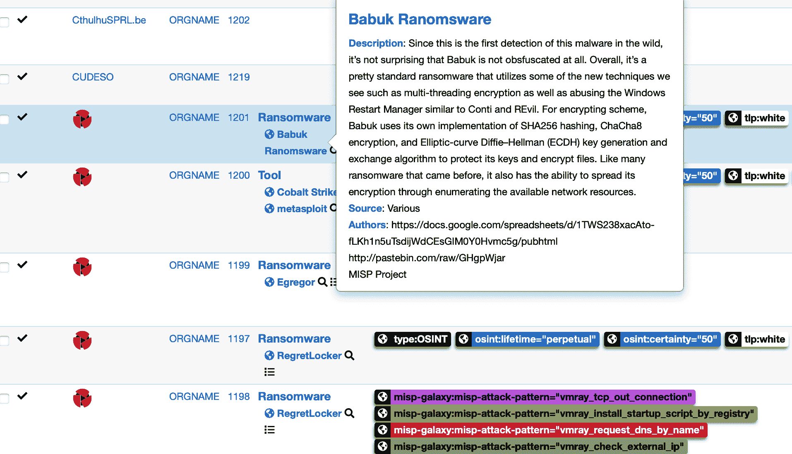
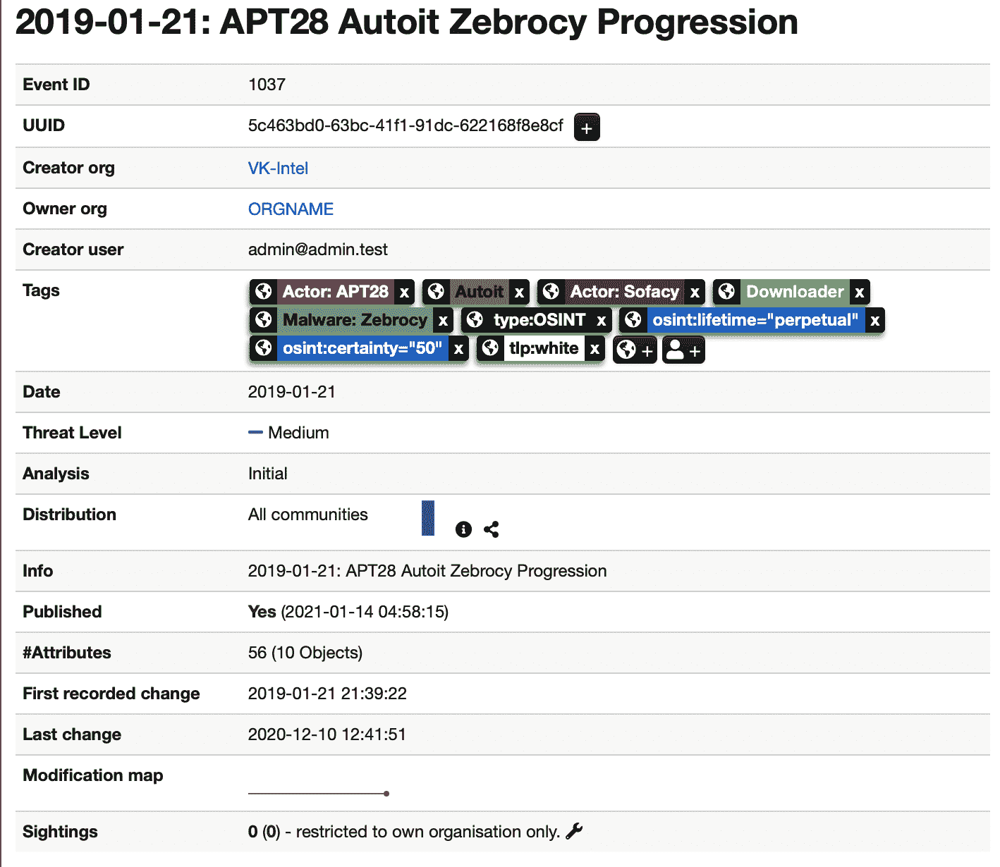
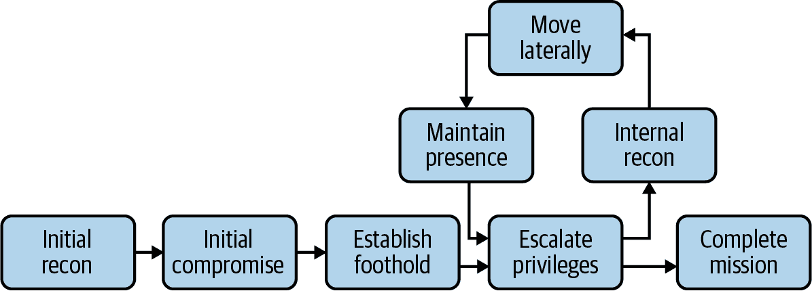
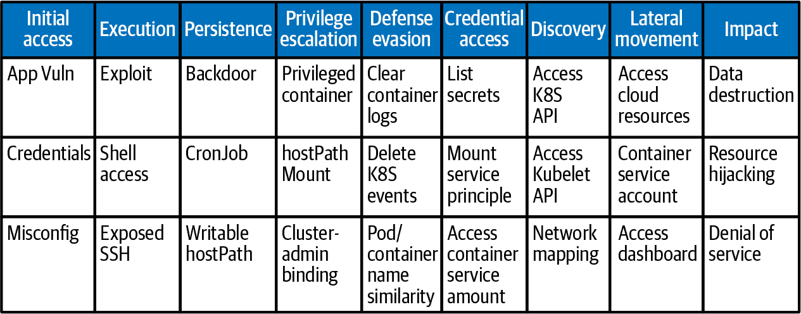

## 第 5 章 管理威胁

系统或应用程序开发人员面临的问题之一是复杂性。任何做成显著事情的应用程序都会因为应用程序中潜在路径的 sheer 数量而变得复杂。一旦你开始转向 Web 应用程序部署模型，你可能拥有多个系统，这增加了额外的复杂性。你现在拥有带有操作系统和应用程序和服务的系统。即使你使用云原生设计，你也必须处理可能出现和消失的虚拟化服务。版本控制是一个问题，因为不同的容器实例中可能运行着应用程序的不同版本。

所有这些都说明软件必须面对大量潜在问题。一切都始于威胁——可能困扰应用程序、软件或系统的任何潜在问题或故障。这可能仅仅是复杂性的结果。也有可能有错误数据被引入程序，导致故障。该错误数据可能是恶意行为的结果。

仅仅拥有威胁信息是不够的。你需要知道要对这些威胁做什么。总是会有你无法处理的威胁，但最好清楚地了解威胁，以便你能就可能的缓解措施做出明智决策。当然，在系统或应用程序开发的情况下，所有这些缓解措施都应纳入需求流程。

本章将讨论收集有关威胁的更多信息的方法，以及可用于更好地了解其影响的分类法。最后，我们将讨论使用威胁矩阵将威胁映射到缓解措施和优先级。

### 开源威胁情报

威胁情报可从多个来源获得。获取最新威胁情报最简单的方法是购买商业服务。但这不是唯一的方法。也有免费获取威胁情报的地方。其中之一是注册信息共享和分析中心（ISAC）。ISAC 通常按行业组织。例如，有金融服务 ISAC（FS-ISAC）以及信息技术 ISAC（IT-ISAC）。这些组织的目的在于为同一行业的人提供一个安全的地方来讨论问题。

威胁情报可以采用多种形式。通常，安全专业人员寻找的是入侵指标（IoCs）。这些是数据片段，可识别攻击者试图访问账户或网络时。 这可能是互联网地址、域名或可识别攻击者位置或已知恶意软件的加密哈希。在软件或系统开发的情况下，这些不太可能有用，因为目标不是在网络或系统中找到攻击者。相反，你想知道攻击者如何行为。这将有助于识别他们可能如何滥用软件或系统。我们寻找的是战术、技术和程序（TTPs）。

幸运的是，有很多 TTPs 的来源，即攻击者采取的行动。TTPs 的一个挑战是它们可能有很多。有一个地方可以存储它们以便轻松搜索是有帮助的。在安全运营组织中，这将是安全信息和事件管理（SIEM）系统。有几款软件可以为你做日志收集和分析。其中之一是开源威胁情报和共享平台， formerly known as 恶意软件信息共享计划，仍称为 MISP。

MISP 会以不同格式消费威胁情报 feed。然后它组织所有信息以便可以搜索。图 5-1 显示了 MISP 界面。图中看到的覆盖层是对 Babuk 勒索软件（数据 feed 中勒索软件拼写错误）可用数据的快速查看。

一旦你向 MISP 添加了一些 feed，你就可以开始浏览攻击者如何操作的更新细节。其中一些信息可能没有用。作为系统或软件开发人员，你可能不关心勒索软件运营商，例如。你会发现很多不同的类别可用，包括工具和威胁行为者。你还会找到攻击模式的条目。例如，图 5-2 显示了威胁组织 APT28，有时称为 Fancy Bear 的攻击模式细节。该威胁行为者使用注册表中的运行键等技术来实现持久性，这使攻击者能够在系统重启后保持恶意软件运行。

需要大量挖掘，但你可以通过阅读威胁情报 feed 了解攻击者如何操作，获得大量细节。即使超出威胁建模练习的使用，使用威胁情报 feed 也有一些好处。首先，这些 feed 会向你展示将安全引入产品开发生命周期的尽可能早的重要性，仅仅因为攻击者可以利用软件中任何潜在漏洞的方式。即使你的软件在任何方面都不是远程的，即没有网络监听器，攻击者仍有可能通过使用你的软件获得额外权限。

### 攻击阶段

在确定任何系统或软件的威胁之前，你需要能够对这些攻击可能如何运作进行分类。有两种很好的专业知识方式，并且基于数十年来观察攻击者如何操作，是攻击生命周期。

#### MITRE ATT&CK 框架

MITRE 公司有着开发惠及整个行业的分类策略的历史。近年来，MITRE 致力于开发攻击分类法，该分类法被分解为攻击者活动的类别或阶段。然而，这不仅仅是攻击者将经历的阶段列表。ATT&CK 框架也是已知的 TTPs 数据库。以下是该框架的阶段，包括攻击者使用的一些 TTPs：

侦察
：

攻击者要做的第一件事就是侦察目标，然后寻找有关目标的信息。这可能包括收集有关系统、人员或财务数据的信息。这可能通过使用开源信息来实现，而受害者可能永远不会察觉，也可能通过扫描受害者网络来收集详细信息，这更可能产生噪音且更容易被检测到。

#### 资源开发

在此阶段，攻击者正在为攻击做准备。他们可能会从可用来源收集账户信息。这可能包括为凭证填充练习做准备，通过收集已知的用户名以及大量已知常用密码。这还可能包括获取系统，无论是合法还是非法，这些系统将被用于发起攻击。

#### 初始访问

初始访问阶段是攻击者开始入侵系统的阶段。这可能通过钓鱼信息或在已知被使用的网站中植入恶意软件来实现。也可能通过使用可移动介质（如随处放置甚至递送给用户的 U 盘）来实现。在针对性攻击的情况下，发送给用户的社会工程信息被称为 spear phishing。这是因为这些用户是被具体识别的，而不是攻击者尽可能多地发送信息以获取尽可能多的人，而不管用户在哪个公司工作。

#### 持久性

获得初始访问是不够的，因为在某个时间点用户会注销或系统会被重启。攻击者希望能够在重启和登录/注销周期中保持远程访问手段。这可能通过 Windows 系统上的注册表项或任何操作系统上的计划任务来实现。也可能包括在操作系统启动前执行的恶意软件。

#### 权限提升

如果安全组织工作做得很好，公司普通用户的权限将被限制，攻击者入侵用户账户后将无法做太多。相反，攻击者需要获得提升或 escalated 的权限，以便能够执行诸如从内存中提取密码等操作。这可能涉及利用软件漏洞来获得额外权限。

#### 防御规避

大多数公司都会部署某种保护能力，即使只是基本的反恶意软件。攻击者必须进行一些欺骗才能绕过这种检测软件。他们可能通过加密数据或以某种方式编码来混淆自己的行为。他们还可能使用诸如 Windows 中的备用数据流等技术来隐藏数据，而某些检测软件不会在那里查找。

#### 凭证访问

攻击者将希望在网络中移动，从一个系统到另一个系统，以搜索信息或获取更多访问权限。他们可能通过从已入侵的系统磁盘和内存中提取额外的用户名和密码来实现，或通过对这些信息的存储库执行网络攻击来实现。

#### 发现

在寻找他们想要的信息的过程中，无论是可被货币化的知识产权还是个人信息，攻击者都会寻找可能包含该信息的其他系统和服务。这些信息可能来自搜索系统上的历史记录，包括用户访问的主机名。

#### 横向移动

横向移动是从环境中的一个系统跳到另一个系统的过程。这可以通过从受损用户向未受损用户进一步进行钓鱼来实现，或通过会话劫持，即攻击者劫持对服务的现有连接以自行获得对该服务的访问权限。

#### 收集

这是数据收集的过程。这可能是可用于进一步入侵系统的信息，也可能是对攻击者有用的数据——知识产权、信用卡信息、个人信息等。

#### 命令与控制

攻击者需要能够远程管理被入侵的系统。毕竟，攻击者并不坐在物理网络上，而且可能无法单独连接到被入侵的系统。对于攻击者来说，让被入侵系统主动连接到远程系统可能更容易，该远程系统将向受害系统发出命令。这些管理系统通常被称为命令与控制（`C2`）系统。

#### 数据外泄

攻击者需要能够检索他们收集的数据。这可能以很多方式发生，具体取决于已部署的保护措施。例如，攻击者可能通过将数据嵌入到知名协议中来将数据推出网络，因为这些协议最有可能被防火墙和其他形式的保护允许通过。

#### 影响

攻击者不仅仅寻找要窃取的信息。有时他们还希望操纵或销毁数据——甚至擦除系统。这可能一直是目标，也可能只是被当场抓获后试图在撤离时尽可能多地销毁，可能是为了掩盖其行为。

正如之前所说，这里有很多内容，并非全部都对你的情况有用。然而，这一框架将在你开始公司 Mandiant 的调查方法时为你的工具箱增添想法。这张图表显示了攻击者从侦察到完成任务所经历的所有阶段。这基于多年来对攻击者如何工作的观察。如果你回顾 1970 年代和 1980 年代的知名渗透事件，包括 Kevin Mitnick 和 Chaos Computer Club 的事件，你可以轻松地将它们映射到这个攻击生命周期。

这与 MITRE ATT&CK 框架的区别在于，攻击生命周期更具针对性。ATT&CK 框架是一个分类法，而攻击生命周期旨在描述攻击者在现实世界中的运作方式。攻击生命周期的一个优势在于，它清楚地说明了攻击者在环境中后发生的循环或循环。ATT&CK 框架中暗示了这种循环，但由于该框架侧重于编目 TTPs，因此实际发生的情况并不那么清晰。攻击生命周期允许你将其可视化。

### 使用攻击矩阵

现在我们知道了攻击者是如何运作的以及他们做了什么，我们能做什么？一旦你通过威胁建模练习识别出软件系统面临的所有潜在威胁后，你就可以开始将这些威胁映射到 ATT&CK 框架或攻击生命周期的各个阶段，具体取决于哪种方式对你更有意义。威胁建模练习，无论是使用 STRIDE 还是其他威胁建模方法，都将生成一份系统或应用程序所有可能威胁的清单——或者至少是你能够识别出的所有威胁的清单。请记住，威胁识别需要一定的技能、经验和想象力。每项威胁都应归类到攻击者阶段之一，以便你更好地可视化基于这些威胁的攻击将如何发生以及何时会被使用。

我们可以使用微软开发的一个示例攻击矩阵来描述对 Kubernetes 安装的潜在威胁。攻击矩阵的一部分显示在 Figure 5-4 中。还有其他被识别出的威胁，但由于本文用于解释目的，没有必要对这些威胁进行穷举。我们将能够利用这里的威胁来演示如何在 DevSecOps 环境中使用威胁矩阵。专注于 Kubernetes 安全的公司 StackRox（现为 Red Hat 的一部分）已根据此威胁矩阵提供了如何更好地保护 Kubernetes 实施的指导。StackRox 在微软分析的基础上提供了一些关于如何缓解已识别威胁的细节。然而，我们将以不同方式来看待如何使用威胁矩阵并从中推导出需求。

让我们以其中一项威胁为例，谈谈如何基于它生成一些需求。一个简单的例子是暴露的仪表板。请记住，并非所有威胁都是由正在开发的应用程序引入的；它们可能涵盖你为支持应用程序或系统而使用的任何应用程序、平台或管理软件。在 Figure 5-4 中显示的简略矩阵中，暴露的仪表板将属于配置错误。针对暴露仪表板威胁的需求是 Kubernetes 仪表板将不会对任何未知系统或网络可用/暴露。这意味着我们需要确保用于监控和管理应用程序内所有虚拟化的 Kubernetes 仪表板只能从已知网络设备访问。此外，Kubernetes 仪表板应仅对通过多因素身份验证进行身份验证并被分配了适当角色的授权用户可访问。

你可能会注意到，这组需求并未定义实现方式。需求随后会贯穿整个系统开发生命周期。从设计角度来看，Kubernetes 仪表板可以放置在虚拟网络中不可访问的位置。你可以实施网络安全组来限制对已知 Internet Protocol（IP）地址块的访问。此外，你需要设计适当的身份和访问管理，以便强制用户使用多因素身份验证。你还需要制定适当的流程，以确保已配置的用户应有权访问仪表板。

在设计阶段之外，我们还需要向测试阶段引入需求。测试组应获得此需求。他们应测试以确保在完成的应用程序中，仪表板未暴露且无法从未知网络段访问。他们还应测试以确保所有用户都需要多因素身份验证。他们在测试方面几乎无法做太多来确保只有适当的用户获得访问权限。这取决于流程中后期的其他人。

部署阶段也必须纳入考虑。部署团队需要确保应用程序根据规范进行部署。在这种情况下，由于我们使用的是 Kubernetes，将会有自动化来管理部署。一旦开始自动化，你可以验证规定部署的脚本或配置，并测试脚本以确保其按预期运行且结果符合需求。

美国国家标准与技术研究院（NIST）为联邦机构的信息安全提供了大量指导。NIST 的网络安全框架（CSF）将安全运营分为以下阶段：识别、保护、检测、响应和恢复。在开发应用程序和部署系统时，这些阶段是有用的考虑因素。

到目前为止，我们一直专注于保护，但安全远不止于期望能够阻止所有攻击发生。在许多情况下，你可能会发现攻击流量看起来像是合法使用。这就是 Kubernetes 仪表板暴露的情况。利用 Kubernetes 仪表板公开暴露的攻击将使用与授权用户相同的基于 Web 的请求。区别在于它们将来自不属于拥有该应用程序的组织的网络。这是部署后可以监控的事情。

部署的一个问题是它可能会漂移。人们对运行中的系统进行更改，从而改变配置和行为。一旦完成部署，你就需要管理和维护应用程序。这始终需要监控。你可以监控对 Kubernetes 仪表板的访问，就像示例威胁中考虑的那样，如果来自意外地址的访问成功，则发出警报。同样，你可以监控任何未使用多因素身份验证的成功访问。

虽然这是一个使用非常简单且易于管理的威胁的单一示例，但你可以看到该过程的工作方式。它可能耗时，但通过使用此过程，你可以更好地生成需求，这些需求不仅涵盖软件开发生命周期的全部范围，还可用于帮助检测针对系统或应用程序的攻击，从而使应用程序对攻击更具弹性。

### Summary

攻击者持续活跃，这有助于产生大量关于他们如何运作的信息。如果你在遵循基于威胁的应用程序安全方法，这将非常有用。使用威胁建模的一个问题是它需要大量经验或大量关于攻击者如何运作的信息。识别威胁并非易事。它们不会直接从书本或现有需求中得出。你需要了解大量 TTPs 才能为你的威胁概念提供信息。

幸运的是，有开源威胁情报工具可以帮助你扩展想象力并制定威胁清单。一旦你有了威胁清单，你需要使用 MITRE ATT&CK 框架或攻击生命周期等分类法对它们进行分类，以帮助你确定优先级。有些问题在你的控制范围内，有些则不在。你可能会发现外泄阶段中识别出的威胁可能不在你的控制范围内，也可能不是你需要担心的事情。

一旦你对威胁清单进行了分类，你就可以开始生成需求。你应该在软件开发生命周期的所有阶段考虑需求。威胁可能在设计/开发阶段得到缓解，但这些缓解措施应经过测试以确保其有效。此外，一些威胁可能在部署阶段得到缓解。威胁应始终从设计到部署全程跟踪。

你还应考虑部署之外可能必要的需求。毕竟，并非每一次攻击看起来都是异常的。事实上，你可能要考虑大多数攻击很可能看起来是正常的，因为攻击应用程序通常使用它们所使用的协议和数据以及它们所理解的数据。这意味着你应考虑 NIST CSF 的阶段：识别、保护、检测、响应和恢复。你无法保护所有东西。你需要能够检测到那些无法被保护的坏事发生时。

了解攻击生命周期所有阶段的 TTPs 可以帮助你更好地识别对系统或应用程序的威胁。反过来，这可以帮助你更好地定义更全面的需求。
