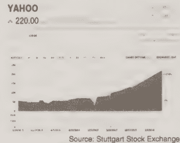

# 简介

2016年9月，曾经主导互联网的巨头雅虎（Yahoo）在与 Verizon 就出售事宜进行谈判期间，宣布其于 2014 年曾遭受数据泄露攻击。此次攻击泄露了 5 亿用户的姓名和联系方式。这是历史上最大规模的数据泄露事件。

三个月后，雅虎进一步披露，2013 年的一次泄露事件也影响了 10 亿个账户。除了姓名和联系方式外，客户的安全问题及其答案也遭到泄露。

不到一年后，即 2017 年 10 月，雅虎修订了报告，确认所有 30 亿雅虎用户均受到影响。

Verizon 的收购交易于 2017 年底完成，但这些泄露事件使雅虎的出售价格估计降低了 3.5 亿美元。

首席执行官当年失去了奖金。

2018 年 1 月，雅虎以 8000 万美元和解了一起集体诉讼。

**关键要点** ➡ **股东和潜在投资者期望对网络相关问题进行及时、详尽的披露。直面坏消息，并展示出真诚改正的决心。**

**图 I.1** 雅虎案例

让我们从图 I.1 所示的雅虎案例开始。

在泄露事件被完全披露之前，董事会向雅虎管理层提出了哪些问题？如果董事们在提问，他们是否理解答案，还是依赖他人来解释？

- 董事不会简单地问会计师数字是否正确。他们会学习如何阅读审计师的注释。
- 董事在不询问交易范围、条款和风险的情况下，绝不会批准一项交易。他们会询问有关行业、法规以及他们需要知道的其他事项的问题。

但在技术决策方面，许多董事依赖员工来了解风险并知道投资什么。无论是出于恐惧还是无知，大多数公司董事都没有提供有效的治理。

_Duty of Care_ 涵盖了您成为高效且自足所需的一切。
