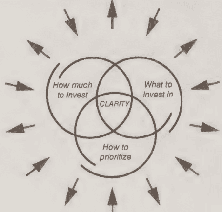

# Chapter 9 – 监督

2017 年，飓风厄玛（Hurricane Irma）远离预期登陆点，佛罗里达州纳波利斯（Naples, Florida）等城市承受了主要损失，因为它们不知道需要做好准备，而该州东海岸的城市则做了超出所需的准备。风向会转变，天气模式难以预测。

技术治理就像在完美风暴中管理，因此你需要了解外部因素，才能知道风暴眼实际上将在哪里登陆。参见图 1.3。

## Figure 1.3 The External Factors

从积极方面看，推动和拉扯的风力可以使技术治理成为一个独特的机会。这是你可以直接影响投资结果的少数领域之一。仿佛你可以买入一只股票，然后在董事会中做出影响股价的决策。

从消极方面看，这些风力也是风险的放大器。每一次误判都可能通过速度和规模被放大。

治理专家正趋于一致的观点是：“当重大战略投资失败时，董事会说他们已将责任委托给 CEO 是不够的。”⁴ 董事会拥有以下内容在战略上至关重要：

- 进度的可衡量指标。
- 定义的结果。
- 对结果的定期监控。

任何低于此的都属于失败。5 就你的数字战略和技术投资而言，“注意义务”（_Duty of Care_）将驾驭这些主导风视为监督的功能。
