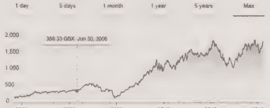
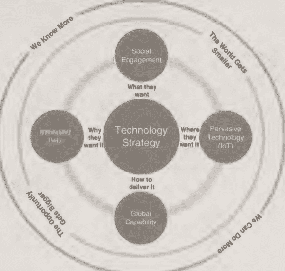
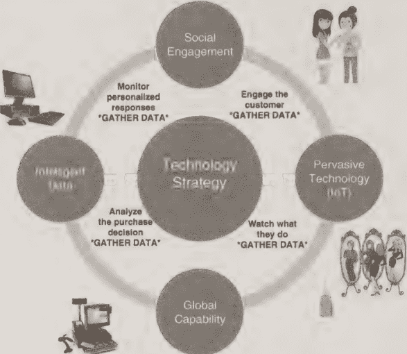

# Chapter 1

## 基础与要点

2006 年，经典品牌博柏利（Burberry）面临市场地位下降和显著的经营利润率挑战。它几乎从市场上消失。十年后，该品牌重回顶峰，成为奢侈品牌，很大程度上要归功于董事会和 CEO 花时间学习语言并投资技术。

# 市场摘要 > 博柏利集团（Burberry Group plc）
LON: BRBY

# 1,808.50 GBX +0.00 (0.17%) ↑
May 14, 4:00 pm GMT+1 › Disclaimer

|    |    |    |
|---|---|---|
| Open | 1,804.50 | Div yield |
| High | 1,812.00 | Prev close |
| Low | 1,804.50 | 52-week high |
| Mkt cap | 7,218 | 52-wk low |
| P/E ratio | 25.77 |    |

Source: London Stock Exchange

博柏利将其完整的品牌体验转移到社交和移动平台。这一决策为热爱零售的千禧一代提供了无与伦比的访问途径。策略包括 2009 年的“雨衣艺术”（Art of the Trench）社交网络网站，提供引人入胜的生活方式参与。2012 年，该品牌在其 2012 年雨衣系列上进行了预发布，与 Instagram 和 Twitter 绑定的“立即购买”计划。继续创新，商店配备了与商店内 RFID 传感器相连的直播功能，因此如果顾客拿起一件商品，附近屏幕上将播放相关视频。

博柏利现在正与微信（WeChat）等创新者合作，在其零售店提供沉浸式体验。结果是毛利率从 59% 增加到 76%，经济利润从 9200 万美元增长到 4.35 亿美元，10 年来的总股东回报（CAGR）为 17%。股价说明了一切。

**博柏利案例的要点 ➤ 期望你的业务战略团队为你提供洞察，并帮助你了解新技术如何解决业务问题。**

## Figure 1.1 The Case of Burberry

博柏利的转型并非始于 CIO（参见图 1.1）。它始于 CEO 和董事会提出问题。本章将为你提供提出问题和理解答案所需的词汇。

几点说明：

1. 并非所有讨论的内容都与你相关，但你应该理解所有概念。如果你不知道某项技术存在及其功能，你怎么知道何时考虑它？
2. 许多技术人员喜欢使用晦涩的表达。他们使用过于复杂的词汇。不要让不熟悉的词汇阻碍你的理解。
3. 你的 IT 领导者正在通过他们每天做出的战术决策来制定战略。你的公司可能不得不长期与这些决策共存，并且这些决策可能会极大地限制你的选择。你需要设定方向，使战术决策保持一致并起到推动作用。

一名称职的董事不需要深入了解每一项新技术或趋势。事实上，变化的步伐使得即使是技术领导者也无法跟上每一个新概念。你可以通过理解影响技术的四个关键动态，并定期重新校准你对业务影响的看法，来获得适当的工作知识。

一个简单的模型展示了基本理解的核心维度，如图 1.2 所示。

## Figure 1.2 Core Dynamics of a Technology Strategy

考虑该模型如何支持博柏利，如图 1.3 所示。

首先，他们在客户的移动设备上与客户互动，位于模型右上角象限（社交媒体与普及技术之间）。他们使用广告活动和店内促销，鼓励博柏利作为一个地点和品牌成为谈论的话题。像 Facebook 这样的工具让他们看到什么内容与客户产生共鸣——即什么正在流行——以便他们能够紧密保持一致，并在正确的时间以正确的方式向正确的客户传递正确的信息和促销。社交媒体和普及设备让他们看到客户在哪里以及他们在购买什么。

## Figure 1.3 The Example of Burberry's Strategy

除了让博柏利收集每位客户的个人信息外，社交媒体还让他们汇总来自客户扩展社交网络的信息；如果一位客户的推文或 Snapchat 照片导致其社交网络中的人查看更多博柏利信息，他们就知道自己有一个成功的产品或活动。

博柏利还通过使用镜子中的传感器和产品标签等普及设备，加大了数据收集力度。

### 社交参与

在核心动态模型的顶端是 _社交参与_。不久以前，关注点仅仅是社交媒体的力量，让人们关注你的公司。其杠杆作用来自让你的营销团队努力保持正面关注。今天，社交媒体已成为一种强大的参与来源，可以直接帮助你发展业务并衡量你的效果。

**社交媒体 ROI** – 社交媒体贡献者可以在四个方面进行衡量并提供洞察：

- 消费 – 你应该知道有多少人查看或下载你的内容。
- 分享 – 你应该知道你发布的内容是否正在获得势头。
- 潜在客户生成 – 你应该确切知道你的内容是如何产生潜在客户，或创造购买的真实兴趣的。
- 转化为销售 – 你应该知道哪些特定内容推动销售，并且你应该衡量这些销售的货币价值。

只要建立了正确的衡量标准，你的董事会就应该看到社交媒体与 ROI 之间的直接关系。

### 社交媒体杠杆

当你成为用户生活方式的一部分时，社交媒体的新力量就得以实现。这种杠杆作用来自可穿戴设备、传感器、游戏化和个性化等新技术。考虑一些示例：

- **Fitbit** 是一个可穿戴设备的示例，它通过使用传感器跟踪和报告活动水平，帮助人们改善健康和生活方式。
- Fitbit 用户也使用 Fitbit 应用程序。他们可以邀请关注健身的朋友加入一个群组，使健身活动成为一种共享的生活方式。通过鼓励健身爱好者在应用程序中互相挑战，Fitbit 创造了一个可以由社交连接的社区共享的游戏。使用类似游戏的功能来改善参与度的做法被称为游戏化。
- **Bing、Yelp 和 Yahoo** 是利用地理围栏转变其业务模式的公司示例，地理围栏是创建代表现实世界地理区域的虚拟边界。当你在线上，你的计算机询问是否可以识别你当前位置时，你正在使用的网站正在应用地理围栏，以便对你更具相关性。在移动设备上，应用程序会动态地提供与你所在的位置精确相关的购物和餐饮推荐。
- 零售商 Urban Outfitters 通过在商店中跟踪客户设备，然后发送与客户所在商店区域直接相关的优惠，使销售额增长了 75%。
- 我们之前的 **Burberry** 示例通过与客户实时交流，并让这些客户在社交媒体上与朋友分享他们的购物，将社交媒体参与提升到新的高度。参与度起作用了——客户购买更多。
- **国际机场** 正在利用迄今为止最强大的战略“社交”工具——个性化。通过知道应用程序用户在机场，并提供更快的值机或自动海关处理，机场现在提供与个人、地点和时间独特相关的优惠。这种以自我为中心的趋势也被称为物联网（Internet-of-Me）。

数字营销专家认为，这些结合的社交媒体体验正变得比价格或产品更重要：

- 到 2018 年，超过 50% 的公司将把投资重定向到客户体验创新。来源：Gartner
- 81% 的消费者希望品牌更好地了解他们，并知道何时以及何时不应该接触他们。来源：Accenture
- 60% 的营销人员难以实时个性化内容，但 77% 的人认为实时个性化至关重要。来源：Adobe

**社交媒体风险** – 围绕社交媒体正在发展一个重要的悖论。一方面，消费者希望他们的体验是高度个性化的，并且希望他们的品牌了解他们并相应地进行参与。另一方面，人们对社交媒体用户行为信息的使用方式日益关注。转折点出现在 Facebook 被发现出售其 8700 万用户的行为分析时。在此之前，大多数社交媒体用户似乎对自己的隐私权毫不知情或不关心。

Facebook 出售用户个人和行为数据将推动许多商业模式的根本性变革。透明度和同意的监管要求将产生巨大影响。作为董事，你需要准备好讨论风险。本章后面的智慧问题旨在帮助你平衡社交媒体中的机会和新出现的问题。

社交媒体的最后考虑因素是你公司自身的存在。即使你没有积极使用社交媒体，你的企业关系工作也应该包括了解（并管理）关于你的公司、你的高管和你的同事董事的言论。作为参考，图 1.4 提供了一些关于 *回应社交媒体存在问题* 的额外说明。

**关于社交媒体的最后说明** – 如果你认为社交媒体对你的公司很重要，你还需要了解分析和人工智能。关于这些概念的更多内容将在后面介绍。

### 基础与要点

许多治理对话集中在如何应对社交媒体对话倾向于负面的情况时。传统的危机管理学科适用：

**首先**，你必须知道它正在发生，并且是实时的。即使社交媒体不在你的雷达上，从定义上讲，社交媒体不是关于你的——它是关于你无法控制的影响者和意见的。你需要投入足够的资源，以便及时获得预警。

**其次**，你的组织需要有足够的信息来知道情况是否值得回应，或者是否可以预期会自行平息，最好不予置评。鉴于社交媒体的病毒式传播特性，在不利情况下风险因素会迅速扩大，时间不是你的朋友。这需要投资于关于谁在说什么、在哪里说以及如何说的情报。这并不意味着一群极客在社交媒体上搜寻对话。有很多可用的工具来监控社交媒体，并标记潜在威胁以供分析和响应规划——使用其中之一。

**第三**，考虑你传达的实际信息。几乎和拥有危机沟通计划一样重要的是承认你的错误。在 2018 年初的 Facebook 数据泄露事件中，扎克伯格花了将近一周的时间才道歉并承认情况，这使情况变得更糟（即便如此，他因提到“发生了什么”而不是“我们让发生了什么”而成为批评的对象）。如果你在使用社交媒体，你需要准备好承认它。

**最后**，看看是谁在制定你的社交媒体响应计划。你的社交策略，特别是事件响应，需要与你的企业形象紧密平行。不要让你的组织将这项任务默认给一个精通社交媒体但相对缺乏经验的发言人。实际撰写信息的人实际上正在推动你的社交策略。

- 为所有社交参与制定明确的业务政策和规则。
- 寻求更谨慎、更成熟的员工来管理你企业信息传递的这部分关键部分。

在《理解社交媒体》中，行业专家 Erik Linask 表示：“社交比企业责任更容易教导。”来源：Linask, E. _Making Sense of Social Media_, Techzone 360 (January 30, 2012)。

### 图 1.4 回应你的社交媒体存在问题

### 普适技术（IoT）

普适技术已远远超出了最初关于笔记本电脑、平板电脑或手机等便携式设备的概念。无处不在的连接性与功能强大的微型设备相结合，为新颖且独特的移动工具创造了机会。智能汽车和智能家电等技术，使互联网拥有了无限的能力来连接人、地点和事物。数字连接似乎仅受想象力和投资资本的限制。随着设备尺寸和互操作性的发展，一种名为物联网（IoT）的新维度已经形成。

一旦有人点击“发送”，信息或图像就已经出现在外面，并且永远无法真正撤回。商店可以通过在你购物时追踪你的行动来收集你的购买行为和偏好信息。一副眼镜可以伪装成视频录制设备。

IoT 是参与和销售的绝佳机会，但它也是同意和隐私方面的风险。接下来的三个步骤将让你在相关对话中自信地参与。

**首先，考虑可能性** – 思考移动设备是如何被使用的：

- 手机可以与汽车连接。
- 家庭监控系统可以让你保持连接，包括执行诸如锁门或通过手机查看谁在按门铃等操作。
- 冰箱可以告诉你需要购买哪些杂货。
- 汽车可以连接到交通监控，包括如果识别到障碍物就告诉汽车刹车的传感器。
- 汽车导航系统，使用 GPS，可以帮助驾驶员既找到目的地又避开交通。
- 手持设备有工业应用。例如，铁路场团队可以使用它们来确切知道移动库存的位置；娱乐场所工作人员可以在入口处验证合法门票；农民可以在田地里放置传感器来测试湿度并触发灌溉系统。

没有任何设备、产品或行业不受影响。移动设备不再是你祖母的车载电话了。

接下来，探索并欣赏趋势 – 曾经存在显著采用障碍的地方，移动技术现在已无处不在：

- 最新（2018 年）估计显示，95% 的美国人至少拥有一部手机。4
- 可以与移动设备通信的条形码扫描仪，让即使是最小的公司也能管理库存、提供促销并即时验证无限数量的属性。
- 跟踪和传输实时信息的传感器，正在彻底改变生鲜和冷冻食品运输等行业的质量控制和安全性。
- 模式识别正在应用于实际解决方案，例如为消费者提供在移动设备上拍摄产品照片，然后直接在互联网上搜索类似产品和竞争性定价的功能。

随着技术变得用户友好、准确且价格实惠，既有机会，也有风险。考虑 BlackBerry 早期忽视移动应用需求的决定。他们决定维持封闭架构，这意味着他们使得其他公司为其设备创建应用变得困难。不幸的是，这个决定意味着为 iPhone 开发应用更容易、更快且更便宜，因此 iPhone 占据了应用驱动市场的最大份额。BlackBerry 失去了市场份额，因为他们决定阻止后来成为一组核心功能的东西。

# 最后，将移动视为一种服务而非解决方案 –

成功的移动策略提供一种服务或功能。例如，Audi 现在通过让客户在共享手机计划中识别他们的汽车，将汽车变成了另一种移动设备。用户不再需要将手机连接到汽车即可访问手机服务——汽车本身就拥有这种能力。

此外，移动服务不再局限于其所在的设备。一旦服务开发完成，如果它基于新技术，就可以相对容易地移植到其他设备上。移动产品可能是一项基础投资，为你未来更广泛的产品做好准备。移动设备本身不再是差异化因素。区分你业务的是设备的使用方式、时间和地点。关注结果，而不是设备或服务。

例如，想象一下，如果一家杂货连锁店为你提供一个购物清单应用，让你在手机上保存清单，并且当你到达他们任何一家商店时，它会引导你走最直接的路线，进店购买所需物品并离开。使用该应用的忙碌客户会很快对该特定连锁店产生偏好。思考一下目标客户一天的生活，你就可以开始想象哪些地方和服务可能有用。

**关于普适技术在大型工业用途中的说明** – 关于移动技术的讨论往往倾向于消费者示例，因为它们对每个人都具有共鸣。移动技术也有重要的非消费者应用。例如，移动技术也被用于在合规要求严格的领域（如铁路和油田）中实现工作流程改进。通过使用射频识别（RFID）来监控检查，铁路可以在场内提供追踪，从而消除了对纸质追踪和班末报告的需求。

想象一下，如果拉克-梅甘蒂克铁路灾难中脱轨的列车配备了能够验证制动系统是否接合的传感器。一个警告信号本可以发送给机车司机，告诉他们离列车太远且未启用安全机制。危机得以避免。

投资移动技术可以让你以客户重视的方式区分你的产品。考虑 National 汽车租赁的“通道内任意车”策略。它让客户直接走到一辆车旁并开车离开。我们不需要知道 National 究竟如何实现这项服务，就可以想象可能性。我们可以猜测 National 知道客户已到达，因此可能涉及 RFID 与客户手机通信。National 还知道，无需人员介入，客户选择了哪辆车。这可能由近场通信（NFC）实现，即两个设备在识别彼此处于特定距离内时独立通信。

只需这些，客户就可以开车离开了。

继续思考可能性。可以通过使用传感器来匹配客户的移动设备和预订，从而消除服务人员。National 接下来可以提供的功能是预订中的“请来杯咖啡”设置。Starbucks 应用将知道他们偏好的饮料，客户可以在离开时取走订单。现在真的没有限制了。

即使我们不知道 National 究竟如何实现其服务，仅仅思考他们可能是如何做到的，也能让我们研究什么是独特或引人注目的。保持好奇心：

- 如果你看到有人用手机做有趣的事情，就去询问。
- 如果你看到新的消费者服务正在提供，就思考他们是如何做到的。

### 全球能力

全球能力，最著名的示例是云，指的是基于公用事业的服务。公司不再需要构建包含硬件、软件和操作系统的计算能力，而是可以购买一项服务，该服务提供所有所需的基础设施，并按指定的服务级别进行管理。在非云世界中，数据存储在特定位置，访问和集成需要投资来整合不同的数据源。使用云数据解决方案，数据可以在广泛的地点访问，并支持扩展的实时分析和运营效率。

移动技术无处不在，几乎每个行业都在不断突破极限。你至少需要知道足够多的内容以跟上步伐。

我曾经问一个 10 岁的孩子如何在我的全新最先进的 iPhone 上做某事（我曾是 BlackBerry 的忠实用户）。他刚教会我如何做我想做的事情，就告诉他的父亲，我拥有的手机浪费在我身上了。

不要生气；只需不断提问，直到你理解你所好奇的事情。

- 如果你看到有趣的东西，在 Google 上快速搜索会给你一些令人惊讶的见解。
- 与你的 CEO 和 CIO 一起头脑风暴你的客户或合作伙伴的“一天生活”。
- 询问你的 CIO 他们认为可能存在哪些移动策略机会。

云计算正在成为管理技术的默认方式，包括：

- 托管的业务服务，例如 Microsoft Office，用于电子邮件和电子表格。
- 作为服务提供的特定软件要求（SaaS），以支持财务会计和人力资源等业务功能。
- 集成的企业资源计划（ERP）业务解决方案，例如 SAP 和 Oracle。

现在只有最独特的企业才需要开发或定制软件来满足业务需求。购买服务而不是开发软件有很多优势：

- **货币** – SaaS 提供商维护最新的软件版本，因此您可以无缝访问最新且最好的功能。
- **纪律** – 健全的运营和合规纪律确保重要的软件更新保持最新。
- **度量和报告** – SaaS 提供商遵循标准流程，称为用例，将特定要求与定义且可衡量的业务成果相匹配。
- **灵活性** – 云成本模型基于消费量，因此您可以根据需要进行扩展或缩减。
- **集成** – 当解决方案包含多个组件时，例如作为 ERP 系统一部分的 CRM，软件将由服务提供商进行集成、管理和维护，从而降低与变更管理和接口维护相关的风险。
- **应用程序编程接口** – 与其维护独特的接口，不如 SaaS 提供商使用应用程序编程接口（API）来标准化系统之间的通信方式。

**关于集成和 API 的更多信息** – 让系统相互通信存在巨大的成本和风险。即使构建正确，只要任一系统发生变化，就必须对接口进行测试。API 使用标准协议和结构化构建块，因此接口更易于管理且更可靠。

一个类比就是过溪。在 API 出现之前，开发人员必须不断评估溪流中的所有岩石，并规划一条从一岸安全到达另一岸的路径。此外，随着水位的变化，或者过河的人跳跃岩石的能力更强（或更弱），开发人员必须不断调整策略并重新测试他们的假设，以确保下一个人能安全过河。API 就像建在溪流上的桥梁。水位上升与否无关紧要。过河的人是运动员还是儿童无关紧要。他们从桥的一侧进入，路径清晰地铺设出来，将他们安全送到另一侧。

当投资策略涉及新的应用程序软件或新的系统集成时，请具体询问您的投资是否利用了云、SaaS 和 API 的高杠杆世界。

### 智能数据

信息——如今被称为数据——是您投资技术的核心。一个简单的例子表明数据有多么关键：

要估计一个人的收入，我们可以从全球平均水平开始，即每年约 15,000 美元。如果我们知道该人是美国人，我们的估计就会跳升到美国人均平均收入，即 56,000 美元。如果我们知道该个体是一名 55 岁的男性，估计就会跳升到 64,500 美元。如果那个人在 IT 行业工作，则跳升到 86,000 美元。如果我们知道那个人是比尔·盖茨……5

每增加一条数据，就能提供更精确的情况视图。

### 重要基础

您的公司自成立或自业务计算开始以来一直在收集和存储信息。数据面临的许多挑战归结于这样一个事实：您可能已经收集了很长时间的数据。旧数据和存储在旧系统中的数据会带来独特的挑战。在 20 世纪 90 年代末和 21 世纪初，即使是最小的公司，数据也开始以惊人的速度积累。收集、增强和存储大量数据曾被视为一种荣誉。然而，其投资价值变得越来越不明确。企业领导者认为自己花钱是为了提高使用数据的能力，但实际上只是在投资存储越来越多的数据。

在批准任何重大投资决策之前，您应该确切了解自己在投资什么。作为参考和基本词汇，图 1.5 解释了计算机系统的实际组成部分。

**数据准确性** – 关注数据会带来一个新挑战——即确保数据正确。出现准确性问题和缺失并不罕见，但您应该了解原因。解释包括：

- 数据来源。直到最近，系统尚未集成，因此数据来自不同的来源。数据的组合方式可能导致不匹配。
- 时间。数据通常以不同的间隔更新，因此并非总是最新的。此外，在月末或季末等关键时刻会进行调整，更新时间的不同可能会造成缺失。
- 定义。通常会使用多个术语来描述不同的项目。关于使用哪些数据的不同假设可能会导致缺失。
- 博弈。会计和报告法规已经降低了再次出现安然事件的可能性，但运营决策仍然可能影响所报告的结果。为了展示偏好的运营视图而管理数据是一个特别棘手的缺失。

董事必须警惕决策是否基于准确的数据。请参阅第 9 章 监督，了解解决旧系统和历史数据源挑战的方法。

思考部分，也称为容量或 CPU（中央处理器），是计算速度，其能力以 GHz（吉赫兹）为单位衡量。从 Atari 的像素化火柴人到今天清晰、超现实的图形，这一历程展示了计算能力的增长。计算机思考部分对您战略的风险在于：

- 速度 – 思考不够快。
- 智能 – 灵活性不足。
- 年限 – 旧计算机可能根本无法满足新技术的要求。

记忆部分，也称为内存。如果内存不足，您就无法保留特定的信息或图像。计算机需要记住的数据量呈指数级增长。对您战略的内存驱动风险将是容量和成本。

算法部分是编程，即告诉计算机该做什么。大量时间和金钱可能会浪费在并非实际需要的解决方案上。对您战略的风险在于，确保构建算法的人了解您想要实现的结果。

数据部分是使投资变得有价值的输出。无论是正在使用的有形数据，还是生成制造等高效产出的数据，总会有一个产出。对您战略的产出风险在于，在开始为编程花钱之前，需要交付的内容并不被充分理解。

# 图 1.5 计算机的四个部分

### 数据机遇

**Shazam** 是一家英国软件开发公司。他们创建了一款应用程序，可以“听”短暂的音乐或剧本片段，并识别该片段来自的音乐、电影、广告或电视节目。数据对 Shazam 核心业务的力量显而易见——他们存储了大量的数字内容，该应用程序只需几小节音乐或几行剧本就能匹配样本。

但这并不是商业模式中最有价值的部分！Shazam 还可以在歌曲登上排行榜前最多 33 天预测哪些歌曲会成为“热门”（Knibbs, 2013）。他们使用基于多年唱片销售数据的预测分析。Shazam 实际上是根据其开发的数据资产提供完全不同的产品。

有很多例子表明数据就是业务。例如，考虑消费者忠诚度计划。数字忠诚度计划会收集会员行为的数据并分析数据，为每个会员提供相关价值。

individual member. They use the aggregated data to develop insight about the customer’s preferences. They predict what campaigns will work with that customer in the future.

Data will not be a new line of business for everyone, but directors need to strive to make the best use of data for their business and invest in those opportunities.

There are two observations that should guide your data strategy:

- “It is not how much data you have, but what you do with it that counts.”⁶ No matter how much data you have, if you don’t use the data to see patterns, trends, and gaps, it isn’t adding value. The right data does not magically happen; you must set out to build it.

- “The right data usually beats a better algorithm.”⁷ Get in the habit of asking clear questions so simple algorithms can give you a high degree of confidence in the result. Complexity is counterproductive—the more complex the algorithm, the more assumptions are being made about both the data and the desired outcome. Focus on common sense and the ability to understand what the data is telling you.

Start by keeping it simple and making sure that you understand the questions:

- Treat data as a supply chain:
  - If the data you are getting seems too complicated, keep asking questions until you understand what it is telling you.
  - If data seems too compartmentalized, identify the integrated view you expect to see, and keep asking questions until you get it that way.
  - Expect to see data that supports operational leverage.
  - Do not give up; demand that your business understands the data so you can leverage it.
  - Expect insight, not data in isolation or without context.
  - Expect external data sources to increase leverage and add value.
  - If you ask for analysis, communicate why you want it. Be clear on the questions you want answers to (rather than specifying what data you want).
  - Recognize that the first time you see data, it may not be right—there will be timing and definition gaps.
  - If you really need complex data analysis, you need to invest in a strategy, the skills, and the tools:
    - Recognize that giving an analyst a tool does not make them a data scientist.
    - Democratizing data analysis can be useful, but it can also simply add to the confusion and complexity.

The power of data starts with having the people, process, and technology in place to make productive use of it. What will drive value is keeping the focus on getting good answers to the right questions.

### 其他颠覆性技术

在核心动态之间，新技术不断涌现，可能会成为混乱或分心的来源。为了帮助您评估它们是否能增加价值，以及何时应该将其纳入考虑，本节将讨论：

- 人工智能（AI）
  - 自动驾驶汽车
  - 计算机视觉和语言处理
  - 机器学习
  - 机器人流程自动化（RPA）
  - 虚拟代理
- 区块链
- 脑机接口（BCI）
- 客户关系管理（CRM）
- 企业资源计划（ERP）
- 机器对机器（M2M）
- 智能软件

**人工智能（AI）** – 人工智能是机器执行通常与人类相关的认知功能的能力。AI 功能可以包括感知、推理、学习、解决问题、发挥创造力以及与环境交互。

认知功能（思考）如果不能付诸行动就没有好处，因此 AI 永远不会单独成为投资焦点。它总是与其他技术合作，以交付能够产生影响的行动。

AI 在现实生活应用中的示例包括（但不限于）：

- **自动驾驶汽车** – AI 加感知技术的应用，用于指示汽车采取行动。

- **计算机视觉和语言处理** – AI 加辅助能力的应用，用于理解视觉或听觉，并应用认知能力来做出回应。

- **机器学习** – AI 加数据访问的应用，用于构建和应用新算法以采取行动（IBM 的 Watson 是机器学习在行动中的一个工作示例，它汇集了大量医疗数据并制定洞察，以协助医生进行诊断）。

- **机器人流程自动化（RPA）** – AI 加软件和硬件的应用，用于执行手动的、劳动密集型的分析和分析。（从手机存入支票是 RPA 的一个示例，其中对签名等数据的数字识别与知道在图像中查看的位置的能力相结合，然后“读取”手写信息，如美元金额。存款被接受并移交处理，无需人工干预。）

- **虚拟代理**（也称为“聊天机器人”）– AI 加问题解决和学习的应用，用于识别来电者、解释询问的性质、回应情况，并在适当的时候将呼叫转接给真人客服。复杂的聊天机器人甚至能够感知高度的敌意或沮丧，并更快地将呼叫转接给真人客服。

AI 很复杂，成本可能很高。投资应有特定的应用和可衡量的结果。AI 是考虑试点项目或原型，或与具有经过验证的 AI 经验的提供商合作的好地方。AI 投资应允许在承诺重大投资之前验证潜力。

**区块链** – 区块链是一种记录保存理念，它维护唯一/安全的访问权限并保持数据不可更改。它更多是一个概念而非产品，因此我们将使用类比来使其更易于理解。

将区块链视为一个系统，由带内置复印机和气动输送管的可上锁文件柜相互连接而成。文件柜在存储文件时会自动复制文件。然后它们通过气动输送管将多份副本安全地发送到其他文件柜。该系统旨在安全地存储同一文件的多个副本，并将副本分布在许多连接的文件柜中。您可以从任何文件柜中取回文件，但您必须拥有钥匙，并且文件在所有位置必须完全相同，系统才会允许您移除它。

### 基础知识与要点

要理解区块链，文件柜就是“区块”。它存在于数字世界（而非物理世界），并由加密技术保护。与文件柜一样，存储的数据可以是文档、记录，甚至是加密货币。

文件柜之间的互连性，即气动输送管，代表“链”。链在文件柜之间发送和管理数据的多个副本。

与打开文件柜类似，数据通过“交易”放入区块。将数据放入区块的人需要拥有自己的唯一密钥才能将数据放入区块，并取出数据。该密钥就是加密，它是一串随机的比特，旨在在提供正确密钥时对数据进行打乱和还原。它提供了区块链的安全性。

一旦数据被放入区块，区块链就会将其复制到多个其他区块中进行安全存储。然后，当您想要从区块中取出数据时，区块链平台会检查它存储副本的所有位置，以确保所有副本仍然相同。如果链中的某个副本不同，您就无法从链中的任何位置移除该数据。这就是您的不可更改数据。

当区块链平台开发完成时，编程定义了区块和链。区块链还可以应用规则，以判定如果数据的任何副本不匹配时如何处理。区块链开发人员正在构建这些判定规则，因此技能和诚信至关重要。如果检测到存储副本之间存在差异，规则可以识别出需要某种干预，或者可以定义特定的区块更可靠或更不可靠，并相应地判断差异。

让我们来看几个区块链平台的实际示例，以帮助理解：

- 政府和文件登记处正在使用区块链来保护登记记录——例如，土地契据。在此示例中，登记办事处拥有存储已执行房产契据的加密密钥，而房产的合法所有者拥有稍后访问的加密密钥。当房产出售时，所有者的密钥与土地登记机构的密钥结合，提供执行房产转让的访问权限。然后新所有者接管加密密钥。契据是所有权的正确记录的保证来自于这样一个事实：契据已被复制到许多位置，并且所有副本都匹配。

- 渔业正在使用区块链来追踪其产品的流动，以确保持续的安全运输条件。当鱼被装箱时，一个温度传感器被放入集装箱，并在区块链平台中进行追踪。传感器在定义的间隔或检查点安全地记录温度，并维护运输温度状态的区块链记录。区块链平台的安全性确保追踪不会中断，并且记录在途中无法被修改。温度数据随后在接收端可用。

shipment, so the buyer has confidence in the freshness and safety of the product.

+ • 钻石和黄金公司（包括伯克希尔·哈撒韦公司（Berkshire Hathaway Inc.）的 Richline Group）正与 IBM 合作开发一种基于区块链的系统——称为 TrustChain——该系统将追踪珠宝的产地，以确保其来源合乎道德。预计该系统将于 2018 年底向公众开放。

+ • 一个私营非营利组织正在致力于构建基于区块链技术的全球去中心化身份系统。合作伙伴包括总部位于美国的 IBM，以及德国电信公司（Deutsche Telecom AG）的创新部门（Telekom Innovation Laboratories）。其结果将是不可更改的身份和公民身份记录，这将有利于安全和移民流程。

+ • 集装箱航运公司已与技术公司联手，升级追踪货物的庞大数据库，摆脱对数百万份纸质文件的依赖。该行业上一次进行重大变革是在二十世纪中期，当时转向了标准化集装箱。货物追踪的成功将需要全球制造商、银行、保险公司、经纪人和港口当局的参与。如果成功，目前需要几天才能完成的文档工作将在几分钟内完成，在大多数情况下无需人工干预。

区块链提供了一个强大的全球机遇，与行业无关。不要被市场对比特币和其他加密货币的关注所分散注意力。2018 年初经历的市场热潮与区块链本身无关；区块链只是用于创建产品的工具。

区块链并非适合所有人。如果规模、访问灵活性或访问来源的安全性很重要，区块链可能会成为你所在行业的颠覆者。另一方面，它是一种相对缓慢的处理方法，因此不太适合对速度有要求的大批量场景。

区块链也很复杂，这使得你的系统高度依赖于设计的完整性。如果你认为它可能相关，请考虑来自 IBM 和 Oracle 等信誉良好的供应商的可配置工具，这些工具将为你提供可审计的解决方案。考虑寻求熟练的帮助。使用试点项目来测试并决定区块链是否应该成为更大的投资重点。

### 其他颠覆性技术

**脑机接口（BCI）** – BCI 使用来自计算机的编码信息发送可以被理解为人类神经活动的消息。最突出的例子是人工耳蜗，它将声音转换为大脑可以识别的电信号。更戏剧性的例子使用植入式电极，例如植入事故受害者手臂的设备，用于产生手和手臂的运动。

数以千计的帕金森病患者正在从用于深部脑刺激疗法的 BCI 植入物中受益。先进的程序还包括刺激视觉皮层以帮助盲人、重新形成神经连接以帮助中风患者，以及电子监测以应对抑郁症的迹象。

更广泛的应用也开始出现，范围从思想到文本的打字，到埃隆·马斯克（Elon Musk）对人脑进行全面升级的愿景。只要有足够的时间和投资，所有这些场景都极有可能实现。成本和上市时间将是阻碍因素。

BCI 的根本障碍在于，植入物需要直接与大脑中的神经元相互作用才能有效。目前，要建立可行的连接需要在头骨上钻孔。除非是危及生命或不可逆转的退行性情况，否则需要时间来克服科学、技术和商业障碍：

+ - **科学上**，我们对人脑了解相对较少，因此对人体的实验仍在推动我们知识的极限，以及我们接受它们的意愿。

+ - **技术上**，无法通过骨骼和膜的多层发送高质量信号。替代渠道，如缩小植入物尺寸、无线技术、超声波和磁性，都在被测试以改进技术能力的范围。

+ - **商业上**，在获得医疗设备分销批准方面存在许多实际障碍。推测消费者不会排队等待脑部手术。另一方面，像激光视力矫正手术这样的程序曾被认为是极端的步骤。现在激光手术无处不在。如果我们能期待戏剧性的结果，似乎是人类本性会接受某些戏剧性的程序。

BCI 是市场创造性投资，而不是随意添加到你正在做的事情上。如果你所在的行业确实存在终局，请谨慎测试逻辑，以确保结果能够现实地实现你所设想的市场，并且在你可以负担的时间范围内。

# 客户关系管理（CRM） – CRM 是管理公司与当前和潜在客户互动的一种方法。CRM 系统有助于识别独特客户，在适当情况下绘制他们之间的关系，并从单一事实来源（数据库）管理与每个客户的互动。CRM 现在已成为现实，代表了管理客户、合作伙伴和供应商信息（包括历史和关系）的最佳实践。CRM 系统中收集的数据可以通过支持分析和行为建模来改善业务关系并实现增长。

30 岁以下的读者可能难以相信，但曾几何时，销售组织面临的最大风险是销售人员可能离职并带走客户的名片。然后公司不得不匆忙重建客户列表。CRM 取代了你销售团队的活页名片夹，让你对客户列表有清晰的视野和控制力。

CRM 可以为细分和保留等战略结果做出贡献，并且结合社交和移动平台的数据，它可以为变革性增长奠定基础。CRM 也已成为在整个客户生命周期中管理客户互动和数据的学科的流行语。

### 企业资源计划（ERP）

– ERP 是业务管理软件，可让你从互连的业务活动中收集、存储、管理和解释数据。该术语常被错误地用于指代总账（G/L）系统或更通用的会计软件。

正确使用时，该术语指的是一个集成业务资源管理视图（包括财务管理系统中的最终跟踪）的系统。ERP 是一项强大的战略投资，因为它支持并集成核心流程：

+ • 跟踪业务资源 – 现金、原材料、生产能力。

+ • 跟踪业务承诺的状态 – 订单、采购订单和工资单。

+ • 管理工作流以集成采购、库存、销售、市场营销、财务和人力资源等流程。

+ • 自动化后台管理功能，如应收账款（A/R）、应付账款（A/P）、开票和收款。

除了集成流程之外，ERP 还提供跨多个计算机化功能的单一事实来源的数据视图。真正集成的 ERP 使用共同的数据源，相同的数据在整个系统中共享和使用。

最初开发时，ERP 系统用于大型制造公司。它们可以高效地将供应链、仓库管理和销售订单处理与财务会计和报告集成。随着开发人员开始通过人力资源系统集成人力资源，ERP 进入了更广泛的业务基础，并开始在其他行业领域应用，以管理业务流程的全面视图。到 20 世纪 90 年代中期，ERP 供应商已涵盖所有核心企业功能。

ERP 解决方案的相关性继续增长，因为它们实现了端到端流程和单一数据视图的承诺。端到端（E2E）是一种消除尽可能多的中间层或步骤以优化流程或系统性能和效率的理念。

作为使用系统进行真正业务转型的示例，CRM 和 ERP 可以结合起来，提供从“线索”到“现金”的端到端流程：

+ • 与客户的第一次对话在 CRM 中被捕获——这就是线索。

+ • 价格和条款的讨论在同一系统中被捕获，并与线索关联。

跟踪收入创造交易的所有方面，通过端到端流程，使用 ERP 系统，可提供财务完整性和运营效率。

ERP 系统的一个新兴趋势是能够与其他公司的 ERP 系统进行交互。例如，当银行门户允许客户在线直接订购支票时，银行通过将其自身企业系统与支票提供商的系统集成，将客户直接连接到其供应商。将订单一直传递到支票提供商，对客户来说很方便，降低了处理支票订单的错误风险，并减少了支持账户所需的员工时间。

ERP 解决方案继续扩展功能，包括集成合规管理等新功能。它们还通过简化基于流程的操作来提高运营杠杆率和数据质量。ERP 可以是解决旧系统问题的良好战略投资。

**M2M (machine to machine)** – 机器对机器是描述数字设备之间直接通信的术语，无需人工干预。常见的应用通常包括工业仪器，例如装配线上识别多个部件到达可完成机器组装位置的传感器。更常见的例子是汽车刹车系统，它能感知道路上的障碍物，并自动减速或停止车辆，无论驾驶员是否采取行动。

**Intelligent software** – 智能软件是利用人工智能 (AI) 来追求定义的流程或目标，并在无需人工干预的情况下交付结果的软件。智能软件有很多示例：

- 能下棋或玩在线游戏的软件会被视为智能软件。
- IBM 的 Watson 使用智能软件来确定哪些医学案例与特定病例相关，并决定向医生展示哪些信息。例如，Watson 分析超过 300 亿个数据元素来形成基因组序列，并能够为单个患者推荐定制的癌症治疗方案。一个人类的基因组占用约 100 吉字节的内存，因此对于人类来说，这项分析是不可能完成的任务。
- Watson 的最新进展更进一步——提供医疗建议。例如，由 Watson 驱动的 Nutrino App 让孕妇注册该应用，输入她的妊娠状态、饮食需求、健康目标、食物偏好、饮食习惯，甚至来自 Fitbit 等可穿戴设备的数据。然后她可以向 Watson 提出各种关于妊娠的问题，例如“我该吃什么来缓解烧心？”Watson 搜索 Nutrino 的数据库，该数据库包含超过 50 万种食物和 10 万个医学来源，并应用深度学习来为个人定制答案。
- Netflix 使用智能软件来分析您的观看习惯，并推荐您可能喜欢的其他节目；人类构建了算法来匹配电影分类和标准，但这就是人工干预的终点——软件应用业务规则，每天做出数千个推荐，推动了 Netflix 75% 的观众互动。
- 监控您电子邮件环境以查找垃圾邮件和病毒的实用程序正在使用智能软件。
- 软件代理，包括机器人和聊天机器人，使用智能软件来提供复杂的客户服务功能。“机器人”以类似人类的特质（如自然语言理解、语音和个性）与人类互动，以减少或消除人员成本。软件代理的独特性质，由其名称中的“代理”一词定义，是它们是拥有权限来决定采取哪些（如果有的话）适当行动的软件。
- 像 Apple Siri、Google Assistant、Amazon Alexa 和 Microsoft Cortana 这样的虚拟助手也是软件代理。这些市场正在迅速扩张，朝着增值合作伙伴关系发展——例如，Alexa 正与 Toyota 合作，提供车内虚拟助手体验。

投资智能软件，与 AI 一样，需要明确的目的和结果。

根据 Accenture 的数据，自 2000 年以来，约 52% 的财富 500 强公司因数字商业模式对其行业造成的颠覆而破产、被收购或不复存在。⁸ 您的投资水平需要与数字技术对您所在行业产生影响的潜力相一致。使用图 1.6 中的 Smart Questions 来了解您的技术基础，并考虑新的机会。

### 了解您的技术基础的智能问题

- 我们拥有的技术是差异化因素还是提供杠杆？
- 谁在研究“哪些技术可能相关”并向董事会汇报？
- 我们的三年技术投资计划是什么？我们是否正在投资试点项目和基础事项，以便为下一次重要投资做好准备？
- 我们现在做出的哪些决定将在三年后限制我们的选择？

- 我们如何使用社交媒体，该策略的好处和风险是什么？
- 与我们的社交媒体投资相关的指标/结果是什么？
- 谁负责，我们的社交媒体响应政策是什么？
- 我们是否创建和策划可分享的内容？
- 我们是否共享或出售客户洞察？

- 我们的移动和普适技术策略是帮助还是阻碍我们在市场上的形象？
- 哪些移动或普适能力对我们的业务可能是独特或引人注目的？

- 我们的技术策略是否使我们具备灵活性和可扩展性？
- 我们的系统策略与五年目标之间存在哪些差距？我们现在正在做什么来弥补这些差距？

- 我们的数据是给我们带来杠杆，还是在阻碍我们？
- 我们的运营实体获取并信任所需数据有多难？
- 我们是否拥有使数据为我们服务所需的基础、工具和技能？

- 我们看到竞争对手投资的三项最重要的技术是什么？
- 我们看到供应商投资的三项最重要的技术是什么？
- 供应商或客户要求我们进行哪些我们无法交付的技术集成？
- 我们接下来的三项最重要的技术决策是什么？

**Figure 1.8** 了解您的技术基础的智能问题

### Notes

1. _Complete Guide to Measuring Social Media ROI_ (blog post), Statusbrew (December 13, 2017), https://blog.statusbrew.com/track-social-media-metrics-and-social-media-roi/.
2. https://www.marketingdive.com/news/how-urban-outfitters-leveraged-location-marketing-for-a-75-conversion-gain/436943/.
3. A. Betts, “The New Era of Personalization: The Hyper-connected Customer Experience,” MarTech Today (January 23, 2018).
4. Mobile Fact Sheet, Pew Research Center (February 5, 2018), http://www.pewinternet.org/fact-sheet/mobile/.
5. T. H. Davenport, Big Data atWork: Dispelling theMyths, Uncovering the Opportunities (Boston: Harvard Business School Press, 2014).
6. “Digital Business Era.”
7. E. Linask, “Social Media Is Responsible Business,” The Free Library (January 1, 2012).
8. “Digital Business Era.”

