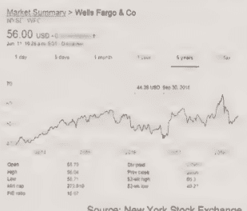

# 风险

2016 年，消费者金融保护局（CFPB）对富国银行处以 1.85 亿美元的罚款，这是该局历史上最高的一笔罚款，原因是有证据表明数百万个账户是在未经客户同意的情况下创建的。富国银行将交叉销售丑闻归咎于糟糕的销售文化，指出正在进行的补救措施，支付了罚款，并准备继续前进。

一年后，该银行意外泄露了超过 50,000 个账户的个人信息。

大约在同一时间，发现该银行向 800,000 名客户收取了他们不需要的保险费用。

同年，该银行错误地向房主收取了锁定抵押贷款利率的费用。

美联储介入，并将持续存在的问题评估为治理和监督根本性失败的结果。他们对富国银行实施了前所未有的制裁，阻止其超越 2017 年的资产规模进行增长。

富国银行于 2018 年 4 月与监管机构达成和解，金额近 10 亿美元。

富国银行的多起丑闻在披露前至少 6-12 个月就已被一线员工和管理层知晓。这些丑闻 100% 可以预防。该银行现在被视为企业级风险管理失败的典型案例，原因是无法证明任何监督或治理。公司现在必须：

1. 披露其管理风险的方法。
2. 展示董事会层面对重大风险直至一线的了解。

除了 2016 年的罚款和 2018 年的和解金外，富国银行还向受损客户进行了赔偿。

尽管其股价在 2017 年第四季度和 2018 年第一季度收益上升后有所回升，但由于行业创纪录的和解金新闻以及持续的系统性问题（包括 USAA 因专利侵权提起的诉讼），他们继续面临挑战。

富国银行案例 ➤ 董事会需要信任但要核实业务风险是否被充分理解，以及风险决策和缓解策略是否与董事会的期望保持一致。

**图 2.1** 富国银行案例

如图 2.1 所讨论的富国银行案例表明，董事会对风险管理中的缺陷负有明确责任。每个受监管的交易环境现在都在明确的治理法规下运行——在美国，即 SEC 规则 33-9089。强大的风险管理计划对于避免财务和声誉损害至关重要。

有两个明确的趋势：

## 1. 法规跟随行业事件

如下面的时间线所示，立法者试图在风险出现之前采取行动。此外，随着新风险的识别，我们可以预期事件影响越大，立法反应就越严格。

例如：

- 严格的支付卡行业（PCI）标准是在 2009 年 Heartland 事件和 2011 年索尼 PlayStation 事件报告后出台的。
- 在 Facebook 于 2018 年处理用户信息不当之后，美国各州正在通过新法规，以解决隐私和消费者信任问题。
- 2018 年提交给美国国会的法案包括《网络安全披露法案》，要求董事会要么具备所需技能，要么确定其获取所需建议和支持的策略。

图 2.2 所示的时间线将 2002 年以来的事件与监管发展相对应。

| 年份 | 事件 |
| :--- | :--- |
| 2003 | 联合国打击跨国有组织犯罪公约 - DDoS |
| 2005 | Heartland 医疗保健行业 PCI 问题（1.45 亿美元罚款，罪犯被判 20 年监禁） 酒店、博彩和娱乐行业报告问题 索尼 PlayStation 访问问题（7100 万美元净收入，1500 万美元集体诉讼） 美国人事管理局披露（2200 万条记录，高管辞职） Adobe、Target、Yahoo 记录被盗（约 1.5 亿美元和解金，Yahoo 估值受影响） eBay、JP Morgan、Home Depot、SONY 记录被盗（约 7.5 亿条记录，Home Depot 身份保护 50 万美元） SWIFT 银行网络、Artem Health、Ashley Madison、Banco del Austro 黑客攻击（SWIFT 2 亿美元，Artem 超过 1 亿美元 + 170 万美元和解金，Ashley Madison 1120 万美元和解金） UBER、英格兰银行黑客攻击（金融部门报告 4400 万次 DDoS 攻击） Equifax、Nissan Finance 黑客攻击 + DDoS 攻击增加 91%（Equifax 1.43 亿客户受影响，声誉受到重大影响） Facebook（超过 5000 万个个人资料被收集，WhatsApp 首席执行官辞职，剑桥分析公司破产） |
| 2008 | |
| 2010 | |
| 2011 | |
| 2012 | |
| 2013 | |
| 2014 | |
| 2015 | |
| 2016 | |
| 2017 | |
| 2018 | 支付卡行业（PCI）标准应对新兴威胁 SEC 报告要求 - 关于提供访问权限的注意标准 美国各州将黑客行为定为犯罪 [美国法规允许网络犯罪起诉 引入数字隐私法案 引入及时披露法律] 银行网络法规升级 [SEC 承诺 NIST 框架 其他司法管辖区增加预防措施要求] FISMA（美国）加强响应和结果法规 欧盟 GDPR 实施严格的隐私和同意法规，具有全球影响 |

**图 2.2** 事件与法规的对齐

## 2. 法规范围越来越广，处罚越来越严重。

新的欧盟通用数据保护条例（GDPR）于 2018 年 5 月 25 日生效。该法规将个人信息定义为任何可用于直接或间接识别个人的信息。它们要求对数据共享进行明确同意，包括：

- 同意必须清晰且可区分。
- 同意请求必须易于理解且易于访问。
- 数据将被使用的目的必须附在同意上。
- 撤回同意必须与提供同意一样容易。

该立法影响与欧盟进行业务交易的公司，包括参与欧盟管辖董事会的非欧盟居民。其影响在全球范围内都相关。罚款非常严重——收入的 4% 或 2000 万欧元，取较高者。最初的几起违规行为将迅速且按法规的最大限度进行处理。从长远来看，全球法规可能会趋于一致。

迹象表明，Facebook 将成为早期 GDPR 罚款的目标，原因是 2018 年 9 月 28 日宣布的数据泄露事件。隐私监管机构正在考虑最高 16.3 亿美元的罚款，如果被发现违反法规。

有三种独特的风险因技术而加剧，并可能影响董事履行对公司及其股东义务的能力：

1. 因数据泄露或运营失败而产生的*特定责任*风险。此风险类别称为**网络安全**。
2. 因风险监督缺陷而产生的*一般责任*风险。这些一般业务风险可以通过**企业风险管理**（ERM）计划进行评估和解决。
3. 因被视为重大虚假陈述（即**证券欺诈**）而产生的*诉讼*风险。这是一种新兴风险，但财务和声誉风险重大，因此董事需要了解风险领域。

接下来的三章将专门解决这三个风险领域。图 2.3 中的智能问题涉及您的整体监管背景。

- 谁负责监控与我们业务相关的法规？
- 新的或变化的法规如何与运营管理相结合？
- 是否有任何法规，我们处于独特的或明知的风险之中？

**图 2.3** 智能问题 – 风险
