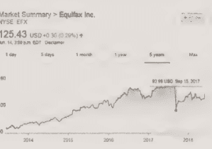

# 网络安全

在 2017 年 9 月，Equifax 宣布一起数据泄露事件影响了 1.46 亿条美国客户记录。该泄露事件据称发生在 2017 年 5 月，原因是一个在 3 月就已知晓但未得到充分修复的安全漏洞。

Equifax 的股价至今尚未恢复，股东们因此展开了严厉的诉讼。索赔包括：

- 未能保护数据系统
- 未能维持充分的监控
- 未能维持充分的安全性
- 实质性虚假和误导性的报告

此外，Equifax 高管在泄露事件披露前出售了约 200 万美元的股份。

近一半的美国人都受到了 Equifax 泄露事件的影响。它已成为网络安全基础的典型案例。

**Equifax 被收购案例** ➡ 作为政策和实践的问题，投资于可持续的网络安全基础。寻找证据表明最佳实践已应用于预防、检测和缓解，以便避免可预见的问题并快速响应新出现的问题。

# 图 3.1 Equifax 案例

### 网络安全

正如图 3.1 所示，网络安全正在不断发展。考虑过去两年的发展：

- 根据 2016 年的估计，大型公司在发生泄露后平均损失 2 亿美元。例如，当 Yahoo 将其网络服务业务出售给 Verizon 时，由于数据泄露，它不得不给予 3.5 亿美元的折扣。1

- 一项 2017–2018 年的调查发现，基于网络的勒索攻击已增加到与加密货币价值相匹配的程度。根据报告，网络攻击的主要驱动力现在是财务收益而非骚扰，且攻击正变得更加有针对性。全球范围内，42% 的公司遭遇了勒索软件攻击，比 2016 年的调查增加了 40%。报告的其他关键发现包括：
  - 四分之一的企业报告称遭遇过网络攻击。
  - 分布式拒绝服务（DDoS）攻击增长了 10%，影响了近五分之二的企业。2

- 平均每个网站会连接到另外 25 个（可能不安全）的网站以获取内容，例如视频片段或广告。3

无论您是在公共或私人董事会，还是在营利或非营利部门，您都需要花时间考虑三个关键领域：

1. **预防和检测** – 安全机制、自动化和教育需要如何发展来保护您？
2. **规划** – 您是否在做正确的事情？
3. **缓解** – 您正在做什么来避免或抵消影响，以及如果发生泄露您将如何响应？

### 预防和检测

网络安全最佳实践结合并平衡安全机制、自动化和教育。您需要提出足够具体的问题，以确认控制措施已到位，或采取行动进行改进。正确的做法分为三类：机制、自动化和教育。

**机制** – 有一组明确定义的事项，您需要将其到位、投入使用，并有效监控或强制执行。需要查找的具体事项包括：

| 机制 | 您需要知道的内容 |
|---|---|
| 政策和程序 | 政策和程序是内部行为的明确标准，以及员工在保护业务资产免受外部因素影响方面的作用。寻找简单、清晰、直截了当的政策，以便它们能被充分理解。您应该能够阅读政策并理解它。 |
| 用户身份验证和访问控制 | 用户身份验证和访问控制应成为管理系统的常规部分。这需要包括对任何异常活动的定期监控，以及定期审计以验证规则是否得到遵守。监督需要包括： |
| | 1. 物理访问和逻辑访问。 |
| | 2. 特定的控制级别，以便任何敏感数据都明确限制给需要它的人。 |
| | 3. 认识到某些数据和某些资产比其他数据和资产需要更多的安全性 |
| 防火墙、防病毒保护和补丁管理 | 防火墙、防病毒保护和补丁管理继续是保护您业务的基本基础。您的审计委员会应期望获得认证，证明环境具备： |
| | • 防火墙，以确保环境外部的不良事物无法进入。 |
| | • 病毒防护，以确保如果有邪恶事物进入环境，它会被包含并识别以便采取行动。 |
| | • 补丁管理，以便在主要供应商和供应商识别出新威胁时，让您保持最新状态。 |

监控让您能够检测环境中的异常活动并采取行动。图 3.1 中 Equifax 案例的一个重大缺陷是，他们不知道自己已经被入侵。您的团队应该能够识别任何异常活动。应采取行动，并将问题作为风险监督的一部分进行报告。

数据保护要求您：

1. 知道哪些数据可以被视为敏感数据。
2. 知道这些数据确切存储在哪里。
3. 知道数据是安全的。

### 预防和检测

| 机制 | 您需要知道的内容 |
|---|---|
| 一般业务安全 | 应使用防火墙和加密等工具，以避免可能暴露敏感数据的情况。一般业务安全帮助您避免已知的网络安全风险。您的计划可能包括对以下内容的限制： |
| | 访问可能不安全的外部网站，这些网站可能是病毒或其他恶意功能的来源。 |
| | 访问可能不适当的外部网站，如果访问行为被泄露，将存在声誉风险。 |
| | 访问可能不安全的实用程序，例如 Dropbox，可能会打开访问通道或启用更智能的网络钓鱼社会工程。 |
| | 从公司内部向外部方发送敏感或专有信息的能力，绕过内部控制并导致员工在盗窃或隐私泄露方面的暴露。 |
| | 这些限制保护员工和公司免受无意的网络安全风险。 |
| 白帽验证 | 白帽验证（也称为渗透测试）是整体控制计划的关键理智测试。无论您的业务规模或性质如何，都应定期进行，并且结果应成为网络安全监督的一部分。 |

| 机制 | 您需要知道的内容 |
|---|---|
| 自动化 | 自动化涉及技术的纯粹速度和容量，因此自动化安全管理至关重要。您的安全团队需要主动了解高风险活动所在，以便在造成损害之前采取行动。例如，网络上异常高的活动量可能表明存在拒绝服务（DDoS）攻击，这可能会阻塞您的网络并影响整个业务。自动化让您的安全团队立即知道，以便他们可以隔离网络的那一部分。网络运营中心（NOC）提供实时监控，因此团队可以一眼看出是否有任何需要关注的事项。寻找主动监控的证据以及随时间改进监督的计划。 |
| 教育 | 您的第一道防线始终是教育。所有员工都需要认真对待自己的安全责任，并认识到自己的个人责任。挑战您的 CIO 使计划变得个人化、有影响力且实用（而非技术性）。寻找针对适当员工知识的内部测试证据。董事会应获得每位员工接受的安全培训——您会立即知道它是否引起共鸣。 |

有方法可以防止大多数网络安全风险。董事会面临的挑战是知道这些方法正在使用。董事会的机会是承认为适当的安全态势所特别需要的活动和投资，然后展示健康的“鼻子进，手指出”纪律，以确保给予正确的关注。

### 规划

您需要做出的最困难的网络安全决定是，您是只想做必要的事情，还是想主动为业务面临的风险做计划。全球研究表明，过去五年中，超过一半的公司经历了全球数据泄露，而这些被泄露的公司中有一半发生了多次事件。4

需要规划的风险性质和范围每年都在增长，如以下注释所示。不主动行动会使您面临风险。

与供应商和业务伙伴的新集成水平创造了新风险。供应商集成正变得无处不在：

- 制造商与供应商集成
- 消费品公司与集成物流
- 公用事业和电信提供商与服务提供商

新的依赖项和合同要求需要与您的业务实践保持一致。

### 物联网（IoT）正在引入一种新的风险敞口。

能够接收电子指令而非由驾驶员控制的汽车、远程管理的交通信号灯和信号系统，以及计算机管理的公用设施（如电网和水坝），都为破坏提供了新的机会。对于参与数字化正在重新定义运营控制的行业的人员来说，规划至关重要。

### 数据泄露的成本非常高昂。

成本包括：

- 危机响应的公共关系需求
- 监管响应，包括罚款、法律费用和诉讼
- 法医技术调查
- 客户数据泄露通知
- 作为重新赢得客户信任策略一部分的消费者保护计划

鉴于您事后仍必须为网络安全进行规划和投资，不如一开始就做好。主动响应将保护董事和高管免受前面讨论过的诉讼情况。

### 数据泄露的隐性成本估计占总影响的 90%。

曾经发生过数据泄露的公司报告称，残余成本长达两年。隐性成本包括运营中断、资本成本增加、客户和提供商关系丧失、商誉贬值以及知识产权丢失。

### 网络安全变得越来越复杂。

风险已超出内部中断和财务风险。近期案例将声誉风险提升为同等甚至更大的关注点，示例包括：

- 泄露内部通信（索尼）
- 网络事件导致的内部（有时不可恢复）数据丢失（SWIFT 银行网络）
- 包括关键隐私泄露在内的外部数据丢失（Facebook）
- 知识产权泄露（索尼 PlayStation）
- 为牟利而劫持信息和资产（亚特兰大市）

网络安全计划只有作为整体技术战略的一部分而非附加项时才最有效。它需要持续关注基础安全措施以及战略变化带来的新风险。标准每年都在提高，因此年度规划和预算周期应包括主动的网络安全改进。

### 响应

每年我们都会看到新的安全漏洞。著名示例包括：

- 2013 年 – Adobe、Target 和 Yahoo
- 2014 年 – JPMorgan Chase 和 Sony
- 2015 年 – Ashley Madison
- 2016 年 – Uber
- 2017 年 – Equifax
- 2018 年 – Facebook、Saks Fifth Avenue

这些不幸的示例此起彼伏。在每个案例中，响应的质量和速度都会影响客户响应和监管决策。延迟和模糊其词会直接导致数据泄露带来的声誉和财务影响。

2018 年，Facebook 在应对重大数据泄露时多日延迟，损害了客户的善意。更糟糕的是，扎克伯格对公众情绪的误判意味着几乎任何回应都可能是错误。历史留下了线索；考虑到他业务的性质，他本应做好更充分的准备。

您可以采取一些措施来应对——并从——网络安全问题中幸存下来：

1. **寻求帮助。** 孤立您可能面临的具体问题，并制定网络安全策略，以便在发生问题时能够尽可能做出良好响应。提前做好准备。

2. **聘请专业法律顾问并关注您的保险。** 没有单一的立法或法规能够完全管辖任何问题，且法规不断变化。在发生数据泄露时，您需要既符合实际情况又在法律上正确的回应。您的保险公司可以帮助您找到最佳实践的起点，并能减轻最高风险场景。

3. **指定一名负责响应和决策的单一联系人。**

您的内部团队将进行调查并提供信息，但在发生重大事件时，董事会应发挥作用。事先做出简单的决定，例如谁有权向监管机构或投资者发出建议，通过设立单一决策者和单一沟通者来引导您度过实际情况，从而为成功奠定基础。

4. **制定沟通计划，并基本准备好沟通内容。**

沟通延迟会破坏即使是最有效的响应。请准备好计划和内容。

5. **在回应之前不要等待完美的信息。**

监管机构对隐私泄露通知的要求日益严格。如果您拖延，将失待愤世嫉俗的公众和媒体的耐心。预先计划的沟通可以快速界定背景事项，让您通过透露已知信息来保持透明。

6. **以事实为依据。**

不要说你不知道为真实的事情。分享你掌握的事实。在披露你为获取更多信息所做的工作时要真诚。在预先计划的响应结构中包含事实核查，以确保你不需要事后更正信息；这只会加剧怀疑。不要为了有话可说而编造信息。

7. **信任团队。**

规划响应结构和方法，然后信任团队。责备狂潮无法解决任何问题，并肯定会分散你应对的能力。只有在情况完全解决后，才应要求团队提供事后复盘。

8. **制定补救计划。** 您的 CIO 应能够在发生数据泄露时为人员、流程和技术提供基础计划。寻找证据表明计划已定义并经过测试，以支持董事会层面的整体响应和沟通计划。计划应规定谁在何时做什么，以及（视情况而定）如何做。

9. **以对客户的补救措施为先导。** 计划应包括呼叫中心脚本以及关于责任和保护的清晰沟通。例如，近期案例表明，信用监控服务是隐私泄露的令人满意的回应。如果您的业务正在积极管理高度敏感的客户数据，您可能希望事先安排好。不要拖延提供以客户为中心的保证。

10. **演练。** 期望团队至少对计划进行一次走查。负责的董事会参与者应参加演练会议，并应向全体董事会汇报计划及其观察结果。

我们只能预料这么多疯狂的事情。大多数人已经习惯于数字世界中的一定风险水平，但对响应中缺乏准备毫无容忍度。快速响应是董事会应对网络安全问题的关键。

### 响应

网络安全对每家公司都构成伽马风险。如果您遇到问题，影响将很快放大。网络安全应至少每年在董事会全体会议上讨论，您的 CIO 应能够以您能理解的方式为您提供更新。在发生数据泄露时，注意义务要求您已尽最大努力进行了解。使用图 3.2 中提供的智能问题来提供适当的监督。

- 我们是否正在采取必要措施来保护我们的数据、系统、环境和业务？我们如何知道？
- 是否存在我们已知但决定不解决的差距？
- 我们行业中的其他公司是否正在投资我们未能匹配的控制水平？
- 我们如何了解新发现的网络风险？我们做些什么来跟上新出现的问题？
- 我们是否拥有有效的（经过测试的）员工意识？
- 我们是否有网络安全计划，我们正在努力改进什么？
- 我们当前的技术计划将带来哪些网络安全改进或问题？
- 我们是否有网络事件响应计划，包括沟通？
- 我们是否已定义负责团队以及谁负责？
- 我们的补救计划是什么？我们是否进行演练？
- 在发生事件时，董事会的角色是什么？

# 图 3.2 智能问题 – 网络安全

### 注释

- 1. N. Goud, “Cyber Attacks on Businesses Cost Investors & 42 Billion Loss,” Cybersecurity Insiders (2016).
- 2. H. Landi, “Survey: 42% of Companies Have Experienced Ransomware Attacks,” Healthcare-informatics.com (January 22, 2018).
- 3. A. DeNisco Rayome, “42% of the Most Popular Websites Are Vulnerable to Cyberattacks,” TechRepublic.com (February 6, 2018).
- 4. M. Bruemmer, “Survey – Most Companies Ill-prepared for a Global Data Breach,” The Experian Data Breach Resolution Blog (June 27, 2017).
- 5. D. Weldon, “How Much Does A Data Breach Cost? Here’s Where the Money Goes,” CSO (August 24, 2016).
- 6. S. Ragan, “10 Mistakes Companies Make After a Data Breach,” CSO (November 13, 2013).
