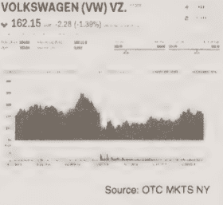
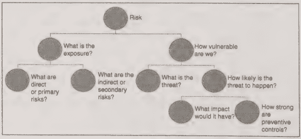
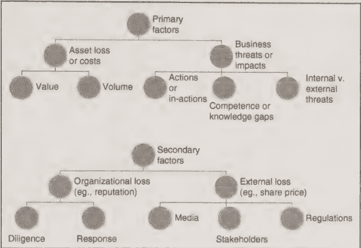
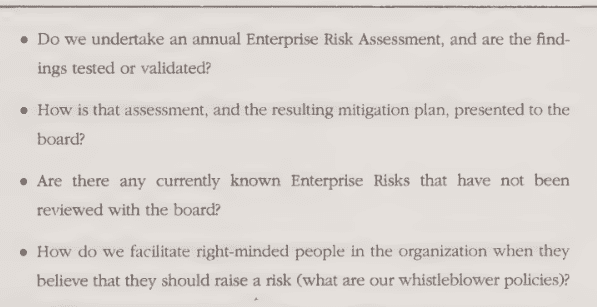

# 第 4 章

## 企业风险管理（ERM）

企业风险管理（ERM）的要求由美国证券交易委员会（SEC）于 2010 年制定。

2015 年有报道称，大众汽车故意规避环境合规标准，通过编程让部分柴油车仅在测试时启动排放控制系统。

数天内，大众汽车面临超过 30 起联邦诉讼，股价下跌超过 40%。至今仍未完全恢复。

大众汽车在 1100 万辆车辆上安装软件以欺骗排放测试设备。受影响的车型包括 2013 年至 2016 年间销售的大众、奥迪和保时捷柴油车型。

首席执行官因不知晓排放风险且疏忽大意，使大众汽车面临最高法律处罚，因而被解职。

一部 Netflix 纪录片暗示，大众汽车曾在猴子身上测试柴油废气，并将其与大屠杀事件相提并论。

一项代表约 50 万名车主的美国集体诉讼案于 2016 年以 250 亿美元和解。加拿大诉讼案于 2018 年结案，拟向约 2 万名车主支付 2.905 亿美元和解金。

许多选择单独推进的 2000 多名美国原告仍在进行和解，而大众汽车继续处理此事。

大众汽车案的启示 ➔ 无论您考虑的是财务还是业务流程和结果，技术都使掩盖错误商业决策变得轻松高效。全企业范围的风险讨论，为组织中有识之士提供了就监管和声誉问题提出担忧的机会。

# 图 4.1 大众汽车案例

如图 4.1 所述的大众汽车案例，凸显了理解技术决策风险影响的重要性。企业风险管理（ERM）为审视组织的完整风险组合提供了基础。由于与 ERM 作为一项实践相一致的严格法规，有许多工具和专业服务可帮助董事履行其义务。

从高层次来看，ERM 方法用于了解企业面临的个别风险。它们考虑风险之间的相互关系，并支持对适当缓解措施的验证。为了使 ERM 作为整体治理计划的一部分发挥作用，董事会必须就其风险承受水平进行公开讨论。每一级增量的风险预防都有成本，并非每项预防措施都是必要的，甚至明智的。风险和安全专业人员往往倾向于绝对化，因此董事会必须将威胁与事件发生的概率以及对该事件的容忍度相权衡至关重要。包括保险在内的缓解措施，可能是投资昂贵预防措施的有效替代方案——本章将帮助您做出这些权衡决策。

风险不是绝对的东西，而是一个衍生值，需考虑：

- • 威胁 – 可能产生影响的潜在事件
- • 价值或负债 – 将丢失的资产价值或由此产生的负债成本
- • 缓解措施 – 已采取以防止或最大限度减少影响的措施
- 概率和风险承受度 – 风险事件发生的可能性，需结合企业承担结果的意愿或能力来考虑

ERM 是一种有纪律的方法，用于考虑一系列威胁。它是一种关键方法，用于具体理解和考虑可能发生的情况和最坏情况。ERM 方法评估已采取的避免或减轻损失的对策，并识别剩余风险是否对企业可接受。如果风险不可接受，ERM 计划将识别行动，将风险降至与您的容忍度一致的水平。总体而言，有效的 ERM 计划提供合理保证，即公司在识别出的风险或威胁下能够实现其目标。

需要理解的基本概念是，风险不能基于绝对观察来评估。它是特定威胁与实际可能出错情况的组合而得出的。

为了更易理解，请考虑光头胎场景。1

如果有人拿着一条相对光头的轮胎，问您使用它是否存在可接受的风险水平，您可能会说没有——在没有更多信息的情况下，您可能会认为风险很高。如果他们随后澄清，预期用途是将其绑在树上作为儿童秋千，您会改变评估，并说风险较低。对于轮胎秋千来说，胎纹无关紧要。

知道轮胎是用于树秋千，而非用于汽车，风险分析将要求您现在考虑树枝的大小和要使用的绳索的强度。它们现在是风险因素。

ERM 是一门广泛的学科，旨在解决复杂性和相互依赖性。它是一种最佳实践方法，为风险承受度背景下的治理提供基础。图 4.2 简化了风险评估的方式。

结构化风险计划的价值在于，它既审视风险本身（主要风险因素），也审视导致风险的因素（次要风险因素）。企业计划识别并量化风险，以便相应定义缓解策略。例如，如图 4.3 所示，减轻声誉风险的最佳方式是展示尽职，并制定并执行周密的响应计划。

任何投资者都有理由期望至少每年看到一次 ERM 评估。董事会需要投资于它，私人投资者应期望在年度报告或商业计划中看到其讨论。请参见图 4.4 所示的智能问题。

# 图 4.2 风险评估方式

# 图 4.3 主要和次要风险因素

# 图 4.4 智能问题 – 企业风险

## 注释

1. J. Jones, “An Introduction to Factor Analysis of Information Risk (FAIR): A Framework for Understanding, Analyzing, and Measuring Information Risk,” Risk Management Insight (2015).
