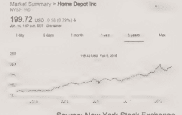
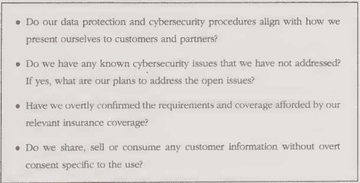

# 第 5 章

## 诉讼和欺诈风险

2014 年 9 月，家得宝宣布超过 5600 万张客户支付卡数据泄露。有三个因素使该公告特别令人震惊：

- 1. 导致泄露的漏洞与 2013 年暴露塔吉特 4000 万条支付卡记录的漏洞完全相同，因此该漏洞已被充分理解并广泛传播
- 2. 尽管存在相对容易的方法来显著改善其安全性，但家得宝未利用这些方法来保护客户卡数据
- 3. 很明显，问题已存在约 5 个月，但未被发现

到 2016 年，家得宝宣布拨出 1.61 亿美元（不包括保险赔偿）以支付泄露成本。

2016 年披露的付款包括向包括 Visa 和 Mastercard 在内的财团支付 1.34 亿美元。还有一项 1950 万美元的消费者和解，包括现金基金和信用监控。

2017 年又一项和解涉及向其银行合作伙伴支付超过 2700 万美元。该和解还包括承诺进行重大补救，以修复已知的安全问题。

家得宝的董事和高管被列入衍生诉讼。虽然该诉讼最初被驳回，但最近已和解以避免上诉。

**家得宝案的启示 ➔ 审慎义务现在扩展到网络安全监督，缺乏理解或知识在出现问题时不再是辩护理由。**

# 图 5.1 家得宝案例

### 诉讼与欺诈风险

在衍生诉讼提起之前，家得宝（Home Depot）的和解与数据泄露的传统风险敞口一致（参见图 5.1）。就网络安全问题起诉董事属于新事物。相关论点认为，董事和高管未能履行其监督和保障义务。公司不仅忽视了已知的行业威胁，甚至没有采取最基本的控制措施来保护支付卡数据。在发现问题之前存在的时间滞后使情况更加恶化。

像家得宝这样的案例，如今已将网络风险带入潜在**证券欺诈**的领域。直到最近，董事会层面缺乏理解或知识仍可作为辩护理由。目前的案例表明，这已不再可以被默认认可。如上文家得宝的例子所示，**雅虎（Yahoo!）**和**温迪（Wendy’s）**的董事和高管已被列入衍生诉讼，原因包括董事会失职，从不作为到披露不足或误导性披露。

**雅虎（Yahoo!）**的案例是最近针对公司董事和高管的诉讼示例，指控其公开披露的充分性。根据原告的说法，泄露事件的宣布危及了与 Verizon 的待决合并，导致 Verizon 为该公司少支付了 3.5 亿美元；2018 年 1 月，雅虎以 8000 万美元和解了其证券诉讼。

**温迪（Wendy’s）**的诉讼更为复杂，股东不仅起诉了公司，还点名了特定的董事和高管。指控称，个人被告**违反了忠实、勤勉和善意义务**，原因是**未能实施和执行有关数据安全的有效内部控制和程序系统**。除其他指控外，诉讼认为，温迪未能充分披露其数据安全政策和程序的有效性，尽管已认识到安全漏洞可能对公司业务和运营产生不利影响。

损害赔偿尚未披露，但已知包括原告律师本身接近 100 万美元的费用。

至今为止，经过检验的欺诈指控分为三类：

- 1. **宣传其数据安全的公司。** 考虑**艾可（Equifax）**的案例，该公司将其信用监控服务描述为*提供安全*，并随时间推移强调*新的安全功能*。考虑到未披露的漏洞，艾可的陈述被视为*虚假和/或误导性*。投诉称，该公司未能维持足够的措施，也未能监控以检测泄露；因此，其财务报表存在重大虚假和误导。针对艾可董事和高管的诉讼具体声称*违反受托责任*。

- 2. **关于数据安全（据称）保持沉默的公司。** 沉默也已被证明不是一种选择。考虑**英特尔（Intel）**的案例，该公司*知道其处理器包含使其易受泄露影响的缺陷，并未实质性披露*。问题在于，缺乏披露是否影响了股价。此诉讼尚未进展到足以评估其影响的程度。

- 3. **披露不够具体的公司。** 另一个近期案例指控，虽然**超微半导体（AMD）**披露了数据安全是已知的关键风险，但他们未披露*一个特定缺陷（与英特尔类似），该缺陷是已知的风险敞口，使其易受泄露影响*。与英特尔案例一样，问题在于董事会是否故意通过隐瞒信息来影响股价。AMD 诉讼是近期的，但诉讼正在进行，似乎有理据。披露的具体性是否构成直接风险敞口，目前仍在法律中接受检验。

现实地说，这些例子只是冰山一角。披露的层次、披露的性质，甚至披露的必要性，都已成为潜在诉讼的事项。

第四个尚未经过检验的欺诈指控领域，可能会从数据销售业务及其所需的同意构成中产生。最著名的例子是最近围绕 Facebook 和 Cambridge Analytica 的事件。已提起诉讼，包括针对董事会违反职责的诉讼。尽管这些法律行动尚未结案，但在 2018 年 6 月初，披露称 Facebook 继续与包括日产汽车公司（Nissan Motor Co.）和加拿大皇家银行（Royal Bank of Canada）在内的关键客户达成定制数据共享协议。监管机构正在调查，但董事会需要考虑：

- 1. 用于购买的数据是否会通过法律测试，证明其是在获得同意的情况下提供的。

- 2. 作为非法获取数据的消费者，他们是否可能被视为与数据提供方共谋。

2016 年至 2017 年间，数据泄露事件增加了 164%。1 数据泄露不仅仅是大公司的问题，2016/2017 年报告的事件中，超过一半发生在员工少于 1,000 人的公司。

一次泄露的平均成本为每条受影响记录 225 美元，这还不包括诉讼和法律和解的额外成本。欧盟的保险公司建议，新的和重大的风险在大多数保单中将不予承保，因此，对网络保险和董事及高管（D&O）保单的细节关注至关重要。

归根结底，董事会最好的辩护是其展示尽职调查的能力。董事需要在网络风险和一般业务风险的监督中表现出*审慎义务*。参见图 5.2 中的 Smart Questions。

Note

1. *Internet Security Threat Report*，Volume 23，Symantec Corporation（2018 年 4 月）。
