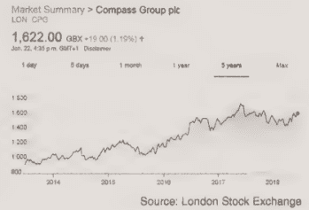

# Chapter 6

# 投资多少 – 数字成熟度

Compass Group PLC 是了解如何投资的一个很好的例子。

Compass Group 为全球市场提供餐饮服务。其对一流执行的关注体现在以下事实：其收入、利润和每股收益在四年期间均有所增长，而包括成本和安全事件在内的运营指标均有所下降。

商业和工业账户占其收入基础的 39%。在北美市场，该部门为许多大型公司的大型校园提供服务。

在其中一个校园最近的客人体验调查显示，尽管该多建筑校园有数十家餐饮场所和形式，但客人普遍认为选择和种类不足。

更深入的分析显示，其平均客人不会从实际工作地点步行超过五分钟去取午餐。

解决此问题的传统方法是在每个场所增加更多选择。更极端的反应可能是投资更多场所，以更紧凑的间隔复制。Compass 希望更有创意。

相反，他们寻求技术合作伙伴的想法。他们决定提供一个由机器人配送的程序。他们现在为校园内的任何客人提供机器人配送选项，以合理的成本结构实现所有场所的无摩擦访问。

Compass 最初并不是在寻找一个使用机器人的酷地方——他们是从客户问题出发，而机器人碰巧是解决问题的合适技术。他们对技术投资的成熟运用体现在其股价中。

**Compass Group PLC 案例要点** ➤ **分析让您能够非常具体地了解您试图解决的问题。然后，您就有机会让技术成为解决方案的一部分。**

### Figure 6.1 The Case of Compass Group PLC

有三点表明 Compass Group（参见图 6.1）是一家数字成熟度高的公司：

- 1. 他们利用现有数据了解真正的客户不满点。

- 2. 他们对替代方案的评估包括基于合作伙伴的交付模式来管理投资。

- 3. 他们解决了客户问题。

解决方案很酷只是一个额外的好处。

数字成熟度高的组织比同行高出 9%，盈利能力高出多达 26%。它们提供的市场价值高出 12%。1

您的数字投资水平不仅仅是您认为在技术上花费了多少钱，或者您的 IT 预算是逐年增加还是没有增加。关键是，在您所在的行业中是否应该成为领导者，或者是否可以通过让他人推动边界来实现正确的结果。没有“正确”的投资水平，但您的投资水平需要经过选择设定，而不是默认设定。

投资多少，以及在需要时转型的能力，定义了您的数字成熟度。

数字成熟度模型，2，如图 6.2 所示，是理解和验证技术投资的通用行业框架。使用此模型来考虑

# 图 6.2 数字成熟度模型

来源：MIT Sloan 管理学院。

(a) 你当前的投资水平意味着什么，以及 (b) 这正是你所期望的吗。

- • **数字强度**（纵轴）是指你在技术赋能的举措上投资的程度。不要将数字强度与成为数字或技术公司混淆——所有行业领域都有技术投资的领导者和追随者。将其视为一种速度的衡量标准——你的投资让你跟上竞争对手或在行业中领先的速度有多快？你的数字强度是多少，应该是多少？

- • **转型强度**是指你为实现业务转型所需的技能所做的投资。

数字初学者（模型左下角的象限）在投资和转型方面都是追随者。如果你明白数字初学者意味着什么，并且希望处于这个位置，那么成为数字初学者可能是合适的。

成为数字初学者并不意味着你没有在技术上进行投资。你可能在传统意义上的 IT 支出方面非常成熟，在这种情况下，你的系统管理良好并满足业务需求。你甚至可能拥有一些最佳实践能力，例如成熟的 ERP。这仅仅意味着你是基于现状进行投资。

# 你是数字初学者，如果：

- • 你的投资（预算）按年同比运行率进行管理。

- • 预算中任何新增内容都需要有通向明确商业案例的线性路径。

- • 你对起步较小或在行业中落后感到满意。

成为初学者应该是一种有意的投资策略。不要无意中发现自己处于这个象限。

在模型中向右移动，我们发现数字保守派象限。数字保守派更看重审慎而非创新³：

- • 你认识到拥有清晰愿景的必要性。

- • 你的投资水平与你的文化和治理相一致。

- • 你的投资管理良好。

- • 你在业务中拥有变革型领导力，但技术更多是推动者而非驱动者。

- • 你可能对新趋势持怀疑态度，或者你没有看到做不同事情的明确必要性。

数字保守派面临的最重大风险是错失机会或不尝试新事物的长期后果。你可能很大程度上依赖你的 IT 团队来了解对你有益的事物，并逐步在正确的时间引入正确的事物。如果你的投资水平处于这个象限，责任在于你，确保你倾听你的 IT 领导者——你已将他们视为你的良心。

数字时尚达人，位于左上角，愿意投资技术，但关注点更多在于当下的新事物，而非遵循企业投资策略：

- - 你认识到测试边界的必要性。
- - 你可能正在避免将投资分散得太薄而无法产生影响的陷阱。
- - 你可能拥有超出适当治理流程范围并造成分心的举措。
- - 你可能没有充分利用你的 CIO 所知道的和可以贡献的内容。
- - 你可能或可能没有为你的投资实现价值。
- - 举措可能是组织中领导者的宠物项目，而不是与明确的策略保持一致。

如果你是数字时尚达人，你可能在某些领域具有成熟度，但你的技术职能可能缺乏真正的企业治理或企业架构。4 成为时尚达人没问题，只要对获得资助的内容及其原因进行治理即可。

Digirati 位于最终（右上角）象限，因为他们已证明了解如何推动价值。将 Digirati 视为将以下投资公式应用于其技术投资的公司：

基于价值的投资
=
愿景 + 治理 + 参与度
投资

# 将你的投资水平与你想要达到的位置相一致

数字成熟度没有对错之分，只有你想要达到的位置与你的投资水平之间的一致性。一致性可以让你避免意图与现实之间的差距。如果你的意图清晰且与你的投资方式一致，你就可以降低因行业颠覆而感到惊讶，或者股东期望未能得到满足的风险。

根据 2017 年的一项调查，董事会层面对数字颠覆的担忧与其实际投资转型的意愿之间存在可衡量的差距。根据该调查，82% 的董事认为技术创新是一项重要挑战，但 44% 认为他们可以在未来 5 年内在没有特定投资的情况下继续增长。5 接近 40% 的这些董事认为他们的 CEO 和 IT 领导者在运营层面已制定了正确的投资策略，并且他们不打算增加技术 CAPEX 承诺⁶。如果这些董事期待任何新事物或不同事物，他们将会失望。

研究还表明，CEO 对现实的看法与其 IT 领导层的看法之间存在差距。例如，51% 的 IT 领导者表示他们无法应对所面临的数字需求，然而 55% 的这些相同的 IT 组织在年度预算基础上使用相同或更少的资金。只有 7% 的 CEO 表示他们的数字素养很强。⁷

提出关键问题很重要，并且要确保有人在思考你的技术投资水平和你的数字未来。董事、CEO 和投资者需要对他们想要参与的数字投资类型有一致的看法。你可以采取三个步骤来做出该决定：

+   1. 武装自己，掌握数据，以便你有自己的观点。

+   2. 直接与 CIO 交谈。

+   3. 将你的投资与竞争对手和行业进行基准对比。

使用图 6.3 中显示的智能问题来校准你在数字成熟度模型中的位置。带着对你所在的位置以及你认为应该所在的位置的观点，进入你的下一次策略讨论。

让董事会讨论更关注投资价值的另一种方法是，让一名非技术董事会成员定期与 CIO 会面，讨论当前的问题，并报告哪些内容引起了共鸣⁸。对你董事会中的技术人员无意冒犯，如果你有一位的话，但很容易陷入一种友谊，即技术董事代表其他人发言，而不是真正推动全体董事会建立信任但验证的必要性。

最后，让你的员工将你的投资与几家关键竞争对手和整个行业进行基准对比。季度和年度报告是战略洞察的良好来源。供应商活动和行业协会是洞察的绝佳来源。你的 CIO 应该负责监控和报告你的竞争对手和行业投资概况，作为你战略规划节奏的输入。

在《思考，快与慢》中，Daniel Kahneman 谈到了内部视角，9 其中“外部世界的现实有时会被人们基于自身经验和数据的外推所取代。”Kahneman 表示，即使相关人员正在尝试他们从未做过的事情，这种动态也会成立。糟糕决策的潜在可能性不可低估。

就技术投资而言，其影响是可怕的。你需要有基于事实的观点。然后你可以有意识地确定你的投资水平。

董事的存在是为了提供关于未来的视角，帮助管理层识别最值得追求的机会。

C. Bart，“董事会应就策略提出的 20 个问题”，CICA

了解你的数字成熟度可以让你更具体——不是具体到你需要什么技术，而是具体到你渴望成为什么样子——这样你就可以构建价值公式中的愿景部分。

# 图 6.3 智能问题——投资多少

- 我们是否将技术视为一种策略、一种推动者、一种运营职能或一种产品？
- 我们是否拥有数字优势？如果是，具体是什么？
- 我们预算（OPEX 和 CAPEX）中有多少用于维护当前系统？
- 我们预算（OPEX 和 CAPEX）中有多少用于增长或战略举措？
- 谁负责了解行业趋势并与我们一起审查？这些人是否主动且富有求知欲？
- 我们是落后于、跟上还是领先于竞争对手？
- 如果我们落后于竞争对手，后果会是什么？我们是否有计划赶上行业？
- 我们如何优先安排技术资源的使用？
- 管理层如何决定将哪些投资讨论提交给董事会？
- 我们的投资与董事会对策略的看法如何保持一致？
- 项目是否同时根据金额和非货币效益进行评估？
- 结果是否根据我们的意图进行衡量？
- 我们当前的项目是什么？它们如何支持我们的策略？
- 董事会是否有足够的直接接触来了解审视我们技术投资机会的人员？

### 注释

- G. Westerman, D. Bonnet, 和 A. McAfee，“数字成熟度的优势，”《MIT 斯隆管理评论》（2012 年 11 月 20 日），https://sloanreview.mit.edu/article/the-advantages-of-digital-maturity/.
- 同上.
- 同上.
- _企业架构_ 是将技术投资计划与企业完整表达进行战略性和集成性对齐；提供一个总体规划或协作力量，以在可执行的框架内对齐目标、愿景、战略和治理，该框架足够敏捷以利用新机遇，又足够稳定以支持运营、连续性和恢复。
- _董事透镜，2017 年秋季调查_，公司董事学院与 Envirronics 研究集团（2017 年）.
- 同上.
- D. Aron 和 G. Waller，“驯服数字巨龙：2014 年 CIO 议程，”Gartner 执行摘要（2014 年，第 1 号）.
- C. Bradley, M. Hirt, 和 S. Smit，《超越曲棍球棒的战略》（新泽西州霍博肯：John Wiley & Sons 出版社，2017 年），第 71 页。提升水平的五种方式：
  - 提高提案质量。
  - 开展更具协作性、以学习为导向的对话。
  - 体验更多真实性和严谨性——更好地提出挑战。
  - 做出更少偏见、更好的决策，并根据外部视角进行校准。
  - 以更多勇气领导你的团队，采取经过计算的风险，并更有力地承诺。
- D. Kahneman, *思考，快与慢* (纽约：Farrar, Straus and Giroux 出版社，2011 年).
