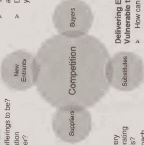
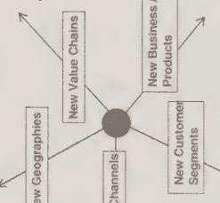

# 第 7 章

## 如何确定优先级

自 2013 年底的历史低点以来，BlackBerry 股价近期呈现上涨趋势。有猜测称，股价可能在 2020 年超过 40 美元，这很大程度上归功于对其汽车部门投资的优先级排序。

BlackBerry 正在利用其在安全领域的数字传统，将其应用于物联网——包括汽车、拖车和飞机。

BlackBerry 通过推出两款汽车领域产品，在非常短的时间内占据了显著的市场份额：

**Radar**，可实现拖车和货车等车队资产的资产跟踪。

**QNX**，是为汽车（包括自动驾驶车辆系统）中的电子系统提供安全和防护的软件。

最近的报告表明，BlackBerry 还在开发一项安全服务，该服务将远程扫描车辆以查找病毒等漏洞，并在车辆处于危急危险时指示其靠边停车。据报道，该服务将能够为怠速汽车安装安全补丁，解决汽车领域日益增加的黑客攻击和接管漏洞。2015 年，两名黑客暴露了菲亚特克莱斯勒的一个漏洞，导致美国召回了 140 万辆汽车。

在 2013/2014 年遭受行业毁灭性损失后，BlackBerry 花时间根据其独特优势确定了优先级。它正在恢复。与其为重新夺回移动设备市场份额而战，不如将其优势置于新兴技术趋势的背景下审视。它现在已确定一个数字优先事项，这将使股东受益。

**BlackBerry 被收购案例 ➡** 通过专注于你的差异化因素究竟是什么，你可以利用技术进一步推进机遇，既能挽救市场机遇，也能创造市场机遇。

图 7.1 BlackBerry 案例

### 从你当前的业务战略开始

你不是为了技术而投资技术。你现有的战略是关键的参考点，因此请将你需要在当前业务中进行的投资纳入其中。

理想情况下，董事会参与对话将能够实现清晰且真正的技术战略，这些战略建立在你的业务优先事项之上。董事会层面的技术战略对话可以成为你当前规划方法的组成部分。当你思考市场定位、推动增长或提高运营杠杆时，花几分钟额外时间讨论可以做出贡献的技术投资以及可能产生影响的差距。

向董事会提交的战略演示通常由负责销售的团队制定，技术战略被附加在后面以支持故事。寻找技术投资与特定成果之间的明确对齐，这些成果将直接对业务计划做出贡献。

如 BlackBerry 案例所示（参见图 7.1），专注于你独特的差异化市场定位是战略规划的关键部分。优先排序你的技术投资是你已经进行的战略规划工作的简单延伸。它不应该是一个独立的、脱节的过程。你需要进行的投资应该是你对核心业务战略审议的组成部分。

框架。考虑外部有什么可能会让你感到意外，并讨论技术趋势，以便你知道你在正确的时间将正确的资金投入到正确的地方。

作为如何识别变革性战略的示例，本章使用 Porter’s Five Forces1（图 7.2），它考虑：

- 买家或客户
- 竞争对手
- 潜在的新进入者
- 替代产品
- 供应商

任何经过验证的规划模型都可以。关键是将技术驱动因素明确地加入到你的对话中。

### 买家/客户

几乎每个行业都在经历围绕客户参与度和期望的颠覆。通过查看模型的买家/客户方面，你可以从他们是否（以及为什么）会购买更多转变为讨论你的客户试图通过你的产品或服务实现什么。关注结果。你是否（或是否可以）为他们的生活方式带来改变？他们是否会因为认识使用你产品的人而与你互动？是否有什么事情可以让你的客户更容易使用更多的服务或产品？如果你的客户是其他企业，你能为他们节省时间或金钱吗？

### 考虑 Porter’s Five Forces 以识别可以改变你竞争格局的数字投资

竞争对手在做什么可能会改变游戏规则？
你的商业模式边界发生了什么，可能会让竞争对手改变力量平衡？
是否有黑天鹅事件，而你独特地处于可以领先于它们的位置？

### 新进入者是真正的风险

- 像 Cloud 这样的新能力是否使新进入者更容易匹配你的产品？最大的风险是什么？
- 你的客户期望你的产品有多现代化？
- 你如何利用 SaaS、API 集成以更好、更快、更便宜的方式交付能力？

### 客户和买家拥有权力

- 你的客户拥有什么新的杠杆作用？
- 思考结果——你的买家试图实现什么，你可以提供什么体验？
- 如果你让与你互动变得更容易，是否能提高你的议价能力？

### 供应商成为合作伙伴

- 你的交付模式中是否存在差距或瓶颈，合作伙伴可以通过分析或新渠道来提高运营杠杆？
- 哪里可以通过更以合作伙伴为中心的方法来改进你的产品？
- 你的渠道、分析或运营流程在哪里可以从快速获取最佳实践中受益？

### 交付体验使你对替代品更不脆弱

- 你如何为客户构建更全面的体验？
- 传感器、可穿戴设备、无处不在的设备、机器人、智能系统……是否能对体验产生积极影响？
- 你如何与你的客户群创造粘性？

图 7.2 如何识别变革性战略
来源：改编自 Porter’s Five Forces 模型，哈佛商学院。

想想 Burberry 案例（第 1 章）。Burberry 的雄心勃勃的投资是提供身临其境的社交购物体验，因为他们从分析中知道这将增加销售额。他们从讨论的客户方面入手，设想了一种全新的体验。在 Compass Group 的示例中（第 6 章），通过了解特定的客户不满点，该公司能够投资于一个特定的计划来改善其客户参与度。

重要的是要具体思考你的客户会重视什么。继续以零售为例，零售商 Uniqlo 投资了智能镜子，这样顾客可以穿上衣服，镜子会向他们展示不同的颜色。看来店内顾客不需要反复穿脱衣服来选择颜色。如果你不提供下一个“最佳”体验，你可能会失去竞争力。

虽然在数字战略背景下可能显得老派，但你可能需要回到神秘购物者，并绘制竞争对手的体验图。在五力模型的买方方面，你需要专注于消费者和企业客户期望你交付的真正变化。然后制定一个推动该变化的投资计划。

经济正在向购买体验和结果而非产品或服务转变。你的客户战略必须包括开发数据敏锐度，以衡量和管理结果和承诺。

### 竞争对手、潜在进入者和替代产品

竞争、潜在进入者和产品替代的技术驱动因素是相似的。它们共享相同的三种风险，因此我们将竞争对手、新进入者和替代产品放在一起考虑。有四个关键因素需要考虑：

- **进入壁垒** – 技术变得更容易获取，技术成本正转向按需付费模式。技术的启动成本不再是显著的进入壁垒。像微软的云服务 Azure 这样的数字服务产品，使竞争对手或新进入者能够几乎无需前置时间即可获得高度安全、世界一流的能力。

- **集成和扩展的便捷性** – 基于云的服务可以处理几乎所有运营功能，无需投资构建系统。应用程序编程接口（API）减少了集成的时间、成本和风险，以提供高功能性、强健的商业模式。在早期的数字世界中，新竞争对手可能需要以月（甚至年）计算的时间才能开始运营，并且需要更长时间才能构成威胁。新世界正在召唤更小的进入者或替代产品，以便在你的市场中迅速立足。

- **标准流程的更高门槛** – 与早期的集成说明一样，更标准化行业解决方案的出现意味着你的竞争对手和新进入者可以获得更精简、更模块化的商业模式，而无需进行规划或将其构建为系统。实际的数据处理不再是最终目标。相反，战略机会在于数据、与其他流程的集成，以及用于访问和功能的工具扩展。

### 定制系统的作用

–你的高管可能会推动定制系统。除非有客户在意的差异化因素，否则你可能更适合使用标准工具，并将独特性构建在使用方式中。提供专业行业解决方案所提供的那种一流能力（包括社交、移动和分析）几乎总是成本高昂的。

具体防御竞争对手和新进入者的最佳方法是真正倾听客户的声音。关注他们将重视的体验和结果，以便你保持相关性，并准备好应对竞争对手、新进入者和替代产品。然后将这些见解与你的首席信息官（CIO）分享，以便他们可以识别能够帮助你实现目标的投资。

### 供应商

数字影响最大的机会之一在于供应商。供应商杠杆的早期行业示例是准时制（JIT），其中重型制造能够抵消持有零件库存的成本。一个更近期的示例是图书出版，许多书籍在你在亚马逊下订单之前并不实际存在。然后它们会在亚马逊物流中心附近的设施中按需打印。

与供应商的高杠杆机会在于集成。通过自动化劳动密集型流程，可以在机器对机器（M2M）处理中找到成本节约和运营杠杆。

M2M 的示例包括：

- **直接供应商集成** – 许多银行门户现在将客户直接连接到支票和信用卡提供商。银行保留客户关系和对客户活动的可见性，但不必处于可以直接与第三方自动化的活动中间。

- **业务流程外包** – 部分抵押贷款提供商可以直接与第三方提供商连接，用于评估、土地登记查询和法律指令管理。提供这些相邻服务的公司正在颠覆其自身行业，并且它们通常提供直接的 M2M 链接，以节省处理中的宝贵时间和成本。

- **聚合供应商以交付差异化产品** – 亚马逊聚合了数千名第三方全球供应商，他们直接向客户发货，并通过管理产品、价格和供应商评级来筛选这些供应商，以获得显著的成本优势。除了提供数千种不直接仓储的独特产品外，它们还为客户可能想要的几乎任何东西提供熟悉的客户体验。

与供应商的集成和聚合是真实存在的。评估这一机会的最佳方法是查看相邻商业模式——例如新渠道——以真正了解机会所在。*Profit from the Core*2 模型可用于推断数字机会，如图 7.3 所示。请你的管理团队绘制相邻技术策略，并提供见解，帮助董事会监督你战略框架的边界。

### 速度因素

你的计算机以非常高的速度管理大量数据和交易。技术和速度通常被呈现给董事会作为风险，但根据 Gartner，投资于数字化转型的 56% 首席执行官正在看到可衡量的利润收益。3 董事会必须意识到风险，但他们也需要寻找机会。

作为速度影响的证据，技术经常是所谓黑天鹅事件的驱动因素——即偏离正常预期的随机事件或发生。黑天鹅事件是未预料到的，但通常，一点讨论和预先考虑本可以使情况显著不那么随机。

个人电脑的兴起经常被引用为黑天鹅事件。但事实真的是这样吗？在 1980 年代在计算机行业工作时，我认识一些正在组装自己个人电脑的人。基于纸质的备忘录流程

### 核心利润 – 识别相邻领域的框架

- 我们所在行业中数字化程度较高的参与者在哪里？
- 什么会将他们带入我们的市场？
- 我们所在行业中数字化程度最低的参与者在哪里？
- 我们如何进入他们的市场？
- 是否有其他地理区域可用的技术杠杆？

- 我们如何使用分析来了解渠道效能和改进机会？
- 我们是否测试过不同的社交渠道或普遍技术？我们学到了什么？
- 我们的在线（互联网）存在是否在没有人工交互的情况下带来新业务？可以吗？
- 互联网能改善我们与当前渠道的互动方式吗？
- 我们的渠道或分销流程中是否有可以数字化的活动？

- 我们如何使用分析和外部数据来源来了解当前客户？
- 我们的客户情绪如何？
- 客户情绪告诉我们关于细分市场的看法是什么？
- 社交媒体活动在哪里显示出相邻/交叉机会？

- 我们的系统是否能够对核心流程提供端到端的视图？
- 当前哪些流程（入站或出站）是手动的、耗时的或不在核心框架之外？是否有合作伙伴可以有效地数字化这些交互？
- 我们独特擅长什么？谁会从拥有我们的能力访问权限中受益？

- 什么使我们的产品或服务独特？技术如何帮助我们利用这种差异化（价格、速度、功能）？
- 我们如何使用分析和外部数据来源来监控我们的产品/商业定位？
- 我们如何为产品添加服务？
- 我们如何使用社交和普遍技术来改变产品或扩展业务覆盖范围？

**图 7.3** 识别相邻领域的框架
_来源：模型改编自 Chris Zook 与 James Allen 的《核心利润：在动荡时代回归增长》（Bain & Company，2010 年）。_

were being replaced by early electronic mail systems. The pervasiveness that we see now may have been difficult to see then, but it is disingenuous to call the outcome random.

The book Fooled by Randomness states that a black swan event depends on the observer. For example, at Thanksgiving what may be a surprise for a turkey is not a surprise to the butcher; the objective should be to identify areas of vulnerability in order to “turn the Black Swans white.”4 By thinking through the adjacencies in your sector, and factoring in the effect of speed, you may be able to see the swans and make sure that they are white.

Four things can help you avoid technology-driven black swan events:

1. Know your own digital maturity, and continually revisit whether you are where you need to be.

2. Specifically consider the boundaries of your competitive landscape, including what is happening at the adjacencies. If your competition is actively hiring data scientists, for example, you may need to pay attention to how analytics and behavioral modeling could change the industry.

3. Pay attention to the influences at play with your buyers, suppliers, entrants, and substitutes.

4. Write down what scares you most. Be specific. Use ink, not pencil. Then share those fears with your board associates and your CEO.

Ask questions, have opinions, and talk about outcomes. None of us has a crystal ball but using a model for your

### 112 How to Prioritize

- What technology strategies are being recommended by senior management?
- Have we asked our CIO what they believe to be our biggest strategic risk or opportunity?

- What outcomes are our customers after when they consider our product or service?
- What would make it easier for our customers to use our product or service, or to use more?
- Can technology offer new ways for us to differentiate?
- Do our customers care about what other people or companies think of us?
- Can we acquire to improve our digital reputation or loyalty?

- What technology investments are being by our competitors?
- What are the emerging trends for our sector? Where are we at risk of being left behind?
- Have we benchmarked our product or service experience against our customers?
- What is being said about us, and our competition?
- Can we acquire to gain technological advantage?

- Have we assessed our end to end process to know where processes could be improved with technology?
- Do suppliers use their technology to help us differentiate? Can they?
- How could technology improve the strategic value of our supply chain?
- Can we partner for greatness?

- What have been the most surprising recent trends or events in our sector?
- Who is advising us on potential technology-driven inflection points in the sector?
- What scares us most?

#### Figure 7.4 Smart Questions – How to Prioritize

strategic-planning work does help you think through what can be impactful.

The Smart Questions shown in Figure 7.4 will help you form opinions, both about whether your current priorities are right and about what your priorities should be.

Don't get caught up in the specific technology; think directionally. You are a director or CEO because you can filter through a lot of information and make decisions. Let your intuition and common sense guide you.

### Notes

1. M. Porter, “Five Competitive Forces That Shape Strategy,” _Harvard Business Review_ (January 1, 2008).

2. C. Zook and J. Allen, _Profit from the Core: A Return to Growth in Turbulent Times_ (Hoboken, NJ: John Wiley & Sons, 2010).

3. “Gartner Survey Shows 42% of CEOs Have Begun Digital Business Transformation,” Gartner Newsroom (April 24, 2017).

4. N. Taleb, _Fooled by Randomness_ (New York: Random House, 2010).
