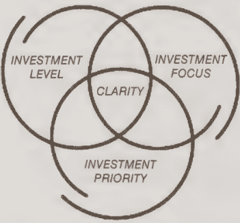

# Chapter 8

## Clarity

Visa Inc. is a good example of the value a company can deliver to shareholders by having clarity.

Visa started with a strong brand that is known for providing consumers with secure and reliable face-to-face payment processing. In the last five years, Visa has taken advantage of an infection point between the payment industry and technology, and it has strategically invested in both the ways to pay and the ways to be paid.

By recognizing the strategic value of its network, Visa moved from being the preferred provider for face to face transactions to being the preferred provider for e-commerce, government to consumer and business to business processing. It also bridged its capability over to the mobile space, by providing a secure backbone for the port-to-port transactions required for tap and other mobile payments.

With a strategic focus on taking the friction out of the payment experience, Visa had the clarity to invest in flexible capabilities that were of value for both the consumer and the provider. It avoided chasing one-off strategies for specific tactical markets, and instead demonstrated the maturity to focus on enabling a single set of standards that would deliver value across its platform and offerings.

The clarity of Visa’s technology strategy shows in their share price.

The case of Visa takeaway ➡ Taking a leadership position in an industry or supply chain creates new opportunities to transform the sector and to shape the company’s position. Technology creates new opportunities for market changing competition.

### Figure 8.1 The Case of Visa

### 118 Clarity

As shown in Figure 8.1, the case of Visa, companies that find the confluence of investment level, focus, and priority are better able to develop clear digital plans. This chapter will guide you through turning your strategy into an executable plan. Figure 8.2 frames the challenge and the opportunity – how to find clarity in the eye of the storm.

Parts of this chapter may go deeper than you would like, but the devil is in the details. Successful digital directors recognize that clarity requires specificity, and that clarity will make their investments more successful.

There are four ways to improve clarity in your investment plan:

- **Vision** – Make sure that everyone understands what you are investing in, and why.
- **Direction** – Set boundaries for how you expect the investment to take shape.

### Figure 8.2 The Perfect Storm Model

Time and scope – Balance your expectations so you get what you need when you need it.

Risk – Allow for what can go wrong

In the book _Strategy Beyond the Hockey Stick_, McKinsey talks about the importance of being bold.1 In this chapter, we will focus on clarity as leverage for bold technology investments.

# Vision

Think of vision as the “what” and “why” of your investment. It is the point on the horizon that you are steering toward. Bold strategies reinforce the need for clarity. You need to “get specific about where the opportunities are, so you can translate high level trends into investable pockets.”2

> Vision without execution is a daydream.
> 
> **Japanese proverb**

Digital investments will only be a differentiator if you are specific about the outcome you are after, and you can measure for success against those outcomes.

Years ago, I was helping a large transaction-oriented business plan for automation of ordering and fulfillment. The board believed that they were clear about the focus – improve processing time and compliance and deliver operational leverage through cost savings. Unfortunately, the board and CEO were reticent to declare the objectives for cost savings. The business units were focused on processing time and compliance as department-level activities. In the absence of clarity, they missed the operating leverage in integrating across their departmental boundaries. They established metrics around processing time, but they did not plan or measure for actual cost savings. The investment was suboptimized because the board was not clear about the outcomes they were after.

The best way to make sure that your vision is understood – and realized – is to align spending with outcomes. You will probably need to shift money away from some current spending plan to fund your digital investments; be clear about what you expect to be different.

Start by looking into how operational planning decisions are made with respect to technology investments. Figure 8.3 provides a transformation model that will help you address the unique requirements of technology investment planning.

If capital investment is a growth amplifier, there will be no better reinforcement of the vision than the redirection of scarce capital resources. Research shows that realigning more than 50% of your capital investment drives 50% more value over a 10-year period than if you do not.3 Proactive directors need to ask questions about the strategy and outcomes behind capital investment plans.

### Direction

If vision is the what and why of your investment, direction is the “how.” Direction aligns your investment with the vision

### Enrich Your Technology Investment Planning

| Mechanisms | Enrich Your Technology Investment Planning |
|---|---|
| Planning Cycles | → Include technology in your planning → Treat it as a journey, not an event → Support ongoing board / CEO dialogue with regular CIO briefings |
| Decision Making | → Expect to be given meaningful options in major investments → Have a view of the Digital Ecosystem, and a Digital Strategy, to provide context for discussion |
| Strategic Focus | → Choose investments where you can define outcomes–what will be different, how, and by when → Choose a small number of important initiatives |
| Budget Alignment | → Focus on what moves will differentiate your business → Talk about the moves first, the budget second → Benchmark to measure outcomes |
| Best Practice Budgets | → Move to spending 25% of your investment on transformation |
| Business Alignment | → Incentivize the business for delivering to outcomes |
| Delivering Leverage | → Incentivize business engagement in digital investments |
| Tactical Roadmap | → Have a bias for action → Use pilots and partnerships to deliver specific outcomes |

Figure 8.3 Enrich Your Technology Investment Planning

### Figure 8.4 Investment Alignment

by framing the steps to take or the path to follow. Directors need to be engaged in setting that direction to ensure that technology investments stay aligned (see Figure 8.4).

Your technology investment plan should drive from the overall business strategy, rather than being communicated as an afterthought. Ideally, the board would talk about technology early in their strategic planning work. Alternatively, the CEO can champion the development of a digital strategy, working iteratively with the board for strategic direction.

The board should look for the digital strategy and technology investment plans to be written down, presented as part of the board process, and overtly approved and governed.

### Time and Scope

It does not help to be clear on what you expect to happen, and how that should be accomplished, without some context on when you expect results. Directors and CEOs often see time as a discrete element discussed in isolation from other factors. Then they are disappointed when expectations are not met. Time needs to be considered in the context of scope.

Your CIO lives every day with a framework that balances scope, time, and budget (see Figure 8.5). If any one of the three changes, the other two must adjust to keep the balance. Success demands that what is being delivered (scope) is tightly managed, so that the work can get done in the time expected. Successful boards and senior leaders overtly enable the trade-offs.

Boards and CEOs seldom say, “We tried to get too much done.” Instead, the perception is generally, “They did not get it done by the committed date.” Successful technology investment considers all three factors together, and an effective board expects schedule commitments to be met. This is an important area to practice a “nose-in-fingers-out” approach to oversight.

Figure 8.5 The Success Funnel

You may be dependent on the CIO to tell you how long the company needs to deliver on your strategic requirements. You are also entitled to have a sense of urgency and a notion of when you would like to see results. The guiding principle is to be reasoned and balanced.

Genuinely give your CIO the opportunity to speak to the challenges and opportunities, including:

- What resources need to be assigned to the work, and when they will become available based on current priorities.
- What would need to be forfeited to meet the required timeframe (is that a trade-off you want to make?)
- Other considerations around the timing of work – for example, changing your financial reporting process in the middle of a quarter or midstream in the fiscal year may create a data accuracy issue.
- Consider where the outcomes you are after are aligned with other operational considerations, and make timing decisions accordingly.

The most common cause of time-based disappointments is the “time-boxing” of the delivery team to an outcome without considering scope. On average, your business staff will take a dictated schedule and do their best to meet it, but if they do not have the opportunity to genuinely align their work with your expectations they are unlikely to be successful. Instead of a strategic project being an exciting opportunity, it will become a stress-filled dis-satisfier.

> Progressive improvement beats delayed perfection.
> Mark Twain

Being clear on schedule considerations helps the business understand your vision. For example, if staff members know you want to have something to talk to shareholders about at the post-AGM reception, they can think in terms of what progress they can deliver, on that timeline that will resonate for the shareholders. If you are committed to delivering cost savings as part of your next fiscal budget approvals, they can focus on the specific and measurable parts of the strategy that can be extended into budget commitments.

If schedule discussions identify the audience and the impact you are focused on, you give the CIO and the staff members the opportunity to propose options that can align with your sense of urgency. Alignment on sense of urgency translates to alignment on both time and scope. It is a critical part of investment clarity.

### Investment Risk

The final point of clarity for your digital investment is risk—not enterprise risk as we discussed earlier, but the risks surrounding investment uncertainty and the probability that things will go wrong.

> Risk is the clue that our dreams are both real and great.
> — Craig D. Lounsbrough

Few digital strategies carry no risk, but with forethought either you can either address the risks and make them go away or you can make decisions that will mitigate the risks. Your CIO and project teams will know how to address or mitigate most risks, but they can only be effective if you foster a practical approach to risk management:

1. Fail early – Do not let the team treat risk as an afterthought. They should be able to articulate the investment risks, so they can understand, qualify, and mitigate the risk early in the work plan. Late-breaking risks are hard to recover from. Specifically:

- If they need to confirm the technical viability of an idea, fund a proof-of-concept or pilot project to get answers. Do not expect your team to know if a technical project will work based on vendor demos and written specifications.
- If they need to confirm the technical viability of an idea, invest “seed funding.” Give your team the resources that they need to get the details right.
- Do not confuse a pilot project (a test) with a gradual rollout. The difference is important. A pilot or test means that things will potentially be learned and that plans can be adjusted. A scaled-down launch or gradual rollout means that the deliverables are known to be right, but the deployment will be done over time. Executives often interpret a pilot to be a first step in a rollout, but it is not. Clarity on which approach is being taken is critical.
- If your CIO identifies a potential risk for the project, ask them to be specific, and then give him or her the time and resources to get fact-based.

2. Encourage honesty – Oversight of transformational projects often involves charts that show a green, yellow, or red status as an indicator of the health of the project.

In theory, a yellow or red status should indicate that the project has an issue to be addressed, but most teams avoid showing governing bodies anything but green for fear of causing alarm. By the time an issue is flagged as red, the governing body has little ability to influence outcomes or address the risk.

Rules of thumb:

- Green means that everything is on track in terms of budget, schedule, and scope.
- Yellow means that there an issue, but it is understood and being addressed; it is flagged as yellow for transparency and awareness.
- Red means that there is an issue, but it is not fully understood and/or the actions to address the issue are not yet known or committed. If status is red, the governing body should be participating in a decision-making process that will enable movement back to yellow.
- An initiative should never go straight from green to red, or red back to green; if it does, the person running the initiative is withholding information from the oversight process.
- Test your understanding by discussing scenarios using “what happens if . . .” questions
- Risks should always be identified with mitigation options. Think in terms of a range of outcomes, rather than an absolute, to improve your understanding of what the risk really is and how to offset or self-insure.

### Groupthink*

occurs when the members of a highly cohesive group lose their willingness to evaluate each other’s inputs critically.

#### Symptoms of Groupthink

- Illusions of vulnerability – Members overemphasize the strength of the group and feel that they are above criticism: This leads the group to approve risky decisions without addressing where individual members may have serious concerns.

- Illusions of unanimity – Members accept consensus prematurely, without testing whether all members really agree. Silence is often taken for agreement.

- Illusions of group morality – Members of the group feel that something is “right” and above reproach: Members feel no need to debate ethical issues.

- Stereotyping of the “enemy” as weak, evil, or stupid–Members do not realistically examine their competitors and they oversimplify competitor motives: The stated aims of outsiders, or their reactions, are not considered.

- Self-censorship by members – Members refuse to communicate concerns for fear of disturbing the consensus.

- Mind-guarding– Members take responsibility for ensuring that negative feedback does not reach influential members of the group.

- Direct pressure – In the unlikely event that a note of concern is interjected, the group responds with pressure to bring the deviance back into line.

#### Guidelines for Avoiding Groupthink

- Challenge every member of the group to be critical as an evaluator; overtly share objections.

- Make it clear that the leader or discussion chairperson is independent, and should avoid articulating a preference.
- Create subgroups to all consider the same problem; then compare the results.
- Facilitate additional information from the subordinates, peers and networks of group members; encourage briefing documents and direct presentations to the group.
- Invite outside experts to participate in discussions, including observing group processes.
- Assign a member to play devil's advocate at each meeting.
- Overtly focus on alternative scenarios.
- Once consensus is reached, reexamine the next (but unchosen) alternative, comparing it to the chosen course of action.

*Irving, L. Janis, Groupthink, 2nd ed. (Boston: Houghton-Mifflin, 1982).

# Figure 8.6 （Continued）

## 3. Avoid groupthink – Many companies use some form of “new initiative” risk assessment, but these are only as good as the discussion that takes place to do the assessment. See Figure 8.6 for strategies to improve your risk evaluation effectiveness.

Your digital strategy and investment decisions need to provide the clarity that your business needs to deliver the outcomes you expect. The Smart Questions in Figure 8.7 will help.

- What is the point on the horizon that we are steering toward?
- What do we think our industry will look like in three to five years?
- What are our three most important technology initiatives? What will be different when each is successful?
- Which director is tasked with regularly meeting with the CIO?
- What timing trade-offs are being made that the board be aware of?
- What technology assumptions could impact our annual plans or budget?
- What technology-based strategic outcome would be bold?

Figure 8.7 Smart Questions – Clarity

### Notes

1. C. Bradley, M. Hirt, and S. Smit, _Strategy Beyond the Hockey Stick_ (Hoboken, NJ: John Wiley & Sons, 2017), p. 127.

2. Ibid.

3. C. Bradley, M. Hirt, and S. Smit, “Strategy to Beat the Odds,” McKinsey Quarterly (February 2018).
