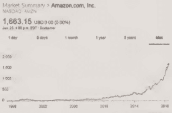

# Chapter 10

## Governance

Amazon stands out as the poster child for governance in digital strategy and technology investment. The Amazon board drives value based on three enduring principles:

+   1. Focus on the customer.
+   2. Test market opportunities made available by technology.
+   3. Focus on data driven analysis to improve results.

Amazon started with word matching and search optimization (SEO), building millions of key words for customer search as the foundation for engagement and growth.

Over time, Amazon has led the industry by progressively delivering clear and simple experiences through testing with customers and responding to needs.

Amazon leads the industry in delivering personalization, with relevant recommendations based on a customer’s buying behavior.

The frictionless purchase decision that Amazon Prime enables is an impactful example of a mature and proactive digital strategy. Amazon has consistently topped the American Customer Satisfaction Index (ACSI) since 2000, and they are at the top of their sector for revenue per unique visitor.

The power of governance shows in Amazon’s share price.

The case of Amazon takeaway → Just because there is technology involved, do not lose sight of the basics. Stay focused on where the facts take you, and do what makes sense.

### Figure 10.1 The Case of Amazon

The case of Amazon, in Figure 10.1, demonstrates the power of being focused on both the enhancement and the protection of shareholder value. There are two specific standards of performance:

+   1. **Fiduciary duty**, which requires the individual director to act with honesty, in good faith, and in the best interest of the company.

+   2. **Duty of care**, which requires the individual director to engage with care, diligence, and skill, and to make decisions that are prudent and reasonable.

It has historically been enough for a board to rely on experts in areas like technology. With incidents involving systemic breaches of privacy, like Target, and business models that go beyond expected norms, like Facebook, directors are increasingly under pressure to have their own level of technology diligence and skill in order to fulfill the “protect” part of their mandate.

Enhance and protect are the flip sides of the same coin, and directors need to be on top of both.

> _Governance is like steering, Risk Management is like braking._
> 
> Pearl Zhu

Technology governance discussions often focus only on the risk issues, which leave most boards with a blind spot regarding the opportunities. The blind spot is made larger by the traditional approach of governance by exception.

When a board counts on the CEO to know what to bring in for discussion, it is often left out of the digital investment conversation entirely.

Industry experts now suggest “technology governance has become integral to corporate governance because it can impact multiple areas of corporate risk, including reputation and changing requirements for IT disclosure. Incompetence, or even reduced competence, can be very costly in a digital era. This is evidenced by the Target US case, as well as the growing list of iconic brands that have either gone out of business or that have lost significant market share. Many simply did not see digital disruption coming, or worse they lacked the capability to recognise that digital change was relevant to them.”¹ Further, “how a company implements and represents its corporate social responsibility and sustainability practices may affect its operations, financial performance, corporate governance, and reputation.”²

Best practice frameworks identify three broadly based governance competencies as critical:³

+   1. The ability to govern technology for strategic performance and to enhance organization performance.

+   2. The ability to make quality judgements and decisions in relation to business technology and data use, including technology risk.

+   3. The ability to oversee technology projects to achieve returns and demonstrate value.

当重大战略投资失败时，董事会仅声称已将责任委托给首席执行官是不够的。董事会拥有可衡量的进度指标和明确的结果至关重要，并且应定期监控结果。任何低于此标准的做法都可被视为治理失败。⁴

作为一名经验丰富的董事，您了解治理的基本原理，但当对话变得“过于”技术化时，可能会出现差距。您可以采取以下措施：

- **进行更多对话式交流。** 通过更真诚地参与讨论，您可以提出更好的挑战，并寻求提交给董事会的观点质量的改进。使用各章中提供的聪明问题。然后，积极倾听答案并不断提问，直到您了解所需了解的内容。

- **给予您的疑虑时间和优先权。** 您之所以成为董事，是因为您已证明自己的直觉非常敏锐。如果您不理解某个话题，您有理由持怀疑态度。您不必接受首席信息官或任何其他人所推销的一切。使用以下聪明问题，要么消除您的疑虑，要么直接说不。

- **不要被技术术语分散注意力。** 如果您正在阅读本书，说明您已准备好投入足够精力，以理解您被要求做出的决策。如果您的首席信息官无法帮助您了解所需了解的内容，那么您可能找错了首席信息官。

- **不要容忍董事会同事出现“眼神呆滞”的情况。** 如果其他董事似乎不投入，请寻求您的领导团队将对话提升到一个引人入胜的水平。找到一个能引起共鸣的类比，以阐明问题和需要做出的决策。使用示例。如果有必要，私下讨论；只有另一位董事才能指出这种行为所构成的问题。

- **寻求独立意见。** 使用类似前文“如何避免群体思维”的方法，以做出偏差更小、校准更好的决策。

- **避免“因筋疲力尽而达成一致”。** 杜鲁门总统手下的国务卿迪安·阿奇逊创造了这个短语，用来描述专家不屈不挠的情况。决策得以批准，是因为决策者希望讨论停止。

- **以勇气领导您的团队。**

- **采取知情且经过计算的风险。**

- **全力承诺。** 了解为实现所需结果需要付出什么。

技术治理的核心在于立即开始；之后会变得更容易。挑战自己，做得更好。请参见图 10.2 中所示的聪明问题。

> 有许多方式可以以商业为中心。您可以关注竞争对手，可以关注产品，可以关注技术，可以关注商业模式，还有更多。但在我看来，痴迷于客户关注远远是最重要的。即使客户自己还不知道，客户也想要更好的东西；而您取悦客户的愿望将驱动您为他们发明。

杰夫·贝索斯

- 我们是否挑战管理层，在技术战略中纳入董事会审查和批准？我们是否收到该战略进展的更新？
- 我们正在委托哪些决策，而我们本应更深入参与？
- 技术是否使我们能够做些新的或不同的事情？
- 我们是否有效地讨论了实现价值创造的机会？
- 我们正在做哪些可能影响我们政策的改变？
- 我们是否真正对与 IT 相关的决策负责？
- 我们或我们的领导团队期望外部专家对技术决策负多大责任？
- 我们委托的决策是否适当？风险是什么？
- 我们是否对数字投资相关的风险提供有效的监督？

**图 10.2** 聪明问题 – 治理

### 注释

1. E. Valentine, “企业技术治理：董事会所需的新信息和技术核心能力，昆士兰科技大学专业博士论文，2016 年，第 235 页。
2. 同上，第 234 页。
3. 同上，第 198 页。
4. “为何单独将技术治理列为董事会关注重点？” _企业治理博客_（2014 年 2 月 16 日）。
