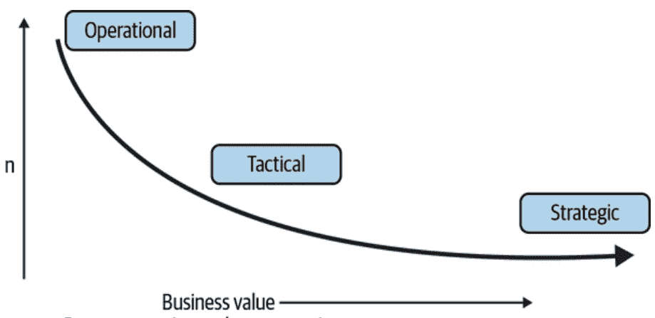
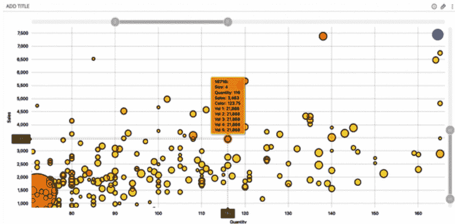
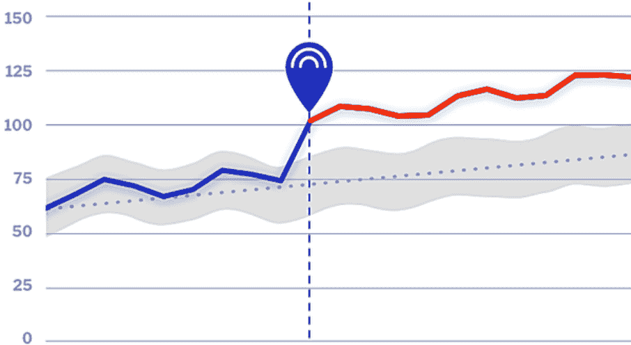
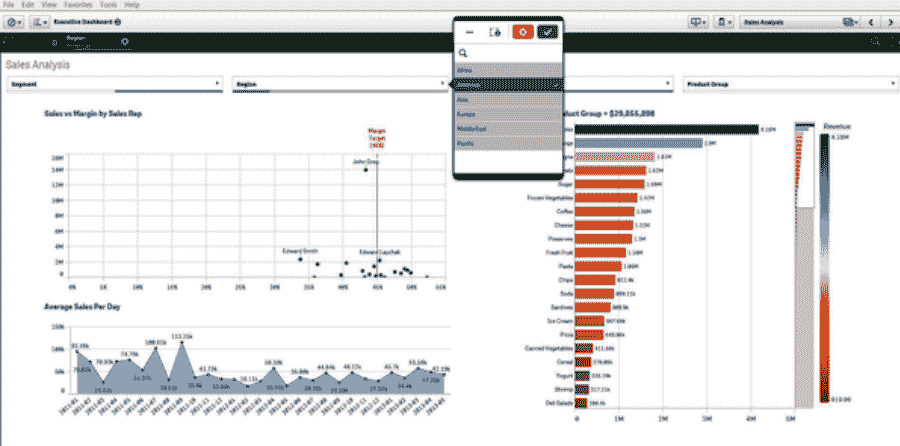
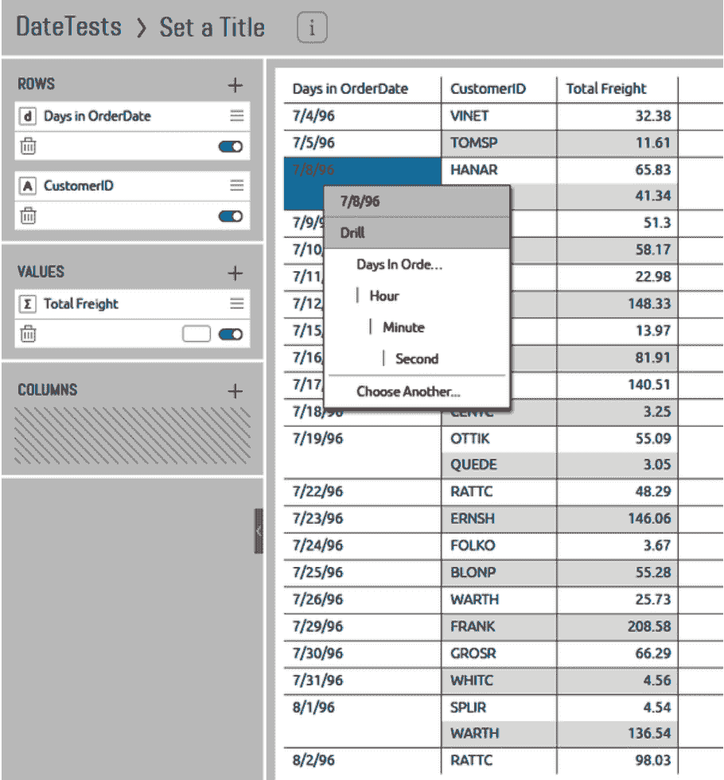
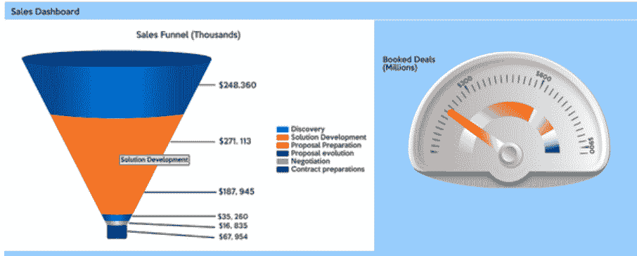
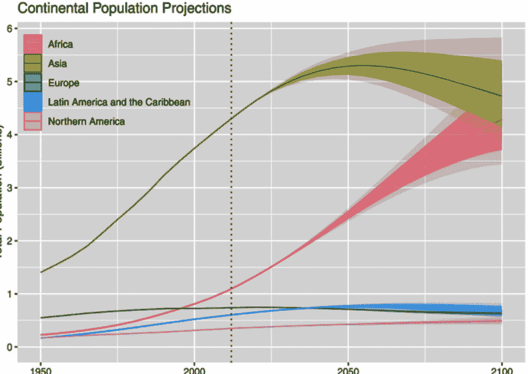

# 第 2 章 分析与决策

在考虑嵌入式分析在业务中的作用时，回过头来思考我们使用分析的目的很有用。

一个答案是，分析帮助我们与业务保持联系，为管理人员和规划者提供一种广泛的情境意识。这是一个明智的目标，但我们需要分析洞察的一个更实际、更直接的原因是：做出更好的决策。

要做出更好的业务决策，我们需要更好的业务信息。自20世纪50年代和60年代在卡内基技术学院进行首次系统性决策研究以来，这一观点就已被理解。甚至在更早的时候，当人们开始创建基本财务报告或管理报告时，提供更好信息的意图就已经是隐含的。在那些日子里，这个过程不被称为 *分析*，而是称为 *决策支持*。老实说，这仍然是该实践的一个好名字，因为我们的目的确实是支持更好的决策。

## 什么是决策？

与往常一样，一个我们每天都在使用的单词可能有点难以定义。在业务环境下，我们喜欢 James Taylor 和 Neil Raden 在 2007 年出版的 *智能足够系统*（Prentice Hall）中给出的定义：

> 决策……是确定行动方案的行为。

我们喜欢这个定义，因为它如此清晰地将决策行为与行动联系起来。当然，有时我们可能决定不采取行动，但在商业中，即使不行动也是一种会带来后果的选择。

既然说过一个目标是支持决策，我们需要更多地了解决策过程。决策科学领域有大量的学术研究，通常与概率论和博弈论相关，但这有些抽象，因此超出了我们的范围。就我们的目的而言，我们不需要科学模型，而是一个您可以在大多数现代企业中看到的重要模式的有用描述。

图 2-1 显示了决策的两个维度：垂直轴上我们做出的决策数量，以及沿水平轴上单个决策的业务价值。我们可以看到，曲线从单个价值很低的大量决策，到单个价值很高的少量决策：也就是说，从运营决策到战略决策。

图 2-1. 关注决策

决策不仅在价值和频率上有所不同，而且在用于支持它们的数据和做出决策的人员上也有所不同。当我们设计嵌入式分析体验时，了解这种差异很重要。

在本章中，我们将考虑现代企业中做出的不同类型的决策，特别是那些可以通过嵌入式分析得到协助的决策。我们还将讨论分析的一种设计模式，这在嵌入需要有影响力但不令人分心的组件时特别有用。最后，我们需要讨论模糊性在分析中的作用，因为很少有决策能得到完美数据的支持。让我们先来看看战略决策。

## 高管和战略决策

在任何企业中，都有一些高价值的决策需要做出。我们要构建什么新产品？我们应该收购另一家公司吗？我们要进入哪些新市场？这些高价值的战略决策每一个都有重大的业务影响，但它们不是每天都做出的。这些决策通常由高管团队做出，事项可能在年度或季度董事会会议上解决，或在月度管理评审期间解决。在管理良好的企业中，战略不是日复一日改变的东西。

支持此类决策的数据高度聚合。季度董事会会议不会纠结于每笔销售交易的细节，而是会考虑前一期的全球或部门销售，进行汇总、平均和趋势分析。

战略决策的数据不仅以这种方式聚合，还会辅以大量外部信息。高管决策很少只查看一个数据源或一个狭窄的业务领域来做出。战略由各种数据所指导，这些数据可能甚至没有以结构化格式捕获。例如，战略决策可能受到关于竞争对手企业的竞争情报、经济状况、政治稳定性问题以及企业领导者的期望的影响。我们将在第 8 章中更详细地探讨高管决策，届时我们将考虑如何嵌入电子表格，即高管的首选工具。

## 运营决策

如果我们现在看光谱的另一端，即运营决策，我们可以看到它们数量非常多。事实上，大型企业每天会做出数千个运营决策。

运营决策是在业务过程中做出的一种选择，范围非常有限，与战略决策相比，单个决策的业务价值较低。下一个要拜访哪个客户？向他们展示哪些产品？可以提供什么折扣？当这个警报响起时，采取什么行动？是否为该客户批准贷款？

当然，从重要意义上说，运营决策就是您的业务在运行。这就是您的业务运作方式。

运营决策通常使用来自定义良好的数据源的相对有限的数据量来做出。可能根本不使用任何外部信息。在所有这些方面，它们几乎正好与战略决策相反。决策者可能不是高管，而是销售人员、机器操作员、呼叫中心代表或文员。

运营决策是嵌入式分析的主要用例。如果您需要响应警报或当场在电话中向客户提出报价，拥有一些背景信息或建议来帮助您做出更好的决策是非常有用的。否则，您很可能只是对相对低信息的事件做出本能反应。

出于这些原因，在整本书中，我们经常关注运营决策以及如何通过嵌入式分析来改进和增强它们。

## 战术管理决策

如图 2-1 所示，在运营和战略工作之间，我们有战术决策。这些决策通常由我们有时称之为（并不总是作为恭维）中层管理人员的人做出。尽管他们作为官僚的名声不佳，但中层管理人员在商业决策制定中起着极其重要的作用。中层管理人员在其工作范围内将运营决策聚合到出现模式的程度，

趋势和例外情况可以被发现。从那里，战术决策者在可行的时间段内设定业务方向，这可能是天、几周或几个月，而不是战略规划那种长达数年的视野。

例如，销售经理与销售副总裁不同，需要访问所有单个销售交易，也许会挖掘明细，即使只有一个项目看起来明显错误或异常。战术决策以汇总操作数据为基础，并可能辅以人力资源数据等来源的补充。尽管如此，战术思维的范围远比战略决策狭窄。

中层管理决策是传统商业智能的关注焦点。过去20年里，大多数报告和仪表板工具都是针对这类工作优化其用户体验的。事实上，这种中层管理关注点也是商业智能采用度有限的原因，因为战术决策者数量有限。

## 商业智能的局限

> 2017年，Gartner分析师Cindi Howson和Rita Sallam表示：“普及的商业智能依然难以实现，BI和分析的采用率约为所有员工的30%。希望在组织中扩大BI和分析的覆盖范围和影响的数据与分析负责人应部署现代BI平台，利用移动和嵌入式功能。”

扩大BI覆盖范围是有充分理由的，但我们相信，我们应当通过关注改进决策来实现这一点，而不仅仅是提高采用率。

相比之下，操作决策者数量非常庞大，他们正是我们希望通过嵌入式分析触达的人群。这并不是说嵌入式分析在战术管理者或战略高管的世界中没有作用：当我们考虑报告和仪表板解决方案时，我们将探讨其中的一些场景。

目前，我们如何开始利用数据和洞察支持决策者呢？在下一节中，我们将分享一些有帮助的模式。

## 分析体验的设计模式

2007年，加州大学洛杉矶分校信息研究系的主要研究人员Marcia Bates分析了浏览行为的组成部分，具体是在图书馆中。她的论文《浏览到底是什么？》非常引人入胜。Bates详细探讨了该研究，但我们发现一个简化模型在我们自己的工作中很有用。

请注意，在描述这个模型时，所有优点都真正来自Bates的工作——这是一篇值得一读的论文。任何不足之处都是过度简化的结果。

无论我们是仅为了信息而考虑分析，还是像我们这样将其作为决策输入，图2-2所示的模式都很有效。

Figure 2-2. 分析体验的简化模型

### 定位

浏览（以及分析）的第一步是知道自己在哪里，在信息环境中定位自己。在图书馆中，这涉及到知道自己处于哪个主题区域，以及如何找到其他区域。

在使用嵌入应用程序中的分析对象时，会出现类似的问题。我们在看什么？假设这是产品销售分析。包含哪些产品？哪些地理区域？显示哪些年份？我们不应让用户被“有用”的指标压倒，因为他们更可能在细节中迷失而不是得到帮助。（想想在灯光、标志和标记过多的路口很难理解交通情况。）两到三个关键信息应该能帮助用户确定他们在看什么。

定位还应让用户了解如何在信息空间中移动。例如，如果您正在查看今天的呼叫量，如何才能找到昨天或前一周的数据？这些信息是否可用？

这里超出了我们描述用户体验可提供这些功能的所有方式的范围。事实上，我们不需要这样做，因为当我们将分析嵌入主机环境或应用程序时，如果分析组件的定位和导航功能或多或少遵循主机应用程序的功能，则最有用。这样，体验会更加熟悉且易于学习，同时减少用户在环境之间切换的认知负担。

### 一瞥

图书馆（或书店，如果你愿意）的原始示例在这里很有用。如果我们在寻找关于如何开好会的书，我们肯定可以将自己定位在商业书籍区。但我们如何找到那本会议书呢？可能会有成百上千种各种主题的书籍，也许按作者组织。

如果我们有时间、耐心并对系统有一些了解，可能会查阅目录。否则，我们更有可能*浏览*（因此是论文标题），而不是仔细查看每一本书，而是让视线在书架上漫游，直到某样东西吸引我们的目光。我们*一瞥*，也许，书名中有“会议”一词。而且，就像我们一瞥书名一样，我们也会吸收作者姓名、封面设计特征等等。

在分析中，一瞥是理解数据的关键步骤，尤其是在寻找洞察或新信息时。在[图2-3]()所示的散点图中，很容易看到一些称为异常值的数值与大多数数据点分离开来。它们使我们能够一瞥可能有趣或重要的内容。

Figure 2-3. 可以轻松一瞥异常值的散点图

同样，在图2-4的时间序列可视化中，我们可以一瞥几个有用的特征。总体趋势显示销售随时间增长，但有一个短期内销售显著下降后又恢复的时期：这可能是为什么？我们还可以一瞥近期数值的激增；也许这是一个值得探索的有用数据点。

Figure 2-4. 可清晰显示峰值和谷值的时间序列图表

正如你所见，某些可视化对于实现这些快速洞察尤其有用。事实上，为数据选择合适的可视化时，应考虑信息将如何被一瞥，然后在看到可能有趣的内容后，将如何进行检查。这是模型的下一步。

### 检查

回到图书馆，在一瞥一本关于会议文化的书后，是时候看看它是否是一个有用的选择了。于是我们从书架上取下书并检查它。请注意，我们在图书馆里不会读完整本书。我们可能会查看目录，翻阅章节，阅读封面背面的简短营销语和热情的引文。它有图表吗？练习吗？索引吗？检查有助于我们理解这本书是否确实像我们希望的那样有用。

在我们的可视化中，可以做概念上类似的事情。在一瞥我们认为重要的数据点或趋势后，是时候对其进行检查了。

有些工具比其他工具更容易做到这一点。在图2-5中，通过将鼠标悬停在相关数据点上，可以弹出一个包含更多信息的小面板。这当然很有用，并且比一次性将所有这些额外细节加载到可视化中更好。

Figure 2-5. 检查数据值

### 嵌入式分析的导航范围

在这些示例中，当我们检查我们一瞥的某个数据特征时，会获得更多关于它的信息。一些商业智能工具允许你做更多。例如，在检查了区域级别的销售后，你可能会扩大视图，查看整个企业的销售，然后追溯到不同区域的新路径。战略和战术决策者经常这样做，因为他们正在检查较高层次的数据，并需要跨越更广泛的业务范围进行比较。

但是，如果你是一名销售人员，正在尝试选择下一位要拜访的客户，并且正在使用嵌入式可视化来帮助做出该决定，那么将自己的工作与全球或其他区域的总销售额进行比较不太可能获得太多洞察。你最好关注那些尽管规模较小但与你自己的决策相关的场景。

在嵌入分析时，我们必须牢记，我们并不是嵌入一个可以解决企业中任何问题的完整BI环境。我们正在支持特定类别的用户在他们做出特定决策时。

为了实现这种更紧凑的关注点——并避免分散用户注意力——嵌入式分析通常比传统的通用BI工具范围更受限。

另一个示例在图2-6中呈现。在这种情况下，你不是仅将鼠标悬停在可视化的某个部分以获取更多信息，而是可以单击相关数据点，整个视图就会改变。你已经从按区域查看销售转变为检查该区域内某位特定销售人员的销售。我们将这种交互称为*下钻*。这是任何商业智能工具的关键功能。

图 2-6. 钻取分析实例

## 决策

当 Marcia Bates 调查图书馆中的浏览行为时，她识别出的最后一步被称为 *获取*。浏览者实际上会获取一个对象以供使用，借阅一本图书馆图书来阅读。

在我们的情况中，我们不会将数据带到前台去盖章并稍后归还。但是，在一瞥到有趣的内容并审视了数据之后，我们现在有了洞察，是时候采取行动了。是时候采取行动，做出决策了。

由于我们一直强调工作中支持决策，你可以想象这一步对于嵌入式分析的成功至关重要。事实上，这个主题非常重要，以至于第 3 章的很大一部分将讨论如何建模决策的组成部分，然后利用分析洞察来实现决策。

目前，公平地说，这一最终步骤在分析工具中处理得并不好。长期以来，我们的关注点是当天的挑战——将高质量数据交到业务用户手中，并使他们能够探索和可视化数据。我们做得足够好，但技术和用户需求已经发展。今天，我们需要将这一决策步骤更直接地集成到用户的工作流程中。

用户从审视到决策有四种方式：

- 用户可以简单地自己做出决策——如果你愿意，就在脑海中——然后转到另一个工具或另一个操作环境来采取行动。这是用户使用传统 BI 工具做决策的方式。
- 仪表板和一些报告通常允许用户通过电子邮件、聊天应用程序，甚至通过剪辑或将分析对象共享到演示文稿幻灯片来共享可视化内容。有时此功能紧密集成，但通常只是一个松散的功能。它仍然要求用户在分析工具中进行观察，并在其他地方采取行动。
- 一些 BI 工具允许对分析环境进行扩展，这些扩展可以集成到操作应用程序的链接。这通常通过一个称为回写的过程实现。我们将在第 4 章中更详细地讨论回写。从某种意义上说，这种方法与嵌入式分析恰恰相反：它将操作功能嵌入到分析工具集中，而不是将分析功能嵌入到操作环境中。这有很好的应用场景，我们将在稍后讨论。
- 最后——也是我们在这里的主要关注点——如果分析对象（例如可视化内容）嵌入到操作应用程序中，用户可以在同一屏幕上立即采取行动，而无需切换环境或失去专注力。作为一名销售人员，你可能在客户分析中看到一些异常值，也许是很久没有联系过的客户。就在那里，在你的客户管理应用程序中，你可以决定发起电话、做笔记，并直接处理这些客户。

这种浏览模型既强大又实用，部分原因在于这种体验对我们来说非常自然。我们在图书馆中使用它。事实上，稍加思考，你会在许多活动中识别出这种模式，例如选择要流媒体的电影或购买杂货。但是，我们确实想强调，这种模式是从现实世界经验中简化而来，以便在我们的设计工作中更容易应用。

这种浏览模型忽略的数据和决策的一个重要方面是常见的问题：我们的数据并不总是能清晰或明确地导向一个单一、简单的决策。在现实世界中，数据是模棱两可的。

## 模糊性与分析

人类不习惯于模棱两可。关于我们对模棱两可的神经反应的研究表明，当我们对不确定性在情感和身体上感到不适时，控制战斗或逃跑本能的杏仁核会被激活。

除了这种不适之外，模棱两可根本无法令人信服。正如 J. M. Coetzee 在《糟糕年份日记》（Penguin 出版）中写道：“如果你不习惯以概率术语思考，那么来自概率世界的预测看起来就空洞无物。”麦克阿瑟将军离开马尼拉时并没有说：“我可能会回来。”

商业智能大多寻求通过偏好清晰而非复杂来消除模棱两可和不确定性。最著名的例子是数据仓库架构师声称能够提供 *一个版本的真相*。仅从其表述上就暗示了存在需要被压制的替代方案。确定性会受到奖励。

即使在不确定性不可避免的地方，我们也常常偏好固定值的人为清晰度。很常见看到仪表板预测预算和支出精确到分，如 [图 2-7] 所示。

当然，我们不相信我们会见到正好 $7,493,087.68 的销售额，但我们缺乏工具，而对于许多没有概率背景的人来说，我们缺乏词汇来将更现实、更 *模棱两可* 的结果聚焦出来。

最好，所有相关人员都将其理解为一场自我欺骗的游戏。尽管如此，在舒适的幻象背后潜伏着虚假精确性谬误的危险。我们可能会过度信任这些预测，因为它们看起来准确，而忘记了我们自己在其中的角色。

今天，我们只是在欺骗自己。但是，由于机器学习和人工智能本质上是概率性的，我们的企业正迅速走到这样的地步：这种识字率不足将严重限制我们的工作和成功。我们不需要所有人都成为数据科学家，但我们确实需要在工作中更好地传达不确定性。

| 机会名称 | 公司名称 | 关闭日期 | 预估价值 | 概率 | 负责人 |
|---|---|---|---|---|---|
| Axles and Gears | Trike Inc | 18/11/2021 | $7,493,087.68 | 50 | Monteiro |
| Facility expansion | Metal refining Inc | 10/6/2022 | $43,983,503.76 | 50 | Monteiro |
| Full Assembly | Retail Log LLC | 6/6/2022 | $6,618,395.28 | 25 | Howie |
| Closed elements | A.C. Corp | 3/12/2021 | $13,022,204.00 | 25 | Monteiro |
| Inventory | Retail Log LLC | 5/5/2022 | $4,339,532.83 | 50 | Monteiro |

图 2-7. 不切实际的精确度的仪表板

图 2-8 显示了一个可视化示例，它以有帮助且易于理解的方式表示模棱两可的数据。

虽然我们不能精确知道未来各大洲的人口将是多少，但我们可以做出合理的预测，如本可视化所示。它还以简单的方式展示了围绕该预测的潜在差异范围——即模棱两可。然而，这不是一个带有复杂公式和详细误差可视化的技术图表。几乎任何具备合理数据素养的用户都能理解它。更重要的是，它可以带来更好的决策。一方面，我们可以非常容易地看到和解释潜在场景的范围。

模棱两可是一个复杂的问题。对其对商业决策影响的完整处理有点超出我们的范围。但是，了解问题的存在以及有方法来解决它，在我们设计嵌入式分析体验时将很有用。

图 2-8. 华盛顿大学 Adrian Raftery 制作的不确定数据的简单但引人注目的可视化

## 总结

在本章中，我们回顾了现代企业中做出的不同类型的决策。我们看到战略决策使用各种各样的投入，因此很少从嵌入式应用程序中受益——但要注意电子表格，它们仍然是高管的重要工具。

战术和运营决策（一线经理及其员工的决策）最受益于嵌入式分析。定向–一瞥–审视–决策的模式大大有助于使分析变得可访问且有效。

最后，我们考虑了如何处理模棱两可和不确定的数据，随着我们更多地使用预测和

other machine learning features in our work.

Now it is time to get started planning our embedded analytics.
