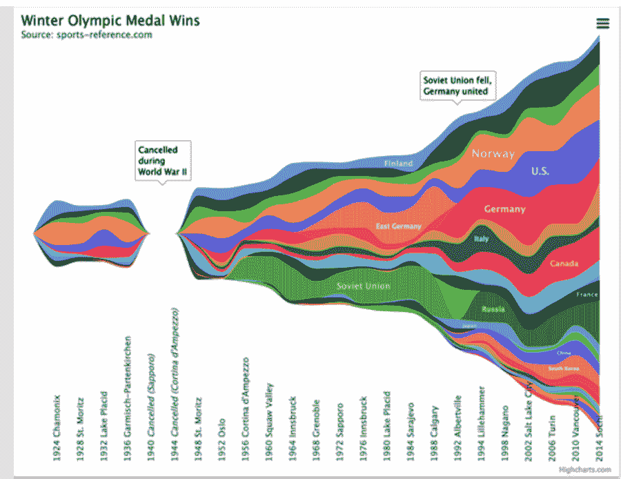
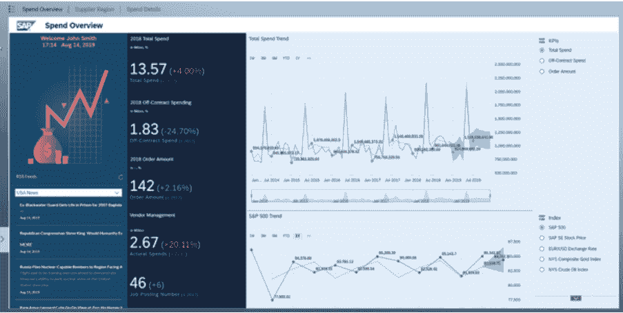

# 第 3 章 嵌入式分析架构

Having looked at the nature of decisions and a design pattern for analytics, how do we start to put together an embedded analytics solution? In this chapter we will give an overview of some architectural features to consider. We will also look at some benefits and weaknesses of common approaches.

## 嵌入式分析的要素

When thinking about how to approach embedding analytics in your applications, look for several common elements, as described in this section.

## 数据连接

We will consider the topic of data for embedded analytics in much more detail in Chapter 4. But for now, we should recognize and understand that simply being able to connect your data source is a critical capability of any analytics solution. This is not always as obvious as it may sound.

When we embed analytics into operational systems, we often connect to legacy applications that the business has been running for years. Or perhaps we need to access data in custom applications. And in both these cases we may have to integrate both operational and analytic data. If you cannot connect, in all of these scenarios, you will fall at the first hurdle.

## 分析引擎

Analytics is more advanced than reporting because the pattern of Orientation–Glimpsing–Examining–Deciding is predicated on interactivity, especially in the examining phase. Often, when we have glimpsed a potential insight and examined it, we discover things are not quite as we thought. So we return to glimpse another, related insight to examine again. This process can prove quite convoluted. Think of the steps you go through searching for a restaurant or hotel online: internet search engines employ our analytic pattern too!

An embedded report has limited scope for this kind of interaction. You may filter or sort the data in the report, in the same way as a regular report might be filtered or sorted. There is nothing especially "analytical" or insightful about an embedded report. The report server may need to scale substantially, but it rarely has complex calculations to perform: any advanced or involved aggregations or predictions will generally be calculated outside the report server by the analytics engine. Similarly, a visual component added in code may be used only to display results, and not have any real analytics behind it.

Embedded analytics, on the other hand, may include quite sophisticated options for selections, navigation, and even custom queries or calculations. The visualizations may display data in complex and demanding ways, perhaps enabling us to zoom in from a summary to fine detail. In such cases, the analytics engine is critical.

What is the analytics engine? Generally speaking, it's a system for performing queries against one or more data sources that includes specific functions for analyzing data. An online analytic processing (OLAP) system can typically perform numerous aggregations, such as computing sums, averages, and minimum and maximum values, across large volumes of data with near-instantaneous performance. And, of course, the aggregations may be much more complex than these examples. Other analytics engines may have particular knowledge about time series data and be able to perform calculations such as year to date and same period last year with a simple query for developers and great performance for users. More recently, we've begun to see analytics engines with features for machine learning algorithms and data science.

Expect an analytics engine with high performance, preferably one with query optimization, to take best advantage of available resources and the best methods of computing results.

## 品牌化用户体验

It is a common requirement that an embedded solution should not look like an embedded solution! Designers generally want the analytics to look completely consistent with the host application. This expectation may require that navigating, selecting, editing, confirming changes, and so on should all behave the same way in the embedded environment as in the host.

Moreover, the host environment may be branded with logos, corporate standard colors, and preferred typefaces. When we white label the user experience, all these elements will look the same in the embedded analytics objects. This is a common requirement, although we are skeptical of its value: it can be a useful nudge to a user's curiosity to recognize that this chart or that table is a special object worthy of attention. It's similar to pulling out a quotation in writing, not only to show that this is another author's words, but also to give them some authority as being noteworthy. On the other hand, we understand the resistance to the other extreme, where the analytics vendor's name, logos, and UX preferences are all visible in what should be an unintrusive embedded component.

## 无缝并非表面所见

A term you will come across often when researching user experiences or any architectural integration is seamless.

Seamlessness, we are told, is a virtue: the idea being that when we switch from one context to another in our work, the cognitive effort required reduces our productivity and distracts us. The solution is an environment where we do not need to switch context but see all our different scenarios working together as a unified whole, like in a seamless garment.

Metaphors can be tricky. Seams are, in fact, important. They don't merely hold together a garment stitched from pieces of material. Seams give shape to our clothing, so it drapes properly and moves with us. Seams give strength. Seams are practical.

So, too, in software design. Sometimes a user will not want to switch context; they just need a quick reminder of a number or to glimpse a trend. But at other times, we absolutely do want the user to switch context: they should be aware that *now I am doing analytics* and this involves a slightly different practice from my regular work.

Think carefully, therefore, about seamless experiences. What does the user need to know about what they are doing? Will a clear transition from one mode of thinking to another help them? Sometimes, you need a seam.

## 开发者资源

In this chapter we will review several different criteria that may influence your choice of embedded analytics architecture. However, in many cases we have seen the decision come down to just two simplified, if rather extreme, parameters. First, can I connect to my data? That is essential, of course. But also, can my developers do this work effectively? Have they the skills, the resources, and the time?

In general, we may prefer an embedded architecture that reuses as much of our existing effort as possible, whether in data, analytics, security, or application management. Or, we may be required by legislation or best-practice guidelines (for public departments and certain highly regulated industries) to ensure that security and access control run based on a particular system, or that certain user experience and accessibility requirements are adhered to.

## 可扩展性

When embedding analytics in operational applications you should be aware of two different forms of scalability.

First—and most familiar—is the volume of data that the analytic system can handle. When vendors talk about large-scale solutions this is generally what they mean. At the high end, modern engines are designed to handle even petabytes of data, but because the design of analytics engines varies widely, it is useful to ask if your candidate system can handle all the data it needs to. This is unlikely to be a problem if you are integrated with, say, an HR system or a customer record system: you will almost certainly not have enough employees or customers to cause any issues with even a basic reporting system. However, if you're connecting to an enterprise data lake and summarizing big data, such as web logs or ecommerce transactions, then scale really can prove problematic, especially for in-memory analytics engines that must hold all the data at once to work with it effectively.

A second form of scalability is the number of users who may connect to the system, especially simultaneously. This often varies throughout the day and the week, as discussed in the following sidebar, but there may also be seasonal trends depending on your business.

## 上午 9 点的问题

Donald Farmer

我在 20 世纪 90 年代开始使用商业企业服务器。此前，我的工作侧重于复杂但规模较小的场景，通常用于研究。但当为石油公司、零售商和医疗保健提供商等大型客户设计报告和分析应用程序时，我熟悉了一种规模问题。每个工作日上午 9 点，尤其是周一，几乎所有经理都会登录系统并刷新其关键报告。这是系统的峰值负载，我们很快了解到，简单地向问题投入资源——例如更大的服务器——并不是一个受欢迎的解决方案，主要是因为成本太高。我们使用了包括预测预处理、缓存、缓存共享和即时处理在内的多种技术，使其正常工作。

今天您可能不存在这个问题。事实上，在云计算时代，您不应该存在这个问题。您的云服务提供商应该能够提供真正具有弹性的可扩展性，既高效又经济实惠。但是，您应该仔细建模这一场景——计算峰值需求将是怎样的——并确保您的云提供商和分析引擎确实可靠地实现了它。

## 安全性

在第 6 章中，我们将更深入地探讨嵌入式分析的安全影响，在第 7 章中，我们还将探讨一些与数据治理相关的主题。在这里，在选择平台时，指出一些需要考虑的关键标准非常重要：

- 确保分析系统可以为您的需求实现正确的协议。查找标准集成，例如轻量级目录访问协议 (LDAP)、OAuth 或 Active Directory。
- 基于角色的安全性至关重要。您必须能够根据用户的角色配置查看和处理数据的权限。更好的是，用户应该直接从托管应用程序继承这些权限，因此您不必重复造轮子并两次定义相同的安全要求。
- 单点登录 (SSO) 对您来说可能是必不可少的。要求用户登录其托管应用程序，然后再登录其嵌入式分析平台，这是一个笨拙且容易出错的过程。SSO 只需一次登录即可访问所有相关应用程序。这不仅仅是用户体验问题。任何在没有 SSO 的情况下涉及管理不同用户帐户（托管应用和嵌入式应用）的变通方法，都可能导致开发人员走捷径、对用户名和密码进行硬编码，甚至降低嵌入式应用中的安全防范措施。
- 分析是否需要在客户端 Web 应用程序中外部访问？如果是，环境应支持在 Web 应用程序中嵌入，提供必要的安全措施，并具有处理大量外部用户的可扩展性和性能。
- 日志记录也是一个重要的考虑因素，因为它有助于故障排除、监控性能以及识别可能导致安全问题的使用模式。

### 管理工具

当您必须管理所有这些元素——数据访问、安全性、可扩展性和用户体验——时，您会欣赏有效的管理工具。

一个重要的管理功能是更新和数据刷新的调度。特别是在使用也按计划刷新的托管应用程序时，请确保您可以根据需要同步、共享或重复使用调度。

> 注意
> 
> IT 也是人！在我们谈论用户体验和对有效业务用户工具的需求时，很容易忽视 IT 的需求。但请记住，IT 团队日复一日地管理服务器和应用程序。如果用户体验设计不佳，他们也会遭受上下文切换的困扰。而且，如果他们疲惫、压力大，或者只是使用笨拙低效的工具，他们的错误可能会产生深远的企业级后果，甚至可能导致解决方案的用户采纳完全失败。所以，请考虑您的 IT 员工：他们值得——并且他们也需要——优秀的应用程序。

## 嵌入式分析平台

在描述了嵌入式平台的一些要素后，我们现在可以探讨不同的嵌入方法，每种方法都有其自身的优点和缺点。我们将考虑面向开发人员的组件库、也可用于嵌入的企业报告和 BI 平台，最后，是专为嵌入构建的专用平台。

## 组件库

开发人员很容易被“自建”解决方案所诱惑，从头开始构建整个嵌入式分析基础架构。产生诱惑的原因在于，可视化组件库非常有吸引力，提供了从最基本到最复杂的各种图表和图形类型。

也许您的需求很简单：预算有限，配置是静态的，并且您不打算在未来集成更复杂的分析。在这种情况下，您当然可以将组件库视为入门的有效方式。

同样，如果您有针对特定且复杂的图表类型的特殊需求，那么像 D3.js 或 Highcharts（见图 3-1）这样的可视化组件库可能是您最佳，甚至是唯一的选择。

但是，可视化组件库作为专注于运营和战术决策的企业的实用解决方案，存在显著缺点。开发可能耗时，因为每个组件都必须在代码中自定义，安全性和管理也必须在组件级别在代码中定义。虽然这可能是一种快速入门的方法，但当数据连接需要重定向到新来源时，维护就会成为一个真正的问题。

图 3-1. 使用 Highcharts 可视化库构建的复杂图表

开发团队面临的另一个问题是，构建分析会将资源从其他开发任务中转移开。如果这些开发人员本身不是数据和分析专家，他们的学习曲线可能非常陡峭。数据集成、管理和安全性的问题依然存在。

简而言之，虽然组件库可以提供非常复杂的可视化功能，但在代码中维护连接性和数据管理的负担，除了最简单的场景之外，很可能需要投入过多的部署工作。

## 总有办法

Donald Farmer

我曾经就一家拥有优秀、高技能开发团队的电脑游戏公司提供过建议。事实上，几乎所有高级人员都是经过实践的开发人员，他们沿着不同的路径进入自己的岗位，但都有软件背景。他们也是视觉型思维者，喜欢使用复杂的图表和可视化。因此，无论是在市场营销还是产品管理中，许多经理都已使用组件库构建了自己的可视化工具，并连接到企业数据湖。

然而，即使对于这些精明的用户来说，在代码中管理数据访问和安全性、版本控制以及应用企业基于角色的规则也是太繁琐的事情。因此，他们没有在运营应用程序中嵌入分析，而是选择了一个可以通过自定义组件进行扩展的 BI 平台。BI 平台包含安全性、治理和管理功能，而组件库提供了他们想要的可视化效果。这种颠三倒四的做法对他们来说是有效的，但这只是因为从 CFO 到秘书，每个人骨子里都是开发人员。我不推荐这样做，但这个故事值得讲述，哪怕只是为了提醒我们，只要足够有创新精神，每种场景都有解决方案。

## 企业报告平台

如果您在大型组织工作，您几乎肯定已经拥有一个现有的企业报告平台，这可能是开始使用嵌入式分析的最简单的地方。这些应用程序旨在在整个组织中大规模提供业务数据的标准化视图。通常，集中式 IT 团队开发、维护和部署平台和应用程序，这有助于标准化，但限制

定制化和敏捷性。事实上，开发和部署周期可能会相当延长。

尽管如此，报告可以相当容易地嵌入应用程序，通常在 HTML 中填充一个内联框架；我们所要做的就是指向企业服务器上报告的地址。然而，简单性往往伴随着功能有限。与报告的交互通常仅限于排序、搜索和一些简单的筛选。同样，嵌入可能会给报告平台带来各种问题。记录数量众多的报告可能无法在框架内正确分页，而滚动查找记录不符合我们第 2 章中的 Orientation–Glimpsing–Examining–Deciding 模型。

企业报告的一些功能在嵌入场景中可能很有用。例如，当数据分组重复时，报告可以像图 3-2 所示分带显示。不过，请注意，这些原本用于独立报告的体验，在嵌入时应当合适且不分散注意力。

| 财务摘要 | | | |
| --- | --- | --- | --- |
| 无限制活动 | 财年 2012 | 财年 2013 | 财年 2014 |
| 无限制运营收入 | | | |
| 获得的项目收入 | $1,181,314 | $1,435,918 | $1,099,321 |
| 获得的非项目收入 | $182,851 | $131,113 | $152,849 |
| 总获得收入 | $1,364,165 | $1,516,626 | $1,233,916 |
| 投资收入 | $74,328 | $69,174 | $87,378 |
| 贡献收入 | $1,911,793 | $1,886,793 | $2,576,007 |
| 总无限制运营收入 | $3,349,793 | $3,472,593 | $3,897,301 |
| 运营费用 | | | |
| 项目 | $1,979,211 | $2,017,716 | $2,001,304 |
| 筹款 | $253,171 | $246,655 | $251,202 |
| 一般和行政 | $1,283,413 | $1,446,689 | $1,398,314 |
| 总运营费用 | $3,515,795 | $3,711,060 | $3,650,820 |
| 净无限制活动：运营 | -$166,002 | -$238,467 | $246,481 |
| 净无限制活动：非运营 | $0 | $0 | $0 |
| 总净无限制活动 | -$166,002 | -$238,467 | $246,481 |
| 净暂时受限活动 | -$63,700 | -$400,022 | $6,949,016 |
| 净永久受限活动 | $0 | $0 | $0 |
| 总净活动 | -$229,702 | -$638,489 | $7,195,497 |

图 3-2. 分带报告

使用报告的良好场景包括：需要以简单格式嵌入标准化的企业视图、可接受有限的交互、以及数据（或至少是摘要字段）可以在框架内轻松呈现的情况。请务必确保报告与托管应用程序的工作流真正相关。不过，有些场景并不存在所谓的运营工作流。例如，像图 3-3 所示的报告可以嵌入企业门户，如 Microsoft SharePoint。这些报告在很大程度上是静态对象；也许我们不应将此用例视为真正的分析。

图 3-3. 可嵌入的 Power BI 报告，例如可在 Microsoft SharePoint 中嵌入

嵌入未能在正确语境下提供最相关信息的报告，充其量只是徒劳，而且常常令人困惑、笨拙且适得其反。而且，即使嵌入后，报告看起来仍像报告。它们主要用于参考，并不会鼓励新的视角或发现。

## 商业智能应用程序

当我们超越最简单的报告和仪表板解决方案时，BI 应用程序在定制化以及用户自行进行探索和分析的能力方面提供了更多。这些 BI 平台通常包含用于定向的良好导航功能、用于瞥视的广泛可视化选项、以及用于审视数据的强大交互功能。然而，要有效地使用它们，确实比简单的报告需要更多的培训。几家领先的 BI 平台还使用内存处理，这承诺即使在复杂场景下也能提供出色性能，但可能会限制在数据湖中使用大数据。

虽然我们承认这些应用程序比报告提供更多的交互性，但也应指出，这种灵活性有其自身成本。用户体验，尤其是导航或选择功能，可能与托管应用程序不同。当托管应用程序中选择或在记录之间移动的方法与嵌入式分析中的方法不同时，体验可能会令人困惑并分散注意力。

您还可能发现 BI 应用程序有自己的安全模型和安全架构，因此它可能无法从托管应用程序继承权限。

但是，如果 BI 应用程序在您的业务中已经广泛部署，将其嵌入托管应用程序似乎非常方便。在这种情况下，用户不需要学习完全新的方法论。事实上，他们可能欣赏熟悉的环境。如果这种方法很有吸引力，请务必调查 BI 应用程序是否确实被广泛使用和赞赏。仅仅部署是不够的。嵌入不受欢迎或使用不足的应用程序并非成功之路！

虽然某些 BI 应用程序可以像报告一样轻松地嵌入托管应用程序——例如，使用 iframe——但有些应用程序具有更先进的嵌入功能，例如专用容器组件和开发者 API。如果您只是想向现有应用程序添加少量分析功能，甚至特定的分析选项卡，使用 iframe 很有吸引力，但为每个嵌入组件使用 iframe 可能会严重影响性能。

虽然开发者可能欣赏 BI 应用程序包含的 API，但他们往往发现可编程或可嵌入功能有限且难以使用。这种情况可能发生在供应商在 BI 应用程序本身之后一段时间才开发 API 时；换句话说，当 API 是附加上去的而不是内置的。以这种方式开发的 API 通常集成度较低、可靠性较低（测试起来更复杂），并且定义不够仔细。这些 API 的文档也可能不够完整。

对许多企业来说，重用其在现有 BI 开发中已经投入的工作是有意义的。我们通常想要嵌入的往往不是完全新的报告或可视化，而是组织中其他地方已经在使用的某个东西的一个版本。但是，正如我们所看到的，这种方法存在一些局限性和妥协。

当我们需要从头开始开发新解决方案，或者当局限性阻碍了托管应用程序的最佳用户体验时，那么就是时候考虑专用工具了。

## 专用嵌入式平台

当您需要开发一流的嵌入式分析时，您自然会寻找一流的开发平台和工具集。

一些供应商创建了从一开始就设计为可由开发者嵌入和扩展的平台。API 是平台架构的组成部分。在理想情况下，供应商自己的开发者使用外部开发者可以使用的相同 API 来构建产品。这种彻底的方法避免了附加式 API 几乎带来的所有困难。在最佳情况下，这些 API 将系统中最常见、最引人注目的功能封装在文档齐全、清晰的结构中，可从您自己的代码中简单调用。

由于这些平台从一开始就设计为可嵌入，因此它们更有可能具有可以从托管应用程序调用的导航和探索功能，并提供一致的用户体验。在图 3-4 中，您可以看到分析已完全嵌入运营应用程序。事实上，在这里很难分辨用户体验中哪些元素是分析性的，哪些是运营性的。

图 3-4. 完全嵌入运营应用程序的分析

良好的嵌入式分析平台应附带一系列用于常见场景的开箱即用功能。这将确保开发和部署既快速又可靠。

嵌入式解决方案与托管应用程序的安全功能集成很重要。我们将在第 6 章中更详细地讨论这一点，但目前请注意，使用良好的嵌入式平台时，安全集成应当是简单直接的。

当然，这些嵌入式平台比简单的组件库需要更多的技能和培训。但是，其功能的完整性和分析的强大通常值得付出额外的努力。这些平台还应附带软件开发工具包 (SDK)，其中应包括详细的文档、示例代码和用于数据连接的组件（例如 JavaScript 组件）以及自定义可视化，以帮助开发者快速构建和测试应用程序。

## 嵌入式自助服务

自助分析平台目前是商业智能应用最流行的形式。这种方法为业务用户提供了使用专门为此目的设计的工具构建自身分析的机会。在

理论上，我们可以从仪表盘开发中释放 IT 资源用于其他工作，从而消除瓶颈。同样在理论上，业务用户可以获得他们想要的一切，而无需与 IT 团队进行漫长的需求收集和原型开发周期。

实践中，自助式分析很少能如此理想地实现。当业务用户创建更多分析产出（报告、仪表盘和低代码应用程序）时，他们对数据访问的需求会更多，尽管可能缺乏将数据发挥最大作用的分析技能。IT 必须提供这些工具并管理数据，尽管 IT 可能缺乏支持业务用户场景所需的业务知识，或质疑他们在实践中如何应用分析。此外，随着这些分析的普及，系统性能可能下降（业务用户很少构建高效的应用程序），可用性、治理和合规性问题也可能增加。在自助式系统中，IT 团队要么不得不跟上业务用户的步伐，要么重新思考其角色。有关这一两难困境的更多想法，请参见侧边栏“从守门人到店主”。

您可能认为自助式分析在嵌入式场景中并不实用。但是，如果您选择的平台具备这些功能，用户可以通过一些简单的自定义来避免向 IT 提出大量请求。也许他们只需要更改可视化类型的功能。（尽管设计师和可视化专家付出了最大努力，但有些人仍然偏爱饼图！）但他们还可以基于当前视图添加新筛选器、新选择，甚至完全新的报告。

大多数嵌入式自助式场景与独立的自助式平台不同，并不期望业务用户从头开始构建一切。相反，业务用户可以重复使用开发人员已创建的现有对象，以新的方式对其进行布局和配置。

然而，在启用嵌入式自助式分析之前，您必须确保能够解决一个重要挑战：升级自定义内容。如果用户可以创建自己的对象（报告、仪表盘、新配置），那么在升级应用程序时，平台必须检测并尊重这些自定义内容。否则，用户可能会丢失精心制作的工作，或托管应用程序可能以不可预测的方式中断。

## 摘要

表 3-1 汇总了本章中所述选项的主要差异。

## 表 3-1. 嵌入式分析的架构平台

| 架构 | 优势 | 劣势 |
| :--- | :--- | :--- |
| 组件库 | • 用户体验可以与主机应用程序完全匹配。 | • 每个组件都必须在代码中自定义。 • 安全性和管理必须为每个组件编码。 • 维护的实施和测试可能较为复杂。 |
| 企业报告 | • 集中治理。 • 高度可扩展。 • 在企业范围内标准化。 | • 开发周期长。 • 用户选项或自定义受限。 • 交互性有限。 |
| 商业智能应用程序 | • 丰富的可视化图表。 • 连接选项丰富。 • 来自内存引擎的高性能。 | • 用户体验可能与主机应用程序非常不同。 • 高度交互的环境可能会让用户困惑或分心。 • 安全性不太可能与主机应用程序集成。 |
| 嵌入式分析平台 | • 高度可定制，甚至可以实现一些自助式功能。 • 针对嵌入式进行了优化。 • 与应用程序安全性和管理集成。 | • 成本高于组件库。 • 需要比组件库更多的培训。 |

在本章中，我们探讨了嵌入式解决方案的常见要素，并考虑了不同方法的一些优缺点。其中一些非常重要，需要更详细的考虑，因此在接下来的章节中，我们将探讨数据和安全性作为您成功的关键要素。
