# 第 5 章 嵌入式分析对象

既然我们已经讨论了可以为嵌入式分析解决方案提供动力的潜在数据源，我们可以考虑可以嵌入的实际对象。在本章中，我们将讨论各种类型的分析对象、用户和消费者如何与它们交互，以及在规划、开发和实施嵌入式解决方案时应评估哪些注意事项（技术性和其他）。

我们将探讨嵌入式对象如何以可视方式集成到第三方应用程序中，为最终用户提供无缝体验，还将介绍扩展功能并允许嵌入式解决方案与其他企业资源计划（ERP）、CRM 和通信平台集成的具体技术流程。

> **注意**
> 在本章中，我们故意使用宽泛的定义，用术语“对象”来指代任何托管在主机应用程序内的分析元素、组件或内容，无论它是由主机应用程序本身提供，还是来自外部源或应用程序。

## 我们可以嵌入什么？

值得概述一些在任何解决方案中可嵌入的分析对象类型的分类方法。首先，我们要提醒自己，嵌入式分析不仅关乎集成分析对象，还关乎分析能力。例如自然语言生成（NLG）等功能，能够像图表和图形等更典型的嵌入式对象一样，帮助最终用户做出更好的决策，但通常依赖于非常不同的技术方法。其次，虽然以这种方式对对象进行分类很有用，但请记住，真正有效的嵌入式分析解决方案通常会结合这些功能，以提供更好的可访问性，并鼓励非技术用户采用。

让我们看一些示例。

## 关键绩效指标

从分析角度来看，关键绩效指标（KPI）是您在处理嵌入式分析时会听到的最常见的术语之一。简单来说，它代表一个可衡量的值，用于评估向先前商定的目标（如销售目标、响应时间或季度收入）取得的进展。虽然 KPI 可被视为一种数据可视化类型（静态或其他），但我们建议您将其视为一种独立的对象类型，原因有二：

- 它们几乎总是高度聚合的度量值，或者对汇总度量值发生的情况给出非常直观的视觉指示。该数字是正还是负？销售是上升还是下降？在嵌入式分析的语境下，这一点尤为重要，因为快速向最终用户提供一定程度的方向性洞察，意味着他们可以“保持在流中”，而无需花费大量时间与复杂的图表交互或进行解读。
- KPIs 的性质意味着，它们是在相对较小的区域内呈现大量高级洞察的一种强大方式。同样，这对于嵌入式用例非常有用，其中页面或应用程序内的空间可能会用于其他内容，而不仅仅是分析。

图 5-1 展示了使用 KPI 汇总三项指标性能的典型用法。请注意，KPI 通常由其他指示性对象补充，以增加一些上下文。在此示例中，我们的 SALES YTD KPI 向我们展示了聚合销售值，以及与一年前同期相比的该值变化（以数值和百分比变化表示）。还有一个颜色编码的指示器，可帮助我们快速查看变化是增加还是减少。这种方法建立在单指标 KPI 的基本理念之上，并开始使用一些更复杂的数据可视化技术。

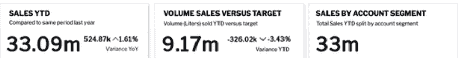

图 5-1. 一个展示各种 KPI 的仪表板部分

## 数据可视化

人类是模式识别机器。以可视方式解读数据可以减少我们的认知工作量，我们的大脑也更适合这样做。我们还倾向于以非常可预测且一致的方式处理视觉信息，因此数据可视化成为任何嵌入式分析解决方案的主流也是情理之中。

外部有成千上万个资源、书籍和网站专门讨论数据可视化这一主题（截至撰写本文时，Amazon 对该术语返回的结果超过七千个），这些资料详尽地阐述了图表和图形的历史、创建和解读。然而，就我们的目的而言，让我们通过思考嵌入式分析解决方案中您将看到的一些关键数据可视化对象的*用途*，以及它们的外观来进行总结。

如图 5-2 所示，柱状图和条形图最常用于比较事物的大小（或规模），例如不同地区的总销售额。

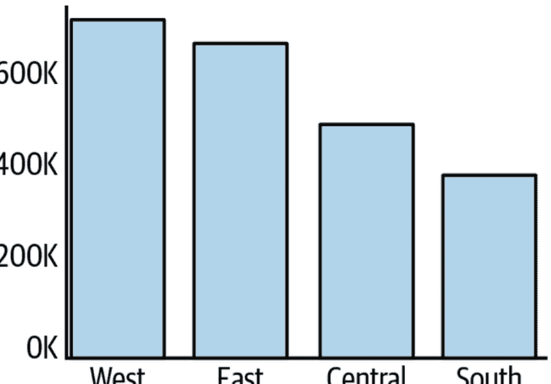

图 5-2. 条形图示例

图 5-3 展示了直方图。它们常用于显示事件发生的频率，也是展示统计分布（例如按年龄类别划分的人口分布）的标准方式。

像图 5-4 所示的折线图及其衍生图表（面积图、阶梯图等）用于展示事物随时间的变化情况，例如呼叫中心的每日呼叫量。折线图通常是趋势图的基础。

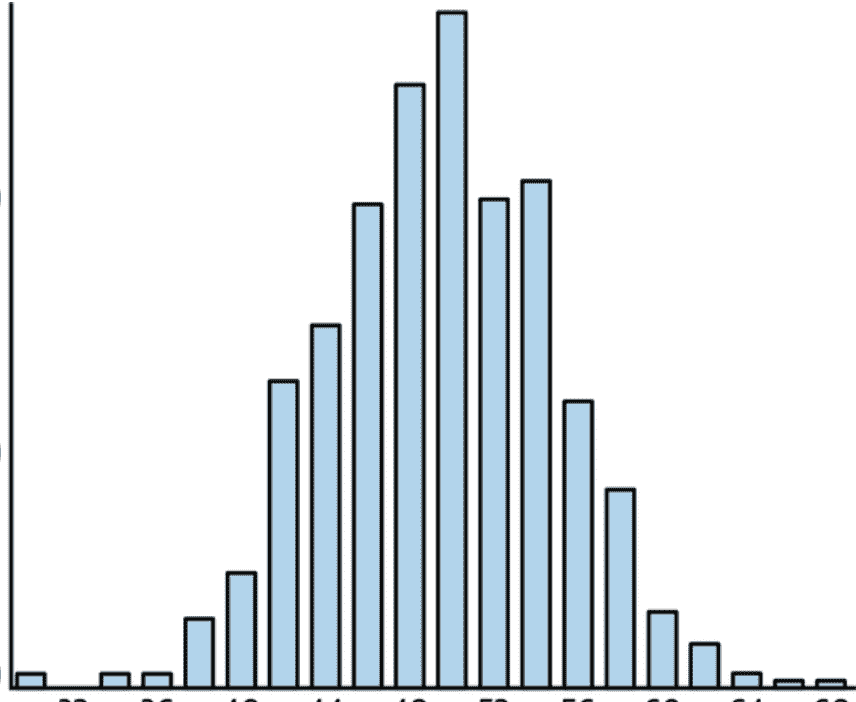

图 5-3. 直方图示例

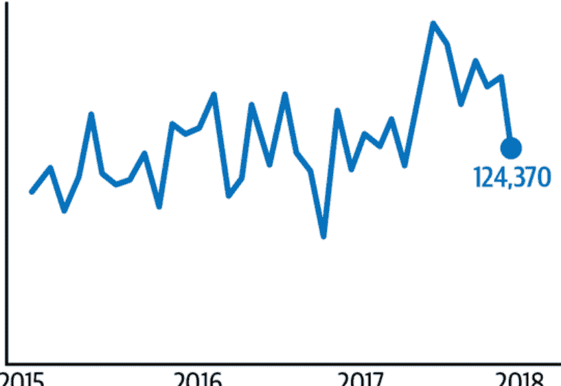

图 5-4. 折线图示例

像图 5-5 所示的甘特图，对于用户已经在使用 ERP 或 CRM 应用程序的嵌入式解决方案很有相关性。它们可视化事物随时间的持续时间和关系很有用，例如项目中的任务。

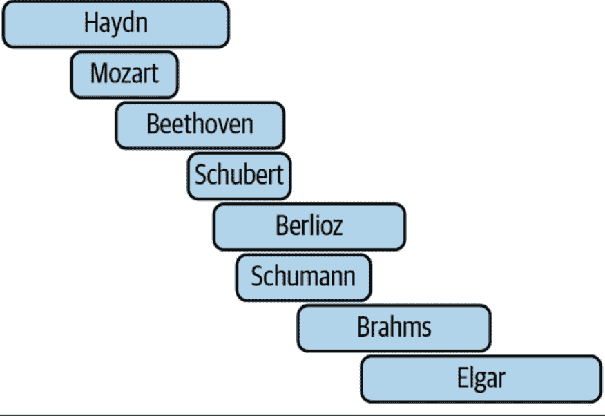

图 5-5. 甘特图示例

像图 5-6 所示的堆叠条形图，常用于展示部分与整体数据的关系，例如按类别划分的预算支出明细。大多数人熟悉的最常见（也最具争议）的部分与整体数据可视化类型是饼图。

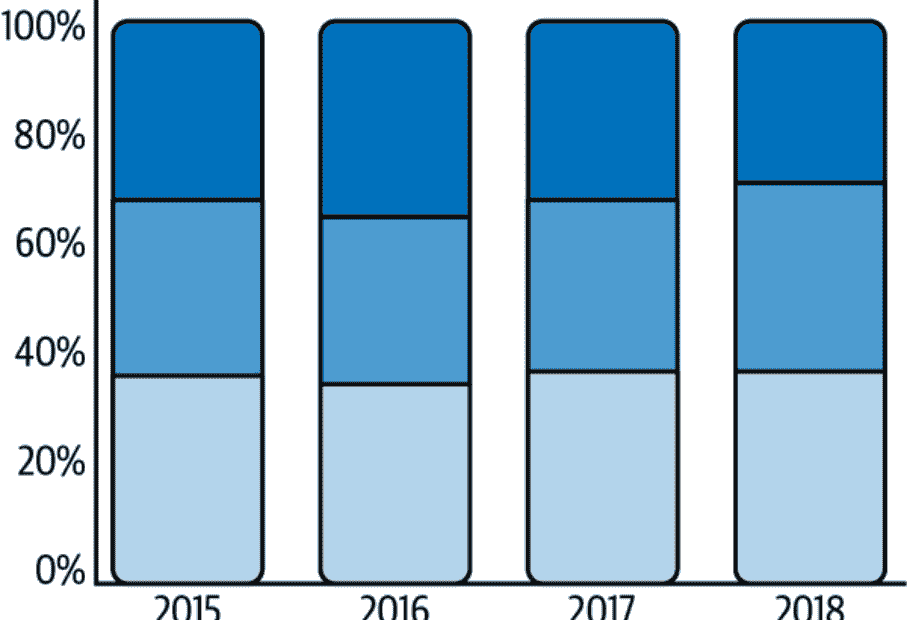

图 5-6. 堆叠条形图示例

像图 5-7 所示的空间图，用于将数据与特定位置或地理区域相关联进行可视化，例如在地图上标注预计降雨的位置。

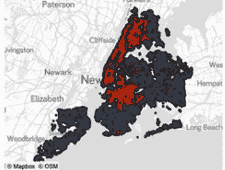

图 5-7. 空间图示例

像图 5-8 所示的散点图，用于展示两个变量之间的关系，例如年龄与鞋码之间的相关性。

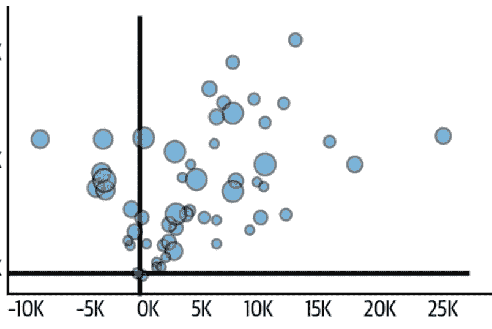

图 5-8. 散点图示例

当然，还存在许多其他图表和图形的衍生物及组合，以及雷达图、同量图、桑基图和弦图等更深奥的图表类型——所有这些都有特定的用例。

这些图表类型在为最终用户带来洞察方面非常强大，但我建议任何涉足数据可视化领域的人都要记住，图表或图形的有效性取决于观看者理解它——或者甚至与之交互的能力，我们将在后面更详细地讨论这一点。

## 表格数据

我们所说的“表格”是什么意思？作为一个涵盖一切的定义，我们可以从“以表格形式呈现的数据”开始，这对我们大多数人来说意味着电子表格，例如 Excel 文档或 Google 表格。如前几章所述，电子表格仍然是高管的首选工具，也是用户在应用程序中接触分析内容最常见、最基本的方式。


让我们看几个例子。

图 5-9 是一个网站中嵌入的汇总表格式分析对象的绝佳示例，显示了各澳大利亚管辖区的 COVID 疫苗接种状态汇总数据。与我们的 KPI 示例类似，此表还包含数据可视化技术（在列级别计算的颜色编码热图），以帮助读者识别最高值和最低值。

| Jurisdiction | One dose | Two doses | Three doses | Four doses |
|---|---|---|---|---|
| AUS | 86.98 | 84.4 | 54.98 | 17.45 |
| NSW | 86.95 | 84.64 | 53.55 | 17.85 |
| VIC | 88.2 | 85.69 | 57.36 | 16.92 |
| QLD | 81.6 | 79.14 | 46.84 | 16.64 |
| WA | 85.43 | 82.74 | 62.3 | 16.38 |
| SA | 84.92 | 82.1 | 56.34 | 19.57 |
| TAS | 87.34 | 84.72 | 56.86 | 21.29 |
| ACT | 89.65 | 87.35 | 61.47 | 20.3 |
| NT | 79.04 | 75.1 | 53.18 | 8.46 |

图 5-9. 带颜色编码热图的表格式分析对象（来源：CovidLive.com.au）

您也很可能在 CRM 和 ERP 系统中遇到表格对象，如图 5-10 所示：一个 Salesforce 页面示例，汇总了年度销售业绩数据。请注意，底部汇总数据的精度很高。这些表格形式的汇总值对查看者是否有用，是您在使用任何类型表格形式的汇总值时需要做出的决定。

| | 2020 年 1 月 | 2020 年 2 月 | 2020 年 3 月 | 2020 年 4 月 | 2020 年 5 月 | 2020 年 6 月 |
|---|---|---|---|---|---|---|
| **财务与交易** | | | | | | |
| 订单价值 | 2409 | 3670 | 3345 | 1450 | 2334 | 6000 |
| 运营费用 | 0.07 | 0.03 | 0.05 | 0.25 | 0.04 | 0.012 |
| 返现价值 | 240 | 367 | 335 | 145 | 233 | 600 |
| **汇总数据** | | | | | | |
| 中型市场价值 | 6.5687 | 5.7896 | 5.2656 | 6.5687 | 7.5687 | 8.5687 |
| 市场增长 | 0.005 | -0.001 | 0.001 | -0.015 | -0.107 | -0.096 |

图 5-10. CRM 系统页面的一部分

## 动态文本和 NLG 内容

随着数据和分析应用程序功能的不断增强，基于文本的内容常被用来丰富嵌入式分析，并在上下文中呈现洞察，使用户无需解读数据可视化即可阅读。请参考以下示例：

> *店内* 是表现最好的销售类别，在过去 12 个月中为美国总销售额贡献了 131,092 美元。这比去年同期增长了 6%。

在此，静态（预设）文本由四个动态（数据驱动）字段增强，这些字段基于数据源进行更新。这种方法的优势在于解读数据所需的认知努力较低，且文本可以与嵌入式解决方案中的其他非分析内容紧密集成。根据视觉结构的方式，用户可能甚至意识不到自己正在解读分析数据——这可能是一项令人印象深刻的成就。

超越动态文本，NLG 技术使用机器学习技术和计算语言学从数据源生成书面文本，无需预先确定结构或语法。在撰写本文时，这种快速发展的技术通常作为许多领先数据可视化工具的补充技术呈现，既可为最终用户为传统数据可视化仪表板增加价值，也可作为统计分析的辅助手段，使用具备相应知识的用户能够快速识别重要趋势和异常值。

在以下示例中，所有文本均由 NLG 系统生成，包括语法结构和语言呈现以及数据驱动的指标。如果配置得当并仔细部署，您可以想象这种方法在嵌入式分析解决方案中有多么强大，以及可能节省多少时间：

> 去年的技术类订单有 75% 准时或提前发货。标准班运输表现强劲，其中 90% 的订单准时或提前发货，这可能是今年运输良好的一个可能解释。南部地区是另一个可能的原因，因为这些订单中有 81% 准时或提前发货。

## 添加交互性

如前所述，嵌入式分析不仅关乎集成分析对象，还关乎分析能力。NLG 是嵌入分析能力的绝佳示例，但对最终用户来说并不立即显而易见。提供额外能力最有效的方法之一是嵌入用户可以与之交互的对象。

## 交互示例

当我们谈论与分析对象交互时，简单来说就是提供某种人为输入：点击按钮、拖动滚动条、在搜索框中输入值。以下是一些示例：

- 将鼠标悬停在对象上以揭示图表中数据点的其他或上下文详细信息。工具提示是这种技术最常见的示例，但该技术也可用于触发其他操作，例如在其他图表上高亮显示相关对象或区域。
- 在图表上选择数据点以筛选其他图表上的相关对象。数据可视化上的选择通常可以使用流行应用程序界面中相同的机制完成——拖动、多选等。
- 在数据可视化中钻入（或"向下"或"穿过"）单个元素以扩展其组成元素。虽然由选择驱动，但这是嵌入式分析解决方案中一种极其常见的技术，允许用户从 KPI 或高度汇总的对象转到更细粒度或行级视图以进行更详细的分析。
- 使用选项卡、菜单链接、图标等传统方法进行导航。这是另一种常见的交互技术，用于允许用户在一系列数据可视化之间移动，这些可视化可能嵌入在单个页面中。

当然，预期是无论您与什么交互，都应快速更新以显示您的输入结果，并且至关重要的是，为嵌入式对象增添一些额外的功能或价值。但是，使用大量复杂的交互技术最终可能会导致复杂、不直观且毫无意义的分析体验，这完全有可能。让我们来看一个虚构的示例，该示例很好地运用了其中一些技术。

在图 5-11 中，嵌入式对象（仪表板）作为菜单选项显示，与 CRM 系统紧密集成。用户只需单击即可访问 CRM 系统的其他区域，此部分中的分析内容是采用与系统其余部分相匹配的视觉风格创建的。

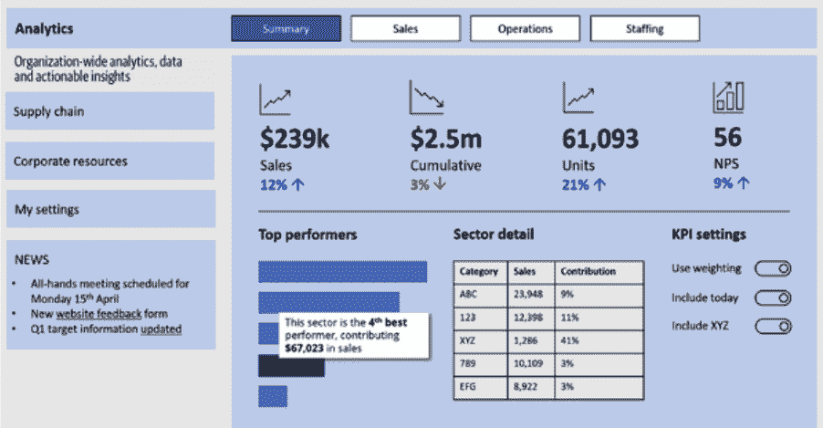

图 5-11. 嵌入 CRM 系统的交互式仪表板

在仪表板本身中，我们正在使用之前提到过的几种技术。用户可以将鼠标悬停在柱状图上的数据点上以查看包含更多详细信息的工具提示，可以点击柱子以筛选网格中的详细信息，还可以应用自定义设置，这些设置将影响 KPI 的计算方式。通过导航按钮清楚地指明这是一个摘要仪表板，用户可根据需要导航到其他仪表板。

## 交互作为增值功能

从产品体验角度思考交互性也很有用，设身处地为最终用户着想，响应时间必须很快。在理想世界中，为了营造用户直接在屏幕上操作某物的错觉，响应时间必须小于 0.2 秒（200 毫秒）。这听起来可能很雄心勃勃，但请记住，在典型网站上，与预加载对象（如按钮、下拉列表和链接行为）的常见交互通常都在这个范围内。

然而，在嵌入式分析的背景下，我们可能需要降低预期。诚然，许多分析工具对原生功能（如工具提示、下拉筛选器和选择）的用户交互具有"即时"响应。但是，如果交互向底层数据源生成查询（或以其他方式需要加载和呈现新数据），就会出现延迟，且延迟可能超过 200 毫秒。因此，在规划嵌入式分析解决方案时，您应该执行以下操作：

- *考虑基础设施和解决方案设计对响应时间的影响。*

从数据集市或数据仓库（位于靠近分析解决方案的位置）提取的优化、非规范化数据可能比连接到云数据仓库中托管的表格的实时连接表现更快。同样，为分析工作负载优化和合理配置硬件可以取得良好效果。


### 了解分析产品使用的缓存模型及其对您的解决方案的影响

大多数数据库、数据仓库和数据湖产品都具有复杂且先进的查询和结果缓存功能，这些功能通常可以与数据可视化产品缓存结合使用，仅在必要时生成新查询或页面加载，从而将响应时间降至最低。

### 定义交互响应的上下限并进行监控

了解什么是“良好”响应，有助于实现高效的优化和管理。如果 5 秒的响应时间对于您的用例而言可能已足够，那么努力可以仅针对表现最差的对象、页面和可视化对象进行。

### 测试嵌入式内容的一般性能以及并发用户对您的解决方案的影响

并发性可能难以定义，但了解大量用户同时与同一对象交互时响应时间受到的影响会非常有用，尤其是在扩展嵌入式分析解决方案时。

通常情况下，对任何计划解决方案的技术架构有良好掌握，很可能在评估过程中揭示许多这些考量因素。

## 使用 iframe 嵌入对象

那么，我们如何将分析对象嵌入到目标应用程序或网页中呢？让我们来探讨几乎每个支持可视化嵌入的分析平台所使用的最常见方法之一：iframe。

> **注意**
>
> 请注意，这里讨论的是*真正的嵌入*，即将来自第三方来源（如数据可视化工具）的内容嵌入到目标应用程序或网站（如 CRM 或 ERP 平台）中，无论是通过浏览器还是移动应用程序访问。显然，某些分析对象可能看起来嵌入在目标应用程序中，但实际上它们是集成在应用程序本身中的。

嵌入式分析解决方案（其中被嵌入的内容或对象由与嵌入页面不同的系统提供）几乎总是使用 iframe 来进行嵌入。

我们在前面的章节中已经提到过这些。*iframe* 是一种标准 HTML 元素，可用于在父页面中加载另一个网页。大多数流行的数据可视化应用程序都具有允许内容在 iframe 中嵌入的功能，可以直接使用 URL，也可以通过调用 API 来请求内容。此方法也可以在使用 WebView 组件的移动应用中使用。

Here’s a simple example of an HTML page with an embedded iframe:

```
<h1>Here's a web page in an ERP system</h1>
<p>This content is part of the ERP system</p>
<iframe src="https://en.wikipedia.org/..." width="100%" height="300"></iframe>
<p>This content is also part of the ERP system</p>
```

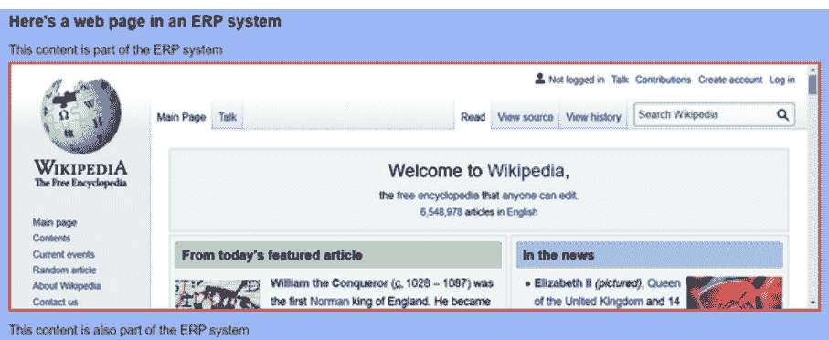

图 5-12. 在网页中嵌入 iframe 的示例

### 利用 iframe 获取优势

需要考虑的关键点之一是，当分析对象被嵌入时，最终用户体验可能更具可定制性，这对可用性是一个巨大优势。这样做的好处如下：

- 可帮助用户了解如何使用嵌入式内容的内容，例如常见问题解答、用户指南和提示，可以与嵌入式对象并排显示或在上下文中显示。
- 解释从嵌入式对象得出的有趣结论或见解的叙事内容可以以编辑方式紧密集成。许多主要新闻媒体使用此方法来支持数据驱动的编辑内容。
- 可以在嵌入式对象周围应用品牌形象，以进一步改善解决方案的外观和感觉。如果您正在嵌入数据可视化，那么内容的标题和描述完全可以位于 iframe 之外、在父页面上，并单独进行格式化。

这些只是基本可能性。我们将在本章后面讨论嵌入式解决方案的潜在外观和感觉以及用户体验。

## 跨域限制

大多数现代 Web 浏览器都有安全机制，限制一个来源（您正在浏览的网页）的资源如何与另一个来源（例如，在该页面上的 iframe 中显示的报告平台可视化）的资源进行交互。这种机制背后的原理是合理的：您不希望某个随机网站在未经您同意的情况下加载的嵌入式 iframe 中运行可疑的 JavaScript 代码来攻击您的 Web 邮件。这种安全机制专门用于防止“跨源”内容首先加载。

这对嵌入式解决方案为什么是个问题呢？在许多情况下，提供分析对象的报告平台可能与您希望将其嵌入的网站或应用程序不在同一源中。

确切地构成不同源的具体细节超出了本书的范围，但就我们的目的而言，我们可以考虑一个简单示例：您的网站 http://my.business.com 中嵌入了来自 https://mi.reporting.com 的分析对象。在许多浏览器中，这将构成不同源，因为嵌入式内容不仅来自不同主机，而且还使用不同协议（HTTPS 而非 HTTP）提供。

幸运的是，有方法可以解决跨源挑战，例如确保两个域都被明确信任，或者使用跨源资源共享（CORS）等方法来指定应允许哪些其他源加载资源。

## 当前嵌入式分析趋势

嵌入式分析解决方案是许多数据货币化产品的核心，随着组织利用软件即服务（SaaS）产品和其他云服务，这些解决方案变得越来越复杂。这个快速创新的领域产生了一些有趣的趋势和整合模式。

### 使用嵌入式分析共享数据

许多嵌入式分析产品围绕自助服务的概念设计，我们在前面章节中已经涉及过。然而，这类产品通常不可避免地需要允许用户选择、导出和下载数据以供其他用途。在这些情况下，嵌入式对象通常被用作选择机制，以识别和筛选要导出的数据选择。

例如，考虑用户在地图上绘制选择以构建邮政编码选择。在这种情况下，用户的选择受可视化中的交互功能限制，但更复杂的方法可用。通过适当的用户身份验证和授权，完全可以允许用户在 SQL 中编写数据操作语言（DML）语句，从底层数据源中选择他们想要的任何内容，同时使用相同数据的嵌入式选项。这对于嵌入式解决方案来说可能是一个非常强大的增值主张。

### 变革性最佳实践可视化

虽然为嵌入式分析解决方案添加更复杂的功能无疑能增加价值，但对数据可视化本身遵循最佳实践往往被忽视为区分产品的一种方式。我们的意思是什么？以下是一些示例：

- 为数据使用最合适的可视化类型
- 避免数据误导，例如截断轴以夸大比较维度
- 谨慎应用配色方案、间距和排版

遵循这些原则将使您的产品更易于使用，并更能吸引用户。

### 嵌入式体验的外观和感觉


这是你用于构建分析对象的工具的能力真正发挥作用的地方。许多数据可视化工具高度可定制，允许用户构建更类似于“动态信息图表”的交互式体验：与目标系统紧密集成，并通过叙述和图像进行增强，其行为更像是一个应用程序，而不是传统的仪表板。

如需灵感，请参阅 Tableau 的 [公共网站]()，该网站展示了使用该工具创建的一些最佳动态交互式可视化示例。

## 把所有内容整合在一起

我们讨论过可以嵌入的分析对象类型，以及如何通过考虑嵌入式分析解决方案的人类和技术方面来增加功能和价值。现在，让我们思考一下我们在与一些实际用例相关方面所学到的内容。

## 嵌入式工作流

嵌入式分析的一个核心原则是在做出由数据驱动的决策时，让用户保持“在流程中”。分析对象位于你正在使用的工具*中*，这意味着你不必*离开*该工具，这当然很有帮助。但正如我们所讨论的，可视化的性质、反应速度以及对用户的有效性都是重要因素。

这意味着思考该工作流程的上下文很重要。用户在看到嵌入式内容之前经历过什么？他们在与之交互后会做什么？嵌入式对象如何推动可能与我们不断谈论的“流程”不可或缺的上游和下游流程？

## 典型的报告自动化工作流

让我们考虑一个基本报告工作流的示例。财务团队需要收集数据以提供月度报告，并需要 IT/数据库团队的参与才能完成。一旦他们获得所需的数据，他们就会创建一份文档（或更新现有文档），并将其提供给管理团队用作决策工具。

通过这个流程，我们得到了什么？不同团队参与导致的延误、重复劳动、潜在错误、内容无管制的增殖，以及潜在的安全问题。这是一种非最佳模式，很可能正在成千上万个组织中发生。

图 5-13 说明了这种在典型组织中可能出现的复杂多依赖流程。这通常是嵌入式分析解决的第一个实际用例。

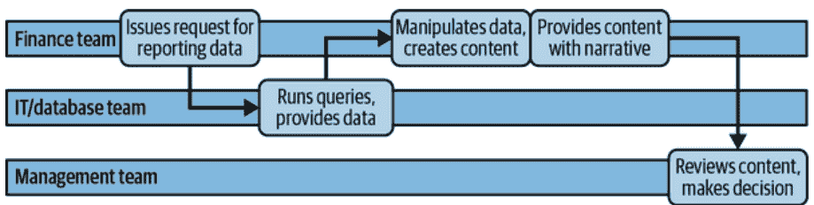

图 5-13. 资源密集且成本高昂的分析工作流示例

当我们结合嵌入式分析工作流时，如图 5-14 所示，分析内容集成到组织范围的“门户”中，分析对象由组织财务数据库的数据驱动，并且仅对管理团队开放。特定管理者只需登录、审阅并与分析对象（例如仪表板）交互，即可做出明智的决策。


图 5-14. 使用嵌入式分析加速洞察时间

对比显而易见；只有一份报告，无需任何人更新。数据准确，访问受到严格控制，报告内容立即可用。事实上，财务和 IT/数据库团队根本不参与。

以这种方式使用嵌入式分析所实现的潜在时间和成本节约是不容小觑的。

## 使用嵌入式分析支持指令性分析

*指令性分析* 是用于描述一种分析模型的术语，该模型中解决方案具体描述了实现特定结果所需的操作。它听起来简单，但通常涉及很多复杂性，这在很大程度上是因为大多数指令性分析技术涉及向非技术用户展示机器学习过程的结果，这并非易事。

当嵌入式分析解决方案成功实施时，就可以集成指令性分析流程，为最终用户提供无缝体验。以下是一个示例：

- 1. 销售经理在其 CRM 系统中访问一个嵌入式图表，显示当前季度的销售额异常低。他们考虑与销售团队解决这个问题。
- 2. 一个在过去五年的历史销售数据上训练的机器学习模型确定，为了实现当前目标，最佳方案是将精力集中在降低三个特定产品类别的价格上，这些类别在历史上一直产生强劲的销售额，并应用适当的折扣。
- 3. 为每个产品类别确定具体的折扣百分比，建议与 CRM 系统中的嵌入式图表一起显示，作为解决销售业绩不佳的最佳方式。

这真正实现了闭环。团队不再凭直觉和猜测来解决问题，销售经理可以发布一条有统计数据支持的指令：*对这三条产品线进行折扣，我们就能重新开展业务*。

**注释**

值得注意的是，指令性分析很少被有效部署，因为涉及的流程复杂，且需要高级分析、数据科学和机器学习 (DSML)，其使用通常需要高技能的数据科学家或分析工程师。与以往一样，软件正在日益使这一学科民主化。

我们将在第 9 章中花更多时间讨论 DSML、自动化和增强在嵌入式分析解决方案中的应用，但可以肯定的是，DSML 技术通常是我们讨论的指令性分析功能的核心。

## 数据操作化（或“回写”）

在许多情况下，我们迄今描述的工作流可能包含需要将数据写回数据源或其他操作系统以推动进一步流程的步骤。以下是三个实际示例：

- 用户跟踪仪表板显示，某用户已打开营销电子邮件。因此，CRM 系统中该用户的记录需要更新，以显示用户已响应营销活动，从而在一段时间内将其从收件人列表中移除。
- 一位高管在图表中的某个离群数据点添加了评论，该评论需要以工具提示的形式显示在该数据点旁，供未来查看该图表的任何其他人查看。
- 用户与显示生产线错误的仪表板进行交互。当用户单击特定错误时，需要在错误跟踪应用程序中创建一个工单，其中包含错误发生的时间和性质等详细信息。

从高层次来看，所有这些示例的工作方式相似。从嵌入式*分析解决方案*（由用户输入或纯粹从数据本身推导）推导的数据被写回*目标系统*（CRM/ERP 系统中的数据存储或专用数据库）。在这两种情况下，这都实现了与分析工作流“闭环”的目标：您在一个工作流中使用分析来推导洞察，并相应地更新数据。

这些示例都需要分析解决方案与目标系统之间的某种集成，但关键点是，数据操作化通常可以直接从嵌入式分析解决方案本身驱动，确保用户无需离开解决方案即可*执行*可操作的洞察。

作为分析工作流一部分的数据操作化，是分析和数据仓库厂商高度创新且大量投资的领域。对于熟悉 OLAP 与在线事务处理 (OLTP) 的人来说，事务性用例与分析性用例之间的技术区别在历史上一直需要不同的技术方法，因此需要不同的产品。

> **注释**
> 
> OLTP 用例通常表示数据*写入*数据库的频率很高且数据量较小，而 OLAP 用例通常表示从数据库*读取*数据的频率较低且数据量较大。

随着可扩展 SaaS 产品的出现以及数据存储、缓存和查询性能的进步，这种区别正变得越来越少见。截至撰写本文时，一些数据平台厂商（例如 Snowflake）正在开发统一服务，以提供能够同时处理 OLAP 和 OLTP 工作流的数据库：一个 ERP 系统向其中写入*且*充当分析应用程序读取的真实数据源的单一数据存储。

## 业务用例集成


消息传递应用程序（例如 Slack 或 Microsoft Teams）与数据可视化工具之间的集成正变得越来越普遍。其目标是确保用户即使当前没有使用嵌入式分析解决方案，也能访问可操作的洞察。以下是一个示例：

- 1. Vaughn 正在步行上班，他是一家大型零售组织的供应链经理。他在消息传递应用上收到一条通知，告知他某关键产品线的库存水平已低于特定警告阈值——该阈值是他本人通过在嵌入式分析对象上设置警报来配置的。

- 2. 点击通知中的链接后，他被引导至相关的嵌入式数据可视化，该可视化显示预期的供应商货件已延迟，并提供相关客户经理联系详情的链接。

- 3. 他在手机上点击链接，给客户经理打电话，并确认虽然货件延迟，但会按时到达以支持本月预期的履行量（该履行量也在嵌入式仪表板旁的 ERP 系统中显示）。Vaughn 只需五分钟就能完成这一切，且都在到达办公室之前。他决定停下来买杯咖啡庆祝。

此示例包含四个集成组件：

- 在数据可视化平台内配置数据驱动警报的方法论
- 由数据可视化平台定向的消息传递应用集成（以及电子邮件和其他通知渠道）
- 嵌入供应链 ERP 系统的精心设计仪表板
- 为 Vaughn 在其移动设备上与这些组件交互提供的适当身份验证和授权

## 管理与治理集成

Vaughn 代表一个 *消费者* 用例，但使用现代数据可视化平台仍有许多其他强大的集成模式可用。许多数据可视化和 SaaS 数据库工具具有 RESTful 或 GraphQL API，可与之交互以执行与管理、治理和报告相关的各项关键任务。

*血缘与影响分析* 可通过查询数据可视化平台中的底层组件（KPI、可视化、数据源、用户、事件等）来实现，以确定它们之间的关系。了解某个数据库包含为 KPI 提供数据的表，就可以确定对该组件所做更改的影响。它会影响一个 KPI 还是数千个 KPI？这些信息对于管理嵌入式分析解决方案开发的团队非常有用。

在图 5-15 中，我们可以看到数据源中的 29 个字段来自单个数据库中的 3 张表。如果你是一名即将对其中一张表进行更改的数据库管理员，肯定很有必要知道，你可能会影响 Tableau 数据源中使用的 29 个字段。

### 血缘

| 数据库 | 1 |
| 表 | 3 |
| Superstore 数据源 | 字段 29 |
| 所有者 | 0 |

图 5-15. Tableau 中血缘的显示示例

以下是一些与数据可视化平台集成（通常通过 API 实现）可解决常见治理和管理挑战的真实示例：

### 性能审计

我们已论证性能很重要，不仅指交互响应时间，还包括嵌入式对象的整体加载时间。大多数数据可视化平台均包含原生内容或可扩展方法，以了解基本性能指标。我的嵌入式对象加载速度如何？哪些对象交互最频繁？哪些数据源最受欢迎？所有这些信息对于了解用户行为和支持性能调优计划都至关重要。

### 以编程方式管理内容

以编程方式管理内容对于在嵌入式分析解决方案中部署、迁移和更新内容非常有用。例如，如果你的解决方案包含数百个嵌入式对象，并且发现它们都包含需要更正的计算，那么拥有一种以编程方式更新计算（并可能重新部署/更新/发布更正后的对象）的方法，与逐个下载并更正每个对象的过程相比，将节省大量时间和精力。

许多数据可视化工具都可以使用 API 以这种方式处理内容，从而可以以编程方式管理内容、数据源、用户、权限和组成员身份。你可以更改和不能更改的范围由 API 提供的功能决定，因此如果你正在评估特定工具，查看相关的 API 参考以了解哪些内容可能自动化始终是值得的。

### 以编程方式控制用户配置

能够以编程方式控制用户配置对面向外部的数据货币化产品尤其重要。如果考虑新客户购买嵌入式分析产品的访问权限，可能需要发生以下几件事：

- 可能需要捕获和处理支付详细信息。
- 需要捕获用户详细信息，并根据购买点选择的选项将其与产品的访问权限级别关联。
- 需要在身份提供商或身份验证系统以及目标系统和数据可视化平台中设置用户。
- 需要应用访问权限以控制用户需要访问的内容。这可能扩展到数据可视化平台中的对象以及数据库，以及目标系统以及托管在目标系统上的非分析内容（文件等）。
- 需要向用户提供介绍性内容（电子邮件、常见问题解答、登录链接等）。

你的解决方案可能不需要所有这些流程，实际上，根据所使用的工具性质和可用 API 的功能，其中某些流程可能无法以编程方式处理。但是，如果你正在规划嵌入式分析解决方案的部署，确定哪些（如果有）步骤可以自动化是有用的。这样做将在添加更多用户时带来长期效益。

### 结论

我们现在花了一些时间探索嵌入式分析解决方案的组件，并讨论了这些解决方案可以提供的注意事项和可能性。希望你现在能更好地了解如何处理解决方案的规划、开发和实施。

在下一章中，我们将详细介绍嵌入式分析的管理：设置用户、了解许可模型、资源管理和所有权。
