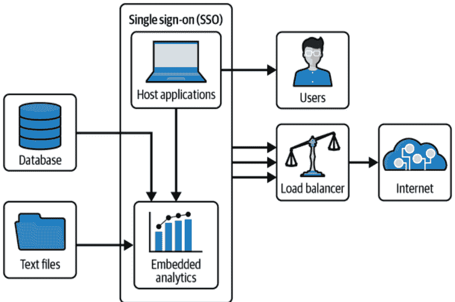
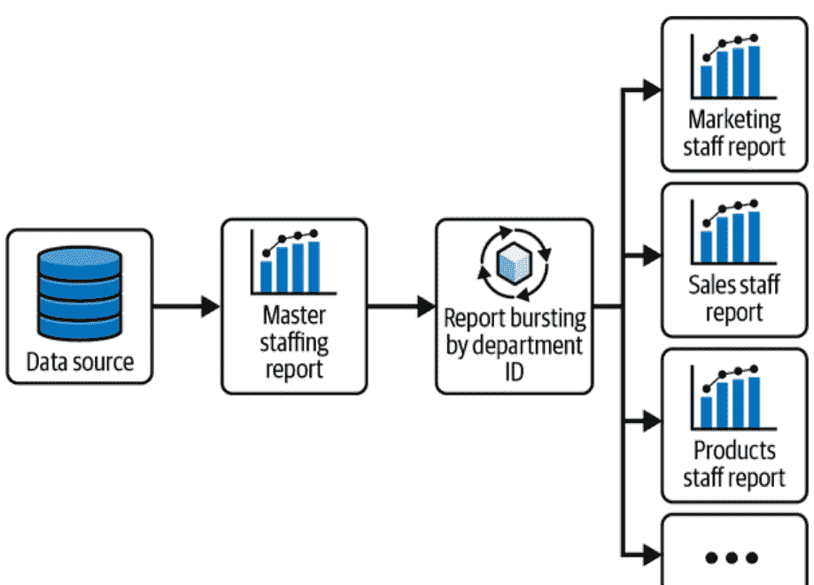

# 第 6 章 嵌入式分析的管理

本章将探讨在运营应用程序中管理嵌入式分析解决方案的挑战。一般来说，管理此过程有一条黄金法则：

> 尽可能将嵌入式解决方案的所有管理与主机应用程序的管理保持一致。

这可以确保工作重复最少，系统协调性更好。我们还将深入探讨云与本地部署、安全配置和 DevOps 集成等特定主题，以全面了解如何最好地处理这些集成系统。

## 部署嵌入式分析

在决定是在本地还是在云中运行嵌入式分析时，涉及的问题可能看起来相当复杂。各种规模的企业都在迁移到云存储，因为它通常被视为部署便捷且成本效益高的最佳解决方案——但也有一些边缘情况并非理想。

### 本地部署

本地部署意味着你公司的服务器托管在组织的基础架构中，在许多情况下物理上位于现场。服务器由你公司及其内部 IT 团队或 IT 合作伙伴采购、控制、管理、维护等。计算机通过本地网络共享数据和其他信息。

采用本地部署方式可以让你在架构、采购和可扩展性方面拥有控制权。但是，这种选项也有一些缺点：硬件采购和交付需要更长时间，而且升级设备可能更昂贵且更困难。此外，与云托管相比，扩展不那么直接，云托管的可用性不受预设大小的限制。

## 云部署

云部署涉及由外部服务提供商（如 Microsoft、Google 或 Amazon）管理你的数据和应用程序。服务提供商负责其数据中心中所需的任何硬件、软件和其他基础设施。访问这些服务通常通过浏览器界面进行，这意味着你可以从几乎任何地方、任何设备控制你的帐户和服务。

云托管使扩展更加容易，因为它比传统的本地托管提供了更大的灵活性和可扩展性。云计算提供弹性基础设施，可以根据需求快速向上或向下扩展，使组织能够更快地响应其业务环境的变化。

使用云服务提供商时，无需进行昂贵的硬件投资，因为资源在需要时即可使用，无需前期资本投入，也无需承担采购和配置物理服务器所涉及的长周期。相反，你所需要做的就是请求一个虚拟机（VM）或 Docker 容器。通常在几分钟内，云服务提供商会努力匹配你的要求，分配额外的服务器资源（如 CPU 核心、RAM 和磁盘空间）以容纳请求的 VM 或容器大小。该过程甚至可能涉及配置网络规则，以便通过外部 IP 地址或专用网络段进行访问。完成这些步骤后，新创建的实例即可供客户使用。这种简单性非常有吸引力！

虽然云计算提供低成本和简单性，但如果管理不当，成本可能会变得很高。订阅价格起初可能看起来合理，但使用量增加会迅速推高每月账单。此外，用户创建的自助查询通常未经优化，这可能导致读取和返回大量不必要的数据，从而增加计算成本。

在图 6-1 中，你可以看到典型的应用程序部署，包括单点登录安全性，我们将在本章后面讨论。

*Figure 6-1. 典型的负载平衡部署*

值得注意的是，使用负载均衡器（如负载均衡路由器）可以优化到互联网的流量。*负载均衡路由器*是一种网络设备，用于通过在多个路径之间分配流量来管理多个网络或服务器之间的流量，以提高性能、可靠性和可扩展性。负载均衡路由器还可以用于在多个互联网连接或运行在同一服务器上的多个应用程序之间平衡负载。负载均衡对于嵌入式分析很有帮助，因为不同客户端之间的负载可能因用户活动而显著不同，用户活动可能从仅仅查看嵌入式报告，到使用复杂的仪表板和可视化，再到创建自助对象。

另一种可能更易于管理的部署方法是使用 *容器*，我们将在本章后面讨论。

## 嵌入式分析的 IT 运维与 DevOps

如今，大多数现代化的软件团队都采用 DevOps 方法论，结合软件开发和信息技术运维的技术和工具。其目的是实现新功能更频繁（通常是持续）的部署。

### DevOps

DevOps 是一套软件开发实践，结合软件开发（Dev）和 IT 运维（Ops）。它旨在使组织能够快速可靠地交付应用程序和服务。DevOps 侧重于自动化、监控和协作，以缩短开发生命周期并减少容易出错的手动流程。

但是，这种方法也有一些缺点。设置 DevOps 环境可能成本高昂，尤其是需要在软件和培训方面进行新投资时。后者至关重要，因为 DevOps 需要在广泛的主题和技术方面具备相当详细的技术知识，包括源代码控制、自动化、可观测性、测试、基础设施即代码、脚本和虚拟化。有了所有这些，可以想象，采用 DevOps 标准也可能很困难。

但是，对于嵌入式分析来说，DevOps 能够快速且以更一致的质量交付重要新功能——得益于自动化集成和功能测试——这对许多团队来说很有吸引力。

随着 DevOps 越来越主流，你的嵌入式分析解决方案支持其方法论自然很重要。否则，协调主应用程序和嵌入式分析的发布可能会比必要的情况更加复杂，并可能减缓你的解决方案的采用。事实上，嵌入式分析解决方案经常被主应用程序“落下”，后者更新更频繁且部署更容易。另一方面，在早期开发中，你可能希望多次迭代部署你的嵌入式分析（例如添加新图表），而不打扰主应用程序的部署。

在使用嵌入式分析和 DevOps 时，以下是一些值得考虑的最佳实践：

- *嵌入式分析解决方案应与你现有的安全模型集成。*

一般来说，你的嵌入式分析安全将使用 DevOps 团队目前为主应用程序使用的相同技术。这样，你就不必重新创建或复制安全信息。安全必须集成到整个 DevOps 过程中，从开发到部署，确保开发和测试环境得到适当保护，代码被检查漏洞，生产环境的访问受到严格控制，并且系统定期监控和修补。此外，安全团队需要参与 DevOps 过程，以确保采取适当的安全措施，并在整个应用程序生命周期中实现安全目标。

- *DevOps 过程必须支持常见的数据场景。*

集成分析的应用程序应能够使用现有系统中的数据，并在不同来源之间提供强大的性能，同时开发由 DevOps 方法论支持。事实上，DevOps 凭借其广泛的自动化和从脚本启动多个环境的能力，非常适合开发和测试各种部署。

无论环境如何，使用预包装的分析可以确保查询高效且定义明确。但是，对于允许最终用户自行进行数据发现的自助应用程序，查询不是由开发人员定义的。DevOps 应该意识到这一点，并使用在自助场景中经常出现的低效且昂贵的查询进行测试，就像 DBA 在对生产数据库启用自助服务时所做的那样。

- *DevOps 应该使你能够针对云、容器和混合部署环境进行测试。*

嵌入式分析不应使 DevOps 团队的生活变得更困难，也不应现在或将来限制选项。分析环境需要在多个平台和混合环境中运行。DevOps 团队将寻找对 Docker 等容器技术和 Kubernetes 等编排技术的支持，以实现容器化应用程序的部署、扩展和管理自动化。这确保了从开发、测试和暂存到生产（无论是物理机还是虚拟机）的过渡顺利进行。请参阅侧边栏“容器与替代方案”。

- *DevOps 应该能够使用当前技术进行部署。*

DevOps 团队不希望使用迫使他们更改当前部署方法论的嵌入式分析平台。该平台必须灵活，不仅在架构方面，而且在部署、许可和高可用性支持方面都要灵活。例如，如果主应用程序支持负载平衡和故障转移（可能包括冗余服务器和共享存储设备），那么嵌入式分析平台也应该如此。

- *嵌入式分析应支持水平和垂直扩展。*

*水平扩展*是向系统添加更多节点以增加其容量的过程。*垂直扩展*是在不更改应用程序架构任何其他部分的情况下升级其单个组件的过程。垂直扩展的示例是升级服务器上的 RAM；水平扩展可能涉及添加更多服务器以处理额外负载。

- *嵌入式分析应支持持续集成和交付。*

许多 DevOps 团队已采用持续集成和持续交付（CI/CD）流程，其中代码更改在提交到代码仓库时会自动进行测试和发布。

要实现高效，分析平台的应用程序逻辑和用户界面必须与其数据存储层解耦。这样开发人员可以独立地处理应用程序的不同部分，而不必担心某一部分的变更会如何影响其他组件。例如，用户界面可能会比底层数据存储层看到更多的开发和增量变更。

## 容器及其替代方案

传统上，所有软件都在物理服务器上运行，但在 20 世纪 90 年代末，虚拟机作为运行多台物理计算机的替代方案出现。虚拟机使 IT 团队能够通过将硬件和软件资源整合到单台物理机器上来降低成本，同时还允许在相同的硬件上运行不同的操作系统，从而提供了一定的灵活性。然而，由于每次启动都需要引导整个操作系统，虚拟机的启动速度可能会比较慢。

近年来，软件容器作为比虚拟机更轻量级的替代方案变得流行。容器是一种操作系统虚拟化形式，允许开发人员将应用程序、其依赖项和库打包成一个称为容器的单元。容器与主机环境隔离，并在不同操作系统之间提供一致性、可移植性和可扩展性。容器的启动速度比虚拟机快得多，内存消耗更少，并且可以轻松部署到不同的基础架构上。

Docker 是一个流行的容器平台，用于创建和管理容器。它使用镜像，即预配置的软件包，可用于快速部署应用程序。它还具有内置的编排工具，用于管理多个容器。

Kubernetes 是一个开源的容器编排平台，可自动执行容器化应用程序的部署、扩展和管理。它用于运行、管理和扩展分布式应用程序，并可与 Docker、Google Cloud Platform (GCP) 和其他容器技术协同工作。Kubernetes 简化了部署和管理容器化工作负载的过程。

虚拟机仍然具有一些优势。例如，它们在不同环境之间提供了更好的隔离，因为每个虚拟机都有自己的操作系统和应用程序堆栈，运行在相同物理硬件上的其他机器或应用程序无法访问它们——由于容器的共享特性，这是容器无法实现的。此外，如果您需要访问旧系统，那么使用虚拟机可能仍然是最佳选择，因为通常不支持这些类型软件的容器化版本。

## 嵌入式分析的安全性

在设计嵌入式解决方案时，安全性必须是第一优先级。数据是分析的核心，应始终得到相应保护：不保护数据可能会带来法律和金钱方面的影响。为确保管理成功，建议使用主机应用程序提供的现有安全基础架构和控件，而不是专门为分析创建新的基础架构。这既简化了管理，又防止了可能导致安全漏洞的潜在安全缺口。

### 嵌入式分析解决方案的安全优先事项

成功的嵌入式分析解决方案将优先考虑这些安全考量事项：

### 可适应的选项

确保您企业的安全解决方案具备适用于多种场景（例如运营报告和自助分析）所需功能至关重要。虽然最初您可能只需要嵌入式分析功能，但为未来的成功预留选项将会有所裨益。对于销售封装应用程序的供应商来说，现在投资于长期灵活性将在未来证明是有利的。

### 权限

管理员应能够根据场景为单个用户或按角色设置控制和权限。例如，当嵌入式分析在运营应用中被多个用户访问时，基于角色的安全性至关重要；但是，如果需要更多个性化（例如，针对管理层或高管仪表板），则可能需要分配与传统组织角色不匹配的特定用户权限，例如授予销售负责人访问营销报告的权限，而其他销售成员无法查看。

### *多租户支持*

在多租户主机应用程序中实施嵌入式分析解决方案时，必须考虑每个租户的安全性以及用户和资源管理的处理方式。不仅需要安全地管理租户之间的用户和资源控制，还需要管理其他资源，例如仪表板或报表设计模板、集成文档和自定义选项。这些次要资源安全存储非常重要；如果它们未由租户主机在数据库中加以保护，则必须采取适当措施，确保它们不会跨到另一个租户的环境中。尽管这在单租户环境中可能看起来不重要，但在处理多个租户时，无论数据的感知重要性如何，都应将其视为机密公司信息。

### *与第三方标准集成*

能够提供强大支持的解决方案应遵循 LDAP 等标准，并与目录服务（例如 Microsoft Active Directory）集成。这种集成允许用户身份验证数据和其他安全信息（包括密码）在企业系统中的各种设备或应用程序之间安全地共享。此外，由于角色已在 Active Directory 中定义，因此可以轻松实现基于角色的访问控制。

### 独立安全模型

在某些情况下，您可能需要创建并实现一个独立的安全模型。在这种情况下，嵌入式技术必须拥有合适的内部安全系统以满足您的标准，并提供一个全面且文档完善的 API。

牢记这些优先事项，让我们来看看一些可能有用的安全方法。

### 开放式和封闭式系统

真正的开放式系统允许所有用户访问并修改任何共享内容。对于在数据方面普遍采用开放策略的小型团队或公司来说，这可能很方便。但是，由于此类无限制共享存在潜在风险，我们不推荐这种方法。

对于中型团队和公司，建议采用受限开放式系统。这种系统以某种方式限制对共享内容的访问，允许某些用户编辑特定内容，而其他用户可能完全无法查看相同信息。此外，如果您希望内容对所有人都可查看，但仅由少数人编辑，那么这种受限的开放式系统将是可行的。

大多数大型企业和几乎所有多租户平台都采用封闭系统的某种变体。在封闭系统中，管理员只能查看和管理他们共享相同用户安全组的用户帐户。此限制也适用于他们所属的组；管理员无法访问其自身组之外的任何其他用户或组。因此，此类系统上不再存在“所有用户”组，这意味着系统中的所有用户无法被称作一个集体实体。

如果您正在为多个租户或公司提供服务，则必须为每个租户建立独立的组。我们强烈建议在客户拥有来自不同企业和组织的客户（这些客户不应知道平台上存在其他用户）的情况下使用封闭系统。

在确定安全方法后，有多种方法可以配置用户如何登录运营应用程序和嵌入式分析。最常见且推荐的方法是单点登录。

### 单点登录

SSO（单点登录）是一种身份验证过程，允许用户使用一组登录凭据访问多个应用程序或网站。SSO 减少了用户记住和管理不同用户名和密码的需求，使他们可以从任何设备轻松登录其帐户，而无需每次想要访问时都手动输入详细信息。

在部署嵌入式分析时，SSO 支持对于为用户提供无缝体验至关重要，分析功能无需特殊登录。相反，用户将通过您的主机应用程序进行身份验证。

SSO 嵌入的工作原理是在应用程序中添加一个登录按钮（或向现有登录按钮添加功能），使用户能够使用其 SSO 凭据登录。当用户单击此按钮时，他们会被重定向到指定的身份提供程序 (IdP) 页面，在那里可以只输入一次用户名和密码，然后即可同时访问主机和嵌入式系统，而无需为每个系统手动输入额外详细信息。

为了以安全且基于标准的方式在身份提供程序 (IdP) 和服务提供程序 (SP) 之间交换身份验证和授权数据，大多数开发人员使用安全断言标记语言 (SAML)。嵌入式分析系统通常会充当服务提供程序，而验证用户身份的运营系统将是 IdP。

将身份和身份验证方法合并的过程称为 *联合身份验证*。有两种常见的方法可用于嵌入式分析中的联合：

### *服务提供方启动的流程*

在 SP 启动的流程中，当用户尝试访问受保护资源时，会被重定向到身份提供方的登录页面。这种方法允许已在两个系统中都有账户的用户快速登录应用程序，而无需拥有多组用户名和密码。

在嵌入式分析中，分析系统是服务提供方，主机应用程序是身份提供方，当企业拥有一些独立的分析应用程序，但也使用同一供应商的嵌入式功能时，此场景最有用。

### *身份提供方启动的流程*

在 IdP 启动的流程中——这是嵌入式分析的首选选项——当用户尝试从主机应用程序访问受保护资源时，会被重定向到服务提供方的登录页面，在那里他们可以输入凭据并使用 SAML 进行身份验证。

对用户来说更好的做法是，身份提供方可以使用 API 代其登录到服务提供方，并提供所有必要信息（包括签名的安全令牌），以便在 SP 端通过 SAML 进行身份验证。这将带来更高的用户采用率和满意度，因为这对用户来说更自然，并使嵌入式分析感觉像是整体系统的一个完整组件。

一般而言，应选择与支持 SAML 2.0 的身份提供方（如 Okta、Auth0 或 Active Directory Federation Services (AD FS)）协同工作的系统。某些企业应用程序（例如 Salesforce）拥有自己的身份提供方，使用户可以使用这些应用程序的登录凭据与您的嵌入式系统进行交互。

## 安全实践摘要

应始终严格对待安全，以确保客户信息的安全和合规性。以下是一些需要牢记的关键点：

- 如果您将分析作为服务或产品提供给客户或合作伙伴，应为此使用单独的分析服务器实例。这样可确保您自己的系统与外部用户隔离。
- 对数据采用同样的方法。连接到分析服务器的数据不应包含外部用户不得访问的任何数据。
- 启用封闭系统。
- 选择支持 SAML 2.0 的嵌入式架构，并为嵌入式实例使用强身份验证，例如 Auth0、Okta 或 AD FS。
- 使用带 API 身份验证的 IdP 启动场景实现 SSO。
- 确保已启用安全事件日志记录：谁登录、谁访问了哪些数据，等等。

## 其他管理注意事项

部署和安全将是您的主要管理关注点，但还有其他一些管理功能需要考虑，例如排期、版本管理、报告分发和管理控制台。

## 排期

每次用户访问时更新运营报表或仪表板，很少高效，或者在云中运行时，也不划算。如果对象嵌入在用户桌面上始终打开的屏幕中，则尤其如此。您需要能够按计划或响应主机应用程序的事件触发器刷新报表。如果企业已广泛使用计划作业，则与现有企业调度程序或内置于数据库平台的调度程序集成可能很有用。

## 版本管理

如果您正在使用 DevOps 流程，很可能会将嵌入式分析与现有的版本控制系统集成。否则，应确保嵌入式技术包含内置的版本管理系统。这对于具有特定合规标准的组织可能至关重要，这些标准要求对生成的报告进行严格的版本控制，例如在医疗保健和金融服务领域，管理员需要保证记录随时间的准确性，以便跟踪、监控任何更改，并在必要时轻松回滚。

## 报告分发

如 *图 6-2* 所示，报告分发是将预格式化的报告分发给不同收件人的过程。它通常涉及将报告拆分为多个部分，每个部分包含与收件人需求和兴趣相关的特定数据。

### 图 6-2. 报告分发

报告分发允许管理员根据公司名称、部门等条件自定义各个版本，这意味着每个收件人都会收到包含其自身特定信息的正确版本的报告。

分发通常用于发票生成、财务报告（创建主报告，然后将其拆分为管理人员的各个成本中心报告），甚至员工工资单。

## 管理控制台

优秀的分析解决方案应为管理员提供集中式用户界面，以管理服务器资源、集群、调度程序、安全配置以及他们负责的所有其他任务。此统一门户或控制台为管理员提供了一种高效的方式来查看资源的分配和利用情况。这不仅更方便，而且对于确保公司系统的适当治理并了解资产使用情况，变得越来越必要。

可从控制台完成的常见任务可能包括以下内容：

- 配置嵌入式分析 Web 服务器，包括连接信息和安全证书
- 配置日志记录，无论是内置的还是使用日志服务
- 配置国际化和本地化设置，例如语言、货币、日期格式，可能还有字符编码
- 与 Active Directory 或其他目录服务集成
- 管理用户和用户组，包括创建帐户、更改权限和组成员身份
- 计划刷新数据
- 设置临时存储位置
- 配置或删除自助服务用户创建的工件
- 监控服务器性能和资源使用情况
- 取消正在消耗资源的长时间运行或“卡住”的查询
- 备份（和恢复）数据以用于恢复目的

## 结论

在任何环境下管理嵌入式分析始终涉及主机应用程序管理与分析平台要求的结合（或折衷）。因此，选择不仅兼容，而且在管理、安全和治理的整体方法上高度一致的平台非常重要。

在下一章中，我们将更详细地探讨数据治理，因为它已成为数据管理员和开发人员的重要考量，甚至可以说是头痛问题。我们将看到，嵌入式分析与独立应用程序有许多相同的治理关切，还有一些特有的要求。
