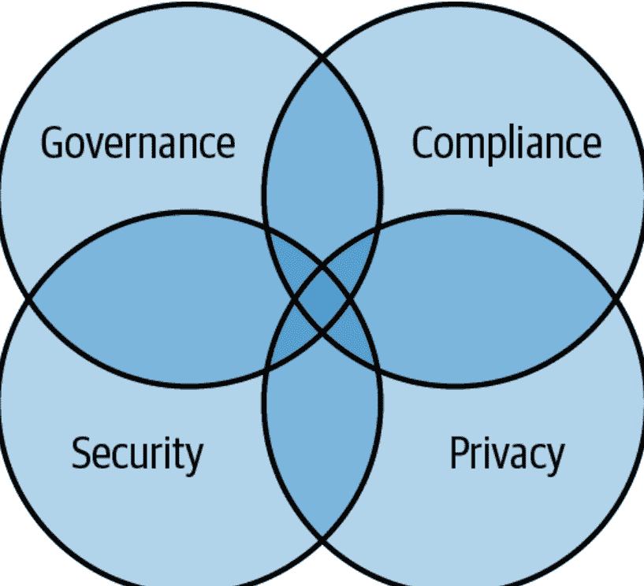

# 第 7 章 治理与合规

几乎每天我们都读到数据泄露、客户信息的严重滥用或新的黑客丑闻。在这个充满风险的环境中，任何大量使用数据的公司都必须应对日益增加的法规和消费者的强烈压力。因此，数据的安全和隐私已成为焦虑的高管和压力巨大的 IT 团队关注的重中之重。

作为一种实践，数据治理多年来已从相对简单的安全和隐私政策发展成为一项广泛的企业范围举措，涵盖不仅包括数据访问，还包括分析和机器学习中数据的用途，甚至包括营销、销售、研究等方面的数据目的。

在第 6 章中，我们考虑了嵌入式分析引发的一些特定安全问题。这些问题之所以具有重要性，是因为我们正在结合两种特定类型的数据：主机应用程序中的运营数据，以及已集成、清理且常常去规范化以实现高效分析的分析数据。正如分析可以成为企业的宝贵洞察来源一样，如果未得到严格保护，它也可能成为不受欢迎的用例的“金矿”。

在本章中，我们将超越安全问题，探讨隐私、治理和合规性的要求。让我们先从一些定义开始。

## 良好治理的压力

消费者当然对其数据的隐私和安全性越来越关注——也越来越担忧，尤其是在云服务和存储方面。软件供应商和服务提供商总体上都非常努力地解决这些问题。他们首先的动机很可能是新法规的要求以及面临严厉制裁的可能性。然而，与法律的“棍棒”相伴，我们还应考虑竞争优势的“胡萝卜”。尊重用户隐私和同意的供应商可以赢得新客户，并获得现有社区更大的忠诚度。安全的数据还能提升企业的运营效率，从新用户引入到数据配置，乃至实现更多数据驱动的合作伙伴生态。简而言之，隐私和安全不是你需要承担的负担，而是一项对你和你的客户都有益的承诺。

## 治理、合规、安全与隐私

It can be useful to visualize the components of data oversight as a Venn diagram of overlapping interests, as in Figure 7-1.

Figure 7-1. The fields of data oversight and assurance

这些四个领域密切相关——都涉及我们数据的安全性和保证以及流程监督的某些方面——但我们需要清楚，它们也截然不同。这些差异要求我们采用多种方法，以确保覆盖所有可能的风险。

免受威胁和免受不必要的关注或入侵是基本的人类需求，然而，这些需求在不同社会和社会语境下的表述差异很大。即使在法规背景下讨论数据安全和隐私，不同监管制度之间也存在重要但微妙的差异。因此，适用于您情况的具体定义会有所不同，但心中牢记一些指导思路的原则仍然很有用。

## 隐私与安全

Privacy is about appropriate use of personal data.

Security is about protecting data from unauthorized access.

如果我们把隐私理解为前面提到的免受不必要的关注或入侵的自由，把安全理解为免受威胁的需求，那么一个简单的类比可能会说清楚这些重要的区别。

在你家中，如果百叶窗是开着的，任何人都能看进去，你就几乎没有隐私，即使门窗紧锁，你感到安全。然而，如果百叶窗是关闭的但门没锁，尽管你感觉拥有路人无法随意突破的隐私，但你并不安全：如果有人通过你没锁的门进入，你的隐私和安全都受到了破坏。

就数据而言，请考虑你为确保网络安全所采取的控制措施，例如防火墙和登录。你可能免受未经授权的访问，但如果你没有注意确保即使经过身份验证的用户也不会随意看到他们不应看到的内容，你就没有在保护隐私。

另一方面，也许你已经采取了保护措施，以确保只有拥有正确权限的用户才能查看某些数据。你已竭力保护该情境下的隐私。然而，如果网络存在漏洞，未经授权的用户仍可能潜入，如果他们获得了正确的权限，安全和隐私都会被破坏。

在任何给定场景中，理解你正在保护什么非常重要：是安全还是隐私？答案通常是两者兼有，但你仍会发现最好将它们视为独立的问题，并用具体的解决方案分别处理。

## 治理与合规

*治理是用于确保流程支持组织目标和宗旨的管理框架。*

*合规侧重于满足法律和法规要求。*

如果你的治理计划最初是出于遵守法规的需要，那么合规可能是你的首要关切。然而，请理解，虽然治理和合规密切相关，但我们必须做出一些重要区分。

*治理是确保你建立健全的流程并且这些流程被认真遵循的过程：*

*治理不是关于做出更好的决策。*

*治理是关于以正确的方式做出决策。*

对某些人来说，这似乎是一个悖论，但我们认为这是现实的。我们一直关注决策支持以及如何做出更好的决策。良好的流程应该能够促成更好的决策，但不能保证这一点。

如果你想想市政治理，例如地方政府，就能很清楚地看到区别。你可能不同意地方政府做出的决定，比如批准新建筑或修建新的交通岛，但这与相信它是通过腐败或无效的流程得出这些决定是完全不同的事情。

*合规取决于满足一组预定义的标准。*

这些要求可能是外部的（法律、合同等）或内部的（例如行为守则）。你可以把合规看作一个检查清单：你是否满足这一组要求，无论该要求是由政府、专业团体还是你自己的行为守则发布的？你要么合规，要么不合规。

如果治理不善，要持续遵守法规是困难的。如果没有完善的政策，有缺陷的流程更可能潜伏在你的组织或架构的某个地方。然而，即使治理良好的组织也可能不完全合规，因为它可能忽略或误解了规则的某些方面，或者没有跟上规则的变化。当这种情况发生时，无论你的内部流程管理得多么仔细，都会偏离目标。

## 政策与实践

对数据治理最佳实践的全面审查是一个专业主题，超出了本书的范围。但我们可以提供一些简单的指导原则——一些经验法则——这些原则与在嵌入分析时出现的各种治理和合规问题相关。

## 从守门人到店主

在描述数据和分析的新所有权模式时，将 IT 的角色——以及 IT 的思维模式——描述为从守门人转向店主是有帮助的。

防御性方法在现代商业智能策略中不再那么有效，因为它几乎总是包含强大的自助服务元素。越来越多的用户拥有进行自主分析的技能和工具，但他们仍然需要数据。

传统上，IT 团队将自己视为企业系统的守门人，有效地将不必要的入侵者挡在重要数据源之外。然而，这种模式对于除了最受监管的新场景之外的所有情况通常来说过于限制。事实上，存在真正的危险：流程受到如此限制，以至于出于良好意图的业务用户也会绕过系统而不是在系统内工作，从而创建所谓的影子系统。这些未经批准的数据池本身可能对治理构成相当大的威胁。

对 IT 团队成员来说，将自己的角色更多地视为店主而非守门人可能更好。店主不是没有监管的（想想烟草、酒类或彩票销售），但确实确保产品（或者在我们的情况中，数据）适合其目的、包装得当，并在需要时可用。这种方法的优势在于，配置良好的用户（数据商店中的客户）能以受良好治理的形式获得所需的东西，而不会因获得重大数据源的过度特权而面临危险。简而言之，不要让用户进入系统进行探索，而是将适当的数据——且仅适当的数据——推送到用户那里。

## 如果合规至关重要，你需要一个合规团队

我们中的许多人在高度受监管的行业工作，例如公共服务、医疗保健、金融等等。因此，重要的是要记住

治理并不能保证合规，但它是实现一致性和信心所必需的。我们强烈建议，作为治理计划的一部分，你应成立一个跨职能团队，负责密切关注合规问题。该团队应持续重新评估立法，识别在政策覆盖方面需要更多、更好或新的覆盖的领域，以及调查事件和问题并跟踪相关数据。

不将合规视为理所当然本身就是一种良好实践，但它还有助于减轻他人的一些负担和焦虑。例如，对于数据库管理员来说，及时了解医疗数据处理相关立法并保持系统运行是一项重大责任。良好的政策指明了通往合规的道路；它们并非商业障碍。

全球消费者和客户越来越担心数据隐私，并且有充分的理由，对企业是否真正考虑他们的最佳利益缺乏信任。以下是一些你可以采取的步骤，以提高客户对你业务的信心：

## *坦诚说明你的隐私政策，并让客户掌控权。*

我们都熟悉要求我们指定 Cookie 政策的网站。你可以，也应该，询问客户是否同意你持有的关于他们的数据的其他用途，例如用于研究的人口统计数据、用于产品改进的系统使用情况以及用于营销的趋势。

## *在企业的每个层级制定政策，将这些偏好作为规则加以执行。*

有些规则可以在代码或技术程序中应用。例如，你可以检查，除非客户已授权，否则不要将人口统计数据从客户记录中提取到数据仓库中。其他规则，例如“不得将这些客户记录用于产品研究”，可能更像是政策。无论如何，你的治理计划都需要涵盖这些规则。

## 寻找良好治理的次要收益

到目前为止，这些实践主要关注你可能认为的治理的限制性方面：尽量不做错事。良好的治理也能促进许多有益的事情发生。

治理良好的基础设施改善了数据访问，并鼓励高效重用已创建的分析和报告。之所以有效，是因为政策预先定义了哪些数据与某个角色相关且允许使用，因此可以放心地进行配置。治理不善的系统往往会引发一连串临时数据访问请求，这对 IT 来说既具有干扰性又容易出错，包括为了完成工作而过度配置权限的合规风险。

虽然更好的决策不是治理的直接目标，但经过良好治理的决策更有可能被广泛理解和支持。对流程的信心会赋予决策信心，特别是当政策是团队之间的伙伴关系而非沿部门界限拼凑而成时。

在治理良好的组织中，协作可以得到改善。许多首席信息官（CIO）抱怨其业务中存在数据孤岛，或部门和个人囤积数据。这些是真实存在的问题，通常是由数据所有者不确定其控制范围之外的用户是否会负责任地处理数据所导致的。有了合适的政策，数据所有者在共享和协作方面会更加放心，因为会有人承担责任。有时，这种更开放的数据使用责任会落在首席技术官（CTO）身上，如果没有人担任特定的 CIO 职衔的话。

## 承诺开放、意识和培训

如果数据用户不知道治理计划，该计划就无法有效。以下几种实践建立在你组织内对治理流程的共同理解之上：

- 对该计划、其目标及其成功衡量标准保持开放。发布策略，描述流程，并共享指标。

- 将对该计划的意识纳入入职培训。如果你有其他领域的合规培训，例如防止骚扰，请与相关团队和人力资源部门合作，让数据治理走上类似的轨道。

- 在所有与数据相关的技术培训中（例如 BI 工具培训），包含治理策略的相关要素（以及它在正在审查的工具和平台中是如何具体实现的）。

- 在培训课程中涵盖数据质量的重要性以及政策如何帮助维护该质量，同时涵盖受治理数据源的可用性和重用性。特别是，数据分析师和报告作者不应感到他们是在用敏捷性交换政策。相反，他们应将受治理的数据视为为更有作为的工作打开可能性的资源。

- 通过文档和常见问题解答（FAQ）解决用户的用例，从而帮助用户。如果用户需要下载一些数据（也许导出到文件中），可以将其存储在哪里？什么时候可以删除？如果用户无法自助服务，如何从 IT 部门请求特定的数据馈送或提取？

- 实施“治理保证”认可印章，你可以将其添加到仪表板、报告和其他成果中，以表明相关数据已得到妥善治理。

## 治理你的治理

有效的治理计划是一项持续的努力，并且对每个组织都是独特的：没有一种方法适合所有人。作为一个组织，你将采用新技术和平台。此外，新角色将出现，法规也会发生变化。当这些事情发生时，你需要弄清楚如何将特定计划扩展以治理它们。

因此，很明显你需要定期评估你的政策。评估频率？至少每年进行一次评估是合理的，因为在此期间会发生很多变化。其他评估将是临时性的，例如在完成带来新数据、新人员和新工具的合并或收购时。

某些行业，例如金融服务业，可能会出现频繁变化，因为不仅关于数据的立法，而且关于反洗钱、制裁、流动性、信用等规则也会随时间演变。跟踪这一不断变化的立法环境可能是一项艰巨的任务。

在大型组织或治理需求非常严格的组织中，一个更相关的关切是治理应该在管理层级中的哪个位置。治理团队是向 CTO 还是 CIO 汇报？或者也许是向首席安全官或首席合规官汇报？不同的组织采用不同的配置。它们工作得如何可能取决于个人与角色的具体匹配程度，以及整个组织是否有强烈的承诺来使计划取得成功。

我们认为安全与治理有关，但是一个独立的专业领域。合规性也与治理有关，因此首席安全官或首席合规官可能会直接或间接管理治理团队。

如果不存在这些角色，则让治理团队向 CIO 而不是 CTO 汇报更可取。甚至可能更好的是让他们向 CFO 汇报；在许多组织中，CIO 向 CFO 汇报，实际上就是这样。我们经常发现需要强调，治理不是拥有技术解决方案的技术问题。相反，它表现为人员、流程和技术协同工作的问题，而 CIO 办公室可能是最适合监督它的部门。不存在理想配置：重要的是组织结构应支持，而不是限制，你的战略和目标。

## 安全与隐私跨职能团队

了解安全和隐私是独立但相关的领域后，你会发现建立两个独立但相关的计划是实用的，即使这些计划由一个团队运行。

隐私计划的重点应放在决定你的数据处理、保护和保留要求的相关立法上。该计划还必须考虑消费者期望。现实地说，合规性将位居议程之首。如果你所在领域的法规复杂，例如在医疗保健领域，你可能需要隐私团队中有法律专家，也许来自你的总法律顾问办公室。

隐私计划识别的要求将传递给安全计划以供实施。但是，它们不应指定要实施的具体流程或技术。

安全团队拥有建立合适的保护和控制措施以满足隐私计划识别的需求的知识和能力。以这种方式保持两者分离的一个重要优势是，法规的解释不会过度受到对技术限制的担忧影响。因此，当安全团队审查隐私计划中不带偏见的要求时，他们可能会识别出需要新的或不同的工具和平台的技术需求。

## 云中的治理

如第 6 章所见，在最低可行层级（尽可能靠近你的数据存储）定义和实施安全和隐私控制措施是良好的做法。收益会自下而上显现。然而，在云中，还有一个需要考虑的问题。你应该寻求底层云平台本身提供出色的安全和隐私功能。平台提供的支持越多，你需要担心的就越少，也就越能一致地应用你的最佳实践。

有了平台的这种支持，在云中部署分析的企业会发现安全性不再那么令人生畏。例如，加密是一项关键

既适用于安全性，也适用于隐私性。在你的数据存储平台上寻找全面的加密功能。当你的云服务提供商拥有更多专业知识和资源，能够将这些功能作为订阅的一部分提供时，你不应该自己设计和实现如此苛刻的功能。保护整个云基础架构不是分析管理员或开发人员的职责，尽管了解基础知识很有用。

## 业务连续性是安全和隐私问题

在系统运行顺畅时保护你的数据是一回事，但你还必须考虑在发生不利事件时其恢复能力和可用性。对于客户和用户来说，系统宕机已经够令人恼火的了。他们希望服务能尽快恢复，而不仅仅是因为他们想重新开始工作。在宕机的黑暗中，他们不禁担心自身利益已受到损害：等待往往是一场漫长的痛苦，只有当应用程序重新运行时才能得到缓解。想想当你无法在线访问银行账户时的感受：这不仅仅是不便，而是真正的担忧。

一些以消费者为中心的立法，例如欧盟的 GDPR，明确提到了这一关键需求，要求组织“实施适当的技术和组织措施”，其中包括“在发生物理或技术事件时，及时恢复个人数据可用性和访问权限的能力”。

云服务通常非常强大可靠，但宕机确实会发生。至关重要的是，要确保你的云服务不仅能自动执行定期数据库备份，还能保证从这些备份中进行 *时间点* 恢复。

## 制定治理策略

有些公司担心治理会扰乱他们的工作，或成为拖慢他们前进的负担，或是他们必须预算支付的额外费用。但事实是，你现在已经在进行一些数据治理了，并且可以从当前的状况出发制定策略。事实上，最好就是如此。

今天，你可能没有文档化的数据治理政策，但你肯定有管理数据的人：设置访问权限的数据库管理员、认真备份和恢复文件的 IT 人员、检查 BI 工具许可证是否合规的网络管理员。而且，你很可能已经有某种形式的数据质量控制或流程。

要从当前状况出发，创建你的组织所使用的数据资产目录。同时，添加谁对这些数据负责的列表——无论他们是管理员、经理，还是孤军奋战的工程师——并查明他们向谁汇报。

在此次调查过程中，你很可能会发现一些令人警醒，甚至令人震惊的疏忽和覆盖缺口，需要迅速处理。可能有软件开发人员、财务控制人员和其他员工将数据存储在办公桌下的机器上、某个私有数据库中，甚至在云端。到最后，你将拥有一个资产、角色和职责的目录。这将是非正式的，也许有点混乱，但它将反映你当前的组织和需求。

要求重塑组织以更好地治理数据，要求过高，风险也太大。相反，应在现有的临时结构周围构建一些正式的支架。你可以通过识别涉及的一些关键角色来做到这一点。

谁就治理控制应当是什么提供建议或被咨询？这可能包括业务用户、总法律顾问办公室和 IT 团队。最初最好广泛征求意见；你很快就会知道谁有有用的见解可以分享。

谁实施这些控制？这项工作的某些方面可能相当技术性，例如在数据库中应用行级和列级权限。其他方面可能更偏向行政，例如人力资源部确保新聘员工被分配正确的职位名称，以便他们自动继承正确的权限。

### 衡量治理的成功

数据治理策略可能看起来对企业的盈利能力没有可衡量的影响，但如果出了问题，确实可能有影响。监管机构可能会处以重罚并要求赔偿。还有声誉风险需要考虑。因此，我们可以肯定地说，糟糕的治理，或根本没有治理，确实可能产生财务影响。

仍然，“不被罚款”并不是年度评估的绝佳 KPI。你还可以如何衡量治理计划的成功？

一种方法是将数据相关的问题和事件专门纳入你现有的 IT 问题管理系统，同时确保所有数据相关事件都会接受治理影响评审。例如，用户丢失对数据库的访问权限可能只是一个简单的事件，但如果通过提升其权限来解决，使其能够访问比其严格需要的更多数据，那这就是一个治理问题。

记录、调查和跟踪此类案例，将形成一套关于治理如何随时间改善或恶化的知识体系和相关指标。

除了事件（本质上是系统正常运行的例外情况）之外，衡量整体系统性能也很有用。例如，通过跟踪有多少用户可以访问系统、他们的权限是什么、他们使用系统的程度，你可以建立有用的基准，并随着时间的推移，深入了解数据是如何被使用的。

起初，当指标发生变化时，你可能无法很好地判断它是改善还是恶化，但这些见解会有所帮助。例如，如果你在增加更多用户，可能是因为数据素养的提高，这是一件好事。但如果这些用户在更多报告中创建更多数据副本而不进行重用，那将表明治理不善。

总之，跟踪事件和问题对你的成功至关重要。洞察和监督措施会随时间发展，一旦你明白自己在寻找什么，它们就可以成为有用的基准。

## 摘要

这对治理和合规政策可能如何影响嵌入式分析进行了非常简要的概述。让我们回顾一些重要的想法。

从阻止数据访问的“守门人”到使数据访问成为可能的“店主”，这一转变是嵌入式分析的关键要素。这项工作的目的是将数据和洞察力带给新用户和新场景。

在处理问题时，尤其是跨团队边界时，牢记安全、隐私、治理和合规之间的区别很有用。确定某事是治理还是合规问题，以及它是涉及隐私还是安全，可以开启重要且有洞察力的对话。

最后，即使从看似前景不佳和非正式的起点开始，你也可以着手制定数据治理策略。关键是要开始。逐步改进治理比处理由治理不善的基础架构可能引发的问题要容易得多。

我们已经了解了为什么治理对消费者和企业都如此重要的一个原因：越来越多懂数据的业务用户对治理问题日益关注。但人们对数据的安全和隐私也日益担忧，当决策不是由人类做出，而是由自动化系统做出时，这种担忧尤为强烈。

决策自动化在嵌入式分析的未来中有着重要的作用。在第 9 章中，我们将探讨一些场景和技术，其中机器智能和决策可以与嵌入式分析相结合。

与此同时，在下一章中，我们将探讨使用最广泛（如果不算最流行的话）的分析工具——电子表格。
