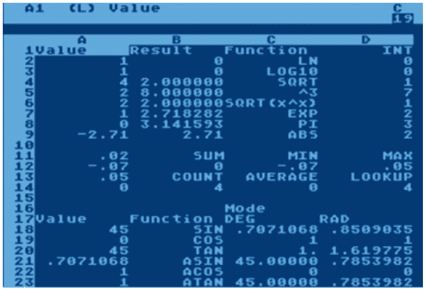
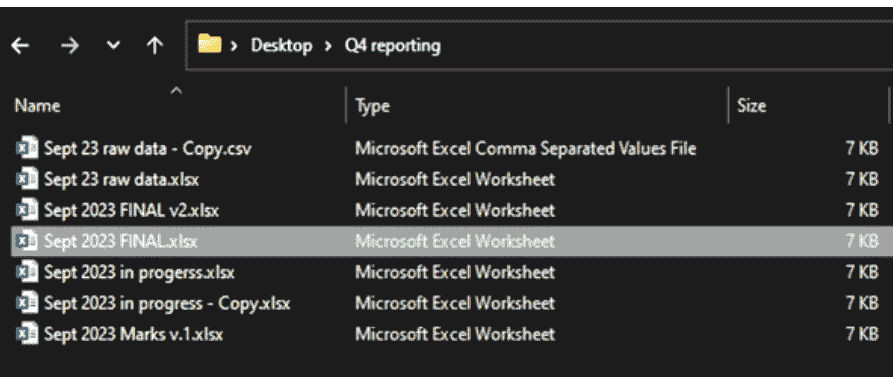
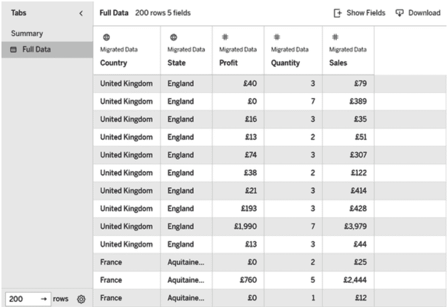

# 第 8 章 超越电子表格

电子表格与可视化分析解决方案之间存在着不和谐的共存。大多数可视化分析专业人士都有大量故事，讲述在将电子表格视为处理数据默认选项的环境中推动采用是多么困难。无论可视化体验多么精巧和交互，现实世界中用户的呼声往往是：“我可以把这个弄到 Excel 里吗？”

然而，在过去几年中，电子表格工具的发展速度与可视化分析相当，拥有新的范式和功能，使用户能够将电子表格工具作为以其数据为中心的可访问、协作和可编程平台的核心。其中一些工具正在推动全新分析方法的发展，一些摒弃了整个可视化分析概念而转而采用网格和表格，还有一些纯粹旨在使组织内收集和管理数据单一事实来源（SSOT）的过程民主化。

那么，我们应如何在嵌入式分析的背景下看待电子表格？在本章中，我们将探讨电子表格背后的一些历史，了解产品格局在过去几年中的演变，并展示现代电子表格工具如何为嵌入式分析解决方案带来真正价值的方式。

为了帮助支持关于你自己组织中可能拥有的工具的讨论，我们还将尝试回答电子表格工具是否可以被视为其自身分析平台的问题。

### 场景设定


出于本章的目的，让我们制定一些宽松的定义，以帮助我们区分在现实世界中经常被混用的术语：

### 表格

电子表格工具中表示和交互数据的典型方式。我们使用这个术语来涵盖最基本的示例，其中数据被组织成共享公共列的行，以及更复杂的示例，如数据透视表。同义词可能包括“表格”或“网格”等术语。

### 原始数据

电子表格工具使用的数据源。这可能只是简单的行级、分项数据，已粘贴到电子表格工具中的表单中。也可能是电子表格工具连接的关系型数据库中存储的数据。

### 分隔数据

这个术语涵盖了多种文件格式，用于编码和交换由数据库、ERP 和 CRM 系统以及电子表格工具生成的数据。分隔文本文件中的数据按行排列，使用分隔符字符将每行中的值分隔为列。如[第 4 章]中所述，不同字符可用作分隔符；最常见的示例是逗号，用于 CSV 文件。

尽管分隔数据是系统间交换数据的主要方式，但分析解决方案是否提供从系统导出分隔数据的选项，在推动采用、治理和最佳实践管理方面是一个有争议的问题——这是我们稍后将介绍的要点。

### 电子表格工具

能够让你创建和操作原始数据和表格的软件。我们将使用这个术语来涵盖 Excel 等无处不在的软件，以及利用类似功能提供具有广泛功能的 SaaS 平台的更现代派生产品，如 Airtable 和 Google Sheets。

## 让电子表格诞生

在过去两百万年中，人类进化成了模式识别和“视觉枚举”机器。我们的周边视觉和视力敏锐度是使早期人类能够躲避捕食者、狩猎以及对周围环境做出关键决策的重要特质。我们对整个世界的看法都受到这些特质的影响。

这与嵌入式分析和电子表格有什么关系？显然，将远古人类躲避捕食者与坐在空调办公室里查看最新营销报告的人相比，有点牵强，但我们看到和解读数据的一些方式仍然利用这些远古行为。让我们考虑一些示例。

图 8-1 说明了选择的一个绝佳示例。对我们来说，能够识别成熟的水果很重要（甚至可能关系到生死），因此我们能够非常快速地识别共同的视觉特征——在这里是颜色变化——并将这些元素归为我们感兴趣的单一选择。


图 8-1. 树上正在成熟的苹果

图 8-2 向我们展示了这种选择特征如何应用于更现代（但也许不那么美味）的示例。根据条件突出显示数据行利用了我们快速识别感兴趣行的能力。请注意，浏览销售代表列表并识别四个人的姓名是直观的。这就是你的视觉选择特征在起作用。

| | A | B | C | D | E | F | G |
|---|---|---|---|---|---|---|---|
| 1 | 订单日期 | 地区 | 销售代表 | 项目 | 数量 | 单位成本 | 总计 |
| 2 | 44202 | 东部 | Jones | 铅笔 | 95 | 1.99 | 189.05 |
| 3 | 44219 | 中部 | Kivell | 活页夹 | 50 | 19.99 | 999.5 |
| 4 | 44236 | 中部 | Jardine | 铅笔 | 36 | 4.99 | 179.64 |
| 5 | 44253 | 中部 | Gill | 钢笔 | 27 | 19.99 | 539.73 |
| 6 | 44270 | 西部 | Sorvino | 铅笔 | 56 | 2.99 | 167.44 |
| 7 | 44287 | 东部 | Jones | 活页夹 | 60 | 4.99 | 299.4 |
| 8 | 44304 | 中部 | Andrews | 铅笔 | 75 | 1.99 | 149.25 |
| 9 | 44321 | 中部 | Jardine | 铅笔 | 90 | 4.99 | 449.1 |
| 10 | 44338 | 西部 | Thompson | 铅笔 | 32 | 1.99 | 63.68 |
| 11 | 44355 | 东部 | Jones | 活页夹 | 60 | 8.99 | 539.4 |
| 12 | 44372 | 中部 | Morgan | 铅笔 | 90 | 4.99 | 449.1 |
| 13 | 44389 | 东部 | Howard | 活页夹 | 29 | 1.99 | 57.71 |
| 14 | 44406 | 东部 | Parent | 活页夹 | 81 | 19.99 | 1619.19 |
| 15 | 44423 | 东部 | Jones | 铅笔 | 35 | 4.99 | 174.65 |
| 16 | 44440 | 中部 | Smith | 书桌 | 2 | 125 | 250 |

图 8-2. 应用于表格数据的选择

枚举是另一种与我们视力敏锐度相关的关键特征。图 8-3 显示了对远古人类来说可能危险的情况：一群看起来特别好奇的鬣狗。我们如何评估这种危险？一只鬣狗不太可能构成严重威胁，但一个群体，尤其是像这样庞大的群体，肯定是令人担忧的事情。这里有一个微妙之处：我们并不是在数群体中的个体数量；我们只是本能地知道这样规模的群体是危险的。幸运的是，我们的现代世界很少涉及这种危险，但这种特征仍然很有用。


图 8-3. 一群鬣狗

使用同一组示例数据，图 8-4 显示了我们如何非常快速地枚举数量，而无需显式计算值。大多数读者都能立即判断出选定列中铅笔比活页夹多，这得益于一些基本的突出显示。

| 订单日期 | 地区 | 销售代表 | 项目 | 数量 | 单位成本 | 总计 |
|---|---|---|---|---|---|---|
| 44202 | 东部 | Jones | 铅笔 | 95 | 1.99 | 189.05 |
| 44219 | 中部 | Kivell | 活页夹 | 50 | 19.99 | 999.5 |
| 44236 | 中部 | Jardine | 铅笔 | 36 | 4.99 | 179.64 |
| 44253 | 中部 | Gill | 铅笔 | 27 | 19.99 | 539.73 |
| 44270 | 西部 | Sorvino | 铅笔 | 56 | 2.99 | 167.44 |
| 44287 | 东部 | Jones | 活页夹 | 60 | 4.99 | 299.4 |
| 44304 | 中部 | Andrews | 铅笔 | 75 | 1.99 | 149.25 |
| 44321 | 中部 | Jardine | 铅笔 | 90 | 4.99 | 449.1 |
| 44338 | 西部 | Thompson | 铅笔 | 32 | 1.99 | 63.68 |
| 44355 | 东部 | Jones | 活页夹 | 60 | 8.99 | 539.4 |
| 44372 | 中部 | Morgan | 铅笔 | 90 | 4.99 | 449.1 |
| 44389 | 东部 | Howard | 活页夹 | 29 | 1.99 | 57.71 |
| 44406 | 东部 | Parent | 活页夹 | 81 | 19.99 | 1619.19 |
| 44423 | 东部 | Jones | 铅笔 | 35 | 4.99 | 174.65 |
| 44440 | 中部 | Smith | 书桌 | 2 | 125 | 250 |

图 8-4. 枚举数量

我们已经展示了几种适合解释以表格形式排列的数据的特征，但有一种特征可以说是历史上首次使用书写表格的起源：模式识别。我们是模式识别机器，能够本能地在周围世界中发现结构和重复的视觉图案，甚至胜过最复杂的算法。

图 8-5 显示了我们都熟悉的一种模式：沙子中的脚印。我们潜意识中可能在判断是谁或什么留下了脚印。脚印还具有 _方向_，这为我们提供了关于周围环境的更多丰富信息：我们可以确定脚印来自哪里以及通向何处。这与我们示例中现实世界数据的解释有何关系？


图 8-5. 沙子中的脚印

图 8-6 可能是使用“表格”来表示数据以供解释的最早用途之一。这是一张被认为有大约 2300 年历史的乘法表。该表依赖于方向性模式识别，以允许查看者从给定的行和列中选择乘数，然后找到它们之间的交点来确定乘积。


图 8-6. 最古老的已知乘法表的一部分

此表格的完整版本允许对 0.5 到 99.5 之间的任何整数或半整数进行乘法运算。这是一个表格如何发展以解决现实世界问题的迷人示例，并且今天在全世界仍然能找到这种用例，在黑板上、在书籍中，以及——你猜对了——在 Excel 中。

## 电子表格是分析平台吗？

源自图 8-6 中乘法表示例的书写表格，是人类能够系统和严格地解释数据的首种方式，这正是我们今天所了解的“分析”的一个坚实定义。

然而，直到 1970 年代末期个人计算机的出现，我们才得以一窥电子表格可能带来的真正变革性变化。第一个商用电子表格工具 VisiCalc（图 8-7）于 1979 年为 Apple II 计算机发布，其影响是立竿见影的。可重新计算的公式、易于导航的表格和一致的数据录入方法消除了手动簿记流程、繁琐的计算以及容易出错的重复操作。财务团队采用了这项技术，他们的公司节省了数百万美元，而现代电子表格的概念诞生了。



图 8-7. VisiCalc，早期的电子表格工具


财务团队并非唯一利用这项新技术的团队。电子表格不仅带来了流程效率；它们提供的灵活性还被经理、人力资源团队、供应链分析师、营销高管以及几乎可以想到的商业组织中几乎所有其他职能部门所利用。

自那时起，变化步伐持续不断，电子表格工具已无处不在。如果你有一台电脑，可以肯定地说，你见过（如果不是使用过）电子表格工具。据估计，每天多达20亿人使用像Excel和Google Sheets这样的电子表格工具。

## Excel 的无处不在

电子表格工具迅速普及：SuperCalc、Lotus 1-2-3、Multiplan以及许多其他厂商在1980年代推动了发展，创新速度很快。用户能够编写更复杂的计算，用户界面变得更加精密，应用程序内原生构建图表和图形的功能也被引入。

当Excel在20世纪80年代末开始流行时，它将自身定位为当时最先进的电子表格工具——这一说法在40多年后如今很多人仍然认同。暂且说说Excel，它现在做了以前没有做的事情？列表很长，但它目前提供的一些核心功能包括：

- 在单个文件中维护多个独立且动态可引用的工作表的能力
- 功能强大且范围广泛的函数集合，包括一个用于在Visual Basic for Applications (VBA)中编写自定义函数的框架，以扩展功能并与其他第三方系统集成
- 从多种来源（如关系数据库）获取数据的集成功能
- 复杂的数据建模、查询编辑和转换功能
- 数学和三角函数，以及内置的统计建模和预测工具
- 大量复杂且可自定义的图表和图形
- 功能完善的在线版本，以实现协作和版本控制
- 用于将分隔数据导出到其他工具的大量选项

这在评估分析平台时是一套合理的标准，因此很明显，Excel能够明确履行分析平台的功能。事实上，全世界数千个组织目前正在将Excel作为其数据编排和分析的唯一平台，即使他们自己并不知道。

Excel如此无处不在且功能丰富，以至于面临数据和分析需求的组织往往选择阻力最小的路径。在许多情况下，组织作为现有Microsoft采购的一部分已经为Excel付费，因此他们已经拥有了软件——这是一个需要跨越的巨大障碍。而且，它为众多日常挑战提供了几乎完美的契合：

*我需要一个地方来存储我们的月度财务记录。*

Excel不一定是存储数据的完美解决方案，但经过仔细管理，它非常适合归档大量行级数据以供未来分析。

*我需要导入在网上找到的一些第三方数据并为其做好分析准备。*

你已经熟悉Excel的工作方式，因此可以直接将数据粘贴到工作表中并开始处理。

*我需要为每周销售演示文稿构建一个图表。*

只需几次点击，你就可以构建所需的图表，还带有投影和渐变填充——每个人都喜欢，对吧？

我需要为下一次员工会议做一个快速粗糙的预算平衡。

Excel就在这儿；为什么不直接用它呢？基本公式易于编写，你可以直接将文件发送给经理审批。

Excel对这类挑战如此契合，这一事实巩固了它在许多组织中作为数据和分析平台默认选择的地位，但它不一定是*正确*的选择。

## Excel无法做到的事情

当今许多组织面临的数据挑战规模庞大，这意味着真正的分析平台需要对用户共享和消费数据的方式提供更强大的控制。以下各部分探讨了Excel及类似电子表格工具未能满足真正分析平台要求的几种方式。

> NOTE
>
> 值得注意的是，许多收购和合并策略特别包含审计式练习，要求公司在以下许多领域正式展示数据和分析能力，才能被视为“数据成熟”。

## 控制内容泛滥

Taylor在一家大型回收厂工作。她的日常职责包括从工厂管理软件下载处理数据，并汇总分钟级数据以创建KPI，然后将其发送给经理。每天，她在本地电脑上保存一个“进行中”版本，然后是最终版本。有时，在纠正错误后，她会创建一个真正的最终版本。她将所有这些文件的副本电邮给经理，经理将它们保存在本地电脑上。

图8-8显示了一个有些刻意的示例。我们都这么做过，而且这不仅仅是Excel的问题。然而，它确实说明了使用完全民主化的软件来管理数据时的主要痛点之一。在Taylor的例子中，每个工作日*至少会创建四到五个文件*（假设Taylor和她的经理都没有将副本分发给任何其他人），命名方式随意且包含相似数据。这每年超过一千个文件，分布在各种本地电脑、网络存储位置和内部邮箱中。



图8-8. 重复报告内容示例

现在，想象一个场景：外部审计师要求提供过去一年的数据。Taylor将有大量工作要做。更糟的是，想象一个场景：外部审计师要求公司验证单一来源的准确处理数据仅存储在一个安全位置。Taylor的经理现在有大量工作要做！

这就是内容泛滥的问题；一旦被允许，就几乎不可能控制，也非常难以重构。

## 支持对大量数据进行计算的能力

撰写本文时，Excel单个工作表可以处理1,048,576行和16,384列。不用说，这是一个*非常大*的电子表格。但在现实世界中，大多数用户在使用Excel处理远少于此的行数时很可能会遇到性能问题，尤其是在需要操作数据和计算公式时。

从CRM/ERP系统提取的数据的一般复杂性和数量在不断增加，尽管处理百万行数据集似乎不太可能，但这比许多组织意识到的要常见得多，尤其是在数据从多个来源手动集成时。

要处理如此大型数据集的操作和转换，你真的需要转向专用数据库解决方案。

## 安全性和授权

可扩展的安全和治理策略是任何数据和分析解决方案中最关键的方面之一，在类似Excel的工具之上可靠地实施它非常困难。

我们在[第7章]中深入讨论了有效的治理和合规解决方案是什么样子，如果你以Excel为背景回顾该章节，你会得出一个显而易见的结论：如果将Excel视为唯一的分析平台，几乎没有任何核心治理原则能够得到有效实施，而且肯定无法在不利用许多昂贵的额外外部服务来强制执行甚至基本原则的情况下实现。

## 共享和嵌入

最后，但绝非不重要，真正的分析平台依赖于以一种方式与用户共享内容，这种方式不会与现有的任何治理原则冲突或违背，也不会导致内容泛滥。无任何控制形式的自由分发显然是不可取的，但Excel在其自身由Microsoft驱动的平台之外没有集中式内容共享模型，尽管可以嵌入托管在第三方平台上的Excel文档，但Excel本身并没有固有的能力来控制或以其他方式联邦化对该内容的访问。

换句话说，如果你想将Excel内容嵌入到你自己的网站或应用程序中，你将面临许多专用数据和分析平台根本不存在的挑战。


## 近乎答案

希望你能明白，为什么“电子表格是否算作分析平台？”这个问题并不像看起来那么简单，你的答案无疑会因你目前使用电子表格的方式以及你所在组织未来与数据的关系而有所不同。

不过，一个合理的说法如下：

> 电子表格工具本质上并不适合作为分析平台使用，但其高采用率和强大且易于理解的功能，使其成为许多分析解决方案中不可或缺的一部分。

幸运的是，电子表格工具的世界已不再局限于像 Excel 这样单体的、基于客户端的应用程序。新的、高度专注的 SaaS 产品正以创新方式架起民主化数据访问与严格治理之间的桥梁。此外，一些工具在嵌入式用例方面具有非常有趣的潜力。

## 超越 Excel

虽然 Excel 依然保持着最受欢迎电子表格工具的地位，但电子表格工具的整体版图已大幅多样化。我们现在看到，以 SaaS 为主的产品正在获得关注，其中一些专注于解决非常具体的业务挑战，例如项目管理或调查采集。

SaaS 通常为集成提供更多灵活性，但从嵌入式分析的角度来看，特别令我们感兴趣的是，在这类工具（及其原生表格）在一种相对较新的交互式协作开发工具中的应用：即基于浏览器的计算笔记本。

让我们探索一下这些类别，包括新旧各类。

## 简单报告与分析

许多供应商提供面向支持基本报告分析的传统电子表格工具，其中一些工具利用了这样一个事实：像 Excel 这样的传统工具很可能继续作为现有报告数据的来源。

例如，GRID 允许用户连接到 Excel 中的现有数据，然后从中创建丰富的交互式可视化，这些可视化可与其他用户共享，并包含叙述和上下文反馈，如评论。GRID 有自己的原生电子表格编辑器，但该产品主要定位于满足一种常见用例：分析的呈现与围绕分析的协作（这是 Excel 原生不提供的功能）。

类似地，Google Sheets 是一个更通用的在线电子表格工具，利用 Google 强大的应用生态系统提供丰富的协作功能，不仅在 Sheets 中，而且在 Google Workspace 的其他产品中也是如此，例如 Slides 和 Docs。

像这样的工具高度依赖用户对传统电子表格概念的熟悉程度，例如编写计算、格式化以及处理数据的一般“流程”：复制和粘贴内容、创建汇总或聚合表等。因此，如果你正在考虑在分析解决方案中嵌入表格内容，它们通常是一个合适的选择。

图 8-9 使用了本章前面示例中相同的表格。在此情况下，我们创建了一个 Google Sheet 来包含所涉数据，并利用 Google Sheets 的原生 iframe 共享功能将其嵌入网页。你可以想象，如何轻松创建一个网页，其中嵌入了多个包含表格和图表的工作表，所有这些都可能由同一工具生成。

## ERP 系统中的网页

此内容是 ERP 系统的一部分

| 订单日期 | 地区 | 代表 | 项目 | 数量 | 单位成本 | 总计 |
|---|---|---|---|---|---|---|
| 44202 | East | Jones | Pencils | 95 | 1.99 | 189.05 |
| 44219 | Central | Kivell | Binder | 50 | 19.99 | 999.5 |
| 44236 | Central | Jardine | Pencils | 36 | 4.99 | 179.64 |
| 44253 | Central | Gill | Pen | 27 | 19.99 | 539.73 |
| 44270 | West | Sorvino | Pencils | 56 | 2.99 | 167.44 |
| 44287 | East | Jones | Binder | 60 | 4.99 | 299.4 |
| 44304 | Central | Andrews | Pencils | 75 | 1.99 | 149.25 |
| 44321 | Central | Jardine | Pencils | 90 | 4.99 | 449.1 |
| 44338 | West | Thompson | Pencils | 32 | 1.99 | 63.68 |
| 44355 | East | Jones | Binder | 60 | 8.99 | 539.4 |

此内容也是 ERP 系统的一部分

图 8-9. 网页中包含嵌入式 Google Sheet 的 iframe

## 注意

这是一个非常简化的示例，使用的是公开可用的 Google Sheet。请记住，安全性和授权是真正分析平台的关键组成部分，如果你的用例需要除无限制访问内容之外的任何内容，则应将其视为默认要求。

## 集成与协作

我们已经提到过，协作可能是电子表格工具的一项潜在有价值功能。一些供应商将这一概念推得更远，构建了以表格作为强大协作和集成用例中心存储库的基于电子表格的产品。这种可重复、可复用的“框架”方法提供了灵活性：接口可用于创建直观且可视的方式来捕获数据、创建表单、跟踪项目和分析数据。

此外，此类别中的许多工具（如 Airtable）拥有连接其他常见生产力工具的连接器，可用于在电子表格工具和其他服务之间移动信息。这在实践中意味着什么？

- 其他应用程序（例如可视化白板平台）中的内容可以在该工具中与相关表格一起显示。
- 当表格或面向用户的接口更新时，可从该工具向 Slack 和 Microsoft Teams 等通信平台发送通知。
- 当工具中的状态更新时，可以直接更新 CRM 或 ERP 工具。

可能性是无限的，此类别中的工具通常为寻求解决运营挑战的组织提供一个有吸引力且具有成本效益的选择。

## 项目管理与工作流

电子表格概念非常适合项目管理方法论。具有任意数量属性（持续时间、日期、状态、复杂性等）的任务天然适合以表格形式呈现，而单元格格式化使伪甘特图易于创建和维护。供应商已着力利用这一点，创建了 Smartsheet 和 monday.com 等工具，为任务管理、线索管理、入职、联系人管理和活动管理等典型的管理和工作流程需求提供广泛的功能。对于供应商来说，这是一块丰富的矿脉，因为支持所有这些用例的功能都可以从以电子表格形式存储数据的基本概念中推导出来。

## 计算笔记本

潜在地，在嵌入式分析环境中使用基于表格的数据的最有趣方式之一，是相对较新的计算笔记本概念。基本而言，_计算笔记本_（本章中简称“笔记本”）是一种基于 Web 的环境，用于创建包含文本和富媒体的文档，此外还包含定义的块，这些块可以包含代码、可视化分析、数学表达式以及当然的表格。

笔记本之所以流行，是因为它们非常有效地结合了核心集成开发环境（IDE）概念（例如编写、编辑、调试和运行代码的能力），与协作和叙事概念（例如用文本解释代码的作用，并用嵌入式表格和可视化分析来可视化结果）。笔记本成为一种低依赖、自包含的交互式代码开发环境，非常适合基于团队的代码开发、数据科学和分析。

图 8-10 显示了托管在 Google 协作笔记本平台 Colaboratory 上的一个基本笔记本示例，这是那些想要尝试笔记本的人的绝佳资源。我们的笔记本包括格式化的注释、可实时执行的代码片段以及执行代码的结果：一个嵌入式交互表格。


## 简单笔记本示例

让我们设置环境以运行一些基本 Python 代码：

```
import pandas as pd
import numpy as np

## Make numpy values easier to read.
np.set_printoptions(precision=3, suppress=True)

import tensorflow as tf
from tensorflow.keras import layers
```

此处是将小型 CSV 数据集加载到笔记本中并以表格形式可视化结果的位置：

```
abalone_train = pd.read_csv(
    "https://storage.googleapis.com/download.tensorflow.org/data/abalone_train.csv",
    names=["Length", "Diameter", "Height", "Whole weight", "Shucked weight",
           "Viscera weight", "Shell weight", "Age"])

abalone_train.head()
```

| 索引 | 长度 | 直径 | 高度 | 整体重量 | 去壳重量 | 内脏重量 | 贝壳重量 | 年龄 |
|---|---|---|---|---|---|---|---|---|
| 0 | 0.435 | 0.365 | 0.11 | 0.334 | 0.1356 | 0.0775 | 0.0685 | 7 |
| 1 | 0.585 | 0.45 | 0.125 | 0.874 | 0.3545 | 0.2075 | 0.225 | 6 |
| 2 | 0.655 | 0.51 | 0.16 | 1.092 | 0.396 | 0.2825 | 0.37 | 14 |
| 3 | 0.545 | 0.425 | 0.125 | 0.768 | 0.234 | 0.1495 | 0.26 | 16 |
| 4 | 0.545 | 0.42 | 0.13 | 0.879 | 0.374 | 0.1695 | 0.23 | 13 |

## 图 8-10. 示例计算笔记本

幕后，笔记本是一个包含代码、文本和富媒体的文档，它使用名为 _内核_ 的计算组件来执行文档中可能包含的任何代码和集成过程。笔记本平台和内核通常托管在 Amazon Web Services (AWS) 或 Azure 等云服务提供商上，因此内核可以利用可扩展的计算资源来处理代码执行。这使得笔记本成为计算密集型 AI 和机器学习项目的有力解决方案，能够让代码（以及代码的执行结果）与你正在做什么的说明一并呈现，并且可以实时执行。

**注意**

产品多样化的一个不可避免的后果是术语和命名变得更加复杂。供应商试图通过引入代表相似事物的全新术语来区分其产品功能，在产品评估项目中，大量时间可能仅用于了解这些新术语的含义。这可能感觉是一项无益的努力，但为了有意义地比较功能，这样做很重要。

## 将电子表格置于上下文中

你是否应将电子表格工具和表格视为可嵌入解决方案的对象？毫无疑问，是的。但有几点需要注意。

## 谨慎选择电子表格工具

如果你决定嵌入式分析解决方案出于合理原因需要表格，并且相信它们会增加价值或改善用户体验，请仔细关注我们在本章开头讨论的注意事项。从传统电子表格工具（如 Excel）中嵌入表格可能会违反既定的治理原则，带来安全风险，并且相比于从专用可视化分析平台提供的嵌入式可视化分析对象，管理起来要困难得多。

## 不要破坏可视化分析的范式

这可能是一种更委婉的说法，即“不要偷懒”。可视化分析之所以存在，是因为它们利用人类古老的选择、枚举和模式识别能力，尽可能有效地传达洞察。如果你考虑嵌入表格，请问自己：这对于特定目的而言，是否绝对是传达和呈现数据的最佳方式？如果不是，那么无论电子表格工具提供何种功能和特性，回归到适当的图表或图形（或 KPI）可能是更好的选择。

## 在可能的情况下追求一致的交互方法

在许多情况下（如计算笔记本的概念），用于生成表格的机制或电子表格工具，将与用于生成可视化图表的工具不同。例如，你可能会将 ThoughtSpot liveboard 与 Airtable 生成的表格一起嵌入解决方案中——这是两种完全不同的软件解决方案。与这些嵌入式元素交互的方法自然也会不同。钻取操作在每个工具中可能需要略有不同的流程，某些交互方法（如右键单击）在两个工具中可能都无法使用。

在某种程度上，这是不可避免的（并且用户也许也会预期），但无论如何，仔细思考用户在使用多个供应商的工具时将如何管理和理解可用的交互选项，仍然很重要。

## 为表格考虑高度针对性的用例

在本章开头，我们简要提到了用户只想从嵌入式系统下载或导出分隔数据的常见模式。同样，这里有一个论点：适当使用可视化分析可能从一开始就消除导出的需求。毕竟，如果用户想要下载数据以在 Excel 中构建图表，为什么不构建该图表的嵌入式交互版本，并让用户留在系统中？

然而，用户需要下载数据是有合理原因的。他们可能需要进行嵌入式系统无法实现的分析。他们可能需要作为自身工作流程的一部分将数据上传到第三方系统。或者，在面向外部或货币化的嵌入式分析解决方案中，可能存在合同要求，必须使数据可用。

在这些情况下，表格在嵌入式解决方案中发挥着宝贵的作用：预览要导出的数据，并让用户能够优化并控制最终进入下载文件的内容。

图 8-11 显示了一个绝佳的示例。Tableau 可以预览特定图表或视图中使用的数据并下载底层数据（假设用户具有适当权限）。在这种情况下，用户会看到一个表示将要下载的数据的表格，可以预览选定数量的行，并显示或隐藏图表本身可能不会用到的列。这是一种良好的用户体验，也是表格如何为嵌入式体验增加价值的完美示例。



图 8-11. 从 Tableau 视图下载数据时向用户展示的表格

## 结论

电子表格工具不再仅用于创建表格，用户可以访问基于按行和列存储数据的概念的大量工具、平台和新兴技术。这不一定意味着表格是有效嵌入式分析解决方案的必要组成部分，但经过仔细考虑和工具选择，嵌入式表格内容以提供额外上下文可以为用户提供他们期望的选项（如下载和导出数据）。提供引导式分析体验是任何解决方案架构师都应该探索的事情。
