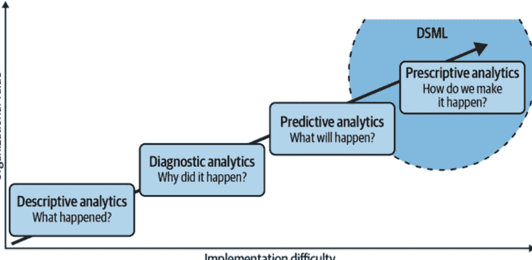
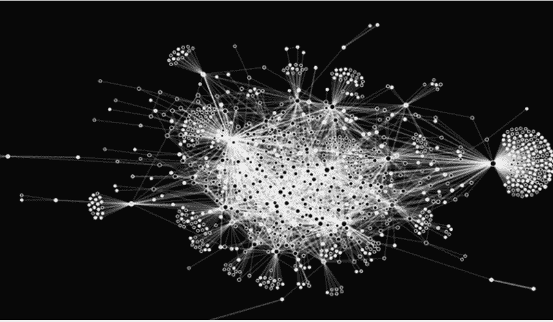
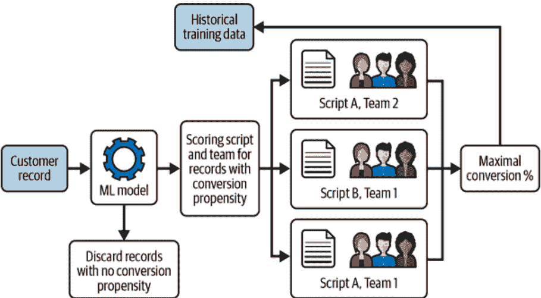
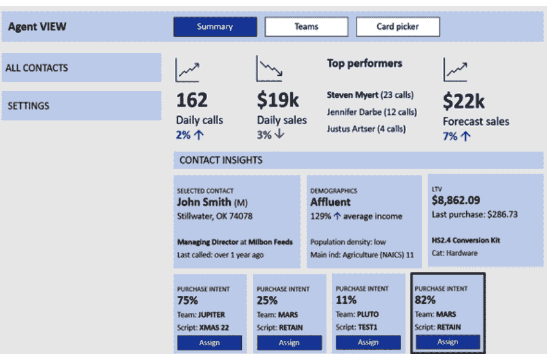

# 第 9 章 数据科学、机器学习和嵌入式分析

在本章中，我们将探讨嵌入式分析、数据科学和机器学习（ML）之间的交汇点。本章特别面向考虑将数据科学和机器学习应用于现有业务流程和嵌入式应用程序以提供额外价值的决策者。我们还将论证，围绕数据科学和机器学习的上下文和“讲故事”可以说与应用这些过程本身同样重要。

这是一个复杂的话题，因此为简单起见，我们将故意模糊数据科学和机器学习特定领域之间的边界，而统称为 DSML。在现实世界中，许多供应商工具、平台和方法论同时使用两个学科的特征，在通用分析的背景下，可以安全地说，这些术语（以及许多其他术语，如人工智能和预测分析）通常可以互换使用。

## DSML 在实践中

那么，除了我们迄今讨论的传统分析之外，DSML 包含什么内容？通常，数据分析实践成熟的组织可能在以下一个或多个领域展示能力：

- 积极使用复杂的统计或基于概率的方法来丰富或从数据中得出洞察，并支持决策

- 使用 Python 和 R 等语言进行数据转换、准备和分析，而非使用 Tableau、Power BI 或 Sisense 等低代码或无代码可视化分析工具
- 较少见的是，在关系型数据库中直接使用 SQL 数据定义语言（DDL）和 DML 命令进行 DSML 的高级用法
- 使用云平台提供商（如 Amazon SageMaker 或 Azure Machine Learning Studio）提供的易于扩展的 SaaS DSML 服务
- 具备机器学习运营（MLOps）实践的通用专业知识，以在专门团队内部署、维护和管理生产环境中的 ML 模型

我们将在本章后面讨论这些功能的一些现实应用，以及它们如何既支持又推动有效的嵌入式分析解决方案，但目前让我们先探讨任何涉足 DSML 的组织都需要考虑的一个基本问题。

## DSML 很难

如果您熟悉分析成熟度的概念，即将各种成熟度阶段绘制在图表上，以指示从基础描述性分析到指令性分析的进展，那么您可能已经知道，我们刚才讨论的大部分（如果不是全部）功能和技能集都属于高难度/高价值象限。

图 9-1 展示了分析成熟度模型的一个版本，说明 DSML 通常用于（或被提议用于）预测性和指令性分析目的。

图 9-1. 无处不在的分析成熟度概念示意图

DSML 实施起来成本高昂且困难，但如果做得当，也能为组织带来变革性价值。然而，这里我们需要考虑一个最具挑战性的问题：如何与非技术利益相关者接触并向其解释 DSML 概念和流程。

## 讲故事的力量

获得传统分析项目的支持比过去容易得多。组织不再需要被说服报告数据中蕴藏着巨大的价值。有大量高效且直观的分析工具和产品可供选择，适合各种预算，几乎任何组织都能发展基础分析能力。

然而，当涉及到从基础分析进驻 DSML 驱动的预测性和指令性分析世界时，事情就变得棘手得多。正如我们之前提到的，除了核心分析知识外，DSML 还涉及高度技术性的概念、对基础统计学和机器学习建模的理解（这并非大多数现实世界传统分析的组成部分），以及复杂且昂贵的技术。

同样重要的是，拥有将具体的组织需求转化为可应用的 DSML 项目的资源，并能够通过“讲故事”有效地将结果的价值传达回组织。许多 DSML 项目在开始之前就失败了，正是因为这一点。

## 事情出错时

让我们通过一个现实世界的例子来说明讲故事所能产生的影响（或没有影响）。

一个专业足球组织正在为即将举行的联赛锦标赛制定媒体宣传活动，经过数月的选拔过程，一家侧重技术的相对较小的广告公司被选中来运行该活动。预算达到八位数，该合同代表了该机构未来两年的财务安全。换句话说，这是一笔大生意。

该机构知道它必须做点不同的事情：展示锦标赛，以及了解球迷想看什么、对他们来说哪些时刻很重要，以及他们为什么关注这项运动。这将定义活动的内容和方向。这个想法越来越受欢迎，因为该机构侧重技术，它决定使用一种称为 *network science* 的技术来更好地了解球迷之间如何互动。该机构将项目简化为一个问题：什么让球迷走到一起？

无论他们支持哪支球队，球迷都会因历史事件而团结：精彩的比赛、有争议的比赛、决定胜负的点球。“足球精彩瞬间”是球迷之间普遍互动发生的地方。

因此，该机构决定，专注于这些精彩瞬间的活动就是答案。它通过使用 DSML（具体来说，是图论和网络科学的应用）来评估社交媒体上数百万次球迷互动，从而确定这些时刻是什么以及围绕它们的情感。

然而，网络科学很复杂。没问题：该机构派遣其活动经理和数据科学家向足球高管推介这个想法。数据科学家兴奋地解释说，*边*、*节点*、*权重*、*基于网络*和*基于自身的属性*将如何在 Python 的 NetworkX 包中用于确定*中心性措施*（如*亲近度*和*中介度*）。他展示了一张幻灯片，如图 9-2 中的示例所示。他很兴奋。当然高管们会印象深刻！

图 9-2. 网络图的可视化

不幸的是，数据科学家的演示遭到了沉默，经过几秒钟令人难以忍受的寂寞后，一位高管轻声说：“我想我们最好还是跟你的老板谈谈，如果可以的话。今天就到这儿。”数据科学家困惑且沮丧地离开了房间。

高管们毫不含糊地告诉活动经理，坦白说，这个提案难以理解。毫无意义，他们说。也许他们应该重新考虑合同。该机构不能用简单的话语解释这个提案*到底*是什么吗？

活动经理开始慌张，回归基础：“好。听我说完。我们将应用尖端的数据科学技术，找出不同球队的球迷在社交媒体上到底在谈论什么。他们认同什么，他们不同意什么，真正将他们团结在一起的事物。然后，我们将围绕这些时刻制作你们见过的最精美、最动人心魄的电视宣传活动。而且我们知道这会引起球迷的共鸣，因为科学告诉了我们这一点。”

反应是立竿见影的。高管们突然明白该机构想要做所有这些花哨的 DSML 事情的原因，眼睛都亮了起来。他们觉得这将是革命性的！成功有保证了！信心恢复后，活动经理和（现在稍微高兴一些的）数据科学家稳妥地拿着合同返回了基地。

这是一个编造的故事，但希望它能重申我们之前提出的观点：不仅拥有将组织需求转化为可应用 DSML 项目的资源至关重要，而且能够有效地将结果的价值传达回组织也至关重要。在故事开始时，该机构自信地认为仅凭技术专家的雄厚实力就足以证明其想法的价值，但实际上，需要简单有效的讲故事来解释提案的“为什么”。

**注意**

如果您对网络图理论感兴趣，Towards Data Science 在线上提供了一些很棒的资源，特别是“Visualizing Networks in Python”，它详细介绍了各种可视化网络的选项，方式与我们在故事中讨论的相同。

那么，这对嵌入式分析有什么相关性呢？请考虑一下：将从 DSML 派生的分析对象嵌入到原生应用程序或界面中，为您提供了一个完美的机制来提供关于 DSML 价值的上下文。让我们探讨一下这意味着什么。

## DSML 驱动的呼叫中心

为了帮助解释一些关键的 DSML 概念如何应用于比我们的网络图用例稍微不那么复杂的现实世界场景，我们将探讨呼叫中心和其他销售点环境中常见的 DSML 典型用例：倾向建模。同样重要的是，我们还将解释最终用户如何与解决方案交互，并使用嵌入式分析来理解 _上下文_ 和 _价值_，而无需了解任何关于 DSML 的知识。

## 倾向建模

在很高的层面上，_倾向建模_ 只是使用历史数据（通常用于描述性分析的相同数据）来预测未来某些事件发生可能性的过程（预测性分析的一个应用）。让我们使用一个虚构的呼叫中心来看一个现实世界的示例。

我们的呼叫中心在过去几年中进行了数百万次 B2B 销售电话。每个通话在数据库中都有对应的行，其中包括客户的详细信息（组织、职位、姓名、性别、地址、之前购买的详细信息等）以及通话本身的详细信息（时长、话务员、团队、日期和时间、脚本等）。

使用客户地址链接到包含地理数据的其他来源，该行还包括关于客户所在地区富裕程度和经济状况的一些第三方人口统计数据。单个通话的行可能包含数百列，都存储着可能有用的数据。但是，有一列对于我们的示例非常重要。它被称为“sold”，包含 1（表示通话促成了销售）或 0（表示未促成销售）。

此列驱动的简单指标是我们呼叫中心的 _转化率_：促成销售的通话百分比。最大化此率是关键。那么，我们该怎么做呢？好吧，让我们暂时跳出细节，思考一下我们可能会改变呼叫中心的哪些方面来提高转化率：

- 呼叫处理人员每天会获得一份需要拨打的新客户名单。我们可以控制哪些客户在这个名单上。
- 呼叫处理人员根据个人表现被组织成团队。我们可以控制哪些团队拨打哪些名单上的客户。
- 有不同的脚本可供呼叫处理人员使用。我们可以规定使用哪个脚本。

让我们先关注第一点。呼叫中心拥有数百万潜在客户的数据。如果我们能确保只拨打那些可能购买的客户，我们将提高转化率。这就是 DSML 派上用场的地方。

## 训练模型

基本挑战是这样的：给定新潜在客户的详细信息，我们需要确定他们是否可能购买。使用 DSML，我们可以使用历史数据训练机器学习模型来为我们预测这一点。

简单来说，我们通过准备数据、使用 ML 服务以及训练和测试模型来完成这一过程，如下文各节所述。

## 准备数据

首先，我们获取历史数据并将其整理干净。几乎总是存在不完整数据的问题，在应用任何 ML 流程之前，最好先对数据进行一些基本的清理和准备，例如正确设置数据类型。我们还可能创建一些新计算，这些计算可能有助于训练我们的模型，例如根据出生日期确定联系人的年龄（以年为单位）。

最重要的是，我们需要确保 "sold" 列被准确且一致地存储，因为这是我们要预测的值。

## 使用 ML 服务

接下来，我们将这些数据传递到 ML 服务中——例如 Microsoft 的 Azure ML Studio。我们想使用历史数据训练一个分类模型。或者，简单地说，我们希望模型找出是什么让客户有可能购买。我们了解很多关于客户的信息；这些方面（在 DSML 中称为“特征”）的组合可能会使特定客户有可能购买某物。

例如，也许那些终身价值（LTV）超过 34,000 美元、过去六个月未进行过购买、并且过去三年中从更富裕地区搬到较不富裕地区的男性联系人，比其他联系人更有可能进行购买。我们的数据集中有数百万客户，有数百个特征（组织、性别、位置、人口统计等），因此人类无法准确确定是什么导致客户进行购买。特征可能有数十亿种潜在组合。

对于这种规模的挑战，ML 不存在此类问题，并且根据可用的计算资源，它通常可以在几分钟内得出结果。

## 训练和测试模型

我们告诉 ML 模型，我们希望它被训练来预测 "sold" 列的值。它遍历我们的数据集，测试数百万个特征组合，以确定哪些组合与购买可能性增加相关。这些特征根据其对可能性的贡献程度被分配权重，然后模型再次运行，每次都以 1 或 0 预测 "sold" 列的值。可以通过将预测结果与历史数据中存储的实际结果进行比较来测试模型的有效性，并从此对模型的总体准确性进行评分。

> NOTE
>
> 本示例中我们使用的受监督机器学习模型（一个基本的二元分类模型）背后的细节和理论超出了本书的范围。大多数云平台（如 AWS 和 Azure）以及专用数据科学工具（如 Dataiku）都提供了多种模型即服务。在许多情况下，实现这些模型只需要很少的经验，尽管特征工程、训练和解释模型结果需要*专业知识*。

在我们的假设案例中，在训练和测试模型并尝试不同的特征和参数后，我们得出了一个模型，该模型可以基于历史数据以 84% 的准确率预测转化可能性。这是一个极好的结果，并且在给定适当数据的情况下，完全在现代 DSML 模型所能预测的范围之内。

是时候将我们的模型投入生产了。

## 付诸实践

我们现在可以解决拨打哪些客户的问题。在客户服务系统中，每次加载客户记录时，我们都会将该记录通过我们的 ML 模型，该模型会立即返回他们购买可能性的预测。这些记录可以提供给呼叫处理人员，其余的则被丢弃。

像这样的 DSML 简单应用目前正在全球数千家呼叫中心发生，其结果可能具有变革性。然而，我们可以以更微妙的方式利用这种方法的价值：

- 首先，请记住，在我们的示例中，呼叫处理人员根据其表现被组织成团队。描述性数据表明，对于特定客户，资深的高绩效团队比经验较少的低绩效团队更有可能促成销售。

- 同样，请记住，实际对话中使用了不同的脚本，相应地推广某些产品或折扣。

这些脚本也会影响转化。这两个方面都可以用作特征来训练新的多类分类 ML 模型，其理念是不同的脚本和团队组合也可能影响转化率。

图 9-3 显示了一个非常简化的关系图，描述了这种稍微高级的实现。使用不仅可以预测销售可能性，还可以预测最合适的团队和脚本（多类分类模型）的模型，我们可以丢弃不太可能转化的联系人，但随后确保将剩余的联系人提供给使用最佳脚本的最佳团队，以进一步最大化销售机会。

图 9-3. 我们的 DSML 模型在生产环境中的示意图

## 闭环

让我们探讨一下我们的呼叫中心经理的最终用户体验是什么样子的。核心概念是我们使用嵌入式分析对象来为团队提供与客户互动所需的所有支持信息。嵌入式分析还为他们提供了基于 DSML 的规范性智能，以最大化销售可能性。

图 9-4 显示了一个虚构的呼叫管理系统屏幕，从负责监控每日团队绩效并将客户联系人分配给团队进行呼叫的呼叫中心经理的角度来看。

图 9-4. 呼叫管理系统页面示例

此单一视图从上到下嵌入了几个有价值的分析对象：

- 基于呼叫中心当天捕获的呼叫数据的可视化描述性分析 KPI
- 来自联系人数据库的基本联系人详细信息，允许呼叫处理人员与客户互动并了解他们以前的通话和购买性质
- 基于联系人位置的增强人口统计数据，进一步向呼叫处理人员提供可能在销售过程中有用的属性信息
- 基于以前购买历史的联系人终身价值洞察
- 关于为最大化销售可能性而使用的最佳团队和脚本组合的基于 DSML 的规范性数据（来自我们之前的示例），以及一个简单的一键机制，用于将联系人“分配”给特定团队
- 基于每日销售数字和传递给团队的通话转化可能性的预测销售价值

这是嵌入式解决方案提供 _上下文_ 并说明（可能）高度复杂的分析和 DSML 工作流派生的数据 _价值_ 的绝佳示例，最终用户无需任何专业知识或技术知识。

为了为“闭环”这一理念提供一些额外背景，图 9-5 显示了 Salesforce 生成的嵌入元素的实际屏幕截图，该元素包含在 Tableau 仪表板中（也可以嵌入到目标应用程序或网页中）。

68%

按时付款的可能性 2,437 行已选中

### 主要预测因子

- 1.6 Disputed 为否 (960 行)
- 0.6 Disputed 为是 (343 行)
- 0.53 付款期限为 30 天 (327 行)

### 如何改进此项

- 20.21 将付款期限延长至 60 天 (937 行)
- 11.5 改用电子发票 (803 行)

由 Einstein Discovery 提供支持

图 9-5. 嵌入式预测与指令性分析的真实案例

此示例不仅提供预测分析（账户按时付款的百分比可能性），还提供指令性分析（增加此可能性的推荐操作），用户可以根据这些分析采取行动。

这是嵌入式分析与 DSML 生成的洞察相结合的强大力量的绝佳示例。

### 其他典型用例

我们的示例探讨了将 DSML 驱动的洞察推送到嵌入式系统的一种潜在方式。DSML 模型本身的开发和部署方式可以有多种处理方式：

- 由云平台服务（如 Lambda 函数）开发和编排的纯代码，可直接与数据和目标系统集成
- 在专用平台上开发和训练的模型，部署在特定供应商（如 Salesforce Einstein Discovery）的“围墙花园”中，或作为在 Dataiku 等工具中创建的可寻址服务
- 专为处理常见用例（如违约预测、转化归因或信用卡欺诈）而设计的行业或垂直领域特定服务

无论采用何种方法开发、训练和部署模型，DSML 目前在 AWS、Azure 和 GCP 等主要云计算提供商的整体计算使用中占据了相当大的比例，并且每天都在开发新的用例。对分析和嵌入式应用特别相关的示例包括以下内容：

### 客户旅程优化

客户旅程优化（如我们呼叫中心示例所示）使用 DSML 来推荐或执行客户旅程中最合适的下一步操作——即最有可能导致所需操作（例如销售）的操作。

### 内容策展

内容策展通常用于根据其他用户的行为，在网站（或应用程序中）自动显示能产生最高参与度的内容。

### 推荐引擎

推荐引擎使用 DSML 根据用户的购买历史、其他用户的参与模式、库存情况和定价策略，向用户推荐合适的产品。

### *需求与定价预测模型*

需求与定价预测模型根据历史交易条件、市场波动和其他特征，持续优化供应链运营，以确保有适当的库存量可用。

越来越多地，DSML 也被用于优化应用程序和系统本身的用户体验，这对于用户交互可以针对购买路径进行优化的应用程序尤其有利。这在在线零售商（如 Amazon）中表现得尤为明显，它们使用 DSML 来确保查询结果能够“从客户的即时搜索记录中学习”。

### 生成式语言服务的兴起

鉴于本书撰写时间（2023 年初），不至少提及 GPT-4 等高度复杂的生成式自然语言处理与生成（NLP/NLG）工具的爆炸式普及和潜力，将是失职之举。尽管严格来说，这不在我们所讨论的嵌入式分析范围之内，但 AI 驱动的自然语言系统在我们在本章探讨的许多用例中得到越来越多的采纳是不可避免的。

像 GPT-4 这样的生成式语言服务本质上是使用大量文本数据训练而来的高度复杂的深度学习模型。给定用户的某些输入文本（例如问题或请求），语言模型（LM）会确定最可能的单词序列作为响应。这些响应不仅可用于简单的问答和基本信息检索，还可用于编写可用代码和诗歌等更复杂（且令人惊讶）的应用！

作为这些服务功能强大的示例，请考虑使用 GPT-4 生成的以下输入和输出：

**提示词：** 我的月度产品销售额正在下降。请提供五个可能的原因。

**响应：** 如果您的月度产品销售额正在下降，可能存在多种因素。以下是五个可能的原因：

**竞争：** 市场竞争加剧可能会影响您的销售。

**经济因素：** 整体经济的变化，例如衰退或消费者支出减少，可能会影响您的销售。

**产品质量：** 产品质量下降可能会影响客户满意度并导致销售额下降。

**营销策略：** 无效的营销策略或消费者偏好的转变可能会影响您的销售。

**供应链中断：** 供应链问题，例如生产延迟或成本增加，可能会影响您满足客户需求的能力并导致销售额下降。

这是一个引人注目的示例。您可以想象一位销售经理即将召开会议解决销售下降问题，并自信地利用这些洞察来指导一些调查。

不难看出这些服务在分析用例方面的潜力：单个基于搜索的界面可以立即响应自然语言问题，并将数据驱动的结果整合为自然语言输出，在许多情况下，这种输出与用户创建的输出难以区分。ThoughtSpot 和 Veezoo 等供应商已经在该领域开发产品，放弃传统的仪表板创建，转而采用基于搜索的自然语言分析。

作者们的审慎观点是，生成式语言服务将在未来几年内显著改变分析格局。还值得指出的是，（除了前面的示例之外）编写本书时未使用任何 GPT-4 结果！

### 结论

本章既解释了又探讨了 DSML 驱动的分析在嵌入式解决方案中的价值。而且，如果您正在考虑将 DSML 作为自身分析解决方案的一个组成部分，我们希望已澄清，虽然数据科学能力至关重要，但同样重要的是要有能干人员参与，其职责是将组织需求转化为具体方案，并有效地将结果的价值传达回组织。

在下一章中，我们将把目前所学的一切整合起来，并探讨分析解决方案如何成为商业上可行的独立产品。
