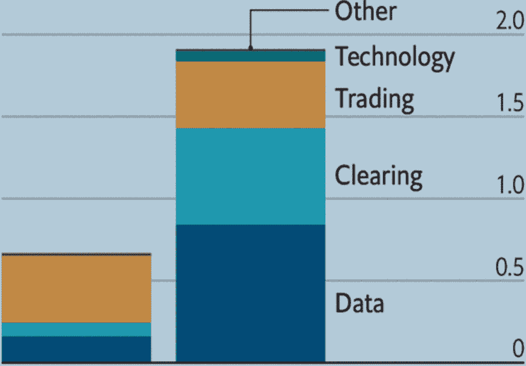

# 第 10 章 分析作为业务线

我们以一个简单的观点开始了本书：当今每家企业都是数据企业。由此，可以说每家企业都需要成为分析型企业，以充分发挥其数据的价值。对许多公司来说，这种分析需求代表着挑战。它们可能没有定义和构建所需分析的基础设施或技能。它们可能没有预算和资源，或者即使有，也可能无法将数据分析置于其他战略计划之上。

对于软件供应商来说，这种未被满足的需求是一个重要的商业前景。您已经在构建客户需要的应用程序或服务：您可以通过将分析作为一项功能来增强产品线，甚至开发能够独立存在的专用分析产品。

这种潜力对于 SaaS 供应商尤其强大。买家习惯于 SaaS 产品提供相对较低的成本、简单的采用以及持续发布的更新。在这种苛刻且竞争激烈的环境中，您的附加价值来自哪里？

我们认为最明确的答案之一在于您已经管理的数据。在本章中，我们将超越将分析作为功能的构建，来探讨如何将分析作为产品（因此作为潜在业务线）来交付。

## 数据作为资产

我们可能都熟悉“数据即资产”这一说法。事实上，这是现代数据管理和分析实践中的陈词滥调。它当然意味着数据具有价值。这种价值来自数据的

使企业能够深入了解客户行为、趋势和偏好。这些洞察可用于制定决策和策略。数据还可帮助企业识别提高效率、管理成本和增加盈利能力的机会。

有时，该价值可以通过数据货币化直接实现。换句话说，数据集可以直接出售，例如通过数据市场、数据经纪人或数据即服务。此外，数据可以直接出售给客户，或通过基于订阅的商业模式出售。数据还可以打包并作为产品或更大服务的一部分出售。

当然，我们必须注意一些限制。在这个场景中，法律和道德限制非常重要。但是，仍有许多公司有雄心从其数据资产中获得实际价值。

## 管理数据资产

如果我们认真将数据视为业务资产，这不仅意味着数据具有价值。考虑企业的其他资产：建筑物、设备、库存等等。它们都有价值，但该价值可能随时间减少。数据也是如此。所有这些资产都需要谨慎管理，以尽可能保留其价值。

例如，企业应跟踪和监控其资产，以确保知道资产位置、谁有权访问它们以及如何使用它们。这可能包括创建所有资产的清单或目录，并设置系统来监控其使用。同样重要的是要确保资产得到妥善保护，以防止盗窃或滥用。

同样，对于数据，数据治理、数据质量和数据安全不仅仅是良好实践；它们是维持该资产价值所必需的。如果您希望数据成为资产，就有工作要做！

将数据资产视为通向价值的路径的起点，该路径可以提供新功能、新产品和新业务线。以伦敦证券交易所为例，2008 年其大部分业务来自交易和股票。如图 10-1 所示，到 2018 年，其收入中最大的单一组成部分（在该期间价值翻了四倍）来自于出售数据。第二大组成部分来自提供结算服务，这些是围绕交易技术构建的数据驱动型服务。换句话说，在 10 年内，伦敦证券交易所已从主要是股票交易所转变为主要是数据和技术公司。当然，它仍然必须是股票交易所才能产生业务，而这些业务又会产生数据，但其主要收入来源现在来自作为业务线的数据和分析。

## 清算

## 伦敦证券交易所集团

收入，十亿英镑

来源：公司报告

《经济学人》

图 10-1. 伦敦证券交易所将数据作为业务线（来源：《经济学人》）

实际情况是，您不会始终看到像伦敦证券交易所那样显著的收益。尽管如此，本章我们希望制定一条路径，使您能够从数据和分析中获得实际价值，尤其是在可以将分析嵌入客户已经熟悉的应用程序的场景中。

实现这一点的最有效方法之一是将您的数据和分析*产品化*——简而言之，就是将您的数据（及其分析）从资产转变为产品。

### 数据产品

嵌入式分析为构建数据产品提供了绝佳平台。首先，如前所述，数据本身的价值有限。分析（即使只是简单的报告或可视化）可以帮助使用户快速识别模式、趋势和相关性，从而使数据更易于使用和更有价值。通过以可视化格式呈现数据，您可以使用户更轻松地处理和理解信息。可视化还可用于突出关键发现，使其更容易记住和回忆。

此外，数据可视化可以帮助识别数据中的异常值和错误，这些问题可以在进一步分析之前得到解决。最后，可视化可以用于更有效地向利益相关者和其他用户传达数据洞察，帮助确保数据以最有用、最有效的方式使用。

通过提供这种额外价值，分析作为新功能或模块（甚至作为新产品）使软件供应商能够向新市场（包括大型企业）进行追加销售。

在使用分析增加价值时，可以遵循三种集成模式：

- 现有产品的增强功能
- 新数据和分析模块
- 基于数据和分析构建的新产品

一般来说，增强功能就是如此：通过添加一些分析功能对现有功能进行的改进。一个简单的例子是将可视化或报告嵌入现有页面，以便为在该上下文中做出决策的用户提供更清晰或更有深度的帮助。

新模块可以从现有应用程序中作为新选项卡添加的报告，到广泛的可视化或机器学习功能不等。这些功能的模块化打包意味着它们可以作为现有产品的插件独立部署。因此，它们可以作为选项提供，甚至可以单独定价。（有关此过程的更多想法，请参见“定价嵌入式分析”部分。）

最后，还有可能基于现有产品生成或收集的运营数据，创建专门提供特定分析的新产品。新产品可能拥有自己的营销和销售活动，以及自己的产品管理、开发、发布和支持流程。

### 嵌入式分析文档

在使用嵌入式分析扩展现有产品或创建全新模块或 SKU 时，保持新文档在语言、格式和结构方面与现有产品文档尽可能一致非常重要。这有助于可用性、培训和支持。

请记住，分析对用户来说是新功能，因此要保持简单直接，避免使用行话，并解释新的技术术语。还应包含说明新界面功能如何与现有产品集成的可视化内容。

以下要点将有助于解释特定的数据和分析功能：

- *说明目的和优势。* 清晰地解释产品的目的及其为用户提供的优势。
- *提供数据定义。* 定义产品中使用的数据元素和指标。
- *给出示例。* 提供数据和分析如何用于解决现实问题的示例。
- *描述数据来源。* 解释数据的来源以及关于数据的任何假设。
- *展示可视化。* 提供数据和分析的可视化，以帮助用户了解产品的功能。
- *解释算法。* 描述用于生成数据和分析的任何算法。

### 嵌入式分析技术的产品分析

当您将分析嵌入现有软件产品时，用户会将这种新功能体验为您的增强和您的新功能，即使分析解决方案运行在第三方平台上。如果您遵循了我们关于安全性、数据访问和用户体验的建议，这一点尤其正确。最终应用程序可以是无缝的。

许多软件供应商使用产品分析系统来检测和监控用户对其软件的使用情况。产品分析帮助供应商了解人们如何使用其产品。例如，从高层次来看，您可以详细了解用户花在软件上的时间、他们最常使用哪些功能，甚至是否存在他们开始使用但感到困难的功能。这种知识不仅可以推动产品设计决策，还可以推动营销和销售策略。

产品分析技术通常附带一个 SDK，用于开发基于分析平台构建的应用程序。SDK 通常包括库、代码示例、文档以及用于调试和测试的工具。

重要的是要理解，即使对于基于 Web 的产品，这些产品分析技术也不同于 Google Analytics 等 Web 分析产品。

Web 分析是分析和解释从网站或基于 Web 的应用程序收集的数据的过程。它涉及收集、衡量和分析用户与网站的交互，以了解它正在如何被

被使用的情况以及访问者如何与之互动。然后可以使用这些数据来改善用户体验并优化网站性能。

产品分析衡量用户进入您的产品并与其交互后的行为。通过产品分析，您可以了解用户如何与产品交互，找出改进领域，并衡量产品更新的成功。通过跟踪事件和用户活动，您可以了解用户旅程、人口统计数据等。您还可以轻松细分用户数据，以获得更有针对性的洞察。许多产品分析平台还提供 A/B 测试和群体分析等功能，使您能够就产品做出更明智的决策。

优秀的嵌入式分析平台可能包含一些与产品分析中使用的功能类似的功能。例如，您可能能够回答以下问题：

- 有多少用户发现并使用了我们在最新版本中发布的新报表类型？
- 用户是否正在定期创建某些我们应该构建到主产品中的自助服务对象？
- 一天中是否存在用户刷新和使用特定仪表板的高峰时段？我们能否根据这些信息优化刷新时间（以获得更好的性能并节省用户的云成本）？

您可以看到这些问题的答案如何帮助您设计新功能、改进现有功能并优化性能。

如果您已为主机应用程序具备产品分析功能，则有两种选择。您可以使用当前的产品分析功能记录嵌入式功能的一些使用信息，也可以独立使用嵌入式分析组件的日志功能。您的选择将取决于您需要此日志记录的详细程度。

最初，您可能只关心有多少人使用嵌入式功能以及使用频率，在这种情况下，您现有的产品分析可能就足够了。

## 自助服务作为一项功能

无论您对客户要求的理解多么透彻，垂直领域专业化程度多么深，您都不太可能提供高级用户要求的每个功能和每个洞察。有时，他们可能拥有包含新信息的自己的数据源，或者可能希望为特定用例构建新的仪表板。

如果用户必须向其 IT 部门请求这些功能，而 IT 部门随后必须作为嵌入式分析提供商向您请求，那么此过程可能会异常缓慢且麻烦。一个解决方案是让用户导出数据以在其他地方进行进一步分析，但这样做有几个缺点：

- 导出数据后，主机应用程序将失去管理、保证或治理其质量或使用的任何能力。
- 使用此导出数据做出的决策和采取的行动不再可以与运营应用程序一起记录、审计或分析。
- 如果用户定期导出数据，特别是为了在商业智能应用程序中使用，他们更有可能将该解决方案用于分析，而不是使用您的嵌入式选项。

出于这些及其他原因，一位同事过去常说：“每当用户导出数据，一位天使就会失去翅膀！”

因此，如果嵌入式分析平台能够提供自助服务功能，使客户能够在不导出数据到第三方应用程序的情况下创建自己的报告或仪表板，那将非常有帮助。

客户对嵌入式分析平台中的自助服务功能有何期望？

用户应该能够从嵌入式环境中重用指标和对象，并简单地对其进行自定义。高级用户需要能够在嵌入式应用程序使用的同一数据集（以及相同的连接和安全性）上从头创建全新仪表板的能力。这种创作体验应由能够实现简单但有效的报告和仪表板构建的工具提供支持。

> 注意
> 自助服务应被视为成熟型嵌入式分析产品的高级功能。在最初的几个版本中，您应与客户和用户密切合作，了解他们需要哪些功能，然后将这些功能构建到开箱即用的产品中，而不是启用广泛的自定义。

虽然某些嵌入式分析平台使启用自定义变得容易，但事情远不止于此。如果自助服务用户创建自定义对象、报告或仪表板，您现在就承诺在产品整个生命周期内支持该自定义，包括其众多升级和新版本。请寻找使自定义维护（而不仅仅是创建）变得简单、自动化且有弹性的平台。

## 分层分析产品

我们之前介绍过嵌入式分析的三种集成模式：增强功能、新功能和新产品。每种模式都有其自身的挑战和机遇：

### 增强功能

很难为增强功能向客户收取额外费用。他们期望您的产品不断改进，并期望每个版本都有更多功能。除非分析功能在产品使用或价值方面标志着重大变革，否则简单的增强通常会被定位为新的竞争优势，而不是新的收入来源。

### 分析模块

另一方面，机器学习、自助服务和自动化等更高级的功能可能很重要，但仅对市场的一个子集有价值。在这种情况下，您可能希望将这些功能单独打包为分析插件或模块，或者提供一个解锁这些功能的增强版本，并为此收取额外的高级费用。

### 新分析产品

新产品代表新的业务线。因此，除了确保与现有产品集成和兼容的技术工作外，您还需要处理一些新的业务流程。新产品需要每个部门的工作。

考虑到这些挑战，您如何为嵌入式分析制定适当的价格？

分层定价模型是一种定价策略，根据数量或使用量等某些标准，为同一产品或服务提供不同层级的定价。该模式有助于激励客户购买更多产品或服务，因为购买越多，价格越优惠。分层定价还可用于定位不同的客户细分市场，使企业能够向更有价值的客户提供更具竞争力的价格。

常见层级可能包括基础版、专业版和企业版，尽管还有许多其他标签。很少能找到超过三个层级，因为用户发现跨过多层级比较功能和优势很棘手。三个似乎是最佳平衡点，您甚至可能已为现有 SaaS 产品采用这种结构。

您如何决定每个层级包含什么？

分层定价模型的顶层通常应包含最全面、最昂贵的产品和服务。对于独立产品，该层级通常包括优先服务和个性化关注等功能和优势；客户可能会获得专属客户经理、优先响应时间以及访问专业资源的权限。

对于嵌入式产品，顶层可以采用两种方式来制定。您可以提供最适合全球企业的安全性和管理功能，或者专注于可扩展性功能。或者，对于任何规模的客户，您可以将机器学习或 AI 等高级分析功能作为顶层提供。

## 分层产品的心理学

20 世纪 60 年代，一位作者的家庭朋友拥有一家宠物店。一种受欢迎的产品是散装鸟食。商店里摆放着三袋鸟食：经济型、普通型和豪华型。很少有客户想对自己的宠物鸟吝啬，因此经济型鸟食只被预算非常紧张的人购买。同样，只有最宠爱宠物的人才会购买豪华型鸟食。绝大多数人购买普通型鸟食，但他们不知道的是，除了价格之外，它与经济型鸟食相同，只是每磅添加了一小撮额外的葵花籽。

您应该对客户更加坦诚，但仔细思考后可以发现，他们的心态会相似。入门级层级是“基础版”，因此它可能不是他们希望用来运营业务的层级，尽管它适合实验和探索技术。

相反，最高层级“企业版”可能会让人觉得大材小用，除非他们确实需要那些额外功能。

因此，您的中间层级，即“专业版”，将是最广泛采用的。请将其视为客户、分析师、同行和市场评判您产品的层级。

使用分层模型时，仔细跟踪人们注册哪个层级以及随时间的变化很重要。如果很少有人注册您的顶层，那么它很可能定价过高。然而，如果许多人注册最低

高级层级而少数选择入门级层级，您的高级功能定价可能过低。同时，留意上下移动层级、变更订阅的人群：这些都是重要的价格和价值信号，可帮助您重构层级、推出特别优惠，或决定新功能的定位方式。

追踪这些行为至关重要，因为您的最佳回报将来自与客户的长期关系。您无需立即销售最先进的功能：成功的客户会自然而然、更有信心地成长为更高级层级的用户。他们可以从基础层级开始，通过分析成熟度模型逐步提升，获得更高回报。

或者，您可能决定不采用分层模型，而是为所有用户提供单一功能集。如果您仅提供增强功能，并希望利用这些增强功能与市场上同等定价的产品形成竞争差异化，那么这种方法就很合适。在这种情况下，您实际上将自行承担分析功能的成本。如果这不可行，您仍可对分析增强功能收费，但只为所有人提供一个价格点。但是，价格点应该是多少？

## 嵌入式分析定价

如果您将分析功能嵌入现有软件产品，那么您已有定价模型。您可能希望基于该模型制定嵌入式分析定价，但尝试不同方法也说得通。常见示例包括竞争定价（根据市场上其他产品的价格定位您的产品）和客户价值定价（估算您的软件对客户而言在可获得价值方面的真实价值）。

竞争定价顾名思义：一种企业根据竞争对手对同类或相似产品/服务的收费来制定自身价格的定价策略。该策略常用于竞争激烈的市场，其中价格微小差异可能导致市场份额发生显著变化。竞争定价通常侧重短期，采用该策略的企业必须仔细监控竞争对手的价格，并相应调整自身价格。

对于客户价值定价，请考虑您的嵌入式分析对客户产生的积极经济影响。例如，确定您的新功能是否能让客户更高效、更快速或以更低成本执行任务。这能增加利润并降低开支。提高客户满意度可能是另一项指标，但在财务上更难评估。请寻找真实客户的示例（如案例研究）来支持您的主张。

如果您的少数客户贡献了收入的较大比例，那么客户价值定价可能是一种有益的解决方案。但正如您所见，确定合适价格可能很困难，且该模式可能会减慢销售流程，因为价值（因此最佳价格）可能因客户而异。

如果市场上有其他企业向您的客户提供嵌入式分析，那么竞争定价自然合理。如果您是此类功能的首个提供商，则应考虑客户价值定价。但无论如何，您都必须密切监控自身和竞争对手的表现，并根据需要进行调整。

## 支持嵌入式分析

在考虑如何支持您的嵌入式解决方案时，需要回答的关键问题是：谁将提供一线和二线客户支持？

一线客户支持是最初的联系点，可以包括电话、电子邮件和聊天支持。一线客户服务人员负责回复客户询问、排除技术问题并提供基本信息。

二线客户支持是下一级客户服务，通常涉及处理更复杂的技术问题和更详细的故障排除。此支持通常由经验更丰富的客户服务人员提供，或可能涉及更专业的团队。

客户支持人员通常通过在工单系统中升级问题，然后将其分配给具有更高专业水平的支持人员，将一线支持问题转移至二线支持。一些客户支持系统还允许代理人分配工单优先级，这有助于确保复杂或紧急问题得到快速处理。

如果您使用第三方平台进行嵌入式分析，而不是自行构建，则需要明确支持流程。您将如何将问题升级至第三方供应商，其服务水平协议（SLA）是什么？

请尽早解决这些流程问题。您不想在生产环境中才来处理这些问题！

## 发布您的产品

如同您从现有产品中了解到的，新产品发布需要准备许多事项。具体到嵌入式分析，您需要考虑以下事项：

## 服务水平协议

如果您的合同与分析平台提供商的保证不一致，则务必了解其 SLA、灾难恢复协议等内容。您可能需要调整合同，并与法律团队合作确定正确的处理方式。

## 数据隐私与法规合规

如第 7 章所述，您需要征求法律团队的意见，以了解适用的数据隐私法规。该团队可能需要研究适用的法律法规，以确定产品合规所需的要求。随后，您可以制定数据保护政策，说明如何收集、使用、存储和保护客户数据。在此方面要保持透明。向客户提供清晰的信息，说明其数据将如何被使用和保护。

## 账单与订阅

无论您选择哪种分层和定价模型，很可能都需要修改账单和订阅流程，以便正确向客户收取新产品费用。请务必考虑，从长远来看，您希望分层产品的客户沿价值链向高级层级迈进。他们如何实现这一点？大多数供应商的财务团队会就账单和订阅事宜向您提供建议。您将需要他们的帮助。

## 营销准备

在产品周期早期与市场部门合作非常有利，这样他们才能为发布做好充分准备。市场团队将负责明显的任务，例如准备社交媒体和更新网站及宣传资料，但还需要与媒体和行业分析师合作，提升对新功能的认知度。特别是在与分析师打交道时，这是一个耗时的过程，通常从早期 Beta 版开始。

## 销售准备

这包括培训销售代表了解产品功能、优势和关键卖点，并为其提供必要的销售材料和工具，以成功演示产品并达成交易。这还涉及制定针对正确客户群的策略，并定义跟踪和衡量成功的流程。

## 培训材料

除了已提到的文档外，大多数产品还需要一系列用户友好的培训材料。为保持一致性，这些材料在风格和呈现方式上应与您现有材料保持一致。展示产品功能、特性和优势的演示视频始终很受欢迎。对于某些任务，您可能需要逐步教程。某些营销材料与培训材料之间存在模糊地带，尤其是涉及视频等丰富媒体内容时。网络研讨会（直播或录播）可以为培训提供产品的深入概述，但也可以用于提升知名度并提供极佳的潜在客户开发。

在准备好这些行动后，您可以选择以下两种方式之一发布您的嵌入式分析功能：与现有产品的版本更新同步，或作为单独的发布。哪种方式更合理，取决于您是将嵌入式分析作为新功能、新模块，还是作为新产品发布。

无论您选择哪种方式，我们都确信此次发布将对您的组织而言是一个令人兴奋且影响深远的时刻。

## 结论

从简单的报表到最先进的算法洞察，分析为几乎所有软件产品增添了巨大价值。能够做出明智且及时的决策以优化运营和绩效，本身就可能带来变革。嵌入式分析使企业能够在决策点上了解客户行为、市场趋势和机遇领域。

这种高度主动且集成到现有产品中的方法增添了如此多的价值，以至于我们认为在许多情况下，值得将其视为一项独立的商业机会。作为新功能实现时，嵌入式分析提供了重新审视现有定价模型和产品层级的机会，以最大化客户的长期价值。作为新模块，甚至作为新产品或 SKU，这一机会更为巨大。

嵌入式分析到位后，您不仅仅是一家数据企业；您是在产品中提供洞察和智能。您将是一个

analytics business, and, we trust, with the help of this book, a highly successful one.
