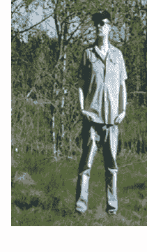
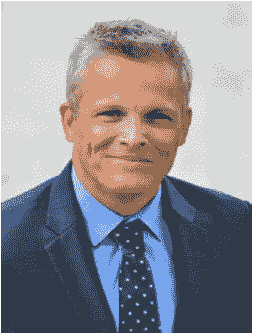
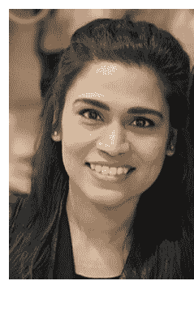

# 索引

## 关于作者



**Robert Ciesla** 是来自芬兰赫尔辛基的自由撰稿人。他曾在多个平台上参与过许多电子游戏的开发。他是《*Game Development with Ren'Py*》（2019）和《*Mostly Codeless Game Development*》（2017）的作者。自中学时读完史蒂芬·霍金的《时间简史》以来，Robert 就对量子力学的世界着迷。Robert 在新闻学学士论文中探讨了如何普及量子物理及其相关领域的核心概念。自那以后他阅读了该领域的大多数相关书籍，并继续探索这一现实领域。

## 关于技术审校



**Paul Love** 是某金融服务机构的首席信息安全与隐私官，已从事信息安全领域近30年。他曾在许多大型组织担任信息安全职位，包括联邦住房贷款抵押公司（Freddie Mac）、安永、微软、斯伦贝谢、Ally Financial 和第五第三银行。Paul 的信息安全职业生涯始于他加入美国海军陆战队，在那里服役八年，最终晋升为中士。

Paul 拥有网络安全理学硕士学位，撰写/合著了九本信息安全和 Unix/Linux 书籍，并担任过十本 Linux 和 Unix 书籍的技术编辑。Paul 持有多项信息安全和隐私认证，包括注册信息系统安全专业人员（CISSP）、注册信息系统审计师（CISA）和注册信息安全隐私经理（CISM）；多项隐私认证包括注册信息隐私专业人员/美国/欧洲/加拿大（CIPP/US、CIPP/E、CIPP/C）；以及其他技术和专业认证。

## 关于技术审校


**Sai Matam** 是一名软件架构师，在软件领域拥有超过20年的多元化经验。他拥有 Osmania University 的工程学学士学位。他的兴趣包括低延迟、高可扩展系统、算法、Java、云和 Go 编程语言。



**Astha Keshariya, PhD, MSC (Honors), MBA,** 在应用密码学和信息安全领域为多个商业和学术组织提供咨询并做出贡献已有16年以上。

此时你应该熟悉另外两个相关术语：*明文* 和 *密文*。前者仅指未加密的消息（例如，“Hello! Apress is the best publisher!”），而后者涵盖加密消息，对于没有解密密钥的人来说，这些消息看起来毫无意义。

现在，首次有记录的隐藏信息实例可以追溯到公元前1900年的古埃及。在一座墓室的墙壁上发现了一系列非标准的象形文字（即埃及书写系统中的字符）。专家们仍在争论这些信息是否包含任何相关信息；它们可能出于娱乐或混淆的目的而创建。

来自美索不达米亚的泥板（其区域对应于现代伊拉克、科威特的大部分地区以及叙利亚的部分地区）表明，约公元前1500年人们尝试隐藏更“严肃”的信息。许多泥板被发现是加密的烹饪笔记。这些显然是重要的国家机密，绝不能落入错误的人手中：帝国曾因更小的原因而崩溃！

古时的强大罗马人也以使用密码学而闻名，创造了一种称为 *凯撒密码* 的装置。它仅仅涉及在双方约定的程度上移动字母表（例如，使用两个字母的右移，使得 A 变为 C，C 变为 E）。尽管在2020年几乎不能代表加密的最新技术，但许多私人通信都是通过这种技术在尤利乌斯·凯撒（公元前100年–公元前44年）及其盟友之间发送的。当然，这也不无帮助，因为他的大多数敌人都是文盲。

在中世纪，密码学的最新技术可以在阿拉伯人中发现。来自伊拉克巴士拉的语法学家 *Al-Khalil*（717–786 AD）撰写了一部关于隐藏信息的开创性著作，题为《*The Book of Cryptographic Messages*》。他的著作以使用排列组合来列出所有可能的阿拉伯单词（有无元音）而闻名。

Al-Khalil 的著作启发了该领域的另一部里程碑式著作，由 *Al-Kindi (801–873 AD)* 撰写的《*The Manuscript for the Deciphering of Cryptographic Messages*》，他是来自伊拉克库法的数学家和天文学家。他的著作于约公元800年出版，很可能是首次详细阐述了 *频率分析* 的概念，该概念至今仍是密码学中的重要概念。我们将在下一节中了解更多关于 Al-Kindi 工作的基础知识。

## 频率分析的基础

频率分析是对加密消息中包含的字母进行研究，以便揭示至少部分明文消息。其余部分应受常识和基本语法支配。现在，大多数语言中某些字母出现的频率是特定的。例如，在英语中，最常见的字母是 E、T 和 A。相比之下，Q、X 和 Z 在英语句子中并不常见。在历史背景下，莫尔斯电码的发明者 *Samuel Morse (1791–1872)* 做了他的部分工作，以发现英语字母表中最常见的字母，以便为其分配最简单的代码。

假设我们要解密一条消息，我们被告知它只包含一个简短的英语句子。知道这一点，我们可以统计地确定消息的某些部分，如果我们幸运的话，可以推断出其余部分。第一步是统计一个字母在加密消息中出现的次数。现在，来看一下我们要解密的密文：

```
KZ GZK ZKGR KKR
```

示例中最频繁的字母是哪个？那就是出现五次的 K。最常见的字母是 E，对吗？将 K 改为 E 得到以下结果：

```
EZ GZE ZEGR EER
```


帮助不大，你可能会这么想。然而，让我们继续。 这里出现频率第二高的字母是 Z，共出现三次。至于英语，第二常用的字母是 T。我们就用它。

ET GTE TEGR EER

这里出现频率第三高的字母是 G 和 R，各出现两次。至于英语，第三常用的字母通常是 A、I、N、O 或 S。我们先用 S，并用它替换消息中的 G。

ET STE TESR EER

我们的直觉告诉我们：这不可能正确。经过仔细考虑（并且可能尝试了所有其他统计上显著的 O、N 和 I 的选择，但都无济于事），我们决定改用 A 来替换 G。

ET ATE TEAR EER

现在我们看到一些模糊类似于英语的东西。让我们运用我们不可思议的推理能力，大胆猜测一下。如果 R 等于 L 呢？

ET ATE TEAL EEL

终于，有一些正确的英语了。哦，那些讨厌的外星人以及它们对我们雄伟的（而且，坦白说，美味的）鳗形目动物的渴望！这是一个简单的频率分析演示。通过结合统计评估和语法感，尤其是事先对消息语言的了解，人们可以用纸笔破解一些较简单的密文。

请注意，我们也可以通过本章前面提到的凯撒密码更轻松地破译这条消息。通过将字母表向右切换六次（即 A 等于 G，C 等于 I），我们就会得到相同的结果。

值得注意的是，埃及数学家 *Al-Qalqashandi*（1355–1418）首次描述了 *多字母表系统*，它极大地削弱了经典频率分析的有效性。多字母表系统是指在明文消息中使用多个字母/符号对应一个字母表的方法，以在解密过程中造成进一步的混乱。

## 隐写术的奇妙之处

*隐写术* 是将消息或图像隐藏在另一条消息或图像中的技术。同样，隐写术这个词来自希腊语，由 *steganos*，意为隐藏，和 *graphe*，意为书写 组成。虽然该术语首次由约翰内斯·特里特米乌斯（Johannes Trithemius，1462–1516）使用，他是一位早期的德国密码学家和本笃会修道院院长，但很可能隐写术的历史要久远得多。特里特米乌斯于 1499 年撰写的开创性三卷本著作 *Steganographia* 直到 1606 年才出版。表面上看它似乎涉及魔法和灵体，但它可能是为了隐藏和展示密码方法的使用而写成的。学者们对此仍持有不同看法。

有趣的是，英国哲学家和政治家弗朗西斯·培根（Francis Bacon，1561–1626）在 1605 年就开发出了一套强大的隐写术系统，被称为 *培根密码*。它不是通过文本内容来隐藏消息，而是通过其呈现方式（即字体）。培根在其 1623 年的巨著哲学作品 *De Augmentis Scientiarum* 中以视觉方式详细阐述了他的隐写术方法。

在实践中，经典隐写术包括诸如隐形墨水和正确解读字体以向知情者传递消息等方法。现代方法包括在图像文件以及几乎任何类型的文件中隐藏消息；数字设备和格式非常适合这些技术。在此背景下也可以利用音频和视频。数字隐写术在 1980 年代中期兴起，并且在可预见的未来不会被放弃。国家机密和机密军事情报将继续通过这种方法分发。

## 欧洲密码学的发展

欧洲也在密码学科学方面做出了巨大贡献。*莱昂·巴蒂斯塔·阿尔贝蒂（Leon Battista Alberti，1404–1472）* 是一位意大利建筑师和作家，他设计了自己的密码工具，被称为 *阿尔贝蒂圆盘*。该装置使用多字母表系统，正如最初由 Al-Qalqashandi 引入的那样，由两个相连的圆盘组成，每个圆盘分为 24 个格子。在不知道其内部工作原理的情况下，该圆盘是不可能被破解的。当时，它是应用密码学的革命性成果。

来自荷兰的奥古斯特·克尔克霍夫斯教授（Auguste Kerckhoffs，1835–1903）在 1883 年发表了两篇文章，被认为是该领域的经典之作。他的作品《军事密码学》刊登在法国的 *《军事科学杂志》* 上。克尔克霍夫斯的文章详细阐述了六项实用密码设计的原则，今天仍然相当相关。它们如下：

- 1. 该系统应是，如果不是理论上不可破解，至少在实践中不可破解。
- 2. 系统的设计不应要求保密，并且系统被攻破不应给通信双方带来不便。
- 3. 密钥应无需笔记即可记住，并且应易于更改。
- 4. 密文应可通过电报传输。
- 5. 设备或文件应便携，且可由单人操作。
- 6. 系统应易于使用，既不需要了解冗长的规则列表，也不涉及精神负担。

原则第 2 条尤其相关；它也被称为 *克尔克霍夫斯定律* 或 *克尔克霍夫斯公理*。它指出，密码系统绝不应在除解密密钥之外的所有方面公开时仍存在漏洞。虽然 *安全通过模糊（STO）* 在一些政府机构中仍然流行，但在今天的密码学家中大多已是过时的方法。模糊根本不应被视为设计安全系统时的一个因素。如果政府公务员叛逃，例如，你的系统最终会被攻破。STO 最多提供一层伪安全。

随着计算机变得足够先进，能够在几毫秒内处理复杂计算，一些克尔克霍夫斯的原则已不再有效。此外，到 2020 年，已没有多少人使用电报了（尽管有一家名为 iTelegram 的公司成立了）。

## 经典密码学的终结

前几节中描述的时代和技术构成了被称为 *经典密码学* 的概念。正如你可能注意到的那样，它主要基于语言学和物理/视觉方法的各个方面。经典密码学影响的信息类型是有限的。但我们现在正进入现代密码学时代。这有点复杂——也令人兴奋。

## CHAPTER 1　 数字加密的第一个时代

## 数字密码学革命

像现代生活的许多其他领域一样，计算机彻底改变了密码学。事实上，它们提供了前所未有的可能性，提供了使用传统方法几乎不可能实现的完全安全的消息传递。最终，密码学与尖端科学相结合，包括量子物理学。但我们还不到那里；让我们先回顾一下我们是如何走到这一步的。

1943 年在第二次世界大战期间，英国密码学专家（有时被称为“密码破译者”）制造了第一台可编程数字计算机，*巨像机*。它主要用于拦截德国军事情报，但也推动了电子学新时代的到来。其德国对应物是 *洛伦兹密码*，这是一台令人畏惧的机器，其加密情报的记录几乎完美无缺。然而，由于人为错误，洛伦兹密码的工作方式最终被英国破解，而他们从未真正拿到过一台。巨像机本身直到 1970 年代中期才成为国家机密，其中许多单元在前十年已被英国政府销毁。

奇怪的是，直到 1970 年代，学术界才开始大规模认真对待密码学。企业很快跟上这一趋势；IBM 是首批开发密码系统和技术的大型公司之一。它们的工作对美国政府的数据保护政策产生了重大影响。

### 数字加密 101

数字领域的加密基本上包含三件事：*加密方法*、*加密密钥* 和 *解密密钥*。加密方法是通过数学手段将消息或文件打乱，使其对第三方看起来完全随机。只有拥有解密密钥（即密码）的一方才能访问文件的明文内容。


现在，世界上广泛使用的两种加密方法（不要与加密算法混淆，加密算法是另一个概念）：对称加密和非对称加密（即公钥密码学）。前者使用单一密钥对数据进行加密和解密。后者使用两个独立的密钥：一个公钥和一个私钥。在这种非对称方法中，公钥用于加密数据，而私钥用于解密。在一个经典示例中，鲍勃使用爱丽丝的公钥加密一些数据。收到后，爱丽丝然后使用她的私钥解密内容。

在大多数情况下，使用公钥无法发现私钥。对称密码学在处理大量数据时已知速度更快。然而，非对称方法提供了额外的安全性。

现在，一个比特是数据科学中最小的测量单位，表示为 1 或 0。加密标准的强度通常体现在其所携带的比特数量上。加密标准范围从 40 到 256 比特及以上。接下来将讨论其中几种，并将在本书后面对其进行更详细的阐述。

## Diffie–Hellman 密钥交换

最早的公钥加密协议之一是 Diffie-Hellman，以密码学家 Whitfield Diffie 和 Martin Hellman 的名字命名。该协议允许两个事先互不了解的各方创建一个共享的秘密密钥/密码。过程是在不安全的通道上进行的。一旦共享密钥形成，任何通信都可以用它在单独的加密方法中进行保护。Diffie-Hellman 方法于 1976 年发表。

## 结语

读完本章后，你应该对密码学的历史以及它与当今电子产品的关系有了了解。你吸收了以下信息：

- 密码学的简明历史
- 基础频率分析
- 数字密码学的初始阶段
- 当今加密技术的基础

在下一章中，我们将开始全力探索数字加密的世界。特别是，你将了解备受推崇的 RSA 算法。

较新的算法。微软就是一个明智的例子，它在 2019 年将其 Office 365 平台上的 Triple DES 予以淘汰。不幸的是，它在一些电子支付服务中仍然在使用，包括截至 2020 年 Visa 和 Mastercard 的智能支付卡类型。
