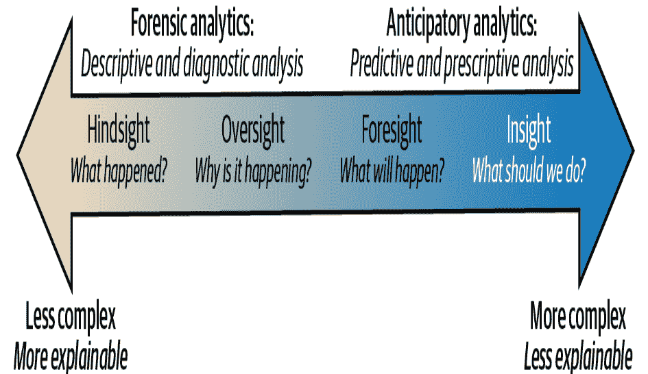
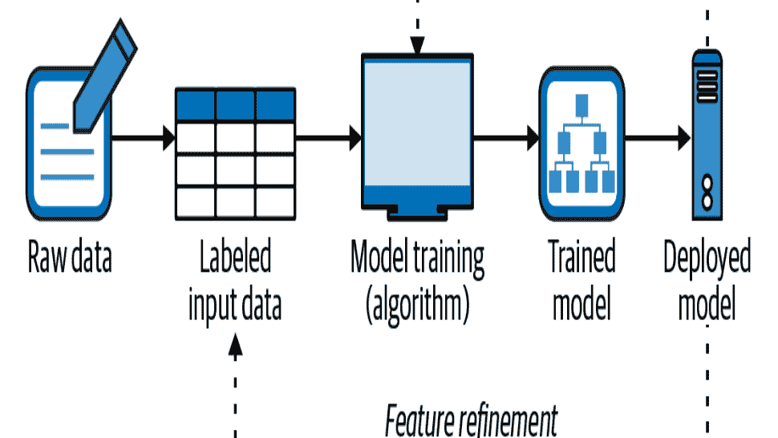
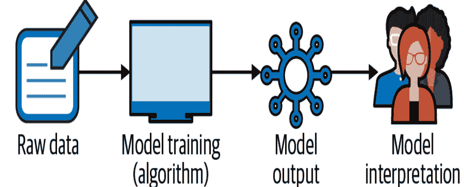
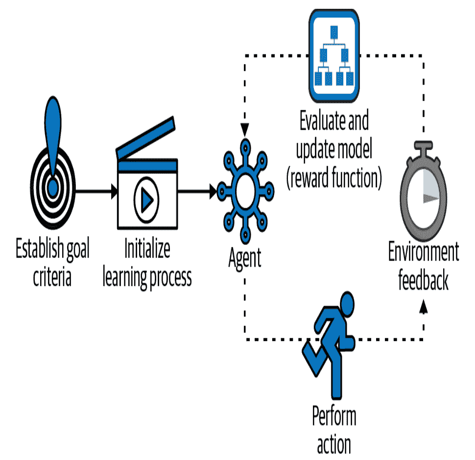
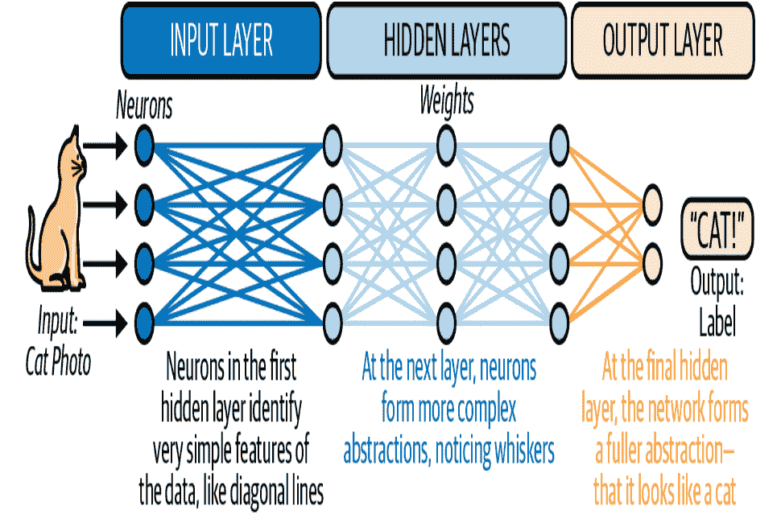
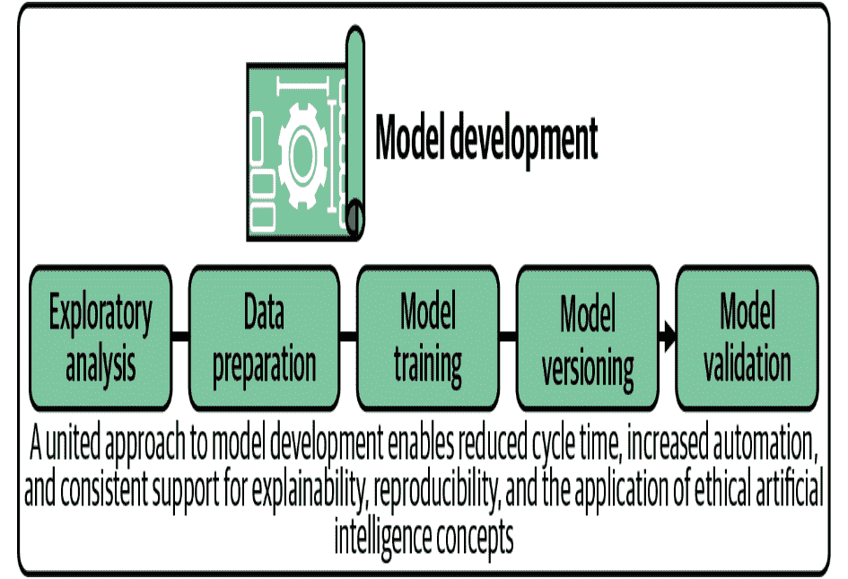
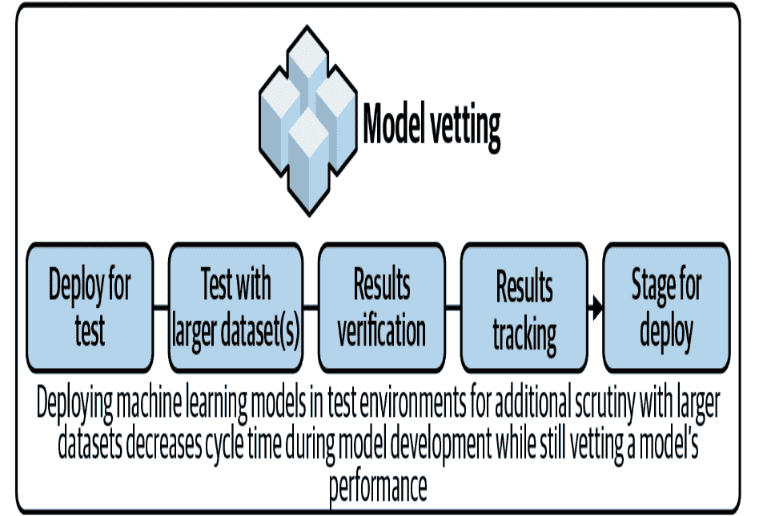
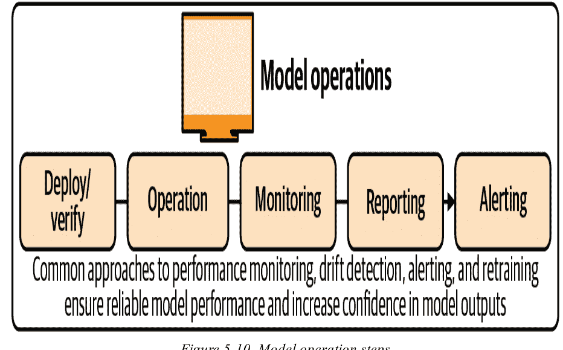

# 第 5 章. 机器学习 (ML)

AI 依赖于大量历史数据和先进的 ML 方法来生成洞察。在上一章中，我们重点关注数据对贵组织在实施 AI 时取得成功的重要性。如果数据是为 AI 应用提供动力的燃料，那么 ML 就是其引擎。

前两章讨论了如何将 AI 分析开发与 DataOps 以及关键利益相关者（如数据所有者和风险经理）进行协调。本节将讨论 AI 开发本身以及其工具和流程如何向更可持续、可扩展和协调的能力演进。

在考虑 ML 如何融入更广泛的 AI 领域时，首先了解数据分析谱系非常重要。图 5-1 说明了传统统计分析（即取证分析，检查过去和现在现象）与预测性分析（即前瞻性分析）之间的差异。

图 5-1. 分析的复杂性与可解释性

每种分析方法都与特定的挑战相关联，更先进的方法提供了通常与稳健 AI 能力相关的决策支持和认知分析。关键区别在于复杂性与可解释性之间的相互作用。在大多数情况下，取证分析远不如预测性分析复杂且更易解释，而预测性分析正迅速变得极其复杂，解释起来也困难得多，可能导致可解释性降低。尽管如此，行业仍在大量投资并推进解释这些复杂模型的能力。

在实践中，ML 通常作为推动 AI 能力的核心机制，利用企业范围的数据来构建和验证复杂模型。如第 2 章和第 3 章所述，管理复杂性和可解释性是 ML 的关键设计考虑因素（指导诸如训练算法、参数等决策）。

同样，我们开始在日常生活中看到的许多最受欢迎的 AI 应用——智能助手、实时物体跟踪和自动驾驶汽车，仅举几例——都由 ML、神经网络和深度学习能力驱动，这些技术更难以解释和管理。

### 神经网络

一系列算法，通过模仿人类大脑运作的过程，尝试识别数据集中潜在的关系。

### 深度学习

利用神经网络实现 AI 能力（如计算机视觉和自然语言处理）的一组专门的机器学习方法。

在本节中，我们介绍 ML 模型的概念以及用于解决特定数据结构和分析目标的不同 ML 框架。本节并非旨在成为 ML 的功能性“如何操作”指南，但扎实的实践知识将帮助您更好地领导组织内的 AI 采用。

### 什么是 ML 模型？

业务分析，通常简称为“分析”，是由分析师或开发人员将业务规则编码到软件中，随后将数据转换为有用的洞察以指导决策。相比之下，ML 模型使用学习算法通过准备好的训练数据生成业务规则。

### 训练数据

用于教导 ML 模型进行预测或学习所需任务的初始、通常较大的数据集。这可能包括输入（原始数据）和输出（标签）或未标记数据。

对于监督学习和强化学习技术，这些学习规则被编码在一个特殊文件中，称为模型。由于它们旨在由机器编写和解释，因此这些模型比业务分析更难阅读（解释）。

与传统分析不同，将用户数据输入分析并产生洞察的行为称为推理。更新 ML 分析是通过原始训练数据、新/更新数据和训练模型的一些组合来完成的。

传统上，组织将 ML 模型视为黑盒，仅对其输入和输出进行解释即可出于所有在第 3 章中描述的原因，成熟的组织正在放弃这种黑盒方法，转而采用可解释的结果。¹ 从领导力角度来看，这种向可解释性的转变将继续改变短期内结果的记录方式以及长期内整体设计流程。

ML 模型也很独特，相似的模型和数据可能产生截然不同的结果。相同的源代码编译成相同的应用程序，但相同的训练数据会根据训练参数产生多种模型。由于很难提前预测最佳配置，因此最佳实践通常是使用许多不同的配置进行训练，然后在训练期间比较每个结果的性能。

对于更复杂的 ML 方法（如神经网络）尤其如此，这也解释了这些技术需要大量计算和数据存储开销的部分原因。此外，即使对训练数据的最小更改也可能对最终结果产生有意义的影响。

这些趋势导致可能存在数百甚至数千个单独的 ML 模型版本。只有少数会投入运行，但许多（或全部，取决于您的目标）都值得保留，以提供对训练过程的额外洞察。您应根据分析必须的可解释程度以及您能多紧密地控制运营和训练数据输入来选择保留多少数据和模型数量。

与任何其他形式的软件一样，ML 模型必须经过记录、测试和版本控制，以帮助团队维护对其结构和功能的了解。与传统分析不同，不可能拆分、记录或独立测试模型的内部结构。相反，我们必须依赖周围的文档、测试和元数据。虽然并非完全独特于 ML 分析，但元数据在描述模型行为方面发挥的作用比在普通（或经典）软件中更大。MLOps（在“机器学习运营 (MLOps)”中讨论）可以帮助进行此文档、测试和版本控制。

DataOps 提供开发和训练 ML 模型的数据管道。然后，MLOps 提供集成和自动化的流程，并具有记录的 CI/CD 流程，以将这些模型集成到利用所述模型的大型软件应用程序中，使用 DevSecOps。这种方法确保利用集成模型的 resulting 软件应用程序是安全的，并且数据科学家或软件工程师可以快速根据需要更新软件和模型。这些组合框架使数据科学从业者能够持续改进模型及其整体分析方法。

### ML 方法论

就像为特定工作选择合适的工具一样，了解支持我们分析工作的算法非常重要。特别是在 ML 的情况下，我们使用这些底层流程来描述和定义每种独特的 ML 方法。通过了解这些技术，我们可以解决任何假设并确定适当的性能评估指标。

理解这些技术还能让我们在将模型投入生产环境时，考虑模型的泛化能力（即将每个模型应用于不熟悉的数据集的能力），并更好地监控和改进整体设计选择。

*监督学习*或许是 ML 最常被讨论的例子。通过这种技术，算法用于分析数值或标记数据（例如，输入-输出对、带标签的图像或其他紧密关联的信息）。常见应用包括用于预测连续数值（如股票价格）的回归模型，以及用于从运营数据特征中预测类别（如文件是否恶意）标签的分类模型。

监督 ML 将数据拆分为输入（称为“特征”）和输出（分类中称为“标签”，回归中称为“目标”），并尝试从前者预测后者。监督学习的关键优势在于，它使我们能够将分析模型聚焦于特定任务，以获得高准确性、精确度和召回率。² 这使得监督学习成为大多数运营用例中最实用的技术。

## Accuracy

机器学习模型产生精确结果与近似结果的能力。它衡量模型在正确预测所有真正例和真负例方面接近的程度。

## Precision

对机器学习模型置信度的衡量。精确度是通过将真正例的总数除以（真正例 + 假正例）来计算的。换句话说，对于模型预测为“阳性”的所有数据，其中有多少比例实际上是阳性的？

## Recall

对机器学习模型分类性能的衡量。召回率（也称为灵敏度或“真正例率”）是通过将真正例的总数除以（真正例 + 假负例）来计算的。换句话说，对于所有实际为阳性的观测值，模型正确预测为“阳性”的比例是多少？

监督学习的运营成功推动了对可解释性和可持续性的额外研究和开发，目前远超其他 ML 技术。监督学习与其他 ML 方法之间的关键区别在于通过训练其权重（即学习参数）的过程来优化模型，如图 5-2 所示。

Figure 5-2. Supervised ML process

在监督学习中，标记的输入数据被输入到算法中以训练模型，其中它通过与指定标准进行测试来完善算法的“加权”。用于完善模型的过程植根于统计交叉验证，其中数据被划分为两个随机子集——一个用于训练模型，另一个用于测试其性能。虽然具体细节会迅速变得极其技术化，但要点是：训练充分后，我们可以通过重新设计训练数据特征并在必要时重新训练模型，同时在 ML 生命周期中监控其行为，来完善和改进已部署的模型。

第二种 ML 技术，无监督学习，直接从数据中存在的模式训练模型，而不是其他类型 ML 中发现的输入-输出方法。无监督算法的关键优势在于其发现开发人员事先不知道的模式的能力，为探索提供了新的途径。这种方法的缺点是，这些算法通常在生产数据中发现大量模式，除了抽象的数据拟合元数据外，没有集中化的方式来判断哪些模式对特定用例有价值。此外，与监督模型相比，无监督学习方法本质上更难解释，因为它们通常利用缺乏指定分类或特征之间输入-输出关系的训练数据。这种高层级过程如图 5-3 所示。

Figure 5-3. Unsupervised ML process

虽然无监督学习技术肯定被用作建模的独立方法（例如，异常检测和数据聚类），但我们经常将这些技术与监督流程结合使用，以简化问题空间或通过探索性分析获得对数据的额外洞察。

第三种技术是强化学习，它提供了一种在指定环境中训练模型的新方法。虽然与监督学习有相似之处（例如，围绕相关惩罚或奖励指标进行优化），但强化学习对模型完善采取了不同的方法。诸如 Q-learning 之类的方法允许所谓的“智能体”（即软件机器人）直接与其环境（物理、虚拟或两者兼有）交互，以完善其行为，目标是迭代实现指定目标。底层算法包括支持向量机（SVM）和神经网络（在本节后面定义），

生成一个模型来指导智能体的行为，并随着在环境中经验的增加而持续更新。

此外，该技术被认为比纯无监督方法更具可解释性。在强化学习过程中，我们逐步将训练数据输入模型，产生由奖励函数评估的结果，然后以奖励函数结果的形式向模型提供反馈，并将其与后续训练数据结合以持续完善模型参数。

如图 5-4 所示，强化学习过程始于用户设定目标，这些目标成为 ML 算法的主要目标。当我们初始化此过程时，智能体对实验规则一无所知，需要多次训练运行后才能提高其性能。随着智能体的模型基于环境中的奖励反馈持续更新，它不断完善其性能，从以前成功的方案中学习，同时淡化不太有用的策略。这种方法最初通过应用于国际象棋、AlphaGo 和星际争霸等游戏而声名鹊起，在执行大量训练后，模型能够在这些游戏中超越专家人类玩家。

Figure 5-4. Reinforcement ML process

如图 5-4 所示，强化学习过程始于用户设定目标，这些目标成为 ML 算法的首要目标。当我们初始化此过程时，智能体对游戏规则完全不知情，需要多次训练运行后才能提高其性能。随着智能体的模型基于环境中的奖励反馈持续更新，它不断完善其性能，从以前成功的方案中学习，同时淡化不太有用的策略。这种方法最初通过应用于国际象棋、AlphaGo 和星际争霸等游戏而声名鹊起，在执行

大量训练后，模型能够在这些游戏中超越专家人类玩家。

强化学习的主要问题是，并非所有用例都允许良好的奖励函数，而且奖励函数可能比给定用例的训练数据更难解释。尽管其处理过程更为晦涩，强化学习在提供适当且可衡量的奖励函数的用例中提供了惊人的结果，例如机器人技术和电子游戏。强化学习的另一个好处是，它可以产生结构化训练数据，以支持在目前尚无训练数据的应用中进行模型开发。

*神经网络*是一种 ML 实现，使用分层网络架构（即神经元和权重）执行特定功能，将输入通过网络的层传递以计算感兴趣的输出。虽然神经网络也利用统计方法来评估给定输入，但它们是独特的，因为其内部过程在很大程度上是对传统计算的非线性抽象。神经网络包含一组参数，称为权重和偏置，通过给定标准训练以优化其输出。虽然神经网络在复杂性和抽象层面上不断增长，但在每种情况下，网络的架构决定了其功能。

神经网络本身并不指定用于训练它们的方法。它们能够交替遵循监督、无监督和强化学习范式。

例如，图 5-5 中的 *卷积神经网络* 可以摄取机器可读图像，训练算法评估编码像素之间的潜在模式和关系，然后以给定程度的确定性对图像进行分类。

Figure 5-5. Neural network example

开发神经网络的结构是一个困难且耗时的设计过程。为了最大限度地减少时间和精力的投入，组织通常会通过利用结构信息并从不同的训练数据中重新生成权重信息，对现有的神经网络进行定制以适应特定应用。这种过程称为迁移学习，是许多组织使用预训练神经网络并利用之前为类似应用执行的广泛训练的最可行方式。

如前所述，模型根据学习技术以多种方式进行更新。在某些用例中，不希望重新加载最初用于创建模型的所有训练数据来更新模型。在这种情况下，可以使用在线学习技术，允许训练数据逐步添加到模型中，而无需从头开始重新训练。

更极端的情况是分布式/联邦学习。最近在所谓的“边缘”技术方面的进展，例如广泛使用的手机和其他物联网设备，使得使用分布式或远程架构进行 ML 开发成为可能。

分布式学习与边缘设备并行进行：在合并结果以结合其整体知识之前，训练在多个在线位置同时进行。分布式学习的关键优势在于能够使模型能够在低功耗边缘设备上进行推理和训练，同时在单个模型中全局组合大量信息。边缘学习的缺点是学习过程变得越来越动态、复杂且难以策划。这种环境会产生极其难以在实时预测、检测和纠正的复杂场景，以便将分布式学习合并为有效的全局模型。

检查图 5-6 中概述的架构，分布式学习的第一个步骤涉及将预训练的“伪模型”从中央枢纽推送到边缘设备。一旦在边缘设备上，此初始模型会通过边缘可用数据进行改进，在本地设备上执行推理和训练更新。在这些基于边缘的模型经过充分训练和更新后，我们会在中央枢纽中对其进行聚合，并对模型进行版本控制，以便最终重新部署到边缘设备。中央枢纽通过使用 MLOps 方法来监控模型性能，从而协调这些迭代改进。

## Data collection, labeling, local training, and deployment
## Orchestration
## Aggregate

Figure 5-6. Distributed learning example

## ML Advanced Topics

在讨论了传统的 ML 建模方法及其注意事项之后，我们应该暂停一下，审视新兴的前沿领域。这些专业应用利用复杂的算法，结合并进一步抽象 ML 方法。以下每种方法都使更成熟的 AI 能力成为可能。然而，与所有技术一样，我们建议您在考虑可解释性和可说明性的更广泛影响时谨慎选择。由于这些技术内部的复杂架构，我们通常无法“打开这些模型的黑箱”，这迫使我们在开发和生产环境中验证其可靠性。³

在过去几十年中，ML 领域最具影响力的发展之一是深度学习，这是一组利用多层“深度”神经网络执行高度专业化任务的方法。用例包括图像分类、机器翻译和语音识别。实际上，深度学习利用多种 ML 方法论（例如，应用无监督方法转换数据作为神经网络的输入）来设计特征并提高模型性能。这些复杂模型通过利用大量数据来训练和优化深度神经网络的参数来实现 AI，其特定架构能够实现超过人类能力的性能。与任何 ML 方法一样，算法的底层结构决定了其专业任务的功能优势，这凸显了考虑复杂深度学习模型负责任的实现、资源需求和可解释性的必要性。

自然语言处理是一个包含手动方法和 AI 应用于分析自然语言数据的广泛领域。使机器能够解析文本数据是自然语言处理的关键组成部分，如果没有它，我们就无法摄取训练模型所需的数据。传统上，挑战根植于人类语言的主观性以及实现语义泛化的难度，特别是在处理行话或在结构差异较大的语言之间进行翻译时。⁴

幸运的是，最近的研究⁵提供了封装语言的新方法，随着性能的提高，需要更强大的基准指标。当前自然语言处理应用涵盖文档分类、情感分析、主题建模、神经机器翻译、语音识别等。随着该领域的不断成熟，您可以预期会出现越来越新颖的应用，以促进自动语言理解。

## ML Life Cycle

将 ML 投入运营包括四个主要阶段：业务分析、模型开发、模型验证和模型运行（例如，在生产中监控您的模型）。以通用方法、实践和理解执行这些组件，可以使组织在缩短 AI 系统上市时间业务价值的同时扩展 ML 应用。为了实现这种共同理解，有助于将每个组件分解为各自的活动，并讨论每个组件所呈现的方法、方法和机会，如图 5-7 所示。

## Business analytics

Gain business understanding

Define project plan

了解业务目标、项目要求和业务功能可推动机器学习的实际业务价值并提高客户满意度

## Model development

Exploratory analysis

Data preparation

Model training

Model versioning

Model validation

统一的模型开发方法可实现周期时间缩短、自动化程度提高，并为可解释性、可重复性和道德人工智能概念的应用提供一致支持

## Model vetting

Deploy for test

Test with larger dataset(s)

Results verification

Results tracking

Stage for deploy

在测试环境中部署机器学习模型以使用更大数据集进行额外审查，可在仍对模型性能进行验证的同时缩短模型开发周期时间

## Model operations

Deploy/ verify

Operation

Monitoring

Reporting

Alerting

对性能监控、漂移检测、警报和再训练的通用方法可确保模型性能可靠并提高对模型输出的信心

Figure 5-7. ML life cycle

## Business Analysis

业务部门越来越多地投资于或确定 ML 技术作为潜在增长领域。这些业务部门希望利用数据并发现模式以提高效率并实现更明智的决策。一个成功的机器学习项目分析业务目标，以揭示影响机器学习交付成果结果的显著因素。这一步至关重要，以确保您的机器学习项目产生正确的答案，直接解决您最初设法解决的业务问题。

您应与主题专家和最终用户密切合作，以更好地了解他们在当前环境中如何执行其活动。在此阶段进行的访谈和咨询将帮助您更好地了解需要解决的业务问题、要达到的目标、任何适用的约束或依赖关系以及期望的结果。

然后应制定项目计划，定义机器学习如何实现业务目标。对所有利益相关者而言，同意指定如何衡量结果以及从业务角度看什么构成成功的标准非常重要。假设应记录下来，以帮助指导下一阶段的后续模型开发过程。所有步骤都应定义，包括项目范围、持续时间、所需资源、输入、输出和依赖关系等项目细节。

## Model Development

为业务使用开发 ML 需要增量步骤（概述在图 5-8 中）。由于此开发过程涉及界定问题、进行实验、审查结果和完善方法，因此很难以直接的方式描述。虽然五个步骤中的每一个可能在不同时间发生，但它们对整体过程的贡献保持一致。

## 模型开发

统一的模型开发方法能够缩短周期时间、提高自动化程度，并为可解释性、可重复性以及伦理人工智能概念的应用提供一致的支持

图 5-8. 模型开发步骤

一旦项目目标设定完毕且业务问题得到理解，就需要进行探索性分析，以识别和收集所有相关数据并评估其满足预期业务目的的能力。该过程旨在对可用数据形成全面视图，并使用分析技术探索数据中的重要关系。

探索性分析还有助于识别可能阻碍模型实现预期业务目的的数据缺陷。数据探索分析我们现有的可用数据，同时也为开发有用模型所需的数据类型提供信息。

数据准备阶段将数据转换以供机器学习算法使用。你需要检查诸如缺失信息、重复/无效数据或数据不平衡等问题。

该阶段还包括帮助准备数据的技术，包括：从数据集中删除重复/无效记录；解决类别不平衡问题（当某一类数据[正例]的总数量远少于另一类数据[负例]的总数量时）；使用额外数据源进行丰富；以及选择数据特征并执行特征工程（以便结合多个特征获得额外的训练收益）。该过程旨在帮助确定在开发预测模型时所需的输入变量。在模型开发的此阶段，你的领域专家非常宝贵。

*模型训练*在数据准备好后开始。在此步骤中，使用训练数据和验证数据来计算优化性能的模型参数。在初始化模型训练过程之前，有必要定义要训练的模型及其相应的配置。模型训练的通用流程通常可跨不同算法使用。

对于大多数类型的机器学习，通用训练流程首先是随机初始化模型及其相关参数。然后使用数据对该模型进行训练，使其微调，通过为训练数据集中每个条目生成和比较预测结果。使用这些预测结果，模型训练会计算每个条目（例如案例、记录、图像）的模型预测与真实值之间的误差和其他性能指标。计算出的误差，通常称为“损失”，随后用于调整模型参数以优化所需指标。训练脚本将继续循环上述步骤，直到达到期望性能或达到最大训练步数。

下一步，*模型版本控制*，对于确保工作流程可解释且可复制至关重要。在此步骤中，模型基于用于训练的数据、所选规范（例如学习率、批大小、epoch 数量）、⁶以及 resulting 输出进行版本控制。应为每个模型分配一个标识符以提供上下文。版本控制使你的团队能够跟踪模型血缘和谱系，这将随着项目的推进而改善结果。

以下是我们在开发工作中建议跟踪的一些项目：用于训练和运行模型的软件；开发环境；模型架构；使用的训练数据；模型参数；以及训练期间收集的工件，例如报告和日志文件。该过程应标准化并在每次模型训练事件中执行，参数存储在通用存储库中。

开发的最后一步，*模型验证*，是通过使用验证数据集来审查模型的训练，以确定是否需要额外的性能调整。重要的是，该验证数据集不应包含模型训练阶段使用过的任何数据，以确保验证指标完全独立于训练过程。

在验证阶段，你创建的模型用于为测试数据集中每个条目做出预测。计算预测误差和其他模型性能指标，以确保在部署模型之前观察到的模型性能满足用户定义的要求。

## 模型审查

机器学习生命周期的下一步是审查你的模型，如图 5-9 所示。审查训练好的机器学习模型是实现机器学习操作化的关键却常被低估的一步。严格的模型审查使本地数据科学团队能够在低风险环境中发现代价高昂的错误并加以纠正。一旦在本地执行审查，就会在生产环境中复制。部署正常工作的模型将建立组织对已部署系统的信任，而不仅仅是对人工智能项目整体的信任。

图 5-9. 模型审查步骤

满足初始性能要求的训练模型将被*部署用于测试*，部署到类似生产的环境中进行严格的测试和评估阶段。此步骤涉及进行计算和性能测试以确保模型满足要求。为保持一致性，将模型部署到测试环境应与将模型部署到实际生产环境的步骤相平行。你的开发团队应与领域专家和功能用户密切合作，以确保测试环境反映实际生产环境。

与模型开发阶段类似，*验证结果*非常重要。此步骤确保模型性能符合预期且未出现性能下降。*根据我们的经验，大多数预生产模型问题都是在此步骤中发现的。*如前所述，至关重要的是在此阶段发送给模型的数据应代表模型在生产环境中分析的数据。

结果验证过程的一部分是探索模型如何处理格式错误或不合适的其他数据。模型应能够处理不合适的数据并确保重要数据不会丢失，向软件开发团队发送适当的错误通知，并在遇到错误后保持功能正常。

*结果跟踪*对于确保你的模型得到有效审查和审计至关重要。存储和审查历史模型输出的能力使领域专家和功能用户能够进行定期审查，确保模型做出可接受且适当的预测。

最后一步，*部署准备*，将模型准备好以便移至生产环境。一旦模型部署到生产环境，模型即被视为“上线”，将可供所有授权终端用户和系统使用。数据科学家、软件工程师以及所有适当专家都应被咨询，以确保模型以符合生产环境预期的方式部署。

## 模型运行

机器学习操作化工作流的最终目标是成功部署并平稳运行功能良好的模型。理想的模型在请求时及时向终端用户提供预测，自动监控模型性能和使用情况，并通过报告和警报机制通知人们相关模型活动。简而言之，成功的部署意味着你的机器学习应用程序按预期运行，并在需要你的关注时提醒你。模型运行（如图 5-10 所示）将使你满足这些需求。

图 5-10. 模型运行步骤

将模型操作化的第一步是将模型部署到生产环境并验证模型已成功转移，且在预期环境中运行模型时不存在问题。部署验证通常通过在部署后密切监控模型来进行，以确保其接收、分析和返回适当的数据。此步骤还涉及验证输入数据格式是否正确并分析输出的正确性，以确保未发生模型性能下降。这些测试最好由软件工程团队在部署后立即在生产托管环境中执行。

运行步骤涉及在需要时执行模型。在此步骤中，软件工程团队必须确保部署模型的各个方面按预期工作。任何系统问题都应根据其重要性顺序进行修复，以确保模型继续按预期运行。该过程通常需要使用定期安排的系统自动化测试，验证模型响应能力，确保在必要时对模型进行重新训练，并验证模型对摄入格式错误或不合适数据的弹性。这些事件导致

系统警报可在必要时请求人工检查，以及一个支持请求系统，允许终端用户提交帮助工单。

已部署模型的平稳运行需要强大的 *监控* 能力。已部署的监控系统应能够跟踪模型输入和输出，捕获软件环境产生的任何警告或错误消息，计算异常模型活动（例如，漂移检测分析、敌对 AI 攻击检测），并将所有相关信息转发到系统的报告和警报接口。

对已部署系统的有效监控需要多个组件系统无缝协同运行。最好通过尽可能自动化系统来实现。鉴于许多 AI 系统运行的速度和规模，仅依靠人工监控和分析来及时捕获所有必要细节是不够的。因此，需要自动化监控任务来执行所需的监控活动，并在需要时运行。这些自动化监控任务的所有结果都会被报告，并在认为必要时发送警报。

*报告* 允许对已部署模型进行人工检查。许多 AI 系统运行的速度和规模可能使人工实时审查模型性能变得不切实际。然而，定期时间间隔的自动化报告将使用户能够验证系统是否按预期工作。这些报告也可以被其他自动化系统用于监控已部署模型。这些报告使用视觉吸引力强的格式进行检查，例如仪表板、电子表格或文档，以提供用户洞察。

*警报* 模块负责创建有关已部署系统状态的实时通知。这些通知旨在要么提醒人员立即审查系统，要么创建微型报告以包含在自动化系统日志中。需要警报通知的事件最初由模型监控模块标记。这些标记的事件会被警报模块接收，在那里警报会根据预写的通知模板起草。然后这些通知通过消息服务发送给收件人。根据需求，通知可以作为短信、电子邮件、Slack 消息、应用推送通知或自动电话呼叫发送。

## 机器学习运维（MLOps）

在软件开发历史的早期，工具、自动化和流程优化方面的创新几乎完全专注于高效交付新功能。DevOps，随后是 DevSecOps，建立了框架，引入了类似的创新，以在功能与自动化、可靠性、分布式开发和安全等优先事项之间取得平衡。

如本 ML 部分所述，ML 模型的开发、训练、测试、部署和监控有许多步骤。在许多情况下，这些步骤是手动执行的。然而，这极大地降低了扩展模型开发流程的能力。MLOps⁷ 通过集成和自动化为此问题提供了一种潜在的解决方案，从而在 ML 模型的开发和训练中实现更高的效率。

MLOps 与 DevSecOps 类似，但有一些独特差异（例如，使用生产数据进行模型训练、模型的快速迭代、考虑偏差、需要持续监控），你必须考虑这些差异。今天的组织主要优先考虑 AI 模型的开发，而不是开发这些模型所使用的流程。通过使用快速扩展的开源和商业解决方案集成这些手动流程，MLOps 将使组织能够扩展其 AI 开发管道以满足未来的需求，并在企业级运行。

## 可扩展训练基础设施

AI 模型训练目前需要更大的训练数据集（例如，流式、物联网）、不断增加的建模方法（例如，监督式、无监督式、强化学习），以及由更多训练参数组成的更复杂模型（例如，深度学习）。随着这种增长，我们看到了对更强大和可扩展训练基础设施的不断增长的需求。该基础设施需要额外的自动化来评估所需的模型范围，同时收集训练结果以便在模型版本和方法之间进行比较。

MLOps 将更传统的 DevSecOps 技术（如持续构建系统、分布式处理和“即服务”（AaS）基础设施）与 ML 特定方法（如模型偏差、模型训练、硬件加速（例如，分布式处理、GPU）、模型优化基础设施（见下一段）和模型监控）相结合。通过这一过程，模型可以更快地开发，并遵循标准流程，同时详细记录结果。

## 模型优化基础设施

在 ML 的早期，模型通常是单独且不频繁地训练（每周、每月），这是由于硬件限制和不成熟的优化技术。

今天，我们拥有操作需求和计算资源，可以更频繁地（每日、每小时、持续）训练模型，并在大批量（10 到 100 个）中使用可扩展训练基础设施、现代优化技术和可扩展计算基础设施。此外，团队越来越多地将 AI 模型部署到各种边缘托管环境中。如果模型要在这些边缘环境中有效运行，你必须优化它们以在这些较低容量的硬件配置上运行。

MLOps 可以通过与可扩展训练基础设施集成并协调训练模型的积累、存储和比较来帮助开发人员。此外，模型的集中存储和分析可以随着时间的推移提供有关模型开发的宝贵见解，提供一种评估模型和数据漂移的方法。此标准流程还支持根据目标托管环境优化训练模型，以确保模型能够在生产中有效运行。从长远来看，这些模型优化存储库也可能在可解释性方面发挥重要作用，因为在此过程中收集了元数据。

## 模型部署基础设施

对于许多 AI 团队而言，将完成的模型部署到运营基础设施供其预期终端用户使用可能代表着重大的技术和流程挑战。这是因为 AI 团队通常缺乏部署此类系统所需深入的软件开发、系统管理和网络工程知识。

AI 开发团队可以通过使用标准自动化部署应用程序（例如，Jenkins、Ansible）为其 ML 模型定义标准化的自动化部署工作流程而受益。这些管道可以由软件开发和系统管理员领域的专家直接贡献，作为集成 AI 开发团队的一部分而开发。这种方法确保部署满足组织要求，并最大限度地减轻 AI 开发团队的负担，同时减少执行初始和再训练部署的时间。

O’Reilly 提供了额外的资源供你探索以了解更多关于 MLOps 的信息，包括 Introducing MLOps 和 Practical MLOps。

在组织内部运营化 ML 能力需要具有非常特定技能集的从业人员。表 5-1 列出了其中一些角色，以及在组建 AI 团队时需要考虑的元素。

## 表 5-1. 关键技术 ML 角色

| 关键人员 | 组建 AI 团队时需要考虑的元素 |
|---|---|
| 数据科学家/AI 开发者 | - 数据科学家往往是 AI 开发期间的默认执行者。在试点阶段这不是大问题，但在系统进入运营时可能会成为问题。创建并配备数据工程师和伦理/政策顾问等专业职位的一个原因是让数据科学家能够专注于开发。
- 大多数数据科学家参与手动和基于 AI 的分析，尽管一些数据科学家更喜欢专门从事 AI。像神经网络这样的特定子学科通常需要专门的经验。 |
| 主题专家 | - 由于 AI 开发技能的稀缺性和新颖性，大多数组织被迫在外部寻找人才。这导致员工了解 AI 开发但不熟悉组织及其数据、流程和挑战的情况。
- 虽然一个优秀的数据科学家最终可以通过观察、文档、代码和数据逆向工程这些信息，但让主题专家参与进来要 *远* 更具成本效益。
- 虽然主题专家在告知 AI 系统功能方面提供了大部分价值，但他们也是安全和政策等运营考虑方面的宝贵信息和反馈来源。 |
| 终端用户 | - 每个 AI 开发系统都存在于解决用例。每种情况通常归结为重要业务流程中的关键决策。做出该决策的人就是终端用户。
- 所有软件系统都应寻求终端用户的反馈以指导未来功能。AI 在这种关系中增加了一层，使得终端用户的结构化反馈可以成为编写业务逻辑的训练数据的一部分。
- 终端用户通常是系统决定失控时的第一道也是最后一道防线。帮助终端用户围绕模型的有效业务逻辑培养直觉对于使他们在这个角色中更有效很重要。 |

+   1 请参阅报告“[In Gartner’s 2020 Hype Cycle, Explainable AI Leaps Ahead](https://)”关于可解释 AI 需求急剧增加的情况。
+   
+   2 有关准确率、精确率和召回率的定义，请参阅 *[Hands-On Machine Learning for Cybersecurity](https://)*（Packt）。
+   
+   3 尽管最近出现了一些有助于揭示这些黑箱模型内部工作机制以提高可解释性的进展，但在考虑某些更复杂的深度学习模型时，可解释性的重大挑战仍然存在。
+   
+   4 “[Daily Archives](https://)”，SAS Institute，2015 年 5 月 6 日。
+   
+   5 “[3 NLP Trends Prime for Improvement in the New Year](https://)”，Inside Big Data，2021 年 1 月 3 日。
+   
+   6 有关这些规范的更多信息，请参阅 [this TowardsDataScience article](https://)。
+   
+   7 在本报告中，我们将“MLOps”定义为“machine learning operations”。然而，我们认识到 MLOps 正在出现一种新的定义，即指“model operations”。当我们在本报告中讨论 MLOps 时，我们关注的是机器学习的运营化，而 model ops 可能关注更广泛的范围。有关此主题的更多阅读，请参阅 [Gartner’s definition of ModelOps](https://) 或 *Forbes* 文章 “[ModelOps Is Just The Beginning Of Enterprise AI](https://)”。
