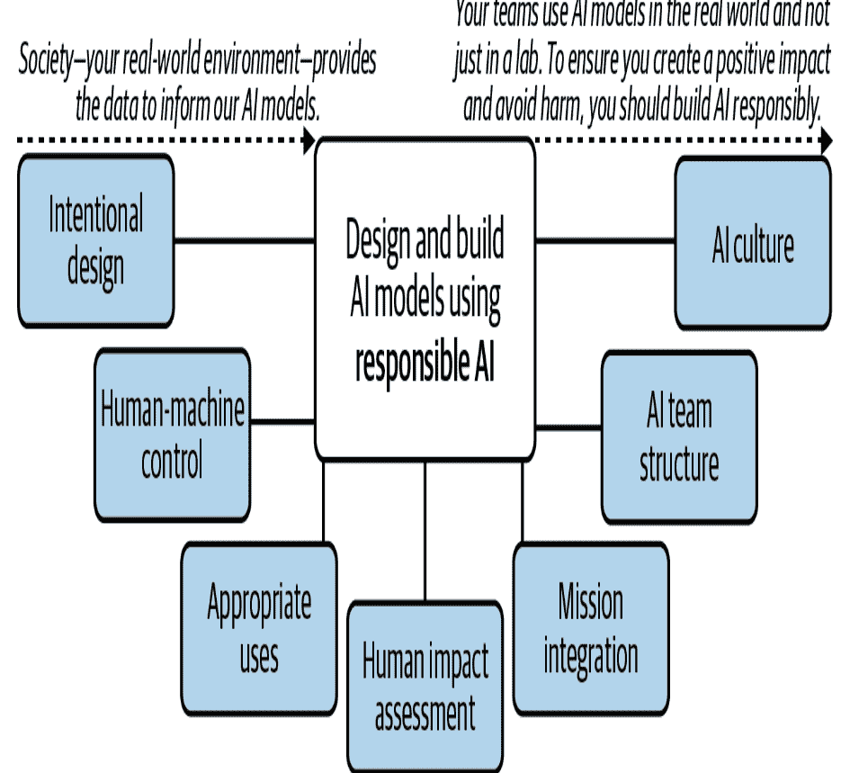
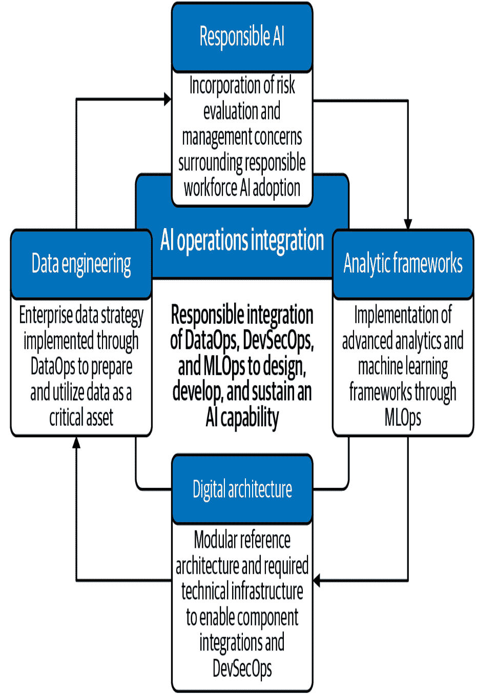

# Chapter 6. The Road to AI Adoption

在之前的章节中，我们介绍了组织应在其团队中整合和协调的关键组件，以利用 AIOps 并开始构建强大的企业 AI 能力。

本章概述了 AI 采用蓝图，以指导将这些主要组件整合到端到端技术解决方案中。利用这一整体蓝图，您的组织可以在多个企业工作流中整合这些解决方案，通过考虑定制和扩展 AI 所需的人员、流程和技术，将 AI 从原型过渡到有影响力的解决方案。

## AI Adoption Blueprint

在开始采用 AI 时，至关重要的是要明白，没有任何组织能在一天内成功。相反，请预期一个由试错定义的过程，并持续获得来自组织各方利益相关者的反馈。本节提供了 AI 采用蓝图及其组件的概述，为这段旅程奠定基础，促进向强大的 AI 能力逐步推进。

将 AI 解决方案运营化的最有效和可持续的方法是对相关风险保持勤勉和审慎。部分得益于 AI 日益普及，组织往往在考虑其独特的 AIOps 因素之前就寻求其项目的“AI 魔法”。虽然组织在采用 AI 解决方案时可以快速行动，但在没有适当计划的情况下仓促进行 AI 开发是存在风险的。

未能全面思考 AIOps 的所有考虑因素，会给团队带来风险，使其开发出不可靠的 AI 解决方案，而员工既不会接受也不会使用，最终限制了组织对 AI 的采用。特别是在大型企业或政府机构的情况下，这种失败可能导致对社会和关键资源产生毁灭性后果的影响。*AI Adoption Blueprint* 将使您能够通过使用 AIOps 来解决这些问题，并制定缓解策略以避免此类陷阱。

首先，您应考虑在推广整体 AI 创建时，负责任 AI 的广泛关注点，如图 6-1 所示。这些要素概述了负责任 AI 采用的主要考虑因素，并为理解 AI 采用蓝图提供了一个有用的起点。

Figure 6-1. Holistic view of responsible AI

要让员工接受 AI，仅靠熟练的技术团队是不够的。将 AI 引入组织可能会颠覆传统的 work 环境和职责。准备好员工在修改后的角色中运作的领导者将防止人才技能差距，加速成功采用，最重要的是，让所有员工做好准备，在开发负责任 AI 中发挥作用。AI 团队必须 *build* AI  responsibly，而终端用户必须 *use* AI responsibly。终端用户必须接受有关应用程序适当用途的培训，包括如何理解和解释输出、适当的人工监督程度以及关键风险。

将这些负责任 AI 的考虑因素纳入我们的 AIOps 方法，让我们现在来审视图 6-2 中的 AI 采用蓝图。该蓝图整合了本报告中详细阐述的 AIOps 框架要素，其中 *AIOps Integration* 作为一种机制，用于将组织要求纳入设计、开发和维持企业 AI 能力。我们将在本章后面更详细地讨论 AIOps Integration 和 *Digital Architecture*，因此让我们先从 AIOps 框架中熟悉主题的概述开始：

### *Responsible AI*

在第 3 章中讨论，重点是建立信任、培养文化准备度、支持 workforce 策略，并在 AI 采用过程中尽早优先考虑伦理。

### *Data engineering*

在第 4 章中讨论，将数据视为战略资产，并有助于确保 AI 的数据就绪性，既用于训练 AI 模型，也用于扩展 AI 能力。您的团队可以利用 DataOps 来实施企业数据战略，以促进对驱动 AI 解决方案的基本数据的安全、民主化访问。

### *Analytic frameworks*

利用 ML 和专门的分析方法推动 AI 能力，并通过数据驱动的洞察提供价值。该要素涉及 MLOps，以在整个生命周期中开发和管理复杂模型。

Figure 6-2. AI Adoption Blueprint

虽然蓝图的每个要素都是一个有效的独立关注点，但在收获 AI 的全部益处之前，您必须整合这些组件。在以下各节中，我们确定将这些要素整合到您独特的解决方案中的关键第一步，从明确阐述 AI 能力的预期最终状态开始。

## Establishing Clear Objectives

利用 AI 采用蓝图来指导我们的提问，您可以开始确定开发目标。在解决具体的实施问题之前，至关重要的是在开始时建立明确的目标和成果。这为利益相关者更好地评估 AI 模型带来的投资回报奠定了基础。

在本节中，我们首先定义项目成功标准，确定使单个 AI 项目成功的 AIOps 组件。

通过将宝贵的经验应用于整体 AIOps 框架，您可以促进企业层面的 AI 成功采用。在定义目标并确定促成成功结果的因素之后，您可以利用 AIOps 标准来评估您的 AI 能力和性能。

Table 6-1 概述了 10 项理想观察结果，可促进企业 AI 采用的成功。

## Table 6-1. Top ten leading indicators for AI project success

| Leading indicator | Ideal observation |
|---|---|
| Data readiness | Accessible, high-quality, catalogued datasets |
| Infrastructure readiness | Flexible, scalable, secure environments and tools |
| Organizational readiness | Forward-leaning, transparent, well-led organization |
| Analytic technique | Literature- and experience-backed processes and methods |
| Leadership and stakeholder buy-in | Executive sponsorship, end-user buy-in and adoption |
| Clearly defined business problem | Well-defined scope and ROI value proposition |
| Project team expertise | Expert, diverse team blending tech and nontech skills |
| Project team cohesion | Consistent, united, committed project team |
| Agile project management | Iterative, feedback-centric management approach |
| Informed project schedule | Ambitious but practical schedule |

突出一些关键考虑因素的详细说明：

### Data

通常是给定项目成功或失败的头号决定因素。许多组织在捕获、组织和提供用于驱动决策的最重要数据方面遇到困难。拥有正式数据战略的组织成功率更高。

### Infrastructure readiness

也是成功的强有力促成因素，使已标准化并投资于分析飞地和平台的组织在运营化 AI 时具有优势。

### Analytic techniques

这些对组织的成败至关重要。很多时候，传统的分析方法就足够了。但有时，像深度学习这样更前沿的方法对成功至关重要。例如，自然语言处理和计算机视觉方法

实现令人难以置信的成功，而像强化学习这样更新的方法仍处于起步阶段。

虽然上述因素通常适用于所有 AI 项目，但我们认识到每个组织都是独特的。识别、跟踪并在企业范围内推广影响 AI 成功发展的因素非常重要。举办 AI 高管愿景会议可以帮助制定作为 AI 战略指导原则的目标和愿景。这确保您的组织能够迅速将原型过渡到满足运营要求并实现组织优先事项的企业级 AI 解决方案。

当您开始在组织内部规划新的 AI 项目时，在项目评审期间可以提出一些探索性问题，以帮助预测该项目的成功：

- 1. “项目领导是否积极参与项目，并且他们是否理解并支持项目目标？”
- 2. “我们项目团队是否拥有适当的技能、培训和经验组合？”
- 3. “我们在项目的最初 90 天内预计会出现哪些延迟？”
- 4. “关键项目资源的预期或实际保留率如何？应急计划是什么？”
- 5. “团队将在整个项目中如何协调其工作？”
- 6. “项目的关键目标和成功标准是什么，它们的可实现性如何？”

这些问题将帮助您识别并收集关键信息，以确定您的 AI 项目是否已准备好开始其旅程。回顾我们上面概述的 10 项标准。您收到的答案是否描绘出这 10 项标准将被满足的图景？您是否开始意识到表 6-1 中定义的理想观察？如果是这样，您可以确信您的 AI 项目正走在正确的轨道上。

相反，如果您在没有明确愿景的情况下实施 AI，您将无法将 AI 为组织带来的任何成功与组织目标联系起来。没有这些知识，您的组织可能无法认识到 AI 的附加价值。推进缺乏明确价值的想法将削弱未来的 AI 努力并阻碍额外的资源投入。

当您制定早期目标以跟踪单个 AI 项目和企业 AIOps 能力的成功时，请记住以下提示：

- 您的目标将取决于您组织在 AI 之旅中的位置。早期实施阶段推动实施的目标需要尽可能多地关注核实想法和教育组织成员，同时开发成功 AI 所需的关键要素——人员技能、基础设施、可重复且集成的解决方案。
- 专注于您能够轻松衡量的目标。
- 专注于解决组织今天无法做到的事情的新能力，而不是重新发明现有或遗留能力。这使得向组织能力增加的价值更容易得到证明。
- 目标需要与风险承受能力、负责任的 AI 原则、数据资产可用性和人才需求保持一致。

我们建议在开始部署 AIOps 时建立总体目标的四个步骤：

- 1. 为您的组织 AI 能力设定明确的愿景，从明确定义的愿景和业务目标开始。您的组织可以使用这些来识别其当前能力、确定想要实现的结果，并将其置于更广泛战略计划的背景下。您的愿景和业务目标随后将为您的战略计划提供信息，该计划逐步推出 AI 能力，重点是 AIOps 的持续改进，同时牢记组织的使命。
- 2. 开始阐述并报告与成果挂钩的明确目标，以进一步强调 AI 与组织使命之间的联系。您可以使用下一节中我们建议的结果，例如，来构建您的报告。
- 3. 确定已经接受 AI 文化的员工和领导者，作为您 AIOps 启动的倡导者——这些人可以领导早期的 AI 试点项目并向其同行展示由此产生的价值。
- 4. 建立短期、技术上可行的项目，并设定明确的成功参数以证明价值。这些快速胜利将有助于建立积极的认可，尤其是在您在第三步中确定的倡导者的推动下。

## 衡量成果和绩效

绩效测量和基准有助于您的组织评估 AI 部署并协助量化 AI 的附加价值。这些衡量标准将确定每个 AI 计划的成果和相对绩效。它们还可以帮助您确定或重构优先级，并在需要时调整方法。

在可能的情况下，组织应将这些指标标准化到 AI 项目中，并将其整合到 AIOps 开发和维护流程中。这可确保项目定期计算指标、将其跟踪在中央存储库中，并定期报告以持续监控和改进 AI 项目影响。

透明度和反馈是持续学习和改进的关键，也是成功的重要决定因素。AIOps 指标可以通过持续监控流程和对收集的数据做出反应的自动警报/操作来发挥这一作用。您还应根据各自的 AI 应用校准所选的跟踪指标。例如，支持高风险流程的 AI 可能需要超出典型基准的额外精度、风险审查和性能验证。

在我们之前的 AI 采用蓝图主题中，我们讨论了与 AIOps 的每个组成部分相关的成功标准。在建立您将开始衡量的指标以跟踪新 AI 能力成功时，我们建议将这些指标与本报告中涵盖的重要经验教训联系起来。以下是我们对您应跟踪的指标的建议，按其与 AI 采用蓝图（以及相应章节）的对齐程度组织：

## 与负责任 AI 相关的指标（第 3 章）

- 1. **可接受性能：** 模型的实际准确度与所需准确度相比（某些模型可能有更高的可接受误差范围，例如）
- 2. **偏差：** 观察模型训练过程中可能引入的任何偏差¹
- 3. **必要审批：** 确保您的团队已获得使用某些数据集可能需要的任何审批
- 4. **可重复性：** 基于 AIOps 流程中收集的数据重现模型训练或推理结果的能力
- 5. **弹性：** 模型通过对抗性影响被破坏的易感性

## 与数据工程相关的指标（第 4 章）

- 1. **数据就绪度：** 跟踪数据集作为 AI 模型输入的就绪度指标
- 2. **数据质量和数据漂移：** 衡量数据质量的定性和定量指标以及驱动漂移的数据特征变化的潜在早期指标
- 3. **数据安全和隐私：** 可用作数据安全和隐私指标的定性和定量指标
- 4. **数据透明度：**² 元数据和指标可以帮助提高模型可解释性

## 与 ML 模型相关的指标（第 5 章）

- 1. **准确率、精确率、召回率：** 模型决策的定量性能
- 2. **吞吐量：** 与基线相比，模型处理的数据吞吐量增加
- 3. **决策速度：** 模型提供答案所需的时间，在许多情况下与基线流程的决策制定时间线相比
- 4. **容量：** 模型推理满足用户请求数量的能力以及提供这些请求时的延迟
- 5. **使用率：** 鉴于目标用户群，有多少百分比正在使用该解决方案以及随时间的变化

理想情况下，您希望您的 AIOps 能力能够在企业范围内实现成功。因此，如果您的 AIOps 框架成功，您将开始在项目的生命周期中看到这些指标的改善。需要提醒的是，这将仍然是一个迭代过程，利用这些标准和利益相关者参与的反馈来跟踪和指导您 AI 能力的开发以及 AIOps 实施复杂性的持续进步。

## 参考架构

在本报告中，我们介绍了构建模块，以帮助您的团队反复创建必要的<|message|> 基础设施并随后部署可扩展的 AI 解决方案。综合起来，这些构建模块形成了一个*参考架构*，即一个框架，用于可视化运营化和交付 AI 所需的相互关联的能力和组件。参考架构也是告知所需技术基础设施和相关开发流程（即、

在技术基础设施上实施 DevSecOps³ 作为更广泛的 AIOps 框架的组成部分）。

## DevSecOps

基于 DevOps（一套致力于提高开发人员与运维人员之间沟通和协调效率的流程和技术），DevSecOps 在此基础上进一步扩展，将安全纳入其中，并需要使系统对有动机对手的蓄意干扰具有鲁棒性。

每个组织的参考架构实现都将不同，但基本组件保持不变（图 6-3）。参考架构可作为黄金标准，使您的团队能够快速部署自己的 AI 模型和应用程序。通过建立参考架构，您的组织可以从抽象框架中产生现实世界解决方案（解决方案基线）。这些解决方案基线对应于您组织的具体用例，并形成一个可重用组件的通用框架，符合通用架构，从而提高企业 AI 能力的效率和可扩展性。

## AIOps RA capabilities

### Data delivery

### Machine learning

### Observability & transparency

AIOps RA components

Data flow

Data repository

Data ingest

Data transform

Data access

Data enrichment

Data versioning

Data validation

Data preparation

Exploratory analysis

Feature engineering

Model training

Feature selection

Model evaluation

Model versioning

Model validation

Drift detection

Retrain detection

Model perf detection

Alerting

Artifact repository (model, applications, source code, docker, etc.)

Ethics, explainability, bias

Configured/custom software (i.e., BI, notebooks, custom, microservices)

Environment monitoring

Provenance collection and reporting

Metadata collection and reporting

Security (auth'n, auth'z, environment)

DataOps

MLOps

*Ops

## Path to production

## Development

## DevSecOps

## Staging & production

Key

Capability

Component

Repository

Environment

Automation

Figure 6-3. Reference architecture

要支持全面的参考架构，您还必须考虑数字架构决策，包括基础设施和开发流程，以将您的 AI 能力从原型演进为已部署的解决方案。您的数字架构选择应支持参考架构和 AIOps 框架的所有组件，包括与终端用户、数据平台和分析技术的接口。考虑到这些相互关联的元素，以下是围绕这些数字架构组件的一些高层考虑，以开发协调、可扩展和可持续的 AI 能力。

## Technical Infrastructure

从本质上讲，AI 模型训练在计算上可能非常密集，通常需要大量算力。用于训练简单/中等复杂度的深度学习模型的类型硬件是专用实例或由图形处理器单元（GPU）或 CPU 与 GPU 组合驱动的小型/中型集群。高性能计算（HPC）环境可针对涉及高维数据集的更复杂模型进行优化，并配备 GPU 和并行分布式文件系统。

## Development Processes

DevSecOps 提供标准化流程，包含组织开发工作的框架，包括跨技术团队的协作以及在其整个生命周期内对能力的统一文档记录。在开发期间，该流程及其相关工具对于使跨职能团队能够高效地开发和测试 AI 模型至关重要。部署后，我们还考虑 AI 能力的长期可持续性，例如能力的持续集成、交付以及对其对组织影响的评估（基于定义的绩效结果）。

## AIOps Integration

现在我们了解了来自 AI 采用蓝图的整体关注点，包括建立目标和绩效衡量，是时候考虑整合使 AI 运营化的要素的方法和流程了。为了实现这些期望的结果，我们必须考虑 AIOps 的组件流程——具体来说是 DataOps、MLOps 和 DevSecOps——包括它们在人员、流程和技术方面的相互关系和依赖性。首先，我们将概述这些考虑因素及其实施，然后从更技术性的角度深入探讨这些流程的整合。

## Operational Components

AI 能力旨在在部署以支持业务流程时提供价值。为此，团队必须将 AI 能力集成到历史上支持业务流程的系统中。鉴于系统复杂性的指数级增长，扩展和维持 AI 需要对流程和依赖关系进行整体视图——以及结构化的工程方法——以将 AI 模型组合转化为已部署的运营能力。图 6-4 将此视图定义为应包含并在组织内集成的核心组件，以实现成功的 AI 部署。

## AI process

## AI integration

Mission and system engineering

+ Pipeline utilities
+ Blueprints
+ Registries
+ Repositories
+ Standards
+ Services/tools

## AI pipelines

## DataOps

+ - Processing
+ - Versioning and validating
+ - Storage

## MLOps

+ - Model training
+ - Analytics
+ - Diagnostics and monitoring

## DevSecOps

+ - Programming
+ - Packaging
+ - Orchestration and deployment

Processes

Federated & distributed learning

## Enterprise IT infrastructure

End users

AI tools

Server/hub

Edge devices

Inference and diagnostic returns

Services

AI/ML application services

Configuration management and orchestration

Enabling components

Data management systems

Infrastructure and workspace environments

Figure 6-4. AIOps components

如图 6-4 所示，DataOps、MLOps 和 DevSecOps 构成了应根据您组织特定用例定制的 AIOps 核心运营组件。将其视为 AIOps 整体，这些方法的整合侧重于通过以下组合将组织需求转化为数据和分析流程：

+ - 开发集成自动化管道，跨越从数据摄取和处理到模型训练再到后续 AI 模型部署
+ - 根据需要更新集成到系统和业务流程中的 AI 模型，以确保它们保持最新和相关，而非静态
+ - 在数据、模型和开发结构之间持续集成和部署流程，并纳入反馈循环以推动流程改进
+ - 在所有阶段支持模型可解释性的元数据收集流程

在考虑我们将这些运营框架纳入的方法时，我们应重申 DataOps、MLOps 和 DevSecOps 在更广泛的 AIOps 框架中的一致性。我们将在下一节描述组件整合时使用这些工作定义。AIOps 整合的整体方法包含以下流程：

+ 1. 利用迭代的 DataOps 流程创建数据管道、普及访问权限，并监控和自动化流程以满足战略数据需求，从而实现 AI 能力。
+ 2. 结合 MLOps 以调整模型实现，更好地确定最适合给定运营需求的方法；MLOps 专注于 ML 模型的自动化训练、部署、监控和管理。

+ 3. 实施 *DevSecOps* 以协调更广泛的软件应用程序开发，支持 ML 模型的快速集成并部署到目标托管环境。如前所述，DevSecOps 在已建立的 DevOps 流程和实践中增加了关键的安全要素。

从企业角度来看，AIOps 组件作为支持组织目标的更大使命关键系统生态系统的一部分存在。鉴于使命关键系统的复杂性和快速演变性质，重要的是要遵循将 AI 能力集成到特定组织需求的最佳实践。与其他使命关键系统一样，AI 系统需要通过全面的企业安全方法进行保护，所有安全最佳实践均适用。

总体而言，该方法允许使用标准流程以可扩展和可重复的方式集成和迭代开发解决方案，同时在整个流程中保持完全可见性，这得益于元数据的帮助，元数据在集中式数据平台中收集。在以下部分，我们将应用 AI 采用蓝图来解决 AIOps 框架这些基本组件的整合问题。

## Component Integration

设计和开发企业 AI 能力需要对各个 AIOps 组件进行开发，以及上游和下游的协调，以使这些组件能够协同支持彼此。如本报告和 AI 采用蓝图所述，我们在通往整体 AIOps 整合的道路上考虑了几个相互关联的元素：负责任的 AI 以指导员工的旅程，数据工程以驱动分析流程；分析框架以从数据中获取价值和洞察；通过数字架构满足技术要求和持续部署。

请记住，AI 采用蓝图将 AIOps 集成定义为负责任地集成 DataOps、DevSecOps 和 MLOps，以设计、开发和维持 AI 能力。AIOps 组件之间的管道集成对于运营化和维持您的企业 AI 系统至关重要。DevSecOps 和 DataOps 都是复杂的学科，它们独立于 AIOps 存在，但在应用于 AI 模型开发时需要独特的考虑。在实施 MLOps 时，许多组织仅专注于模型开发，而没有投入足够的时间来完善围绕 ML 模型开发的其他流程，这种做法往往会导致 AI 系统产生次优结果，无法满足业务需求。

在设计集成企业 AI 系统组件所需的运营管道时，您应牢记以下几点考虑因素。在表 6-2 中，我们通过将 AI 采用蓝图中的元素与问题进行映射来概述 AIOps 的这些相互关联的考虑因素，以检查它们的相互依赖关系。

## Table 6-2. AIOps integration

|  | Responsible AI | Data engineering | Analytic frameworks | Digital architecture |
|---|---|---|---|---|
| Responsible AI | **Incorporation of risk evaluation and management concerns surrounding responsible workforce AI adoption.** |  |  |  |
| Data engineering | *Does your data strategy account for responsible governance and policy? Does your DataOps process enable secure, democratized access?* | **Enterprise data strategy implemented through DataOps to prepare and utilize data as a critical asset.** |  |  |
| Analytic frameworks | *What are the risks associated with interpreting and implementing ML algorithms? What is the value derived from these analytics?* | *Is your data readily available and prepared for sustained analysis? Is data appropriately managed and versioned to enable advanced analytics?* | **Implementation of advanced analytics and ML frameworks through MLOps.** |  |
| Digital architecture | *Does your digital infrastructure align to risk management and technical requirements? Are your development processes clearly documented from prototype to production?* | *Are there established data pipelines between storage systems and development environments? Does your infrastructure support automation to reliably move data from a development to production environment?* | *Do the outcomes of your analytic processes and development practices correspond to specific organizational objectives? Do you have standardized metrics to evaluate the impact of your AI capability?* | **Modular reference architecture as required tech infrastructure to enable component integrations via DevSecOps.** |

在了解 AIOps 组件之间的联系并规划管道的实施特定设计之后，现在是时候构建和部署管道了。您的实施特定设计现在应被转化为最符合您即时业务需求和团队专业知识的技术特定构建。

请记住，AIOps 组件的集成应与构建组件本身一样严谨。事实上，我们应将这些互联视为组件本身！与其他软件解决方案一样，您的开发团队应编写测试以确保这些管道合规且可靠。这种验证必须彻底，并由主题专家提供信息，以确保考虑所有细微差别。管道应像企业 AI 系统的其余部分一样严格维护，并应定期更新，以确保系统持续遵守 AI 最佳实践。

本报告提供了深入回顾组织需要具备的各种方面，以便通过应用 AIOps 以及所有相关支持因素不断推进其企业 AI 能力。这些方面中的每一个都不能单独解决。

相反，组织必须将它们视为一套集成能力，以提升其构建成功且有影响力的 AI 解决方案的能力。

- 1. 有关如何检测模型中偏差的进一步阅读，请参阅 [this article from TowardsDataScience](this article from TowardsDataScience)。
- 2. Steve Sirich，“Data Privacy in the Age of Privacy Protection”，*Forbes*，2020 年 5 月 25 日。
- 3. 有关进一步阅读，请参阅 Jim Bird 的 2016 年报告 *DevSecOps*（O’Reilly Media）。

## Conclusion

本报告的目标是提供有关组织如何从在受控实验室环境中应用 AI 推进到将组织提升为企业 AI 能力的见解。如所述，要使这一转型成功，必须解决许多因素（AI 项目的范围界定、衡量成功、嵌入负责任 AI、运营的集成、监控 AI 模型性能以及追求持续改进）。今天，我们正处于与 AI 相关的最大炒作和潜力点。如果组织无法将 AI 模型投入生产并实现这些投资的潜在回报，AI 解决方案将面临采用率下降以及组织体验 AI 作为转型能力所能提供的全部价值的时间线延长。

通过应用本报告中概述的方法和框架，组织可以利用经验教训，减少在使 AI 成为其组织的企业能力方面的时间和风险。在许多情况下，组织专注于其中一个或少数几个方面，导致在建立和扩展企业 AI 时遇到挑战。本报告中概述的每个领域都必须得到关注和资源投入，必须集成，并且必须迭代增强，以实现企业 AI 的全部潜力。

同时还必须牢记，每个主题都需要迭代改进，尤其是在快速技术发展和 AI 研究的背景下。新的工具和能力不断被开发，推动了这些领域的最新进展，因此 AIOps 应该是一段持续的旅程，而不是“一劳永逸”的过程。

如果组织利用这些 AIOps 方法和框架，它们就能够迅速将 AI 运营化到企业层面。它们可以成为一个组织，能够在与负责任 AI 原则以及组织愿景和目标保持一致的情况下，快速开发和改进其 AI 解决方案。这些 resulting 解决方案可以使组织实现 AI 的预期潜力——一种跨行业的转型能力——并开始看到对其投资的真正、可量化的回报。

## About the Authors

**Justin Neroda** 领导战略投资工作，旨在为国防和情报客户应用人工智能、机器学习、数字解决方案和高级分析。他的专业知识包括在持续的 AI 项目组合中运营化 AI 解决方案。Justin 还有超过 20 年的管理分析师和开发人员执行国防部广泛的建模、仿真、可视化和分析任务的经验。Justin 拥有乔治梅森大学管理信息系统专业的工商管理硕士学位和弗吉尼亚理工大学工业与系统工程专业的理学学士学位。

**Steve Escaravage** 领导 Booz Allen 的分析实践和 AI 服务业务，帮助客户将数据科学、机器学习和 AI 解决方案的运营集成。Steve 作为 Booz Allen 战略创新计划的领导者，还领导着公司在数据科学、机器学习和 AI 方面的投资。他拥有乔治梅森大学运筹学硕士学位和罗格斯大学数学学士学位。

**Aaron Peters** 是 Booz Allen AIOps 能力的负责人，构建框架和工具，使客户能够更有效地将 AI 能力部署到生产环境中。在 Booz Allen 的任期内，Aaron 主导了为医疗和民用客户交付数据科学解决方案的项目。Aaron 的教育背景植根于他在普渡大学的计算机科学理学学士学位，他在软件工程、数据管理和数据工程方面有专门研究。

## 1. 前言
- a. 致谢

## 2. 揭秘 AI
- a. AI 从试点到生产的挑战
  - i. 可扩展性
  - ii. 可持续性
  - iii. 协调

## 3. 定义 AIOps 框架
- a. 为什么你需要一个 AIOps 框架
- b. 其优势是什么？

## 4. 负责任的 AI
- a. 什么是负责任的 AI？
- b. 采用负责任的 AI
- c. 伦理
- d. 劳动力发展
- e. AI 风险与复杂性
- f. 风险管理流程

## 5. 数据：你最宝贵的资产
- a. 数据在 AIOps 中的作用
- b. 数据战略
- c. DataOps：使你的数据战略落地
- d. 数据准备活动
  - i. 摄取
  - ii. 转换
  - iii. 验证
  - iv. AI 数据治理

## 6. 机器学习（ML）
- a. 什么是 ML 模型？
- b. ML 方法论
- c. ML 高级主题
- d. ML 生命周期
  - i. 业务分析
  - ii. 模型开发
  - iii. 模型验证
  - iv. 模型运行
- e. 机器学习运维（MLOps）
  - i. 可扩展训练基础设施
  - ii. 模型优化基础设施
  - iii. 模型部署基础设施

## 7. 通往 AI 采用之路
- a. AI 采用蓝图
- b. 建立明确目标
- c. 衡量成果与绩效
- d. 参考架构
  - i. 技术基础设施
  - ii. 开发流程
- e. AIOps 集成
  - i. 运营组件
  - ii. 组件集成

## 8. 结论

