# 第 1 章. 基础数学与微积分回顾

本章将首先介绍什么是数字，以及变量和函数如何在笛卡尔坐标系中工作。接着我们将介绍指数和对数。之后我们将学习微积分的两种基本运算：导数和积分。

在深入概率、线性代数、统计学和机器学习等核心数学应用领域之前，我们或许应该先回顾一些基础数学和微积分概念。在你扔掉这本书尖叫着逃跑之前，别担心！我会以一种你可能在大学里没有学过的方式，介绍如何对函数求导和积分。我们身边有Python，而不是铅笔和纸。即使你不熟悉导数和积分，也不必担心。

我会尽可能使这些主题简洁实用，只关注对后续章节有帮助且属于“核心数学”范畴的内容。

> 这绝非一本完整的数学速成课！
>
> 这绝不是对高中和大学数学的全面回顾。如果你想要那样，一本值得查阅的好书是 Ivan Savov 所著的《数学和物理无废话指南》（恕我直言）。该书的前几章包含我见过的最好的高中和大学数学速成课。Dr. Richard Elwes 所著的《Mathematics 1001》也有一些很棒的内容，并且采用小节解释的形式。

## 数论

什么是数字？我保证在这本书中不会过于哲学化，但数字不是我们定义的一种构造吗？为什么我们有0到9的数字，而不是更多数字？为什么我们有分数和小数，而不仅仅是整数？这个思考数字及其设计方式的数学领域被称为数论。

**数论**可以追溯到古代，当时数学家研究不同的数系以及我们为何以当前方式接受它们。以下是你可能认识的不同数系：

### *自然数*

这些是1、2、3、4、5……等等的数字。这里只包含正数，也是已知最早的系统。自然数如此古老，以至于穴居人曾在骨头和洞穴墙壁上刻划计数符号来保存记录。

### *非负整数*

在自然数的基础上，“0”的概念后来被接受，我们称这些为“整数。”巴比伦人还开发了对于大于9的数字（如“10”、“1000”或“1090”）中空“列”占位符记数法的有用想法。这些零表示该列没有数值占据。

### *整数*

整数包括正数和负数自然数以及0。我们可能视之理所当然，但古代数学家对负数的概念深感怀疑。但是，当你从3中减去5时，你会得到-2。这在财务领域尤其有用，我们在那里衡量盈亏。公元628年，一位名叫Brahmagupta的印度数学家展示了为什么负数对于利用二次公式推进算术是必要的，因此整数获得了接受。

### *有理数*

任何可以表示为分数的数字（如2/3）都是有理数。这包括所有有限小数和整数，因为它们也可以表示为分数，例如687/100 = 6.87 和 2/1 = 2。它们被称为有理数是因为它们是比率。有理数很快就被认为是必需的，因为时间、资源和其他数量并不总是可以用离散单位来衡量。牛奶不总是以加仑为单位出售。我们可能需要以加仑的部分来衡量它。如果我跑了12分钟，我不能被迫以整英里为单位来衡量，而实际上我跑了9/10英里。

### 无理数

无理数不能表示为分数。这包括著名的π，某些数字的平方根（如√2），以及我们稍后将学习的欧拉数e。这些数字有无限多位小数，例如π = 3.141592653589793238462...

无理数背后有一段有趣的历史。希腊数学家毕达哥拉斯相信所有数字都是有理数。他如此热切地相信这一点，以至于他创立了一种祈祷数字10的宗教。“赐福于我们，神圣的数字，你生育了神和人！”他和他的追随者会祈祷（我不知道为什么“10”如此特别）。有一个传说称，他的一位追随者希帕索斯通过演示2的平方根来证明并非所有数字都是有理数。这严重动摇了毕达哥拉斯的信仰体系，他通过将希帕索斯溺死在海中来回应。

无论如何，我们现在知道并非所有数字都是有理数。

### 实数

实数包括有理数和无理数。在实际操作中，当你进行任何数据科学工作时，可以将你使用的任何小数视为实数。

### 复数和虚数

当你对负数开平方根时，就会遇到这种数字类型。虽然虚数和复数在某些类型的问题中有相关性，但出于我们的目的，我们将大多避开它们。

在数据科学中，你会发现你的大部分（如果不是全部）工作将使用自然数、整数和实数。虚数可能出现在更高级的用例中，例如矩阵分解，我们将在第4章中涉及。

### 复数和虚数

如果你确实想了解虚数，这里有一个很棒的YouTube播放列表[虚数是真实的](https://youtu.be/T647CGsu0VU)。

### 运算顺序

希望你熟悉**运算顺序**，即求解数学表达式各部分的顺序。作为简要回顾，请记住你先计算括号中的组件，然后是指数，接着是乘法、除法、加法和减法。你可以通过助记符**PEMDAS**（Please Excuse My Dear Aunt Sally，即括号、指数、乘法、除法、加法、减法）来记住运算顺序。

以这个表达式为例：

```
2 \times \frac{(3 + 2)^2}{5} - 4
```

首先我们计算括号(3 + 2)，结果为5。

```
2 \times \frac{(5)^2}{5} - 4
```

接下来我们求解指数，可以看出就是对刚才求和的5进行平方。结果是25。

$$ 2 \times \frac{25}{5} - 4 $$

接下来是乘法和除法。这两者的顺序可以互换，因为除法也是乘法（使用分数）。让我们继续将2与\(\frac{25}{5}\)相乘，得到\(\frac{50}{5}\)。

$$ \frac{50}{5} - 4 $$

接下来我们将执行除法，用50除以5，结果为10。

$$ 10 - 4 $$

最后我们执行加法和减法。当然，10 - 4将给我们6。

$$ 10 - 4 = 6 $$

果不其然，如果我们用Python来表达这个，将打印出6.0，如示例1-1所示。

### *示例1-1. 在Python中求解表达式*

```
my_value = 2 * (3 + 2)**2 / 5 - 4
print(my_value) # prints 6.0
```

这可能很基础，但仍然至关重要。在代码中，即使没有它们也能得到正确结果，但在复杂表达式中大量使用括号也是一种好习惯，这样你可以掌控求值顺序。

在这里，我将表达式的分数部分用括号括起来，帮助将其与表达式的其余部分区分开来，如示例1-2所示。

### *示例1-2. 在Python中使用括号以提高清晰度*

```
my_value = 2 * ((3 + 2)**2 / 5) - 4
print(my_value) # prints 6.0
```

虽然两个示例在技术上都是正确的，但后一个示例对我们这些容易混淆的人来说更清晰。如果你或其他人对你的代码进行更改，括号在更改时提供了操作顺序的易于参考。这也为防止代码更改导致的错误提供了一道防线。

### 变量

如果你使用Python或其他编程语言做过脚本编写，你就知道什么是变量。在数学中，**变量**是未指定或未知数字的命名占位符。

你可能有一个表示任何实数的变量x，并且可以在不声明它是什么的情况下对该变量进行乘法运算。在示例1-3中，我们从用户那里获取变量输入x，并将其乘以3。

### *示例1-3. 然后相乘的Python变量*

```
x = int(input("Please input a number\\n"))
product = 3 * x
print(product)
```

某些变量类型有一些标准变量名。如果这些变量名和概念不熟悉，别担心！但其余读者可能认识，我们使用theta θ表示角度，使用beta β表示线性回归中的参数。希腊符号在Python中是别扭的变量名，因此我们可能会在Python中将这些变量命名为theta和beta，如示例1-4所示。

### *示例1-4. Python中的希腊变量名*

```
beta = 1.75
theta = 30.0
```


另请注意，变量名可以加下标，以便使用多个同名变量实例。出于实际目的，只需将它们视为单独的变量。如果您遇到变量 x1、x2 和 x3，只需像示例 1-5 中所示一样将它们视为三个单独的变量。

## 函数

函数是定义两个或多个变量之间关系的表达式。更具体地说，函数接受输入变量（也称为域变量或自变量），将其代入表达式，然后得出输出变量（也称为因变量）。

来看这个简单的线性函数：

```
y = 2x + 1
```

对于任何给定的 x 值，我们使用该 x 求解表达式以找到 y。当 x = 1 时，y = 3。当 x = 2 时，y = 5。当 x = 3 时，y = 7，依此类推，如表 1-1 所示。

### 表 1-1. 微分用途理论 = 2x + 1

| x | 2x + 1 | y |
|---|---|---|
| 0 | 2(0) + 1 | 1 |
| 1 | 2(1) + 1 | 3 |
| 2 | 2(2) + 1 | 5 |
| 3 | 2(3) + 1 | 7 |

函数很有用，因为它们模拟了变量之间可预测的关系，例如在 x 温度下我们可以预期多少场火灾 y。我们将在第 5 章使用线性函数进行线性回归。

对于因变量 y，您可能会看到另一种惯例，即将其明确标记为 x 的函数，例如 f(x)。因此，与其将函数表示为 y = 2x + 1，我们也可以将其表示为：

f(x) = 2x + 1

### 示例 1-6. 在 Python 中声明线性函数

```
def f(x):
    return 2 * x + 1

x_values = [0, 1, 2, 3]

for x in x_values:
    y = f(x)
    print(y)
```

在处理实数时，函数一个微妙但重要的特性是它们通常具有无限数量的 x 值和相应的 y 值。问问自己：我们可以向函数 $y = 2x + 1$ 输入多少个 x 值？与其只输入 0、1、2、3...，为什么不输入 0、0.5、1、1.5、2、2.5、3，如下表 1-2 所示？

### 表 1-2. y = 2x + 1 的微分方程

| x | 2x + 1 | y |
|---|---|---|
| 0.0 | 2(0) + 1 | 1 |
| 0.5 | 2(.5) + 1 | 2 |
| 1.0 | 2(1) + 1 | 3 |
| 1.5 | 2(1.5) + 1 | 4 |
| 2.0 | 2(2) + 1 | 5 |
| 2.5 | 2(2.5) + 1 | 6 |
| 3.0 | 2(3) + 1 | 7 |

或者为什么不对 x 进行四分之一步长？或者十分之一步长？我们可以将这些步长无限小，从而有效地表明 \(y = 2x + 1\) 是一个**连续函数**，其中每个可能的 x 值都有一个对应的 y 值。这很好地引导我们将函数可视化为一条线，如图 1-1 所示。

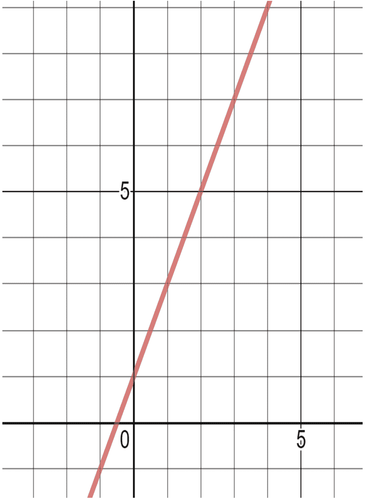

图 1-1. 函数 y = 2x + 1 的图像

当我们在二维平面上使用两条数轴（每个变量一条）进行绘图时，这被称为**笛卡尔平面**、x-y 平面或**坐标平面**。我们追踪给定的 x 值，然后查找对应的 y 值，并将交点绘制成一条线。请注意，由于实数的性质（或者如果您喜欢，小数），存在无限数量的 x 值。这就是为什么当我们绘制函数 f(x) 时，我们得到一条没有中断的连续线。该线或其任何部分上都有无限数量的点。

如果您想使用 Python 绘制此图，有从 Plotly 到 matplotlib 的多种绘图库。在整本书中，我们将使用 SymPy 完成许多任务，首先使用的就是绘制函数。SymPy 使用 matplotlib，因此请确保已安装该包。否则，它会在控制台中输出一个难看的文本图。之后，只需使用 symbols() 向 SymPy 声明 x 变量，声明您的函数，然后按示例 1-7 和图 1-2 所示进行绘图。

### 示例 1-7. 使用 SymPy 在 Python 中绘制线性函数

```python
from sympy import *

x = symbols('x')
f = 2*x + 1
plot(f)
```

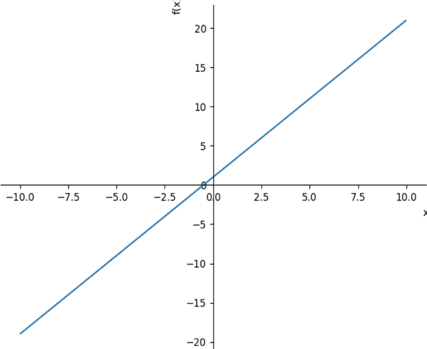

图 1-2. 使用 SymPy 绘制线性函数

示例 1-8 和图 1-3 是另一个示例，展示了函数 f(x) = x^2 + 1。

### 示例 1-8. 使用 SymPy 在 Python 中绘制线性函数

```
from sympy import *
x = symbols('x')
f = x**2 + 1
plot(f)
```

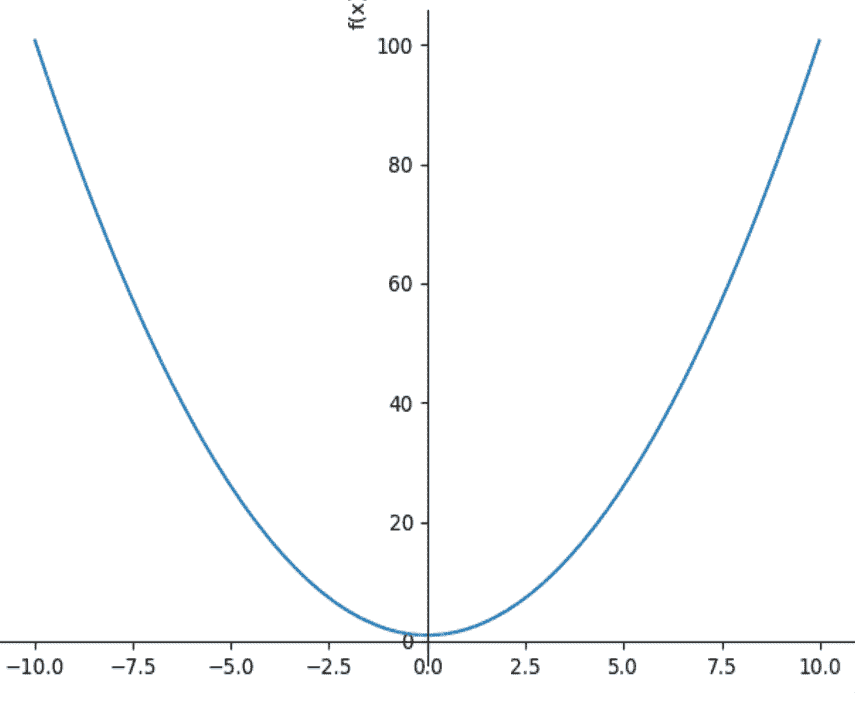

图 1-3. 使用 SymPy 绘制指数函数

请注意，在图 1-3 中，我们得到的不是直线，而是一个称为抛物线的平滑、对称曲线。它是连续的但不是线性的，因为它不会沿直线产生值。像这样的曲线函数在数学上更难处理，但我们会学习一些技巧来使其不那么困难。

> **曲线函数**
> 
> 当函数是连续但曲线的，而不是线性和直的时，我们称其为曲线函数。

请注意，函数可以使用多个输入变量，而不仅仅是一个。例如，我们可以拥有自变量 x 和 y 的函数。请注意，y 不像之前的示例那样是因变量。

\(f(x, y) = 2x + 3y\)

由于我们有 2 个自变量（x 和 y）和 1 个因变量（f(x, y) 的输出），我们需要在 3 维上绘制此图以生成值平面而不是一条线，如示例 1-9 和图 1-4 所示。

### 示例 1-9. 在 Python 中声明带有 2 个自变量的函数：

```
from sympy import *
from sympy.plotting import plot3d

x, y = symbols('x y')
f = 2*x + 3*y
plot3d(f)
```

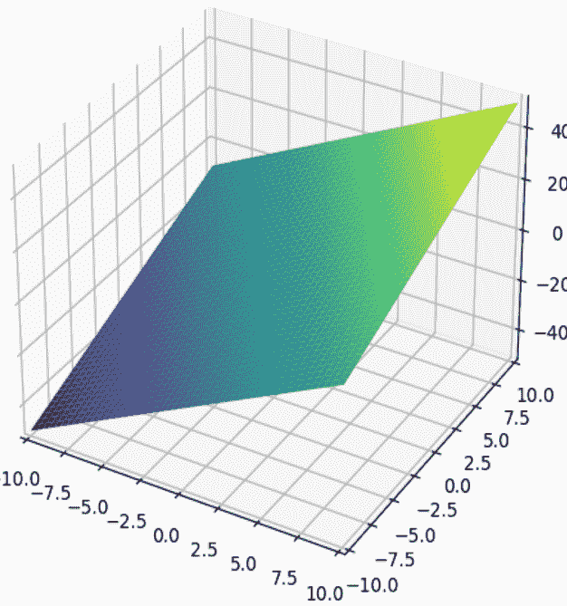

图 1-4. 使用 SymPy 绘制三维函数

无论您有多少个自变量，函数通常只输出一个因变量。当求解多个因变量时，您可能会为每个变量使用单独的函数。

## 求和

我曾承诺在这本书中不使用充满希腊符号的方程。但是，有一个方程非常常见且有用，以至于不介绍它将是一种失职。**求和**用西格玛 \(\Sigma\) 表示，用于将元素相加。

例如，如果我想迭代 1 到 5 的数字，将每个数字乘以 2，然后将它们求和，我将使用求和来表示如下。示例 1-10 展示了如何在 Python 中执行此操作。

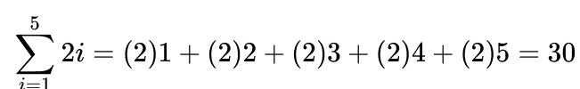

### 示例 1-10. 在 Python 中执行求和

```
summation = sum(2*i for i in range(1,6))
print(summation)
```

请注意，i 是占位符变量，表示循环中我们迭代的每个连续索引值，我们将其乘以 2 然后全部求和。在迭代数据时，您可能会看到类似 x_i 的变量，表示集合中索引 i 处的元素。

### range() 函数

请回顾，Python 中的 `range()` 函数是末尾不包含的，也就是说，如果您调用 `range(1, 4)`，它将迭代数字 1、2 和 3。它将 4 作为上限排除在外。

还常见将 $n$ 表示为集合中的项目数量，例如数据集中的记录数。下面是一个示例，我们迭代大小为 $n$ 的数字集合，将每个数字乘以 10，然后求和。

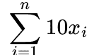

在示例 1-11 中，我们使用 Python 对 4 个数字的集合执行此表达式。请注意，在 Python（以及大多数编程语言）中，我们通常从索引 0 开始引用项目，而在数学中我们从索引 1 开始。因此，我们在迭代时相应地进行偏移，在 `range()` 中从 0 开始。

### 示例 1-11. Python 中元素的求和

```
x = [1, 4, 6, 2]
n = len(x)

summation = sum(10*x[i] for i in range(0,n))
print(summation)
```

这就是求和的要点。简而言之，求和 $\Sigma$ 的意思是“把一堆东西加在一起”，并使用索引 $i$ 和最大值 $n$ 来表达每个输入求和的迭代。我们将在整本书中遇到它们。


## SYMPY 中的求和

欢迎在您了解更多 SymPy 知识后再来查看此侧边栏。我们之前用于绘制函数的 SymPy，实际上是一个符号数学库，我们将在本章后面讨论这意味着什么。但请注意，以备将来参考，SymPy 中的求和操作是使用 `Sum()` 算子执行的。下面在示例 1-12 中，我们将 `i` 从 1 迭代到 `n`，将每个 `i` 相乘并求和。但随后我们使用 `subs()` 函数将 `n` 指定为 5，然后它将迭代并求和 1 到 `n` 的所有 `i` 元素。

### 示例 1-12.

```
from sympy import *

i,n = symbols('i n')

# iterate each element i from 1 to n,
# then multiply and sum
summation = Sum(2*i,(i,1,n))

# specify n as 5,
# iterating the numbers 1 through 5
up_to_5 = summation.subs(n, 5)
print(up_to_5.doit()) # 30
```

请注意，SymPy 中的求和是惰性的，这意味着它们不会自动计算或简化。因此请使用 `doit()` 函数来执行表达式。

## 指数

**指数** 是将一个数乘以自身指定次数的运算。当将 2 提升到 3 次幂（用 3 作为上标，表示为 2³）时，就是将三个 2 相乘：

2³ = 2*2*2 = 8

**底数** 是我们进行幂运算的变量或值，而**指数** 是我们将底数值相乘的次数。对于表达式 $2^3$，2 是底数，3 是指数。

指数有一些有趣的性质。假设我们将 $x^2$ 和 $x^3$ 相乘。请观察下面当我用简单乘法展开指数，然后合并为单个指数时会发生什么：

$x^2 x^3 = (x*x)*(x*x*x) = x^{2+3} = x^5$

当我们将相同底数的指数相乘时，我们只需相加指数，这称为**乘积法则**。请允许我再次强调，所有相乘指数的底数必须相同，乘积法则才适用。

让我们接下来探讨除法。当我们将 $x^2$ 除以 $x^5$ 时会发生什么？

$\frac{x^2}{x^5}
\frac{x*x}{x*x*x*x*x}
\frac{1}{x*x*x}
\frac{1}{x^3} = x^{-3}$

如您所见，当我们将 $x^2$ 除以 $x^5$ 时，可以在分子和分母中抵消两个 $x$，剩下 $\frac{1}{x^3}$。当一个因子同时存在于分子和分母时，我们可以抵消该因子。

您可能会想，那个 $x^{-3}$ 是怎么回事？这是一个引入负指数的好时机，负指数是将指数运算表示在分数分母的另一种方式。为了演示，$\frac{1}{x^3}$ 与 $x^{-3}$ 相同。

$\frac{1}{x^3} = x^{-3}$

回到乘积法则，我们可以看到它也适用于负指数。为了获得对此的直觉，让我们换一种方式来解决这个问题。我们可以通过将 $x^5$ 的“5”指数设为负数，然后将其与 $x^2$ 相乘来表示两个指数的除法。当你添加一个负数时，它实际上是在执行减法。因此，如下所示，指数乘积法则中求和相乘指数仍然成立：

\(\frac{x^2}{x^5} = x^2 \frac{1}{x^5} = x^2 x^{-5} = x^{2+-5} = x^{-3}\)

最后但同样重要的是，你能想明白为什么任何底数的 0 次幂都是 1 吗？

$x^0 = 1$

获得这种直觉的最佳方法是推理：任何数除以它自身都等于 1。如果你有 $\frac{x^3}{x^3}$，从代数上很明显它简化为 1。但该表达式也求值为 $x^0$。

$1 = \frac{x^3}{x^3} = x^3 x^{-3} = x^{3+-3} = x^0$

根据过渡性，即如果 $a = b$ 且 $b = c$，那么 $a = c$，我们知道 $x^0 == 1$。

## 使用 SYMPY 简化表达式

如果您对简化代数表达式感到不自在，可以使用 SymPy 库来为您完成工作。示例 1-13 展示了如何简化我们之前的示例。

### 示例 1-13.

```
from sympy import *

x = symbols('x')
expr = x**2 / x**5
print(expr) # x**(-3)
```

那分数指数呢？它们是表示根（例如平方根）的另一种方式。作为简要回顾，\(\sqrt{4}\) 问“什么数乘以自身会得到 4？”，答案当然是 2。请注意，\(4^{1/2}\) 与 \(\sqrt{4}\) 相同。

\(4^{1/2} = \sqrt{4} = 2\)

立方根与平方根类似，但它们寻求一个数乘以自身 3 次得到结果。8 的立方根表示为 \(\sqrt[3]{8}\)，问“什么数乘以自身 3 次得到 8？”这个数是 2，因为 \(2*2*2 = 8\)。在指数中，立方根表示为分数指数，\(\sqrt[3]{8}\) 可以重新表示为 \(8^{1/3}\)。

\(8^{1/3} = \sqrt[3]{8} = 2\)

为了回到原点，当你将 8 的立方根乘以自身三次时会发生什么？这将撤销立方根并得到 8。或者，如果我们将立方根表示为分数指数 \(8^{1/3}\)，就会清楚我们将指数相加得到指数 1。这也撤销了立方根。

\(\sqrt[3]{8}*\sqrt[3]{8}*\sqrt[3]{8} = 8^{\frac{1}{3}} \times 8^{\frac{1}{3}} \times 8^{\frac{1}{3}} = 8^{\frac{1}{3}+\frac{1}{3}+\frac{1}{3}} = 8^1 = 8\)

还有一个性质：一个指数的指数将指数相乘。这称为**幂的乘方法则**。所以 \((8^3)^2\) 将简化为 \(8^6\)。

\((8^3)^2 = 8^{3\times 2} = 8^6\)

如果您对此持怀疑态度，请尝试展开它，您会看到求和法则使其变得清晰：

\((8^3)^2 = 8^3 8^3 = 8^{3+3} = 8^6\)

最后，当我们有一个分子不为 1 的分数指数时，例如 \(8^{\frac{2}{3}}\)，这意味着什么？好吧，那是先取 8 的立方根，然后将其平方。请看下面：

\( 8^{\frac{2}{3}} = \left(8^{\frac{1}{3}}\right)^2 = 2^2 = 4 \)

是的，无理数可以作为指数，例如 \( 8^\pi \) 约为 687.2913。这可能感觉不直观，也可以理解！出于时间考虑，我们不会深入探讨，因为这需要一些微积分知识。但本质上，我们可以通过用有理数近似来计算无理指数。这实际上就是计算机所做的，因为它们只能计算到有限的小数位数。

例如，$\pi$ 有无限多位小数。但如果我们取前 11 位数字，3.1415926535，我们可以将 $\pi$ 近似为有理数 \( 31415926535 \, / \, 10000000000 \）。果然，这给了我们大约 687.2913，这应该与任何计算器的结果大约一致。

\( 8^\pi \approx 8^{\frac{31415926535}{10000000000}} \approx 687.2913 \)

## 对数

**对数** 是一个数学函数，用于为特定数值和底数求幂。乍一看可能不太有趣，但它实际上有许多应用。从测量地震到管理立体声音量，对数无处不在。它也广泛应用于机器学习和数据科学。事实上，对数将成为**第 6 章**中逻辑回归的关键部分。

开始思考，问问自己“2 乘以 _多少次方_ 得到 8？”一种表达这种数学运算的方法是使用 _x_ 作为指数：

\( 2^x = 8 \)

我们直观地知道答案，\( x = 3 \)，但我们需要一种更优雅的方式来表达这个常见的数学运算。这就是 \( \log() \) 函数的用途。

log_2 8 = x

如您在上面的对数表达式中所见，我们有一个底数为 2，并寻找一个幂使结果为 8。更一般地，我们可以将变量指数重新表示为对数：

a^x = b
log_a b = x

从代数上讲，这是一种隔离 x 的方法，这对于求解 x 很重要。示例 1-14 展示了如何在 Python 中计算这个对数。

### 示例 1-14. 在 Python 中使用 log 函数：

```
from math import log

# 2 raised to what power gives me 8?
x = log(8, 2)

print(x) # prints 3.0
```

当您在类似 Python 的平台上不向 log() 函数提供底数参数时，它通常会有一个默认底数。在某些领域，例如地震测量中，log 的默认底数是 10。但在数据科学中，log 的默认底数是欧拉数 e。Python 使用后者，我们很快会讨论 e。

就像指数一样，对数在乘法、除法、幂运算等方面也有几个性质。出于时间和重点考虑，我将下面在表 1-3 中列出。关键思路是，对数为给定的底数寻找一个指数，使其结果为某个数字。

如果您需要深入了解对数性质，表 1-3 将指数和对数的行为并列显示，供您参考。


## 表 1-3. 指数和对数的属性

| 运算符 | 指数属性 | 对数属性 |
|---|---|---|
| 乘法 | \(x^m \times x^n = x^{m+n}\) | \(log(a \times b) = log(a) + log(b)\) |
| 除法 | \(\frac{x^m}{x^n} = x^{m-n}\) | \(log\left(\frac{a}{b}\right) = log(a) - log(b)\) |
| 指数运算 | \((x^m)^n = x^{mn}\) | \(log(a^n) = n \times log(a)\) |
| 零指数 | \(x^0 = 1\) | \(log(1) = 0\) |
| 逆数 | \(x^{-1} = \frac{1}{x}\) | \(log(x^{-1}) = log\left(\frac{1}{x}\right) = -log(x)\) |

## 欧拉数与自然对数

数学中有一个经常出现的特殊数字，叫做欧拉数 \(e\)。它是一个类似圆周率 \(\pi\) 的特殊数字，约等于 2.71828。\(e\) 被大量使用，因为它在数学上简化了许多问题。

高中时，我的微积分老师在几个指数问题中演示了欧拉数。最后我问：“诺厄先生，究竟什么是 \(e\)？它从哪里来？”我记得对涉及兔群和其他自然现象的解释从未完全满意。我希望在这里给出一个更令人满意的解释。

### 为何欧拉数被广泛使用

欧拉数的一个属性是，其指数函数的导数是其自身，这使得它在指数函数和对数函数中非常方便。我们将在本章后面学习导数。在许多底数其实无关紧要的应用中，我们会选择导数最简单的那个底数，而这就是欧拉数。这也是为什么在许多数据科学函数中，它是默认底数。

以下是我发现欧拉数的喜欢方式。假设你以年利率 20% 向某人贷款 100 美元。通常利息按月复利，因此每月利率为 .20/12 = .01666。两年后贷款余额会是多少？为了简化，我们假设贷款在这两年结束前不需要还款（且未进行任何还款）。

结合我们迄今学习的指数概念（或者也许从金融教材中查出），我们可以得出一个计算利息的公式。它由初始投资 $P$ 对应的余额 $A$、利率 $r、时间跨度 $t$（年数）和每期数 $n$（每年月数）组成。公式如下：

A = P \times (1 + \frac{r}{n})^{nt}

因此，如果按月复利，贷款将增长到 148.69 美元，计算如下：

A = P \times (1 + \frac{r}{n})^{nt}

100 \times \left(1 + \frac{.20}{12}\right)^{12 \times 2} = 148.6914618

如果要在 Python 中执行此操作，请尝试使用示例 1-15 中的代码。

### 示例 1-15. 在 Python 中计算复利

```python
from math import exp

p = 100
r = .20
t = 2.0
n = 12

a = p * (1 + (r/n))**(n * t)

print(a) # prints 148.69146179463576
```

但如果按日复利会怎样？会发生什么？将 n 改为 365。

$$A = P \times \left(1 + \frac{r}{n}\right)^{nt}$$

$$100 \times \left(1 + \frac{.20}{365}\right)^{365\times2} = 149.1661279$$

嘿！如果按日复利而不是按月复利，两年后我们将多赚 47.4666 美分。如果想更贪心，为什么不按每小时复利，如下所示？这会带来更多收益吗？一年有 8760 小时，因此将 n 设置为该值：

$$A = P \times \left(1 + \frac{r}{n}\right)^{nt}$$

$$100 \times \left(1 + \frac{.20}{8760}\right)^{8760\times2} = 149.1817886$$

啊，我们又多挤出了大约 2 美分的利息！但我们是否遇到了边际递减？让我们尝试按每分钟复利！请注意，一年有 525,600 分钟，因此将 n 设置为该值：

$$A = P \times \left(1 + \frac{r}{n}\right)^{nt}$$

$$100 \times \left(1 + \frac{.20}{525600}\right)^{525600\times2} = 149.1824584$$

好吧，复利频率越高，我们获得的美分分数就越来越小。所以，如果我将这些周期不断缩小直到无限小，达到连续复利的程度，这会带来什么结果呢？

让我向你介绍欧拉数 e，约等于 2.71828。以下是“连续复利”的公式，意味着我们不断地进行复利：

$$A = P \times e^{rt}$$

回到我们的示例，让我们计算如果按连续复利计算，2 年后贷款的余额：

$$A = P \times e^{rt}$$

$$A = 100 \times e^{.20 \times 2} = 149.1824698$$

好吧，考虑到按每分钟复利得到的余额为 149.1824584，这并不太令人惊讶。这已经非常接近连续复利时的值 149.1824698 了。

通常，你在 Python、Excel 和其他平台上使用 exp() 函数将 e 作为指数底数。你会发现 e 使用非常普遍，它既是指数函数也是对数函数的默认底数。

示例 1-16 使用 Python 中的 exp() 函数计算连续复利。

### 示例 1-16. 在 Python 中计算连续复利

```python
from math import exp

p = 100 # principal, starting amount
r = .20 # interest rate, by year
t = 2.0 # time, number of years

a = p * exp(r*t)

print(a) # prints 149.18246976412703
```

那么这个常数 e 从哪里来？比较复利公式和连续复利公式。它们在结构上看起来相似，但有一些区别：

\( A = P \times \left( 1 + \frac{r}{n} \right)^{nt} \)

\( A = P \times e^{rt} \)

从更技术的角度来说，\( e \) 是表达式 \( (1 + \frac{1}{n})^n \) 当 \( n \) 越来越大、趋近于无穷大时的结果值。尝试使用越来越大的 \( n \) 值进行实验。通过不断增大 \( n \)，你会注意到一件事：

\( \left( 1 + \frac{1}{n} \right)^n \)

\( \left( 1 + \frac{1}{100} \right)^{100} = 2.70481382942 \)

\( \left( 1 + \frac{1}{1000} \right)^{1000} = 2.71692393224 \)

\( \left( 1 + \frac{1}{10000} \right)^{10000} = 2.71814592682 \)

\( \left( 1 + \frac{1}{100000000} \right)^{100000000} = 2.71828169413 \)

随着 \( n \) 越来越大，收益会递减，并且它大约收敛于 2.71828 的值，即我们的值 \( e \)。你会发现这个数字 \( e \) 不仅用于研究种群及其增长。它在数学的许多领域中发挥着关键作用。

在本书后面，我们将使用欧拉数在第 3 章构建正态分布，在第 6 章构建逻辑回归。

## 自然对数

当我们使用 $e$ 作为对数的底数时，我们称之为**自然对数**。根据平台不同，我们可能会使用 `ln()` 而不是 `log()` 来指定自然对数。因此，与其将自然对数表示为 $log_e10$ 来求 $e$ 的多少次方等于 10，我们会将其简写为 $ln(10)$。

$log_e10 = ln(10)$

然而在 Python 中，自然对数由 `log()` 函数指定。如前所述，`log()` 函数的默认底数是 $e$。只需将底数的第二个参数留空，它就会默认使用 $e$ 作为底数，如示例 1-17 所示。

### 示例 1-17. 在 Python 中计算 10 的自然对数

```python
from math import log

# e raised to what power gives us 10?
x = log(10)

print(x) # prints 2.302585092994046
```

在本书的多个地方，我们将使用 $e。请随意使用 Excel、Python、Desmos.com 或任何其他你选择的计算平台，尝试指数和对数一段时间。制作图表，熟悉这些函数的形状。

## 极限

正如我们通过欧拉数所看到的，当我们永远增加或减少一个输入变量，而输出变量不断接近某个值却从未达到它时，会出现一些有趣的想法。让我们正式探索这个想法。

请看图 1-5 中绘制的这个函数：

$f(x) = \frac{1}{x}$

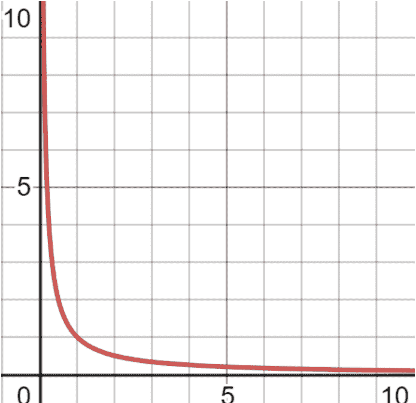

图 1-5. 在任一方向永远趋近于 0 但从未达到 0 的函数

我们只考虑正 x 值。请注意，当 x 永远增加时，f(x) 会越来越接近 0。令人着迷的是，f(x) 实际上永远不会达到 0。它只是永远越来越接近。

因此，这个函数的命运是，当 x 永远延伸至无穷大时，它将不断接近 0 但永远不会达到 0。表达一个永远被接近但从未达到的值的方式，是通过极限。

```
\lim_{x \to \infty} \frac{1}{x} = 0
```

读法为“当 x 趋近于无穷大时，函数 1/x 趋近于 0（但从未达到 0）。” 这种“趋近但从不接触”的行为你会经常看到，尤其是当我们深入学习导数和积分时。


使用 SymPy，我们可以计算当 \( x \) 趋近于无穷大 \( \infty \) 时，\( f(x) = \frac{1}{x} \) 趋近于什么值。请注意，SymPy 中用 \( \infty \) 巧妙地表达了 $\infty$。

### 示例 1-18. 使用 SymPy 计算极限

```python
from sympy import *
x = symbols('x')
f = 1 / x
result = limit(f, x, oo)
print(result) # 0
```

如你所见，我们也是以这种方式发现了欧拉数 \( e \)。它是将该函数中的 \( n \) 永无止境地延伸到无穷大所得的结果。

\[\lim_{n\to\infty} \left(1 + \frac{1}{n}\right)^n = e = 2.71828169413..\]

有趣的是，当我们使用 SymPy 中的极限计算欧拉数时（如示例 1-19 所示），SymPy 会立即将其识别为欧拉数。我们可以调用 `evalf()` 以便将其显示为数字。

### 示例 1-19.

```python
from sympy import *
n = symbols('n')
f = (1 + (1/n))**n
result = limit(f, n, oo)
print(result) # E
print(result.evalf()) # 2.71828182845905
```

## SymPy 的强大之处

SymPy 是 Python 的一个强大而出色的计算机代数系统（CAS），它使用精确的符号计算，而不是使用小数进行近似计算。在你会用“铅笔和纸”来解决数学和微积分问题的那些场景中，它非常有帮助，而且还能使用你熟悉的 Python 语法。它不会将 2 的平方根近似表示为 1.4142135623730951，而是会将其精确地保留为 *sqrt(2)*。

那么，为什么不为所有与数学相关的事情都使用 SymPy 呢？尽管我们会在本书中一直使用它，但使用普通小数进行 Python 数学运算仍然很重要，因为 SciKit-Learn 和其他数据科学库也是采用这种方法。对于计算机来说，使用小数比使用符号快得多。当数学表达式变得过大时，SymPy 也会感到吃力。但请将 SymPy 作为你的秘密武器随时备用，不要告诉你的高中和大学生孩子。他们可以直接用它来做数学作业。

https://docs.sympy.org/latest/tutorial/intro.html

## 导数

让我们回到函数的话题，从微积分的角度来看待它们，从导数开始。导数告诉我们函数的斜率，并且有助于测量函数中任何一点的变化率。

为什么我们要关心导数？它们经常用于机器学习和其他数学算法，尤其是梯度下降。当斜率为 0 时，这意味着我们处于输出变量的最小值或最大值。在以后进行线性回归（第 5 章）、逻辑回归（第 6 章）和神经网络（第 7 章）时，这个概念将很有用。

让我们从一个简单的例子开始。让我们看看图 1-6 中的函数 \( f(x) = x^2 \)。在 \( x = 2 \) 处，曲线有“陡”吗？

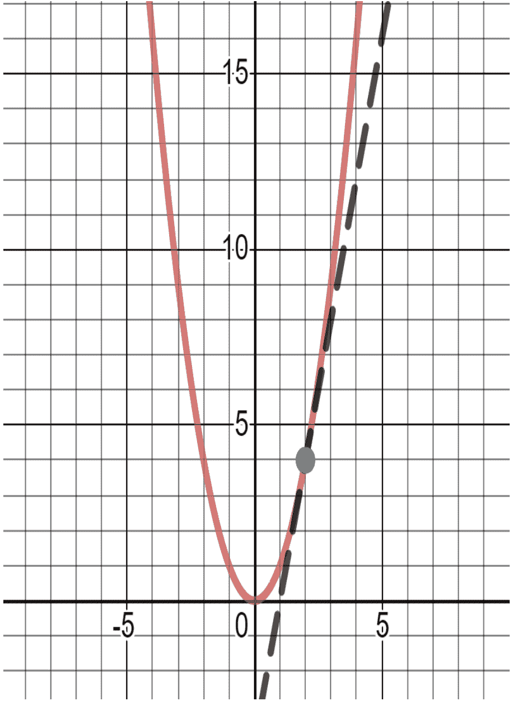

图 1-6. 观察函数给定部分的陡峭程度

请注意，如上所述，我们可以测量曲线上任意点的“陡峭程度”，并可以用一条切线来可视化这一点。将 **切线** 视为在给定点处“刚好接触”曲线的一条直线。它还提供给定点处的斜率。你可以通过创建一条与该 x 值和函数上 *非常接近* 的相邻 x 值相交的直线，来粗略地估计给定 x 值处的切线。

取 x = 2 和附近的值 x = 2.1，将它们传递给函数 f(x) = x^2，将得到 f(2) = 4 和 f(2.1) = 4.41，如图 1-7 所示。通过这两点的直线的斜率为 4.1。

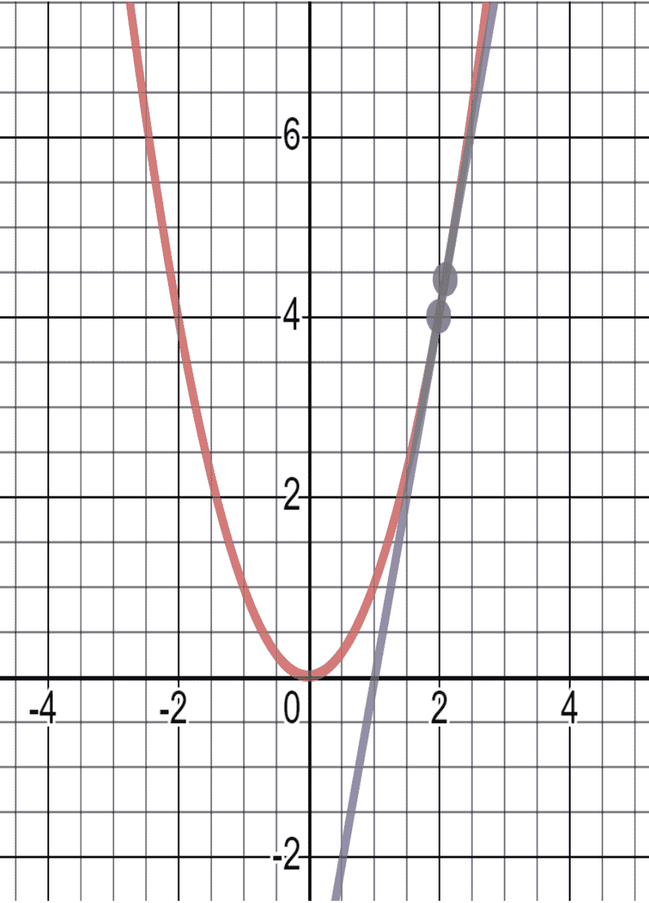

图 1-7. 计算斜率的一种粗糙方法

你可以使用简单的升降比公式快速计算两点之间的斜率 m：

$$m = \frac{y_2 - y_1}{x_2 - x_1}$$

$$m = \frac{4.41 - 4.0}{2.1 - 2.0}$$

$$m = 4.1$$

如果我将两点之间的 x 步长设得更小，例如 x = 2 和 x = 2.00001，这将产生 f(2) = 4 和 f(2.00001) = 4.00004，这将非常接近实际斜率 4。因此，我们相邻值的步长越小，就越接近曲线上给定点处的斜率值。与数学中许多重要概念一样，当我们趋近于无穷大或无穷小的值时，会发现有意义的东西。

### 示例 1-20. Python 中的导数计算器

```python
def derivative_x(f, x, step_size):
    m = (f(x + step_size) - f(x)) / ((x + step_size) - x)
    return m

def my_function(x):
    return x**2

slope_at_2 = derivative_x(my_function, 2, .00001)
print(slope_at_2) # prints 4.000010000000827
```

好消息是，有一种更干净的方法可以计算函数上任意位置的斜率。我们一直在使用 SymPy 来绘制图形，但我会向你展示它如何利用符号计算的魔力为你执行导数等任务。

当你遇到类似 f(x) = x^2 的指数函数时，导数函数会将指数变为乘数，然后将指数减 1，留给我们导数 \frac{d}{dx} x^2 = 2x。\frac{d}{dx} 表示对 x 求导，也就是说我们构建了一个针对 x 值以获取其斜率的导数。因此，如果我们想找到 x = 2 处的斜率，并且拥有导数函数，只需代入该 x 值即可得到斜率。

$$f(x) = x^2$$

$$\frac{d}{dx}f(x) = \frac{d}{dx}x^2 = 2x$$

$$\frac{d}{dx}f(2) = 2(2) = 4$$

如果你打算学习这些规则来手动计算导数，有很多微积分书籍可供参考。但有一些很好的工具可以为你符号化地计算导数。Python 库 SymPy 是免费且开源的，并且很好地适应了 Python 语法的使用。示例 1-21 展示了我们如何在 SymPy 上计算 f(x) = x^2 的导数。

### 示例 1-21. 在 SymPy 中计算导数

```python
from sympy import *
# Declare 'x' to SymPy
x = symbols('x')
# Now just use Python syntax to declare function
f = x**2
# Calculate the derivative of the function
dx_f = diff(f)
print(dx_f) # prints 2*x
```

哇！因此，通过在 SymPy 中使用 symbols() 函数声明变量，我就可以继续使用普通 Python 语法来声明我的函数。之后，我可以使用 diff() 为我计算导数函数。在示例 1-22 中，我们可以将导数函数带回普通 Python，并简单地将其声明为另一个函数。

### 示例 1-22. Python 中的导数计算器

```python
def f(x):
    return x**2

def dx_f(x):
    return 2*x

slope_at_2 = dx_f(2.0)

print(slope_at_2) # prints 4.0
```

如果你想继续使用 SymPy，可以调用 `subs()` 函数将 `x` 变量替换为值 `2`，如示例 1-23 所示。

### 示例 1-23. 在 SymPy 中使用替换功能

```python
# Calculate the slope at x = 2
print(dx_f.subs(x,2)) # prints 4
```

## 偏导数

本书中我们将遇到的另一个概念是 **偏导数**，我们将在第 5 章、第 6 章和第 7 章中使用它。这些是具有多个输入变量的函数上的导数。

这样来看待。与其在一维函数上找斜率，不如说我们有针对多个变量在多个方向上的斜率。对于每个给定变量的导数，我们假设其他变量保持不变。请看图 1-8 中 $f(x, y) = 2x^3 + 3y^3$ 的 3D 图，你将看到我们有两个变量的两个方向上的斜率。

让我们来看看函数 $f(x, y) = 2x^3 + 3y^3$。$x$ 和 $y$ 变量各自都有自己的导数 $\frac{d}{dx}$ 和 $\frac{d}{dy}$。这些表示在多维表面上相对于每个变量的斜率值。在处理多维时，我们从技术上将这些“斜率”称为 **梯度**。以下是 $x$ 和 $y$ 的导数，接着是计算这些导数的 SymPy 代码：

$f(x, y) = 2x^3 + 3y^3$


$$\frac{\partial}{\partial x} 2x^3 + 3y^3 = 6x^2$$
$$\frac{\partial}{\partial y} 2x^3 + 3y^3 = 9y^2$$

示例 1-24 和图 1-8 展示了如何使用 SymPy 分别计算 x 和 y 的偏导数。

### 示例 1-24. 使用 SymPy 计算偏导数

```
from sympy import *
from sympy.plotting import plot3d

# Declare x and y to SymPy
x, y = symbols('x y')

# Now just use Python syntax to declare function
f = 2*x**3 + 3*y**3

# Calculate the partial derivatives for x and y
dx_f = diff(f, x)
dy_f = diff(f, y)

print(dx_f) # prints 6*x**2
print(dy_f) # prints 9*y**2

# plot the function
plot3d(f)
```

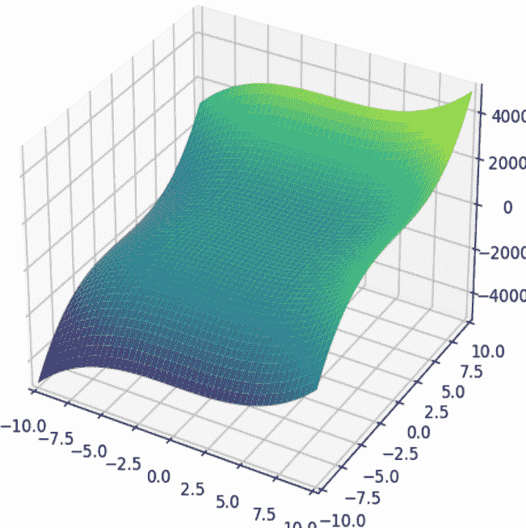

### 图 1-8. 绘制三维指数函数

所以对于 (x,y) 值 (1,2)，x 方向的斜率为 6(1) = 6，y 方向的斜率为 9(2)<sup>2</sup> = 36。

## 使用极限计算导数

想看看极限在计算导数中何时发挥作用吗？如果你对迄今所学内容感到满意，请继续！如果你仍在消化，也许可以考虑稍后再回到这个侧边栏。

SymPy 让我们可以进行一些关于数学的有趣探索。以我们的函数 \( f(x) = x^2 \) 为例，我们通过绘制经过近邻点 \( x = 2.0001 \) 的直线来近似 \( x = 2 \) 处的斜率，方法是增加一个步长 .0001。为什么不使用极限来无限减小该步长 \( s\) 看看它趋近于什么斜率呢？

\[ \lim_{s \to 0} \frac{(x + s)^2 - x^2}{(x + s) - x} \]

在我们的例子中，我们关心的是 \( x = 2 \) 处的斜率，因此让我们代入该值。

\[ \lim_{s \to 0} \frac{(2 + s)^2 - 2^2}{(2 + s) - 2} = 4 \]

通过无限趋近于步长 \( s\) 到 0 但永不触及（记住近邻点不能接触 \( x = 2 \) 处的点，否则就没有直线了！），我们可以使用极限来看到我们趋于斜率 4，如示例 1-25 所示。

### 示例 1-25. 使用极限计算斜率

```
from sympy import *

# "x" and step size "s"
x, s = symbols('x s')

# declare function
f = x**2

# slope between two points with gap "s"
# substitute into rise-over-run formula
slope_f = (f.subs(x, x + s) - f) / ((x+s) - x)

# substitute 2 for x
slope_2 = slope_f.subs(x, 2)

# calculate slope at x = 2
# infinitely approach step size __s__ to 0
result = limit(slope_2, s, 0)

print(result) # 4
```

现在如果我们不为 \(x\) 赋予特定值而将其保持不变呢？如果我们将步长 \(s\) 无限趋近于 0 会发生什么呢？让我们看示例 1-26。

### 示例 1-26. 使用极限计算导数

```
from sympy import *

# "x" and step size "s"
x, s = symbols('x s')

# declare function
f = x**2

# slope between two points with gap "s"
# substitute into rise-over-run formula
slope_f = (f.subs(x, x + s) - f) / ((x+s) - x)

# calculate derivative function
# infinitely approach step size +s+ to 0
result = limit(slope_f, s, 0)

print(result) # 2x
```

这给出了我们的导数函数 \(2x\)。SymPy 足够聪明，能明白永远不让步长达到 0 而始终趋近于 0。这使得 \(f(x) = x^2\) 趋于其导数对应物 \(2x\)。

## 链式法则

但目前让我们通过一个简单的代数示例来学习链式法则。假设你有两个函数：

$y = x^2 + 1$

$z = y^3 - 2$

注意上面两个函数是关联的，因为 y 是第一个函数的输出变量，但在第二个函数中是输入变量。这意味着我们可以像这样将第一个函数 y 代入第二个函数 z：

$z = (x^2 + 1)^3 - 2$

那么 z 对 x 的导数是什么？我们已经有了将 z 用 x 表示的代换。让我们使用 SymPy 在示例 1-27 中计算它。

### 示例 1-27. 求 z 对 x 的导数

```
from sympy import *

z = (x**2 + 1)**3 - 2
dz_dx = diff(z, x)
print(dz_dx)

# 6*x*(x**2 + 1)**2
```

因此，z 对 x 的导数是 6x(x^2 + 1)^2。

$$\frac{dz}{dx} \left( (x^2 + 1)^3 - 2 \right) = 6x(x^2 + 1)^2$$

但看看这个。让我们重新开始，采用不同的方法。如果我们分别对 y 和 z 函数求导，然后将它们相乘，这也会产生 z 对 x 的导数！让我们试一试。

$$\frac{dy}{dx}(x^2 + 1) = 2x$$
$$\frac{dz}{dy}(y^3 - 2) = 3y^2$$
$$\frac{dz}{dx} = (2x) (3y^2) = 6xy^2$$

好吧，$6xy^2$ 看起来可能不像 $6x(x^2 + 1)^2$，但那只是因为我们尚未代入 y 函数。这样做，使得整个 $\frac{dz}{dx}$ 导数用 x 表示而不含 y。

$$\frac{dz}{dx} = 6xy^2 = 6x(x^2 + 1)^2$$

现在我们看到了，我们得到了相同的导数函数 $6x(x^2 + 1)^2$！

我们在这里目睹的是**链式法则**，它指出对于给定函数 y（输入变量为 x）复合到另一个函数 z（输入变量为 y），我们可以通过将两个各自的导数相乘来找到 z 对 x 的导数。

$$\frac{dz}{dx} = \frac{dz}{dy} \times \frac{dy}{dx}$$

示例 1-28 展示了进行此比较的 SymPy 代码，表明链式法则得出的导数等于替换函数的导数。

### 示例 1-28. 使用和不使用链式法则计算导数 dz/dx，但仍得到相同答案

```
from sympy import *
x, y = symbols('x y')
# derivative for first function
# need to underscore y to prevent variable clash
_y = x**2 + 1

dy_dx = diff(_y)

# derivative for second function
z = y**3 - 2
dz_dy = diff(z)

# Calculate derivative with and without
# chain rule, substitute y function
dz_dx_chain = (dy_dx * dz_dy).subs(y, _y)
dz_dx_no_chain = diff(z.subs(y, _y))

# Prove chain rule by showing both are equal
print(dz_dx_chain) # 6*x*(x**2 + 1)**2
print(dz_dx_no_chain) # 6*x*(x**2 + 1)**2
```

链式法则是使用正确权重和偏差训练神经网络的关键部分。与其以嵌套洋葱的方式理清每个节点的导数，不如相乘各节点的导数，这在数学上要容易得多。

## 积分

导数的对立面是**积分**，它用于求给定范围内曲线下的面积。在**第 2 章**和**第 3 章**中，我们将求概率分布下的面积。虽然我们不会直接使用积分，而是使用已经积分的累积密度函数，但了解积分如何求曲线下的面积是有好处的。**附录 A** 包含了在此方法在概率分布上的应用示例。

我想采用一种称为黎曼和的直观方法来学习积分，它能灵活适应任何连续函数。首先，让我们指出，在直线下求某个范围的面积是很容易的。假设我有一个函数 f(x) = 2x，我想求 0 到 1 之间直线下的面积，如**图 1-9** 中阴影所示。

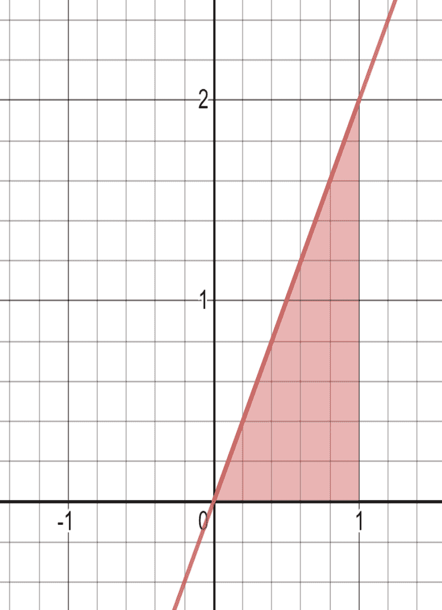

### 图 1-9. 计算线性函数下的面积

请注意，我正在求直线与 x 轴之间，且在 x 范围 0 到 1.0 内的面积。如果你还记得基本的几何公式，三角形的面积 A 为 A = \frac{1}{2}bh，其中 b 是底边长度，h 是高度。我们可以从上面直观地看出 b = 1 且 h = 2。因此，代入公式，我们得到的面积为 1.0，如下计算所示：

$$A = \frac{1}{2}bh$$
$$A = \frac{1}{2}*1*2$$
$$A = 1$$

这还不错，对吧？但让我们来看一个难以求面积的函数：f(x) = x^2 + 1。0 到 1 之间的面积是多少，如图 1-10 中阴影所示？

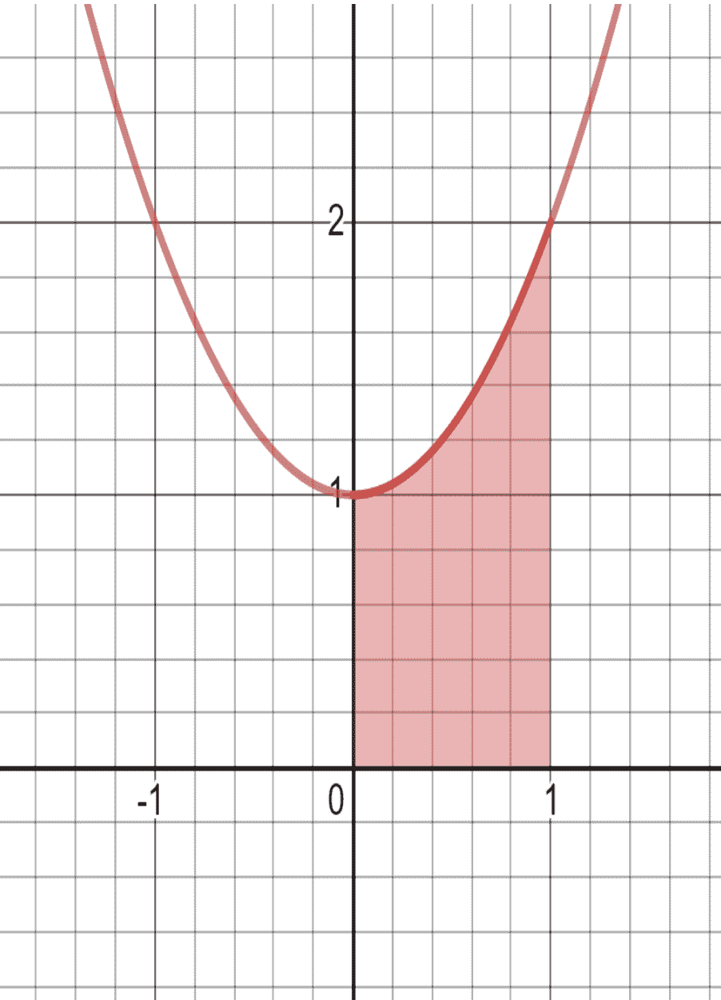

图 1-10. 计算非线性函数下的面积不那么直截了当


同样，我们只关心曲线下方、x轴上方、且x范围在0到1之间的区域。这里的曲线并不能给我们一个简洁的几何公式来求面积，但这里有一个聪明的小技巧你可以尝试。

如果我们在曲线下方像图1-11所示堆放5个等长的矩形，每个矩形的高度都从x轴延伸到中点触及曲线的位置，那会怎么样呢？

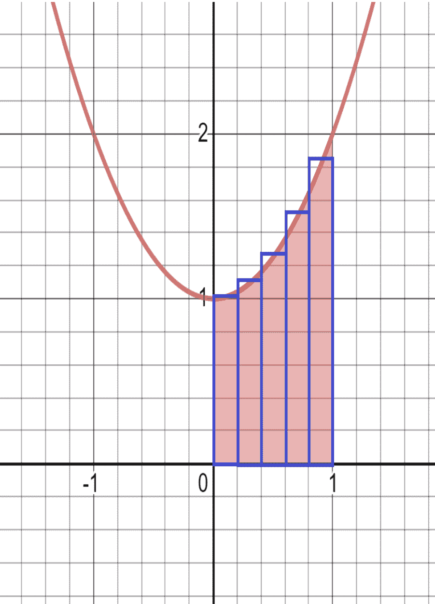

图1-11. 在曲线下方堆放矩形以近似面积

矩形的面积是_A_ = 长 × 宽，因此我们可以轻松求和各个矩形的面积。这能给出曲线下方面积的良好近似吗？如果我们堆放100个矩形呢？1000个？100,000个？当我们增加矩形数量的同时减小它们的宽度，难道我们不会更接近曲线下方的面积吗？当然会，这是又一个例子，即我们将某个东西向无穷递增或递减，以逼近真实值。

让我们在Python中试一下。首先，我们需要一个近似积分的函数，我们将其命名为`approximate_integral()`。参数_a_和_b_分别指定_x_范围的最小值和最大值。_n_是要堆放的矩形数量，_f_是我们要积分的函数。我们在示例1-29中实现该函数，然后用5个矩形在0.0到1.0之间对函数_f_(_x_) = _x_<sup>2</sup> + 1进行积分。

## 示例1-29. Python中的积分近似

```python
def approximate_integral(a, b, n, f):
    delta_x = (b - a) / n
    total_sum = 0

    for i in range(1, n + 1):
        midpoint = 0.5 * (2 * a + delta_x * (2 * i - 1))
        total_sum += f(midpoint)

    return total_sum * delta_x

def my_function(x):
    return x**2 + 1

area = approximate_integral(a=0, b=1, n=5, f=my_function)
print(area) # prints 1.33
```

我们得到的面积是1.33。如果使用1000个矩形会怎样？让我们在示例1-30中试一下。

## 示例1-30. Python中的积分近似

```python
area = approximate_integral(a=0, b=1, n=1000, f=my_function)
print(area) # prints 1.333333250000001
```

好吧，我们这里获得了更多精度，也获得了更多小数位。那100万个矩形呢，如示例1-31所示？

## 示例1-31. Python中的积分近似

```python
area = approximate_integral(a=0, b=1, n=1_000_000, f=my_function)

print(area) # prints 1.3333333333332733
```

好吧，我想我们这里收益递减了，正在趋近于1.333这个值，其中“.333”部分会无限循环。如果这是一个有理数，那很可能是\(\frac{4}{3} = 1.333\)。随着矩形数量的增加，近似值开始在越来越小的小数位上达到其极限。

既然我们对要实现的目标及其原因有了一些直观认识，那么让我们使用SymPy来做一个更精确的方法，碰巧SymPy支持有理数，如示例1-32所示。

## 示例1-32. 使用SymPy执行积分

```python
from sympy import *

# Declare 'x' to SymPy
x = symbols('x')

# Now just use Python syntax to declare function
f = x**2 + 1

# Calculate the integral of the function with respect to x
# for the area between x = 0 and 1
area = integrate(f, (x, 0, 1))

print(area) # prints 4/3
```

酷！所以面积实际上是4/3，这正是我们之前的方法趋近的值。不幸的是，普通Python（以及许多编程语言）只支持小数，但像SymPy这样的计算机代数系统能给我们精确的有理数。我们将在第2章和第3章中使用积分来求曲线下方的面积，尽管我们会让Scikit-learn为我们完成这项工作。

## 使用极限计算积分

对于极度好奇的读者，以下是我们如何在SymPy中使用极限计算定积分。请！如果你已经消化得足够多，可以跳过，或稍后再回到这个侧边栏。但如果你感觉状态良好，想深入了解积分是如何使用极限推导的，请继续！

主要思路与我们之前做的类似：在曲线下方堆放矩形，并使其无限变小，直到逼近精确面积。但当然，矩形的宽度不能为0……它们只需要不断趋近于0而永远不达到0。这是使用极限的又一个例子。

Khan Academy有一篇精彩的文章解释了如何对Riemann Sum使用极限，但以下是我们如何在SymPy中做到这一点，如示例1-33所示。

## 示例1-33. 使用极限计算积分

```python
from sympy import *

# Declare variables to SymPy
x, i, n = symbols('x i n')

# Declare function and range
f = x**2 + 1
lower, upper = 0, 1

# Calculate width and each rectangle height at index "i"
delta_x = ((upper - lower) / n)
x_i = (lower + delta_x * i)
fx_i = f.subs(x, x_i)

# Iterate all "n" rectangles and sum their areas
n_rectangles = Sum(delta_x * fx_i, (i, 1, n)).doit()

# Calculate the area by approaching the number
# of rectangles "n" to infinity
area = limit(n_rectangles, n, oo)

print(area) # prints 4/3
```

上面我们确定了每个矩形的长度`delta_x`和每个矩形的起始位置`x_i`，其中`i`是每个矩形的索引。`fx_i`是索引`i`处每个矩形的高度。我们声明`n`个矩形并求和它们的面积`delta_x * fx_i`，但我们还没有面积值，因为尚未为`n`指定一个数字。相反，我们将`n`趋近于无穷，以查看我们趋近于什么面积，你应该会得到`4/3`！

## 结论

在本章中，我们介绍了本书其余部分将使用的一些基础知识。从数论到对数和微积分积分，我们挑选了一些与数据科学、机器学习和分析相关的重要数学概念。你可能会问这些概念有什么用。这将在下一部分介绍！

在进入概率讨论之前，请花点时间再次浏览这些概念，然后完成以下练习。你在阅读本书的过程中随时可以回到本章，并在开始应用这些数学理念时根据需要复习。

## 练习

- 1. 62.6738是有理数还是无理数？为什么或为什么不是？
- 2. 计算表达式：$10^7 10^{-5}$
- 3. 计算表达式：$81^{\frac{1}{2}}$
- 4. 计算表达式：$25^{\frac{3}{2}}$
- 5. 假设不进行任何还款，5%利率按月复利计算，3年后一笔1000美元的贷款价值多少？
- 6. 假设不进行任何还款，5%利率按连续复利计算，3年后一笔1000美元的贷款价值多少？
- 7. 对于函数f(x) = 3x^2 + 1，x = 3处的斜率是多少？
- 8. 对于函数f(x) = 3x^2 + 1，x在0到2之间时曲线下方的面积是多少？

答案在附录B中。
