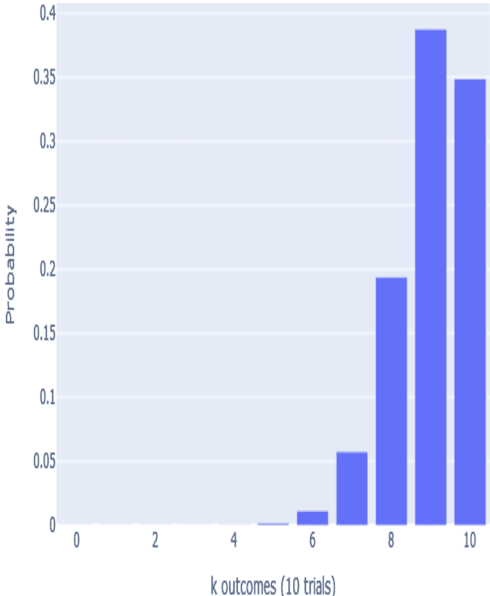
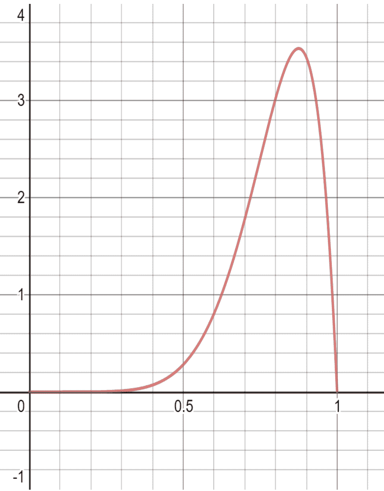
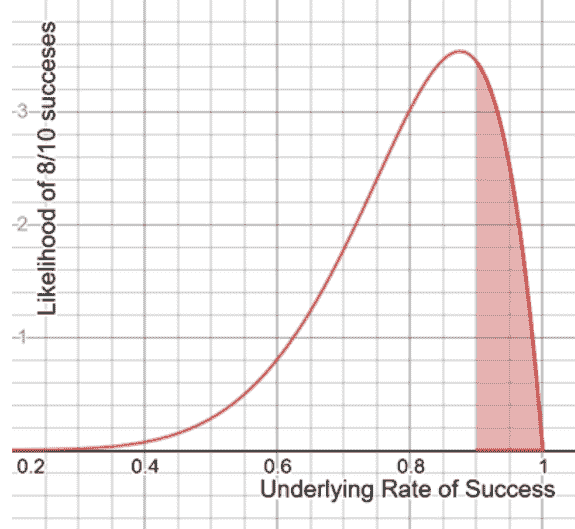
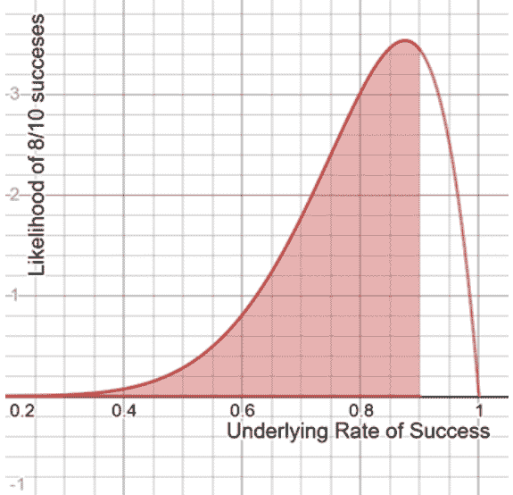
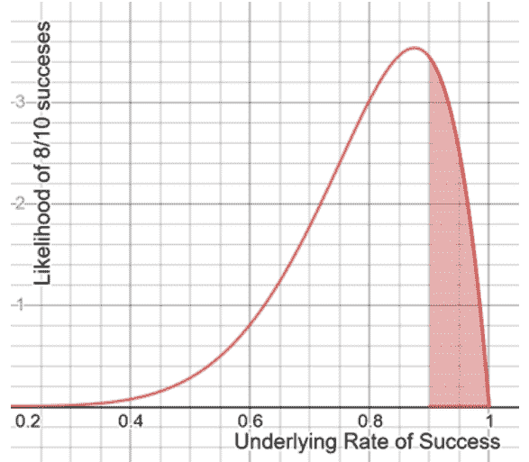
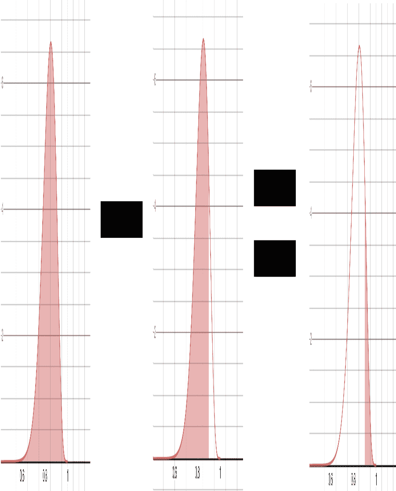
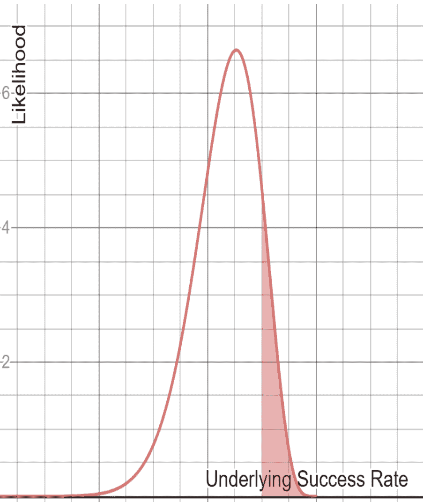
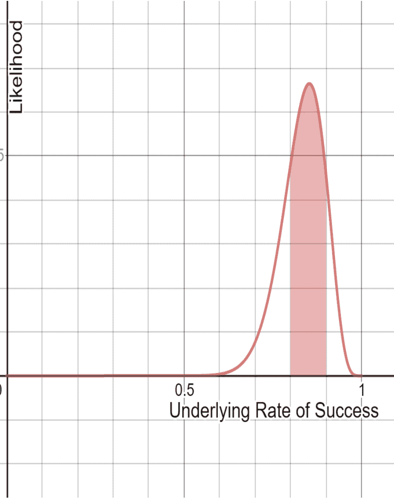
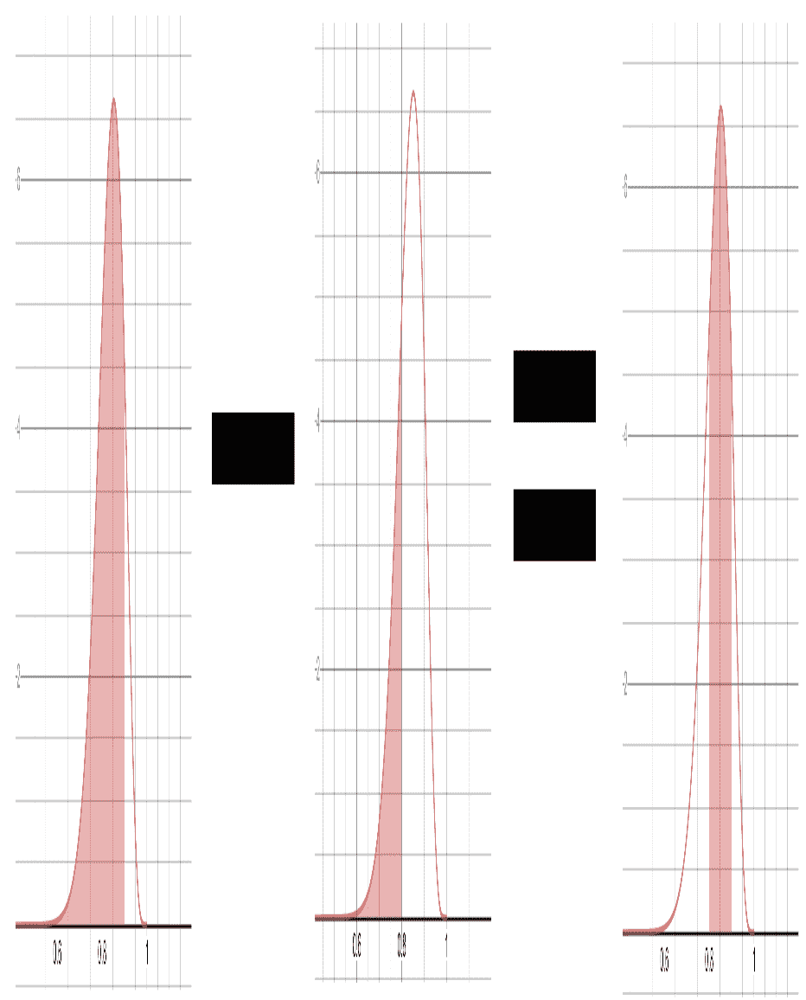

# 第 2 章. 概率

当你想到概率时，脑海中会浮现什么画面？也许你会想到赌博相关的例子，比如中彩票的概率或掷两个骰子得到对子的概率。也可能是预测股票表现、政治选举的结果，或者你的航班是否能准时到达。我们的世界充满了我们想要衡量的不确定性。

也许这就是我们应该关注的词：不确定性。我们如何衡量自己不确定的东西？

归根结底，概率是衡量某事件发生确定性的理论研究。它是统计学、假设检验、机器学习及本书其他主题的基础学科。许多人理所当然地认为自己理解概率。然而，它比大多数人想象的更具微妙性和复杂性。虽然概率的定理和思想在数学上是严谨的，但当我们引入数据并涉足统计学时，它会变得更加复杂。我们将在第4章关于统计学和假设检验的内容中涵盖这一点。

在本章中，我们将讨论什么是概率。然后我们将介绍概率数学概念、贝叶斯定理、二项分布和β分布。

## 理解概率

**概率**是我们相信某事件发生的强度，通常以百分比表示。以下是一些可能需要用概率来回答的问题：

- 我在10次公平投掷中得到7次正面的可能性有多大？
- 我赢得选举的机会有多大？
- 我的航班会晚点吗？
- 我多么确定一个产品有缺陷？

表达概率最流行的方式是百分比，例如“我的航班有70%的可能性会晚点”。我们将把这个概率称为_P_(_X_)，其中_X_是


感兴趣的事件。不过，在使用概率时，你更可能会看到它以小数表示（例如 .70），且必须介于 0.0 和 1.0 之间。P(X) = .70

**似然**与概率相似，容易将两者混淆（许多词典也是如此）。在日常对话中，你可以互换使用“概率”和“似然”。不过，我们应该厘清这些差异。概率是关于量化尚未发生的事件的预测，而似然是衡量已经发生的事件的频率。在统计学和机器学习中，我们常以数据形式利用似然（过去）来预测概率（未来）。

需要注意的是，事件发生的概率必须严格介于 0% 和 100%（即 0.0 和 1.0）之间。从逻辑上讲，事件不发生的概率等于 1.0 减去事件发生的概率。

```
$P(X) = .70$

\(P(\text{not } X) = 1-.70 = .30\)
```

这是概率与似然之间的另一区别。事件所有可能且互斥结果的概率之和必须为 1.0 或 100%（即只能发生一个结果，不能发生多个）。然而，似然不受此规则约束。

另外，概率可以表示为**赔率** \(O(X)\)，例如 7:3、\(\frac{7}{3}\) 或 2.333。

要将赔率 \(O(X)\) 转换为比例概率 \(P(X)\)，请使用以下公式：

```
\(P(X) = \frac{O(X)}{1 + O(X)}\)
```

因此，如果我有一个赔率 \(\frac{7}{3}\)，我可以这样将其转换为比例概率：

```
\(P(X) = \frac{O(X)}{1 + O(X)}\)

\(P(X) = \frac{\frac{7}{3}}{1 + \frac{7}{3}}\)
```

$P(X) = .7$

相反，你可以通过将事件发生的概率除以事件不发生的概率，简单地将赔率转换为概率：

$O(X) = \frac{P(X)}{1-P(X)}$

$O(X) = \frac{.70}{1-.70}$

$O(X) = \frac{7}{3}$

## 赔率很有用！

虽然许多人更习惯以百分比或比例表示概率，但赔率可以是一个有用的工具。如果我有一个 2.0 的赔率，这意味着我认为该事件发生的可能性是不发生的 2 倍。与 66.666% 的百分比相比，用它来描述一种信念可能更直观。因此，赔率在量化主观信念方面很有帮助，尤其是在赌博/投注场景中。它在贝叶斯统计（包括贝叶斯因子）以及我们将在第 6 章介绍的对数赔率的逻辑回归中也发挥作用。

## 概率与统计

有时人们会将*概率*和*统计*互换使用，虽然将这两门学科混为一谈可以理解，但它们确实有区别。**概率**纯粹是关于事件发生可能性的理论，不需要数据。**统计学**另一方面离不开数据，它利用数据来发现概率，并提供描述数据的工具。

试想预测掷骰子出“4”的点数（“die”是“dice”的单数形式）。如果纯粹从概率思维来解决这个问题，只需说骰子有 6 个面。我们假设每个面出现的概率相等，因此掷出“4”的概率是 $\frac{1}{6}$，即 16.666%。

然而，一个热情的统计学家可能会说：“不！我们需要掷骰子来获取数据。如果我们能掷 30 次或更多，掷得越多越好，只有这样我们才有数据来确定掷出 4 的概率。” 如果我们假设骰子是公平的，这种方法可能显得荒谬，但如果不是呢？如果是这种情况，收集数据是发现掷出“4”概率的唯一方法。我们将在第 3 章讨论假设检验。

## 概率数学

当我们处理事件的单一概率 P(X)（称为**边缘概率**）时，其概念如前面所述相当直观。但当我们开始组合不同事件的概率时，情况就不那么直观了。

### 联合概率

假设你有一枚公平的硬币和一个公平的 6 面骰子。你想求分别掷出“正面”和掷出“6”的概率。这是两个独立事件的两个单独概率，但我们想求两个事件同时发生的概率。这称为**联合概率**。

可以将联合概率视为 AND 操作符。我想求掷出正面 AND 掷出六的概率。我们希望两个事件同时发生，那么该如何计算这个概率呢？

硬币有 2 个面，骰子有 6 个面，因此正面的概率是 1/2，六的概率是 1/6。两个事件同时发生的概率（假设它们独立，稍后详述）仅仅是将两者相乘：

```
P(A AND B) = P(A)*P(B)

P (Heads) = 1/2

P (6) = 1/6

P (Heads AND 6) = 1/2 * 1/6 = 1/12 = .08333
```

这很简单，但这是为什么呢？许多概率规则可以通过生成事件的所有可能组合来发现，这来源于离散数学中称为排列和组合的领域。对于这种情况，生成硬币和骰子之间的每一种可能结果，将正面 (H) 和反面 (T) 与 1 到 6 的数字配对。注意，我在感兴趣的结果（即正面和六）周围加上了星号“**”。

H1 H2 H3 H4 H5 *H6* T1 T2 T3 T4 T5 T6

请注意，掷硬币和掷骰子共有 12 种可能结果。我们感兴趣的只有“H6”，即正面和六。由于只有一个结果满足条件，而总共有 12 种可能结果，因此掷出正面和六的概率是 $\frac{1}{12}$。

与其生成所有可能组合并计算我们感兴趣的组合数量，我们可以再次使用乘法作为快捷方式来求联合概率。这称为**乘法规则**。

$P(\text{A AND B}) = P(A) \times P(B)$

$P(\text{Heads AND 6}) = \frac{1}{2} \times \frac{1}{6} = \frac{1}{12} = .08333$

### 并集概率

我们讨论了联合概率，即两个或多个事件同时发生的概率。那么求事件 A 或 B 发生的概率呢？在处理概率中的“或”运算时，这称为**并集概率**。

让我们从**互斥事件**开始，即不能同时发生的事件。例如，掷骰子时，我不能同时得到“4”和“6”。我只能得到一个结果。这类情况的并集概率很简单，直接将它们相加即可。如果我想求掷骰子得到“4”或“6”的概率，则为 $\frac{2}{6} = \frac{1}{3}$。

$P(4) = \frac{1}{6}$

$P(6) = \frac{1}{6}$

$P(4 \text{ OR } 6) = \frac{1}{6} + \frac{1}{6} = \frac{1}{3}$

但**非互斥事件**呢？即可以同时发生的事件。让我们回到掷硬币和掷骰子的示例。得到正面 OR “六”的概率是多少？在你想直接将这些概率相加之前，让我们再次生成所有可能结果，并突出我们感兴趣的结果：

```
*H1*  *H2*  *H3*  *H4*  *H5*  *H6*  T1  T2  T3  T4  T5  *T6*
```

上面，我们关注所有“正面”结果以及“六”的结果。如果我们将感兴趣的 12 个结果中的 7 个按比例计算，即 \(\frac{7}{12}\)，则得到正确的概率 .58333。

但如果将正面和“六”的概率直接相加会怎样？我们会得到一个不同的（错误！）答案 .666。

```
\( P(HEADS) = \frac{1}{2} \)

\( P(6) = \frac{1}{6} \)

\( P(HEADS \text{ OR } 6) = \frac{1}{2} + \frac{1}{6} = \frac{4}{6} = .666 \)
```

这是怎么回事？再仔细研究一下掷硬币和掷骰子的组合，看看是否能发现什么可疑之处。注意，当我们将概率相加时，我们在“H6”和“T6”中都重复计算了得到“6”的概率！如果这还不清楚，尝试求“正面”或骰子点数 1 到 5 的概率。

```
\( P(HEADS) = \frac{1}{2} \)

\( P(1 \text{ through } 5) = \frac{5}{6} \)

\( P(HEADS \text{ OR } 1 \text{ through } 5) = \frac{1}{2} + \frac{5}{6} = \frac{8}{6} = 1.333 \)
```

我们得到 133.333% 的概率，这肯定是不正确的，因为概率不能超过 100% 或 1.0。问题再次是我们重复计算了结果。


如果你思考足够久，你可能会意识到，在并集概率中消除重复计数的逻辑方法是减去联合概率。这被称为**概率加法法则**，可确保每个联合事件只被计算一次。

```
P(A OR B) = P(A) + P(B) - P(A AND B)
P(A OR B) = P(A) + P(B) - P(A) × P(B)
```

因此，回到计算正面或“六”的概率的例子，我们需要从并集概率中减去得到正面或“六”的联合概率：

```
P(HEADS) = 1/2
P(6) = 1/6
P(A OR B) = P(A) + P(B) - P(A) × P(B)
P(HEADS OR 6) = 1/2 + 1/6 - (1/2 × 1/6) = .58333
```

请注意，此公式也适用于互斥事件。如果事件是互斥的，即只允许发生结果 A 或 B 中的一个，而不能两者都发生，那么联合概率 P(A AND B) 将为 0，从而从公式中消除。此时，你只需像之前一样对事件求和即可。

总结：当两个或多个非互斥事件之间存在并集概率时，请务必减去联合概率，以免重复计算概率。

## 条件概率与贝叶斯定理

人们容易混淆的一个概率主题是**条件概率**的概念，即在事件 B 已经发生的情况下，事件 A 发生的概率。它通常表示为 P(A GIVEN B) 或 P(A|B)。

假设某项研究声称 85% 的癌症患者喝咖啡。你对这个说法有何反应？这是否让你感到惊慌，想要放弃你最爱的早晨饮品？让我们先将其定义为条件概率 P(Coffee given Cancer) 或 P(Coffee|Cancer)。这表示已知某人患有癌症的情况下，其喝咖啡的概率。

在美国，让我们将其与癌症诊断人数比例（根据 cancer.gov 为 0.5%）和喝咖啡人群比例（根据 statista.com 为 65%）进行对比：

P(Coffee) = .65
P(Cancer) = .005
P(Coffee|Cancer) = .85

嗯……研究一下这些数字，问问咖啡是否真的是这里的问题。请注意，任何时候只有 0.5% 的人口患有癌症。然而，65% 的人口经常喝咖啡。如果咖啡导致癌症，难道我们不应该看到远高于 0.5% 的癌症数字吗？难道不应该接近 65% 吗？

这就是比例数字的狡猾之处。在没有任何上下文的情况下，它们可能看起来很重要，媒体标题当然可以利用这一点来获得点击率：可能会写“新研究揭示 85% 的癌症患者喝咖啡”。当然，这很荒谬，因为我们将一个常见属性（喝咖啡）与一个罕见属性（患癌）关联了起来。

人们之所以容易被条件概率搞混，是因为条件的方向很重要，而两种条件被错误地视为相等。“已知某人是咖啡饮用者，其患癌的概率”与“已知某人患癌，其是咖啡饮用者的概率”是不同的。简单来说：少数咖啡饮用者患癌，但许多癌症患者喝咖啡。

如果我们有兴趣研究咖啡是否导致癌症，我们真正关心的是第一个条件概率：已知某人是咖啡饮用者，其患癌的概率。

P(Coffee|Cancer) = .85
P(Cancer|Coffee) = ?

我们如何翻转条件？有一个强大的小公式叫做贝叶斯定理，我们可以使用它来翻转条件概率。

```
P (A|B) = \frac{P(B|A)P(A)}{P(B)}
```

如果我们将已有信息代入此公式，可以求解出已知某人喝咖啡，其患癌的概率：

```
P (A|B) = \frac{P(B|A)*P(A)}{P(B)}

P (Cancer|Coffee) = \frac{P(Coffee|Cancer)*P(Coffee)}{P(Cancer)}

P (Cancer|Coffee) = \frac{.85*.005}{.65} = .0065
```

如果你想在 Python 中计算此值，请查看示例 2-1。

### 示例 2-1. 在 Python 中使用贝叶斯定理

```
p_coffee_drinker = .65
p_cancer = .005
p_coffee_drinker_given_cancer = .85
p_cancer_given_coffee_drinker = p_coffee_drinker_given_cancer *
    p_cancer / p_coffee_drinker

# prints 0.006538461538461539
print(p_cancer_given_coffee_drinker)
```

好吧，已知某人是咖啡饮用者，其患癌的概率只有 0.65%！这个数字与已知某人患癌，其是咖啡饮用者的概率（85%）截然不同。现在你明白条件的方向为什么重要了吗？出于这个原因，贝叶斯定理很有帮助。它还可以用于将多个条件概率链接在一起，以便根据新信息不断更新我们的信念。

### 什么定义了“咖啡饮用者”？

请注意，我本可以考虑其他变量，特别是什么样的人才算作“咖啡饮用者”。如果某人每月喝一次咖啡，与每天喝咖啡的人相比，我是否应该同样将两者都视为“咖啡饮用者”？那个一个月前才开始喝咖啡的人，与喝了 20 年咖啡的人呢？人们需要多久、喝多长时间咖啡，才能在这个癌症研究中达到“咖啡饮用者”的门槛？

这些都是需要考虑的重要问题，也表明数据很少能讲述完整的故事。如果有人给你一份患者电子表格，上面有一个简单的“是/否”标记来标注他们是否是咖啡饮用者，那么这个门槛就需要被定义！或者我们需要一个更有分量的指标，比如“过去 3 年内消耗的咖啡饮品数量”。我将这个思想实验保持简单，并没有定义某人如何才算作“咖啡饮用者”，但请注意，在实际工作中，深入探究数据始终是个好主意。我们将在第 3 章中更详细地讨论这一点。

如果你想更深入地探索贝叶斯定理背后的直觉，请转到附录 A。目前只需知道它能帮助我们翻转条件概率。接下来，让我们讨论条件概率如何与联合和并集运算相互作用。

### 朴素贝叶斯

贝叶斯定理在一种常见的机器学习算法——朴素贝叶斯（Naive Bayes）中扮演着核心角色。Joel Grus 在他的书《从头开始学数据科学》中对此进行了讲解。

### 联合与并集条件概率

让我们重新审视联合概率及其与条件概率的相互作用。我想找出某人既是咖啡饮用者又患癌的概率。我是否应该将 P(Coffee) 和 P(Cancer) 相乘？或者，如果可用，我是否应该用 P(Coffee|Cancer) 替代 P(Coffee)？我应该使用哪一个？

- 选项 1：

```
P(Coffee) × P(Cancer) = .65 × .005 = .00325
```

- 选项 2：

```
P(Coffee|Cancer) × P(Cancer) = .85 × .005 = .00425
```

如果我们已经确定概率仅适用于癌症患者，那么使用 P(Coffee|Cancer) 而不是 P(Coffee) 难道不合理吗？一个更具体，并且适用于已经建立的条件。因此，我们应该使用 P(Coffee|Cancer)，因为 P(Cancer) 已经是我们联合概率的一部分。这意味着某人既患癌又是咖啡饮用者的概率是 0.425%。

P(Coffee and Cancer) = P(Coffee|Cancer) × P(Cancer) = .85 × .005 = .00425

这个联合概率也适用于相反的方向。我可以通过将 P(Cancer|Coffee) 和 P(Coffee) 相乘，找出某人既是咖啡饮用者又患癌的概率。如你所见，我得出了相同的答案：

P(Cancer|Coffee) × P(Coffee) = .0065 × .65 = .00425

如果没有任何条件概率可用，那么我们所能做的最好方法就是将 P(Coffee Drinker) 和 P(Cancer) 相乘，如下所示：

P(Coffee Drinker) × P(Cancer) = .65 × .005 = .00325

现在请思考一下：如果事件 A 对事件 B 没有影响，那么这对条件概率 P(B|A) 意味着什么？这意味着 P(B|A) = P(B)，即事件 A 的发生与事件 B 发生的可能性无关。因此，无论两个事件是否依赖，我们可以将联合概率公式更新为：

P(A AND B) = P(B) × P(A|B)

最后，让我们讨论一下并集和条件概率。如果我想计算 A 或 B 发生的概率，但 A 可能会影响 B 的概率，我们这样更新加法法则：

P(A OR B) = P(A) + P(B) – P(A|B) × P(B)

提醒一下，这也适用于互斥事件。如果事件 A 和 B 不能同时发生，则加法法则 P(A|B) × P(B) 将产生 0。


## 二项分布

在本章剩余部分，我们将学习两种概率分布：二项分布和β分布。虽然在本书剩余部分我们不会使用它们，但它们本身是有用的工具，并且对于理解在给定试验次数下事件如何发生是基础性的。它们也将成为理解概率分布的良好过渡，我们将在第3章中大量使用概率分布。让我们探讨一个可能出现在现实世界场景中的用例。

假设你正在开发一种新的涡轮喷气发动机，并进行了10次测试。结果产生了8次成功和2次失败：

- ✓ ✓ ✓ ✓ ✓ X X ✓ ✓

你原本希望达到90%的成功率，但根据上述数据，你得出结论测试只有80%的成功率，因此失败了。每次测试都耗时且昂贵，所以你决定是时候回到绘图板上重新设计了。

然而，你的一名工程师坚持认为应该进行更多测试。“唯一能确定的方法是进行更多测试，”她争辩道。“如果更多测试产生90%或更高的成功率怎么办？毕竟，如果你抛10次硬币得到8次正面，并不意味着硬币被固定在80%。”

你简要考虑了工程师的论点，并意识到她有道理。即使是公平的硬币投掷，结果也不会总是均匀分布，特别是只有10次投掷时。你最可能得到5次正面，但也可能得到3、4、6或7次正面。你甚至可能得到10次正面，尽管这极不可能。那么，在假设基础概率为90%的情况下，你如何确定80%成功的可能性呢？

这里可能相关的一个工具是**二项分布**，它衡量在给定*p*概率的情况下，*n*次试验中出现*k*次成功的可能性。

从视觉上看，二项分布如图2-1所示。



图2-1. 二项分布

如上所示，我们看到每个柱状图代表10次试验中k次成功的概率。
这个二项分布假设概率p为90%，意味着成功发生的概率为.90（或90%）。如果这是真的，这意味着从10次试验中得到8次成功的概率为.1937。从10次试验中得到1次成功的概率极不可能，为.00000008999，因此柱子甚至不可见。

我们也可以通过累加8次或更少成功的柱子来计算8次或更少成功的概率。这将给出.2639的概率，即8次或更少成功。

那么，我们如何实现二项分布呢？我们可以相对容易地从头开始实现（如附录A中所述），或者可以使用SciPy等库。示例2-2展示了如何使用SciPy的binom.pmf()函数（PMF代表“概率质量函数”）来打印我们二项分布从0到10次成功的全部11个概率。

### 示例2-2. 使用SciPy进行二项分布

```
from scipy.stats import binom

n = 10
p = 0.9

for k in range(n + 1):
    probability = binom.pmf(k, n, p)
    print("{0} - {1}".format(k, probability))
```

```
# OUTPUT:
# 0 - 9.99999999999996e-11
# 1 - 8.99999999999996e-09
# 2 - 3.644999999999996e-07
# 3 - 8.74800000000003e-06
# 4 - 0.00013778099999999
# 5 - 0.00148803479999998
# 6 - 0.0116026099999996
# 7 - 0.0573956280000001
# 8 - 0.193710244999993
# 9 - 0.3874204890000037
# 10 - 0.3486784401000004
```

如你所见，我们将n作为试验次数，p作为每次试验的成功概率，而k是我们想要查询其概率的成功次数。我们遍历每个成功次数x及其对应的概率，即观察到那么多次成功的概率。如上面输出所示，最可能的成功次数是9。

但是，如果你将8次或更少成功的概率相加，我们将得到.2639。这意味着即使基础成功率为90%，看到8次或更少成功的机会也有26.39%。所以工程师可能是对的。26.39%的机会并非微不足道，当然是可能的。

然而，我们在模型中确实做了一个假设，我们将在接下来的β分布部分讨论。

### 从零开始构建二项分布

转到附录A，了解如何在不使用Scikit-learn的情况下从头构建二项分布。

## β分布

在使用二项分布的发动机测试模型中，我做了什么假设？是否有一个我假设为真，然后围绕它构建整个模型的参数？仔细思考并继续阅读。

我上面的二项分布可能存在的问题是，我假设基础成功率为90%。这并不意味着我的模型毫无价值。我只是展示，如果基础成功率为90%，那么在10次试验中看到8次或更少成功的概率有26.39%。因此，工程师并非完全错误，即可能存在90%的基础成功率。

但是，让我们换个角度思考一下：除了90%之外，是否还有其他基础成功率会产生8/10的成功？我们能否在基础成功率为80%、70%或30%的情况下看到8/10的成功？当我们固定8/10的成功时，能否探索概率的概率？

与其创建无数个二项分布来回答这个问题，我们可以使用一个工具。**β分布**允许我们看到在给定*α*次成功和*β*次失败的情况下，事件发生的不同基础概率的可能性。

以下是在8次成功和2次失败情况下的β分布图表（见图2-2）。



图2-2. β分布

### 在DESMOS上使用β分布

如果你想与β分布进行交互，这里提供了一个Desmos图表：

https://www.desmos.com/calculator/xylhmcwo71

请注意，x轴表示0.0到1.0（0%到100%）的所有基础成功率，y轴表示给定8次成功和2次失败时该概率的可能性。换句话说，β分布允许我们在给定8/10成功的情况下看到概率的概率。请将其视为元概率，花点时间掌握这个想法！

还要注意的是，β分布是一个连续函数，这意味着它形成一条小数值的连续曲线（与二项分布中整齐且离散的整数不同）。这将使β分布的数学计算稍微困难一些，因为y轴上的给定密度值并不是概率。我们反而通过曲线下的面积来查找概率。

β分布是一种**概率分布**，这意味着整条曲线下的面积为1.0，即100%。要查找概率，我们需要找到某个范围内的面积。例如，如果我们想要评估8/10的成功将产生90%或更高成功率的概率，我们需要找到0.9到1.0之间的面积，即22.5%，如图2-3中阴影所示。



图2-3. 90%到100%之间的面积，即22.5%

与二项分布一样，我们可以使用SciPy来实现β分布。每个连续概率分布都有一个**累积分布函数（CDF）**，它计算到给定x值为止的面积。假设我想要计算到90%（0.0到.90）的面积，如图2-4中阴影所示。



图2-4. 计算到90%（0.0到.90）的面积

使用SciPy及其`beta.cdf()`函数非常简单，我需要提供的唯一参数是x值、成功次数a和失败次数b，如示例2-3所示。

### 示例2-3. 使用SciPy进行β分布

```
from scipy.stats import beta

a = 8
b = 2

p = beta.cdf(.90, a, b)

# 0.7748409780000001
print(p)
```

根据上面的计算，基础成功概率为90%或更低的概率为77.48%。

我们如何计算成功率为90%或更高的概率，如图2-5中阴影所示？




## 图 2-5. 成功率在 90% 或以上的概率

我们的 CDF 仅计算边界左侧的面积，而非右侧。思考一下概率规则：在概率分布中，曲线下的总面积为 1.0。如果我们想求事件的对立概率（大于 0.90 而非小于 0.90），只需用 1.0 减去小于 0.90 的概率，剩余的概率即代表大于 0.90 的情形。图 2-6 直观展示了我们如何进行此减法运算。



## 图 2-6. 求成功率大于 90% 的概率

示例 2-4 展示了如何在 Python 中计算此减法运算。

## 示例 2-4. 使用 SciPy 的贝塔分布

```
from scipy.stats import beta

a = 8
b = 2

p = 1.0 - beta.cdf(.90, a, b)

# 0.22515902199999993
print(p)
```

这意味着在 10 次发动机测试中有 8 次成功的情况下，实际成功率为 90% 或以上的概率只有 22.5%。但它小于 90% 的概率约为 77.5%。这里的形势对我们不利，即我们的测试并未取得成功，但如果我们抱着试试运气的心态，也可以通过更多测试来押注那 22.5% 的机会。如果我们的首席财务官批准了再进行 26 次测试的资金，结果为 30 次成功和 6 次失败，那么我们的贝塔分布现在将如图 2-7 所示。



## 图 2-7. 30 次成功和 6 次失败后的贝塔分布

请注意，我们的分布变窄了，因此更有信心实际成功率落在一个更小的范围内。不幸的是，满足 90% 成功率最低要求的概率仅有所下降，从 22.5% 降至 13.16%，如示例 2-5 所示。

## 示例 2-5. 使用 SciPy 的贝塔分布

```
from scipy.stats import beta

a = 30
b = 6

p = 1.0 - beta.cdf(.90, a, b)

# 0.13163577484183708
print(p)
```

到此为止，或许最好停止测试并收手，除非你想继续冒那 13.16% 的风险，并期望峰值向右移动。

最后，如何计算中间区域的面积？如果我想求实际成功率在 80% 到 90% 之间的概率（如图 2-8 所示），该如何计算？



## 图 2-8. 实际成功率在 80% 到 90% 之间的概率

请仔细思考你可能会如何处理这个问题。如果我们用 0.90 后面的面积减去 0.80 后面的面积（如图 2-9 所示），会怎样？



## 图 2-9. 获取 0.80 和 0.90 之间的面积

这不正是能给出 0.80 和 0.90 之间面积的方法吗？确实如此，这样得到的面积为 0.3386，即 33.86% 的概率。以下是在 Python 中的计算方法（示例 2-6）。

## 示例 2-6. 使用 SciPy 计算贝塔分布中间区域面积

```
from scipy.stats import beta
a = 8
b = 2
p = beta.cdf(.90, a, b) - beta.cdf(.80, a, b)
# 0.33863336200000016
print(p)
```

贝塔分布是一个引人入胜的工具，用于基于有限观测值来衡量事件发生与不发生的概率。它让我们能够对“概率的概率”进行推理，并且在获取新数据时可以对其进行更新。我们也可以用它进行假设检验，但在第 3 章中，我们将更侧重于使用正态分布和 T 分布来实现这一目的。

### 从零开始实现贝塔分布

要了解如何从零开始实现贝塔分布，请参阅附录 A。

## 结论

本节我们学习了许多内容！我们不仅介绍了概率的基础知识、其逻辑运算符和贝叶斯定理，还介绍了包括二项分布和贝塔分布在内的概率分布。在下一章中，我们将介绍较为著名的分布之一——正态分布，以及它与假设检验的关系。

如果你想深入了解贝叶斯概率和统计学，Will Kurt 的 *以有趣的方式学习贝叶斯统计* 是一本极好的书。O'Reilly 平台上也提供交互式的 Kata 代码场景。

## 练习

- 1. 今天下雨的概率为 30%，而你的伞订单按时送达的概率为 40%。你渴望今天在雨中行走，但两者缺一不可！

  下雨 **且** 伞会按时到达的概率是多少？

- 2. 今天下雨的概率为 30%，而你的伞订单按时送达的概率为 40%。

  只有在不下雨或伞送到的情况下，你才能去办事。

  不下雨 **或** 伞到达的概率是多少？

- 3. 今天下雨的概率为 30%，而你的伞订单按时送达的概率为 40%。

  不过，你发现如果下雨，伞按时送达的概率只有 20%。

  下雨 **且** 伞按时到达的概率是多少？

- 4. 你有一班从拉斯维加斯飞往达拉斯的航班，已有 137 名乘客预订。不过，现在是周日早晨的拉斯维加斯，你估计每名乘客有 40% 的概率不出现。

  你正在计算应该超售多少个座位，以免飞机空载飞行。

  至少有 50 名乘客不出现的概率是多少？

- 5. 你掷了 19 次硬币，正面出现 15 次，反面出现 4 次。

  你觉得这枚硬币有很大概率是公平的吗？为什么或为什么不？

答案在附录 B 中。
