# 第 3 章. 描述统计学与推断统计学

**统计学**是收集和分析数据以发现有用结果，或预测导致这些结果发生原因的实践。概率在统计学中常扮演重要角色，因为我们利用数据来估计事件发生的可能性。

统计学或许并不总能得到应有的认可，但它却是众多数据驱动创新的核心。机器学习本身就是一种统计工具，旨在寻找可能的假设，以关联数据中不同变量之间的关系。然而，即使是对专业统计学家而言，统计学也有许多盲点。我们很容易被数据所表达的内容所吸引，而忘记询问数据来自哪里。随着“大数据”、“数据挖掘”和“机器学习”都在加速统计算法的自动化，这些担忧变得愈发重要。因此，打好统计学和假设检验的基础至关重要，这样你就不会将这些自动化视为黑盒。

在本节中，我们将学习统计学和假设检验的基础知识。我们将从描述性统计学入手，学习汇总数据的常见方法。之后，我们将进入推断性统计学领域，试图根据样本推断总体的属性。

### 什么是数据？

定义数据似乎有些奇怪，因为这是我们都在使用且视为理所当然的东西。但我认为有必要这么做。很可能，如果你问任何人什么是数据，他们可能会回答类似“你知道……数据！它就是……嗯……信息！”之类的话，并且不会再深入探讨。如今，数据似乎被宣传为万能之源。它不仅是真理的源泉……更是智慧的源泉！它是“人工智能”的燃料，人们相信你拥有的数据越多，拥有的真理就越多。因此，数据似乎再多也不嫌多。它将解锁重新定义商业战略所需的秘密，甚至可能创造出通用人工智能。但让我提供一个关于数据的务实视角。数据本身并不重要。重要的是对数据的分析（以及数据的生成方式），这才是所有这些创新和解决方案的驱动力。

想象一下，你得到了一张一家人的照片。你能仅凭这一张照片了解这个家庭的故事吗？如果你有 20 张照片呢？200 张？2000 张？你需要多少张照片才能了解他们的故事？你是否需要他们在不同情境下的照片？单独和合在一起？与亲戚和朋友？在家和在工作地点？

**数据**就像照片一样；它提供了一个故事的快照。连续的现实和情境并未被完全捕获，驱动这个故事的无数变量也是如此。正如我们将讨论的，数据可能存在偏差。它可能存在缺口并缺少相关变量。理想情况下，我们希望拥有无限量的数据来捕获无限数量的变量，并有如此多的细节，以至于我们几乎可以重新创建现实并构建替代现实！但这是可能的吗？目前，不可能。即使世界上所有最强大的超级计算机加在一起，也远远无法将整个世界作为数据来捕获。

因此，我们必须缩小范围，使目标具有可行性。几张父亲打高尔夫球的有策略的照片，就能轻易告诉我们他是否擅长高尔夫。但试图仅凭照片解读他一生的故事？那可能是不可能的。快照中有太多无法捕捉的内容。在处理数据项目时，也应考虑这些实际问题，因为数据实际上只是在给定时间下的快照，只捕获其所瞄准的内容（很像相机）。我们需要保持目标聚焦，这样才能聚焦于收集相关且完整的数据。如果我们的目标过于宽泛和开放，我们可能会因得出虚假发现和不完整的数据集而陷入麻烦。这种做法被称为 **数据挖掘**，它有时有用但必须小心进行。我们将在本章末尾再次探讨这一点。

即使目标定义得很窄，我们的数据仍可能出现问题。让我们回到这样一个问题：几张有策略的照片能否判断父亲是否擅长高尔夫。也许，如果你有一张他挥杆时的照片，你就能判断他的姿势是否正确。或者，如果你看到他在球洞旁欢呼和挥拳，你可以推断他取得了好成绩。也许你可以直接拍一张他的成绩单！但重要的是要注意，所有这些情况都可能是伪造的或断章取义。也许他是在为……欢呼


或者是其他人，或者记分卡根本不是他的，甚至是伪造的。就像这些照片一样，数据不会捕捉背景或解释。这是一个非常重要的观点，因为数据提供的是线索，而非真相。这些线索可以引导我们走向真相，也可能误导我们得出错误的结论。

这就是为什么对数据来源保持好奇是如此重要的技能。询问数据是如何创建的，由谁创建，以及数据没有捕获什么。如今，太容易被数据所说的内容所吸引，而忘记询问它来自何处。更糟糕的是，普遍存在一种观点，即可以将数据铲入机器学习算法，并期望计算机自行解决一切。但正如古语所说，“垃圾进，垃圾出。”难怪只有[13% 的机器学习项目根据 VentureBeat 成功](https://venturebeat.com/2019/07/19/why-do-87-of-data-science-projects-never-make-it-into-production/)。成功的机器学习项目会对数据及其产生方式进行深思熟虑和分析。

## 基准真理

更广泛地说，家庭照片的例子呈现了一个基准真理问题。

当我教授 AI 系统安全课程时，曾有人问过我如何让自动驾驶汽车更安全。“当自动驾驶汽车无法通过其摄像头传感器识别行人时，难道没有办法让它识别出故障并停车吗？”我回答说没有，因为该系统没有**基准真理**框架，即对什么是真实的经过验证和完整的认知。如果汽车无法识别行人，它又怎么能意识到自己无法识别行人呢？除非有人工操作员可以提供并介入，否则它没有可供回退的基准真理。

这实际上是“自动驾驶”汽车和出租车服务的现状。雷达等传感器对狭窄问题（例如“车前是否有东西？”）提供了相当可靠的基准真理。但基于摄像头感官（在非受控环境中）识别物体是一个模糊得多的感知问题，可能遇到的像素组合数量天文数字般庞大。因此，基准真理不存在。

您的数据是否代表可验证且完整的基准真理？传感器和来源可靠且准确吗？还是基准真理未知？

https://en.wikipedia.org/wiki/Ground_truth

## 描述统计与推断统计

当你听到“统计学”这个词时，脑海中浮现的是什么？是计算均值、中位数、众数、图表、钟形曲线以及其他描述数据的工具吗？这是统计学中最常被理解的部分，称为**描述统计学**，我们用它来汇总数据。毕竟，浏览一百万条数据记录更有意义，还是让它们被汇总更有意义？我们将首先介绍统计学的这一领域。

**推断统计学**试图揭示更大总体的属性，通常基于样本。它常被误解，且不如描述统计学直观。很多时候，我们有兴趣研究一个太大而无法观察的群体（例如北美青少年的平均身高），不得不求助于仅使用该群体少数成员来推断关于他们的结论。正如你所猜测的，这并不容易做对。毕竟，我们试图用一个可能不具代表性的样本来代表一个总体。我们将在过程中探讨这些注意事项。

## 总体、样本和偏差

在深入研究描述统计学和推断统计学之前，列出一些定义并将其与具体示例联系起来可能是个好主意。

一个**总体**是我们想要研究的特定感兴趣群体，例如“北美所有 65 岁以上的老人”、“苏格兰所有金毛寻回犬”或“洛斯阿尔托斯高中目前的高二学生”。注意我们在定义总体时有边界。其中一些边界很宽泛，涵盖广阔地理区域或年龄段的大量群体。另一些则非常具体和小，例如洛斯阿尔托斯高中的高二学生。你如何界定总体取决于你有兴趣研究什么。

一个**样本**是总体的子集，理想情况下是随机且无偏的，我们用它来推断总体的属性。我们通常不得不研究样本，因为并不总是可能对整个总体进行调查。当然，如果某些总体规模小且易于接触，则更容易获取。但是测量北美所有 65 岁以上的老人？这不太可能切实可行！

## 总体可能是抽象的！

值得注意的是，总体可以是理论上的，而非实物可触的。在这些情况下，我们的“总体”更像是从某种抽象事物中取出的样本。我最喜欢的例子是：我们对机场下午 2 点到 3 点之间起飞的航班感兴趣，但我们缺乏该时间段足够多的航班来可靠预测这些航班延误的频率。因此，我们可以将这个“总体”视为一个样本……来自下午 2 点到 3 点之间所有理论起飞航班的底层总体。

正是这类问题，促使许多研究人员求助于模拟来生成数据。模拟可能有用，但很少准确，因为模拟只捕获了这么多变量，并且内置了假设。

如果我们要基于样本推断总体的属性，重要的是样本应尽可能随机，以免我们扭曲结论。举个例子。假设我是亚利桑那州立大学的一名大学生。我想找出美国大学生每周观看电视的平均小时数。我走到宿舍外面，开始对路过的随机学生进行调查，几个小时内就完成了数据收集。这里有什么问题？

问题是我们的学生样本将会有**偏差**，这意味着它会以过度代表某一群体而牺牲其他群体的方式扭曲我们的发现。我的研究将总体定义为“美国大学生”，而不是“亚利桑那州立大学的大学生”。我只在一所特定大学对学生进行调查，以代表美国整个国家的所有大学生！这真的公平吗？

全国所有大学不太可能在学生属性上都千篇一律。如果亚利桑那州立大学的学生比其他大学的学生观看更多电视，那会怎样？用他们来代表整个国家，难道不会扭曲结果吗？这可能是因为亚利桑那州坦佩通常太热，无法外出。因此看电视是一种常见的消遣（据我所知，我在凤凰城住了很多年）。其他气候较温和地区的大学生可能会参加更多户外活动，看更少电视。

这只是一个可能的变量，说明用一所大学的学生样本来代表整个美国的大学生是个坏主意。理想情况下，我应该在全国不同大学随机调查大学生。这样我就能获得一个更具代表性的样本。

然而，偏差并不总是地理性质的。假设我真诚地努力对美国各地的学生进行调查。我安排了一项社交媒体活动，让各大学在 Twitter 和 Facebook 上分享调查。这样他们的学生就会看到并希望填写。我收到了全国各地关于学生观看电视习惯的数百条回复，觉得自己征服了偏差这头野兽……或者我真的征服了吗？

如果足够活跃于社交媒体以看到调查的学生也更有可能观看更多电视，那会怎样？如果他们经常使用社交媒体，他们可能不介意娱乐屏幕时间。很容易想象他们在另一个标签页里准备好了 Netflix 和 Hulu 来流媒体播放！这种特定类型的偏差，即特定群体更有可能将自己纳入样本，被称为**自我选择偏差**。

该死！你就是赢不了，对吧？！如果你想得足够久，数据偏差感觉就像是不可避免的！而且很多时候它就是。那么多**混杂变量**，即我们没有考虑到的因素，都可能影响我们的研究。数据偏差这一问题克服起来成本高昂且困难，机器学习尤其容易受其影响。

克服这一问题的方法是从整个总体中真正随机选择学生，他们不能自愿选择加入或退出样本。这是减轻偏差最有效的方法，但正如你所想象的，这需要大量协调资源来完成。


## 偏见类型快速导览

作为人类，我们与生俱来就带有偏见。即使模式不存在，我们也会寻找模式。这或许在我们早期的历史中是生存所必需的，因为发现模式能让狩猎、采集和耕作更有成效。

偏见有很多种，但它们都有同样的效果，即扭曲研究结果。确认偏误是只收集支持你信念的数据，这甚至可能在不知不觉中进行。一个例子是只关注你在政治上同意的社交媒体账号，这会强化你的信念，而不是挑战它们。

我们刚刚讨论了自我选择偏差，即某些类型的受试者更有可能将自己纳入实验。走上飞机，询问乘客是否喜欢这家航空公司胜过其他航空公司，并用此来对所有航空公司的客户满意度进行排名，是很荒谬的。为什么呢？这些乘客中很可能有很多回头客，而他们造成了自我选择偏差。我们不知道有多少是首次乘客，有多少是回头客，当然后者会倾向于喜欢这家航空公司胜过其他航空公司。即使是首次乘客也可能带有偏见并自我选择，因为他们选择乘坐这家航空公司，而我们并没有对所有航空公司进行抽样。

幸存者偏差只捕捉活着和幸存的受试者，而已逝者从未被计入。在我看来，这是最迷人的偏见类型，因为其例子多样且不明显。

可能最著名的幸存者偏差例子是这样的：二战期间，皇家空军在德国敌机火力导致轰炸机人员伤亡方面遇到了麻烦。他们的最初解决方案是在发现弹孔的地方为轰炸机加装装甲，理由是这将提高它们的生存概率。然而，一位名叫亚伯拉罕·沃尔德的数学家向他们指出这是致命的错误。他提议为飞机上没有弹孔的区域加装装甲。他疯了吗？远非如此。那些返回的轰炸机显然在有弹孔的地方没有致命损伤。我们怎么知道这一点？因为它们完成任务返回了！那些没有返回的飞机呢？它们被击中在哪里？沃尔德的理论很可能是那些幸存并返回基地的飞机上未被击中的区域，结果证明是正确的。那些没有弹孔的区域被加装了装甲，飞机和飞行员的生存率因此提高。这种非传统的观察被认为扭转了战争局势，使盟军占据上风。

还有其他不那么明显的关于幸存者偏差的迷人例子。许多管理咨询公司和图书出版商喜欢找出成功公司/个人的特征，并将其作为未来成功的预测指标。这些作品纯粹是幸存者偏差（XKCD 就有个关于此的有趣漫画）。这些作品没有考虑到那些默默无闻失败的公司/个人，这些“成功”特质在失败者中同样可能很常见。我们只是没听说过他们，因为他们从未聚光灯下。

让我想到的一个轶事例子是史蒂夫·乔布斯。在许多记述中，他被认为充满激情且脾气暴躁……但他也创办了有史以来最有价值的公司之一。因此，有些人相信充满激情甚至任性可能与成功相关。同样，这是幸存者偏差。我敢打赌，有很多由充满激情的领导者经营但默默无闻失败的公司，但我们却执着于苹果这样的异常成功案例。

最后，1987 年有一项兽医研究显示，从 6 层或更低楼层坠落的猫受伤比从 6 层以上坠落的猫更严重。当时的主流科学理论推测，猫在大约 5 层高度时会调整身体姿势，给自己足够的时间为撞击做准备并减少受伤。但随后，《直说》出版物提出了一个重要问题：那些死掉的猫怎么了？人们不太可能把一只死猫带到兽医那里，因此未报告有多少只猫因高处坠落而死亡。用荷默·辛普森的话说，“哎呀！”。

好了，关于总体、样本和偏见的讨论就够多了。让我们进入一些数学和描述性统计。请记住，数学和计算机不会识别数据中的偏见。作为一名优秀的数据科学专业人士，这是你需要检测的事情！务必询问数据是如何获得的，然后仔细审查该过程如何可能导致数据偏差。

## 机器学习中的样本与偏见

采样和偏见的问题同样扩展到机器学习。无论是线性回归、逻辑回归还是神经网络，都会使用一组数据来推断预测。如果该数据有偏见，它将导致机器学习算法得出有偏见的结论。

这方面有许多有据可查的案例。刑事司法一直是机器学习应用中风险很高的一个领域，因为它一再被证明从各方面都存在偏见，由于数据集中少数群体占比较大，从而歧视少数群体。2017 年，沃尔沃测试了“自动驾驶汽车”，这些汽车是基于捕获鹿、麋鹿和驯鹿的数据集训练的。然而，它在澳大利亚没有驾驶数据，因此无法识别袋鼠，更不用说理解它们的跳跃动作了！这两者都是有偏数据的例子。

### 描述性统计

描述性统计是大多数人熟悉的领域。我们将接触均值、中位数和众数等基础知识，然后是方差、标准差和正态分布。

### 均值和加权均值

**均值**是一组数值的平均值。操作很简单：求和数值，然后除以数值的个数。均值很有用，因为它显示了观察到的一组数值中“重心”所在的位置。

总体和样本的均值计算方式相同。示例 3-1 展示了 8 个数值的样本以及如何在 Python 中计算它们的均值。

*示例 3-1. 在 Python 中计算均值*

```python
# Number of pets each person owns
sample = [1, 3, 2, 5, 7, 0, 2, 3]
mean = sum(sample) / len(sample)
print(mean) # prints 2.875
```

如您所见，我们调查了 8 个人及其拥有的宠物数量。样本的总和是 23，样本中的项目数是 8，因此给出的均值为 2.875，因为 23/8 = 2.875。

你会看到两种版本的均值：样本均值 \(\overline{x}\) 和总体均值 \(\mu\)，如下所示：

\[\overline{x} = \frac{x_1 + x_2 + x_3 + ... + x_n}{n} = \sum \frac{x_i}{n}\]

\[\mu = \frac{x_1 + x_2 + x_3 + ... + x_n}{N} = \sum \frac{x_i}{N}\]

请回顾，求和符号 \(\sum\) 意味着将所有项目相加。\(n\) 和 \(N\) 分别代表样本量和总体量，但在数学上它们代表同一回事：项目数量。对于称呼样本均值 \(\overline{x}\)（“x-bar”）和总体均值 \(\mu\)（“mu”）也是如此。\(\overline{x}\) 和 \(\mu\) 是相同的计算，只是根据我们处理的是样本还是总体而有不同的名称。

均值你可能很熟悉，但关于均值有一个鲜为人知的事实：均值实际上是一种称为**加权均值**的加权平均。我们常用的均值给予每个值相等的权重。但我们可以调整均值，给每个项目赋予不同的权重。

加权均值 =
\(\frac{(x_1 \cdot w_1) + (x_2 \cdot w_2) + (x_3 \cdot w_3) + ... (x_n \cdot w_n)}{w_1 + w_2 + w_3 + ... + w_n}\)

当我们希望某些数值对均值的贡献大于其他数值时，这会很有用。一个常见的例子是给学术考试加权以计算最终成绩。如果你有 3 次期中考试和 1 次期末考试，并且我们给 3 次期中考试每次 20% 的权重，期末考试 40% 的权重，那么像示例 3-2 中那样表示：

*示例 3-2. 在 Python 中计算加权均值*

```python
# Three exams of .20 weight each and final exam of .40 weight
sample = [90, 80, 63, 87]
weights = [.20, .20, .20, .40]

weighted_mean = sum(s * w for s,w in zip(sample, weights)) / sum(weights)

print(weighted_mean) # prints 81.4
```


我们通过乘法相应地对每个考试成绩进行加权，并不是按数值个数相除，而是按权重之和相除。权重不必是百分比，因为任何用作权重的数字最终都会被成比例化。在示例 3-3 中，我们给每个考试赋予“1”的权重，但给期末考试赋予“2”的权重，使其权重是其他考试的两倍。我们仍然会得到同样的答案 81.4，因为这些值仍然会被成比例化。

## 示例 3-3. 在 Python 中计算加权平均数

```python
# Three exams of .20 weight each and final exam of .40 weight
sample = [90, 80, 63, 87]
weights = [1.0, 1.0, 1.0, 2.0]
weighted_mean = sum(s * w for s,w in zip(sample, weights)) / sum(weights)
print(weighted_mean) # prints 81.4
```

## 中位数

中位数是一组有序值中位于中间的值。你依次对值进行排序，中位数将是位于中间的那个值。如果值的个数是偶数，则取两个中间值的平均值。我们可以在示例 3-4 中看到，我们样本中宠物数量的中位数是 7。

- 0, 1, 5, *7*, 9, 10, 14

## 示例 3-4. 在 Python 中计算中位数

```python
# Number of pets each person owns
sample = [0, 1, 5, 7, 9, 10, 14]
def median(values):
    ordered = sorted(values)
    print(ordered)
    n = len(ordered)
    mid = int(n / 2) - 1 if n % 2 == 0 else int(n/2)
    if n % 2 == 0:
        return (ordered[mid] + ordered[mid+1]) / 2.0
    else:
        return ordered[mid]
print(median(sample)) # prints 7
```

当数据被 **异常值**（即与其余值相比极大或极小的值）所偏移时，中位数可以作为均值的一个有用替代方案。这里有一个有趣的轶事来帮助理解原因。1986 年，北卡罗来纳大学地理专业毕业生的平均年薪为 250,000 美元。其他大学平均为 22,000 美元。哇，UNC 的地理专业一定很了不起！

但在现实中，UNC 的地理专业究竟有什么赚钱之处呢？嗯……他们有一位名叫迈克尔·乔丹的毕业生。史上最著名的 NBA 球员之一确实拥有北卡罗来纳大学的地理学学位。然而，他开始职业生涯是打篮球，而不是研究地图。显然，这是一个混淆变量，制造了一个巨大的异常值，并严重扭曲了收入平均值。

这就是为什么在异常值较多的情况下（例如收入相关数据），中位数可能比均值更可取。它对异常值不那么敏感，而是根据数据的相对顺序严格地将数据从中间切分开，而不是根据它们在数轴上的确切位置。当你的中位数与均值相差很大时，这意味着你有一个带有异常值的偏斜数据集。

## 中位数是分位数

描述性统计中存在 **分位数** 的概念。分位数的概念本质上与中位数相同，只是在中间以外的其他位置切分数据。中位数实际上是 50% 分位数，即 50% 的有序值位于其后面的值。然后还有 25%、50%、75% 分位数，它们被称为 **四分位数**，因为它们按 25% 的增量切分数据。

## 众数

**众数** 是出现频率最高的一组值。当你的数据具有重复性且你想要找出哪些值出现频率最高时，它主要变得有用。

当没有任何值出现超过一次时，没有众数。当两个值出现频率相同时，则该数据集被视为 **双峰**。在示例 3-5 中，我们计算了宠物数据集的众数，果然我们看到这是双峰的，因为 2 和 3 出现频率最高（且相同）。

## 示例 3-5. 在 Python 中计算众数

```python
# Number of pets each person owns
from collections import defaultdict

sample = [1, 3, 2, 5, 7, 0, 2, 3]

def mode(values):
    counts = defaultdict(lambda: 0)

    for s in values:
        counts[s] += 1

    max_count = max(counts.values())
    modes = [v for v in set(values) if counts[v] == max_count]
    return modes

print(mode(sample)) # [2, 3]
```

实际上，众数经常不会被大量使用，除非你的数据具有重复性。
这通常在整数、类别和其他离散变量中遇到。

## 方差和标准差

当我们开始谈论方差和标准差时，事情变得有趣起来。令人困惑的一点是，样本和总体的方差和标准差计算存在一些差异。我们会尽力清楚地介绍这些差异。

## 总体方差和标准差

在描述数据时，我们通常有兴趣测量均值与每个数据点之间的差异。这让我们了解数据有多“分散”。

假设我有兴趣研究我工作人员养的宠物数量（请注意，我将其定义为总体，而非样本）。我工作人员中有 7 个人。

我计算他们养的宠物数量的平均值，得到 6.571。让我们从每个值中减去这个平均值。这将显示每个值离平均值有多远，如表 3-1 所示。

## 表 3-1. 员工养的宠物数量

| 值 | 均值 | 差值 |
|---|---|---|
| 0 | 6.571 | -6.571 |
| 1 | 6.571 | -5.571 |
| 5 | 6.571 | -1.571 |
| 7 | 6.571 | 0.429 |
| 9 | 6.571 | 2.429 |
| 10 | 6.571 | 3.429 |
| 14 | 6.571 | 7.429 |

让我们在数轴上可视化这一点，其中“X”表示均值，如图 3-1 所示。

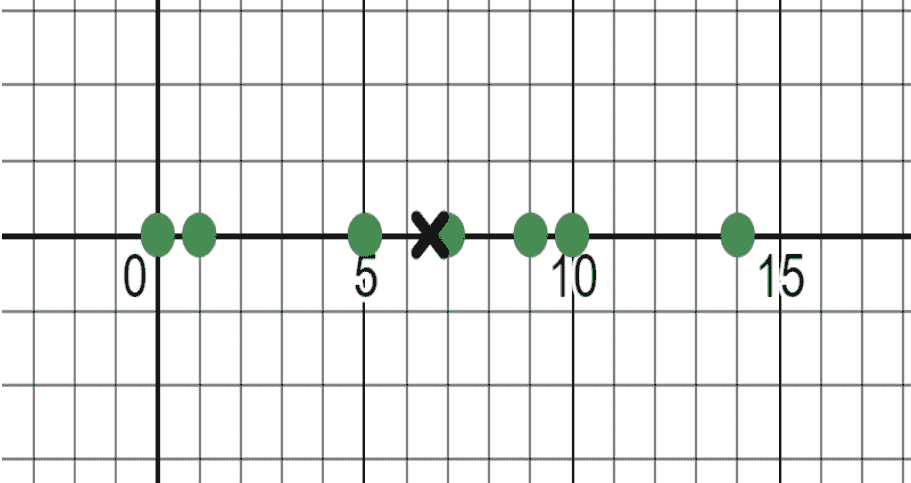

图 3-1. 可视化我们数据的分布，其中“X”是均值

嗯……现在考虑一下上述信息为什么有用。这些差异让我们了解数据有多“分散”，以及值离均值有多远。是否有方法可以将这些差异合并为一个单一数字，以快速描述数据有多分散？

你可能会想取差异的平均值，但在求和时，负数和正数会相互抵消。我们可以对绝对值求和（去掉负号，使所有值变为正数）。更好的方法是在求和前对这些差异进行平方。这不仅消除了负值（因为对负数求平方会使其变为正数），还能放大较大的差异，并且在数学上更易于处理（绝对值的导数不那么直接）。之后，对平方差求平均值。这将给出我们的 **方差**，即衡量数据分散程度的指标。

以下是计算方差的数学公式：

总体方差 = \frac{(x_1 - mean)^2 + (x_2 - mean)^2 + ... + (x_n - mean)^2}{N}

更正式地，以下是总体的方差。

\sigma^2 = \frac{\sum (x_i - \mu)^2}{N}

示例 3-6 展示了如何在 Python 中计算我们宠物示例的总体方差。

## 示例 3-6. 在 Python 中计算方差

```python
# Number of pets each person owns
data = [0, 1, 5, 7, 9, 10, 14]

def variance(values):
    mean = sum(values) / len(values)
    _variance = sum((v - mean) ** 2 for v in values) / len(values)
    return _variance

print(variance(data)) # prints 21.387755102040813
```

所以我办公室员工养宠物数量的方差为 21.387755。好吧，但这到底意味着什么？得出结论，方差越高表示数据越分散，这是合理的，但我们如何将其与我们的数据联系起来呢？这个数字大于我们所有的观测值，因为我们做了大量的平方和求和操作，将其放置在了完全不同的度量上。那么，我们如何将其缩小回原来的量级呢？

平方的逆运算是平方根，因此让我们对方差开平方根，从而得到 **标准差**。这是将方差缩放为以“宠物数量”为单位的数字，这使其更有意义。

$$\sigma = \sqrt{\frac{\sum (x_i - \mu)^2}{N}}$$

要在 Python 中实现，我们可以复用 `variance()` 函数并对其结果调用 `sqrt()`。我们现在有了 `std_dev()` 函数，如示例 3-7 所示。

## 示例 3-7. 在 Python 中计算标准差

```python
from math import sqrt

# Number of pets each person owns
data = [0, 1, 5, 7, 9, 10, 14]

def variance(values):
    mean = sum(values) / len(values)
    _variance = sum((v - mean) ** 2 for v in values) / len(values)
    return _variance

def std_dev(values):
    return sqrt(variance(values))

print(std_dev(data))  # prints 4.624689730353898
```

运行示例 3-7 中的代码，你会看到我们的标准差约为 4.62 只宠物。这样，我们就可以在最初的量级上表达数据的分散程度，这使我们的方差更容易解释。我们将在第 5 章中看到标准差的一些重要应用。

> ## 为什么要平方？
> 
> 关于方差，如果 \(\sigma^2\) 中的指数让你困扰，那是因为它提示你对其开平方根以得到标准差。这是一个小小的提醒，告诉你正在处理需要开平方根的平方值。

## 样本方差和标准差

在上一节中，我们讨论了总体的方差和标准差。然而，当我们计算样本时，需要对这两个公式做一个重要调整：


s² = \frac{\sum (x_i - \bar{x})²}{n - 1}
s = \sqrt{\frac{\sum (x_i - \bar{x})²}{n - 1}}

你发现区别了吗？当我们对平方差求平均值时，除数是 n-1 而不是项目总数 n。我们为什么要这样做？我们这样做是为了降低样本中的任何偏差，并避免根据样本低估总体的方差。通过在除数中少算 1 个值，我们增加了方差，从而捕捉了样本中更大的不确定性。

## 为什么样本大小要减 1？

在 YouTube 上，Josh Starmer 有一个名为 StatQuest 的优秀视频系列。在其中一个视频中，他详细解释了为什么我们在计算方差时对样本采取不同的处理方式，并从项目数量中减去一个元素。

https://www.youtube.com/watch?v=sHRBg6BhKjI

如果我们的宠物数据是样本而不是总体，我们应相应地做出该调整。在示例 3-8 中，我修改了之前的 `variance()` 和 `std_dev()` Python 代码，以可选地提供一个参数 `is_sample`，如果为 `True`，则会从方差的除数中减去 1。

### 示例 3-8. 在 Python 中计算标准差

```python
from math import sqrt

# Number of pets each person owns
data = [0, 1, 5, 7, 9, 10, 14]

def variance(values, is_sample: bool = False):
    mean = sum(values) / len(values)
    _variance = sum((v - mean) ** 2 for v in values) /
        (len(values) - (1 if is_sample else 0))
    return _variance

def std_dev(values, is_sample: bool = False):
    return sqrt(variance(values, is_sample))

print("VARIANCE = {}".format(variance(data, is_sample=True)))  # 24.95238095238095
print("STD DEV = {}".format(std_dev(data, is_sample=True)))  # 4.99523582550223
```

请注意，在示例 3-8 中，我的方差和标准差相比于之前将其视为总体而非样本的示例有所增加。回顾示例 3-7，将其视为总体时标准差约为 4.62。但在这里将其视为样本（从方差分母中减去 1），我们得到的结果约为 4.99。这是正确的，因为样本可能具有偏差，且不能完美代表总体。因此，我们增加了方差（进而增加了标准差），以提高我们对数值分散程度的估计。更大的方差/标准差表明置信度较低，范围更大。

就像均值一样（\(\overline{x}\) 表示样本，\(\mu\) 表示总体），你经常会看到方差和标准差的某些符号。样本标准差和均值分别由 \(s\) 和西格玛 \(\sigma\) 指定。以下是样本和总体标准差公式：

\(s = \sqrt{\frac{\sum (x_i - \overline{x})^2}{n - 1}}\)

\(\sigma = \sqrt{\frac{\sum (x_i - \mu)^2}{N}}\)

方差将是这两个公式的平方，从而消除平方根。因此，样本和总体的方差分别为 \(s^2\) 和 \(\sigma^2\)。

\(s^2 = \frac{\sum (x_i - \overline{x})^2}{n - 1}\)

\(\sigma^2 = \frac{\sum (x_i - \mu)^2}{N}\)

同样，平方有助于暗示应该取平方根以得到标准差。

## 正态分布

我们在上一章中接触过概率分布，特别是二项分布和β分布。然而，最著名的分布是正态分布。正态分布，也称为高斯分布，是一种对称的钟形分布，其大部分质量集中在均值附近，其离散程度由标准差定义。随着远离均值，两侧的“尾部”变得越来越薄。

图 3-2 是金毛寻回犬体重的正态分布。请注意，大部分质量集中在 64.43 磅的均值附近。

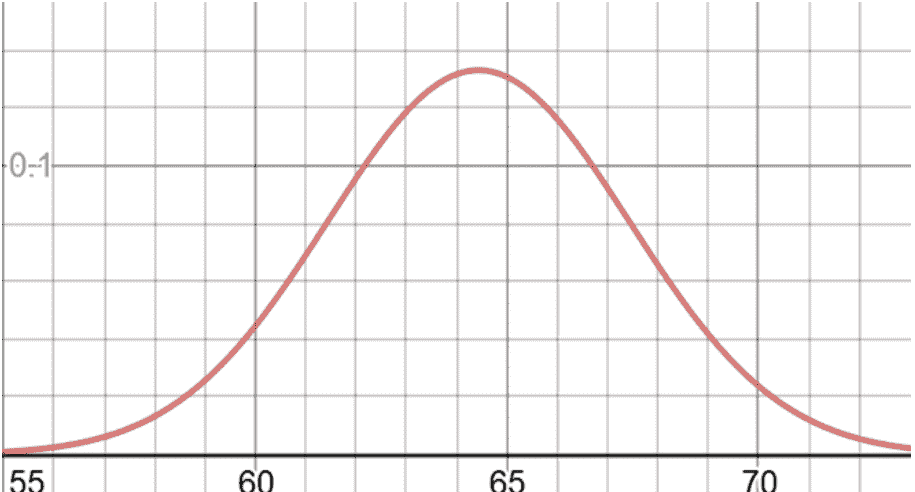

图 3-2. 正态分布

## 发现正态分布

正态分布在自然、工程、科学和其他领域中很常见。我们如何发现它？假设我们对 50 只成年金毛寻回犬的体重进行抽样，并将其绘制在数轴上，如图 3-3 所示。

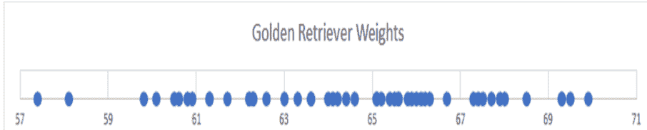

图 3-3. 50 只金毛寻回犬体重的样本

请注意，我们向中心方向有更多值，但向左或向右移动得越远，看到的值就越少。根据我们的样本，遇到体重为 57 或 71 磅的金毛寻回犬似乎不太可能。但体重为 64 或 65 磅？嗯，这当然看起来是可能的。

有没有更好的方法来可视化这种可能性，以查看我们更可能从总体中抽样到哪些金毛寻回犬体重？我们可以尝试创建一个 **直方图**，它根据等长数值范围将值分桶（或“分箱”），然后使用柱状图显示每个范围内的值的数量。在图 3-4 中，我们创建了一个将值分箱为 0.5 磅范围的直方图。

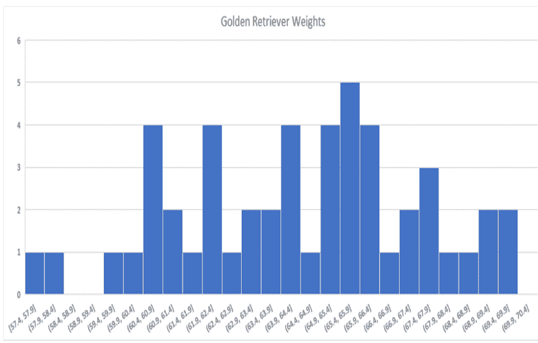

图 3-4. 金毛寻回犬体重的直方图

上面的直方图没有揭示我们数据的任何有意义形状。原因在于我们的分箱太小。我们没有极大或无限的数据量来使每个分箱中有足够多的点。因此，我们必须使分箱更大。让我们在图 3-5 中将每个分箱的长度设为 3 磅。

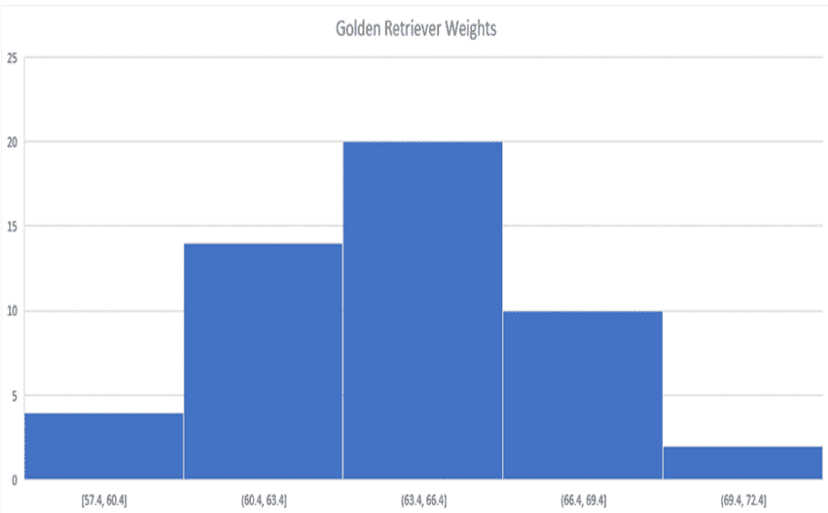

图 3-5. 更有效的直方图

好了，现在我们有进展了！如你所见，如果分箱大小合适（在此例中每个分箱范围为 3 磅），我们的数据就开始呈现出有意义的钟形。它不是完美的钟形，因为我们的样本永远不会完美代表总体，但这很可能是证据表明我们的样本符合正态分布。如果我们使用合适的分箱大小拟合直方图，并将其缩放为面积为 1.0（这是概率分布所要求的），我们就大致能看到一个代表我们样本的钟曲线。让我们在图 3-6 中将其与原始数据点一并展示。

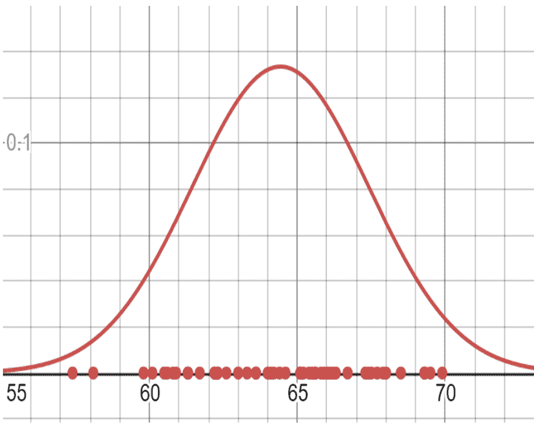

图 3-6. 拟合到数据点上的正态分布

观察上面的钟曲线，我们可以合理地预期金毛寻回犬的体重最可能在 64.43（均值）左右，但在 55 或 73 磅时不太可能。比这更极端的任何情况几乎都不可能。

## 正态分布的属性

正态分布具有几个使其有用的重要属性：

- 它是对称的，两侧在均值（即中心）处完全镜像对称
- 大部分质量集中在均值附近的中心
- 它有一个由标准差指定的离散程度（窄或宽）
- “尾部”是最不可能的结果，无限趋近于零但永远不接触零
- 它类似于自然和日常生活中许多现象，甚至由于中心极限定理而将非正态问题概括化，我们稍后将讨论这一点

## 概率密度函数 (PDF)

标准差在正态分布中起着重要作用，因为它定义了分布“分散”的程度。它实际上是与均值一起的参数之一。创建正态分布的概率密度函数 (PDF) 如下：

f(x) = \frac{1}{\sigma} * \sqrt{2\pi} * e^{-\frac{1}{2} \left(\frac{x-\mu}{\sigma}\right)^2}

哇，这可真是个口舌，不是吗？我们甚至看到了第一章中的老朋友欧拉数 e 以及一些疯狂的指数。以下是如何在示例 3-9 中用 Python 表达它。

### 示例 3-9. Python 中的正态分布函数

```python
# normal distribution, returns likelihood
def normal_pdf(x: float, mean: float, std_dev: float) -> float:
    return (1.0 / (2.0 * math.pi * std_dev ** 2) ** 0.5) *
    math.exp(-1.0 * ((x - mean) ** 2 / (2.0 * std_dev ** 2)))
```

这个公式里有很多东西需要拆解，但重要的是，它接受均值和标准差作为参数，以及一个 x 值，以便你可以查询该给定值的似然性。

就像第 2 章中的 β 分布一样，正态分布是连续的。这意味着要获取概率，我们需要对一系列 x 值进行积分以求出面积。

不过在实践中，我们将使用 SciPy 来为我们执行这些计算。

## 积分正态分布

在正态分布中，垂直轴不是概率，而是数据的似然性。要找到概率，我们需要查看给定范围，然后找到该范围下曲线的面积。假设我想查找金毛寻回犬体重在 62 到 66 磅之间的概率。图 3-7 是我们想要求面积的范围的可视化。


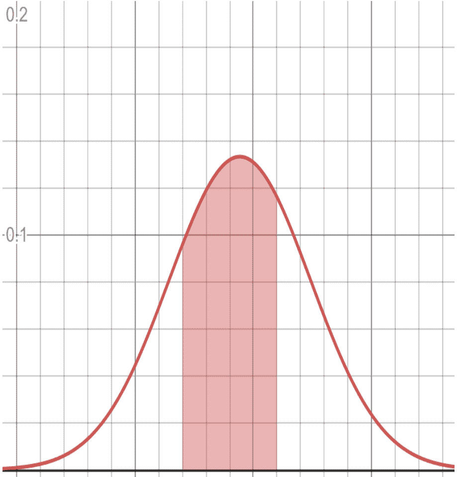

图 3-7. 介于 62 到 66 磅之间的累积分布函数（CDF）

已经在第二章中使用 Beta 分布完成了此任务，和 Beta 分布一样，这里也有一个累积分布函数（CDF）。让我们采用这种方法。

## 使用累积分布函数（CDF）进行积分

正如我们在上一章中所学，累积分布函数（CDF）为给定分布提供直到给定 x 值的面积。让我们看看我们的金毛寻回犬正态分布的 CDF 是什么样子，并在图 3-8 中将其与 PDF 并排展示以供参考。

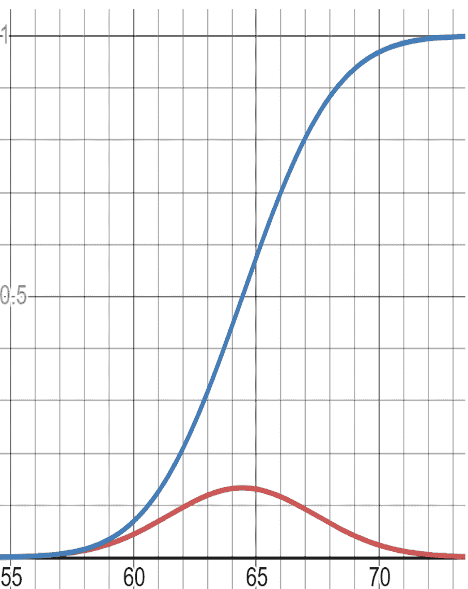

图 3-8. 与累积分布函数（CDF）并排展示的概率密度函数（PDF）

请注意两个图之间存在关系。CDF 是一个 S 形曲线（称为 sigmoid 曲线），它将 PDF 中直到该范围的面积投影出来。观察图 3-9，当我们从负无穷到 64.43（均值）捕获面积时，我们的 CDF 显示的值正好是 .5 或 50%！

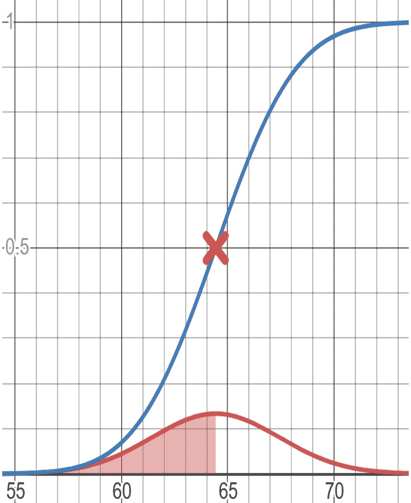

图 3-9. 金毛寻回犬体重的 PDF 和 CDF，测量直到均值的概率

直到均值的 .50 或 50% 这个面积之所以已知，是因为我们的正态分布具有对称性，我们可以预期钟形曲线的另一侧也有 50% 的面积。

要使用 SciPy 在 Python 中计算直到 64.43 的这个面积，请使用 `norm.cdf()` 函数，如示例 3-10 所示。

## 示例 3-10. Python 中的正态分布 CDF

```python
from scipy.stats import norm

mean = 64.43
std_dev = 2.99

x = norm.cdf(64.43, mean, std_dev)

print(x) # prints 0.5
```

就像我们在第二章中所做的，我们可以通过相减面积来演绎得出中间范围的面积。如果我们想找到观察到的金毛寻回犬体重在 62 到 66 磅之间的概率，我们将计算直到 66 的面积并减去直到 62 的面积，如图 3-10 所示。

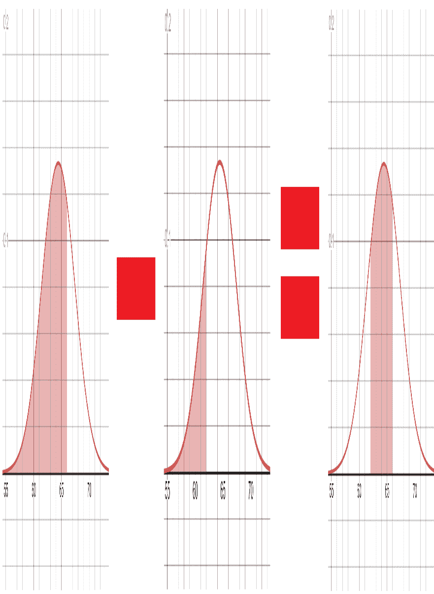

图 3-10. 寻找中间概率范围

使用 SciPy 在 Python 中执行此操作就像减去示例 3-11 中显示的两个 CDF 操作一样简单。

## 示例 3-11. 使用 CDF 获取中间范围概率

```python
from scipy.stats import norm
mean = 64.43
std_dev = 2.99
x = norm.cdf(66, mean, std_dev) - norm.cdf(62, mean, std_dev)
print(x) # prints 0.4920450147062894
```

你应该发现观察到的金毛寻回犬体重在 62 到 66 磅之间的概率为 0.4920，即大约 49.2%。

## 逆累积分布函数（CDF）

当我们在本章后面开始进行假设检验时，你会遇到需要在 CDF 上查找面积然后返回相应 x 值的情况。当然，这是 CDF 的反向用法，因此我们需要使用逆累积分布函数，它像图 3-11 所示翻转轴。

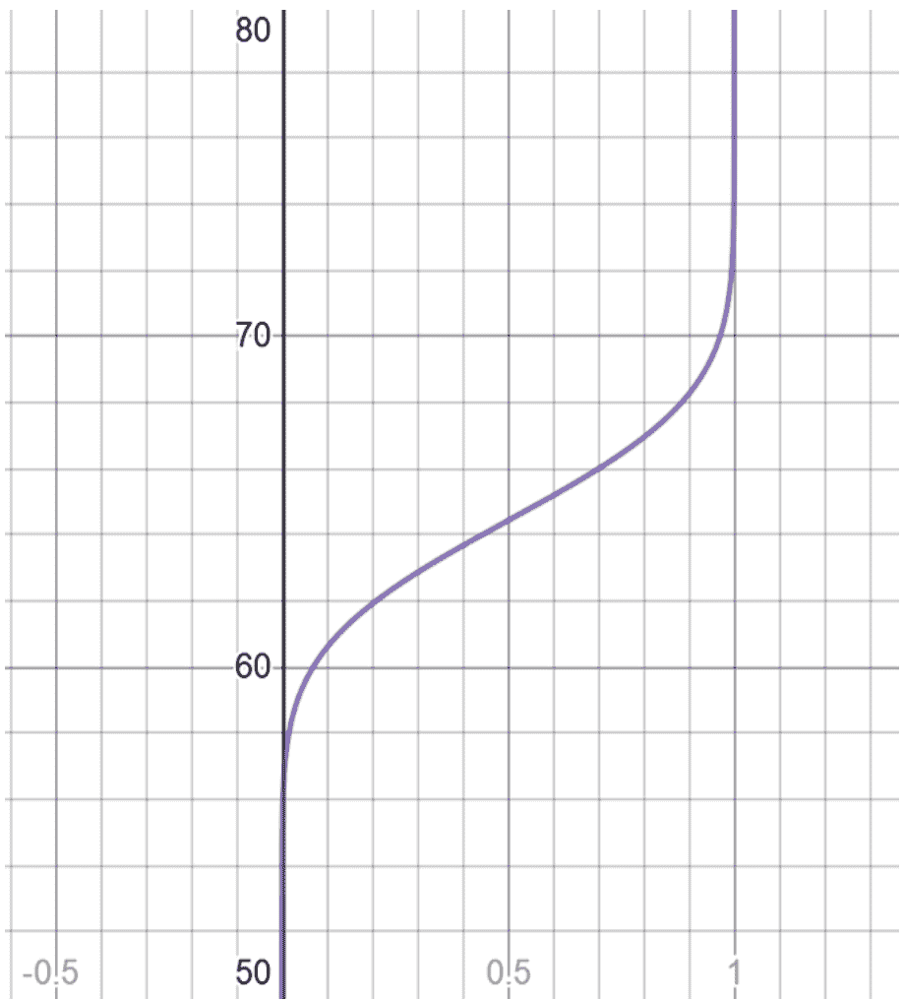

图 3-11. 逆 CDF，也称为 PPF 或分位数函数

这样，我们现在可以查找概率然后返回相应的 x 值，在 SciPy 中我们会使用 norm.ppf() 函数。例如，我想找到 95% 的金毛寻回犬体重低于的数值。当我在示例 3-12 中使用逆累积分布函数时，这很容易完成。

## 示例 3-12. 在 Python 中使用逆 CDF（称为 ppf()）

```python
from scipy.stats import norm
x = norm.ppf(.95, loc=64.43, scale=2.99)
print(x) # 69.3481123445849
```

我发现 95% 的金毛寻回犬体重为 69.348 磅或更低。

你也可以使用逆累积分布函数生成遵循正态分布的随机数。如果我想创建一个生成 1,000 个逼真的金毛寻回犬体重的模拟，我只需生成 0.0 到 1.0 之间的随机值，将其传递给逆累积分布函数，并返回体重值，如示例 3-13 所示。

## 示例 3-13. 从正态分布生成随机数

```python
import random
from scipy.stats import norm
for i in range(0,1000) :
    random_p = random.uniform(0.0, 1.0)
    random_weight = norm.ppf(random_p, loc=64.43, scale=2.99)
    print(random_weight)
```

当然，NumPy 和其他库可以为你生成分布的随机值，但这突出了逆累积分布函数派上用场的一个用例。

> **从零开始实现 CDF 和逆 CDF**
> 
> 要了解如何在 Python 中从零开始实现 CDF 和逆 CDF，请参阅附录 A。

## Z-得分

将正态分布重新缩放，使均值为 0、标准差为 1 是很常见的，这被称为 **标准正态分布**。这使得我们可以轻松比较一个正态分布与另一个正态分布的离散程度，即使它们具有不同的均值和方差。

标准正态分布中特别重要的是，它将所有 x 值表示为标准差，称为 **Z-得分**。将 x 值转换为 Z-得分使用基本缩放公式。

```
z = \frac{x-\mu}{\sigma}
```

这是一个例子。我们有两个来自不同社区的房子。社区 A 的平均房价为 $140,000，标准差为 $3,000。社区 B 的平均房价为 $800,000，标准差为 $10,000。

- μ_A = 140,000
- μ_B = 800,000
- σ_A = 3,000
- σ_B = 10,000

现在我们有来自各自社区的两套房子。社区 A 的房子 A 价值 $150,000，社区 B 的房子 B 价值 $815,000。哪套房子相对于其社区的平均房子更昂贵？

- x_A = 150,000
- x_B = 815,000

如果我们将这两个值表示为标准差，就可以将它们相对于每个社区均值进行比较。使用 Z-得分公式：

- z = \frac{x - mean}{standard deviation}
- z_A = \frac{150000 - 140000}{3000} = 3.\overline{333}
- z_B = \frac{815000 - 800000}{10000} = 1.5

所以社区 A 的房子相对于其社区来说实际上比社区 B 的房子贵得多，因为它们的值分别为 3.\overline{333} 和 1.5。

这是我们如何将来自具有均值和标准差的给定分布的 x 值转换为 z-得分，以及反过来的操作，如示例 3-14 所示。

## 示例 3-14. 将 Z-得分转换为 x 值，反之亦然

```python
def z_score(x, mean, std):
    return (x - mean) / std

def z_to_x(z, mean, std):
    return (z * std) + mean

mean = 140000
std_dev = 3000
x = 150000

# Convert to Z-score and then back to X
z = z_score(x, mean, std_dev)
back_to_x = z_to_x(z, mean, std_dev)

print("Z-Score: {}".format(z)) # Z-Score: 3.333
print("Back to X: {}".format(back_to_x)) # Back to X: 150000.0
```

上面的 z_score() 函数将 x 值按给定均值和标准差缩放为标准差。z_to_x() 函数将 Z-得分转换回 x 值。研究这两个函数，你可以看到它们的代数关系，一个求解 Z-得分，另一个求解 x 值。然后我们将 150000 的 x 值转换为 3.333 的 Z-得分，然后将该 Z-得分转换回 x 值。

## 变异系数

与测量离散程度相关的一个有用工具是变异系数。它比较两个分布并量化每个分布的离散程度。计算很简单：用标准差除以均值。下面是公式及比较两个社区的示例。

```
cv = \frac{\sigma}{\mu}

cv_A = \frac{3000}{140000} = 0.0214

cv_B = \frac{10000}{800000} = 0.0125
```

如上所述，社区 A 虽然比社区 B 便宜，但其离散程度更大，因此价格多样性也比社区 B 更高。

## 推断统计学

我们迄今涵盖的描述性统计学通常被理解。但是当我们进入推断统计学时，样本和总体之间的抽象关系就会充分展现。这些抽象的细微差别不是你希望匆匆而过的东西，而是要花时间深思熟虑地吸收。如前所述，作为人类，我们天生就带有偏见并迅速得出结论。成为一名优秀的数据科学专业人士要求你抑制这种原始欲望，并考虑其他解释也可能存在的可能性。理论认为根本没有任何解释，而一个发现只是巧合和随机的，是可以接受的（甚至是开明的）。

首先让我们从奠定所有推断统计学基础的定理开始。

## 中央极限定理

正态分布有用的原因之一是因为它在自然界中经常出现，例如成年金毛寻回犬的体重。但是它出现在更


在自然总体之外有一个引人入胜的语境。当我们从一个总体中开始测量足够大的样本时，即使该总体不服从正态分布，正态分布依然会出现。

让我们假设我正在测量一个真正且均匀随机的总体。
0.0 到 1.0 之间的任何值出现的可能性都相同，且没有任何值具有优先性。但是当我们从这个总体中取样越来越大，计算每个样本的平均值，然后将它们绘制成直方图时，会发生一件引人入胜的事情。运行示例 3-15 中的 Python 代码，观察图 3-12 中的图表。

### 示例 3-15. 在 Python 中探索中心极限定理

```
# Samples of the uniform distribution will average out to a normal distribution.
import random
import plotly.express as px

sample_size = 31
sample_count = 1000

# Central limit theorem, 1000 samples each with 31 random numbers between 0.0 and 1.0
x_values = [(sum([random.uniform(0.0, 1.0) for i in range(sample_size)]) / sample_size)
            for _ in range(sample_count)]

y_values = [1 for _ in range(sample_count)]

px.histogram(x=x_values, y=y_values, nbins=20).show()
```

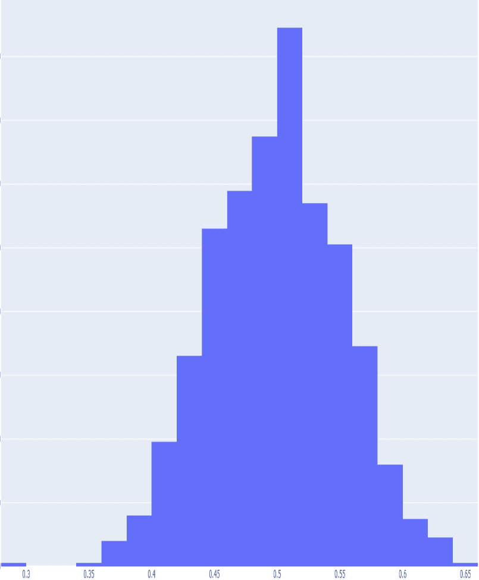

### 图 3-12. 对样本取均值（每个样本大小为 31）并将其绘图。

等等，当均匀随机数被分成每组 31 个并求平均时，怎么会大致形成正态分布呢？任何数字出现的可能性都相同，对吧？分布不应该是平坦的而非钟形曲线的吗？

事情是这样的。样本中的单独数字本身不会形成正态分布。分布会是平坦的，其中任何数字出现的可能性都相同（称为**均匀分布**）。但当我们将它们作为样本分组并求平均时，它们会形成正态分布。

这是因为**中心极限定理**，它指出当我们从总体中取足够大的样本，计算每个样本的均值，并将其作为分布绘制时，会发生有趣的事情：

- 样本均值的均值等于总体均值。
- 如果总体是正态的，那么样本均值也将是正态的。
- 如果总体不正态，但样本大小大于 30，大约样本均值仍然会形成正态分布。
- 样本均值的标准差等于总体标准差除以样本大小的平方根。

样本标准差 = \(\frac{\text{总体标准差}}{\sqrt{\text{样本大小}}}\)

以上所有为什么重要？这些行为使我们能够基于样本推断总体的有用信息，即使是非正态总体。如果你修改上述代码并尝试更小的样本大小（1 或 2），你不会真正看到正态分布出现。但当你接近 31 或更多时，你会看到我们趋于正态分布，如图 3-13 所示。

### 样本大小 = 1

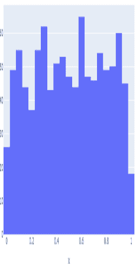

### 样本大小 = 2

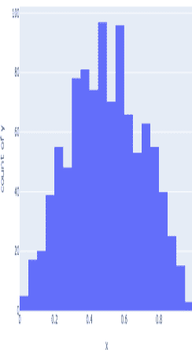

### 样本大小 = 31

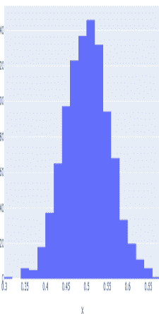

### 图 3-13. 较大的样本大小趋近于正态分布

31 是统计学中的教科书数字，因为此时我们的样本分布通常会趋于总体分布，尤其是当我们测量样本均值或其他参数时。当你样本中的项目少于 31 个时，就必须依赖 T 分布而非正态分布，而样本量越小，T 分布的尾部就越肥。我们稍后会简要讨论这一点，但首先，当我们讨论置信区间和检验时，假设样本中至少有 31 个项目。

## 多少样本才足够？

虽然 31 是样本中满足中心极限定理并看到正态分布所需的教科书项目数，但有时情况并非如此。有些情况下你需要更大的样本，例如当底层分布是不对称或多模态的（意味着它有多个峰值而非均值处的一个峰值）时。

总结来说，当你不确定底层概率分布时，拥有更大的样本更好。你可以阅读这篇文章以获取更多信息。

## 置信区间

你可能听说过置信区间这个术语，它常常让统计学新手和学生感到困惑。置信区间是一种范围计算，显示我们相信样本均值（或其他参数）落在总体均值范围内的置信程度。

_**基于31只金毛寻回犬的样本，样本均值为64.408，样本标准差为2.05，我有95%的把握认为总体均值介于63.686和65.1296之间。我怎么知道这一点？让我来向你展示，如果你感到困惑，请回到这一段落，记住我们试图实现什么。我之所以将其加粗是有原因！**_

我首先选择一个置信水平（LOC），它将包含总体均值范围所需的概率。我希望有95%的把握认为我的样本均值落在我将计算的总体均值范围内。这就是我的LOC。我们可以利用中心极限定理并推断总体均值的这个范围是什么。首先，我需要**临界 Z 值**，它是标准正态分布中对称范围，能让我中心区域有95%的概率，如图3-14中所强调。

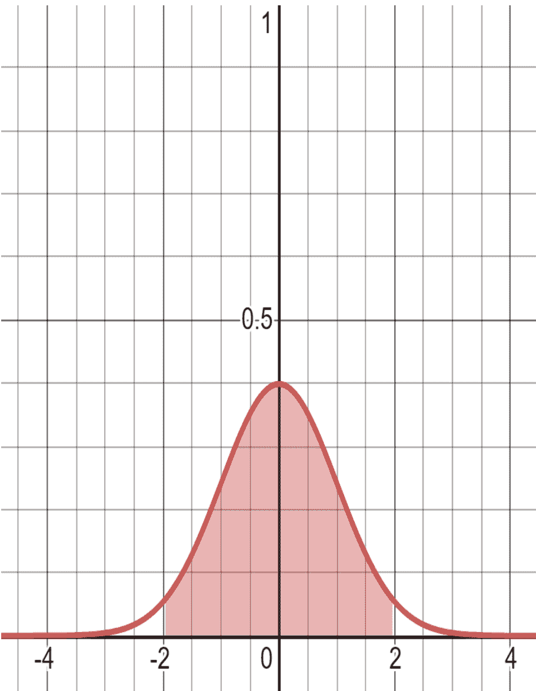

### 图 3-14. 标准正态分布中心区域的95%对称概率

我们如何计算包含面积0.95的这个对称范围？作为概念比作为计算更容易理解。你可能本能地想要使用CDF，但随后你可能会意识到这里还有更多的组成部分。

首先，你需要利用逆CDF。逻辑上，要获得中心区域95%的对称面积，我们会去除尾部，尾部拥有剩余的5%面积。将剩余的5%面积一分为二，每个尾部就有2.5%的面积。因此，我们想要查找x值的面积是0.025和0.975，如图3-15所示。

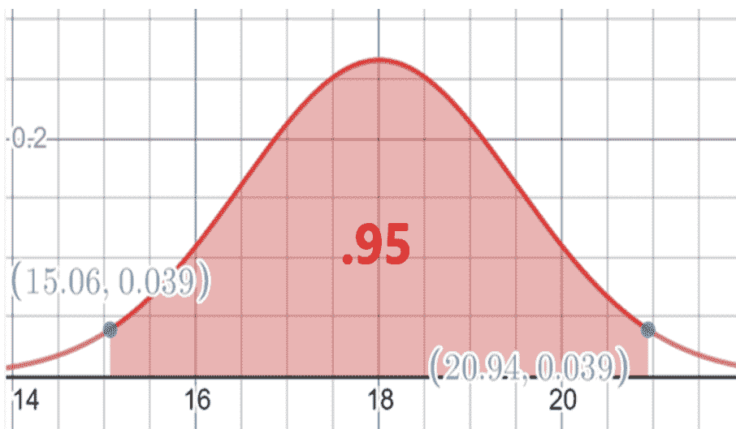

### 图 3-15. 我们想要给出面积0.025和0.975的x值

我们可以查找面积0.025对应的x值，以及面积0.975对应的x值，这将给我们包含95%面积的中心范围。然后我们将返回包含该面积的相应上下z值。请记住，我们这里使用的是标准正态分布，所以它们除了正负号外是相同的。让我们按照示例 3-16 所示在 Python 中计算这一点。

### 示例 3-16. 检索临界 Z 值

```
from scipy.stats import norm

def critical_z_value(p):
    norm_dist = norm(loc=0.0, scale=1.0)
    left_tail_area = (1.0 - p) / 2.0
    upper_area = 1.0 - ((1.0 - p) / 2.0)
    return norm_dist.ppf(left_tail_area), norm_dist.ppf(upper_area)

print(critical_z_value(p=.95))
# (-1.9599639845400054, 1.9599639845400054)
```

好的，我们得到 ±1.95996，这就是捕获标准正态分布中心区域95%概率的临界Z值。接下来，我将利用中心极限定理来计算**误差范围（E）**，它是在该置信水平下包含总体均值的样本均值周围的范围。回顾一下，我们31只金毛寻回犬的样本均值为64.408，标准差为2.05。获取此误差范围的公式如下所示：

```
E = \pm z_c \frac{s}{\sqrt{n}}

E = \pm 1.95996 * \frac{2.05}{\sqrt{31}}

E = \pm 0.72164
```

如果我们将该误差范围应用于样本均值，我们最终就得到了置信区间！

95% 置信区间 = 64.408 ± 0.72164

以下是按照示例 3-17 所示，从头到尾在 Python 中计算此置信区间的方法。

### 示例 3-17. 在 Python 中计算置信区间

```
from math import sqrt
from scipy.stats import norm

def critical_z_value(p):
    norm_dist = norm(loc=0.0, scale=1.0)
    left_tail_area = (1.0 - p) / 2.0
    upper_area = 1.0 - ((1.0 - p) / 2.0)
    return norm_dist.ppf(left_tail_area), norm_dist.ppf(upper_area)

def confidence_interval(p, sample_mean, sample_std, n):
    # Sample size must be greater than 30
    lower, upper = critical_z_value(p)
    lower_ci = lower * (sample_std / sqrt(n))
    upper_ci = upper * (sample_std / sqrt(n))
    return sample_mean + lower_ci, sample_mean + upper_ci
```


```
print(confidence_interval(p=.95, sample_mean=64.408, sample_std=2.05,
n=31))
# (63.68635915701992, 65.12964084298008)
```

所以解读这句话的方式是：“基于我对31只金毛犬体重的样本，样本均值为64.408，样本标准差为2.05，我有95%的把握总体均值在63.686到65.1296之间”。这就是我们描述置信区间的方式。

另一个值得注意的有趣之处是，在我们的误差公式中，n越大，置信区间就越窄！这很合理，因为如果我们拥有更大的样本，就更有把握总体均值落在更小的范围内，这也就是为什么它被称为置信区间。

这里需要注意的一个前提是，为了使此方法生效，样本量必须至少为31个样本。这回溯到了中心极限定理，如果我们想将置信区间应用于更小的样本，则需要使用方差更大（尾部更肥，反映更多不确定性）的分布。这就是T分布的用途，我们将在本章末尾探讨。

在第5章中，我们将继续将置信区间用于线性回归。

## 理解P值

当我们说某事具有统计显著性时，究竟是什么意思？我们经常听到这个词被随意和频繁地使用，但它在数学上究竟意味着什么？从技术上讲，这与所谓的p值有关，这是许多人难以掌握的概念。但我认为，当你追溯p值的起源时，p值的概念会更容易理解。虽然这是一个不完美的例子，但它传达了一些重大理念。

1925年，一位名叫罗纳德·费舍尔的数学家正在参加一个派对。他的同事默里尔·布里斯托尔声称，她可以仅凭品尝就判断出茶是先倒入牛奶还是先倒入茶。被这一说法吸引，罗纳德当场设计了一个实验。

他准备了8杯茶。4杯先倒了牛奶，另外4杯先倒了茶。随后他将这些茶呈送给这位鉴赏家同事，并让她识别每杯茶的倒入顺序。令人惊叹的是，她全部答对了，而这种情况纯属偶然发生的概率是70分之1，即0.01428571。

这个1.4%的概率就是我们所说的 **p值**，即某事纯属偶然发生而非基于假设性解释的概率。无需深入组合数学的细节，默里尔完全凭猜测正确识别所有茶杯的概率是1.4%。这究竟告诉了你什么？

在设计实验时，无论是确定有机甜甜圈是否导致体重增加，还是居住在高压线附近是否导致癌症，我们都必须考虑运气成分的可能性。就像默里尔有1.4%的概率仅凭猜测就正确识别茶杯一样，随机性也总有可能像老虎机一样给了我们一手好牌。这有助于我们构建 **原假设（H0）**，即质疑的变量对实验没有影响，任何积极结果都只是随机运气。而 **备择假设（H1）** 则提出，质疑的变量（称为 **受控变量**）正在导致积极结果。

传统上，统计显著性的阈值是p值小于或等于5%，即.05。由于.014小于.05，这意味着我们可以拒绝默里尔在随机猜测的原假设。随后我们可以支持备择假设，即默里尔具有特殊能力，能够判断是先倒茶还是先倒牛奶。

现在，茶会示例未能体现的一点是，在计算p值时，我们会捕捉该事件或更罕见事件的所有概率。我们将在接下来使用正态分布的示例中探讨这一点。

## 假设检验

以往研究表明，感冒的平均康复时间为18天，标准差为1.5天，且服从正态分布。

这意味着康复时间在15到21天之间的概率约为95%，如图3-16和示例3-18所示。

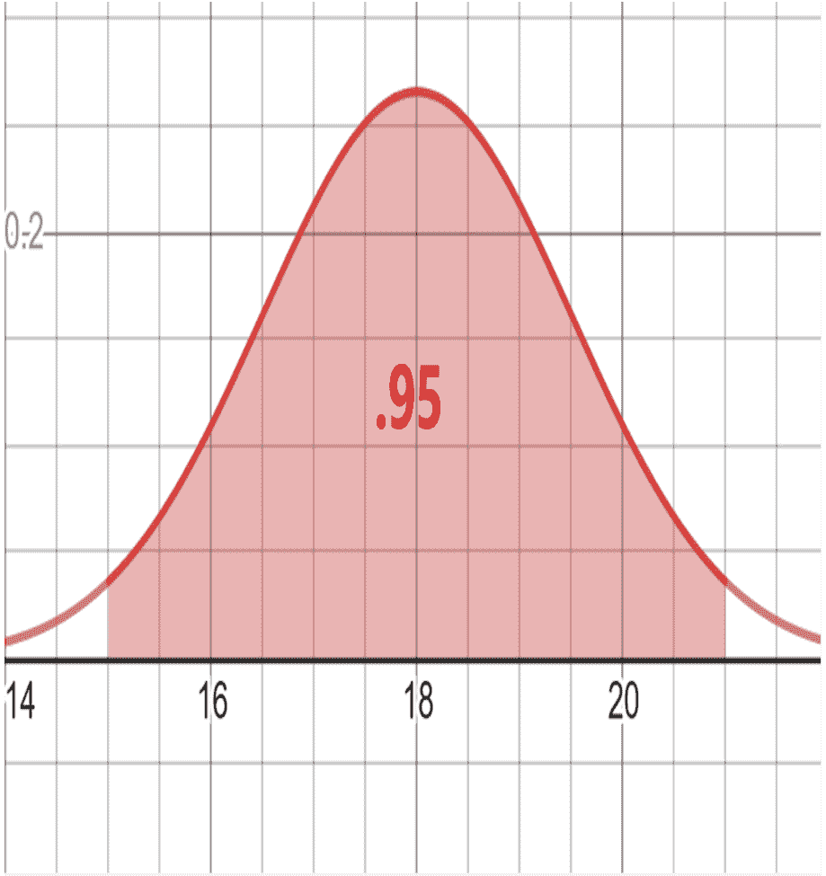

图3-16. 康复时间在15到21天之间的概率为95%

### 示例3-18. 计算康复时间在15到21天之间的概率

```
from scipy.stats import norm

# Cold has 18 day mean recovery, 1.5 std dev
mean = 18
std_dev = 1.5

# 95% probability recovery time takes between 15 and 21 days.
x = norm.cdf(21, mean, std_dev) - norm.cdf(15, mean, std_dev)

print(x) # 0.9544997361036416
```

因此，从剩余的5%概率可以推断，康复时间超过21天的概率为2.5%，少于15天的概率也为2.5%。请记住这个信息，因为稍后至关重要！这就是驱动我们p值的因素。

现在假设一种实验性新药被给予一组40人的测试组，他们从感冒中康复的平均时间为16天，如图3-17所示。

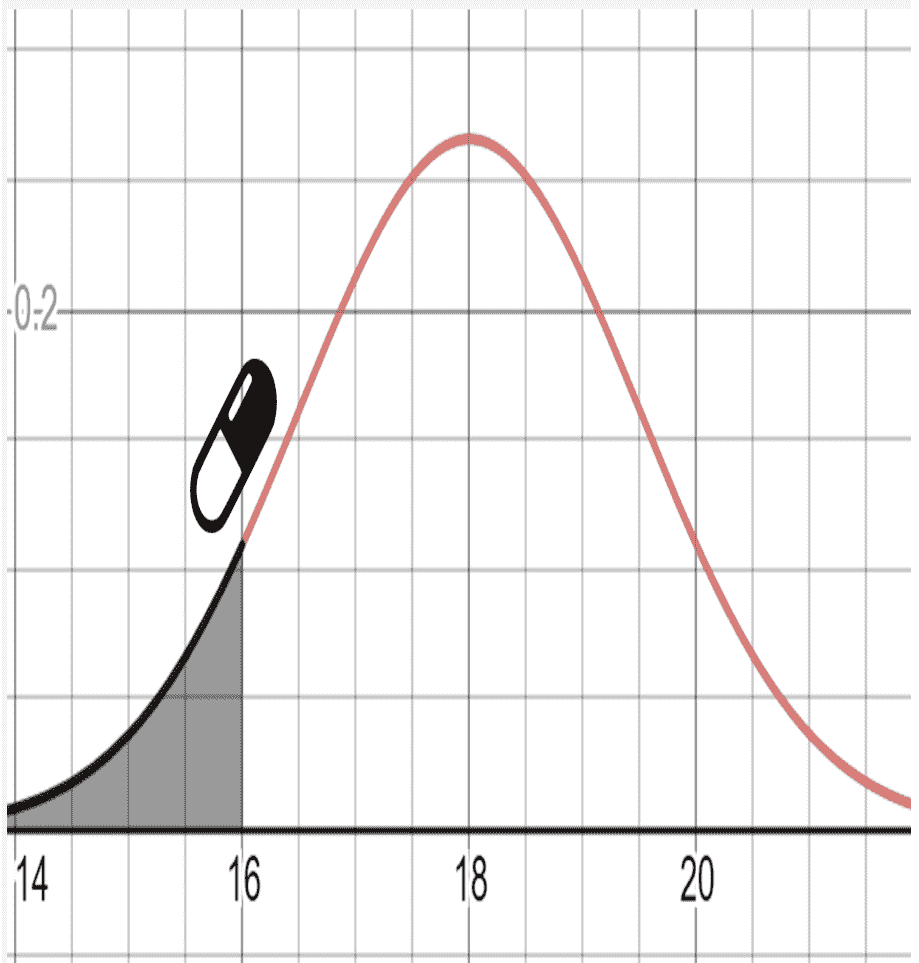

图3-17. 服用药物的一组人花费16天康复

该药物是否有效？如果你思考足够久，可能会意识到我们真正在问的是：该药物是否显示出统计显著性？或者药物无效，16天的康复只是测试组的巧合？第一个问题构成了我们的备择假设，而第二个问题构成了我们的原假设。

计算此问题有两种方法：单侧检验和双侧检验。我们将从单侧检验开始。

### 单侧检验

在进行单侧检验时，我们通常使用不等式来表述原假设和备择假设。我们围绕总体均值提出假设，即总体均值要么大于或等于18（原假设H0），要么小于18（备择假设H1）。

```
H0 : population mean ≥ 18
H1 : population mean < 18
```

要拒绝原假设，我们需要证明服药患者的样本均值不太可能是巧合。由于传统上p值小于或等于.05被视为统计显著，我们将使用此作为阈值（图3-17）。当我们使用Python中的逆累积分布函数计算此问题时，如图3-18和示例3-19所示，我们发现大约15.51天是左侧尾部面积为.05的康复天数。

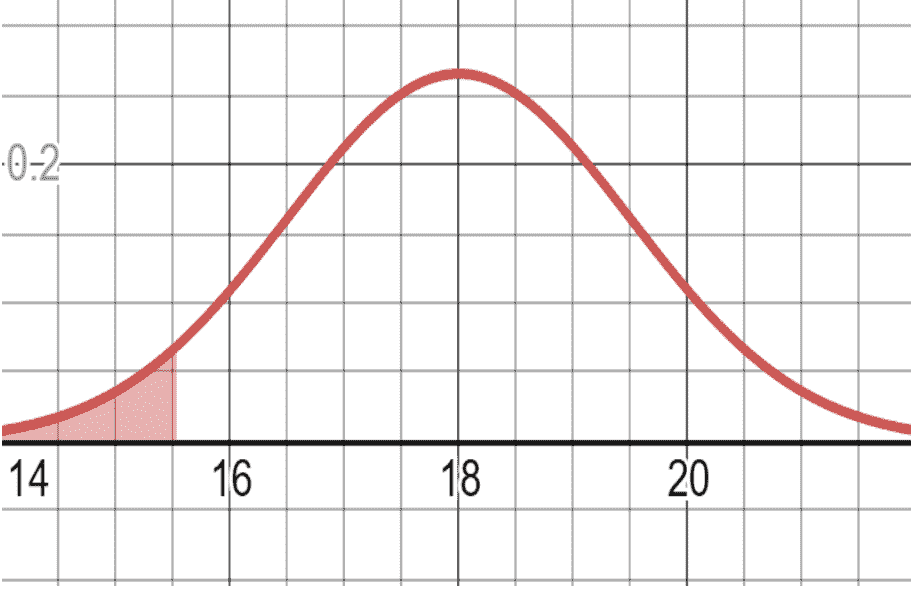

图3-18. 获取尾部面积为5%的x值

### 示例3-19. 获取尾部面积为5%的x值的Python代码

```
from scipy.stats import norm

# Cold has 18 day mean recovery, 1.5 std dev
mean = 18
std_dev = 1.5

# What x-value has 5% of area behind it?
x = norm.ppf(.05, mean, std_dev)

print(x) # 15.53271955957279
```

因此，如果我们的样本组平均康复时间达到15.53天或更少，则我们的药物被认为具有足够的统计显著性来证明有影响。然而，我们的康复时间样本均值实际上是16天，并不落入这个原假设拒绝区域。因此，统计显著性检验失败了，如图3-19所示。

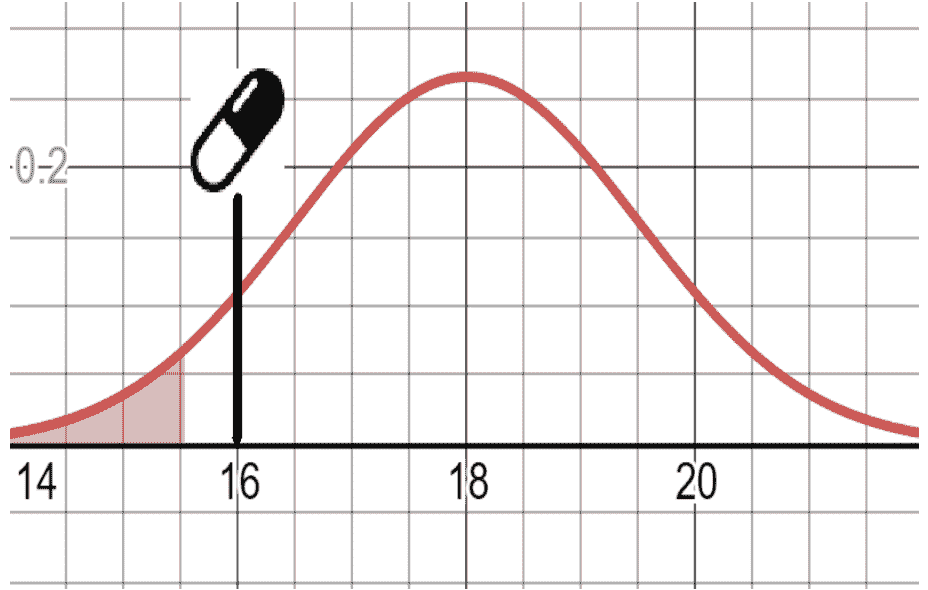

图3-19. 我们未能证明药物测试结果具有统计显著性

直到16天那个点的面积即为我们的p值，为.0912，我们通过Python如示例3-20所示进行计算。

### 示例3-20. 计算单侧p值

```
from scipy.stats import norm

# Cold has 18 day mean recovery, 1.5 std dev
mean = 18
std_dev = 1.5

# Probability of 16 or less days
p_value = norm.cdf(16, mean, std_dev)

print(p_value) # 0.09121121972586788
```

由于p值.0912大于我们的统计显著性阈值.05，我们不认为药物试验成功，因此无法拒绝原假设。

### 双侧检验

我们之前进行的检验被称为单侧检验，因为它只在一侧尾部寻找统计显著性。然而，它通常更安全、更好


采用双尾检验的练习。我们将稍后阐述原因，但先计算一下。

执行 **双尾检验** 时，我们将原假设和备选假设构建为“相等”与“不相等”的结构。在我们的药物测试中，原假设表示平均恢复时间为 18 天。但我们的备选假设是，由于新药的作用，平均恢复时间不是 18 天。

$H_0 : \text{population mean} = 18$

$H_1 : \text{population mean} \neq 18$

这有一个重要的含义。我们构建备选假设并非为了检验药物是否改善感冒恢复时间，而是为了检验它是否产生了 _任何_ 影响。这包括检验它是否延长了感冒持续时间。这有帮助吗？请先保留这个想法。

自然，这意味着我们将 p 值统计显著性阈值分布到两个尾部，而不仅仅是一个。如果我们进行 5% 的统计显著性检验，则将其分割，给每个尾部各分配 2.5%。如果我们的药物平均恢复时间落入任一区域，则检验成功，我们拒绝原假设（图 3-20）。

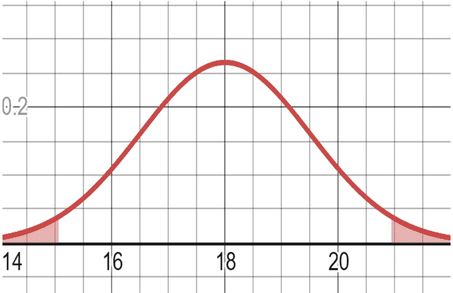

Figure 3-20. 双尾检验

下尾和上尾的 x 值分别为 15.06 和 20.93，这意味着如果分别低于或高于这些值，我们拒绝原假设。以下面的图 3-21 和示例 3-21 中使用逆 CDF 计算的两个值。请记住，要得到上尾，我们取 .95，然后再加上 .025 的显著性阈值，得到 .975。

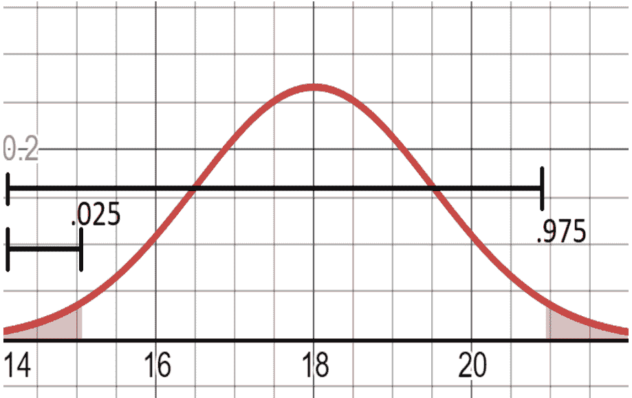

Figure 3-21. 计算正态分布中心 95% 区域

### 示例 3-21.

```
from scipy.stats import norm

# Cold has 18 day mean recovery, 1.5 std dev
mean = 18
std_dev = 1.5

# What x-value has 2.5% of area behind it?
x1 = norm.ppf(.025, mean, std_dev)

# What x-value has 97.5% of area behind it
x2 = norm.ppf(.975, mean, std_dev)

print(x1) # 15.060054023189918
print(x2) # 20.93994597681008
```

药物测试组的样本均值为 16，而 16 既不小于 15.06 也不大于 20.9399。因此，与单尾检验一样，我们仍未能拒绝原假设。如图 3-22 所示，我们的药物仍未显示出具有任何影响的统计显著性。

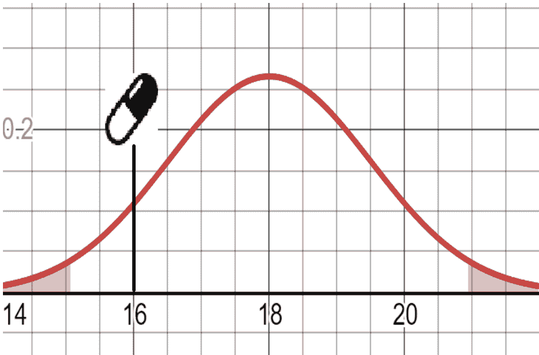

Figure 3-22. 双尾检验未能证明统计显著性

但 p 值是多少？在双尾检验中，这里变得有趣了。我们的 p 值不仅会捕获 16 左侧的区域，还会捕获右侧尾部对称的等效区域。由于 16 低于均值 4 天，我们还会捕获高于 20 的区域，即高于均值 4 天（图 3-23）。这是捕获钟形曲线两侧某事件或更罕见事件的概率。

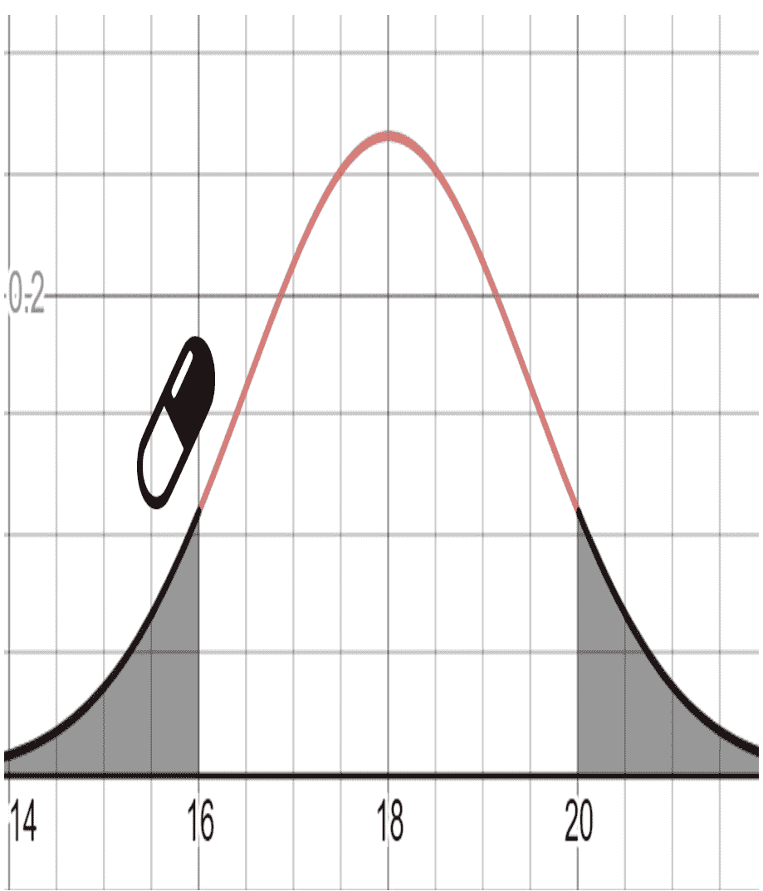

Figure 3-23. p 值为统计显著性添加对称两侧

将这两个区域相加，我们得到 p 值为 .1824。这远大于 .05，因此它肯定不符合我们的 p 值阈值 .05（示例 3-22）。

### 示例 3-22. 计算双尾 p 值

```
from scipy.stats import norm

# Cold has 18 day mean recovery, 1.5 std dev
mean = 18
std_dev = 1.5

# Probability of 16 or less days
p1 = norm.cdf(16, mean, std_dev)

# Probability of 20 or more days
p2 = 1.0 - norm.cdf(20, mean, std_dev)

# P-value of both tails
p_value = p1 + p2

print(p_value) # 0.18242243945173575
```

那么，为什么在双尾检验中，我们还要加上对面侧的对称区域呢？这可能不是最直观的概念，但首先请记住我们如何构建假设：

$$H_0 : \text{population mean} = 18$$

$$H_1 : \text{population mean} \neq 18$$

如果我们以“等于 18”对“不等于 18”的方式进行检验，就必须捕获两侧任何等于或低于该值的概率。毕竟，我们试图证明显著性，而这包括任何同样或更不太可能发生的情况。在只使用“大于/小于”逻辑的单尾检验中，我们并没有这种特殊考虑。但在处理“等于/不等于”时，我们的关注区域会向两个方向延伸。

那么，双尾检验的实际意义是什么？它如何影响我们是否拒绝原假设？问自己：哪一个设定了更高的阈值？你会发现，即使我们的目标是展示我们可能减少了某事（使用药物缩短感冒恢复时间），将假设重新构建为展示任何影响（更大或更小）也会创建更高的显著性阈值。如果我们的显著性阈值是 p 值 .05 或更低，我们的单尾检验在 p 值 .0912 时更接近接受，而双尾检验则约为两倍，即 p 值 .182。

这意味着双尾检验使拒绝原假设更加困难，并要求通过检验需要更强的证据。还要考虑一下：如果我们的药物可能会加重感冒并延长持续时间呢？捕捉该方向的概率并考虑该方向的变异可能也是有帮助的。这就是为什么在大多数情况下，双尾检验更可取。它们往往更可靠，且不会将假设偏向单一方向。

我们将在第 5 章和第 6 章中再次使用假设检验和 P 值。

## 警惕 P-hacking！

科学研究界日益引起关注的一个问题叫做 p-hacking，即研究者寻找统计显著（p 值 ≤ .05）的 p 值。在“大数据”、机器学习和数据挖掘中，这并不难做到，我们可以遍历数百或数千个变量，然后找到它们之间统计显著（但巧合的）关系。

为什么这么多研究者进行 p-hack？许多人可能没有意识到自己在这样做。很容易不断调整模型，剔除“有噪声”的数据并更改参数，直到得到“正确”的结果。其他人只是受到学术界和工业界的压力，需要产出有利可图而非客观的结果。

如果你被 Calvin 谷物公司雇来研究糖霜巧克力糖炸弹是否会导致糖尿病，你期望给出诚实分析并再次被雇佣吗？如果经理要求你制作预测，显示新产品下季度销售额为 1500 万美元，会怎样？你无法控制销售情况，但被要求提供一个产生预设结果的模型。最坏的情况下，当结果被证明错误时，你甚至可能要承担责任。不公平，但确实会发生！

这就是为什么像外交手腕这样的软技能可以在数据科学专业人士的职业生涯中起到关键作用。如果你能以一种能让受众接受的方式分享困难且不便的故事，那是一项了不起的成就。只需注意组织的管理氛围，并始终提出替代方案。如果你最终陷入被要求进行 p-hack 且可能在其适得其反时被追究责任的两难境地，那么一定要改变工作环境！

## T 分布：处理小样本

让我们简要探讨如何处理 30 或以下的小样本，在进行第 5 章的线性回归时我们会用到这一点。无论是计算置信区间还是进行假设检验，如果样本包含 30 个或以下项目，我们会选择使用 T 分布而不是正态分布。T 分布类似于正态分布，但尾部更肥，以反映更大的方差和不确定性。图 3-24 展示了正态分布（虚线）与自由度为 1 的 T 分布（实线）并排对比：

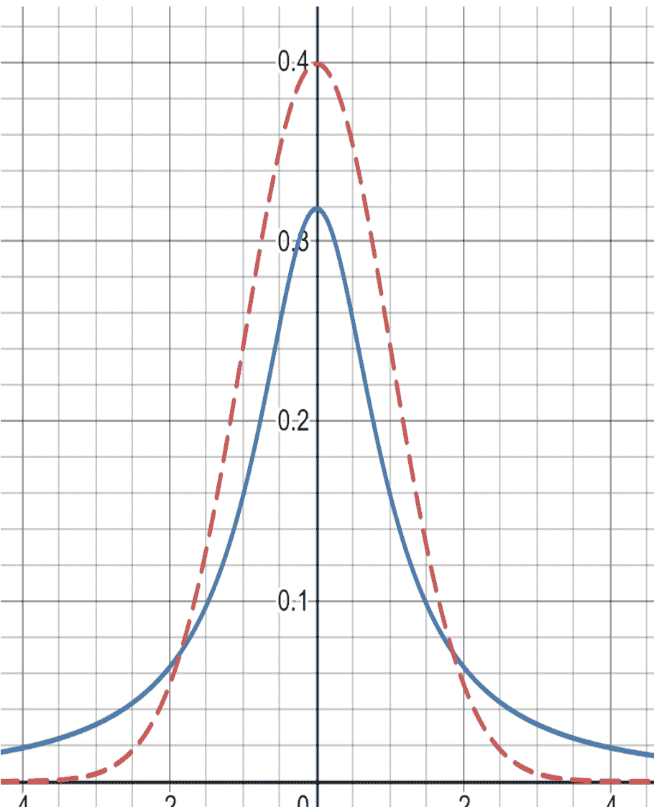

Figure 3-24. 与正态分布并排的 T 分布。注意更肥的尾部。

样本量越小，T 分布的尾部就越肥。但有趣的是，当样本量接近 31 项后，T 分布几乎


与正态分布无法区分，这清晰地反映了中心极限定理背后的思想。

下面的示例 3-23 展示了如何找到 95% 置信水平的临界 t 值。当样本量为 30 或以下时，你可以使用它来进行置信区间估计和假设检验。它在概念上与临界 z 值相同，但我们使用 T 分布而不是正态分布来反映更大的不确定性。样本量越小，反映更大不确定性的范围就越大。

## Example 3-23

```
from scipy.stats import t

# get critical value range for 95% confidence
# with a sample size of 25

n = 25
lower = t.ppf(.025, df=n-1)
upper = t.ppf(.975, df=n-1)

print(lower, upper)
-2.063898561628021 2.0638985616280205
```

请注意，df 是“自由度”参数，如前所述，它应比样本量小 1。

## 超越均值

我们可以使用置信区间和假设检验来测量均值以外的其他参数，包括方差/标准差以及比例（例如，60% 的人报告每天步行 1 小时后幸福感有所提高）。这些需要其他分布，例如卡方分布，而不是正态分布。如前所述，这些都超出了本书的范围，但希望你已打下坚实的概念基础，以便在需要时能够扩展到这些领域。

不过，我们将在整个第 5 章和第 6 章中使用置信区间和假设检验。

## 大数据注意事项与德州神枪手谬误

在结束本章之前，最后一个想法。正如我们所讨论的，随机性在验证我们的发现中扮演着重要角色，我们始终必须考虑其可能性。不幸的是，随着“大数据”、机器学习和其他数据挖掘工具的兴起，科学方法突然变成了倒行逆施的事情。这可能很危险，让我来解释原因，我将改编加里·史密斯在其著作《标准偏差》中的一个例子。

让我们假设我从一副标准扑克牌中抽出 4 张牌。这里没有游戏或目标，除了抽出 4 张牌并观察它们。我得到两张 10，一张 3 和一张 2。“这很有趣，”我说。“我抽到了两张 10，一张 3 和一张 2。这有意义吗？我接下来抽的四张牌也会是两个连续数字和一对吗？这里的基本模型是什么？”

你看到我在那里做了什么吗？我采取了一件完全是随机的事情，不仅寻找模式，还试图根据它们建立预测模型。这里微妙发生的事情是，我从未将抽到这四张具有特定模式的牌作为目标。我是在他们出现后才观察到的。

这正是数据挖掘每天中招的方式：在随机事件中发现巧合的模式。在有大量数据和快速算法寻找模式的情况下，找到看起来有意义但实际上只是随机巧合的事情并不难。

这也类似于我朝墙开枪，然后在弹孔周围画一个靶子，接着叫朋友过来炫耀我的神枪手技巧。蠢吗？对吧？嗯，许多数据科学从业者实际上每天都在这样做，这被称为德州神枪手谬误。他们没有目标就开始行动，偶然发现某种罕见的事情，然后指出他们发现的东西不知怎地创造了预测价值。

问题在于大数定律表明罕见事件很可能会被发现，只是我们不知道是哪些。当我们遇到罕见事件时，我们会强调甚至推测可能导致它们的原因。问题就在于此。特定个人中彩票的概率极低，但总有人会中彩票。当有中奖者时，我们为什么要感到惊讶？除非有人预测了中奖者，否则除了某个随机的人走运之外，什么有意义的事情都没有发生。

这也适用于我们将在第 5 章中学习的相关性。在拥有数千个变量的巨大数据集中，用 .05 的 p 值找到统计显著的结果很难吗？你赌对了！我会找到成千上万个这样的结果。我甚至会展示证据，尼古拉斯·凯奇的电影数量与一年中的游泳池溺亡人数相关。

因此，为了防止德州神枪手谬误和陷入大数据谬误，请尝试使用结构化的假设检验并为该目标收集数据。如果你使用数据挖掘，请尝试获取新数据以查看你的发现是否仍然成立。最后，始终考虑事情可能是巧合的可能性，如果没有常识性的解释，那它很可能就是巧合。

我们学会了在收集数据之前如何提出假设，但数据挖掘先收集数据再提出假设。具有讽刺意味的是，我们从假设开始往往更客观，因为随后我们会寻找数据来故意证明或反驳我们的假设。

## 结论

在本章中我们学到了很多，你应该为自己走到这一步而感到高兴。这可能是本书中较难的主题之一！我们不仅学习了从均值到正态分布的描述性统计，还掌握了置信区间和假设检验。

希望你能以略有不同的眼光看待数据。它是对某事物的快照，而非对现实的完整捕捉。单靠数据并不十分有用，我们需要背景、好奇心以及对数据来源的分析，才能从中获得有意义的洞察。我们介绍了如何描述数据，以及如何基于样本推断更大总体的属性。最后，我们探讨了如果不小心可能会陷入的某些数据挖掘谬误，以及如何通过新数据和常识来补救。

如果你需要回头复习本章的一些内容，请不要难过，因为这里有很多东西需要消化。如果你希望在数据科学和机器学习领域取得成功，进入假设检验的思维模式也很重要。很少有从业者花时间将统计学和假设检验概念与机器学习联系起来，这很遗憾。可理解性和可解释性是机器学习的下一个前沿，因此请继续学习并将这些想法融入到本书剩余部分以及你整个职业生涯中。

## 练习

- 1. 你为 3D 打印机购买了一卷 1.75mm 耗材。你想测量耗材直径实际与 1.75 mm 有多接近。你使用卡尺工具在耗材卷上五次采样直径：1.78, 1.75, 1.72, 1.74, 1.77。计算这组数值的均值和标准差。

- 2. 一家制造商声称 Z-Phone 智能手机的平均消费寿命为 42 个月，标准差为 8 月。假设呈正态分布，给定的随机 Z-Phone 在 20 到 30 个月之间持续使用的概率是多少？

- 3. 我怀疑我的 3D 打印机耗材平均直径并非如宣传的 1.75mm。我用工具采样了 34 次测量值。样本均值为 1.715588，样本标准差为 0.029252。我整卷耗材的均值 99% 置信区间是多少？

- 4. 你的市场部门发起了一个新的广告活动，想知道它是否影响了销售，过去销售平均每天 10,345 美元，标准差为 552 美元。新的广告活动持续了 45 天，平均销售额为 11,641 美元。该活动影响了销售吗？为什么或为什么不？（为获得更可靠的显著性，请使用双尾检验）

答案在附录 B 中。
