# 第 4 章. 线性代数

稍微换个话题，让我们从概率和统计学转向线性代数。有时候人们会把线性代数和基础代数混淆，认为它可能与使用代数函数 y = mx + b 绘制直线有关。这就是为什么线性代数或许应该被称为“向量代数”或“矩阵代数”，因为它更加抽象。线性系统确实发挥作用，但方式更加形而上学。

那么，线性代数究竟是什么？嗯，线性代数关注线性系统，但通过向量空间和矩阵来表示它们。如果你不知道向量或矩阵是什么，不要担心！我们将深入定义和探讨它们。线性代数对数学、统计学、运筹学、数据科学和机器学习等许多应用领域至关重要。当我们在这些领域中任何一个处理数据时，我们都在使用线性代数，或许你甚至都不知道。

你可以暂时不学习线性代数，使用那些为你完成所有工作的机器学习和统计库。但如果我们想了解这些黑箱背后的直觉，并更有效地处理数据，理解线性代数的基础是必然的。线性代数是一个巨大的主题，可以填满厚厚的教科书，因此我们当然无法仅在本书的一章中完全掌握它。然而，我们可以学到足够的内容，使自己更加熟悉它并有效地在数据科学领域中导航。本书的剩余章节（包括第 5 章和第 7 章）也将有机会应用它。

## 什么是向量？

简单来说，向量是空间中具有特定方向和长度的箭头，通常代表一段数据。它是线性代数（包括矩阵和线性变换）的核心构建块。在其


fundamental form, it has no concept of location so always imagine its tail starts at the origin of a Cartesian plane (0,0).

Figure 4-1 shows a vector \(\vec{v}\) that moves 3 steps in the horizontal direction and 2 steps in the vertical direction.

\(\vec{v} = \begin{bmatrix} 3 \\ 2 \end{bmatrix}\)

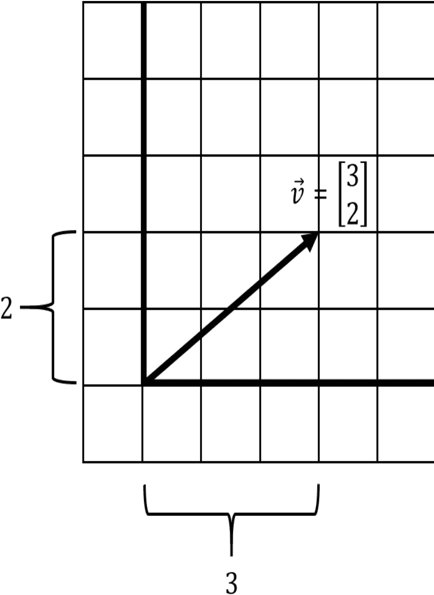

### Figure 4-1. A simple vector

To emphasize again, the purpose of the vector is to visually represent a piece of data. If you have a data record for the square footage of a house 18,000 square feet and its valuation $260,000, we could express that as a vector `[18000 260000]`, stepping 18,000 steps in the horizontal direction and 260,000 steps in the vertical direction.

We declare a vector mathematically like this:

$$\vec{v} = \begin{bmatrix} x \\ y \end{bmatrix}$$

$$
\vec{v} = \begin{bmatrix} 3 \\ 2 \end{bmatrix}
$$

We can declare a vector using a simple Python collection, like a Python list as shown in Example 4-1.

### Example 4-1. Declaring a vector in Python using a list

```
v = [3, 2]
print(v)
```

However when we start doing mathematical computations with vectors, especially when doing tasks like machine learning, we should probably use the NumPy library as it is more efficient than plain Python. You can also use SymPy to perform linear algebra operations, and we will use it occasionally in this chapter when decimals become inconvenient. However, NumPy is what you will likely use in practice so that is what we will mainly stick to.

To declare a vector, you can use NumPy’s `array()` function and then can pass a collection of numbers to it as shown in Example 4-2.

### Example 4-2. Declaring a vector in Python using NumPy

```
import numpy as np
v = np.array([3, 2])
print(v)
```

## PYTHON IS SLOW, ITS NUMERICAL LIBRARIES ARE NOT

Python is a computationally slow language platform, as it does not compile to lower-level machine code like Java, C#, C, etc. It is dynamically interpreted at runtime. However Python’s numeric and scientific libraries are not slow. Libraries like NumPy are typically written in low-level languages like C and C++, hence why they are computationally efficient. Python really acts as “glue code” integrating these libraries for your tasks.

A vector has countless practical applications. In physics, a vector is often thought of as a direction and magnitude. In math it is a direction and scale on an XY plane, kind of like a movement. In computer science, it is an array of numbers storing data. The computer science context is the one we will become the most familiar with as data science professionals. However it is important we never forget the visual aspect so we do not think of vectors as esoteric grids of numbers. Without a visual understanding it is almost impossible to grasp many fundamental linear algebra concepts like linear dependence and determinants.

Here are some more examples of vectors. In Figure 4-2 note that some of these vectors have negative directions on the X and Y scales. Vectors with negative directions will have an impact when we combine them later, essentially subtracting rather than adding them together.

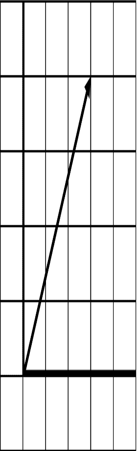

$$ \vec{v} = \begin{bmatrix} 3 \\ 4 \end{bmatrix} $$


$$ \vec{v} = \begin{bmatrix} -3 \\ 2 \end{bmatrix} $$

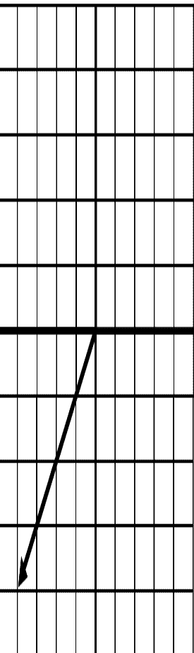

$$ \vec{v} = \begin{bmatrix} -4 \\ 4 \end{bmatrix} $$

### Figure 4-2. A sampling of different vectors

## WHY ARE VECTORS USEFUL?

A struggle many people have with vectors (and linear algebra in general) is understanding why they are useful. They are a highly abstract concept but it has many tangible applications. Computer graphics are easier to work with when you have a grasp of vectors and linear transformations (the fantastic Manim visualization library defines animations and transformations `with vectors`). When doing statistics and machine learning work, data is often imported and turned into numerical vectors so we can work with it. Solvers like the one in Excel or Python PuLP use linear programming, which uses vectors to maximize a solution while meeting those constraints. Even video games and flight simulators use vectors and linear algebra not just to model graphics but also physics. I think what makes vectors so hard to grasp is not that their application is unobvious, but rather these applications are so diverse it is hard to see the generalization.

Note also vectors can exist on more than two dimensions. Below we declare a 3-dimensional vector along axes x, y, and z:

```
\(\vec{v} = \begin{bmatrix} x \\ y \\ z \end{bmatrix} = \begin{bmatrix} 4 \\ 1 \\ 2 \end{bmatrix}\)
```

Note to create the vector above we are stepping 4 steps in the x direction, 1 in the y direction, and 2 in the z direction. Here it is visualized in Figure 4-3. Note that we no longer are showing a vector on a 2-dimensional grid but rather a 3-dimensional space with 3 axes: x, y, and z.

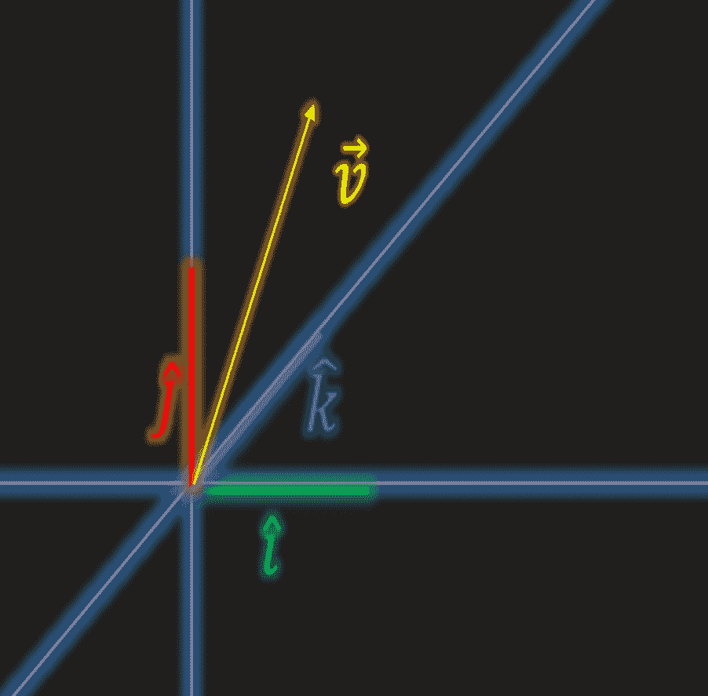

### Figure 4-3. A 3-dimensional vector

Naturally we can express this 3-dimensional vector in Python using 3 numeric values, as declared in Example 4-3.

### Example 4-3. Declaring a 3-dimensional vector in Python using NumPy

```
import numpy as np
v = np.array([4, 1, 2])
print(v)
```

Like many mathematical models, visualizing more than 3 dimensions is challenging and something we will not expend energy doing so in this book. But numerically it is still straightforward. Example 4-4 shows how we declare a 5-dimensional vector mathematically in Python.

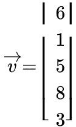

### Example 4-4. Declaring a 5-dimensional vector in Python using NumPy

```
import numpy as np
v = np.array([6, 1, 5, 8, 3])
print(v)
```

## Adding and Combining Vectors

On their own, vectors are not terribly interesting. You express a direction and size, kind of like a movement of space. But when you start combining vectors, known as **vector addition**, it starts to get interesting. We effectively combine the movements of two vectors into a single vector.

Say we have two vectors \(\vec{v}\) and \(\vec{w}\) as shown in Figure 4-4. How do we add these two vectors together?

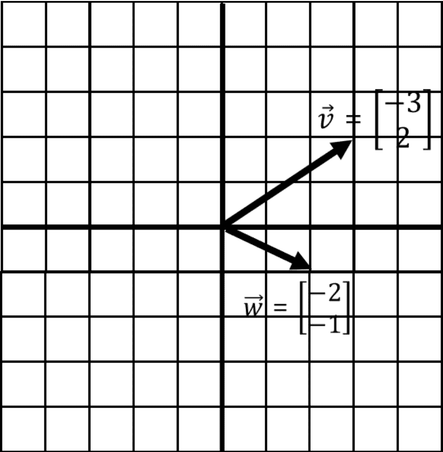

### Figure 4-4. Adding two vectors together

We will get to why adding vectors is useful in a moment. But if we wanted to combine these two vectors, including their direction and scale, what would that look like? Numerically this is straightforward. You simply add the respective $x$ values and then the $y$ values into a new vector as shown in Example 4-5.

$$\vec{v} = \begin{bmatrix} 3 \\ 2 \end{bmatrix}$$

\(\vec{w} = \begin{bmatrix} 2 \\ -1 \end{bmatrix}\)
\(\vec{v} + \vec{w} = \begin{bmatrix} 3+2 \\ 2 + (-1) \end{bmatrix} = \begin{bmatrix} 5 \\ 1 \end{bmatrix}\)

### Example 4-5. Adding two vectors in Python using NumPy

```
from numpy import array

v = array([3,2])
w = array([2,-1])

# sum the vectors
v_plus_w = v + w

# display summed vector
print(v_plus_w) # [5, 1]
```

But what does this mean visually? To visually add these two vectors together, connect one vector after the other and walk to the tip of the last vector (Figure 4-5). The point you end at is a new vector, the result of summing the two vectors.

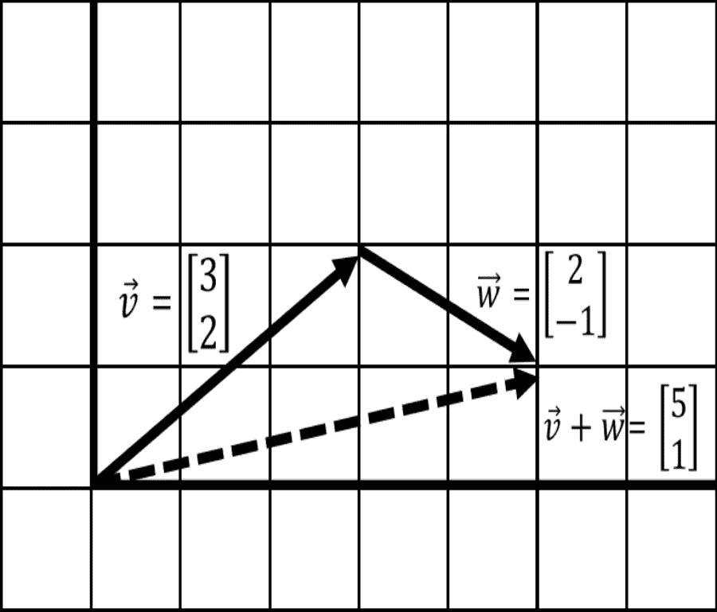

### Figure 4-5. Adding two vectors into a new vector

As seen above in Figure 4-5, when we walk to the end of the last vector \(\vec{w}\) we end up with a new vector [5, 1]. This new vector is the result of summing \(\vec{v}\) and \(\vec{w}\). In practice, this can be simply adding data together. If we were totaling housing values and their square footage in an area, we would be adding several vectors into a single vector in this manner.

Note that it does not matter whether we add \(\vec{v}\) before \(\vec{w}\) or vice versa, which means it is **commutative** and order of operation does not matter. If we walk \(\vec{w}\) before \(\vec{v}\) we end up with the same resulting vector [5, 1] as visualized in Figure 4-6.


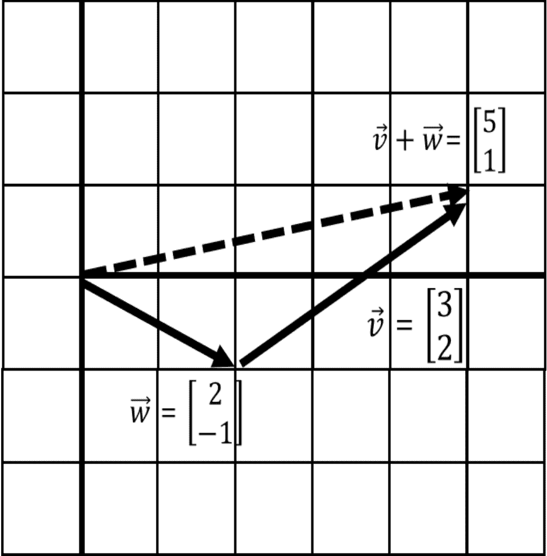

图 4-6. 向量加法满足交换律

## 缩放向量

缩放是增长或缩短向量的长度。你可以通过乘以一个单一值（称为**标量**）来增长或缩短向量。图 4-7 展示了向量 \(\vec{v}\) 被 2 倍缩放，即长度加倍。

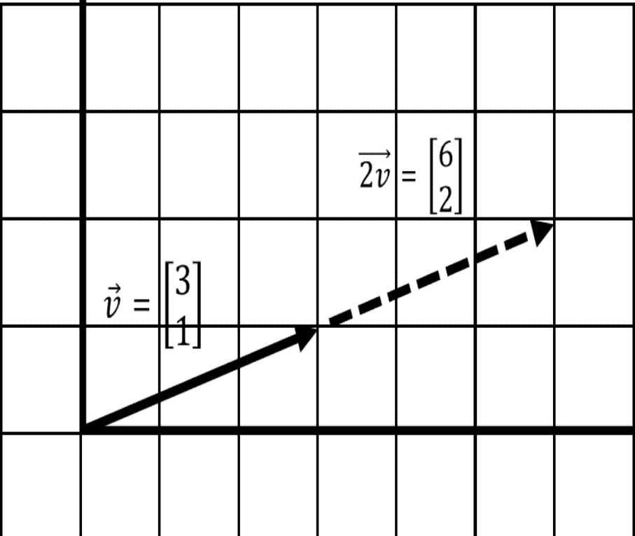

图 4-7. 缩放向量

在数学上，你将向量的每个元素乘以标量值。

\(\vec{v} = \begin{bmatrix} 3 \\ 2 \end{bmatrix}\)

\(2\vec{v} = 2 \begin{bmatrix} 3 \\ 2 \end{bmatrix} = \begin{bmatrix} 3 \times 2 \\ 2 \times 2 \end{bmatrix} = \begin{bmatrix} 6 \\ 4 \end{bmatrix}\)

在 Python 中执行此缩放操作就像用向量乘以标量一样简单，如示例 4-6 所示。

## 示例 4-6. 使用 NumPy 在 Python 中缩放数字

```
from numpy import array

v = array([3,1])

# scale the vector
scaled_v = 2.0 * v

# display scaled vector
print(scaled_v)  # [6 2]
```

如图 4-8 所示，向量 \(\vec{v}\) 被 0.5 倍缩放，即长度减半。

\(\vec{v} = \begin{bmatrix} 3 \\ 1 \end{bmatrix}\)

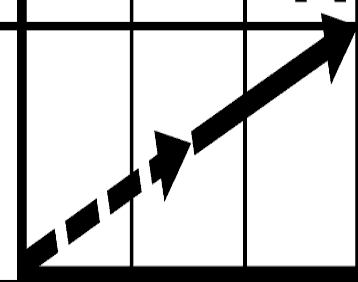

\(0.5\vec{v} = \begin{bmatrix} 3 \\ 1.5 \end{bmatrix}\)

图 4-8. 将向量缩小一半

## 操纵数据即操纵向量

每个数据操作都可以用向量来理解，即使是简单的平均值。

以缩放为例。假设我们想要获取整个社区的平均房价和平均面积。我们会将向量相加，分别合并它们的价值和面积，得到一个包含总价值和总面积的巨型向量。然后我们通过除以房屋数量 N 来缩小该向量，这实际上就是乘以 1/N。现在我们有一个包含平均房价和平均面积的向量了。

这里需要注意的一个重要细节是：缩放向量不会改变其方向，只改变其大小。但这条规则有一个小例外，如图 4-9 所示。当你将向量乘以负数时，它会翻转向量的方向，如下所示：

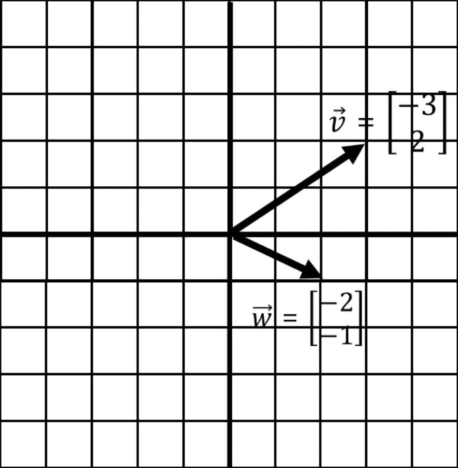

图 4-9. 负标量会翻转向量方向

不过仔细想一想，用负数缩放并没有真正改变方向，因为向量仍然位于同一条直线上。这引出了一个关键概念：线性相关性。

## 展开与线性相关性

这两种操作——向量相加和缩放——带来了一个简单但强大的想法。通过这两种操作，我们可以合并两个向量并缩放它们，以创建任意想要的结果向量。图 4-10 展示了六个示例：取两个向量 \(\vec{v}\) 和 \(\vec{w}\)，对其进行缩放并合并。这两个固定在不同方向上的向量 \(\vec{v}\) 和 \(\vec{w}\)，可以缩放并相加，以创建任意新向量 \(\vec{v + w}\)。

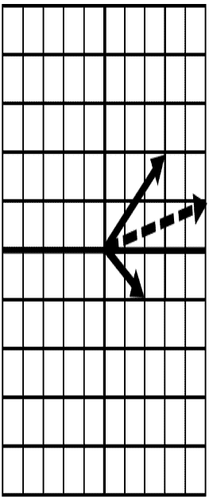

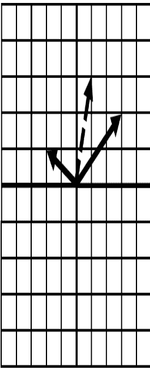

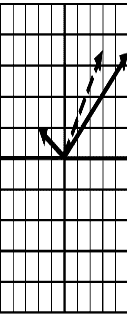

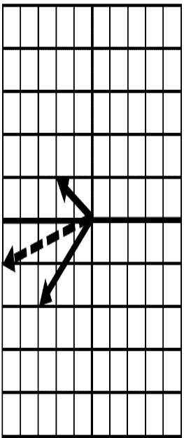

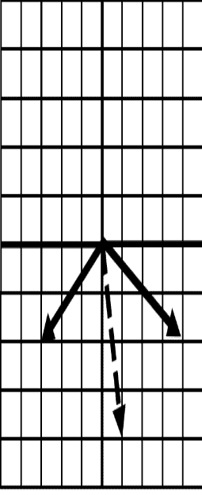

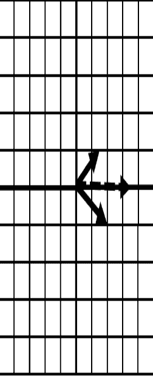

图 4-10. 缩放两个相加的向量，使我们能够创建任意新向量

再次强调，\(\vec{v}\) 和 \(\vec{w}\) 的方向是固定的，除非通过负标量翻转，但我们可以使用缩放来自由创建由 \(\vec{v + w}\) 组成的任何向量。

这种可能向量的整个空间称为**展开（span）**，在大多数情况下，我们只需缩放并求和这两个向量，就能创建无限多个向量。当我们拥有两个不同方向的向量时，它们是**线性无关的**，并具有这种无限的展开。

但在什么情况下，我们能创建的向量是有限的？请思考并继续阅读。

当两个向量在同一方向上，或位于同一条直线上时会发生什么？这些向量的组合也被困在同一条直线上，限制了我们的展开仅为那条直线。无论你如何缩放，结果和向量也被困在同一条直线上。这使它们成为**线性相关**的向量，如图 4-11 所示。

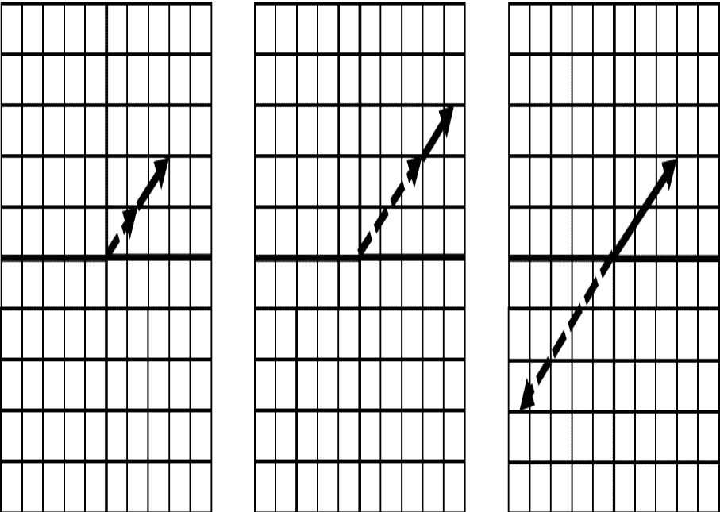

图 4-11. 线性相关向量

这里的展开被困在构成它的两个向量所在的同一条直线上。因为两个向量位于同一条底层直线上，我们无法通过缩放灵活地创建任何新向量。任何结果向量都被困在那条直线上。

在 3 维或更高维度中，当我们有一组线性相关向量时，通常会被困在一个较低维度的平面上。如图 4-12 所示，即使我们拥有 3 维向量，也可能被困在 2 维平面上，下面是一个示例。

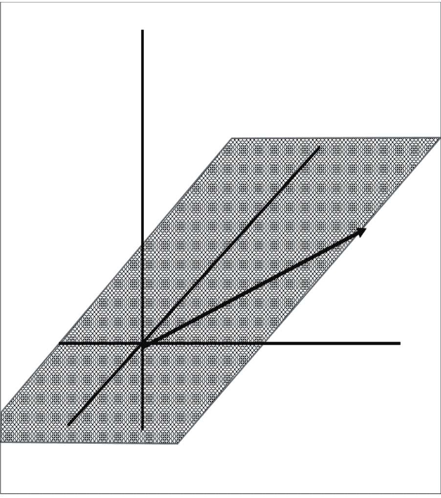

图 4-12. 3 维中的线性相关性，注意我们的展开被限制在一个平面上

稍后我们将学习一个称为行列式的简单工具来检查线性相关性，但我们为什么关心两个向量是线性相关还是线性无关呢？当它们线性相关时，许多问题会变得困难或无法求解。例如，当我们在本章后面学习方程组时，线性相关的方程组会导致变量消失，使问题无法求解。但如果你拥有线性无关性，从两个或多个向量中创建任何你需要的向量的灵活性在求解方案时将变得无比宝贵！

## 线性变换

将两个固定方向的向量相加，并对其缩放以获得不同组合向量的概念，非常重要。这个组合向量（线性相关情况除外）可以指向任何方向，并拥有我们选择的任何长度。这为线性变换建立了直觉，我们用一个向量以类似函数的方式转换另一个向量。

## 基向量

想象我们有两个简单的向量 \(\hat{i}\) 和 \(\hat{j}\)（“i-帽”和“j-帽”）。这些被称为**基向量**，用于描述对其他向量的变换。它们通常长度为 1，并指向互相垂直的正方向，如图 4-13 所示。

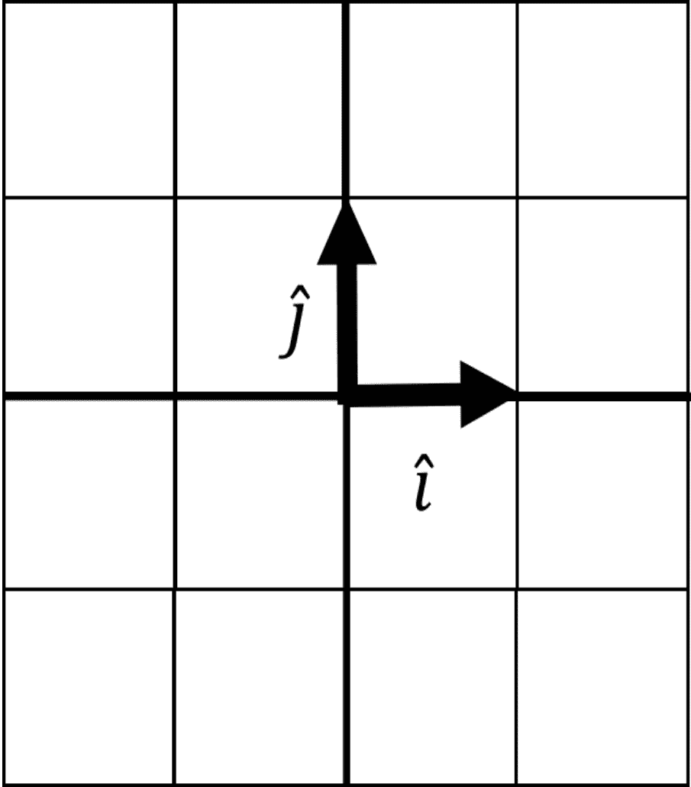

图 4-13. 基向量 $\hat{i}$ 和 $\hat{j}$

将基向量视为构建或转换任何向量的积木。我们的基向量表示为一个 2x2 矩阵，第一列是 $\hat{i}$，第二列是 $\hat{j}$。

```
$$\hat{i} = \begin{bmatrix} 1 \\ 0 \end{bmatrix}$$
\hat{j} = \begin{bmatrix} 0 \\ 1 \end{bmatrix}

basis = \begin{bmatrix} 1 & 0 \\ 0 & 1 \end{bmatrix}
```

一个**矩阵**是向量的集合（例如 \(\hat{i}, \hat{j}\)），可以有多个行和列，是一种方便的数据打包方式。我们可以通过缩放和相加 \(\hat{i}\) 和 \(\hat{j}\) 来创建任何我们想要的向量。让我们从每个长度为 1 开始，并展示结果向量 \(\vec{v}\)，如图 4-14 所示。

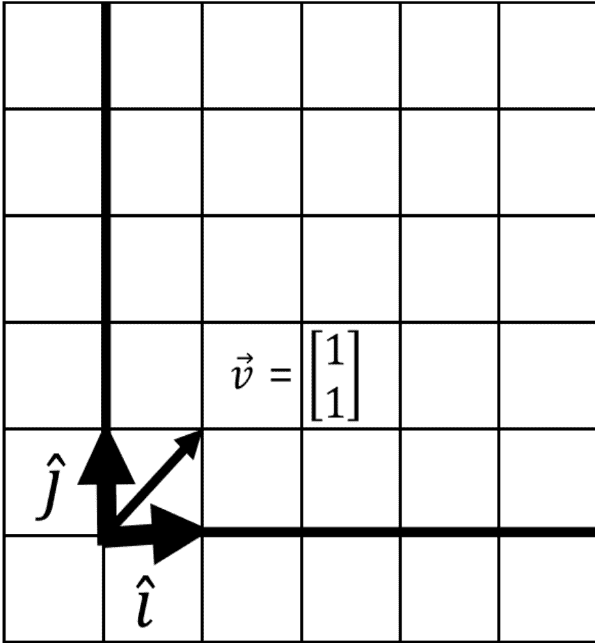

图 4-14. 基于基向量创建向量

我希望向量 \(\vec{v}\) 落在 \([3, 2]\) 处。如果我们将 \(\hat{\imath}\) 扩展 3 倍，将 \(\hat{\jmath}\) 扩展 2 倍，\(\vec{v}\) 会发生什么变化？首先我们分别对它们进行缩放，如下所示：

\(3\hat{\imath} = 3\begin{bmatrix} 1 \\ 0 \end{bmatrix} = \begin{bmatrix} 3 \\ 0 \end{bmatrix}\)

$2\hat{j} = 2 \begin{bmatrix} 0 \\ 1 \end{bmatrix} = \begin{bmatrix} 0 \\ 2 \end{bmatrix}$

如果我们在这两个方向上拉伸空间，这对 $\vec{v}$ 有什么影响？嗯，它将随 $\hat{i}$ 和 $\hat{j}$ 一起拉伸。这称为**线性变换**，我们通过跟踪基向量的运动，用拉伸、压缩、剪切或旋转来转换向量。在图 4-15 的这种情况下，缩放 $\hat{i}$ 和 $\hat{j}$ 连同我们的向量 $\vec{v}$ 一起拉伸了空间。

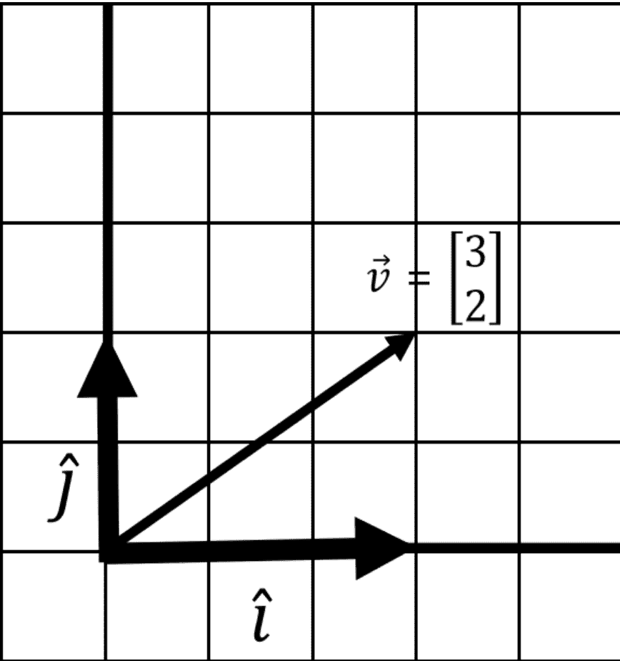

图 4-15. 一个线性变换


但 \(\vec{v}\) 落在哪里呢？这里很容易直观地看到它落在哪里，即 `[3, 2]`。回顾一下，向量 \(\vec{v}\) 是由 \(\hat{i}\) 和 \(\hat{j}\) 相加组成的。因此，我们只需取拉伸后的 \(\hat{i}\) 和 \(\hat{j}\) 并将它们相加，以查看向量 \(\vec{v}\) 落在了哪里。

\(\vec{v}_{new} = \begin{bmatrix} 3 \\ 0 \end{bmatrix} + \begin{bmatrix} 0 \\ 2 \end{bmatrix} = \begin{bmatrix} 3 \\ 2 \end{bmatrix}\)

一般来说，使用线性变换，你可以实现图 4-16 所示的四种运动。

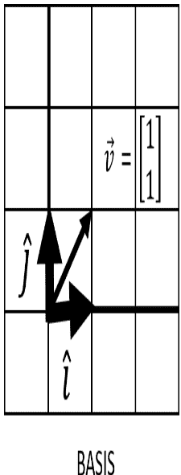

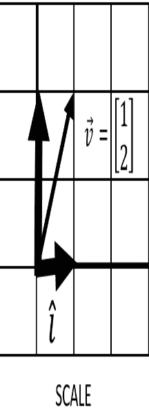

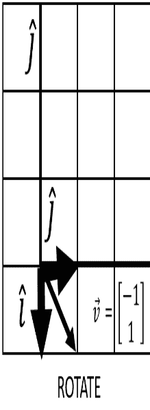

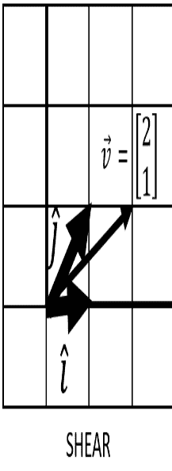

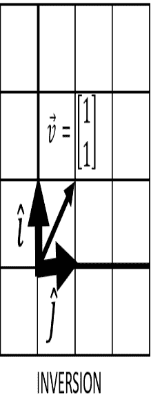

图 4-16. 线性变换可以实现四种运动

这四种线性变换是线性代数的核心部分。缩放向量会拉伸或压缩它。旋转会转动向量空间，而反转会翻转向量空间，使 \(\hat{i}\) 和 \(\hat{j}\) 互换各自的位置。

重要的是要注意，你不能有非线性变换，因为这会导致不再遵循直线的曲线或蜿蜒变换。这就是为什么我们称之为线性代数，而不是非线性代数！

## 矩阵向量乘法

这把我们带到了线性代数中的下一个重要概念。跟踪 \(\hat{i}\) 和 \(\hat{j}\) 在变换后落在哪里的概念很重要，因为它不仅让我们能够创建向量，还能转换现有向量。如果你想获得真正的线性代数启发，想想为什么创建向量和转换向量实际上是同一件事。这全都是关于相对性的问题，即你的基向量在变换前后作为起点。

给定打包为矩阵的基向量 \(\hat{i}\) 和 \(\hat{j}\) 来转换向量 \(\vec{v}\) 的公式如下：

```
\[
\begin{bmatrix} x_{new} \\ y_{new} \end{bmatrix} = \begin{bmatrix} a & b \\ c & d \end{bmatrix} \begin{bmatrix} x \\ y \end{bmatrix}
\]
\[
\begin{bmatrix} x_{new} \\ y_{new} \end{bmatrix} = \begin{bmatrix} ax + by \\ cx + dy \end{bmatrix}
\]
```

\(\hat{i}\) 是第一列 `[a \ c]`，\(\hat{j}\) 是列 `[b \ d]`。我们将这两个基向量都打包成一个矩阵，这再次是一组表示为两个或更多维度中数字网格的向量。通过应用基向量来转换向量的过程被称为 **矩阵向量乘法**。起初这可能显得有些牵强，但这个公式是缩放和相加 \(\hat{i}\) 和 \(\hat{j}\) 的快捷方式，就像我们之前将两个向量相加一样，并将变换应用于任何向量 \(\vec{v}\)。

因此，实际上，矩阵确实是作为基向量表达的变换。

要在 Python 中使用 NumPy 执行此变换，我们需要将基向量声明为矩阵，然后使用 `dot()` 运算符将其应用于向量 \(\vec{v}\)（示例 4-7）。点运算符将执行我们刚才描述的矩阵与向量之间的缩放和相加。这被称为 **点积**，我们将在本章中探讨它。

### 示例 4-7. NumPy 中的矩阵向量乘法

```
from numpy import array

# compose basis matrix with i-hat and j-hat
basis = array(
    [[3, 0],
     [0, 2]]
)

# declare vector v
v = array([1, 1])

# create new vector
# by transforming v with dot product
new_v = basis.dot(v)

print(new_v) # [3, 2]
```

在以基向量思考时，我倾向于先拆分基向量，然后将它们组合成矩阵。请注意，你需要进行 **转置**，即交换列和行。这是因为 NumPy 的 `array()` 函数会做出我们不想要的相反方向，将每个向量作为行而不是列填充。NumPy 中的转置在示例 4-8 中演示。

### 示例 4-8.

```
from numpy import array

# Declare i-hat and j-hat
i_hat = array([2, 0])
j_hat = array([0, 3])

# compose basis matrix using i-hat and j-hat
# also need to transpose rows into columns
basis = array([i_hat, j_hat]).transpose()

# declare vector v
v = array([[1,1]])

# create new vector
# by transforming v with dot product
new_v = basis.dot(v)

print(new_v) # [2, 3]
```

这里还有另一个例子。让我们从向量 \(\vec{v}\) 为 [2  1] 开始，\(\hat{i}\) 和 \(\hat{j}\) 分别起始于 [1  0] 和 [0  1]。然后我们将 \(\hat{i}\) 和 \(\hat{j}\) 转换为 [2  0] 和 [0  3]。向量 \(\vec{v}\) 会发生什么？使用我们的公式手动进行数学计算，我们得到以下结果。

\(\begin{bmatrix} x_{new} \\ y_{new} \end{bmatrix} = \begin{bmatrix} a & b \\ c & d \end{bmatrix} \begin{bmatrix} x \\ y \end{bmatrix} = \begin{bmatrix} ax + by \\ cx + dy \end{bmatrix}\)

\(\begin{bmatrix} x_{new} \\ y_{new} \end{bmatrix} = \begin{bmatrix} 2 & 0 \\ 0 & 3 \end{bmatrix} \begin{bmatrix} 2 \\ 1 \end{bmatrix} = \begin{bmatrix} (2)(2) + (0)(1) \\ (2)(0) + (3)(1) \end{bmatrix} = \begin{bmatrix} 4 \\ 3 \end{bmatrix}\)

示例 4-9 在 Python 中展示了这个解决方案。

### 示例 4-9. 使用 NumPy 转换向量

```
from numpy import array

# Declare i-hat and j-hat
i_hat = array([2, 0])
j_hat = array([0, 3])

# compose basis matrix using i-hat and j-hat
# also need to transpose rows into columns
basis = array([i_hat, j_hat]).transpose()

# declare vector v
v = array([2,1])

# create new vector
# by transforming v with dot product
new_v = basis.dot(v)

print(new_v) # [4 3]
```

向量 \(\vec{v}\) 现在落在 [ 4 3 ] 处。图 4-17 显示了此变换的可视化效果。

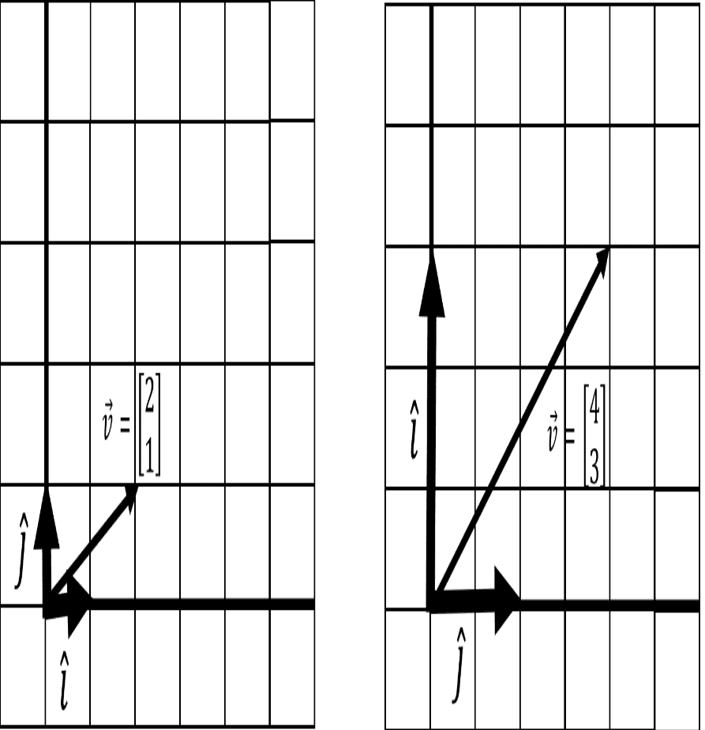

图 4-17. 一个拉伸线性变换

这里有一个难度再上一层的例子。让我们取值为 \([2 \quad 1]\) 的向量 \(\vec{v}\)。\(\hat{i}\) 和 \(\hat{j}\) 起始于 \([1 \quad 0]\) 和 \([0 \quad 1]\)，但随后被转换并落在 \([2 \quad 3]\) 和 \([2 \quad -1]\)。\(\vec{v}\) 会发生什么？让我们查看图 4-18 和示例 4-10。

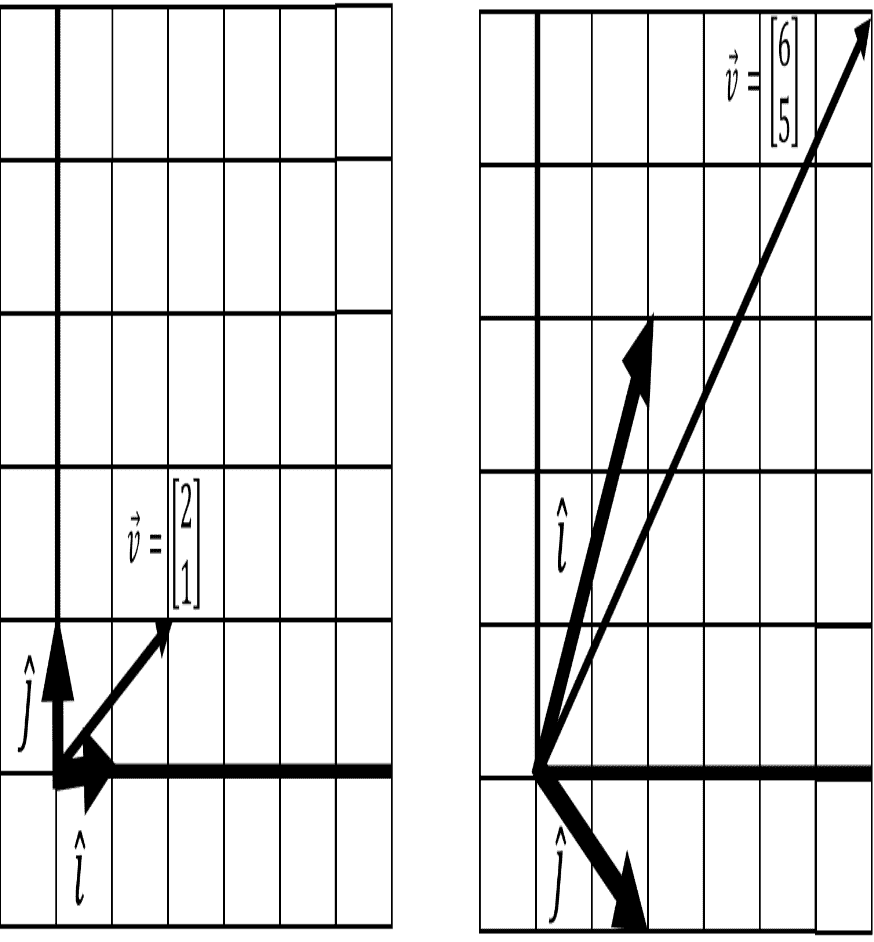

图 4-18. 一个执行旋转、剪切和空间翻转的线性变换

### 示例 4-10.

```
from numpy import array

# Declare i-hat and j-hat
i_hat = array([2, 3])
j_hat = array([2, -1])

# compose basis matrix using i-hat and j-hat
# also need to transpose rows into columns
basis = array([i_hat, j_hat]).transpose()

# declare vector v
v = array([2,1])

# create new vector
# by transforming v with dot product
new_v = basis.dot(v)

print(new_v) # [6, 5]
```

这里发生了很多事情。我们不仅缩放了 \(\hat{i}\) 和 \(\hat{j}\) 并拉长了向量 \(\vec{v}\)。我们实际上还剪切、旋转和翻转了空间。当 \(\hat{i}\) 和 \(\hat{j}\) 在其顺时针方向中互换位置时，你知道空间被翻转了，我们将在本章后面学习如何使用行列式来检测这一点。

## 3D 及更高维度中的基向量

你可能在想，我们如何在 3 维或更多维度中思考向量变换。基向量的概念非常好地延伸了。如果我有一个 3 维向量空间，那么我就有基向量 \(\hat{\imath}\)、\(\hat{\jmath}\) 和 \(\hat{k}\)。对于每个新维度，我只需继续从字母表中添加更多字母（图 4-19）。


图 4-19. 3D 基向量

值得指出的另一点是，某些线性变换可以将向量空间移动到更少或更多维度，而这正是非方阵所做的（行数和列数不相等）。由于时间关系，我们无法深入探讨这一点。但 3Blue1Brown 精美地解释和动画演示了这一概念。

## 矩阵乘法

我们学习了如何将向量和矩阵相乘，但将两个矩阵相乘究竟能实现什么？将 **矩阵乘法** 视为对向量空间应用多个变换。每个变换都像一个函数，我们先应用最内层的变换，然后向外依次应用每个后续变换。

下面是如何对值为 [`x` `y`] 的任何向量 \(\vec{v}\) 先应用旋转，再应用剪切。

```
[ 1  1 ] [ 0 -1 ] [ x ]
[ 0  1 ] [  1  0 ] [ y ]
```

我们实际上可以使用这个公式来合并这两个变换，将一个变换应用到上一个变换之上。你将第一个矩阵的每一行与第二个矩阵的每个相应列相乘并相加，按照“横过-向下！横过-向下！”的模式进行。

```
[ a b ] [ e f ] = [ ae + bg  af + bh ]
[ c d ] [ g h ]   [ ce + dg  cf + dh ]
```

因此，我们实际上可以将这两个独立的变换（旋转和剪切）合并为一个单一的变换。

```
[ 1  1 ] [ 0 -1 ] [ x ]
[ 0  1 ] [  1  0 ] [ y ]

= [ (1)(0) + (1)(1)  (-1)(1) + (1)(0) ] [ x ]
  [ (0)(0) + (1)(1)  (0)(-1) + (1)(0) ] [ y ]
```


= \(\begin{bmatrix} 1 & -1 \\ 1 & 0 \end{bmatrix} \begin{bmatrix} x \\ y \end{bmatrix}\)

在 Python 中使用 NumPy 执行此操作时，可以直接使用 `matmul()` 或 `@` 运算符（示例 4-11）来组合这两个矩阵。然后，我们将使用这个合并后的变换，并将其应用于向量 `[1 2]`。

### 示例 4-11.

```python
from numpy import array

# Transformation 1
i_hat1 = array([0, 1])
j_hat1 = array([-1, 0])
transform1 = array([i_hat1, j_hat1]).transpose()

# Transformation 2
i_hat2 = array([1, 0])
j_hat2 = array([1, 1])
transform2 = array([i_hat2, j_hat2]).transpose()

# Combine Transformations
combined = transform2 @ transform1

# Test
print("COMBINED MATRIX:\n {}".format(combined))

v = array([1, 2])    # [-1 1]
print(combined.dot(v)) # [-1 1]
```

> # 使用 DOT() 还是 MATMUL() 和 @
> 
> 一般来说，在 NumPy 中组合矩阵时，应优先使用 `matmul()` 及其简写 `@`，而不是 `dot()` 运算符。前者在处理高维矩阵及元素广播方式方面通常具有更可取的策略。
> 
> 如果你喜欢深入研究这类实现细节，这个 [StackOverflow](https://stackoverflow.com/) 问题是一个很好的起点。

请注意，我们也可以分别对向量 \(\vec{v}\) 应用每个变换，仍然得到相同的结果。如果将最后一行替换为这三行（示例 4-12），对每个变换进行应用，你在该新向量上仍然会得到 [-1 1]。

### 示例 4-12.

```python
rotated = transform1.dot(v)
sheered = transform2.dot(rotated)
print(sheered) # [-1 1]
```

请注意，应用每个变换的顺序很重要！如果我们在 `transformation2` 上应用 `transformation1`，将得到与示例 4-13 中计算的不同结果 `[-2 3]`。因此，矩阵点积不具备交换性，这意味着你不能交换顺序并期望得到相同的结果！

### 示例 4-13.

```python
from numpy import array

# Transformation 1
i_hat1 = array([0, 1])
j_hat1 = array([-1, 0])
transform1 = array([i_hat1, j_hat1]).transpose()

# Transformation 2
i_hat2 = array([1, 0])
j_hat2 = array([1, 1])
transform2 = array([i_hat2, j_hat2]).transpose()

# Combine Transformations, apply shear first and then rotation
combined = transform1 @ transform2

# Test
print("COMBINED MATRIX:\n {}".format(combined))

v = array([1, 2])
print(combined.dot(v)) # [-2 3]
```

将每个变换视为一个函数，我们从内到外应用它们，就像嵌套函数调用一样。

## 实际中的线性变换

你可能会好奇，所有这些线性变换和矩阵与数据科学和机器学习有什么关系。答案是：一切都有关！从导入数据到线性回归、逻辑回归和神经网络中的数值运算，线性变换都是数学处理数据的核心。

不过，在实际操作中，你很少会花时间从几何上将数据可视化为向量空间和线性变换。你将要处理太多维度，无法高效地完成此操作。但了解几何解释仍然很有益，这样你才能明白这些看似巧妙的数值运算到底在做什么！否则，你只是在没有任何上下文的情况下死记硬背数值运算模式。这也能让行列式等新的线性代数概念变得更加直观。

### 行列式

执行线性变换时，我们有时会“扩展”或“压缩”空间，这种发生的程度可能很有帮助。取向量空间中图 4-20 的一个采样区域：在缩放 î 和 ĵ 之后，它会发生什么变化？

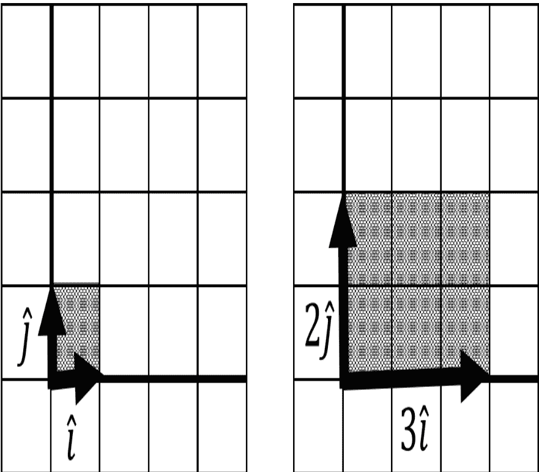

图 4-20. 行列式衡量线性变换如何缩放面积

面积增加了 6.0 倍，这个因子被称为 **行列式**。行列式描述了向量空间中采样区域在线性变换下的缩放程度，这可以提供关于变换的有用信息。

### 示例 4-14.

```python
from numpy.linalg import det
from numpy import array

i_hat = array([3, 0])
j_hat = array([0, 2])

basis = array([i_hat, j_hat]).transpose()

determinant = det(basis)

print(determinant) # prints 6.0
```

简单的剪切和旋转不应该影响行列式，因为面积不会改变。图 4-21 和示例 4-15 展示了一个简单的剪切，行列式仍保持 1.0 的因子，表明其不变。

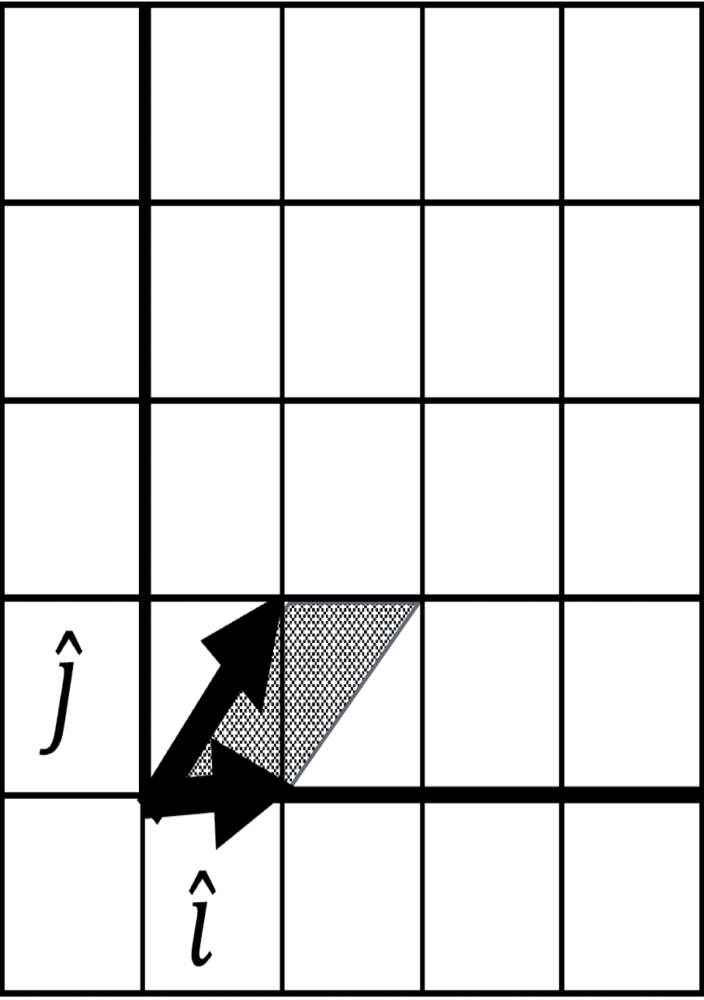

图 4-21. 简单的剪切不会改变行列式

### 示例 4-15.

```python
from numpy.linalg import det
from numpy import array
i_hat = array([1, 0])
j_hat = array([1, 1])
basis = array([i_hat, j_hat]).transpose()

determinant = det(basis)

print(determinant) # prints 1.0
```

但是缩放会增加或减少行列式，因为这会增加/减少采样面积。当方向翻转（î 和 ĵ 顺时针互换位置）时，行列式将为负数。图 4-22 和示例 4-16 展示了一个行列式，表示的变换不仅缩放了空间，还翻转了向量空间的方向。

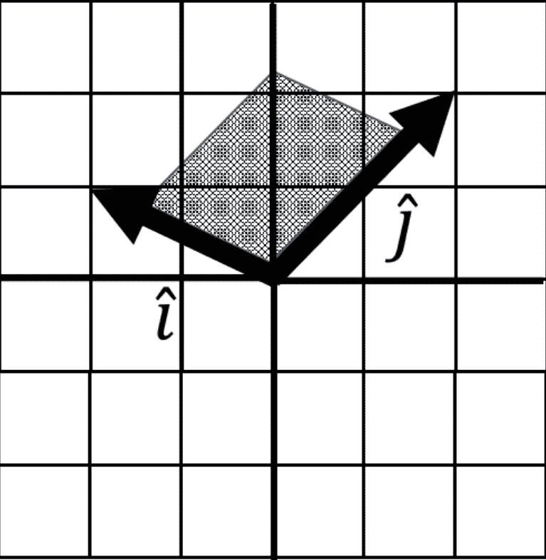

图 4-22. 翻转空间上的行列式为负数

### 示例 4-16.

```python
from numpy.linalg import det
from numpy import array

i_hat = array([-2, 1])
j_hat = array([1, 2])

basis = array([i_hat, j_hat]).transpose()

determinant = det(basis)

print(determinant) # prints -5.0
```

由于这个行列式为负数，我们可以快速看出方向已经翻转。但行列式告诉你的最关键信息是，该变换是否具有线性相关性。如果行列式为 0，意味着整个空间已被压缩到较低维度。

在图 4-23 中，我们看到两个具有线性相关性的变换：一个将 2D 空间压缩到 1 维，另一个将 3D 空间压缩到 2 维。在这两种情况下，面积和体积分别为 0！

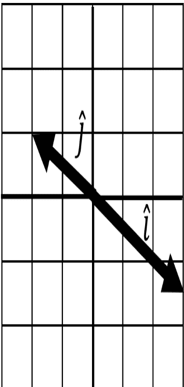

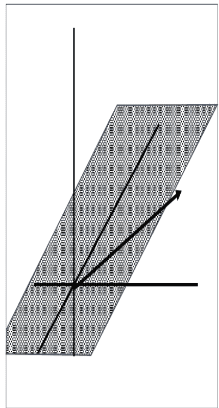

图 4-23. 2D 和 3D 中的线性相关性

示例 4-17 展示了上述 2D 示例的代码，将整个 2D 空间压缩到一条一维数轴上。

### 示例 4-17.

```python
from numpy.linalg import det
from numpy import array

i_hat = array([-2, 1])
j_hat = array([3, -1.5])

basis = array([i_hat, j_hat]).transpose()

determinant = det(basis)

print(determinant) # prints 0.0
```

因此，检测 0 行列式对于判断变换是否具有线性相关性非常有帮助。当你遇到这种情况时，很可能会面临一个棘手甚至无法解决的问题。

### 特殊类型的矩阵

有些特殊的矩阵案例值得关注，我们应该介绍一下。

#### 方阵

方阵是行数和列数相等的矩阵。

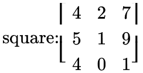

它们主要用于表示线性变换，并且是许多运算（如特征值分解）的前提条件。

#### 单位矩阵

单位矩阵是一个方阵，其对角线上的元素为 1，其他元素均为 0。

单位矩阵：

| 1 | 0 | 0 |
|---|---|---|
| 0 | 1 | 0 |
| 0 | 0 | 1 |

单位矩阵有什么重要性呢？其实，当你拥有单位矩阵时，基本上就已经撤销了变换并找到了起始基向量。这在下一节求解方程组时将发挥重要作用。

#### 逆矩阵

逆矩阵是撤销另一个矩阵变换的矩阵。假设我有矩阵 $ A $。

A =

| 4 | 2 | 4 |
|---|---|---|
| 5 | 3 | 7 |
| 9 | 3 | 6 |

矩阵 $ A $ 的逆矩阵称为 $ A^{-1} $。我们将在下一节学习如何使用 Sympy 或 NumPy 计算逆矩阵，以下是矩阵 $ A $ 的逆矩阵。

A^{-1} =

| -1/2 | 0 | 1/3 |
|---|---|---|
| 5.5 | -2 | 4/3 |
| -2 | 1 | 1/3 |

当我们对 $ A^{-1} $ 和 $ A $ 进行矩阵乘法时，最终得到一个单位矩阵。我们将在下一节关于方程组的内容中，通过 NumPy 和 Sympy 看到这一点。

```
| -1/2 0 1/3 || 4 2 4 || 1 0 0 |
| 5.5 -2 4/3 || 5 3 7 | = | 0 1 0 |
| -2 1 1/3 || 9 3 6 |   | 0 0 1 |
```


## 对角矩阵

与单位矩阵类似的是**对角矩阵**，其对角线为非零值，其余值均为 0。对角矩阵在某些计算中非常理想，因为它们表示将简单标量应用于向量空间。它出现在一些线性代数运算中。

对角线：

| 4 | 0 | 0 |
|---|---|---|
| 0 | 2 | 0 |
| 0 | 0 | 5 |

## 三角矩阵

与对角矩阵类似的是**三角矩阵**，其对角线为非零值，前方为值构成的三角形，其余值均为 0。

三角形：

| 4 | 2 | 9 |
|---|---|---|
| 0 | 1 | 6 |
| 0 | 0 | 5 |

三角矩阵在许多数值分析任务中非常理想，因为它们在方程组求解中通常更容易求解。它也出现在某些分解任务中，例如 LU 分解。

## 稀疏矩阵

偶尔你会遇到大部分为零且只有少量非零元素的矩阵。这些被称为**稀疏矩阵**。从纯数学角度来看，它们并不十分有趣。但从计算角度来看，它们提供了创建效率的机会。如果矩阵大部分为 0，稀疏矩阵实现不会费劲去浪费空间存储一堆 0，而是只跟踪非零单元格。

稀疏：

| 0 | 0 | 0 |
|---|---|---|
| 0 | 0 | 2 |
| 0 | 0 | 0 |
| 0 | 0 | 0 |

当你有大型稀疏矩阵时，可能会显式使用稀疏函数来创建矩阵。

## 方程组与逆矩阵

线性代数的基本用例之一是求解方程组。这也是学习逆矩阵的一个良好应用。假设你得到了以下方程，需要求解 x、y 和 z。

4x + 2y + 4z = 44
5x + 3y + 7z = 56
9x + 3y + 6z = 72

你可以尝试手动使用不同的代数运算来隔离三个变量，但如果你想让计算机求解，则需要像下面所示将此问题用矩阵表示。将系数提取到矩阵 A 中，将方程右侧的值提取到矩阵 B 中，将未知变量提取到矩阵 X 中。

A =

| 4 | 2 | 4 |
|---|---|---|
| 5 | 3 | 7 |
| 9 | 3 | 6 |

B =

| 44 |
|---|
| 56 |
| 72 |

$X = \begin{bmatrix} x \\ y \\ z \end{bmatrix}$

线性方程组的函数为 $AX = B$，我们需要用另一个矩阵 $X$ 来转换矩阵 $A$，从而得到矩阵 $B$。

$AX = B$

\begin{bmatrix} 4 & 2 & 4 \\ 5 & 3 & 7 \\ 9 & 3 & 6 \end{bmatrix} \cdot \begin{bmatrix} x \\ y \\ z \end{bmatrix} = \begin{bmatrix} 44 \\ 56 \\ 72 \end{bmatrix}

我们需要“撤销” $A$ 以便隔离 $X$ 并获取 $x$、$y$ 和 $z$ 的值。撤销 $A$ 的方法是取 $A$ 的逆（记为 $A^{-1}$），并通过矩阵乘法将其应用于 $A$。我们可以如下代数表达：

$AX = B$
$A^{-1}AX = A^{-1}B$
$X = A^{-1}B$

计算矩阵 $A$ 的逆时，我们可能应该使用计算机，而不是使用高斯消元法手动寻找解（本书不会深入探讨高斯消元法，PatrickJMT 在 YouTube 上有一些很棒的视频）。以下是矩阵 $A$ 的逆。

$A^{-1} = \begin{bmatrix} -\frac{1}{2} & 0 & \frac{1}{3} \\ 5.5 & -2 & \frac{4}{3} \\ -2 & 1 & \frac{1}{3} \end{bmatrix}$

注意，当我们将 $A^{-1}$ 与 $A$ 进行矩阵乘法时，将生成一个单位矩阵，即对角线上为 1、其余均为 0 的矩阵。单位矩阵相当于线性代数中的乘以“1”，意味着它基本没有影响，并将有效隔离 $x$、$y$ 和 $z$ 的值。

$A^{-1} = \begin{bmatrix} -\frac{1}{2} & 0 & \frac{1}{3} \\ 5.5 & -2 & \frac{4}{3} \\ -2 & 1 & \frac{1}{3} \end{bmatrix}$

$A = \begin{bmatrix} 4 & 2 & 4 \\ 5 & 3 & 7 \\ 9 & 3 & 6 \end{bmatrix}$

$A^{-1}A = \begin{bmatrix} 1 & 0 & 0 \\ 0 & 1 & 0 \\ 0 & 0 & 1 \end{bmatrix}$

要在 Python 中看到这个单位矩阵的实际效果，你可能希望在此处使用 SymPy 而不是 NumPy。NumPy 中的浮点小数不会让单位矩阵如此明显，但在 Example 4-18 中以符号方式进行操作，我们将看到干净、符号化的输出。注意，在 SymPy 中进行矩阵乘法时，我们使用星号 * 而不是 @。

## 示例 4-18. 使用 SymPy 研究逆矩阵和单位矩阵

```python
from sympy import *

# 4x + 2y + 4z = 44
# 5x + 3y + 7z = 56
# 9x + 3y + 6z = 72

A = Matrix([
    [4, 2, 4],
    [5, 3, 7],
    [9, 3, 6]
])

# dot product between A and its inverse
# will produce identity function
inverse = A.inv()
identity = inverse * A

# prints Matrix([[-1/2, 0, 1/3], [11/2, -2, -4/3], [-2, 1, 1/3]])
print("INVERSE: {}".format(inverse))

# prints Matrix([[1, 0, 0], [0, 1, 0], [0, 0, 1]])
print("IDENTITY: {}".format(identity))
```

不过在实践中，浮点精度的不足不会对我们的答案产生太大影响，因此使用 NumPy 求解 X 应该没问题。

示例 4-19 展示了使用 NumPy 的解法。

## 示例 4-19. 使用 NumPy 求解方程组

```python
from numpy import array
from numpy.linalg import inv

# 4x + 2y + 4z = 44
# 5x + 3y + 7z = 56
# 9x + 3y + 6z = 72

A = array([
    [4, 2, 4],
    [5, 3, 7],
    [9, 3, 6]
])

B = array([
    44,
    56,
    72
])

X = inv(A).dot(B)

print(X) # [ 2. 34. -8.]
```

因此 x = 2，y = 34，z = -8。由于我在此问题中使用了 SymPy，示例 4-20 展示了使用 SymPy 的完整解法，作为 NumPy 的替代方案。

## 示例 4-20. 使用 SymPy 求解方程组

```python
from sympy import *

# 4x + 2y + 4z = 44
# 5x + 3y + 7z = 56
# 9x + 3y + 6z = 72

A = Matrix([
    [4, 2, 4],
    [5, 3, 7],
    [9, 3, 6]
])
B = Matrix([
    44,
    56,
    72
])
X = A.inv() * B
print(X) # Matrix([ [2], [34], [-8]])
```

以下是数学符号中的解法：

\(A^{-1}B = X\)

\(\begin{bmatrix} -\frac{1}{2} & 0 & \frac{1}{3} \\ 5.5 & -2 & \frac{4}{3} \\ -2 & 1 & \frac{1}{3} \end{bmatrix} \begin{bmatrix} 44 \\ 56 \\ 72 \end{bmatrix} = \begin{bmatrix} x \\ y \\ z \end{bmatrix}\)

\(\begin{bmatrix} 2 \\ 34 \\ -8 \end{bmatrix} = \begin{bmatrix} x \\ y \\ z \end{bmatrix}\)

希望这能让你对逆矩阵及其如何用于求解方程组有所了解。

## 线性规划中的方程组

这种求解方程组的方法也用于线性规划，其中不等式定义约束条件，并对目标进行最小化/最大化。

PatrickJMT 有大量关于线性规划的优秀视频。我们也在附录 A 中简要介绍了它。

实际上，你很少需要手动计算逆矩阵，可以让计算机为你完成。但如果你有需要或出于好奇，你会想了解高斯消元法。

PatrickJMT 在 YouTube 上有多个演示高斯消元法的视频。

## 特征向量和特征值

**矩阵分解**是将矩阵分解为其基本组件，类似于对数字进行因式分解（例如，10 可以分解为 2 x 5）。

矩阵分解对查找逆矩阵、计算行列式以及线性回归等任务很有帮助。根据任务的不同，矩阵分解有多种方法。在第 5 章中，我们将使用一种称为 QR 分解的矩阵分解技术来执行线性回归。

但在本章中，让我们专注于一种称为特征值分解的常用方法，它常用于机器学习和主成分分析（PCA）。在这个层面上，我们没有精力深入探讨每个应用。目前，只需知道特征值分解有助于将矩阵分解为在不同机器学习任务中更易于处理的组件。请注意，它仅适用于方阵。

在特征值分解中，有两个组成部分：特征值（记为 lambda λ）和特征向量（记为 v），如图 4-24 所示。

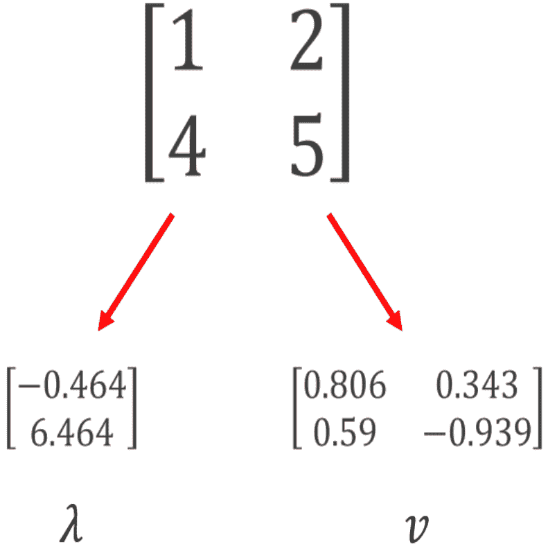

### 图 4-24. 特征向量和特征值

如果有一个方阵 $A$，它具有以下特征值方程：

$Av = \lambda v$

如果 $A$ 是原始矩阵，它由特征向量 $v$ 和特征值 $\lambda$ 组成。每个父矩阵的每个维度都有一个特征向量和特征值，并且并非所有矩阵都可以分解为特征向量和特征值。有时甚至会出现复数（虚数）。


示例 4-21 展示了如何在 NumPy 中为给定矩阵 A 计算特征向量和特征值：

## 示例 4-21. 在 NumPy 中执行特征分解

```
from numpy import array, diag
from numpy.linalg import eig, inv

A = array([
    [1, 2],
    [4, 5]
])

eigenvals, eigenvecs = eig(A)

print("EIGENVALUES")
print(eigenvals)
print("\nEIGENVECTORS")
print(eigenvecs)

"""
EIGENVALUES
[-0.46410162  6.46410162]

EIGENVECTORS
[[ -0.80689822  -0.34372377]
 [ 0.59069049  -0.9390708 ]]
"""
```

那么，我们如何从特征向量和特征值重建矩阵 $A$ 呢？
回顾这个公式：

$Av = \lambda v$

我们需要对公式进行一些小调整以重建 $A$：

$A = Q \Lambda Q^{-1}$

在这个新公式中，$Q$ 是特征向量，$\Lambda$ 是对角形式的特征值，而 $Q^{-1}$ 是 $Q$ 的逆矩阵。对角形式意味着将向量填充到一个由零组成的矩阵中，并沿对角线占据类似单位矩阵的模式。

示例 4-22 在 Python 中完整演示了这一过程，首先分解矩阵，然后重新组合它。

## 示例 4-22. 在 NumPy 中分解和重新组合矩阵

```
from numpy import array, diag
from numpy.linalg import eig, inv

A = array([
   [1, 2],
   [4, 5]
])
```

```
eigenvals, eigenvecs = eig(A)

print("EIGENVALUES")
print(eigenvals)
print("\nEIGENVECTORS")
print(eigenvecs)
```

```
print("\nREBUILD MATRIX")
Q = eigenvecs
R = inv(Q)

L = diag(eigenvals)
B = Q @ L @ R

print(B)
```

> """
> 特征值
> [-0.46410162  6.46410162]
> 特征向量
> [[-0.80689822 -0.34372377]
>  [ 0.59069049 -0.9390708 ]]
> 重建矩阵
> [[1. 2.]
>  [4. 5.]]
> """

如上所示，我们重建的矩阵就是我们开始时的那个矩阵。

## 结论

线性代数可能会令人抓狂地抽象，充满了值得深思的奥秘和思想。你可能会发现整个主题是一个巨大的“兔子洞”，而且你说得对！不过，如果你希望拥有一个长久且成功的数据科学职业生涯，保持好奇心是个好主意。它是统计计算、机器学习及其他应用数据科学领域的基础。归根结底，它是计算机科学的基础。你当然可以暂时不懂它，但到某个时候你会在理解上遇到局限。

你可能会好奇这些想法有多实际，因为它们可能感觉很理论。别担心，我们将在本书中看到一些实际应用。但理论和几何解释在处理数据时很重要，可以帮助你建立直觉；通过直观理解线性变换，你将准备好应对追求过程中可能遇到的更高级概念。

如果你想了解更多关于线性规划的内容，没有比 3Blue1Brown 的 YouTube 播放列表《线性代数的本质》更好的地方了。PatrickJMT 的线性代数视频也很有帮助。

如果你想更熟练地使用 NumPy，Wes McKinney 所著的 O’Reilly 出版的《Python for Data (第 2 版)》是一本推荐读物。它并不侧重线性代数，但确实提供了在数据集上使用 NumPy、Pandas 和 Python 的实用指导。

## 练习

- 1. 向量 \(\vec{v}\) 的值为 [1 2]，但随后发生了一次变换。\(\hat{i}\) 映射到 [2 0]，\(\hat{j}\) 映射到 [0 1.5]。\(\vec{v}\) 会映射到哪里？

- 2. 向量 \(\vec{v}\) 的值为 [1 2]，但随后发生了一次变换。\(\hat{i}\) 映射到 [-2 1]，\(\hat{j}\) 映射到 [1 -2]。\(\vec{v}\) 会映射到哪里？

- 3. 一个变换将 \(\hat{i}\) 映射到 [1 0]，将 \(\hat{j}\) 映射到 [2 2]。这个变换的行列式是多少？

- 4. 是否可以将两个或多个线性变换合并为一个线性变换？为什么或为什么不？

- 5. 求解关于 x、y、z 的方程组：
  3x + 1y + 0z == 54
  2x + 4y + 1z = 12
  3x + 1y + 8z = 6

- 1. 下面的矩阵是否线性相关？为什么或为什么不？

| 2 | 1 |
|---|---|
| 6 | 3 |

答案在附录 B 中。
