# 第 5 章. 线性回归

数据分析中最实用的技术之一是通过观察到的数据点拟合一条直线，以展示两个或多个变量之间的关系。**回归**试图将一个函数拟合到观察数据，以便对新数据进行预测。**线性回归**将一条直线拟合到观察数据，试图展示变量之间的线性关系，并对尚未观察到的新数据进行预测。

与其阅读线性回归的描述，不如看一张图，可能更容易理解。以下是图 5-1 中的线性回归示例。

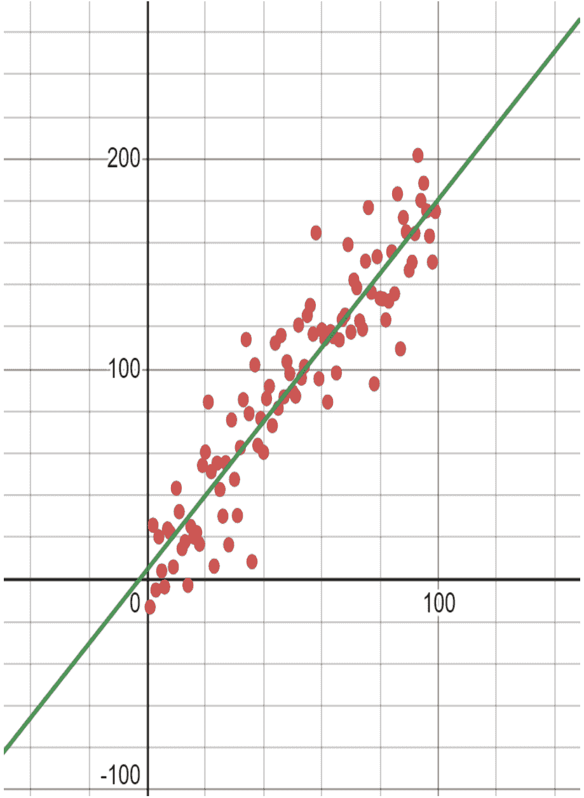

图 5-1. 线性回归示例，将直线拟合到观察数据

线性回归是数据科学和统计学中的得力工具，不仅运用了前几章学到的概念，还为神经网络（第 7 章）和逻辑回归（第 6 章）等后续主题奠定了新的基础。这一相对简单的技术已有 200 多年历史，当代被称为一种机器学习形式。

机器学习从业者通常采用不同的验证方法，从将数据划分为训练集和测试集开始。统计学家更可能使用预测区间和相关性等指标来评估统计显著性。我们将介绍两种思想流派，以便读者能够弥合这两个学科之间日益扩大的差距，从而掌握两套技能。

> ### 等等，回归是机器学习吗？
> 
> “机器学习”涵盖多种技术，但目前应用最广泛的是有监督学习，回归在这里起着重要作用。这就是为什么线性回归被称为一种机器学习形式。令人困惑的是，统计学家可能将其回归模型称为 *统计学习*，而数据科学和机器学习专业人士则会称其模型为 *机器学习*。
> 
> 虽然有监督学习通常是回归，但无监督机器学习更多涉及聚类和异常检测。强化学习通常将有监督机器学习与仿真相结合，以快速生成合成数据。
> 
> 我们将在第 6 章（逻辑回归）和第 7 章（神经网络）中学习另外两种有监督机器学习形式。

### 基础线性回归

我想研究狗的年龄与其就医次数之间的关系。在一个虚构的样本中，我们有 10 随机狗。我喜欢用简单的数据集（真实或非真实）来理解复杂技术，这样我们就能在不被复杂数据干扰的情况下理解该技术的优势和局限性。让我们按照图 5-2 所示绘制这个数据集。

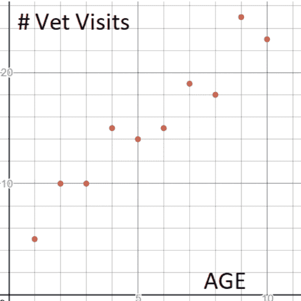

图 5-2. 绘制 10 只狗及其年龄和就诊次数的样本

我们可以清楚地看到这里存在线性相关，意味着当其中一个变量增加/减少时，另一个变量也会大致按比例增加/减少。我们可以穿过这些点画一条线，如图 5-3 所示展示这种相关性。

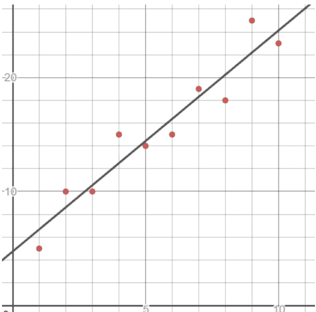

### 图 5-3. 通过我们的数据拟合一条直线

我将在本章后面展示如何计算这条拟合直线。我们还将探讨如何计算这条拟合直线的质量。目前，让我们关注执行线性回归的好处。它允许我们对未见过的数据进行预测。我的样本中没有 8.5 岁的狗，但我可以查看这条直线，估计该狗一生会有 21 次就医。我只需查看 x=8.5 处的直线，就能看到 y=21.218，如图 5-4 所示。另一个好处是，我们可以分析变量之间的可能关系，并假设相关变量之间存在因果关系。


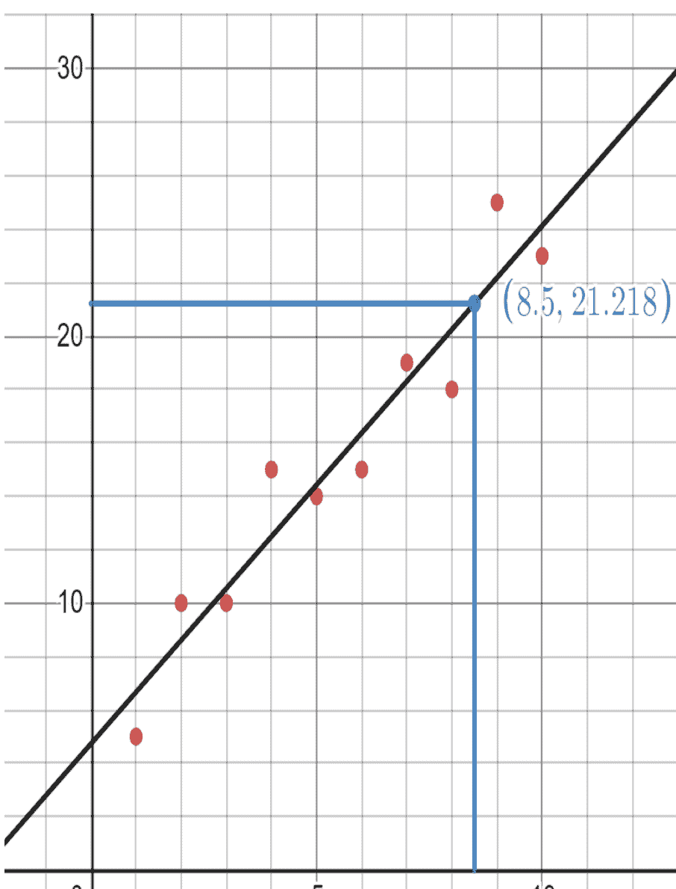

图 5-4. 使用线性回归进行预测，显示一只 8.5 岁的狗预计有大约 21.2 次兽医就诊

那么线性回归的缺点是什么？我不能指望每个结果都会精确地落在该线上。毕竟，现实世界的数据是嘈杂的且从不完美，不会遵循一条直线。它可能根本不会遵循一条直线！这条线周围会有误差，数据点可能会落在线上方或下方。当我们讨论 p 值、统计显著性和预测区间（描述我们的线性回归有多可靠）时，我们将从数学上介绍这一点。另一个问题是，我们不应该使用线性回归对现有数据范围之外的值进行预测，这意味着我们不应该对 x < 0 和 x > 10 进行预测，因为我们没有这些值之外的数据。

> **不要忘记抽样偏差！**
>
> 我们应该质疑这些数据及其采样方式，以检测偏差。这是在单一兽医诊所进行的吗？还是多个随机诊所？使用兽医数据、仅调查就诊狗狗是否存在自我选择偏差？如果狗狗在同一地理区域被采样，是否会影响数据？也许炎热沙漠气候中的狗狗会更频繁地因为中暑和蛇咬而去看兽医，这会虚高我们样本中的兽医就诊次数。
>
> 如前所述在第 3 章中，将数据视为真理神谕已成为一种时尚。然而，数据仅仅是总体的一个样本，我们需要练习辨别力来判断我们的样本代表性有多好。要对数据的来源（而不仅仅是数据本身）保持同样甚至更多的兴趣。

## 使用 SciPy 的基本线性回归

本章我们有很多关于线性回归需要学习，但让我们先用一些代码来执行目前所知道的内容。

有许多平台可以执行线性回归，从 Excel 到 Python 和 R。但在这本书中，我们将坚持使用 Python，首先使用 Scikit-learn 为我们完成工作。本章稍后我将展示如何从头开始构建线性回归，以便我们掌握梯度下降和最小二乘等重要概念。

代码示例 5-1 演示了如何使用 Scikit-learn 对 10 只狗的样本进行基本的未验证线性回归。我们使用 Pandas 加载这些数据，将其转换为 NumPy 数组，使用 Scikit-learn 执行线性回归，并使用 plotly 在图表中显示它。

## 示例 5-1. 使用 Scikit-learn 进行线性回归

```
import pandas as pd
import matplotlib.pyplot as plt
from sklearn.linear_model import LinearRegression

# Import points
df = pd.read_csv('https://bit.ly/3goOAnt', delimiter=",")

# Extract input variables (all rows, all columns but last column)
X = df.values[:, :-1]

# Extract output column (all rows, last column)
Y = df.values[:, -1]

# Fit a line to the points
fit = LinearRegression().fit(X, Y)

# m = 1.7867224, b = -16.51923513
m = fit.coef_.flatten()
b = fit.intercept_.flatten()
print("m = {0}".format(m))
print("b = {0}".format(b))

# show in chart
plt.plot(X, Y, 'o') # scatterplot
plt.plot(X, m*X+b) # line
plt.show()
```

首先，我们从 GitHub 上的这个 CSV 导入数据。我们使用 Pandas 将两列分离为 X 和 Y 数据集。然后，我们将 LinearRegression 模型与输入 X 数据和输出 Y 数据进行 fit()。之后，我们可以获取描述我们拟合线性函数的 m 和 b 系数。

在图表中，你果然会得到一条穿过这些点的拟合线，如图 5-5 所示。

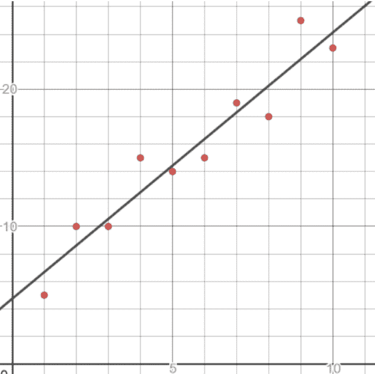

图 5-5. SciPy 会将回归线拟合到您的数据上。

是什么决定了这些点的最佳拟合线？让我们接下来讨论一下。

## 残差与平方误差

像 Scikit-learn 这样的统计工具如何得出拟合这些点的直线？归根结底，这取决于机器学习训练中两个基本问题：

- 1) 什么定义了“最佳拟合”？
- 2) 如何达到那个“最佳拟合”？

第一个问题有相当明确的答案：我们最小化平方，或者更具体地说，是平方残差之和。让我们来分解一下。在点中绘制任意一条直线。残差是直线与点之间的数值差，如图 5-6 所示。

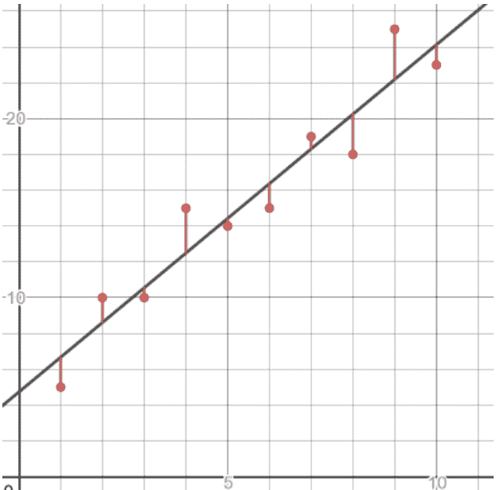

图 5-6. 残差是直线与点之间的差异

直线上方的点将有正残差，直线下方的点将有负残差。换句话说，这是预测 y 值（由直线得出）与实际 y 值（来自数据）之间的减法差。残差的另一个名称是 **错误**，因为它们反映了我们的直线在预测数据时有多么错误。

让我们在代码示例 5-2 中计算这 10 个点与直线 y = 1.93939x + 4.73333 之间的这些差异。

## 示例 5-2. 计算给定直线和数据的残差

```
import pandas as pd

# Import points
points = pd.read_csv('https://bit.ly/3goOAnt',
                    delimiter=",").itertuples()

# Test with a given line
m = 1.93939
b = 4.73333

# calculate sum of squares
for p in points:
    y_actual = p.y
    y_predict = m*p.x + b
    residual = y_actual - y_predict
    print(residual)
```

# 输出：

# 示例 5-3.

-1.67272
1.3878900000000005
-0.5515000000000008
2.5091099999999997
-0.4302799999999998
-1.3696699999999993
0.6909400000000012
-2.2484499999999983
2.8121600000000002
-1.1272299999999973

如果我们要在 10 个数据点上拟合一条直线，我们可能希望总体上最小化这些残差，以使直线与点之间的差距尽可能小。但我们如何衡量“总体”？最佳方法是采用 **平方和**，它只是对每个残差求平方（即将每个残差乘以其自身），然后将它们相加。我们取每个实际 y 值，减去直线给出的预测 y 值，然后对所有这些差值求平方并求和。

## 为什么不使用绝对值？

你可能会好奇为什么在求和之前必须对残差求平方。为什么不直接把它们加起来而不求平方？这行不通，因为负数会抵消正数。如果我们加绝对值，将所有负值转换为正值呢？这听起来有希望，但绝对值在数学上不方便。更具体地说，绝对值与微积分导数配合不好，我们将在后面用于梯度下降。这就是为什么我们选择平方残差作为总计损失的方式。

一种直观的思考方式如图 5-7 所示，我们在每个残差上叠加一个正方形，每条边的长度等于残差。我们将所有这些正方形的面积相加，稍后我们将学习如何通过确定最佳 m 和 b 来找到可以达到的最小和。

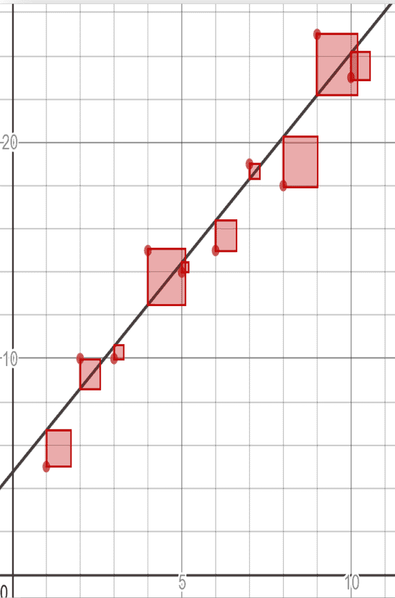

图 5-7. 可视化平方和，即所有正方形面积之和，每个正方形的边长等于残差

让我们修改示例 5-4 中的代码。

## 示例 5-4. 计算给定直线和数据的平方和

```
import pandas as pd

# Import points
points = pd.read_csv("https://bit.ly/2KF29Bd").itertuples()

# Test with a given line
m = 1.93939
b = 4.73333

sum_of_squares = 0.0

# calculate sum of squares
for p in points:
    y_actual = p.y
    y_predict = m*p.x + b
    residual_squared = (y_predict - y_actual)**2
    sum_of_squares += residual_squared

print("sum of squares = {}".format(sum_of_squares))
# sum of squares = 28.096969704500005
```

下一个问题是：如何在不使用 Scikit-learn 等库的情况下，找到会产生最小平方和的 m 和 b 值？让我们接下来看看。

## 寻找最佳拟合线

我们现在有了一种方法来衡量给定直线与数据点之间的质量：平方和。我们能让这个数字越低，拟合就越好。那么，我们如何找到产生最小平方和的正确 m 和 b 值呢？

我们可以采用几种搜索算法，这些算法试图找到解决给定问题的正确值集。您可以尝试采用暴力法，数百万次生成随机的 m 和 b 值，并且


选择产生最小平方和的那些。这种方法效果不好，因为即使找到一个不错的近似解也需要花费无穷无尽的时间。我们需要一些更有引导性的方法。我将为你整理出五种可用的技术：闭式解、矩阵求逆、矩阵分解、梯度下降和随机梯度下降。还有像爬山算法这样的其他搜索算法可以使用（并在附录A中介绍），但我们将坚持使用常见的方法。

## 机器学习训练即拟合回归

这是“训练”机器学习算法的核心。我们提供一些数据和一个目标函数（平方和），它会找到合适的系数m和b来实现该目标。所以当我们“训练”机器学习模型时，实际上是在最小化损失函数。

## 闭式方程

有些读者可能会问，是否存在一个公式（称为闭式方程）可以通过精确计算来拟合线性回归。答案是肯定的，但仅适用于只有一个输入变量的简单线性回归。对于许多有多个输入变量和大量数据的机器学习问题，这种便利并不存在。我们可以使用线性代数技术来进行扩展，稍后我们将讨论这一点。我们也将借此机会学习随机梯度下降等搜索算法。

对于只有一个输入和一个输出变量的简单线性回归，以下是计算m和b的闭式方程。示例5-5展示了如何在Python中进行这些计算。

```
m = \frac{n \sum xy - \sum x \sum y}{n \sum x^2 - (\sum x)^2}
b = \frac{\sum y}{n} - m \frac{\sum x}{n}
```

## 示例 5-5. 为简单线性回归计算m和b

```
import pandas as pd

# Load the data
points = list(pd.read_csv('https://bit.ly/2KF29Bd',
delimiter=",").itertuples())

n = len(points)

m = (n*sum(p.x*p.y for p in points) - sum(p.x for p in points) *
     sum(p.y for p in points)) / (n*sum(p.x**2 for p in points) -
     sum(p.x for p in points)**2)

b = (sum(p.y for p in points) / n) - m * sum(p.x for p in points) /
n

print(m, b)
# 1.9393939393939394 4.7333333333333325
```

计算m和b的这些方程源自微积分，如果你想探究公式的来源，本章后面我们将使用SymPy进行一些微积分工作。目前，你可以代入数据点数n，并遍历x和y值来执行上述操作。

接下来，我们将学习更多面向当代技术的方法，这些技术能够应对更大规模的数据。闭式方程通常难以扩展。

> ## 计算复杂度
> 
> 闭式方程在较大数据集上扩展性不佳的原因，归因于一个称为*计算复杂度*的计算机科学概念，它衡量算法随问题规模增长所需的时间。值得熟悉这一概念，下面是两个关于此主题的优秀YouTube视频：
> 
> **P vs. NP 与计算复杂度动物园** https://youtu.be/YX40hbAHx3s
> 
> **什么是大O表示法？** https://www.youtube.com/watch?v=Q_1M2JaijjQ

## 逆矩阵技术

接下来，我有时会用不同的名称β₁和β₀来分别替代系数m和b。这是你在专业领域中会更常看到的惯例，所以现在是时候升级一下了。

虽然我们在第4章专门用整章篇幅介绍了线性代数，但对于初学者来说，将其应用于数学和数据科学可能会有些令人不知所措。这就是为什么本书中的大多数示例将使用纯Python或Scikit-learn。不过，我会在合适的地方穿插一些线性代数，以展示它的用处。如果你觉得本节内容令人不知所措，可以随意跳过，先阅读本章的其余部分，稍后再回来。

我们可以使用在第4章中介绍过的转置矩阵和逆矩阵来拟合线性回归。下面，给定输入变量值的矩阵X和输出变量值的向量y，我们计算系数向量b。不深入微积分和线性代数证明的细节，公式如下：

b = (Xᵀ · X)⁻¹ · Xᵀ · y

你会注意到，转置和逆运算是在矩阵X上执行的，并与矩阵乘法结合使用。以下是我们在NumPy中执行上述操作以获取系数m和b的方式，如示例5-6所示。

## 示例 5-6. 使用逆矩阵和转置矩阵拟合线性回归

```
import pandas as pd
from numpy.linalg import inv
import numpy as np

# Import points
df = pd.read_csv('https://bit.ly/3goOAnt', delimiter=",")

# Extract input variables (all rows, all columns but last column)
X = df.values[:, :-1].flatten()

# Add placeholder "1" column to generate intercept
X_1 = np.vstack([X, np.ones(len(X))]).T

# Extract output column (all rows, last column)
Y = df.values[:, -1]

# Calculate coefficients for slope and intercept
b = inv(X_1.transpose() @ X_1) @ (X_1.transpose() @ Y)
print(b) # [1.93939394 4.73333333]

# Predict against the y-values
y_predict = X_1.dot(b)
```

这不直观，但请注意，上面我们必须在x列旁边堆叠一列“1”。这样做的原因是，这会生成截距\(\beta_0\)系数。由于这一列全是1，它实际上生成的是截距，而不仅仅是斜率\(\beta_1\)。

当数据量大且维度多时，计算机可能会开始吃力并产生不稳定的结果。这就是矩阵分解的用武之地，我们在第4章关于线性代数的内容中学习过。在此特定情况下，我们取矩阵X，追加一列额外的1来生成截距\(\beta_0，就像之前一样，然后将其分解为两个分量矩阵Q和R。

\(X = Q \cdot R\)

避免更多微积分的细节，以下是如何使用Q和R来找到矩阵形式b中的beta系数值：

\(b = R^{-1} \cdot Q^T \cdot y\)

以下是如何在Python中使用上述QR分解公式和NumPy来执行线性回归。

## 示例 5-7. 使用QR分解执行线性回归

```
import pandas as pd
from numpy.linalg import qr, inv
import numpy as np

# Import points
df = pd.read_csv('https://bit.ly/3goOAnt', delimiter=",")

# Extract input variables (all rows, all columns but last column)
X = df.values[:, :-1].flatten()

# Add placeholder "1" column to generate intercept
X_1 = np.vstack([X, np.ones(len(X))]).transpose()

# Extract output column (all rows, last column)
Y = df.values[:, -1]

# calculate coefficients for slope and intercept
# using QR decomposition
Q, R = qr(X_1)
b = inv(R).dot(Q.transpose()).dot(Y)

print(b) # [1.93939394 4.73333333]
```

通常，QR分解是许多科学库用于线性回归的方法，因为它更容易处理大量数据并且更稳定。我所说的*稳定*是什么意思？**数值稳定性**是指算法尽量减少错误，而不是放大近似中的错误。请记住，计算机只能处理有限的小数位数，并且需要近似，因此我们的算法在近似误差累积时不劣化变得很重要。

https://en.wikipedia.org/wiki/Numerical_stability

> > **不知所措？**
> > 如果你发现这些线性回归的线性代数示例令人不知所措，请不要担心！我只是想让你接触线性代数的一个实际用例。接下来我们将专注于其他你可以利用的技术。

## 梯度下降

**梯度下降**是一种优化技术，它使用导数和迭代来最小化/最大化一组针对目标的参数。要了解梯度下降，让我们做一个快速的思想实验，然后将其应用于一个简单的示例。

## 梯度下降思想实验

想象你身处夜晚的山脉，手持一支手电筒。你试图到达山脉的最低点。在迈出步伐之前，你就能看到周围的坡度。你会朝着明显向下的方向踏步。坡度越大，步子越大；坡度越小，步子越小。最终，你会发现自己处于坡度为0（即平坦）的低点。听起来不错，对吧？这种手电筒方法被称为**梯度下降**，即沿着坡度向下的方向踏步。

在机器学习中，我们常常将不同参数下可能遇到的所有平方损失视为一片山岳地貌。我们希望最小化损失，并通过在损失地貌中导航来实现这一点。解决这个问题时，梯度下降有一个吸引人的特点：偏导数就是那盏手电筒，使我们能够看到每个参数（在此例中为m和b，或β₀和β₁）的斜坡。我们朝着m和b的斜坡向下方向踏步。坡度越大，步子越大；坡度越小，步子越小。我们可以通过取坡度的一小部分来简单地计算步长。这一部分被称为我们的**学习率**。学习率越高，运行速度越快，但代价是精度降低。但学习率越低，训练速度越慢，且需要更多的迭代。

决定学习率就像在蚂蚁、人类或巨人之间选择来沿斜坡下山。蚂蚁（小的学习率）会迈出小步子，需要不可接受的长时间才能到达底部，但能做得非常精确。巨人（大的学习率）可能会一直跨过最低点，以至于无论走多少步都可能永远无法到达。人类（适中的学习率）可能拥有最平衡的步长，在速度和准确性之间做出了正确的权衡，以到达最低点。

## 先走再跑

对于函数f(x) = (x − 3)² + 4，让我们找到产生该函数最低点的x值。虽然我们可以代数方法求解，


让我们使用梯度下降来做这件事。

下面是我们要做的事情的直观演示。如图 5-8 所示，我们想要将 x“步进”到斜率为 0 的最小值处。

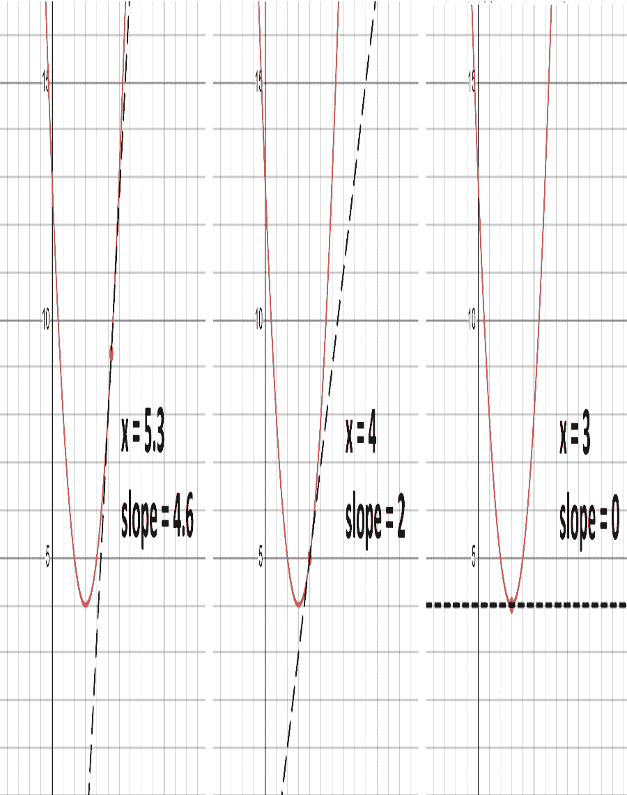

图 5-8. 向斜率趋近于 0 的局部最小值步进

在示例 5-8 中，函数 f(x) 及其对 x 的导数为 dx_f(x)。请回顾我们在第 1 章中介绍过如何使用 SymPy 计算导数。求得导数后，我们接着执行梯度下降。

## 示例 5-8. 使用梯度下降求抛物线的最小值

```
import random

def f(x):
    return (x - 3) ** 2 + 4

def dx_f(x):
    return 2*(x - 3)

# The learning rate
L = 0.001

# The number of iterations to perform gradient descent
iterations = 100_000

# start at a random x
x = random.randint(-15,15)

for i in range(iterations):
    # get slope
    d_x = dx_f(x)

    # update x by subtracting the (learning rate) * (slope)
    x -= L * d_x

print(x, f(x)) # prints 2.99999999999889 4.0
```

如果我们绘制该函数（如图 5-8 所示），应该能清楚地看到函数的最低点在 x = 3 处，而上面的代码应该能非常接近该点。学习率用于在每次迭代中取斜率的一小部分并将其从 x 值中减去。较大的斜率会导致较大的步长，而较小的斜率会导致较小的步长。经过足够多的迭代后，x 将到达函数的最低点（或足够接近该点），此时斜率为 0。

## 梯度下降与线性回归

你现在可能在想我们如何将其用于线性回归。其实思路是一样的，只不过我们的“变量”是 m 和 b（或 β0 和 β1），而不是 x。原因如下：在简单线性回归中，我们已经知道 x 和 y 的值，因为它们作为训练数据提供。我们需要求解的“变量”实际上是参数 m 和 b，以便找到最佳拟合直线，然后可以接受一个 x 变量来预测新的 y 值。

我们如何计算 m 和 b 的斜率？我们需要对每个变量求偏导数。我们要对哪个函数求导数？请记住，我们试图最小化损失，而损失将是平方和。因此，我们需要找到平方和函数对 m 和 b 的导数。

我按照示例 5-9 所示实现了 m 和 b 这两个偏导数。我们很快将在 SymPy 中学习如何做到这一点。接着，我执行梯度下降来求 m 和 b。100,000 次迭代且学习率为 .001 就足够了。请注意，学习率设得越小，速度越慢，所需的迭代次数越多。但如果设得过高，虽然运行速度快，但近似效果较差。当有人说机器学习算法在“学习”或“训练”时，实际上只是像这样拟合一个回归。

## 示例 5-9. 对线性回归执行梯度下降

```
import pandas as pd

# Import points from CSV
points = list(pd.read_csv("https://bit.ly/2KF29Bd").itertuples())

# Building the model
m = 0.0
b = 0.0

# The learning Rate
L = .001

# The number of iterations
iterations = 100_000

n = float(len(points)) # Number of elements in X

# Perform Gradient Descent
for i in range(iterations):
    # slope with respect to m
    D_m = sum(2 * p.x * ((m * p.x + b) - p.y) for p in points)
    # slope with respect to b
    D_b = sum(2 * ((m * p.x + b) - p.y) for p in points)
    # update m and b
    m -= L * D_m
    b -= L * D_b
print("y = {0}x + {1}".format(m, b))
# y = 1.9393939393939548x + 4.73333333333227
```

还不错！这个近似结果接近于我们解析解公式的结果。但问题在哪里呢？仅仅因为我们通过最小化平方和找到了“最佳拟合直线”，并不意味着我们的线性回归模型就很好。最小化平方和能保证得到一个用于预测的优秀模型吗？并不完全是。现在我已经向你展示了如何拟合线性回归，让我们退后一步，重新审视大局，判断给定的线性回归是否真的是进行预测的正确方法。但在此之前，这里还有一段展示 SymPy 解法的插曲。

## 使用 SymPy 的线性回归梯度下降

如果你想要计算平方和函数对 m 和 b 这两个偏导数的 SymPy 代码，示例 5-10 中的代码如下。

## 示例 5-10. 计算 m 和 b 的偏导数

```
from sympy import *
m, b, i, n = symbols('m b i n')
x, y = symbols('x y', cls=Function)
sum_of_squares = Sum((m*x(i) + b - y(i)) ** 2, (i, 0, n))
d_m = diff(sum_of_squares, m)
d_b = diff(sum_of_squares, b)
print(d_m)
print(d_b)
```

```
# OUTPUTS
# Sum(2*(b + m*x(i) - y(i))*x(i), (i, 0, n))
# Sum(2*b + 2*m*x(i) - 2*y(i), (i, 0, n))
```

你会看到上面分别打印出了 \(m\) 和 \(b\) 的两个导数。
请注意，`Sum()` 函数会迭代并将项目相加（在此例中为所有数据点），我们将 \(x\) 和 \(y\) 视为查找给定索引 \(i\) 处点的值的函数。

在数学符号中，其中 \(e(x)\) 表示平方和损失函数，\(m\) 和 \(b\) 的偏导数如下。

\(e(x) = \sum_{i=0}^n ((mx_i + b) - y_i)^2\)

\(\frac{d}{dm}e(x) = \sum_{i=0}^n 2(b + mx_i - y_i)x_i\)

\(\frac{d}{db}e(x) = \sum_{i=0}^n (2b + 2mx_i - 2y_i)\)

如果你想要应用我们的数据集并使用梯度下降执行线性回归，则需要执行示例 5-11 中所示的几个额外步骤。我们需要对 `d_m` 和 `d_b` 导数函数迭代所有数据点，以替换 \(n\)、\(x(i)\) 和 \(y(i)\) 的值。这样应该只剩下 \(m\) 和 \(b\) 变量，我们将使用梯度下降来搜索它们的最优值。

## 示例 5-11.

```
import pandas as pd
from sympy import *

# Import points from CSV
points = list(pd.read_csv("https://bit.ly/2KF29Bd").itertuples())

m, b, i, n = symbols('m b i n')
x, y = symbols('x y', cls=Function)

sum_of_squares = Sum((m*x(i) + b - y(i)) ** 2, (i, 0, n))

d_m = diff(sum_of_squares, m) \
.subs(n, len(points) - 1).doit() \
.replace(x, lambda i: points[i].x) \
.replace(y, lambda i: points[i].y)

d_b = diff(sum_of_squares, b) \
.subs(n, len(points) - 1).doit() \
.replace(x, lambda i: points[i].x) \
.replace(y, lambda i: points[i].y)

# compile using lambdify for faster computation
d_m = lambdify([m, b], d_m)
d_b = lambdify([m, b], d_b)

# Building the model
m = 0.0
b = 0.0

# The learning Rate
L = .001

# The number of iterations
iterations = 100_000

# Perform Gradient Descent
for i in range(iterations):
    # update m and b
    m -= d_m(m,b) * L
    b -= d_b(m,b) * L

print("y = {0}x + {1}".format(m, b))
# y = 1.9399393939393954x + 4.733333333333231
```

如示例 5-11 所示，最好对两个偏导数函数都调用 `lambdify()`，将它们从 SymPy 转换为优化后的 Python 函数。这样在执行梯度下降时，计算速度会快得多。生成的 Python 函数由 NumPy、SciPy 或 SymPy 检测到的任何可用数值库提供支持。之后，我们就可以执行梯度下降了。

最后，如果你想知道这个简单线性回归的损失函数是什么样子的，示例 5-12 展示了将 x、y 和 n 值代入损失函数的 SymPy 代码，然后将 m 和 b 作为输入变量进行绘图。我们的梯度下降算法将找到图 5-9 所示损失曲面的最低点。

## 示例 5-12.

```
from sympy import *
from sympy.plotting import plot3d
import pandas as pd

points = list(pd.read_csv("https://bit.ly/2KF29Bd").itertuples())
m, b, i, n = symbols('m b i n')
x, y = symbols('x y', cls=Function)

sum_of_squares = Sum((m*x(i) + b - y(i)) ** 2, (i, 0, n)) \
    .subs(n, len(points) - 1).doit() \
    .replace(x, lambda i: points[i].x) \
    .replace(y, lambda i: points[i].y)

plot3d(sum_of_squares)


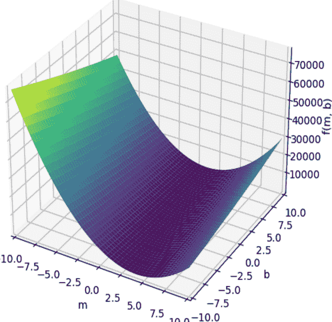

图 5-9. 简单线性回归的损失景观

## 过拟合与方差

让我来出个谜题：如果我们真心想最小化损失，也就是将平方和降为 0，该怎么做？除了线性回归，还有其他选择吗？你可能得出的一个结论是，只需拟合一条经过所有点的曲线。哎呀，不如直接把点用分段连线起来，如图 5-10 所示用来做预测？这样我们的损失就是 0 了！

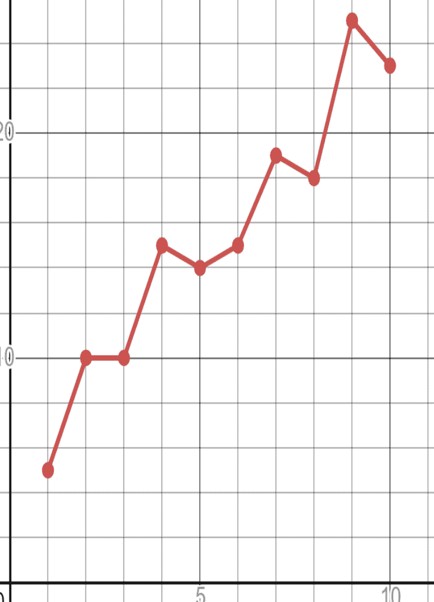

图 5-10. 通过简单连接点来进行回归，从而得到零损失。

哎呀，我们为什么要为线性回归费那么大劲，而不这样做呢？好吧，请记住，我们宏观的目标不是最小化平方和，而是对新数据做出准确预测。这个“连线连点”模型严重**过拟合**，意味着它将回归拟合得过于精确地贴合训练数据，以至于在新数据上预测效果很差。这个简单的“连线连点”模型对远离其余点的异常值非常敏感，意味着它在预测中会有很高的**方差**。虽然本例中的点相对靠近一条直线，但在分布更广且包含更多异常值的其他数据集中，这个问题会严重得多。因为过拟合会增加方差，预测结果将千差万别！

## 过拟合即记忆

当你听到有人说回归“记住”了数据，而不是对其进行泛化时，他们指的就是过拟合。

不言而喻，我们希望在模型中找到有效的泛化，而不是记忆数据。否则，我们的回归就只是一个用于查找值的数据库。

这就是为什么在机器学习中，你会发现模型中加入了偏差，而线性回归被认为是一个高度偏差的模型。这里的偏差与数据中的偏差不同，我们在第 3 章中详细讨论过。**模型中的偏差**意味着我们优先采用某种方法（例如保持一条直线），而不是去迎合数据所显示的一切。偏差模型留出了一定的余地，希望在新数据上最小化损失以获得更好的预测，而不是在训练数据上最小化损失。我想你可以说，向模型添加偏差是通过**欠拟合**（即对训练数据拟合得不够）来抵消过拟合的。

不难想象，这是一场平衡艺术，因为这两个目标是矛盾的。在机器学习中，我们基本上是在说：“我想把回归拟合到我的数据上，但我不想把它拟合_太过_。我需要一些余地来对那些不同的新数据进行预测。”

## LASSO 回归与岭回归

LASSO 回归和岭回归是线性回归的两种较为流行的变体。岭回归以罚项的形式向线性回归添加了进一步的偏差，因此导致它对数据拟合得较少。LASSO 回归会尝试边缘化噪声变量，因此在你希望自动移除可能无关的变量时非常有用。

即便如此，我们不能只是对一些数据应用线性回归，做一些预测，然后就假设一切都没问题。即使有直线的偏差，线性回归仍然可能过拟合。因此，我们需要检查并减轻过拟合和欠拟合，以找到两者之间的平衡点。如果根本不存在这样的平衡点，那么你应该彻底放弃该模型。

## 随机梯度下降

在机器学习场景中，你不太可能像我们之前那样在实际操作中使用梯度下降（那时我们在所有训练数据上进行训练，称为批量梯度下降）。在实际操作中，你更有可能执行随机梯度下降，它在每次迭代时只训练数据集中的一个样本。在小批量梯度下降中，每次迭代使用数据集中的多个样本（例如 10 或 100 个数据点）。

为什么每次迭代只使用部分数据？机器学习从业者提到了几个好处。首先，它显著减少了计算量，因为每次迭代不需要遍历整个训练数据集，只需遍历其中一部分。第二个好处是它能减少过拟合。通过在每次迭代时只让训练算法接触部分数据，它不断改变损失景观，使其不会落在损失最小值上。毕竟，最小化损失是导致过拟合的原因，因此我们引入一些随机性来制造一点欠拟合（但希望不要太多）。

当然，我们的近似会变得不那么精确，因此我们必须小心。这就是为什么我们很快就会讨论训练/测试划分，以及用于评估线性回归可靠性的其他指标。

示例 5-13 展示了如何在 Python 中执行随机梯度下降。如果你将样本大小改为大于 1，它将执行小批量梯度下降。

## 示例 5-13. 执行线性回归的随机梯度下降

```
import pandas as pd
import numpy as np

# Input data
data = pd.read_csv('https://bit.ly/2KF29Bd', header=0)

X = data.iloc[:, 0].values
Y = data.iloc[:, 1].values

n = data.shape[0] # rows

# Building the model
m = 0.0
b = 0.0

sample_size = 1 # sample size
L = .0001 # The learning Rate
epochs = 1_000_000 # The number of iterations to perform gradient descent

# Performing Stochastic Gradient Descent
for i in range(epochs):
    idx = np.random.choice(n, sample_size, replace=False)
    x_sample = X[idx]
    y_sample = Y[idx]

    # The current predicted value of Y
    Y_pred = m * x_sample + b

    # d/dm derivative of loss function
    D_m = (-2 / sample_size) * sum(x_sample * (y_sample - Y_pred))

    # d/db derivative of loss function
    D_b = (-2 / sample_size) * sum(y_sample - Y_pred)
    m = m - L * D_m # Update m
    b = b - L * D_b # Update b

# print progress
if i % 10000 == 0:
    print(i, m, b)
print("y = {0}x + {1}".format(m, b))
```

当我运行这段代码时，得到的线性回归为 y = 1.9382830354181135x + 4.753408787648379。显然，你的结果会不同，而且由于随机梯度下降，我们实际上不会收敛到某个特定的最小值，而是会落在一个更广泛的区域内。

## 随机性是坏事吗？

如果这种随机性让你感到不安，即每次运行一段代码都会得到不同的答案，欢迎来到机器学习、优化和随机算法的世界！许多进行近似的算法都是基于随机性的，虽然有些非常有用，但另一些可能会像你预期的那样粗心大意且表现不佳。

许多人将机器学习和 AI 视为一种能给出客观、精确答案的工具，但这与事实相去甚远。机器学习产生的是带有一定不确定度的近似结果，一旦投入生产，往往没有真实值可依。如果一个人不了解其工作原理，机器学习可能会被滥用，而不承认其非确定性和近似的本性是失职的。

虽然随机性可以创造一些强大的工具，但也可能被滥用。要小心不要利用种子值和随机性来 p-hack 一个“良好”的结果，并且要致力于分析你的数据和模型。

## 相关系数

看看图 5-11 中的这个散点图及其线性回归。为什么线性回归在这里可能效果不太好？

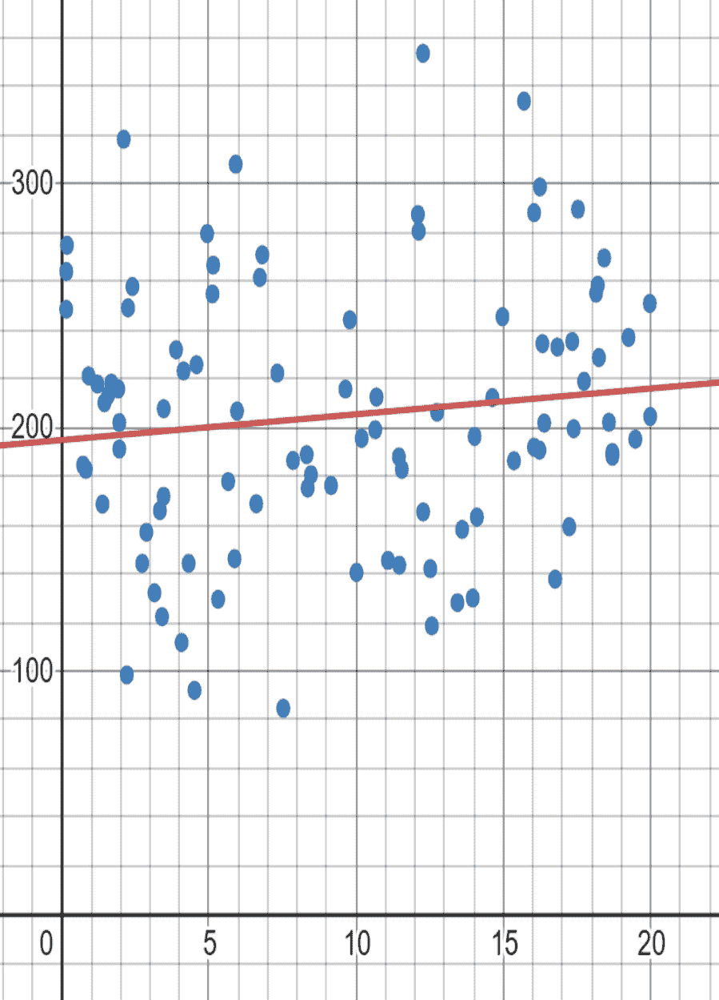

图 5-11. 方差较高的数据散点图

这里的问题是数据方差较高。如果数据分布非常分散，会使方差升高到预测变得不那么准确和有用的程度，从而导致较大的残差。当然，我们可以引入一个偏差更大的模型，例如线性回归，使其不那么容易迎合方差而发生弯曲。然而，欠拟合也会削弱我们的预测，因为数据分布得太分散了。我们需要在数值上衡量我们的预测“偏离”程度。

那么，如何对这些残差进行整体衡量？又如何了解数据方差的大小呢？让我来介绍一下**相关系数**，也称为**皮尔逊相关**，它以 -1 到 1 之间的值来衡量两个变量之间关系的强度。相关系数越接近 0，表示相关性越弱。相关系数越接近 1，表示强**正相关**，意味着当一个变量增加时，另一个变量也按比例增加。如果越接近 -1，则表示强**负相关**，意味着当一个变量增加时，另一个变量按比例减少。

请注意，相关系数通常用 r 表示。图 5-16 中高度分散的数据的相关系数为 0.1201。由于它远比 1 更接近 0，我们可以推断其几乎没有相关性。

图 5-12 展示了另外三个散点图及其相关系数。请注意，点越是沿着一条直线分布，相关性就越强。点越分散，相关性就越弱。


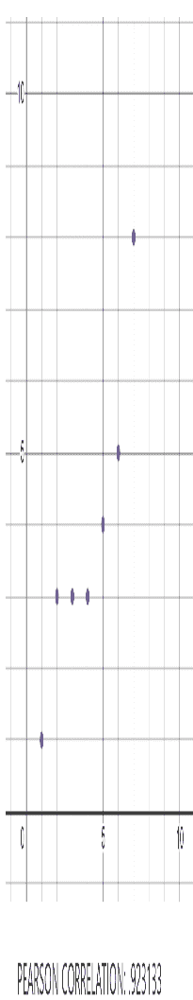

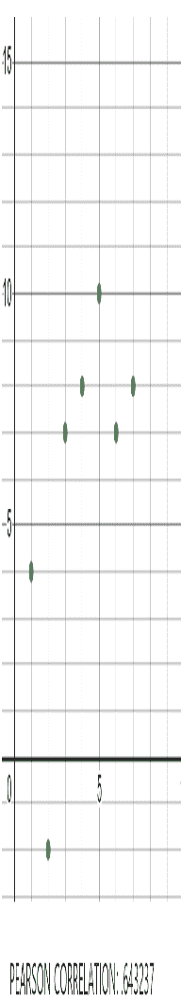

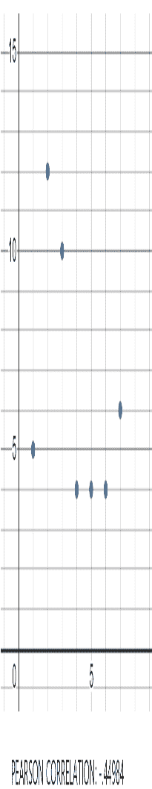

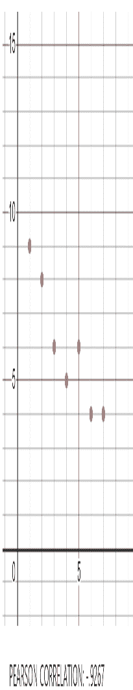

图 5-12. 四个散点图的相关系数

你可以想象，相关系数有助于判断两个变量之间是否存在可能的关系。如果存在强正/负相关关系，它在我们的线性回归中将很有用。如果没有关系，它们可能只是增加噪声并降低模型准确性。

我们如何使用 Python 来计算相关系数？让我们使用之前用过的那个简单的 10 点数据集。分析所有变量对之间相关性的一种快速简单方法是使用 Pandas 的 `corr()` 函数。它可以轻松查看数据集中每对变量之间的相关系数，在本例中仅为 `x` 和 `y`。这称为**相关矩阵**。请参阅示例 5-14。

### 示例 5-14. 使用 Pandas 查看每对变量之间的相关系数

```python
import pandas as pd

# Read data into Pandas dataframe
df = pd.read_csv('https://bit.ly/2KF29Bd', delimiter=",")

# Print correlations between variables
correlations = df.corr(method='pearson')
print(correlations)

# OUTPUT:
#           x         y
# x  1.000000  0.957586
# y  0.957586  1.000000
```

正如你所见，`x` 和 `y` 之间的相关系数 .957586 表明这两个变量之间存在强正相关关系。你可以忽略矩阵中 `x` 或 `y` 与自身设置且值为 `1.0` 的部分。显然，当 `x` 或 `y` 与自身设置时，相关性将完美地达到 1.0，因为它们的值与自身完全匹配。当有两个以上变量时，相关矩阵将显示一个更大的网格，因为有更多的变量需要配对和比较。

如果更改代码以使用方差较大、数据分布较分散的不同数据集，你会看到相关系数下降。这同样表明相关性较弱。

## 计算相关系数

对于好奇相关系数如何计算的数学爱好者，以下是公式：

\( r = \frac{n \sum xy - (\sum x)(\sum y)}{\sqrt{n \sum x^2 - (\sum x)^2} \sqrt{n \sum y^2 - (\sum y)^2}} \)

如果你想在 Python 中看到完整实现，我喜欢使用单行 `for` 循环来进行这些求和。示例 5-15 展示了在 Python 中从头实现相关系数。

### 示例 5-15. 在 Python 中从头计算相关系数

```python
import pandas as pd
from math import sqrt

# Import points from CSV
points = list(pd.read_csv("https://bit.ly/2KF29Bd").itertuples())
n = len(points)

numerator = n * sum(p.x * p.y for p in points) - \
    sum(p.x for p in points) * sum(p.y for p in points)

denominator = sqrt(n*sum(p.x**2 for p in points) - sum(p.x for p in points)**2) \
    * sqrt(n*sum(p.y**2 for p in points) - sum(p.y for p in points)**2)

corr = numerator / denominator

print(corr)

# OUTPUT:
# 0.9575860952087218
```

## 统计显著性

线性回归中你必须考虑的另一个方面是：我的数据相关性是否是巧合？在第 3 章中，我们学习了假设检验和 p 值，我们将在此用线性回归扩展这些思想。

### STATSMODELS 库

虽然本书不会再介绍另一个库，但如果你想进行统计分析，值得一提的是 `statsmodels` 值得关注。

https://www.statsmodels.org/stable/regression.html

Scikit-learn 和其他机器学习库不提供统计显著性和置信区间的工具，我们将在另一个侧边栏中讨论原因。我们将自己实现这些技术。但要知道这个库存在，并且值得一试！

让我们从一个基本问题开始：我是否可能因为随机机会而在数据中看到线性关系？我们如何才能 95% 确定这两个变量之间的相关性是显著的，而非巧合？如果这听起来像第 3 章中的假设检验，那就是因为它确实是！我们需要不仅表达相关系数，还要量化我们对相关系数非随机发生的信心程度。

与我们在第 3 章药物测试示例中估计均值不同，我们正在基于样本估计总体相关系数。我们用希腊字母 ρ（“Rho”）表示总体相关系数，而我们的样本相关系数是 r。与第 3 章一样，我们将设立原假设 H0 和备择假设 H1。

```
H0 : ρ = 0 (implies no relationship)

H1 : ρ ≠ 0 (relationship is present)
```

我们的原假设 $H_0$ 是两个变量之间没有关系，或者更准确地说，相关系数为 0。备择假设 $H_1$ 是存在一种关系，可以是正相关或负相关。这就是为什么备择假设定义为 \(\rho \neq 0\)，以支持正相关和负相关。

让我们回到图 5-13 所示的 10 点数据集。我们偶然看到这些数据点的可能性有多大？而它们恰好产生了看似线性的关系？

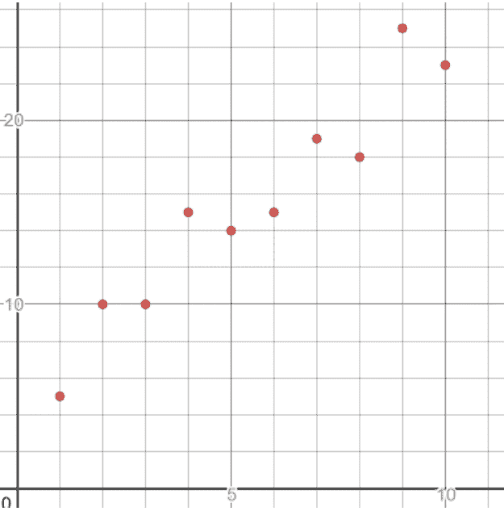

图 5-13. 通过随机机会看到这些似乎具有线性相关性的数据的可能性有多大？

我们之前在示例 5-14 中已经计算过该数据集的相关系数，为 0.957586。这是一种强有力且令人信服的正相关关系。但我们仍需要评估这是否纯属运气。让我们使用双尾检验以 95% 的置信度开展假设检验，探索这两个变量之间是否存在关系。

我们在第 3 章讨论过 T 分布，其尾部更宽，以捕获更多的方差和不确定性。我们使用 T 分布而不是正态分布来进行线性回归的假设检验。首先，让我们像图 5-14 所示绘制一个带有 95% 临界值范围的 T 分布。我们考虑到样本中有 10 条记录，因此有 9 个自由度（10 - 1 = 9）。

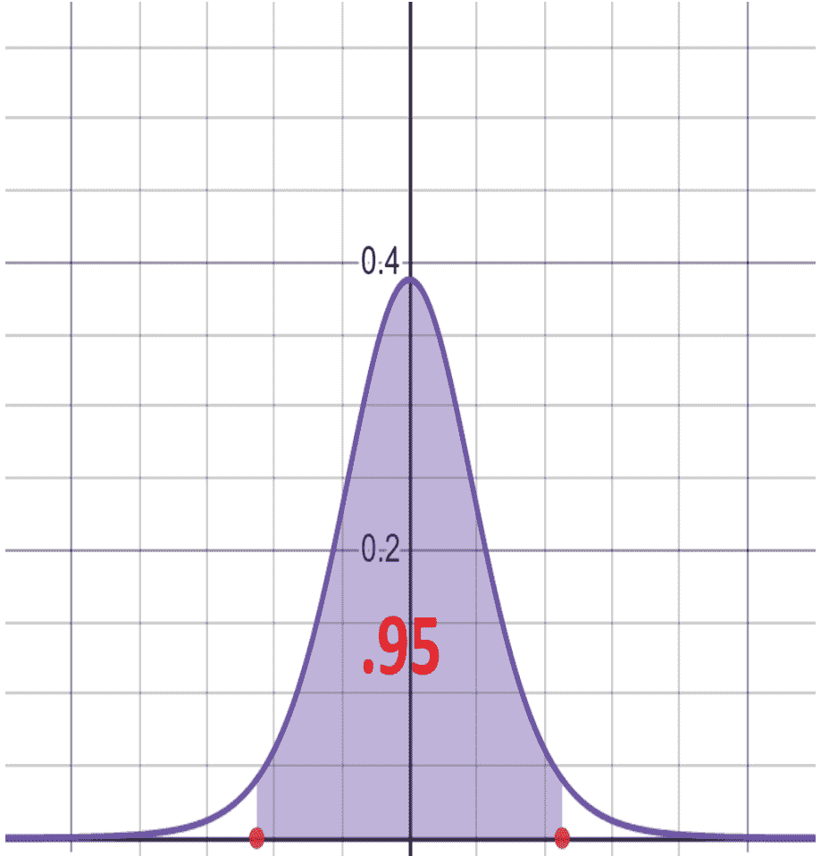

图 5-14. 具有 9 个自由度的 T 分布，因为有 10 条记录且我们减去 1。

临界值约为 ±2.262，我们可以按照示例 5-16 在 Python 中计算它。这涵盖了 T 分布中心区域的 95%。

### 示例 5-16. 从 T 分布计算临界值

```python
from scipy.stats import t

n = 10
lower_cv = t(n-1).ppf(.025)
upper_cv = t(n-1).ppf(.975)

print(lower_cv, upper_cv)
# -2.262157162740992 2.2621571627409915
```

如果我们的检验值碰巧落在 (-2.262, 2.262) 范围之外，则可以拒绝原假设。要计算检验值 t，我们需要使用下面的公式。同样，r 是相关系数，n 是样本量。

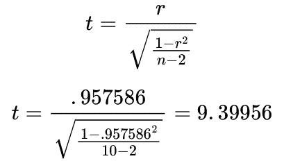

让我们像示例 5-17 所示在 Python 中将整个测试整合起来。如果我们的检验值落在 95% 置信度的临界范围之外，我们接受相关性不是偶然的。

### 示例 5-17. 对看似线性的数据进行显著性检验

```python
from scipy.stats import t
from math import sqrt

# sample size
n = 10

lower_cv = t(n-1).ppf(.025)
upper_cv = t(n-1).ppf(.975)

# correlation coefficient
# derived from data https://bit.ly/2KF29Bd
r = 0.957586

# Perform the test
test_value = r / sqrt((1-r**2) / (n-2))

print("TEST VALUE: {}".format(test_value))
print("CRITICAL RANGE: {}, {}".format(lower_cv, upper_cv))

if test_value < lower_cv or test_value > upper_cv:
    print("CORRELATION PROVEN, REJECT H0")
else:
    print("CORRELATION NOT PROVEN, FAILED TO REJECT H0 ")

# Calculate p-value
if test_value > 0:
    p_value = 1.0 - t(n-1).cdf(test_value)
else:
    p_value = t(n-1).cdf(test_value)

# Two-tailed, so multiply by 2
p_value = p_value * 2
print("P-VALUE: {}".format(p_value))
```

上面的检验值约为 9.39956，这肯定落在 (-2.262, 2.262) 范围之外，因此我们可以拒绝原假设并说我们的相关性是真实的。这是因为 p 值极为显著：.000005976。这远低于我们的 .05 阈值，因此这几乎肯定不是巧合，而是存在相关性。p 值如此之小是有道理的，因为这些点强烈类似一条直线。这些点偶然如此紧密地排列成一条直线的可能性极小。

图 5-15 显示了其他一些数据集及其相关系数和 p 值。分析每一个。哪个最可能对预测最有用？其他数据集有什么问题？


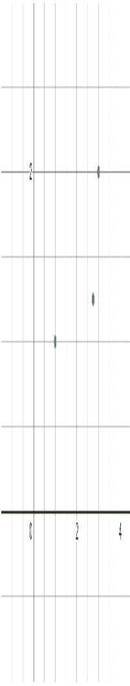

r 0.771454
p-value 0.34913

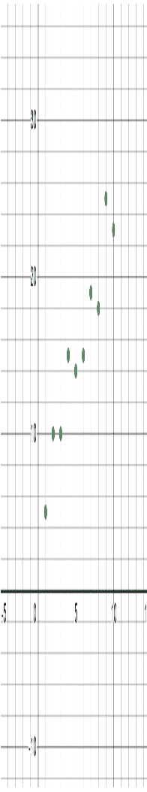

r 0.957586095
p-value 0.000005976

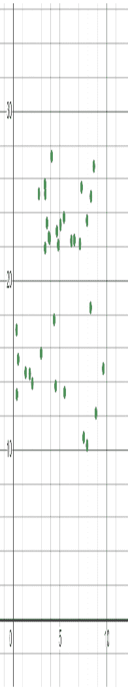

r 0.100984708
p-value 0.569732057

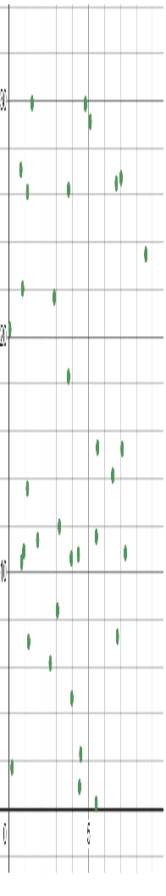

r 0.037875905
p-value 0.831544971

图 5-15. 不同数据集及其相关系数和 p 值

既然你有机会对图 5-15 中的数据集进行了分析，让我们来梳理一下发现。左图具有高正相关，但只有 3 个点。数据不足会显著推高 p 值至 .34913，并增加数据是偶然发生的可能性。这是合理的，因为只有 3 个数据点时容易看到线性模式，但这并不比仅有 2 个点（两点间简单连成一条线）好多少。这里提及一条重要经验法则：拥有更多数据会降低你的 p 值，尤其是当数据沿线性分布时。

第二个图就是我们刚才介绍的。它只有 10 个数据点，但线性模式非常完美，因此不仅有很强的正相关，还有一个极低的 p 值。当 p 值如此之低时，你可以肯定你在测量的是一个经过设计且受严格控制的过程，而非社会学或自然现象。

图 5-15 中右侧的两个图未能识别出线性关系。它们的相关系数接近 0，表明没有相关性，而 p 值也并不意外地表明随机性起了作用。

经验法则如下：你拥有的且持续呈现线性趋势的数据越多，你的相关性 p 值就越显著。数据越分散或稀疏，p 值就越高，从而表明你的相关性是偶然发生的。

## 决定系数

让我们学习一下统计和机器学习回归中常见的一个重要指标。**决定系数**，称为 $r^2$，衡量一个变量的变化量有多少可以由另一个变量的变化量来解释。它也是相关系数 $r$ 的平方。当 $r$ 趋向于完美相关（-1 或 1）时，$r^2$ 趋向于 1。基本上，$r^2$ 显示了两个变量相互作用的程度。

让我们继续查看图 5-13 中的数据。在示例 5-18 中，使用我们之前计算相关系数的 dataframe 代码，然后简单地对其平方。这将把每个相关系数乘以自身。

### 示例 5-18. 在 Pandas 中创建相关矩阵

```python
import pandas as pd

# Read data into Pandas dataframe
df = pd.read_csv('https://bit.ly/2KF29Bd', delimiter=",")

# Print correlations between variables
coeff_determination = df.corr(method='pearson') ** 2
print(coeff_determination)
```

```
#
# x y
# x 1.000000 0.916971
# y 0.916971 1.000000
```

决定系数为 .916971，可解释为：“x 的 91.6971% 变化量由 y 解释（反之亦然），其余 8.3029% 是由其他未捕获变量引起的噪声。0.916971 是一个相当不错的决定系数，表明 x 和 y 互相解释了各自的方差。但可能还有其他变量在起作用，构成了那剩余的 0.083029。请记住，相关不等于因果，因此可能还有其他变量在影响我们所看到的关系。

## 相关不等于因果！

需要注意的是，虽然我们非常重视测量相关性并围绕它构建指标，但请记住 _相关不等于因果！_ 你可能以前听过这个口号，但我想解释一下统计学家为什么这样说。

仅仅因为我们看到 x 和 y 之间存在相关性，并不意味着 x 导致 y。事实上，可能是 y 导致 x！或者可能有一个第三个未捕获变量 z 在导致 x 和 y。也可能是 x 和 y 根本不相互导致，相关性只是巧合，因此衡量统计显著性很重要。

现在我有一个更紧迫的问题要问你。计算机能区分相关性和因果关系吗？答案是毫无疑问的“不”！计算机只有相关性的概念，而没有因果关系的概念。假设我将一个数据集加载到 Scikit-learn 中，显示消耗的加仑水量和我的水费账单。我的计算机，或包括 Scikit-learn 在内的任何程序，都不知道是更多的用水导致更高的账单，还是更高的账单导致更多的用水。一个“AI”系统很容易得出后者结论，尽管这毫无意义。这就是为什么许多机器学习项目需要人工介入来注入常识。

在计算机视觉中也会发生这种情况。计算机视觉通常使用对数字像素的回归来预测类别。如果我使用牛的照片训练一个计算机视觉系统来识别牛，它很容易与田地而非牛建立相关性。因此，如果我展示一张空旷田野的照片，它会将草地标记为牛！这又是因为计算机没有因果关系的概念（牛的形状应该导致标签“牛”），而是陷入了我们不感兴趣的相关性中。

## 估计值的标准误

衡量线性回归总体误差的一种方法是 **SSE**，即 **平方误差和**。我们之前学过，对每个残差平方并求和。如果 ŷ（读作“y-hat”）是直线上的每个预测值，而 y 表示数据中的每个实际 y 值，计算方法如下：

```
SSE = \sum (y - \hat{y})^2
```

然而，所有这些平方值都难以解释，因此我们可以使用平方根逻辑将事物缩放回原始单位。我们还会对它们求平均，这就是 **估计值的标准误**（**S**<sub>e</sub>）所做的。如果 _n_ 是数据点数量，示例 5-19 展示了如何在 Python 中计算标准误 **S**<sub>e</sub>。

\( S_e = \frac{\sum (y - \hat{y})^2}{n - 2} \)

### 示例 5-19. 计算估计值的标准误

下面是我们在 Python 中计算它的方法：

```python
import pandas as pd
from math import sqrt

# Load the data
points = list(pd.read_csv('https://bit.ly/2KF29Bd',
                          delimiter=",").itertuples())

n = len(points)

# Regression line
m = 1.939
b = 4.733

# Calculate Standard Error of Estimate
S_e = sqrt((sum((p.y - (m*p.x + b))**2 for p in points))/(n-2))

print(S_e)
# 1.87406793500129
```

为什么是 _n_ – 2 而不是 _n_ – 1，就像我们在第 3 章的许多方差计算中所做的那样？无需深入数学证明，这是因为线性回归有两个变量，而不仅仅是一个，所以我们在自由度中需要再增加一个不确定性。

你会注意到估计值的标准误与我们在第 3 章学习的标准差非常相似。这并非巧合。这是因为它是线性回归的标准差。

## 预测区间

如前所述，线性回归中的数据是总体的一个样本。因此，我们的回归只能和样本一样好。我们的线性回归直线上也沿着一个正态分布。有效地，这使得每个预测 y 值都像均值一样是一个样本统计量。事实上，“均值”正沿着直线移动。

还记得我们在第 2 章讨论统计学时提到方差和标准差吗？这些概念同样适用于此。在线性回归中，我们希望数据以线性方式遵循正态分布。回归直线充当我们钟形曲线上移动的“均值”，而数据围绕直线的分散程度反映了方差/标准差，如图 5-16 所示。


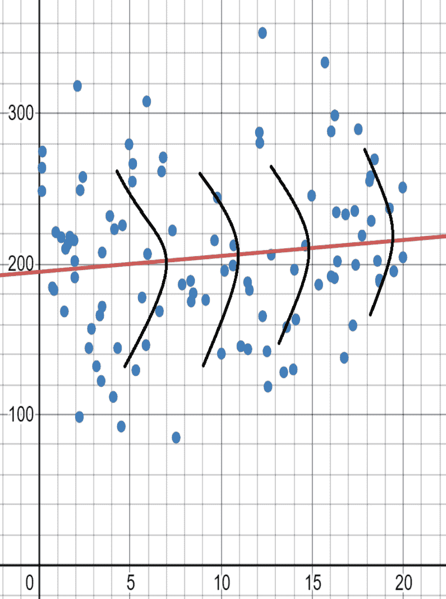

图 5-16. 线性回归假设正态分布围绕回归线分布

当我们有一条沿着线性回归线的正态分布时，我们面对的不再是单一变量，还有第二个变量在引导分布。每个 y 预测值周围都有一个置信区间，这被称为预测区间。

让我们通过兽医示例重新建立一些背景，估算狗的年龄和兽医就诊次数。我想知道一只 8.5 岁狗的兽医就诊次数在 95% 置信水平下的预测区间。这个预测区间的样子如图 5-17 所示。我们有 95% 的把握，一只 8.5 岁的狗兽医就诊次数会在 16.462 到 25.966 次之间。

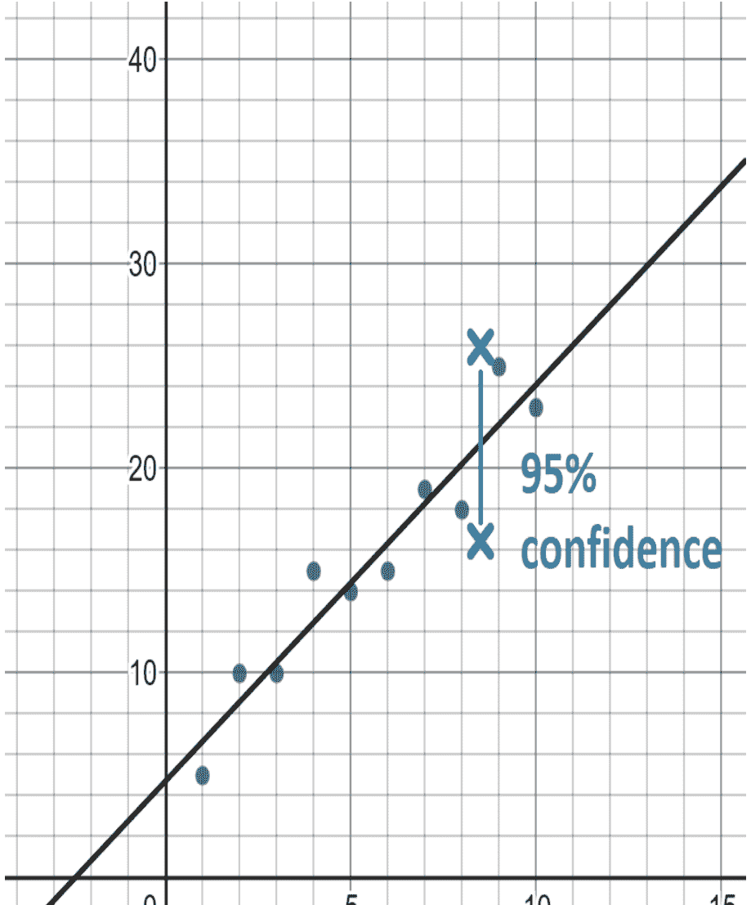

图 5-17. 一只 8.5 岁狗在 95% 置信水平下的预测区间

我们该如何计算这个？我们需要得到误差范围，并将其在预测的 y 值周围进行加减运算。这是一个棘手的方程，涉及 t 分布的临界值以及估计的标准误。让我们来看一下：

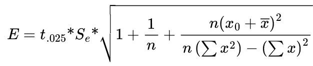

我们感兴趣的 x 值指定为 $x_0$，在此例中为 8.5。以下是使用 Python 解决此问题的方法，如示例 5-20 所示。

## 示例 5-20. 计算一只 8.5 岁狗的兽医就诊次数预测区间

```
import pandas as pd
from scipy.stats import t
from math import sqrt

# Load the data
points = list(pd.read_csv('https://bit.ly/2KF29Bd', delimiter=",").itertuples())

n = len(points)

# Linear Regression Line
m = 1.939
b = 4.733

# Calculate Prediction Interval for x = 8.5
x_0 = 8.5
x_mean = sum(p.x for p in points) / len(points)

t_value = t(n - 2).ppf(.975)

standard_error = sqrt(sum((p.y - (m * p.x + b)) ** 2 for p in points) / (n - 2))

margin_of_error = t_value * standard_error * \
    sqrt(1 + (1 / n) + (n * (x_0 - x_mean) ** 2) / \
    (n * sum(p.x ** 2 for p in points) - sum(p.x for p in points) ** 2))

predicted_y = m*x_0 + b
# Calculate prediction interval
print(predicted_y - margin_of_error, predicted_y + margin_of_error)
# 16.462516875955465 25.96648312404537
```

哎呀！这需要大量计算，遗憾的是 SciPy 及其他主流数据科学库并不提供此功能。但如果你倾向于统计分析，这将是非常有用的信息。我们不仅基于线性回归做出预测（例如，一只 8.5 岁的狗会有 21.2145 次兽医就诊），还能够表达一个远非绝对的结论：一只 8.5 岁的狗有 95% 的概率兽医就诊次数在 16.46 到 25.96 次之间。很棒，对吧？这是一个更安全的说法，因为它捕捉的是一个范围而不是单一数值，从而考虑了不确定性。

## 参数的置信区间

仔细想想，线性回归线本身就是一个样本统计量，而我们试图推断的总体也有一条线性回归线。这意味着 m 和 b 等参数有自己的分布，我们可以分别围绕 m 和 b 建模置信区间，以反映总体的斜率和 y 截距。这超出了本书的范围，但值得注意的是，可以进行这种类型的分析。

你可以找到从头进行这些计算的资源，但使用 Excel 的回归工具或 Python 库可能更简单。

## 训练/测试划分

我刚才进行的相关系数、统计显著性和决定系数分析，不幸的是并非总是由从业者执行。有时他们面对的数据量太大，没有时间或技术能力去做。例如，一张 128x128 像素的图像至少有 16,384 个变量。你有时间对每个像素变量进行统计分析吗？可能没有！不幸的是，这导致许多数据科学家根本不学习这些统计指标。

在一个晦涩的在线论坛上，我曾读到一篇帖子，说统计回归像手术刀，而机器学习像链锯。在处理海量数据和变量时，你无法用手术刀筛选所有内容。你不得不求助于链锯，虽然你失去了可解释性和精确性，但至少可以扩展规模，对更多数据做出更广泛的预测。话虽如此，抽样偏差和过拟合等统计问题并不会消失。但有一些做法可以用于快速验证。

## 为什么 Scikit-learn 中没有置信区间和 P 值？

Scikit-learn 不支持置信区间和 P 值，因为这两种技术对于高维数据来说是未解决的问题。这只强调了统计学家和机器学习从业者之间的差距。Scikit-learn 的维护者之一 Gael Varoquaux 说过：“……一般来说，计算正确的 P 值需要对数据做出一些假设，而机器学习使用的数据并不满足这些假设（没有多重共线性，与维度相比有足够的数据）……P 值是人们期望被仔细检查的东西（它们是医学研究中的一道防线）。实现它们是在找麻烦……我们只能在非常狭窄的设置中[变量很少]给出 P 值。”

如果你想深入探究，GitHub 上有一些有趣的讨论：

- https://github.com/scikit-learn/scikit-learn/issues/6773
- https://github.com/scikit-learn/scikit-learn/issues/16802

如前所述，`statsmodels` 是一个为统计分析提供有用工具的库。请注意，由于上述原因，它可能无法扩展到更高维的模型。

- https://www.statsmodels.org/stable/regression.html

机器学习从业者用来缓解过拟合的一种基本技术叫做训练/测试划分，通常将 1/3 的数据留作测试，另外 2/3 用于训练（也可以使用其他比例）。**训练数据集**用于拟合线性回归，而**测试数据集**用于衡量线性回归在未见过的数据上的表现。这种技术通常用于所有受监督机器学习，包括逻辑回归和神经网络。图 5-18 展示了我们如何将数据分为 2/3 用于训练和 1/3 用于测试的可视化。

## 这是一个小型数据集

稍后我们将了解，将训练/测试数据集划分为 2/3 和 1/3 之外还有其他方法。如果你的数据集非常小，使用 9/10 和 1/10 搭配交叉验证，或者甚至只使用留一法交叉验证，可能会更好。参见 *训练/测试划分必须是三分之一吗？* 了解更多。

数据

训练

测试

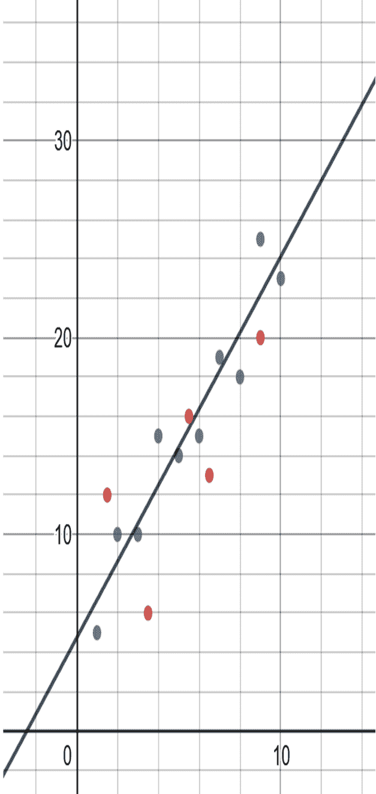

图 5-18. 划分训练/测试数据。回归线是通过最小二乘法拟合到训练数据（蓝色）上的，而测试数据（红色）随后被分析，以查看预测在之前未见过的数据上偏离了多少

示例 5-21 展示了如何使用 Scikit-learn 执行训练/测试划分，其中 1/3 的数据留作测试，另外 2/3 用于训练。

> 训练就是拟合回归
> 
> 请记住，“拟合”回归与“训练”同义。后者一词由机器学习从业者使用。

## 示例 5-21. 对线性回归执行训练/测试划分

```python
import pandas as pd
from sklearn.linear_model import LinearRegression
from sklearn.model_selection import train_test_split

# Load the data
df = pd.read_csv('https://bit.ly/3cIH97A', delimiter=",")

# Extract input variables (all rows, all columns but last column)
X = df.values[:, :-1]

# Extract output column (all rows, last column)
Y = df.values[:, -1]

# Separate training and testing data
# This leaves a third of the data out for testing
X_train, X_test, Y_train, Y_test = train_test_split(X, Y,
                                                test_size=1/3)

model = LinearRegression()
model.fit(X_train, Y_train)
result = model.score(X_test, Y_test)
print("R^2: %.3f" % result)
```

请注意 train_test_split() 会获取我们的数据集（X 和 Y 列），将其打乱，然后根据我们的测试数据集大小返回训练和测试数据集。我们使用 LinearRegression 的 fit() 函数在训练数据 X_train 和 Y_train 上进行拟合。然后我们使用


在测试数据集 X_test 和 Y_test 上使用 `score()` 函数来评估 $r^2$，从而了解回归在未见过的数据上的表现。测试数据集的 $r^2$ 越高，越好。该数值越高，表明回归在未见过的数据上表现越好。

## 使用 R-平方 进行测试

请注意，此处的 \( r^2 \) 计算方式略有不同，因为我们有一个来自训练的预定义线性回归。我们将测试数据与基于训练数据构建的回归线进行比较。目标仍然相同：越接近 1.0 越理想，以表明即使在训练数据上回归相关性也很强；而越接近 0.0 则表明测试数据集表现不佳。其计算方法如下，其中 \( y_i \) 是每个实际 y 值，\( \widehat{y_i} \) 是每个预测 y 值，\( \overline{y} \) 是所有数据点的平均 y 值。

\( r^2 = 1 - \frac{\sum \left( y_i - \widehat{y_i} \right)^2}{\sum \left( y_i - \overline{y} \right)^2} \)

图 5-19 显示了不同线性回归的不同 \( r^2 \) 值。

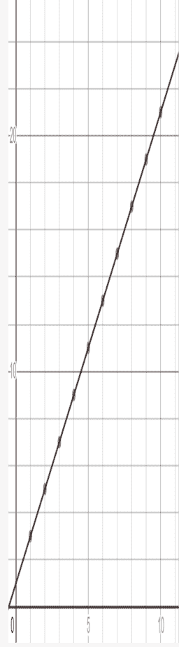

### $R^2 = 1.0$
（完美！）

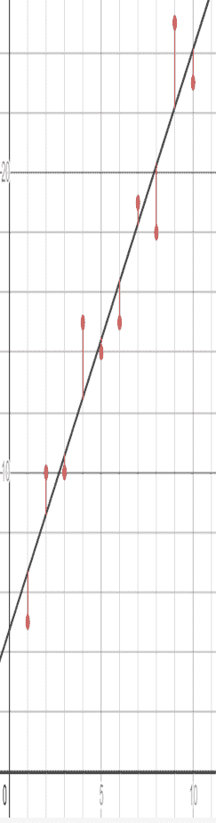

### $R^2 = 0.917$
（良好！）

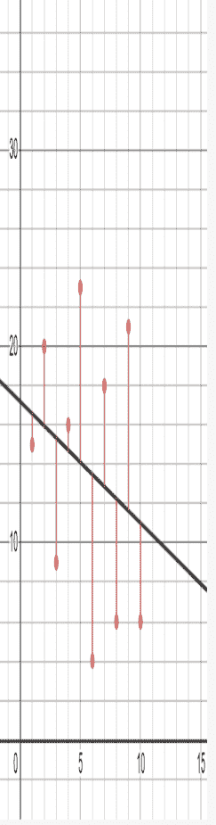

### $R^2 = 0.071$
（较差！）

图 5-19. 将 R-平方应用于使用训练过的线性回归的不同测试数据集

我们还可以将测试数据集在每个 1/3 折叠之间轮换。这称为 **交叉验证**，通常被视为验证技术的金标准。图 5-20 显示了数据的每个 1/3 如何轮流充当测试数据集。

数据

| | | |
|---|---|---|
| 训练 | 训练 | 测试 |
| 训练 | 测试 | 训练 |
| 测试 | 训练 | 训练 |

### 图 5-20. 三倍交叉验证的可视化

示例 5-22 中的代码展示了在三个折叠上执行交叉验证，然后将评分指标（在此情况下为平均平方和（MSE））及其标准差平均，以显示每次测试的一致性。

### 示例 5-22. 对线性回归使用 3 倍交叉验证

```
import pandas as pd
from sklearn.linear_model import LinearRegression
from sklearn.model_selection import KFold, cross_val_score

df = pd.read_csv('https://bit.ly/3cIH97A', delimiter=", ")

# Extract input variables (all rows, all columns but last column)
X = df.values[:, :-1]

# Extract output column (all rows, last column)\
Y = df.values[:, -1]

# Perform a simple linear regression
kfold = KFold(n_splits=3, random_state=7, shuffle=True)
model = LinearRegression()
results = cross_val_score(model, X, Y, cv=kfold)
print(results)
print("MSE: mean=%.3f (stdev=%.3f)" % (results.mean(), results.std()))
```

## 训练/测试划分必须是三分之一吗？

我们不需要将数据按三分之一进行折叠。您可以使用 **k 倍验证** 来按任何比例划分数据。通常，1/3、1/5 或 1/10 常被用作测试数据的比例，但 1/3 是最常用的。

一般而言，您选择的 _k_ 值需要使测试数据集为该问题提供足够大的样本。您还需要足够多的交替/打乱的测试数据集，以便对未见过的数据的性能提供公平的估计。中等规模的数据集可以使用 _k_ 值 3、5 或 10。**留一法交叉验证（LOOCV）** 会将每个单独的数据记录作为测试数据集中唯一的样本进行轮换，当整个数据集较小时，这很有帮助。

当您担心模型的方差时，除了进行简单的训练/测试划分或交叉验证外，您还可以使用 **随机折叠验证** 反复打乱并训练/测试划分数据无数次，并汇总测试结果。在 *示例 5-23* 中，有 10 次迭代，随机抽取 1/3 的数据用于测试，另外 2/3 用于训练。然后将这 10 个测试结果及其标准差平均，以查看测试数据集的表现是否一致。

有什么代价吗？由于我们多次训练回归模型，计算成本非常高。

### 示例 5-23. 对线性回归使用随机折叠验证

```
import pandas as pd
from sklearn.linear_model import LinearRegression
from sklearn.model_selection import cross_val_score, ShuffleSplit

df = pd.read_csv('https://bit.ly/38XwbeB', delimiter=",")

# Extract input variables (all rows, all columns but last column)
X = df.values[:, :-1]

# Extract output column (all rows, last column)\ 
Y = df.values[:, -1]

# Perform a simple linear regression
kfold = ShuffleSplit(n_splits=10, test_size=.33, random_state=7)
model = LinearRegression()
results = cross_val_score(model, X, Y, cv=kfold)

print(results)
print("mean=%.3f (stdev=%.3f)" % (results.mean(), results.std()))
```

因此，当时间紧迫或数据量太大无法进行统计分析时，训练/测试划分将提供一种方法，用于衡量您的线性回归在未见过的数据上的表现。

## 训练/测试划分并非保证

需要注意的是，仅仅应用机器学习最佳实践（即划分训练数据和测试数据）并不意味着您的模型就会表现良好。您很容易过度调优模型，并通过 p-hacking 获得良好的测试结果，结果却发现它在现实世界中表现不佳。这就是为什么有时需要留出一个称为 **验证集** 的另一数据集，尤其是在比较不同模型或配置时。这样，您对训练数据所做的调整以获得更好的测试数据性能就不会将信息泄露到训练中。您可以使用验证数据集作为最后一道防线，以查看 p-hacking 是否导致您在测试数据集上过拟合。

即便如此，您的整个数据集（包括训练、测试和验证）一开始就可能存在偏差，任何划分都无法缓解这一问题。Andrew Ng 在与 DeepLearning.AI 和 Stanford HAI 的问答中将此讨论为机器学习的一大问题。他通过一个示例说明了为什么机器学习尚未取代放射科医生（https://spectrum.ieee.org/andrew-ng-xrays-the-ai-hype）。

## 多元线性回归

本章几乎专注于对单个输入变量和单个输出变量进行线性回归。但是，我们在此学到的概念很大程度上也适用于多元线性回归。可以使用 $r^2$、标准误差和置信区间等指标，但随着变量增多，难度会增加。示例 5-24 是使用 Scikit-learn 进行的具有两个输入变量和一个输出变量的线性回归示例。

### 示例 5-24. 具有两个输入变量的线性回归

```
import pandas as pd
from sklearn.linear_model import LinearRegression

# Load the data
df = pd.read_csv('https://bit.ly/2X1HWH7', delimiter=",")

# Extract input variables (all rows, all columns but last column)
X = df.values[:, :-1]

# Extract output column (all rows, last column)\
Y = df.values[:, -1]

# Training
fit = LinearRegression().fit(X, Y)

# Print coefficients
print("Coefficients = {0}".format(fit.coef_))
print("Intercept = {0}".format(fit.intercept_))
print("z = {0} + {1}x + {2}y".format(fit.intercept_, fit.coef_[0],
fit.coef_[1]))
```

当模型因变量过多而开始失去可解释性时，就存在一定的脆弱性，这时机器学习实践开始介入并将模型视为黑盒。我希望您已相信统计学问题不会消失，并且您添加的变量越多，数据就越稀疏。但如果您退后一步，使用相关矩阵分析每对变量之间的关系，并寻求理解每对变量如何交互作用，这只会有助于您创建高效的机器学习模型。

## 结论

本章涵盖了大量内容。我们力求超越对线性回归的肤浅理解，并不再将训练/测试划分作为唯一的验证方式。我想向您展示手术刀（统计学）和链锯（机器学习），以便您能判断哪种最适合特定


你遇到的问题。仅在线性回归中就有大量可用的度量和分析方法，我们介绍了其中一些，以了解线性回归是否可靠用于预测。你可能会发现自己需要进行宽泛的近似回归，或使用统计工具仔细分析和梳理数据。你采用哪种方法取决于具体情况，如果你想了解更多Python中可用的统计工具，请查看`statsmodels`库。

https://www.statsmodels.org/stable/regression.html

在第6章（涵盖逻辑回归）中，我们将重新探讨R²和统计显著性。我希望本章让你相信，有方法可以有意义地分析数据，而这种投资可以决定项目的成败。

## 练习

此处提供了一个包含两个变量x和y的数据集：https://bit.ly/3C8JzrM。

- 1. 执行简单线性回归，找到最小化损失（平方和）的m和b值。
- 2. 计算此数据的相关系数和统计显著性（95%置信度）。相关性有用吗？
- 3. 如果我预测x = 50，y预测值的95%预测区间是多少？
- 4. 重新开始你的回归并进行训练/测试划分。请随意尝试交叉验证和随机折叠验证。线性回归在测试数据上表现良好且一致吗？为什么或为什么不？

答案在附录B中。
