# 第 6 章. 逻辑回归与分类

在本章中，我们将介绍**逻辑回归**，这是一种根据一个或多个自变量预测结果概率的回归类型。这反过来可用于**分类**，即预测类别而非我们在线性回归中处理的实数。

我们并不总是有兴趣将变量表示为**连续**型，即它们可以表示无限多个实小数值。在某些情况下，我们宁愿变量是**离散**型，或代表整数、整型或布尔值（1/0，真/假）。逻辑回归在训练时使用的是离散（二进制1或0）或分类数值（即整数）的输出变量。它确实以概率形式输出连续变量，但可以通过阈值将其转换为离散值。

逻辑回归易于实现，并且对异常值和其他数据挑战具有相当的鲁棒性。许多机器学习问题最好用逻辑回归解决，与其他类型的监督机器学习相比，它提供了更多的实用性和性能。

就像我们在第5章介绍线性回归时所做的那样，我们将尝试在统计学和机器学习之间走钢丝，使用两个学科的工具和分析方法。逻辑回归将整合我们从本书中学到的许多概念，从概率到线性回归。

### 理解逻辑回归

想象发生了一起小型工业事故，你正在尝试了解化学物质暴露的影响。你有11名患者接触这种化学物质的时长各不相同（请注意这是编造的数据）。有些人出现了症状（值为1），其他人没有出现症状（值为0）。让我们在图6-1中绘制它们，其中x轴是暴露小时数，y轴是他们是否（1或0）出现了症状。

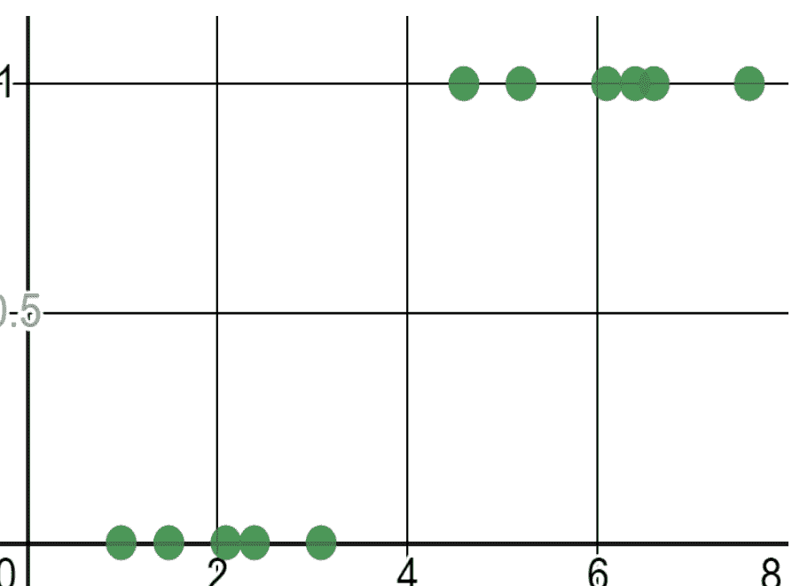

图6-1. 绘制患者在x小时暴露期间是否（1）或没有（0）出现症状。

患者在多长时间后开始出现症状？嗯，很明显在近乎4小时时，我们立即从患者未出现症状（0）转变为出现症状（1）。在图6-2中，我们看到带有预测曲线的相同数据。

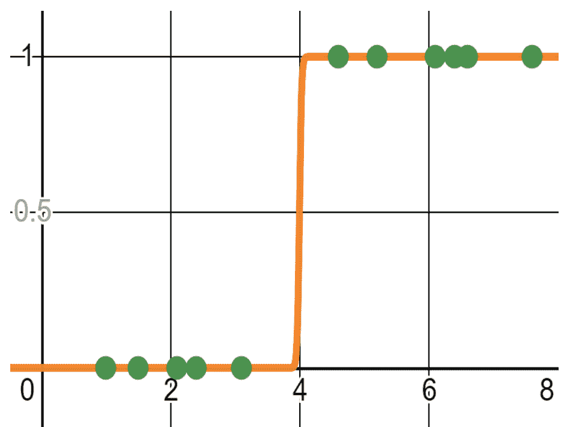

图6-2. 4小时后，我们看到一个明显的跳跃，患者开始出现症状

对该样本进行粗略分析，我们可以说，暴露时间少于4小时的患者几乎有0%的概率出现症状，而暴露时间大于4小时的患者则有100%的概率。在这两组之间，大约在4小时时，出现症状的概率立即跳跃。

当然，现实世界中情况从来不会如此非黑即白。假设你收集了更多数据，其中范围的中间部分既有出现症状的患者也有未出现症状的患者，如图6-3所示。

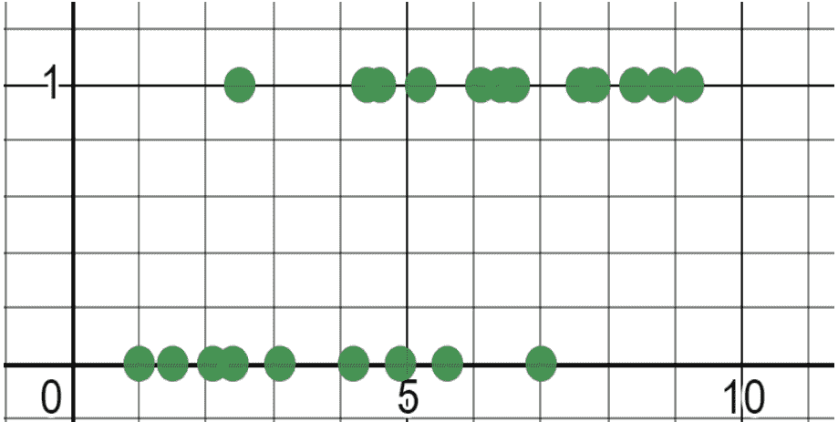

图6-3. 中间既有出现症状（1）的患者也有未出现症状（0）的患者。

解释这一点的方法是，患者出现症状的概率随每小时暴露逐渐增加。让我们用**逻辑函数**来可视化这一点，即一个S形曲线，其中输出变量被压缩在0和1之间，如图6-4所示。

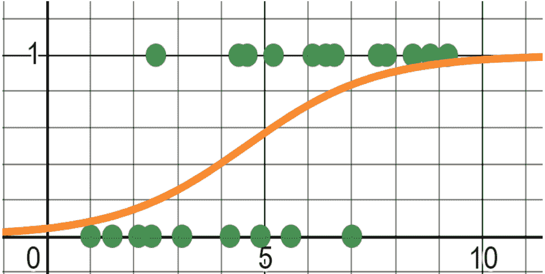

图6-4. 将逻辑函数拟合到数据上

由于中间这些点的重叠，患者出现症状没有明确的截止点，而是从0%概率到100%概率（“0”和“1”）的渐进过渡。这个示例演示了**逻辑回归**如何产生一条曲线，表明属于真实类别（患者出现了症状）的概率随自变量（暴露小时数）而变化。

我们可以重新利用逻辑回归，不仅为给定的输入变量预测概率，还可以添加阈值来预测它是否属于该类别。例如，如果我有一个新患者，发现他们已暴露了6小时，我预测他们有71.1%的几率出现症状，如图6-5所示。如果我的阈值是至少50%的概率出现症状，我只需将其分类为将出现症状。

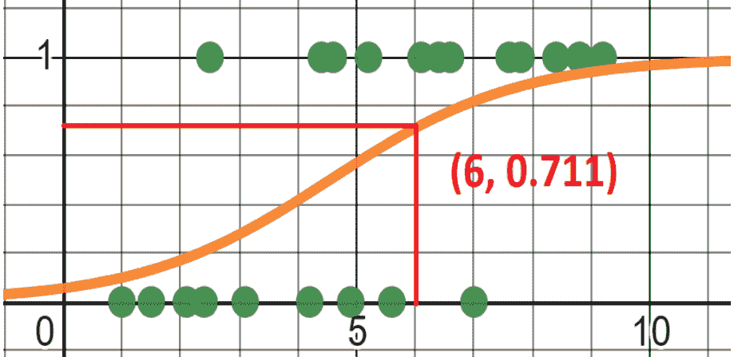

图6-5. 我们可以预期暴露6小时的患者有71.1%的可能性出现症状，并且因为这大于50%的阈值，我们预测他们将出现症状

### 执行逻辑回归

那么，我们如何执行逻辑回归呢？让我们先看看逻辑函数，并探索其背后的数学原理。

### 逻辑函数

逻辑函数是一种S形曲线（也称为Sigmoid曲线），对于给定的输入变量集，它生成介于0和1之间的输出变量。由于输出变量介于0和1之间，它可用于表示概率。

下面是一个针对单个输入变量x输出概率y的逻辑函数。

```
y = \frac{1.0}{1.0 + e^{-(\beta_0+\beta_1 x)}}
```

请注意，此公式使用了在第1章中介绍过的欧拉数$e$。$x$变量是自变量/输入变量。$\beta_0$和$\beta_1$是我们需要求解的系数。

$\beta_0$和$\beta_1$被打包在一个指数中，该指数类似于线性函数，你可能记得它与$y = mx + b$或$y = \beta_0 + \beta_1x$完全相同。这并非巧合，逻辑回归实际上与线性回归有着密切的关系，我们将在本章后面讨论。$\beta_0$确实是截距（在简单线性回归中我们称之为$b$），$\beta_1$是x的斜率（在简单线性回归中我们称之为$m$）。指数中的这个线性函数称为log-odds函数，但目前只需知道整个逻辑函数会生成我们需要的S形曲线，以便在$x$值上输出变化的概率。

要在Python中声明逻辑函数，请使用`math`包中的`exp()`函数来声明$e$的指数，如示例6-1所示。

### 示例6-1. 针对单个自变量的Python中的逻辑函数

```python
import math

def predict_probability(x, b0, b1):
    p = 1.0 / (1.0 + math.exp(-(b0 + b1 * x)))
    return p
```

让我们绘制图表来看看它是什么样子，并假设$\beta_0 = -2.823$和$\beta_1 = 0.62$。我们将在示例6-2中使用SymPy，输出的图表如图6-6所示。

### 示例6-2. 使用SymPy绘制逻辑函数

```python
from sympy import *
b0, b1, x = symbols('b0 b1 x')

p = 1.0 / (1.0 + exp(-(b0 + b1 * x)))

p = p.subs(b0,-2.823)
p = p.subs(b1, 0.620)
print(p)

plot(p)
```


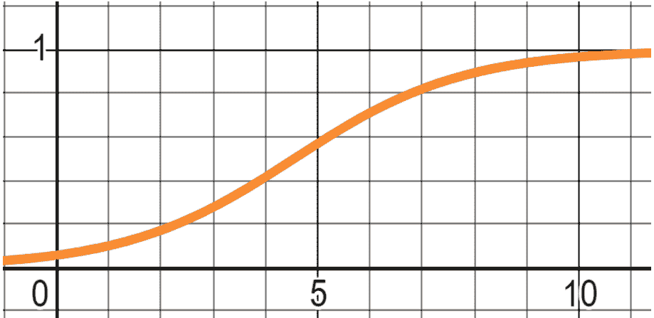

图 6-6. 逻辑函数

在某些教材中，你也可能会看到逻辑函数按如下形式声明。

$$p = \frac{e^{\beta_0 + \beta_1 x}}{1 + e^{\beta_0 + \beta_1 x}}$$

别担心，因为这只是同一个函数的不同代数表达方式。请注意，就像线性回归一样，我们也可以将逻辑回归扩展到多个输入变量（$x_1, x_2, ... x_n$），如下面的公式所示。我们只需添加更多的 $\beta_x$ 系数。

$$p = \frac{1}{1 + e^{-(\beta_0 + \beta_1 x_1 + \beta_2 x_2 + ... \beta_n x_n)}}$$

## 逻辑曲线拟合

如何将逻辑曲线拟合到给定的训练数据集？首先，数据可以包含小数、整数和二进制变量的任意混合，但输出变量必须是二进制的（0 或 1）。当我们实际进行预测时，输出变量将在 0 到 1 之间，类似于概率。

数据提供了我们的输入和输出变量值，但我们需要求解 $\beta_0$ 和 $\beta_1$ 系数以拟合我们的逻辑函数。回想一下我们在第 5 章中如何使用最小二乘法。然而，这不适用于这里。相反，我们使用最大似然估计，正如其名称所示，最大化给定逻辑曲线输出观测数据的可能性。

要计算最大似然估计，实际上没有像线性回归那样的封闭形式方程。我们仍然可以使用随机梯度下降，或者让库为我们完成。让我们先从库 SciPy 开始，介绍这两种方法。

## 使用 SciPy

SciPy 的好处在于模型通常具有一组标准化的函数和 API，这意味着在许多情况下，你可以复制/粘贴代码，然后在不同模型之间重复使用。在示例 6-3 中，你将看到对我们的患者数据执行逻辑回归。如果你将其与第 5 章中的线性回归代码进行比较，你会发现它在导入、分离和拟合数据方面有着几乎相同的代码。主要区别在于，我为模型使用了 LogisticRegression() 而不是 LinearRegression()。

### 示例 6-3. 使用标准逻辑回归 SciPy

```python
import pandas as pd
from sklearn.linear_model import LogisticRegression

# Load the data
df = pd.read_csv('https://bit.ly/33ebs2R', delimiter=",")

# Extract input variables (all rows, all columns but last column)
X = df.values[:, :-1]

# Extract output column (all rows, last column)
Y = df.values[:, -1]

# Perform logistic regression
# Turn off penalty
model = LogisticRegression(penalty='none')
model.fit(X, Y)

# print beta1
print(model.coef_.flatten()) # 0.69267212

# print beta0
print(model.intercept_.flatten()) # -3.17576395
```

## 进行预测

要进行特定预测，请在 SciPy 的模型对象上使用 predict() 和 predict_prob() 函数，无论它是 LogisticRegression 还是任何其他类型的分类模型。predict() 函数将预测特定类（例如 True 1.0 或 False 1.0），而 predict_prob() 将输出每个类的概率。

在 SciPy 中运行模型后，我得到的逻辑回归为 $\beta_0 = -3.17576395$ 和 $\beta_1 = 0.69267212$。当我绘制它时，它应该看起来不错，如图 6-7 所示。

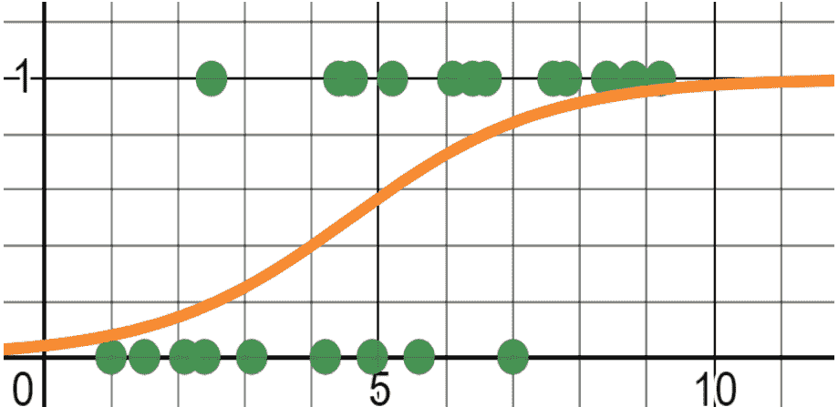

图 6-7. 绘制 Scikit-learn 逻辑回归

这里有几点需要注意。当我创建 `LogisticRegression()` 模型时，我没有指定 `penalty` 参数，该参数选择像 `l1` 或 `l2` 这样的正则化技术。虽然这超出了本书的范围，但我在“关于 SciPy 参数”框中包含了简要的见解，以便你手头有有用的参考。

最后，我将对系数和截距使用 `flatten()`，它们作为多维矩阵输出但只有一个元素。展平意味着将数字矩阵折叠为较少的维度，特别是在元素数量少于维度数量时。例如，我在这里使用 `flatten()` 来获取嵌套在二维矩阵中的单个数字，并将其作为单个值提取出来。然后我就得到了我的 $\beta_0$ 和 $\beta_1$ 系数。

## 关于 SciPy 参数

SciPy 在其回归和分类模型中提供了很多选项。不幸的是，没有足够的篇幅或页面来涵盖它们，因为这不是一本专注于机器学习的书。

然而，SciPy 文档写得很好，关于逻辑回归的页面可以在这里找到。

https://scikit-learn.org/stable/modules/generated/sklearn.linear_model.LogisticRegression.html

如果很多术语不熟悉，例如正则化和 l1 及 l2 惩罚，还有其他优秀的 O'Reilly 书籍探讨这些主题。我发现的一本更有帮助的文本是 Aurélien Géron 编写的 **Hands-On Machine Learning with Scikit-learn, Keras, and TensorFlow**。

https://learning.oreilly.com/library/view/hands-on-machine-learning/9781492032632/

## 使用最大似然和梯度下降

正如我们在本书中一贯所做的，我旨在提供从头构建技术的见解，即使库可以为我们完成。为了自己拟合逻辑回归，有几种方法，但所有方法通常都求助于最大似然估计（MLE）。MLE 最大化给定逻辑曲线输出观测数据的可能性。它与平方和不同，但我们仍然可以应用梯度下降或随机梯度下降来求解。

我将尝试简化数学术语，并在此尽量减少线性代数。基本上，其思路是找到 $\beta_0$ 和 $\beta_1$ 系数，使我们的逻辑曲线尽可能贴近这些点，表明它最有可能生成了这些点。如果你回想一下第 2 章我们学习概率时，我们通过将多个事件的概率（或似然）相乘来组合它们。在此应用中，我们正在计算对于给定的逻辑回归曲线，我们会观察到所有这些点的可能性。

应用联合概率的概念，每个患者都有基于拟合逻辑函数表现出症状的可能性，如图 6-8 所示。

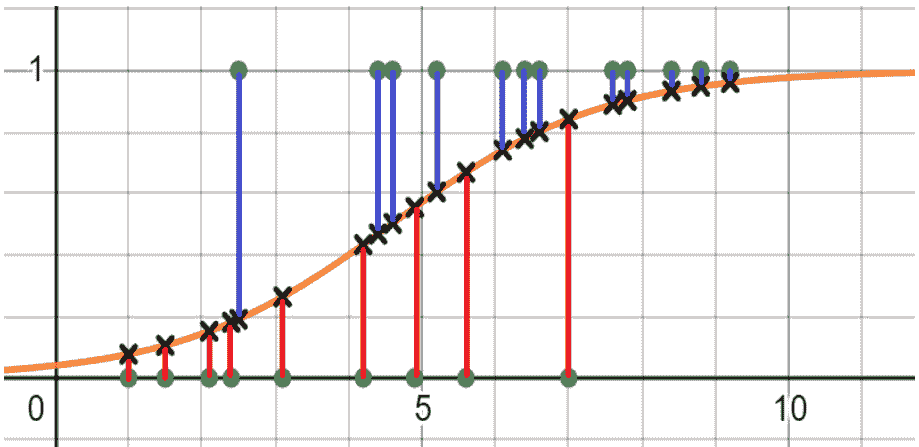

图 6-8. 逻辑曲线上每个输入值都有对应的似然值

我们从逻辑回归曲线上每个点上方或下方获取每个似然值。如果点在逻辑回归曲线下方，我们需要将结果概率从 1.0 中减去，因为我们也想最大化负例。

给定系数 $\beta_0 = -3.17576395$ 和 $\beta_1 = 0.69267212$，示例 6-4 展示了如何在 Python 中计算此数据的联合似然。

### 示例 6-4. 计算给定逻辑回归观察所有点的联合似然

```python
import math
import pandas as pd
patient_data = pd.read_csv('https://bit.ly/33ebs2R', delimiter=",").itertuples()
b0 = -3.17576395

b1 = 0.69267212

def logistic_function(x):
    p = 1.0 / (1.0 + math.exp(-(b0 + b1 * x)))
    return p

# Calculate the joint likelihood
joint_likelihood = 1.0

for p in patient_data:
    if p.y == 1.0:
        joint_likelihood *= logistic_function(p.x)
    elif p.y == 0.0:
        joint_likelihood *= (1.0 - logistic_function(p.x))

print(joint_likelihood) # 4.7911180221699105e-05
```

这里有一个数学技巧，可以压缩那个 `if` 表达式。正如我们在第 1 章中介绍的，当你将任何数字设为 0 次幂时，它将始终为 1。看一下这个公式，并注意指数中真（1）和假（0）情况的处理。

joint likelihood = \(\prod_{i=1}^{n} \left( \frac{1.0}{1.0 + e^{-(\beta_0 + \beta_1 x_i)}} \right)^{y_i} \times \left( \frac{1.0}{1.0 + e^{-(\beta_0 + \beta_1 x_i)}} \right)^{1.0-y_i}\)

要在 Python 中执行此操作，请将该 for 循环内的所有内容压缩到示例 6-5 中：

### 示例 6-5. 不使用 `if` 表达式压缩联合似然计算

```python
for p in patient_data:
    joint_likelihood *= logistic_function(p.x) ** p.y * (1.0 - logistic_function(p.x)) ** (1.0 - p.y)
```

我到底做了什么？请注意，这个表达式有两个部分，一个用于 \(y = 1\)，另一个用于 \(y = 0\)。当任何数字被提升到 0 次幂时，结果将为 1。因此，无论 \(y\) 是 1 还是 0，都会导致另一侧的相反条件计算为 1，并在乘法中没有影响。我们得以表达 `if` 表达式，但完全使用数学表达式来完成。我们无法对使用 `if` 的表达式进行求导，因此这将很有帮助。

请注意，计算机在将多个小小数相乘时可能会不堪重负，这被称为 **浮点下溢**。这意味着随着小数越来越小（在乘法中可能发生这种情况），计算机在跟踪那么多小数位时会遇到限制。有一个巧妙的数学技巧可以绕过这个问题。你可以对每个正在相乘的小数取 `log()`，然后将它们相加。这要归功于我们在第 1 章中介绍的对数的加法特性。然后你可以调用 `exp()` 函数将总和转换回乘积。

让我们修改代码以使用对数加法而不是乘法。请注意，`log()` 函数默认以底数 *e* 为底，虽然任何底数从技术上讲都可以工作，但这样做更可取，因为 *e^x* 是自身的导数，从计算角度来看更高效。


### 示例 6-6. 使用对数相加

```
# Calculate the joint likelihood
joint_likelihood = 0.0

for p in patient_data:
    joint_likelihood += math.log(logistic_function(p.x) ** p.y * \
    (1.0 - logistic_function(p.x)) ** (1.0 - p.y))

joint_likelihood = math.exp(joint_likelihood)
```

若要将上述 Python 代码表示为数学符号，其表达式如下。

联合似然 = \sum_{i=1}^{n} log \left( \left( \frac{1.0}{1.0 + e^{-(\beta_0 + \beta_1 x_i)}} \right)^{y_i} \times \left( 1.0 - \frac{1.0}{1.0 + e^{-(\beta_0 + \beta_1 x_i)}} \right)^{1.0 - y_i} \right)

你想计算上述表达式中 \beta_0 和 \beta_1 的偏导数吗？我想你不想。这太棘手了。天哪，单在 SymPy 中表达那个函数就够呛了！请看示例 6-7。

### 示例 6-7. 在 SymPy 中表达逻辑回归的联合似然

```
joint_likelihood = Sum(log((1.0 / (1.0 + exp(-(b + m * x(i)))))**y(i) \
* (1.0 - (1.0 / (1.0 + exp(-(b + m * x(i))))))**(1-y(i))), (i, 0, n))
```

所以，我们就让 SymPy 来帮我们分别对 \beta_0 和 \beta_1 求偏导数吧。然后我们会立即编译并用于梯度下降，如示例 6-8 所示。

### 示例 6-8. 在逻辑回归中使用梯度下降

```
from sympy import *
import pandas as pd

points = list(pd.read_csv("https://tinyurl.com/y2cocoo7").itertuples())

b1, b0, i, n = symbols('b1 b0 i n')
x, y = symbols('x y', cls=Function)
joint_likelihood = Sum(log((1.0 / (1.0 + exp(-(b0 + b1 * x(i))))) ** y(i) \
* (1.0 - (1.0 / (1.0 + exp(-(b0 + b1 * x(i))))) ** (1 - y(i))), (i, 0,
n))

# Partial derivative for m, with points substituted
d_b1 = diff(joint_likelihood, b1) \
.subs(n, len(points) - 1).doit() \
.replace(x, lambda i: points[i].x) \
.replace(y, lambda i: points[i].y)

# Partial derivative for m, with points substituted
d_b0 = diff(joint_likelihood, b0) \
.subs(n, len(points) - 1).doit() \
.replace(x, lambda i: points[i].x) \
.replace(y, lambda i: points[i].y)

# compile using lambdify for faster computation
d_b1 = lambdify([b1, b0], d_b1)
d_b0 = lambdify([b1, b0], d_b0)

# Perform Gradient Descent
b1 = 0.01
b0 = 0.01
L = .01

for j in range(10_000) :
    b1 += d_b1(b1, b0) * L
    b0 += d_b0(b1, b0) * L

print(b1, b0)
# 0.6926693075370812 -3.175751550409821
```

在对 \(\beta_0\) 和 \(\beta_1\) 计算偏导数后，我们代入 \(x\) 和 \(y\) 的值以及数据点数量 \(n\)。然后我们使用 `lambdify()` 编译导数函数以提高效率（它在幕后使用 NumPy）。之后，我们执行梯度下降，就像在第 5 章中所做的那样，但由于我们试图最大化而非最小化，因此我们将每次调整加到 \(\beta_0\) 和 \(\beta_1\) 上，而不是像最小二乘法那样相减。

如示例 6-8 所示，我们得到 \(\beta_0 = -3.17575\) 和 \(\beta_1 = 0.692667\)。这与我们之前在 SciPy 中得到的系数值高度可比。

正如在第 5 章中学到的，我们也可以使用随机梯度下降，在每次迭代时只采样一条或少量记录。这将提升计算速度和性能，并防止过拟合。此处无需再次赘述，我们将继续往下。

## 多元逻辑回归

让我们尝试一个在多个输入变量上使用逻辑回归的示例。以下是来自一个虚构数据集的少量记录样本，该数据集包含一些员工保留数据（完整数据集在此：https://bit.ly/3aqsOMO）。

| 性别 | 年龄 | 晋升次数 | 雇佣年限 | 是否离职 |
|---|---|---|---|---|
| 1 | 32 | 3 | 7 | 0 |
| 1 | 34 | 2 | 5 | 0 |
| 1 | 29 | 2 | 5 | 1 |
| 0 | 42 | 4 | 10 | 0 |
| 1 | 43 | 4 | 10 | 0 |

图 6-9. 员工保留数据样本

这个数据集中有 54 条记录。假设我们想用它来预测其他员工是否会离职，这里可以使用逻辑回归（尽管这一切都不是个好主意，我会在后面详细说明原因）。还记得我们可以支持不止一个输入变量，如下面公式所示。

\( y = \frac{1}{1 + e^{-(\beta_0 + \beta_1 x_1 + \beta_2 x_2 + ... \beta_n x_n)}} \)

我将为变量 `sex`、`age`、`promotions` 和 `years_employed` 中的每一个创建 \(\beta\) 系数。输出变量 `did_quit` 是二进制的，它将驱动我们要预测的逻辑回归结果。由于我们处理的是多维数据，可视化我们的逻辑曲线所代表的曲面超平面会很困难。因此我们将避开可视化。

让我们使其更有趣。我们将使用 Scikit-learn，但会制作一个交互式 shell 来测试员工。以下是示例 6-9 中的代码，运行后将执行逻辑回归，然后我们可以输入新员工的数据来预测他们是否会离职。会有什么问题？我相信没事。我们只是根据人们的个人属性进行预测并据此做出决定。我相信一切都会很好。

（如果还不清楚，我在说反话）。

### 示例 6-9. 对员工数据进行多元逻辑回归

```
import pandas as pd
from sklearn.linear_model import LogisticRegression

employee_data = pd.read_csv("https://tinyurl.com/y6r7qjrp")

# grab independent variable columns
inputs = employee_data.iloc[:, :-1]

# grab dependent "did_quit" variable column
output = employee_data.iloc[:, -1]

# build logistic regression
fit = LogisticRegression(penalty='none').fit(inputs, output)

# Print coefficients:
print("COEFFICIENTS: {0}".format(fit.coef_.flatten()))
print("INTERCEPT: {0}".format(fit.intercept_.flatten()))

# Interact and test with new employee data
def predict_employee_will_stay(sex, age, promotions, years_employed):
    prediction = fit.predict([[sex, age, promotions, years_employed]])
    probabilities = fit.predict_proba([[sex, age, promotions, years_employed]])
    if prediction == [[1]]:
        return "WILL LEAVE: {0}".format(probabilities)
    else:
        return "WILL STAY: {0}".format(probabilities)

# Test a prediction
while True:
    n = input("Predict employee will stay or leave {sex},{age},{promotions},{years employed}: ")
    (sex, age, promotions, years_employed) = n.split(",")
    print(predict_employee_will_stay(int(sex), int(age), int(promotions),
    int(years_employed)))
```

图 6-10 显示了员工是否被预测会离职的结果。该员工性别为 "1"，年龄 34 岁，晋升过 1 次，在公司工作了 5 年。果然，预测结果是 “WILL LEAVE”。

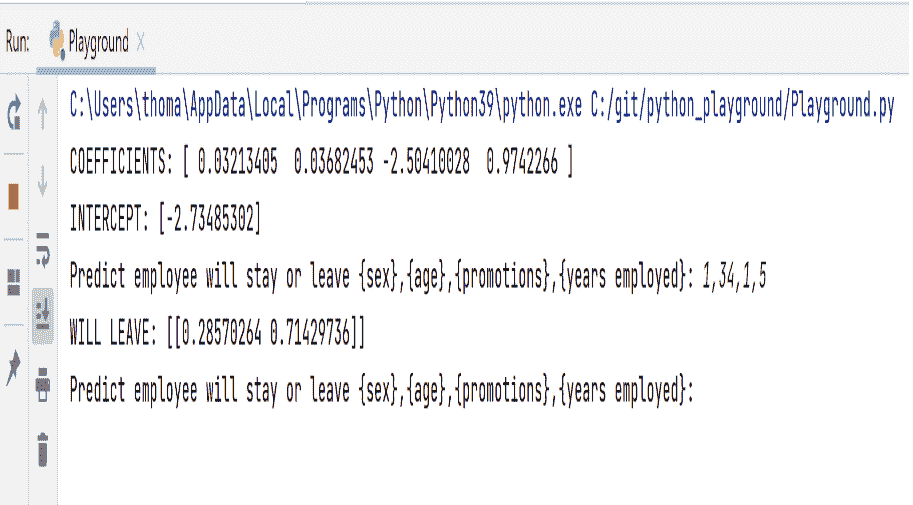

图 6-10. 对一名 34 岁、有 1 次晋升和 5 年工龄的员工是否会离职进行预测

请注意，`predict_proba()` 函数会输出两个值，第一个是 0（假）的概率，第二个是 1（真）的概率。

你会注意到，性别、年龄、晋升次数和工龄的系数按此顺序显示。根据系数的权重，你可以看出性别和年龄在预测中起的作用很小（它们的权重都接近 0）。然而，`promotions` 和 `years_employed` 分别有 -2.504 和 .97 的显著权重。关于这个玩具数据集的一个秘密：我编造了它，使得员工如果大约每 2 年得不到一次晋升就会离职。果然，我的逻辑回归捕捉到了这个模式，你也可以用其他员工来试试。但是，如果你超出了训练数据的范围，预测可能会开始失效（例如，输入一名 70 岁且 3 年未获晋升的员工，很难说这个模型会如何，因为它没有该年龄段的数据）。

当然，现实生活并不总是这么干净利落。一名在一家公司工作了 8 年却从未晋升的员工，可能对自己的角色感到满意，短期内不太可能离职。如果是这种情况，年龄等变量可能会起作用并获得权重。然后，当然，我们可能会开始担心其他相关变量没有被


captured. See the warning callout Be Careful Making Classifications on People! to learn more.

## 谨慎对人进行分类！

自毁前脚最快、最稳妥的方式，就是收集关于人群的数据，并随意用其进行预测。不仅可能引发数据隐私问题，如果模型被发现具有歧视性，还可能引发法律和公关问题。种族和性别等输入变量可能会在机器学习训练中被赋予权重。此后，不被雇佣或贷款被拒等不良后果将施加于这些人群。更极端的应用包括被监控系统错误标记或被拒绝刑事假释。还要注意，通勤时间等看似无害的变量也被发现与歧视性变量相关。

At the time of writing, a number of articles have been citing machine learning discrimination as an issue.
https://www.theregister.com/2021/07/16/facial_recognition_failure/
https://www.nytimes.com/2020/06/24/technology/facial-recognition-arrest.html

As data privacy laws continue to evolve, it is advisable to err on the side of caution and engineer personal data carefully. Think about what automated decisions will be propagated and how that can cause harm. Sometimes it is better to just leave a “problem” alone and keep doing it manually, rather than

Finally on this employee retention example, think about where this data came from. Yes, I made up this dataset but in the real world you always want to question what process created the data. Over what period of time did this sample come from? How far back do we go looking for employees who quit? What constitutes an employee who stayed? Are they current employees at this point in time? How do we know they are not about to quit, making them a false negative? Data scientists easily fall into traps only analyzing what data says, but not questioning where it came from and what assumptions are built into it.

The best way to get answers to these questions is understand what the predictions are being used for. Is it to decide when to give people promotions to retain them? Can this create a circular bias promoting people with a set of attributes? Will that bias be re-affirmed when those promotions start becoming the new training data?

These are all important questions, and perhaps even inconvenient ones that cause unwanted scope creep into the project. If this scrutiny is not welcomed by your team or leadership on a project, consider empowering yourself with a different role where curiosity becomes a strength.

## 理解对数几率（Log-Odds）

At this point, it is time to discuss the logistic regression and what it is mathematically made of. This can be a bit dizzying so take your time here. If you get overwhelmed you can always revisit this section later.

Starting in the 1900s, it has always been an interest to mathematicians to take a linear function and scale its output to fall between 0 and 1, and therefore be useful for predicting probability. The log-odds, also called the logit function, lends itself to logistic regression for this purpose.

Remember earlier I pointed out the exponent value \(\beta_0 + \beta_1x\) is a linear function? Look below at our logistic function again:

$$p = \frac{1.0}{1.0 + e^{-(\beta_0+\beta_1x)}}$$

This linear function being raised to \(e\) is known as the **对数几率（log-odds）** function, which takes the logarithm of the odds for the event of interest. Your response might be “Wait, I don’t see any \(\log()\) or odds. I just see a linear function!” Bear with me, I will show the hidden math.

As an example, let’s use our logistic regression from earlier where \(\beta_0 = -3.17576395\) and \(\beta_1 = 0.69267212\). What is the probability of showing symptoms after 6 hours, where \(x = 6\)? We already know how to do this: plug these values into our logistic function.

$$p = \frac{1.0}{1.0 + e^{(-3.17576395+0.69267212(6))}} = 0.727161542928554$$

We plug in these values and output a probability of .72716. But let’s look at this from an odds perspective. Recall in Chapter 2 we learned how to calculate odds from a probability:

$$\text{odds} = \frac{p}{1 - p}$$

$$\text{odds} = \frac{.72716}{1 - .72716} = 2.66517246407876$$

So at 6 hours, a patient is 2.66517 times more likely to show symptoms than not show symptoms.

When we wrap the odds function in a natural logarithm (a logarithm with base \(e\)), we call this the **logit 函数**. The output of this formula is what we call the **对数几率（log-odds）**, named... shockingly... because we take the logarithm of the odds.

$$\text{logit} = log\big(\frac{p}{1 - p}\big)$$

$$\text{logit} = log\big(\frac{.72716}{1 - .72716}\big) = 0.98026877$$

Our log-odds at 6 hours is 0.9802687. What does this mean and why do we care? When we are in “log-odds land” it is easier to compare one set of odds against another. We treat anything greater than 0 as favoring odds an event will happen, whereas anything less than 0 is against an event. A log-odds of -1.05 is linearly the same distance from 0 as 1.05. In plain odds though, the equivalents are .3499 and 2.857 respectively, which is not as interpretable. That is the convenience of log-odds.

### 几率与对数（ODDS AND LOGS）

Logarithms and odds have an interesting relationship. Odds are against an event when it is between 0.0 and 1.0, but anything greater than 1.0 favors the event and extends into positive infinity. This lack of symmetry is awkward. However, logarithms rescale an odds so that it is completely linear, where a log-odds of 0.0 means fair odds. A log-odds of -1.05 is linearly the same distance from 0 as 1.05, and thus make comparing odds much easier.

Josh Starmer has a great video talking about this relationship between odds and logs here:
https://www.youtube.com/watch?v=ARfXDSkQf1Y

Recall I said the linear function in our logistic regression formula β₀ + β₁x is our log-odds function. Check this out:

```
log odds = β₀ + β₁x

log odds = -3.17576395 + 0.69267212(6)

log odds = 0.98026877
```

It’s the same value 0.98026877 as our previous calculation, the odds of our logistic regression at x = 6 and then taking the `log()` of it! So what is the link? What ties all this together? Given a probability from a logistic regression p and input variable x, it is this:

```
log (p / (1 - p)) = β₀ + β₁x
```

Let’s plot the log-odds line alongside the logistic regression, as shown in Figure 6-11.

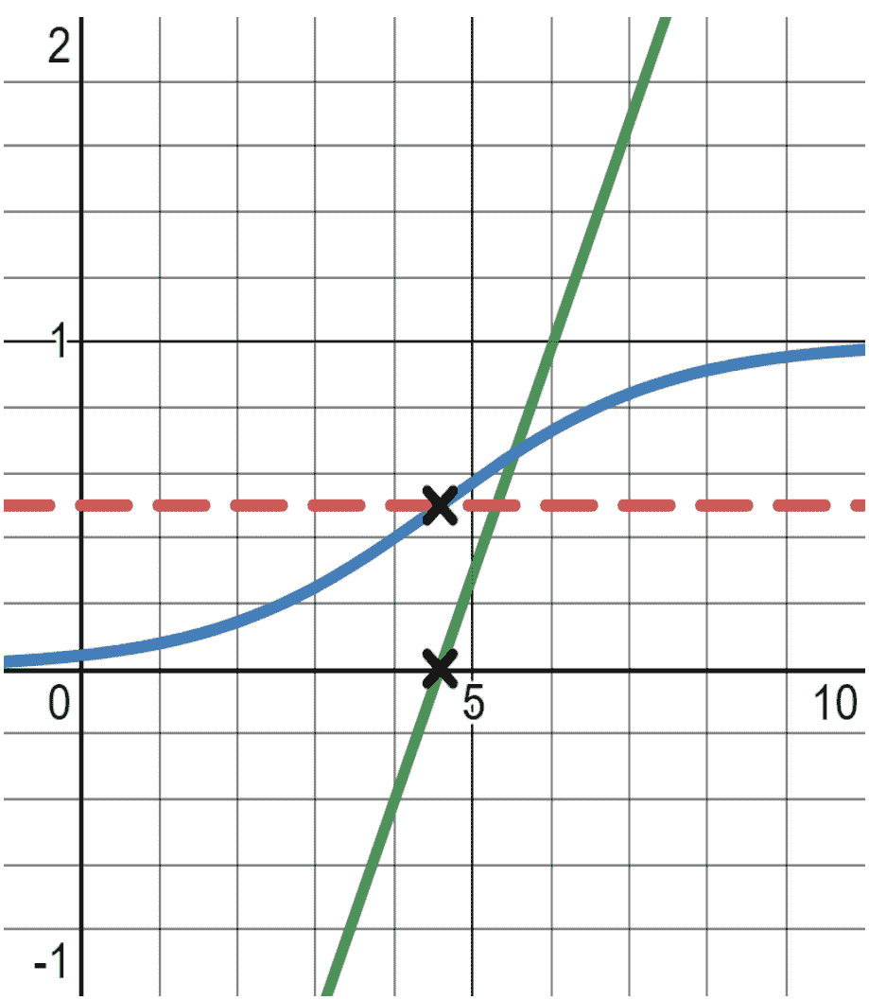

Figure 6-11. The log-odds line is converted into a logistic function that outputs a probability.

Every logistic regression is actually backed by a linear function, and that linear function is a log-odds function. Note in Figure 6-11 that when the log-odds is 0.0 on the line, then the probability of the logistic curve is at 0.5. This makes sense because when our odds are fair at 1.0, the probability is going to be 0.50 as shown in the logistic regression, and the log-odds are going to be 0 as shown by the line.

Another benefit we get looking at the logistic regression from an odds perspective is we can compare the effect between one x value and another. Let’s say I want to understand how much my odds change between 6 hours and 8 hours of exposure to the chemical. I can take the odds at 6 hours and then 8 hours, and then ratio the two odds against each other in an **几率比（odds ratio）**. This is not to be confused with a plain odds which, yes is a ratio, but it is not an odds ratio.

Let's first find the probabilities of symptoms for 6 hours and 8 hours respectively.

\( p = \frac{1.0}{1.0 + e^{-(\beta_0+\beta_1 x)}} \)

\( p_6 = \frac{1.0}{1.0 + e^{(-3.17576395+0.69267212(6))}} = 0.7271615429285554 \)

\( p_8 = \frac{1.0}{1.0 + e^{(-3.17576395+0.69267212(8))}} = 0.914167258137741 \)

Now let's convert those into odds, which we will declare as \( o_x \) .

\( o = \frac{p}{1 - p} \)

\( o_6 = \frac{0.7271615429285554}{1 - 0.7271615429285554} = 2.66517246407876 \)

\( o_8 = \frac{0.914167258137741}{1 - 0.914167258137741} = 10.6505657200694 \)

Finally, set the two odds against each other as an odds ratio, where the odds for 8 hours is the numerator and the odds for 6 hours is in the denominator. We get a value of approximately 3.996, meaning that our odds of showing symptoms increases by nearly a factor of 4 with an extra 2 hours of exposure.

\(\text{odds ratio} = \frac{10.6505657200694}{2.66517246407876} = 3.99620132040906 \)

You will find this odds ratio value of 3.996 holds across any two hour range, like 2 hours to 4 hours, 4 hours to 6 hours, 8 hours to 10 hours... etc. As long as its a 2-hour gap you will find that odds ratio stays consistent. It will differ for other range lengths.

## R-Squared

We covered quite a few statistical metrics for linear regression in Chapter 5, and we will try to do the same for logistic regression. We still worry about many of the same problems as in linear regression, including overfitting and variance. As a matter of fact, we can borrow and adapt several metrics from linear regression and apply them to logistic regression. Let's start with \( R^2 \).


就像线性回归一样，给定的逻辑回归也有一个 $R^2$。如果你还记得第 5 章，$R^2$ 表示给定的自变量在多大程度上解释了因变量。将此应用到我们的化学暴露问题中，衡量化学暴露小时数在多大程度上解释症状出现是有道理的。

关于在逻辑回归中计算 $R^2$ 的最佳方法并没有真正的共识，但一种称为 McFadden's Pseudo $R^2$ 的流行技术密切模拟线性回归中使用的 $R^2$。我们将在以下示例中使用此技术，公式如下：

$$ R^2 = \frac{(\text{对数似然}) - (\text{拟合的对数似然})}{(\text{对数似然})} $$

我们将学习如何计算“拟合的对数似然”和“对数似然”，从而计算 $R^2$。

这里不能像线性回归那样使用残差，但可以如图 6-12 所示，将结果投影回逻辑曲线，并查找其介于 0.0 和 1.0 之间的对应似然值。

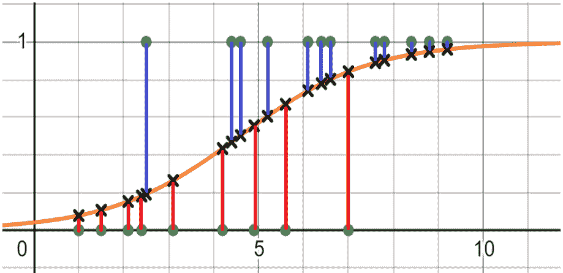

图 6-12. 将输出值投影回逻辑曲线

然后可以对这些似然值分别取 log() 并将它们相加。这将是拟合的对数似然。就像计算最大似然时所做的那样，我们将通过从 1.0 中减去其值来转换“false”似然值。

### 示例 6-10. 计算拟合的对数似然

```python
from math import log, exp
import pandas as pd

patient_data = pd.read_csv('https://bit.ly/33ebs2R', delimiter=",").itertuples()

b0 = -3.17576395
b1 = 0.69267212

def logistic_function(x):
    p = 1.0 / (1.0 + exp(-(b0 + b1 * x)))
    return p

# Sum the log-likelihoods
log_likelihood_fit = 0.0

for p in patient_data:
    if p.y == 1.0:
        log_likelihood_fit += log(logistic_function(p.x))
    elif p.y == 0.0:
        log_likelihood_fit += log(1.0 - logistic_function(p.x))

print(log_likelihood_fit) # -9.946161673231583
```

使用一些巧妙的二进制乘法和 Python 推导式，我们可以将该 `for` 循环和 `if` 表达式合并为一行，返回 `log_likelihood_fit`。与我们在最大似然公式中所做的类似，我们可以在 true 和 false 情况之间使用一些二进制减法，从数学上消除其中之一。在此例中，我们乘以 0，因此相应地将 true 或 false 情况中的一个（而非两者）应用于求和。

### 示例 6-11. 将对数似然逻辑合并为单行

```python
log_likelihood_fit = sum(log(logistic_function(p.x)) * p.y +
    log(1.0 - logistic_function(p.x)) * (1.0 - p.y)
    for p in patient_data)
```

如果用数学符号表示拟合的似然，则如下所示。请注意 f(x_i) 是给定输入变量 x_i 的逻辑函数。

$$
log\ likelihood\ fit = \sum_{i=1}^{n} (log(f(x_i)) \times y_i) + (log(1.0 - f(x_i)) \times (1 - y_i))
$$

如示例 6-10 和示例 6-11 中计算的那样，拟合的对数似然为 -9.9461。计算 $R^2$ 还需要一个数据点：即不使用任何输入变量、仅使用真实病例数除以所有病例数（实际只保留截距）来估算的对数似然。请注意，可以通过将所有 y 值相加 $\sum y_i$ 来统计有症状病例数，因为只有 1 而不是 0 会计入总和。公式如下：

$$
log\ likelihood = \frac{\sum y_i}{n} \times y_i + \left(1 - \frac{\sum y_i}{n}\right) \times (1 - y_i)
$$

示例 6-12 中应用了此公式的展开式 Python 等价代码如下。

### 示例 6-12. 患者的对数似然

```python
import pandas as pd
from math import log, exp

patient_data = list(pd.read_csv('https://bit.ly/33ebs2R',
delimiter=",").itertuples())

likelihood = sum(p.y for p in patient_data) / len(patient_data)

log_likelihood = 0.0

for p in patient_data:
    if p.y == 1.0:
        log_likelihood += log(likelihood)
    elif p.y == 0.0:
        log_likelihood += log(1.0 - likelihood)

print(log_likelihood) # -14.341070198709906
```

为了整合此逻辑并反映公式，我们可以将该 `for` 循环和 `if` 表达式压缩为一行，使用一些二进制乘法逻辑来处理 true 和 false 情况：

### 示例 6-13. 将对数似然合并为单行

```python
log_likelihood = sum(log(likelihood) * p.y + log(1.0 - likelihood) * (1.0 - p.y) \
    for p in patient_data)
```

最后，只需代入这些值即可得到 $R^2$：

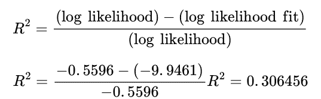

以下是示例 6-14 中显示的 Python 代码，用于完整计算 $R^2$。

### 示例 6-14. 计算逻辑回归的 $R^2$

```python
import pandas as pd
from math import log, exp

patient_data = list(pd.read_csv('https://bit.ly/33ebs2R',
delimiter=",").itertuples())

# Declare fitted logistic regression
b0 = -3.17576395
b1 = 0.69267212

def logistic_function(x):
    p = 1.0 / (1.0 + exp(-(b0 + b1 * x)))
    return p

# calculate the log likelihood of the fit
log_likelihood_fit = sum(log(logistic_function(p.x)) * p.y +
    log(1.0 - logistic_function(p.x)) * (1.0 - p.y)
    for p in patient_data)
# calculate the log likelihood without fit
likelihood = sum(p.y for p in patient_data) / len(patient_data)
log_likelihood = sum(log(likelihood) * p.y + log(1.0 - likelihood) * (1.0 - p.y) \
    for p in patient_data)
# calculate R-Square
r2 = (log_likelihood - log_likelihood_fit) / log_likelihood
print(r2)  # 0.306456105756576
```

好的，我们得到 $R^2 = 0.306456$，那么化学暴露小时数是否能解释某人是否出现症状？如我们在第 5 章线性回归中所学，拟合度差的 $R^2$ 更接近 0.0，拟合度高的则更接近 1.0。因此我们可以得出结论：暴露小时数对预测症状的效果平平，因为 $R^2$ 为 0.30645。除了暴露时间之外，一定还有其他变量有助于更好地预测某人是否会出现症状。这很合理，因为在我们观察到的大多数数据中，出现症状和未出现症状的患者混杂程度很高，如图 6-13 所示。

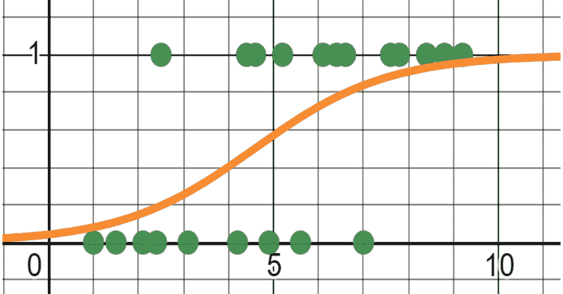

图 6-13. 我们的数据 $R^2$ 仅为 0.30645（效果平平），因为曲线中间存在很大方差

但如果我们的数据存在清晰的分界，其中 1 和 0 结果像图 6-14 所示那样被清晰分开，那么我们将拥有完美的 $R^2 = 1.0$。

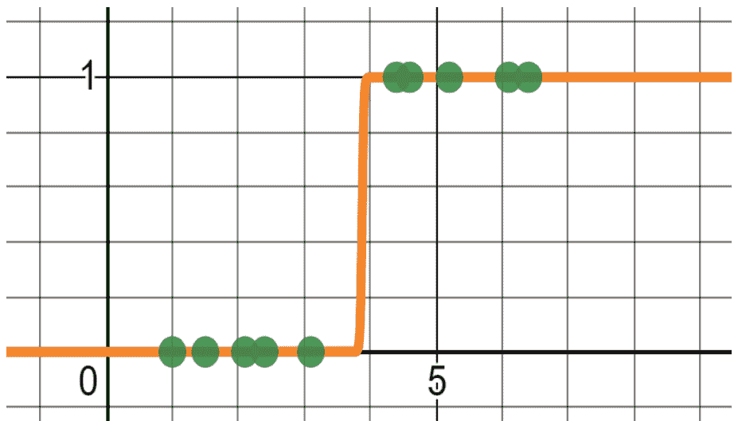

图 6-14. 此逻辑回归的 $R^2$ 为完美的 1.0，因为暴露小时数预测的结果存在清晰分界。

## P 值

就像线性回归一样，仅仅因为有了 R^2 并不意味着分析结束。我们需要调查看到这些数据的可能性是由于巧合，而非实际关系。这意味着我们需要一个 P 值。

为此，我们需要学习一种称为卡方分布（Chi-Square Distribution，标注为 chi^2 Distribution）的新概率分布。它是连续的，并在统计学的多个领域中使用，包括这个领域！

如果将标准正态分布（均值为 0，标准差为 1）中的每个值平方，则可得到自由度为 1 的 chi^2 分布。就我们的目的而言，自由度将取决于逻辑回归中参数 n 的数量，即 n - 1。不同自由度的示例见图 6-15。由于我们有两个参数（暴露小时数和是否出现症状），因此自由度为 1，因为 2 - 1 = 1。

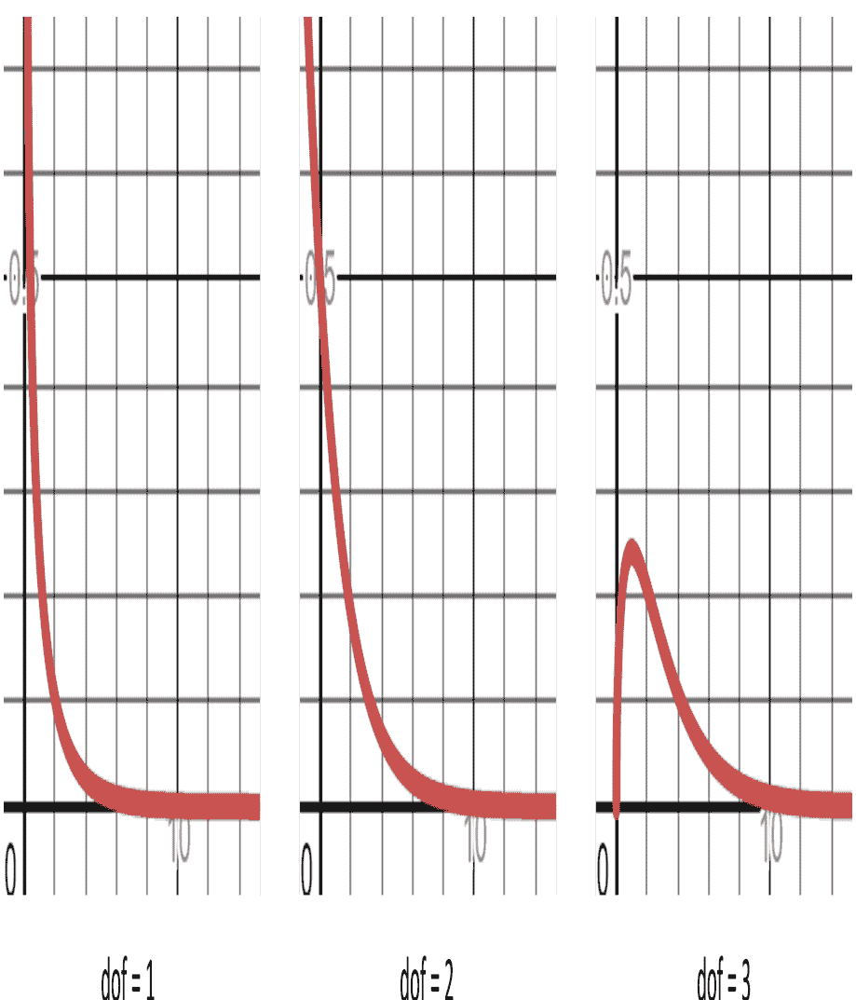

图 6-15. 自由度不同的 $\chi^2$ 分布。

我们需要先前 $R^2$ 小节中计算的拟合对数似然和对数似然。用于查找的 $\chi^2$ 值公式如下：

$$
\chi^2 = 2 (\text{拟合的对数似然}) - (\text{对数似然})
$$


然后我们取该值，并从 \(\chi^2\) 分布中查找概率。这将给出我们的 p 值。

p-value = chi(2((log likelihood fit) - (log likelihood)))

这是给定拟合逻辑回归的 p 值。我们使用 SciPy 的 `chi2` 模块来使用卡方分布。

### 示例 6-15. 计算给定逻辑回归的 p 值

```
import pandas as pd
from math import log, exp
from scipy.stats import chi2

patient_data = list(pd.read_csv('https://bit.ly/33ebs2R',
delimiter=",")).itertuples()

# Declare fitted logistic regression
b0 = -3.17576395
b1 = 0.69267212

def logistic_function(x):
    p = 1.0 / (1.0 + exp(-(b0 + b1 * x)))
    return p

# calculate the log likelihood of the fit
log_likelihood_fit = sum(log(logistic_function(p.x)) * p.y +
    log(1.0 - logistic_function(p.x)) * (1.0 - p.y)
    for p in patient_data)

# calculate the log likelihood without fit
likelihood = sum(p.y for p in patient_data) / len(patient_data)

log_likelihood = sum(log(likelihood) * p.y + log(1.0 - likelihood) * (1.0 - p.y) \
    for p in patient_data)

# calculate p-value
chi2_input = 2 * (log_likelihood_fit - log_likelihood)
p_value = chi2.pdf(chi2_input, 1) # 1 degree of freedom (n - 1)

print(p_value) # 0.0016604875618753787
```

所以我们得到的 p 值为 0.00166，如果显著性阈值为 .05，我们就说该数据在统计上具有显著性，而非随机偶然。

## 训练/测试划分

如第 5 章（线性回归）中所述，我们可以使用训练/测试划分来验证机器学习算法。这是评估逻辑回归性能的更“机器学习”方法。虽然依赖 \(R^2\) 和 p 值等传统统计指标是个好主意，但在处理更多变量时，这变得不太实际。这时训练/测试划分再次派上用场。为了回顾，图 6-16 可视化了一种交替测试数据集的 3 折交叉验证。

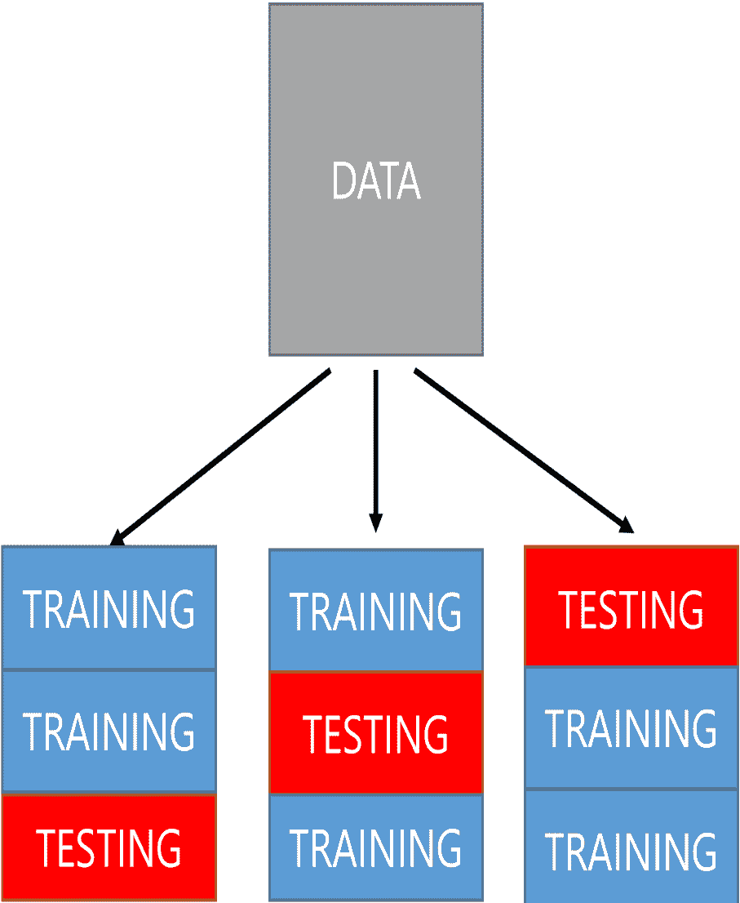

图 6-16. 3 折交叉验证，将数据集的每一第三部分作为测试数据集。

在示例 6-16 中，我们在员工保留数据集上执行逻辑回归，但将数据分为三等份。然后我们将每一第三部分作为测试数据。最后，用平均值和标准差汇总三个准确率。

### 示例 6-16. 使用 3 折交叉验证执行逻辑回归

```
import pandas as pd
from sklearn.linear_model import LogisticRegression
from sklearn.model_selection import KFold, cross_val_score

# Load the data
df = pd.read_csv("https://tinyurl.com/y6r7qjrp", delimiter=",")

X = df.values[:, :-1]
Y = df.values[:, -1]

# "random_state" is the random seed, which we fix to 7
kfold = KFold(n_splits=3, random_state=7, shuffle=True)
model = LogisticRegression(penalty='none')
results = cross_val_score(model, X, Y, cv=kfold)

print("Accuracy Mean: %.3f (stdev=%.3f)" % (results.mean(), results.std()))
```

我们还可以使用随机折叠验证、留一法交叉验证以及第 5 章中执行的所有其他折叠变体。废话不多说，让我们来谈谈为什么准确率是分类的糟糕指标。

## 混淆矩阵

假设一个模型观察到名为“Michael”的人辞职了。将姓和名作为输入变量捕获的理由确实值得商榷，因为有人的姓名是否会影响其是否辞职存疑。然而，为了简化示例，我们就假设如此。然后模型预测任何名为“Michael”的人都会辞职。

现在正是准确率失效的地方。我有 100 名员工，其中一名叫“Michael”，另一名叫“Samantha”。Michael 被错误地预测会辞职，而实际上是 Samantha 辞职了。我的模型准确率是多少？是 98%，因为在 100 名员工中只有 2 个预测错误，如图 6-17 所示。

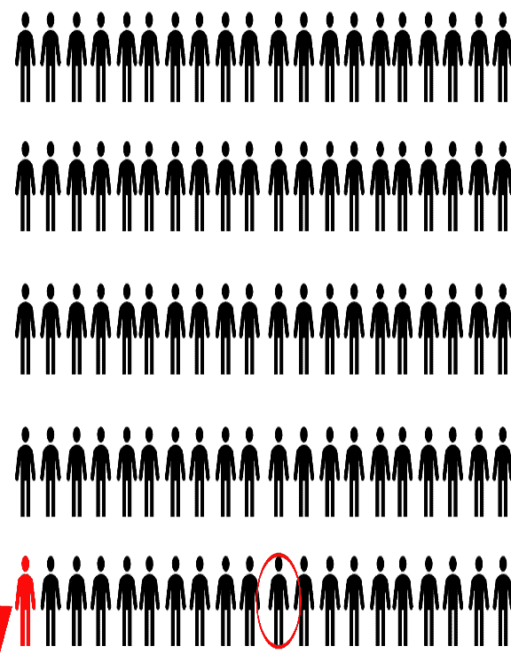

实际：此员工辞职 预测错误 但我仍然 98% 准确！

预测：此员工名为 "Michael" 此员工将辞职

图 6-17. 名为 "Michael" 的员工被预测会辞职，但实际上是另一名员工辞职，这使我们获得了 98% 的准确率

特别是对于不平衡数据，其中感兴趣事件（例如员工辞职）很少见，准确率指标对分类问题具有极大的误导性。如果您曾有供应商、顾问或数据科学家试图以准确率为卖点向您销售分类系统，请要求提供混淆矩阵。

一个 **混淆矩阵** 是一个网格，它将预测与实际结果进行对比，显示真正例、真负例、假正例（I 类错误）和假负例（II 类错误）。图 6-18 展示了一个混淆矩阵。

| | 实际离职 (真) | 实际留任 (假) |
|---|---|---|
| 预测将离职 (真) | 0 | 1 |
| 预测将留任 (假) | 1 | 98 |

图 6-18. 一个简单的混淆矩阵

通常，我们希望对角线值（从左上角到右下角）更高，因为这些反映了正确的分类。我们希望评估有多少被预测会离职的员工确实离职了（真正例）。相反，我们也希望评估有多少被预测会留任的员工确实留任了（真负例）。

其他单元格反映错误预测，即被预测会离职的员工最终留任（假正例），以及被预测会留任的员工最终离职（假负例）。

我们需要做的是将准确率指标拆分为更具体的准确率指标，针对混淆矩阵的不同部分。让我们来看看图 6-19，它添加了一些有用的指标。

| | 实际离职 | 实际留任 | | |
|---|---|---|---|---|
| 预测将离职 | 0 (TP) | 1 (FN) | 灵敏度<br>\(\frac{TP}{TP+FN} = \frac{0}{0+1} = 0\) | F1 分数<br>\(\frac{2 \cdot Precision \cdot Recall}{Precision + Recall} = 未定义\) |
| 预测将留任 | 1 (FP) | 98 (TN) | 特异度<br>\(\frac{TN}{TN+FP} = \frac{98}{98+1} = .989\) | |
| | 精确率<br>\(\frac{TP}{TP+FP} = \frac{0}{0+1} = 0\) | 阴性预测值<br>\(\frac{TN}{TN+FN} = \frac{98}{98+1} = .989\) | 准确率<br>\(\frac{TP+TN}{TP+TN+FP+FN} = \frac{98+0}{0+98+1+1} = .98\) | |

图 6-19. 向混淆矩阵添加有用指标

从混淆矩阵中，我们可以推导出除准确率之外的各种有用指标。我们可以轻松看出，精确率（正预测的准确性）和灵敏度（识别出的正例比例）均为 0，这意味着该机器学习模型在正例预测上完全失败。

### 示例 6-17. 在 SciPy 中为测试数据集创建混淆矩阵

```
import pandas as pd
from sklearn.linear_model import LogisticRegression
from sklearn.metrics import confusion_matrix
from sklearn.model_selection import train_test_split

# Load the data
df = pd.read_csv('https://bit.ly/3cManTi', delimiter=",")
# Extract input variables (all rows, all columns but last column)
X = df.values[:, :-1]
# Extract output column (all rows, last column)\
Y = df.values[:, -1]
model = LogisticRegression(solver='liblinear')
X_train, X_test, Y_train, Y_test = train_test_split(X, Y, test_size=.33,
random_state=10)
model.fit(X_train, Y_train)
prediction = model.predict(X_test)
"""
The confusion matrix evaluates accuracy within each category.
[truepositives falsenegatives]
[falsepositives truenegatives)]
The diagonal represents correct predictions,
so we want those to be higher
"""
matrix = confusion_matrix(y_true=Y_test, y_pred=prediction)
print(matrix)
```

## 贝叶斯定理与混淆矩阵

你还记得第 2 章中的贝叶斯定理吗？你可以使用贝叶斯定理引入外部信息，以进一步验证混淆矩阵中的发现。图 6-20 显示了 1000 名接受疾病检测的患者的混淆矩阵。


| | 检测呈阳性 | 检测呈阴性 |
|---|---|---|
| 有风险 | 198 | 2 |
| 无风险 | 50 | 750 |

图 6-20. 医学检测的混淆矩阵，用于识别疾病

我们被告知，对于有健康风险的患者，99% 会被成功识别（灵敏度）。使用混淆矩阵，我们可以看到在数学上这是成立的。

```
sensitivity = \frac{198}{198 + 2} = .99
```

但是如果我们颠倒条件呢？检测呈阳性的人中，有多少人有健康风险（精确率）？虽然我们在颠倒条件概率，但不需要在这里使用贝叶斯定理，因为混淆矩阵为我们提供了所有需要的数字。

```
precision = \frac{198}{198 + 50} = .798
```

好吧，79.8% 还不算糟糕，这是检测呈阳性的人中实际患病的比例。但请问问自己……我们对数据做了什么假设？它能代表总体吗？

我们快速研究了一下，发现总体中实际只有 1% 的人患有这种疾病。这里有个使用贝叶斯定理的机会。我们可以考虑总体中实际患病的比例，并将其纳入混淆矩阵的发现中。我们随后发现了一件重要的事情。

```
P (At Risk if Positive) = \frac{P(Positive if At Risk) \times P(At Risk)}{P(Positive)}

P (At Risk if Positive) = \frac{.99 \times .01}{.248}

P (At Risk if Positive) = .0339
```

当我们考虑到只有 1% 的总体有风险，而我们的测试患者中有 20% 有风险时，在检测呈阳性的情况下，有风险的概率是 3.39%！它怎么从 99% 降下来的？这只表明，我们很容易被那些仅在特定样本（如供应商的 1000 名测试患者）中很高的概率所误导。所以，如果这个测试成功识别真阳性的概率只有 3.39%，我们可能不应该使用它。

## 接收者操作特征（ROC）/曲线下面积（AUC）

在评估不同机器学习配置时，我们可能会面对几十个、几百个甚至几千个混淆矩阵。审查这些矩阵可能会很乏味，因此我们可以用接收者操作特征（ROC）曲线来概括所有矩阵，如图 6-21 所示。这样我们就可以查看每个测试实例（每个由黑点表示），并找到真阳性和假阳性之间的可接受平衡。

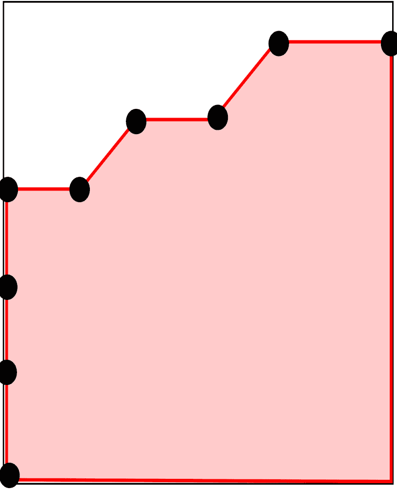

图 6-21. 接收者操作特征（ROC）曲线

我们还可以为每个模型创建单独的 ROC 曲线来比较不同的机器学习模型。例如，如果在图 6-22 中，红色曲线代表逻辑回归，蓝色曲线代表决策树（本书未介绍的一种机器学习技术），我们可以并排查看它们的性能。曲线下面积（AUC）是选择使用哪个模型的良好指标。由于红色曲线（逻辑回归）具有更大的面积，这表明它是更优的模型。

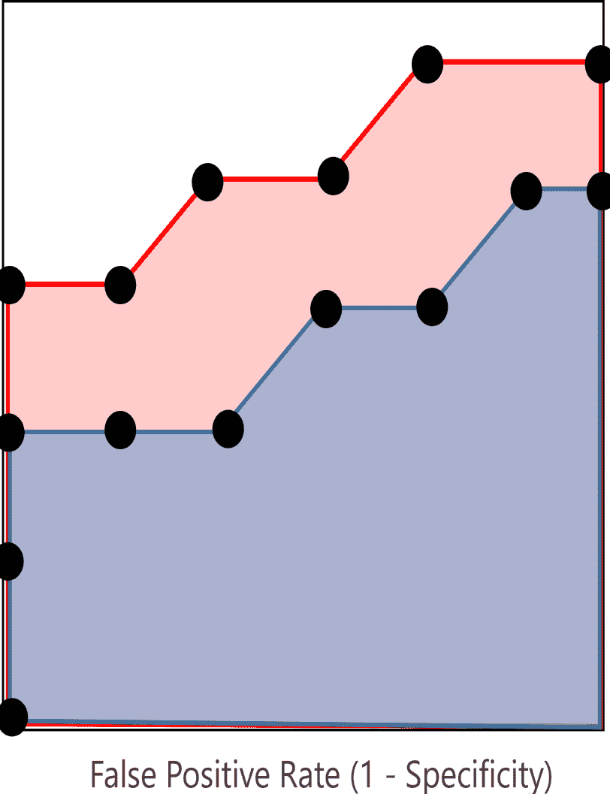

图 6-22. 通过各自的 ROC 曲线比较两个模型的曲线下面积（AUC）

要将 AUC 用作评分指标，请将 Scikit-learn API 中的 `scoring` 参数更改为使用 `roc_auc`，如示例 6-18 中所示的交叉验证。

## 示例 6-18. 将 AUC 用作 Scikit-learn 参数：

```
# put Scikit-learn model here
results = cross_val_score(model, X, Y, cv=kfold, scoring='roc_auc')
print("AUC: %.3f (%.3f)" % (results.mean(), results.std()))
# AUC: 0.791 (0.051)
```

## 类别不平衡

在结束本章之前，还有一个需要讨论的问题。如前面讨论混淆矩阵时所见，**类别不平衡**（当数据在每个结果类别中分布不均时发生）是机器学习中的一个问题。不幸的是，许多感兴趣的问题都是不平衡的，例如疾病预测、安全漏洞、欺诈检测等等。类别不平衡仍然是一个未解决的问题，没有很好的解决方案。不过，你可以尝试一些技巧。

首先，你可以采取一些显而易见的措施，比如收集更多数据或尝试不同的模型，以及使用混淆矩阵和 ROC/AUC 曲线。所有这些都有助于跟踪错误预测并主动发现错误。

另一种常见的技术是复制少数类中的样本，直到它在数据集中得到均等表示。你可以在 Scikit-learn 中执行此操作，如示例 6-19 所示，在进行训练-测试分割时。传递包含类值的列的 `stratify` 选项，它将尝试均等表示每个类的数据。

## 示例 6-19. 在 Scikit-learn 中使用“stratify”选项以平衡数据中的类别

```
X, Y = ...
X_train, X_test, Y_train, Y_test = \\
train_test_split(X, Y, test_size=.33, stratify=Y)
```

还有一类称为 SMOTE 的算法，它可以生成少数类的合成样本。不过，最理想的方法是使用异常检测模型来解决问题，这类模型专门用于寻找罕见事件。然而，这些模型寻找的是异常值，并且不一定是分类，因为它们是无监督算法。所有这些技术都超出了本书的范围，但值得提及，因为它们*可能*为特定问题提供更好的解决方案。

## 结论

逻辑回归是用于预测概率和分类的主力模型。逻辑回归可以预测多个类别，而不仅仅是 true/false。你只需构建单独的逻辑回归模型，对数据是否属于该类别进行建模，概率最高的模型胜出。你可能会发现，Scikit-learn 在大部分情况下会为你完成此操作，并检测你的数据是否超过两个类别。

在本章中，我们不仅介绍了如何使用梯度下降和 Scikit-learn 拟合逻辑回归，还介绍了统计和机器学习方面的验证方法。在统计方面，我们介绍了 R² 和 p 值；在机器学习方面，我们探讨了训练/测试分割、混淆矩阵和 ROC/AUC。

如果你想了解更多关于逻辑回归的内容，可能最好的入门资源是 Josh Starmer 的 StatQuest 逻辑回归播放列表。我必须感谢 Josh 的工作，它协助了本章的一些部分，特别是关于如何计算逻辑回归的 R² 和 p 值。如果没有其他原因，也要看看他的视频，欣赏精彩的开场曲！

https://youtu.be/yIYKR4sgzI8

与往常一样，你会发现自己在统计学和机器学习两个世界之间行走。现在很多书籍和资源都从机器学习角度介绍逻辑回归，但也试着寻找统计学资源。两种思想流派都有优缺点，只有同时适应两者才能获胜！

## 练习

这里提供了一个包含三个输入变量 RED、GREEN 和 BLUE 以及一个输出变量 LIGHT_OR_DARK_FONT_IND 的数据集：https://bit.ly/3imidqa。它将用于预测浅色/深色字体（分别为 0/1）是否适用于给定的背景颜色（由 RGB 值指定）。

- 1. 对上述数据进行逻辑回归，使用 3 折交叉验证和准确率作为指标。

- 2. 生成混淆矩阵，比较预测值和实际值。

- 3. 选择几种不同的背景颜色（你可以使用类似这样的 RGB 工具：https://bit.ly/3FHywrZ），看看逻辑回归是否合理地为每种颜色选择了浅色（0）或深色（1）字体。

- 4. 根据前面的练习，你认为逻辑回归对预测给定背景颜色的浅色或深色字体是否有效？

答案在附录 B 中。
