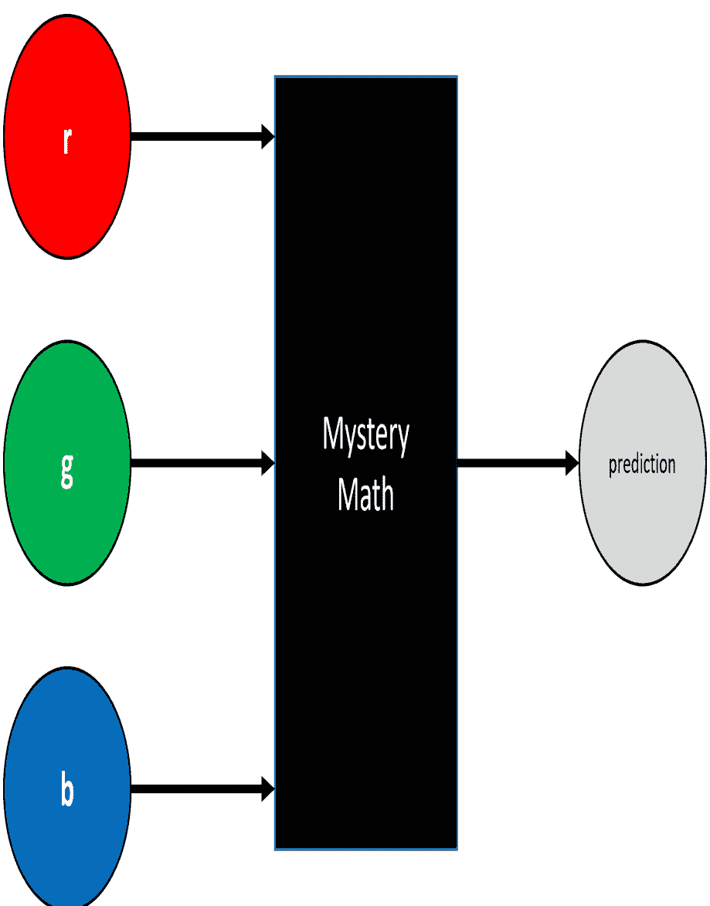
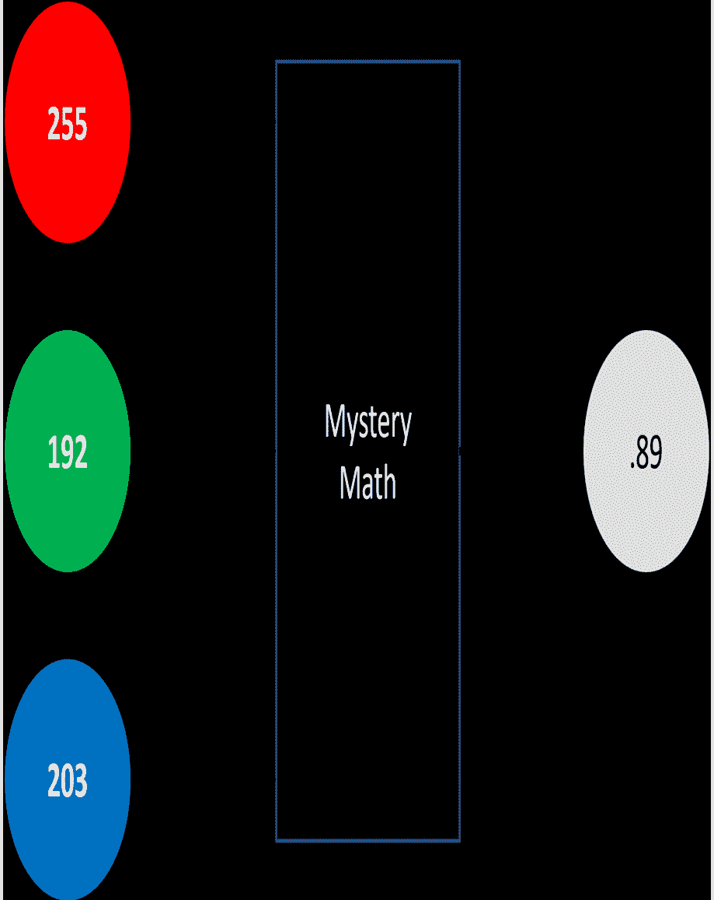
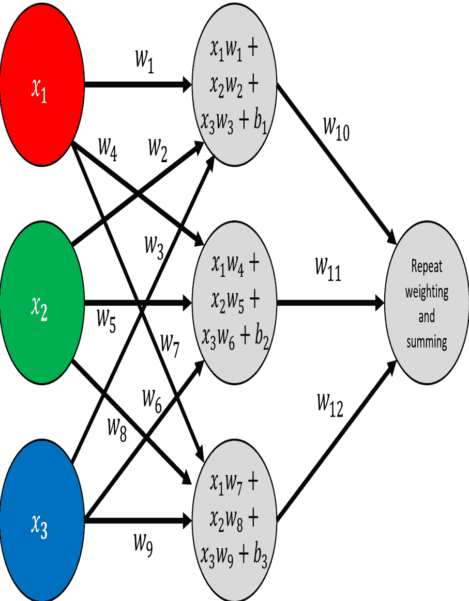
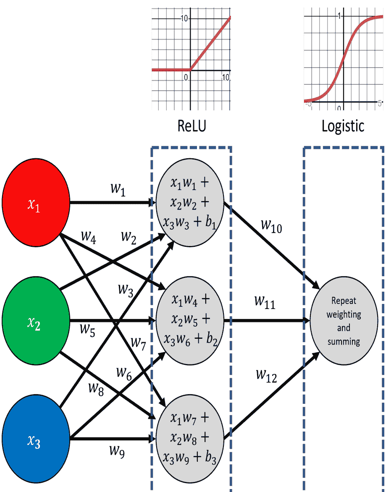
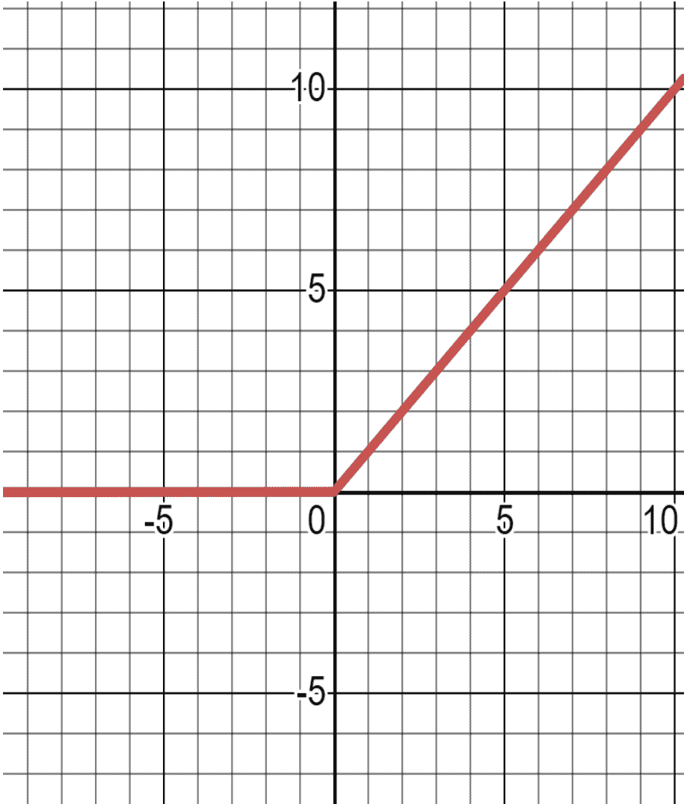
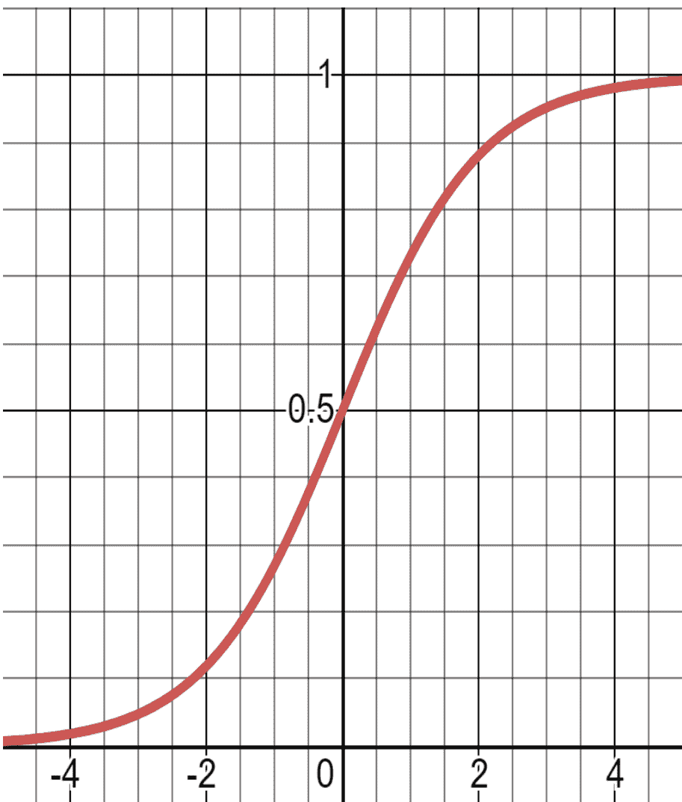
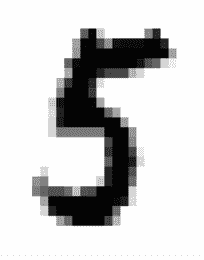
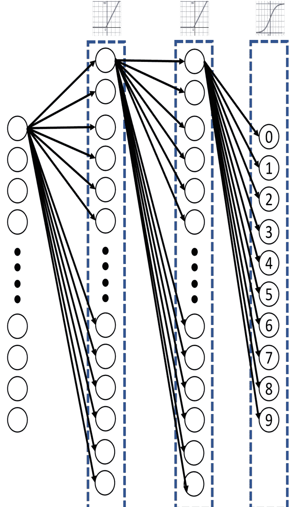
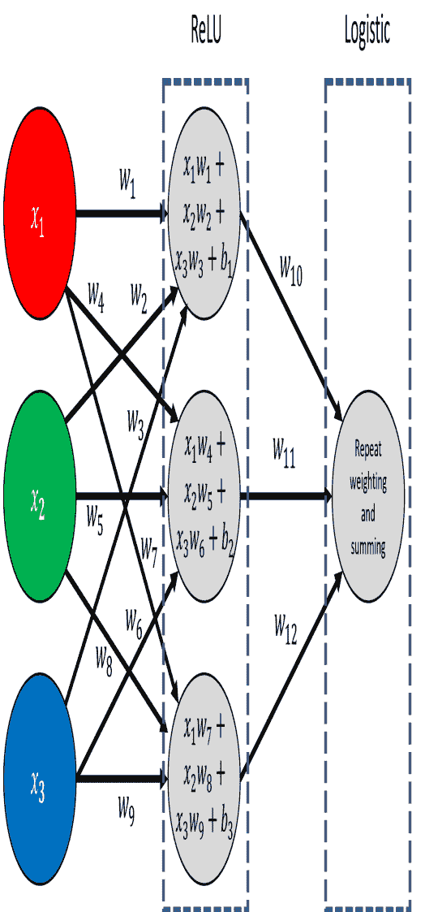

# 第 7 章. 神经网络

神经网络是一种在过去 10 年中获得复兴的回归和分类技术。从最简单的定义来看，**神经网络**是一种多层回归，包含位于输入变量和输出变量之间的权重、偏置和非线性函数层。**深度学习**是神经网络的一种流行变体，它利用多个“隐藏”（或中间）节点层，这些节点包含权重和偏置。每个节点在传递给非线性函数（称为激活函数）之前都类似于线性函数。就像我们在第 5 章中学习的线性回归一样，优化技术（如随机梯度下降）被用来找到最佳的权重和偏置值，以最小化残差。

神经网络为过去计算机难以解决的问题提供了令人兴奋的解决方案。从图像中识别对象到处理音频中的文字，神经网络已创造出影响我们日常生活的工具。这包括虚拟助手和搜索引擎，以及我们 iPhone 中的照片工具。

鉴于媒体对神经网络的大肆渲染和新闻头条上的大胆声称，它们自 20 世纪 50 年代就已存在，这可能令人惊讶。2010 之后它们突然走红，是因为数据和计算能力的日益普及。2011 年至 2015 年之间的 ImageNet 挑战可能是这种复兴的最大推动力，将在 140 万张图像上对 1000 个类别进行分类的性能提高到 96.4% 的准确率。

然而，像任何机器学习技术一样，它只适用于定义狭窄的问题。即使是创建“自动驾驶”汽车的项目，也不采用端到端深度学习，而主要使用手写的规则系统，并利用卷积神经网络作为“标签制作器”来识别道路上的物体。我们将在本章后面讨论这一点，以了解神经网络实际应用于何处。但首先，我们将在 NumPy 中构建一个简单的神经网络，然后使用 Scikit-learn 作为库实现。

### 何时使用神经网络和深度学习

神经网络和深度学习可用于分类和回归，那么它们与线性回归、逻辑回归及其他类型的机器学习相比如何？你可能听过这样的话：“当你手里只有一把锤子，看什么都像钉子。”每种算法都有其特定场景的优缺点。线性回归和逻辑回归，以及


与梯度提升树（本书未涉及）一样，在对结构化数据进行预测方面效果相当出色。将“结构化数据”视为易于表示为带有行和列的表格的数据。但图像分类等感知问题的结构性要弱得多，因为我们试图在像素组之间寻找模糊的相关性来识别形状和模式，而不是表格中的数据行。预测正在输入的句子中的下一个4-5个单词，或解读音频片段中所说的话，也属于感知问题，并且是神经网络用于自然语言处理的示例。

本章将主要关注简单的神经网络，仅包含1-2个隐藏层。

## 神经网络的变体

神经网络的变体包括卷积神经网络，常用于图像识别。长短期记忆网络（LSTM）用于时间序列预测或预测。循环神经网络常用于文本转语音应用。

## 使用神经网络是否大材小用？

为即将举例使用神经网络很可能属于大材小用，因为逻辑回归可能更实用。甚至可以采用公式化方法。然而，我始终主张通过将复杂技术应用于简单的玩具问题来理解它们。你可以了解技术的优势和局限性，而不会被大型数据集分散注意力。因此，请尽量在更简单的模型更实用时避免使用神经网络。本章我们将打破这条规则，以便理解该技术。

## 一个简单的神经网络

这里有一个简单的玩具示例，可帮助你熟悉神经网络。我想预测对于给定颜色背景，字体应该是浅色（1）还是深色（0）。图7-1展示了几种不同背景色的示例。第一行配合浅色字体效果最好，第二行配合深色字体效果最好。


图7-1. 浅色背景配深色字体效果最好，深色背景配浅色字体效果最好

在计算机科学中，表示颜色的一种方法是使用RGB值，即“红”、“绿”和“蓝”值。这些值均介于0到255之间，表示混合这三种颜色以创建所需颜色的比例。例如，如果将RGB表示为（红，绿，蓝），则深橙色的RGB为（255，140，0），粉色为（255，192，203）。黑色为（0，0，0），白色为（255，255，255）。

从机器学习和回归的角度来看，我们有三个数值输入变量——红、绿、蓝——用于捕捉给定的背景颜色。我们需要针对这些输入变量拟合一个函数，并输出是否应为该背景颜色使用浅色（1）或深色（0）字体。

## 通过RGB表示颜色

在线上有数百种调色板可用于尝试RGB值。W3 Schools提供了一个：

https://www.w3schools.com/colors/colors_rgb.asp

请注意，此示例与神经网络识别图像的工作原理并不远，因为每个像素通常被建模为三个数值RGB值。在此示例中，我们只关注一个“像素”作为背景颜色。

让我们先从高层次入手，暂时搁置所有实现细节。我们将像剥洋葱一样来探讨这个话题，先从更高层面的理解开始，再慢慢深入细节。目前，我们只是将接受输入并产生输出的过程简单地标记为“神秘数学”。我们有三个数值输入变量R、G和B，由这套“神秘数学”进行处理。然后它输出一个介于0和1之间的预测值，如图7-2所示。



图7-2. 我们有三个数值RGB值，用于对浅色或深色字体进行预测。

此预测输出表示一种概率。输出概率是神经网络分类中最常见的模型。一旦用数值替换RGB，我们就会发现，小于0.5意味着建议使用深色字体，而大于0.5意味着建议使用浅色字体，如图7-3所示。



图7-3. 如果输入背景颜色为粉色（255,192,203），则“神秘数学”推荐使用浅色字体，因为输出的概率0.89大于0.5。

那么，该“神秘数学”黑盒内部究竟发生了什么？让我们在图7-4中看一看。



图7-4. 神经网络的隐藏层将权重和偏置值应用于每个输入变量，而输出层则将另一组权重和偏置应用于该输出。

神经网络还缺少一个部分，即激活函数，但我们稍后会讲到。让我们先来理解这里发生了什么。左侧第一层仅仅是三个变量的输入，在这里即红、绿、蓝值。在隐藏（中间）层中，请注意，我们在输入和输出之间产生了三个**节点**，即权重和偏置的函数。每个节点本质上是一个线性函数，斜率为w_i，截距为b_i，与输入变量x_i相乘并求和。每个输入节点和隐藏节点之间有一个权重w_i，每个隐藏节点和输出节点之间还有一组权重。每个隐藏节点和输出节点都会额外添加一个偏置b_i。

请注意，输出节点重复相同的操作，即取隐藏层加权求和后的输出，并将其作为最终层的输入，在最终层中将应用另一组权重和偏置。我使用“重复加权求和”代替数学表达式，因为从隐藏层嵌入的表达式太长，无法在图形中显示。但以下是最终节点的表达式，请注意隐藏层的输出如何成为最终层的输入。

```
output = w_10 (x_1 w_1 + x_2 w_2 + x_3 w_3 + b_1)
+ w_11 (x_1 w_4 + x_2 w_5 + x_3 w_6 + b_2)
+ w_12 (x_1 w_7 + x_2 w_8 + x_3 w_9 + b_3) + b_4
```

简而言之，这与线性回归或逻辑回归一样是一种回归，只是需要求解的参数多得多。权重和偏置值类似于线性回归中的m和b，或β₁和β₀参数。我们确实使用随机梯度下降并最小化损失，与线性回归一样，但我们需要一个称为反向传播的额外工具来解开权重w_i和偏置b_i值，并使用链式法则计算它们的偏导数。我们将在本章后面讨论这一点，但目前先假设我们已优化好权重和偏置值。首先我们需要讨论激活函数。

## 激活函数

接下来我们来介绍激活函数。激活函数是一种非线性函数，可对节点中的加权求和值进行变换或压缩，帮助神经网络有效分离数据以便进行分类。让我们看看图7-5。如果没有激活函数，你的隐藏层将不会起作用，其性能将不比线性回归好。



图7-5. 应用激活函数

ReLU激活函数会将隐藏节点的任何负输出置零。如果权重、偏置和输入相乘并求和得到一个负数，它将


会被转换为 0。否则输出保持不变。这是使用 SymPy（示例 7-1）绘制的 ReLU 图（图 7-6）。

### 示例 7-1. 绘制 ReLU 函数

```python
from sympy import *

# plot relu
x = symbols('x')
relu = Max(0, x)
plot(relu)
```



图 7-6. ReLU 函数图像

ReLU 是“修正线性单元”的缩写，但这只是一个花哨的说法，意思是“将负值转换为 0”。ReLU 因其速度快且能缓解梯度消失问题，在神经网络和深度学习的隐藏层中广受欢迎。当偏导数斜率变得非常小、过早趋近于 0 并导致训练戛然而止时，就会发生梯度消失现象。

输出层有一项重要工作：它获取神经网络隐藏层中的大量数学运算结果，并将其转换为可解释的结果，例如呈现分类预测。这个特定神经网络的输出层使用 **logistic 激活函数**，这是一个简单的 sigmoid 曲线。如果你读过第 6 章，logistic（或 sigmoid）函数应该很熟悉，这表明逻辑回归正在作为我们神经网络中的一个层发挥作用。输出节点对来自隐藏层的每个输入值计算权重、偏置和求和。之后，它将该结果值传递给 logistic 函数，因此输出一个 0 到 1 之间的数字。与第 6 章中的逻辑回归类似，这表示神经网络推荐使用浅色字体的概率。如果该值大于或等于 .5，神经网络建议使用浅色字体；低于此值则建议使用深色字体。

这是使用 SymPy（示例 7-2）绘制的 logistic 函数图（图 7-7）。

### 示例 7-2. SymPy 中的 logistic 激活函数

```python
from sympy import *
# plot logistic
x = symbols('x')
logistic = 1 / (1 + exp(-x))
plot(logistic)
```



图 7-7. Logistic 激活函数

请注意，当我们将节点的加权、加偏且求和后的值传递给激活函数时，我们现在将其称为 **激活输出**，意思是它已通过激活函数过滤。当激活输出离开隐藏层时，信号就准备好馈送到下一层了。激活函数可能增强了信号、削弱了信号，或者保持原样。这就是神经网络大脑和突触比喻的由来。

鉴于可能存在的复杂性，你可能想知道是否有其他激活函数。表 7-1 显示了一些常见的激活函数。

### 表 7-1. 常见激活函数

| 名称 | 典型使用层 | 描述 | 备注 |
|---|---|---|---|
| 线性 | 输出 | 保持值不变 | 不常用 |
| Logistic | 输出 | S 形 sigmoid 曲线 | 将值压缩到 0 和 1 之间，通常协助二分类 |
| 双曲正切 | 隐藏 | tanh，-1 到 1 之间的 S 形 sigmoid 曲线 | 通过将均值拉近 0 来协助“中心化”数据 |
| ReLU | 隐藏 | 将负值转换为 0 | 流行的激活函数，比 sigmoid 和 tanh 更快，缓解梯度消失问题，计算开销小 |
| 漏 ReLU | 隐藏 | 将负值乘以 .01 | ReLU 的有争议的变体，它边缘化而非消除负值 |
| Softmax | 输出 | 确保所有输出节点加起来等于 1.0 | 用于多类分类，并重新缩放输出使其加起来等于 1.0 |

这并非激活函数的详尽列表，在理论上，任何函数都可以作为神经网络中的激活函数。

虽然这个神经网络看似支持两个类别（浅色字体或深色字体），但实际上它是面向一个类别建模的：字体是否应该是浅色（1）或不是（0）。如果你想支持多个类别，可以为每个类别添加更多输出节点。例如，如果你试图识别手写数字 0-9，会有 10 个输出节点，分别表示给定图像是这些数字中每一个的概率。在有多个类别时，你也可以考虑将 softmax 用作输出激活。图 7-8 展示了一个示例，即对一张数字的像素化图像进行处理，其中像素被拆分为单独的神经网络输入，然后传递两个中间层，最后传递一个带有 10 个节点的输出层，代表 10 个类别（即数字 0-9）的概率。





图 7-8. 将每个像素作为输入并预测图像包含哪个数字的神经网络

关于在神经网络中使用 MNIST 数据集的示例，请参阅附录 A。

> # 我不知道该使用哪个激活函数！
> 
> 如果不确定使用哪些激活函数，当前最佳实践倾向于中间层使用 ReLU，输出层使用 logistic（sigmoid）。如果输出中有多个分类，请在输出层使用 softmax。

## 前向传播

让我们使用 NumPy 记迄今所学的内容。请注意，我尚未优化参数（我们的权重和偏置值）。我们将使用随机值初始化它们。

示例 7-3 是创建一个尚未优化的简单前馈神经网络的 Python 代码。所谓“前馈”，是指我们只是将颜色输入神经网络并查看其输出。权重和偏置是随机初始化的，将在本章后面优化，因此暂时不要指望有有用的输出。

### 示例 7-3. 一个带有随机权重和偏置值的简单前向传播网络。

```python
import numpy as np
import pandas as pd
from sklearn.model_selection import train_test_split

all_data = pd.read_csv("https://tinyurl.com/y2qmhfsr")

# Extract the input columns, scale down by 255
all_inputs = (all_data.iloc[:, 0:3].values / 255.0)
all_outputs = all_data.iloc[:, -1].values

# Split train and test data sets
X_train, X_test, Y_train, Y_test = train_test_split(all_inputs, all_outputs,
test_size=1/3)
n = X_train.shape[0] # number of training records

# Build neural network with weights and biases
# with random initialization
w_hidden = np.random.rand(3, 3)
w_output = np.random.rand(1, 3)

b_hidden = np.random.rand(3, 1)
b_output = np.random.rand(1, 1)

# Activation functions
relu = lambda x: np.maximum(x, 0)
logistic = lambda x: 1 / (1 + np.exp(-x))

# Runs inputs through the neural network to get predicted outputs
def forward_prop(X):
    Z1 = w_hidden @ X + b_hidden
    A1 = relu(Z1)
    Z2 = w_output @ A1 + b_output
    A2 = logistic(Z2)
    return Z1, A1, Z2, A2
```

```python
# Calculate accuracy
test_predictions = forward_prop(X_test.transpose())[3]  # grab only output layer, A2
test_comparisons = np.equal((test_predictions >= .5).flatten().astype(int),
Y_test)
accuracy = sum(test_comparisons.astype(int) / X_test.shape[0])
print("ACCURACY: ", accuracy)
```

这里有几点需要注意。包含 RGB 输入值以及输出值（1 表示浅色，0 表示深色）的数据集位于 https://tinyurl.com/y2qmhfsr。我将输入列 R、G 和 B 的值按 1/255 的因子缩小，使其介于 0 和 1 之间。这将有助于后续训练，以压缩数值空间。

请注意，我还使用 Scikit-learn 将 2/3 的数据用于训练，1/3 用于测试，这是我们在第 5 章中学习过的方法。n 仅仅是训练数据记录的数量。

现在请注意示例 7-4 中所示的这些代码行。

### 示例 7-4. NumPy 中的权重矩阵和偏置向量

```python
# Build neural network with weights and biases
# with random initialization
w_hidden = np.random.rand(3, 3)
w_output = np.random.rand(1, 3)

b_hidden = np.random.rand(3, 1)
b_output = np.random.rand(1, 1)
```

这些代码声明了神经网络隐藏层和输出层的权重和偏置。这可能还不明显，但矩阵乘法将使用线性代数和 NumPy 使我们的代码强大而简单。

权重和偏置将初始化为 0 到 1 之间的随机值。让我们先看看权重矩阵。当我运行代码时，得到了这些矩阵。

\( W_{hidden} = \begin{bmatrix} 0.034535 & 0.5185636 & 0.81485028 \\ 0.3329199 & 0.53873853 & 0.96359003 \\ 0.19808306 & 0.45422182 & 0.36618893 \end{bmatrix} \)
\( W_{output} = [0.82652072 \quad 0.30781539 \quad 0.93095565] \)

请注意，上面 \( w_{hidden} \) 是隐藏层中的权重。第一行代表第一个节点的权重 \( w_1, w_2, and w_3 \)。第二行是第二个节点，带有权重 \( w_4 \),


w5、和 w6。第三行是第三个节点，权重为 w7、w8 和 w9。

输出层只有一个节点，意味着其矩阵只有一行，权重为 w10、w11 和 w12。

这里有规律吗？每个节点都表示为矩阵中的一行。如果有 3 个节点，就有 3 行。如果有 1 个节点，就有 1 行。每一列都保存该节点的权重值。

让我们也来看看偏置。由于每个节点有一个偏置，隐藏层将有 3 行偏置，输出层将有 1 行偏置。每个节点只有 1 个偏置，因此将只有 1 列。

\( B_{hidden} = \begin{bmatrix} 0.41379442 \\ 0.81666079 \\ 0.07511252 \end{bmatrix} \)

\( B_{output} = [0.58018555] \)

现在让我们将这些矩阵值与图 7-9 中显示的可视化神经网络进行比较。



- $w_1 = 0.034535$
- $w_2 = 0.5185636$
- $w_3 = 0.81485028$
- $b_1 = 0.41379442$
- $w_4 = 0.3329199$
- $w_5 = 0.53873853$
- $w_6 = 0.96359003$
- $b_2 = 0.81666079$
- $w_7 = 0.19808306$
- $w_8 = 0.45422182$
- $w_9 = 0.36618893$
- $b_3 = 0.07511252$
- $w_{10} = 0.82652072$
- $w_{11} = 0.30781539$
- $w_{12} = 0.93095565$
- $b_4 = 0.58018555$

图 7-9. 将我们的神经网络与权重和偏置矩阵值进行可视化。

除了晦涩紧凑之外，这些矩阵形式的权重和偏置有什么好处？让我们将注意力集中在示例 7-5 的这些代码行上。

## 示例 7-5. 我们的神经网络的激活函数和前向传播函数。

```
# Activation functions
relu = lambda x: np.maximum(x, 0)
logistic = lambda x: 1 / (1 + np.exp(-x))

# Runs inputs through the neural network to get predicted outputs
def forward_prop(X):
    Z1 = w_hidden @ X + b_hidden
    A1 = relu(Z1)
    Z2 = w_output @ A1 + b_output
    A2 = logistic(Z2)
    return Z1, A1, Z2, A2
```

以上代码很重要，因为它使用矩阵乘法和矩阵-向量乘法简洁地执行了我们整个神经网络。我们在第 4 章中学习过这些操作。它只需几行代码就能将三个 RGB 输入的颜色通过权重、偏置和激活函数。

我首先声明 relu() 和 logistic() 激活函数，它们实际上接受给定的输入值并返回曲线上的输出值。forward_prop() 函数为给定的包含 R、G 和 B 值的颜色输入 X 执行我们整个神经网络。它返回 4 个阶段的矩阵输出：Z1、A1、Z2 和 A2。“1”和“2”分别表示操作属于第“1”层和第“2”层。“Z”表示该层的未激活输出，而“A”是该层的激活输出。

隐藏层由 Z1 和 A1 表示。Z1 是应用于 X 的权重和偏置。然后 A1 获取 Z1 的输出并将其通过激活 ReLU 函数。Z2 获取 A1 的输出并应用输出层权重和偏置。该输出随后被通过激活函数（即逻辑曲线），并变为 A2。最终阶段 A2 是来自输出层的预测概率，返回 0 到 1 之间的值。我们称它为 A2，因为它是第 2 层的“激活”输出。

让我们从 Z1 开始更详细地分析这一点。

$Z_1 = W_{hidden}X + B_{hidden}$

首先，我们在 $W_{hidden}$ 和输入颜色 X 之间执行矩阵-向量乘法。我们将 $W_{hidden}$ 的每一行（每一行都是一个节点的一组权重）与向量 X（RGB 颜色输入值）相乘。然后将偏置加到该结果上。

Z_1 = W_{hidden}X + B_{hidden}

Z1 = \(\begin{bmatrix} 0.034535 & 0.5185636 & 0.81485028 \\ 0.3329199 & 0.53873853 & 0.96359003 \\ 0.19808306 & 0.45422182 & 0.36618893 \end{bmatrix} \begin{bmatrix} 0.82652072 \\ 0.30781539 \\ 0.93095565 \end{bmatrix} + \begin{bmatrix} 0.41379442 \\ 0.81666079 \\ 0.07511252 \end{bmatrix}\)

Z1 = \(\begin{bmatrix} 0.946755221909086 \\ 1.33805678888247 \\ 0.644441873391768 \end{bmatrix} + \begin{bmatrix} 0.41379442 \\ 0.81666079 \\ 0.07511252 \end{bmatrix}\)

Z1 = \(\begin{bmatrix} 1.36054964190909 \\ 2.15471757888247 \\ 0.719554393391768 \end{bmatrix}\)

图 7-10. 使用矩阵-向量乘法以及向量加法将隐藏层权重和偏置应用于输入 X。

该 Z1 向量是隐藏层的原始输出，但我们仍然需要将其通过激活函数以将 Z1 转换为 A1。这很简单。只需将该向量中的每个值通过 ReLU 函数，它就会给我们 \(A_1\)。由于所有值都是正数，这不应有任何影响。

\(A_1 = ReLU (Z_1)\)

\(A_1 = \begin{bmatrix} ReLU(1.36054964190909) \\ ReLU(2.15471757888247) \\ ReLU(0.719554393391768) \end{bmatrix} = \begin{bmatrix} 1.36054964190909 \\ 2.15471757888247 \\ 0.719554393391768 \end{bmatrix}\)

现在让我们取该隐藏层输出 \(A_1\) 并将其通过最终层以获得 \(Z_2\)，然后获得 \(A_2\)。\(A_1\) 变成输出层的输入。

\(Z_2 = W_{output}A_1 + B_{output}\)

\(Z_2 = [0.82652072 \quad 0.30781539 \quad 0.93095565] \begin{bmatrix} 1.36054964190909 \\ 2.15471757888247 \\ 0.719554393391768 \end{bmatrix} + [0.58018555]\)

\(Z_2 = [2.45765202842636] + [0.58018555]\)

\(Z_2 = [3.03783757842636]\)

最后将 \(Z_2\) 中的这个单个值通过激活函数以获得 \(A_2\)。这将产生大约 \(0.95425\) 的预测。

\(A_2 = logistic (Z_2)\)

\(A_2 = logistic ([3.03783757842636])\)

\(A_2 = 0.954254478103241\)

这执行了我们整个神经网络，尽管我们还没有训练它。但请花点时间欣赏一下，我们已经将所有这些输入值、权重、偏置和非线性函数都转换成了一个将提供预测的单一值。

同样，\(A_2\) 是最终输出，用于预测背景颜色是需要浅色（1）还是深色（0）字体。尽管我们的权重和偏置尚未优化，但让我们按示例 7-6 所示计算准确率。获取测试数据集 X\_test，将其转置，并将其通过 `forward_prop()` 函数，但只获取包含每个测试颜色预测的 \(A_2\) 向量。然后将预测与实际值进行比较，并计算正确预测的百分比。

## 示例 7-6. 计算准确率

```python
# Calculate accuracy
test_predictions = forward_prop(X_test.transpose()) [3]  # grab only A2
test_comparisons = np.equal((test_predictions >= .5).flatten().astype(int),
Y_test)
accuracy = sum(test_comparisons.astype(int) / X_test.shape[0])
print("ACCURACY: ", accuracy)
```

当我运行示例 7-3 中的完整代码时，我大约得到 55% 到 67% 的准确率。请记住，权重和偏置是随机生成的，因此结果会有所不同。虽然考虑到参数是随机生成的，这看起来可能很高，但请记住，输出预测是二进制的：浅色或深色。因此，随机抛硬币对于每个预测也可能产生这种结果，所以这个数字不应令人惊讶。

> **别忘了检查数据是否不平衡！**
> 如前第 6 章所讨论，别忘了分析你的数据以检查类别是否不平衡。整个背景颜色数据集有点不平衡。512 种颜色的输出为 0，833 种颜色的输出为 1。这可能会扭曲准确率，也可能是我们的随机权重和偏置趋向高于 50% 准确率的原因。如果数据极度不平衡（例如 99% 的数据属于同一类），请记住使用混淆矩阵来跟踪假阳性和假阴性。

好了，到目前为止在结构上一切都说得通吗？在继续之前，欢迎随时回顾到目前为止的所有内容。我们只有一个最后要讲的部分：优化权重和偏置。去弄杯浓缩咖啡或氮气咖啡吧，因为这是本书中我们将要进行的最复杂的数学！

## 反向传播

在开始使用随机梯度下降来优化神经网络之前，我们面临的一个挑战是弄清楚如何相应地更改每个权重和偏置值，尽管它们都纠缠在一起以创建输出变量，然后用该变量来计算残差。我们如何找到每个权重 _w<sub>i</sub>_ 和偏置 _b<sub>i</sub>_ 变量的导数？我们需要使用在第 1 章中介绍的链式法则。

### 计算权重和偏置导数

我们还没有准备好应用随机梯度下降来训练神经网络。我们必须获取关于权重 _W<sub>i</sub>_ 和偏置 _B<sub>i</sub>_ 的偏导数，并且链式法则可以帮助我们。


虽然过程基本相同，但在神经网络上使用随机梯度下降存在一个复杂性。一层中的节点将其权重和偏差馈送到下一层，然后下一层应用另一组权重和偏差。这创造了一个像洋葱一样嵌套的结构，我们需要从输出层开始解开。

在梯度下降过程中，我们需要确定应该调整哪些权重和偏差，以及调整多少，以减少总体成本函数。单次预测的成本将是神经网络输出 \(A_2\) 的平方减去预测值 Y。

\(C = (A_2 - Y)^2\)

但让我们深入一层。这个激活后的输出 \(A_2\) 只是经过激活函数处理后的 \(Z_2\)。

\(A_2 = sigmoid(Z_2)\)

而 \(Z_2\) 则是将输出权重和偏差应用于来自隐藏层的激活输出 \(A_1\) 的结果。

\(Z_2 = W_2A_1 + B_2\)

\(A_1\) 是基于 \(Z_1\) 构建的，\(Z_1\) 经过 ReLU 激活函数处理。

\(A_1 = ReLU(Z_1)\)

最后，\(Z_1\) 是输入 X 值经过隐藏层加权和加偏后的结果。

\(Z_1 = W_1X + B_1\)

我们需要找到包含在 \(W_1, B_1, W_2,\) 和 \(B_2\) 矩阵和向量中的权重和偏差，以最小化我们的损失。通过微调它们的斜率，我们可以改变对最小化损失影响最大的权重和偏差。但是，对权重或偏差的每一点微小调整都会一直传播到外层的损失函数。这时链式法则可以帮助我们找出这种影响。

让我们专注于寻找输出层权重 \(W_2\) 与成本函数 \(C\) 之间的关系。权重 \(W_2\) 的变化会导致未激活输出 \(Z_2\) 的变化。然后这会改变激活后的输出 \(A_2\)，从而改变成本函数 \(C\)。使用链式法则，我们可以定义 \(C\) 对 \(W_2\) 的导数如下。

\(\frac{dC}{dW_2} = \frac{dZ_2}{dW_2} \frac{dA_2}{dZ_2} \frac{dC}{dA_2}\)

当我们将这三个梯度相乘时，我们就得到了一个衡量指标，表明对 $W_2$ 的改变会使成本函数 $C$ 变化多少。

现在我们将计算这三个导数。让我们使用 SymPy 来计算成本函数对 A2 的导数，如示例 7-7 所示。

### 示例 7-7. 计算成本函数对 A2 的导数

```python
from sympy import *

A2, y = symbols('A2 Y')
C = (A2 - Y) ** 2
dC_dA2 = diff(C, A2)
print(dC_dA2) # 2*A2 - 2*Y
```

\(\frac{dC}{dA_2} = 2A_2 - 2y\)

接下来，让我们求出 A2 对 Z2 的导数。请记住，A2 是激活函数的输出，在这里是逻辑函数。因此，我们实际上是在求解一个 sigmoid 曲线的导数。

### 示例 7-8. 求解 A2 对 Z2 的导数

```python
from sympy import *

Z2 = symbols('Z2')

logistic = lambda x: 1 / (1 + exp(-x))

A2 = logistic(Z2)
dA2_dZ2 = diff(A2, Z2)
print(dA2_dZ2) # exp(-Z2)/(1 + exp(-Z2)) ** 2
```

\(\frac{dA_2}{dZ_2} = \frac{e^{-Z_2}}{(1 + e^{-Z_2})^2}\)

Z2 对 w2 的导数结果将仅为 A1，因为它只是一个线性函数，并将返回斜率。

### 示例 7-9. Z2 对 W2 的导数

```python
from sympy import *

A1, W2, B2 = symbols('A1, W2, B2')

Z2 = A1*W2 + B2
dz2_dW2 = diff(Z2, W2)
print(dZ2_dW2) # A1
```

\(\frac{dZ_2}{dW_2} = A_1\)

汇总以上内容，以下是求解 $W_2$ 中某个权重的变化如何影响成本函数 $C$ 的导数。

$$ \frac{dC}{dW_2} = \frac{dZ_2}{dW_2} \frac{dA_2}{dZ_2} \frac{dC}{dA_2} = (A_1) \left( \frac{e^{-Z_2}}{(1 + e^{-Z_2})^2} \right) (2A_2 - 2y) $$

当我们运行带有三个输入 R、G 和 B 值的输入 X 时，我们将拥有 $A_1, A_2, Z_2$ 和 $y$ 的值。

### 不要在数学中迷失！

此时很容易在数学中迷失，并忘记最初想要实现的目标，即求解输出层中某个权重（$W_2$）对成本函数的导数。当你发现自己陷入细节并忘记自己想要做什么时，请后退一步，去散散步，喝杯咖啡，提醒自己想要完成什么。如果做不到，你应该从头开始重新来过，一步步推导到你迷失的地方。

然而，这只是神经网络的一个组成部分，即 $W_2$ 的导数。以下是示例 7-10 中用于链式法则所需的其余偏导数的 SymPy 计算。

### 示例 7-10. 计算神经网络所需的所有偏导数

```python
from sympy import *

W1, W2, B1, B2, A1, A2, Z1, Z2, X, Y = symbols('W1 W2 B1 B2 A1 A2 Z1 Z2 X Y')

# Calculate derivative of cost function with respect to A2
C = (A2 - Y)**2
dc_dA2 = diff(C, A2)
print("dc_dA2 = ", dc_dA2) # 2*A2 - 2*Y

# Calculate derivative of A2 with respect to Z2
logistic = lambda x: 1 / (1 + exp(-x))
A2 = logistic(Z2)
dA2_dZ2 = diff(A2, Z2)
print("dA2_dZ2 = ", dA2_dZ2) # exp(-Z2)/(1 + exp(-Z2)) ** 2

# Calculate derivative of Z2 with respect to A1
_Z2 = A1*W2 + B2
dZ2_dA1 = diff(_Z2, A1)
print("dZ2_dA1 = ", dZ2_dA1) # W2

# Calculate derivative of Z2 with respect to W2
dZ2_dW2 = diff(_Z2, W2)
print("dZ2_dW2 = ", dZ2_dW2) # A1
```

```python
# Calculate derivative of Z2 with respect to B2
dZ2_dB2 = diff(Z2, B2)
print("dZ2_dB2 = ", dZ2_dB2) # 1
```

```python
# Calculate derivative of A1 with respect to Z1
relu = lambda x: Max(x, 0)
_A1 = relu(Z1)

d_relu = lambda x: x > 0 # Slope is 1 if positive, 0 if negative
dA1_dZ1 = d_relu(Z1)
print("dA1_dZ1 = ", dA1_dZ1) # Z1 > 0
```

```python
# Calculate derivative of Z1 with respect to W1
_Z1 = X*W1 + B1
dZ1_dW1 = diff(Z1, W1)
print("dZ1_dW1 = ", dZ1_dW1) # X
```

```python
# Calculate derivative of Z1 with respect to B1
dZ1_dB1 = diff(Z1, B1)
print("dZ1_dB1 = ", dZ1_dB1) # 1
```

请注意，ReLU 是手动计算的，而不是使用 SymPy 的 diff() 函数。这是因为导数适用于平滑曲线，而不是 ReLU 上存在的锯齿状拐点。但我们可以轻松地通过声明正数的斜率为 1、负数的斜率为 0 来绕过这个问题。这是有道理的，因为负数是斜率为 0 的平直线。而正数则保持不变，具有 1 对 1 的斜率。

这些偏导数可以链式组合，以创建相对于权重和偏差的新偏导数。让我们求解 $W_1$、$W_2$、$B_1$ 和 $B_2$ 相对于成本函数的所有四个偏导数。我们已经讲解了 $\frac{dC}{dW_2}$。让我们将其与我们需要的其他三个链式导数一起展示。

\[
\frac{dC}{dW_2} = \frac{dZ_2}{dW_2} \frac{dA_2}{dZ_2} \frac{dC}{dA_2} = (A_1) \left( \frac{e^{-Z_2}}{(1 + e^{-Z_2})^2} \right) (2A_2 - 2y)
\]

\[
\frac{dC}{dB_2} = \frac{dZ_2}{dB_2} \frac{dA_2}{dZ_2} \frac{dC}{dA_2} = (1) \left( \frac{e^{-Z_2}}{(1 + e^{-Z_2})^2} \right) (2A_2 - 2y)
\]

\[
\frac{dC}{dW_1} = \frac{dC}{dA_2} \frac{dA_2}{dZ_2} \frac{dZ_2}{dA_1} \frac{dA_1}{dZ_1} \frac{dZ_1}{dW_1} = (2A_2 - 2y) \left( \frac{e^{-Z_2}}{(1 + e^{-Z_2})^2} \right) (W_2) (Z_1 > 0) (X)
\]

\[
\frac{dC}{dB_1} = \frac{dC}{dA_2} \frac{dA_2}{dZ_2} \frac{dZ_2}{dA_1} \frac{dA_1}{dZ_1} \frac{dZ_1}{dB_1} = (2A_2 - 2y) \left( \frac{e^{-Z_2}}{(1 + e^{-Z_2})^2} \right) (W_2) (Z_1 > 0) (1)
\]

我们将使用这些链式梯度来计算成本函数 C 相对于 W1、B1、W2 和 B2 的斜率。

## 自动微分

如你所见，即使使用链式法则和像 SymPy 这样的符号库，解开导数仍然很繁琐。这就是为什么可微分编程库正在兴起，例如 Google 开发的 JAX 库。它与 NumPy 几乎完全相同，只是它允许对打包为矩阵的参数计算导数。

如果你想了解更多关于自动微分的信息，这个 YouTube 视频很好地解释了它。

https://youtu.be/wG_nFlawSSY

## 随机梯度下降

我们现在准备好整合链式法则以执行随机梯度下降了。为了保持简单，我们在每次迭代中只采样一个训练记录。批量梯度下降和小批量梯度下降常用于神经网络和深度学习，但每次迭代只处理一个样本就已经涉及足够多的线性代数和微积分了。

让我们来看看我们神经网络的完整实现，带有反向传播的随机梯度下降，如示例 7-11 所示。

## 示例 7-11. 使用随机梯度下降实现神经网络

```python
import numpy as np
import pandas as pd
from sklearn.model_selection import train_test_split

all_data = pd.read_csv("https://tinyurl.com/y2qmhfsr")

# Learning rate controls how slowly we approach a solution
# Make it too small, it will take too long to run.
# Make it too big, it will likely overshoot and miss the solution.
L = 0.05

# Extract the input columns, scale down by 255
all_inputs = (all_data.iloc[:, 0:3].values / 255.0)
all_outputs = all_data.iloc[:, -1].values

# Split train and test data sets
X_train, X_test, Y_train, Y_test = train_test_split(all_inputs, all_outputs,
test_size=1 / 3)
n = X_train.shape[0]

# Build neural network with weights and biases
```


```python
# with random initialization
w_hidden = np.random.rand(3, 3)
w_output = np.random.rand(1, 3)

b_hidden = np.random.rand(3, 1)
b_output = np.random.rand(1, 1)
```

```python
# Activation functions
relu = lambda x: np.maximum(x, 0)
logistic = lambda x: 1 / (1 + np.exp(-x))
```

```python
# Runs inputs through the neural network to get predicted outputs
def forward_prop(X):
    Z1 = w_hidden @ X + b_hidden
    A1 = relu(Z1)
    Z2 = w_output @ A1 + b_output
    A2 = logistic(Z2)

    return Z1, A1, Z2, A2
```

```python
# Derivatives of Activation functions
d_relu = lambda x: x > 0
d_logistic = lambda x: np.exp(-x) / (1 + np.exp(-x)) ** 2
```

```python
# returns slopes for weights and biases
# using chain rule
def backward_prop(Z1, A1, Z2, A2, X, Y):
    dc_dA2 = 2 * A2 - 2 * Y
    dA2_dZ2 = d_logistic(Z2)
    dZ2_dA1 = w_output
    dZ2_dW2 = A1
    dZ2_dB2 = 1

    dA1_dZ1 = d_relu(Z1)
    dZ1_dW1 = X
    dZ1_dB1 = 1

    dc_dW2 = dc_dA2 @ dA2_dZ2 @ dZ2_dW2.T

    dc_dB2 = dc_dA2 @ dA2_dZ2 * dZ2_dB2

    dc_dA1 = dc_dA2 @ dA2_dZ2 @ dZ2_dA1

    dc_dW1 = dc_dA1 @ dA1_dZ1 @ dZ1_dW1.T

    dc_dB1 = dc_dA1 @ dA1_dZ1 * dZ1_dB1

    return dc_dW1, dc_dB1, dc_dW2, dc_dB2
```

```python
# Execute gradient descent
for i in range(100_000):
    # randomly select one of the training data
    idx = np.random.choice(n, 1, replace=False)
    X_sample = X_train[idx].transpose()
    Y_sample = Y_train[idx]
    # run randomly selected training data through neural network
    Z1, A1, Z2, A2 = forward_prop(X_sample)

    # distribute error through backpropagation
    # and return slopes for weights and biases
    dW1, dB1, dW2, dB2 = backward_prop(Z1, A1, Z2, A2, X_sample, Y_sample)

    # update weights and biases
    w_hidden -= L * dW1
    b_hidden -= L * dB1
    w_output -= L * dW2
    b_output -= L * dB2

    # Calculate accuracy
    test_predictions = forward_prop(X_test.transpose())[3]  # grab only A2
    test_comparisons = np.equal((test_predictions >= .5).flatten().astype(int),
                                Y_test)
    accuracy = sum(test_comparisons.astype(int) / X_test.shape[0])
    print("ACCURACY: ", accuracy)
```

这里有很多内容，但它建立在本章学到的其他所有内容之上。我们执行 100,000 次随机梯度下降迭代。将训练数据和测试数据分别按 2/3 和 1/3 分割，根据随机性的不同，我在测试数据集上大约能获得 97-99% 的准确率。这意味着训练后，我的神经网络能正确识别 97-99% 的测试数据，做出正确的浅色/深色字体预测。

这里的关键是 backward_prop() 函数，它实现了链式法则，获取输出节点的误差（平方残差），然后将其拆分并反向传播到输出权重/偏置和隐藏权重/偏置，以求得每个权重/偏置的斜率。接着，我们在 for 循环中分别利用这些斜率微调权重/偏置，乘以学习率 L，就像在第 5 章和第 6 章中所做的那样。我们进行一些矩阵-向量乘法，根据斜率反向传播误差，并在需要时转置矩阵和向量，以使行和列之间的维度匹配。

如果你想让神经网络更具交互性，以下是示例 7-12 中的一段代码片段，我们可以输入不同的背景颜色（通过 R、G、B 值），看看它是预测浅色字体还是深色字体。将其追加到之前代码示例 7-11 的底部，试一试吧！

### 示例 7-12. 为我们的神经网络添加交互式 shell

```python
# Interact and test with new colors
def predict_probability(r, g, b):
    X = np.array([[r, g, b]]).transpose() / 255
    Z1, A1, Z2, A2 = forward_prop(X)
    return A2

def predict_font_shade(r, g, b):
    output_values = predict_probability(r, g, b)
    if output_values > .5:
        return "DARK"
    else:
        return "LIGHT"

while True:
    col_input = input("Predict light or dark font. Input values R,G,B: ")
    (r, g, b) = col_input.split(",")
    print(predict_font_shade(int(r), int(g), int(b)))
```

从零构建自己的神经网络需要大量工作和数学知识，但这能让你深入了解其本质。通过逐层学习、微积分和线性代数，我们能更强烈地感受到 PyTorch 和 Tensorflow 等深度学习库在幕后所做的工作。

通读本章后你可能已经了解，让神经网络运转起来有很多组成部分。在代码的不同部分设置断点，查看每个矩阵操作在做什么，这可能会有所帮助。你还可以将代码移植到 Jupyter Notebook 中，以便更直观地了解每个步骤。

> # 3BLUE1BROWN 论反向传播
>
> 3Blue1Brown 有几段经典视频，讲解反向传播以及神经网络背后的微积分。
>
> https://youtu.be/llg3gGewQ5U
> https://youtu.be/tleHLnjs5U8

## 使用 Scikit-learn

Scikit-learn 中有一些有限的神经网络功能。如果你认真对待深度学习，可能会想学习 PyTorch 或 Tensorflow，并配备一台拥有强大 GPU 的电脑（这是买你一直想要的游戏电脑的一个绝佳理由！）。我听说现在所有酷孩子都在使用 PyTorch。不过，Scikit-learn 确实提供了一些方便的模型，包括 MLPClassifier，即“多层感知器分类器”。这是一种专为分类设计的神经网络，默认使用 logistic 输出激活函数。

示例 7-13 是我们开发的背景颜色分类应用程序的 Scikit-learn 版本。activation 参数指定隐藏层。

### 示例 7-13. 使用 Scikit-learn 神经网络分类器

```python
import pandas as pd
# load data
from sklearn.model_selection import train_test_split
from sklearn.neural_network import MLPClassifier

df = pd.read_csv('https://bit.ly/3GsNzGt', delimiter=",")

# Extract input variables (all rows, all columns but last column)
# Note we should do some linear scaling here
X = (df.values[:, :-1] / 255.0)

# Extract output column (all rows, last column)
Y = df.values[:, -1]

# Separate training and testing data
X_train, X_test, Y_train, Y_test = train_test_split(X, Y, test_size=1/3)

nn = MLPClassifier(solver='sgd',
    hidden_layer_sizes=(3, ),
    activation='relu',
    max_iter=100000,
    learning_rate_init=.05)

nn.fit(X_train, Y_train)

# Print weights and biases
print(nn.coefs_ )
print(nn.intercepts_)

print("Training set score: %f" % nn.score(X_train, Y_train))
print("Test set score: %f" % nn.score(X_test, Y_test))
```

运行上面的代码，我在测试数据上大约能获得 99.3% 的准确率。

### 使用 Scikit-learn 的 MNIST 示例

要查看使用 MNIST 数据集预测手写数字的 Scikit-learn 示例，请转到附录 A。

## 神经网络和深度学习的局限性

尽管有诸多优势，神经网络在某些类型的任务上仍然存在困难。层、节点和激活函数的这种灵活性使其能以非线性方式拟合数据……可能太灵活了。为什么呢？因为它可能会对数据过拟合。Andrew Ng 是深度学习教育的先驱，曾任 Google Brain 负责人，他在 2021 年的一次新闻发布会上将此视为一个问题。当被问及为什么机器学习尚未取代放射科医生时，他是这样回答的：

事实证明，当我们从斯坦福医院收集数据，然后在同一家医院的数据上进行训练和测试时，我们确实可以发表论文，表明[这些算法]在识别某些疾病方面与人类放射科医生相当。

事实证明，[当]你将同一模型、同一 AI 系统带到街角一家老旧医院，使用旧机器，且技术人员采用略有不同的成像协议时，数据漂移会导致 AI 系统性能显著下降。相比之下，任何人类放射科医生都可以走到那家老旧医院，工作完全正常。

因此，尽管在特定时间点、特定数据集上我们可以证明这套方法有效，但临床现实是，这些模型仍需要大量工作才能投入生产。——Andrew Ng

[1] https://spectrum.ieee.org/andrew-ng-xrays-the-ai-hype

换句话说，机器学习在斯坦福医院的训练和测试数据集上过拟合了。当应用于拥有不同机器的其他医院时，由于过拟合，性能显著下降。

自动驾驶汽车和“自驾驶”汽车也面临相同的挑战。仅在一个停车标志上训练神经网络是不够的，还需要围绕该停车标志训练无数种条件组合：好天气、雨天、昼夜、有涂鸦、被树遮挡、不同地点等等。在交通场景中，想想所有不同类型的车辆、行人、穿着戏服的行人，以及将要遇到的无数边缘情况！单纯通过在神经网络中增加更多权重和偏置，根本没有有效方法来捕捉道路上遇到的每一种事件。

这就是为什么自动驾驶汽车本身不会以端到端的方式使用神经网络。相反，不同的软件和传感器模块被拆分开，其中一个模块可能使用神经网络在物体周围画一个框。然后另一个模块会使用不同的神经网络来分类框内的物体，例如行人。之后，传统的基于规则的逻辑会尝试预测行人的路径，而硬编码逻辑会根据不同条件选择如何响应。机器学习仅限于标签生成活动，而非车辆的策略和机动。除此之外，雷达等基本传感器如果在车辆前方检测到未知物体，就会简单地停止，这只是技术栈中另一项不使用机器学习或深度学习的部分。

考虑到媒体上关于神经网络和深度学习在国际象棋和围棋等游戏中击败人类，甚至在空战模拟中战胜飞行员的头条新闻，这可能令人惊讶。重要的是要记住，在这类强化学习环境中，模拟是封闭世界，可以拥有无限量的标注数据可以


通过虚拟有限世界生成和学习。然而现实世界并非我们可以生成无限数据的模拟。此外，这不是一本哲学书，因此我们不讨论我们是否生活在模拟之中。抱歉，埃隆！在现实世界中收集数据既昂贵又困难。不仅如此，现实世界充满了无限的不可预测性和罕见事件。所有这些因素都迫使机器学习实践者诉诸数据录入劳动来标记交通对象图片和其他数据。自动驾驶初创公司往往必须将这种数据录入工作与模拟数据相结合，因为生成训练数据所需的里程和边缘场景，仅凭驾驶车队行驶数百万英里就难以收集。

这些都是AI研究偏爱使用棋盘游戏和视频游戏的原因，因为可以轻松干净地生成无限标记数据。Google 的著名工程师 Francis Chollet（他为 Tensorflow 开发了 Keras，也写了一本很棒的书《Deep Learning with Python》）对此分享了一些见解：

> 问题在于，一旦你选定一个衡量标准，就会采取任何可用的捷径来操纵它。例如，如果你将下棋作为智力衡量标准（我们从20世纪70年代到90年代开始这样做），你最终只会得到一个下棋系统，仅此而已。没有理由认为它在其他任何方面都有用。你最终会得到树搜索和极小极大算法，而这不会让你了解任何关于人类智能的东西。今天，将Dota或StarCraft等视频游戏的技巧作为通用智力的替代指标，陷入了完全相同的智力陷阱……

> 如果我打算用深度学习在超人类水平上“解决”魔兽争霸III，只要我能获得足够的工程人才和计算能力（对于这样的任务来说，成本大约在数千万美元量级），你可以非常肯定我会做到。但是一旦做到了，我对智能或泛化学到了什么呢？嗯，什么也没学到。最多，我对扩展深度学习有了一些工程知识。所以我并不真的将其视为科学研究，因为它没有教会我们任何我们还不知道的东西。它没有回答任何未解之问题。如果问题是“我们能在超人类水平上玩X吗？”，答案肯定是“是的，只要你能生成足够稠密的训练情境样本，并将其输入到足够富有表现力的深度学习模型中。”我们早就知道这一点了。

> —François Chollet

[2] https://www.theverge.com/2019/12/19/21029605/artificial-intelligence-ai-progress-measurement-benchmarks-interview-francois-chollet-google

换句话说，我们必须小心，不要将算法在游戏中的表现与尚未解决的更广泛能力混淆。机器学习、神经网络和深度学习都狭窄地作用于定义明确的问题。它不能进行广泛推理或选择自己的任务，也不能思考它从未见过的对象。像任何编码应用程序一样，它只做被编程要做的事情。

不惜任何代价，解决问题。不应该对神经网络或任何其他可用工具有偏爱。考虑到所有这些，对于你面前的任务，使用神经网络可能不是最佳选择。重要的是始终考虑你正在努力解决什么问题，而不应将特定工具作为主要目标。深度学习的使用必须是战略性的并且有道理的。当然也有使用场景，但在你大多数日常工作中，你可能会用更简单、更有偏见的模型（如线性回归、逻辑回归或传统的基于规则的系统）取得更多成功。但是，如果你发现自己需要对图像中的对象进行分类，并且有预算和劳动力来构建该数据集，那么深度学习将是你的最佳选择。

## AI 寒冬即将来临吗？

神经网络和深度学习有用吗？当然有用！而且绝对值得学习。

话虽这么说，你很可能已经看到媒体、政客和科技名流将深度学习吹捧为某种通用人工智能，它能够匹配甚至超越人类智能，甚至注定要控制世界。我曾参加过软件开发社区权威人士的演讲，他们告诉程序员，由于机器学习，他们几年后就会失业，AI将接管编写代码的工作。

将近十年后，这些预测在2022年仍然落后，因为它们根本不真实。我们看到的AI挑战远多于突破，我仍然要自己开车和写自己的代码。神经网络松散地受到人脑启发，但绝不是对其的复制。它们的能力远远不及你在《终结者》、《西部世界》或《战争游戏》等电影中看到的。相反，神经网络和深度学习狭窄地作用于特定问题，例如在成千上万张图片上优化后识别猫狗照片。如前所述，它不能推理或选择自己的任务，也不能思考不确定性或未见过的对象。它只做被编程要做的事情。

这种脱节可能导致投资和期望被夸大，从而导致泡沫破裂。这将带来另一次“AI 寒冬”，即幻灭和失望会使AI研究的资金枯竭。在北美、欧洲和日本，自20世纪60年代以来，AI寒冬已经发生过多次。另一次AI寒冬很可能就在不远处，但这并不意味着神经网络和深度学习会失去用处。它们将继续应用于其擅长的问题：计算机视觉、音频、自然语言以及其他一些领域。也许你可以发现使用它们的新方法！无论使用的是线性回归、逻辑回归、传统的基于规则的系统还是神经网络，都要用效果最好的。将合适的工具与合适的问题相匹配，这种简单中蕴含着巨大的力量。

## 结论

神经网络和深度学习提供了一些令人兴奋的应用，在本章中我们只是皮毛。从图像识别到自然语言处理，应用神经网络及其不同深度学习形式的用例仍在不断涌现。

从零开始，我们学习了如何构建一个带有一个隐藏层的简单神经网络，以预测在背景颜色上应该使用浅色还是深色字体。我们还应用了一些高级微积分概念来计算嵌套函数的偏导数，并将其应用于随机梯度下降来训练我们的神经网络。我们还接触了 Scikit-learn 等库。虽然本书篇幅有限，无法讨论 Tensorflow、PyTorch 和更高级的应用，但有很多优秀资源可以扩展你的知识。

3Blue1Brown 有一个关于神经网络和反向传播的精彩播放列表，值得观看多次。Josh Starmer 的 StatQuest 神经网络播放列表也很有帮助，特别是在将神经网络可视化为流形操纵方面。关于流形理论和神经网络的另一个精彩视频可以在 The Art of the Problem 上找到。最后，当你准备深入学习时，请查看 O'Reilly 出版的 Aurélien Géron 的书籍以及 François Chollet 的《Deep Learning with Python》。

如果你读完了本章并觉得你合理地吸收了所有内容，恭喜！你有效地不仅学习了概率、统计、微积分和线性代数，还将其应用于线性回归、逻辑回归和神经网络等实际应用。我们将在下一章讨论如何继续前进，并开始你职业成长的新阶段。

## 练习

将神经网络应用于我们在第6章中使用的员工留存数据。你可以在此处导入数据：https://tinyurl.com/y6r7qjrp。尝试构建这个神经网络，以便它对该数据集进行预测，并使用准确率和混淆矩阵来评估性能。这是这个问题的一个好模型吗？为什么或为什么不？

虽然你可以从零开始构建神经网络，但可以考虑使用 Scikit-Learn、PyTorch 或其他深度学习库来节省时间。

答案在附录B中。


