# 附录 A. 附录

### 使用 SymPy 进行 LaTeX 渲染

当你对数学符号越来越熟悉时，将 SymPy 表达式转换为数学符号显示会很有帮助。

最快的方法是在你的表达式上使用 SymPy 的 `latex()` 函数，然后将结果复制到 Math LaTeX 查看器中。

示例 A-1 展示了如何将一个简单的表达式转换为 LaTeX 字符串。当然，我们也可以对导数、积分以及其他 SymPy 操作的结果进行 LaTeX 渲染。不过，为了保持示例简洁，我们只做最简单的展示。

### 示例 A-1. 使用 SymPy 将表达式转换为 LaTeX

```
from sympy import *
x,y = symbols('x y')
z = x**2 / sqrt(2*y**3 - 1)
print(latex(z))
# prints
# \frac{x^{(2)}}{\sqrt{2 y^{(3)} - 1}}
```

这个 `\frac{x^{(2)}}{\sqrt{2 y^{(3)} - 1}}` 字符串是格式化后的数学 LaTeX，有多种工具和文档格式可以对其进行适配以支持显示。但如果你只想渲染数学 LaTeX，可以去一个 LaTeX 方程编辑器。以下是我常用的两个在线编辑器：

- https://lateditor.lagrida.com/
- https://latex.codecogs.com/

在图 A-1 中，我使用 Lagrida 的 LaTeX 编辑器来渲染数学表达式。


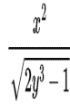

图 A-1. 使用数学 LaTeX 编辑器查看 SymPy LaTeX 输出

如果你想省去复制粘贴的步骤，可以将 LaTeX 直接作为参数追加到 CodeCogs LaTeX 编辑器的 URL 中，如示例 A-2 所示，这样浏览器就会显示渲染后的数学方程。

### 示例 A-2. 使用 CodeCogs 打开数学 LaTeX 渲染

```python
import webbrowser
from sympy import *

x,y = symbols('x y')

z = x**2 / sqrt(2*x*y**3 - 1)

webbrowser.open("https://latex.codecogs.com/png.image?\dpi(200)" + latex(z))
```

如果你使用 Jupyter，也可以使用插件来渲染数学 LaTeX。

### 从零开始实现二项分布

如果你想从零开始实现二项分布，示例 A-3 中包含了你需要的所有部分。

### 示例 A-3. 从零开始构建二项分布

```python
# Factorials multiply consecutive descending integers down to 1
# EXAMPLE: 5! = 5 * 4 * 3 * 2 * 1
def factorial(n: int):
    f = 1
    for i in range(n):
        f *= (i + 1)
    return f

# Generates the coefficient needed for the binomial distribution
def binomial_coefficient(n: int, k: int):
    return factorial(n) / (factorial(k) * factorial(n - k))

# Binomial distribution calculates the probability of k events out of n trials
# given the p probability of k occurring
def binomial_distribution(k: int, n: int, p: float):
    return binomial_coefficient(n, k) * (p ** k) * (1.0 - p) ** (n - k)

# 10 trials where each has 90% success probability
n = 10
p = 0.9

for k in range(n + 1):
    probability = binomial_distribution(k, n, p)
    print("{0} - {1}".format(k, probability))
```

使用 `factorial()` 和 `binomial_coefficient()`，我们可以从零开始构建二项分布函数。阶乘函数将 1 到 n 的连续整数范围相乘。例如，5! 的阶乘是 1*2*3*4*5 = 120。

二项系数函数允许我们从 n 种可能性中选取 k 种结果，而不考虑顺序。如果 k = 2 且 n = 3，那么将分别生成集合 (1,2) 和 (1,2,3)。在这两个集合之间，可能的不同组合为 (1,3)、(1,2) 和 (2,3)。共有 3 种组合，因此二项系数为 3。当然，使用 `binomial_coefficient()` 函数，我们可以通过阶乘和乘法来避免所有排列工作。

在实现 `binomial_distribution()` 时，请注意我们如何取二项系数，并将其乘以成功概率 p 发生 k 次（即指数）的概率。然后我们将其乘以相反的情况：失败概率 1.0 - p 发生 n - k 次的概率。这样我们就可以考虑事件在多次试验中发生与不发生的概率 p。

### 从零开始实现β分布

如果你很好奇如何从零开始构建β分布，你需要重用用于二项分布的 `factorial()` 函数，以及上一章中构建的 `approximate_integral()` 函数。

就像我们在上一章中所做的那样，我们将感兴趣范围内的矩形堆积在曲线下方，如图 A-2 所示。

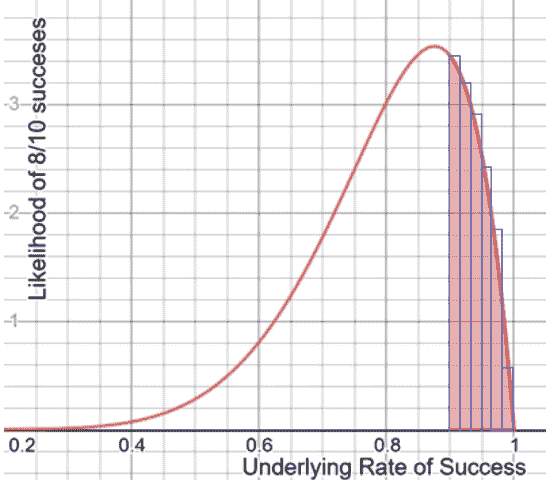

图 A-2. 在曲线下方堆积矩形以求面积/概率

这里只使用了 6 个矩形，如果使用更多矩形，精度会更高。让我们从零开始实现 `beta_distribution()`，并在 .9 到 1.0 之间积分 1000 个矩形，如示例 A-4 所示。

### 示例 A-4. β分布从零开始

```python
# Factorials multiply consecutive descending integers down to 1
# EXAMPLE: 5! = 5 * 4 * 3 * 2 * 1
def factorial(n: int):
    f = 1
    for i in range(n):
        f *= (i + 1)
    return f
```

```python
def approximate_integral(a, b, n, f):
    delta_x = (b - a) / n
    total_sum = 0

    for i in range(1, n + 1):
        midpoint = 0.5 * (2 * a + delta_x * (2 * i - 1))
        total_sum += f(midpoint)

    return total_sum * delta_x
```

```python
def beta_distribution(x: float, alpha: float, beta: float) -> float:
    if x < 0.0 or x > 1.0:
        raise ValueError("x must be between 0.0 and 1.0")

    numerator = x ** (alpha - 1.0) * (1.0 - x) ** (beta - 1.0)
    denominator = (1.0 * factorial(alpha - 1) * factorial(beta - 1)) / (1.0 *
    factorial(alpha + beta - 1))

    return numerator / denominator
```

```python
greater_than_90 = approximate_integral(a=.90, b=1.0, n=1000, f=lambda x:
beta_distribution(x, 8, 2))
less_than_90 = 1.0 - greater_than_90

print("GREATER THAN 90%: {}, LESS THAN 90%: {}".format(greater_than_90,
less_than_90))
```

你会发现，在 `beta_distribution()` 函数中，我们提供一个给定概率 x、一个量化成功的 alpha 值，以及一个量化失败的 beta 值。该函数将返回观察到给定可能性 x 的可能性。但同样，为了获得观察概率 x 的概率，我们需要在 x 值的范围内找到一个区域。幸运的是，我们已经从上一章中定义好了 `approximate_integral()` 函数，可以直接使用。我们可以计算成功率大于 90% 以及小于 90% 的概率，如上文最后几行所示。

### 推导贝叶斯定理

如果你想理解贝叶斯定理为什么有效，而不仅仅是听我说，让我们做一个思想实验。假设我有 100,000 人的人口。用给定的概率乘以它，得到喝咖啡的人数和患癌症的人数。

```
N = 100,000

P(Coffee Drinker) = .65

P(Cancer) = .005

Coffee Drinkers = 65,000

Cancer Patients = 500
```

我们有 65,000 名咖啡饮用者和 500 名癌症患者。在这 500 名癌症患者中，有多少人喝咖啡？我们得到了条件概率 P(Coffee|Cancer)，可以将其乘以这 500 人，这应该能得出 425 名喝咖啡的癌症患者。

```
P(Coffee Drinker|Cancer) = .85

Coffee Drinkers with Cancer = 500×.85 = 425
```

那么，喝咖啡的人中患癌症的百分比是多少？我们要除以哪两个数字？我们已经知道了既喝咖啡又患癌症的人数。因此，我们将这个数字与咖啡饮用者的总数进行比例计算。

```
P(Cancer|Coffee Drinker) = \frac{Coffee Drinkers with Cancer}{Coffee Drinkers}

P(Cancer|Coffee Drinker) = \frac{425}{65,000}

P(Cancer|Coffee Drinker) = 0.006538
```

等等，我们刚刚翻转了条件概率吗？是的，我们做到了！我们从 P(Coffee Drinker|Cancer) 开始，最终得到了 P(Cancer|Coffee Drinker)。通过取出人群的两个子集（65,000 名咖啡饮用者和 500 名癌症患者），然后应用我们拥有的条件概率的联合概率，我们最终得到了 425 名既喝咖啡又患癌症的人。然后我们将其除以咖啡饮用者的人数，得到给定某人是咖啡饮用者时患癌症的概率。


但此处的贝叶斯定理在哪里呢？让我们专注于 $P(\text{Cancer}|\text{Coffee Drinker})$ 表达式，并用我们先前计算的所有表达式来展开它。

$P(\text{Cancer}|\text{Coffee Drinker}) = \frac{100,000 \times P(\text{Cancer}) \times P(\text{Coffee Drinker}|\text{Cancer})}{100,000 \times P(\text{Coffee Drinker})}$

请注意，100,000 的总体 N 既出现在分子中也出现在分母中，因此会被约掉。现在这看起来熟悉了吗？

$P(\text{Cancer}|\text{Coffee Drinker}) = \frac{P(\text{Cancer}) \times P(\text{Coffee Drinker}|\text{Cancer})}{P(\text{Coffee Drinker})}$

果然，这应该与贝叶斯定理相符！

$P(\text{A}|\text{B}) = \frac{P(\text{B}|\text{A})*P(\text{B})}{P(\text{A})}$

$P(\text{Cancer}|\text{Coffee Drinker}) = \frac{P(\text{Cancer}) \times P(\text{Coffee Drinker}|\text{Cancer})}{P(\text{Coffee Drinker})}$

因此，如果你对贝叶斯定理感到困惑，或难以掌握其背后的直觉，不妨根据给定的概率对固定总体进行子集抽取。然后你就可以沿着思路，将条件概率“翻转”过来。

## 从零开始实现 CDF 和逆 CDF

为了计算正态分布下的面积，我们当然可以使用第 1 章学到、并在第 2 章中应用于β分布的矩形填充法。它不需要累积分布函数（CDF），只是在概率密度函数（PDF）下方堆放矩形。使用这种方法，我们可以找到一只金毛寻回犬体重在 61 到 62 磅之间的概率，如示例 A-5 所示，使用 1000 个堆叠的矩形与正态 PDF 进行计算。

### 示例 A-5. Python 中的正态分布函数

```
import math
```

```
def normal_pdf(x: float, mean: float, std_dev: float) -> float:
    return (1.0 / (2.0 * math.pi * std_dev ** 2) ** 0.5) *
           math.exp(-1.0 * ((x - mean) ** 2 / (2.0 * std_dev ** 2)))
```

```
def approximate_integral(a, b, n, f):
    delta_x = (b - a) / n
    total_sum = 0
    for i in range(1, n + 1):
        midpoint = 0.5 * (2 * a + delta_x * (2 * i - 1))
        total_sum += f(midpoint)

    return total_sum * delta_x
```

```
p_between_61_and_62 = approximate_integral(a=61, b=62, n=7,
                                   f=lambda x: normal_pdf(x, 64.43, 2.99))
print(p_between_61_and_62) # 0.0825344984983386
```

这将给我们大约 8.25% 的概率，即一只金毛寻回犬的体重在 61 到 62 磅之间。如果我们想利用已经为我们积分好的累积分布函数，且无需任何矩形堆叠，我们可以像示例 A-6 所示从零开始声明它。

### 示例 A-6. 在 Python 中使用逆 CDF（称为 ppf()）

```
import math
def normal_cdf(x: float, mean: float, std_dev: float) -> float:
    return (1 + math.erf((x - mean) / math.sqrt(2) / std_dev)) / 2
mean = 64.43
std_dev = 2.99
x = normal_cdf(66, mean, std_dev) - normal_cdf(62, mean, std_dev)
print(x) # prints 0.49204501470628936
```

math.erf() 被称为误差函数，常用于计算累积分布。最后，要从零开始实现逆 CDF，你需要使用 erf() 函数的逆函数，称为 erfinv()。示例 A-7 使用从零开始编码的逆 CDF 计算了 1000 个随机生成的金毛寻回犬体重。

### 示例 A-7. 生成随机金毛寻回犬体重

```
import random
from scipy.special import erfinv
def inv_normal_cdf(p: float, mean: float, std_dev: float):
    return mean + (std_dev * (2.0 ** 0.5) * erfinv((2.0 * p) - 1.0))
mean = 64.43
std_dev = 2.99
for i in range(0, 1000):
    random_p = random.uniform(0.0, 1.0)
    print(inv_normal_cdf(random_p, mean, std_dev))
```

## 使用 e 来预测随时间变化的事件概率

让我们再看一个 e 的实用用例。假设你是一家丙烷罐制造商。显然你不希望罐体泄漏，否则可能会造成危险，尤其是在明火和火花附近。在测试一种新罐体设计时，你的工程师报告称，在任何给定年份，它泄漏的概率为 5%。

你知道这个数字已经高到不可接受，但你想知道这个概率随时间如何复合。你现在问自己：“在 2 年内、5 年内、10 年内发生泄漏的概率是多少？”暴露的时间越长，看到罐体泄漏的概率不会只会越高吗？欧拉数 e 又可以来解救了！

```
P_{leak} = 1.0 - e^{-\lambda T}
```

上述函数模拟了随时间变化的事件概率，在此情况下即罐体在 T 时间后泄漏的概率。e 再次是欧拉数，lambda λ 是每个时间单位（每年）的故障率，T 是已过去的时间量（年数）。

如果我们将此函数作图，其中 T 为横轴，泄漏概率为纵轴，且 λ = .05，我们将得到图 A-3 中所示的结果：

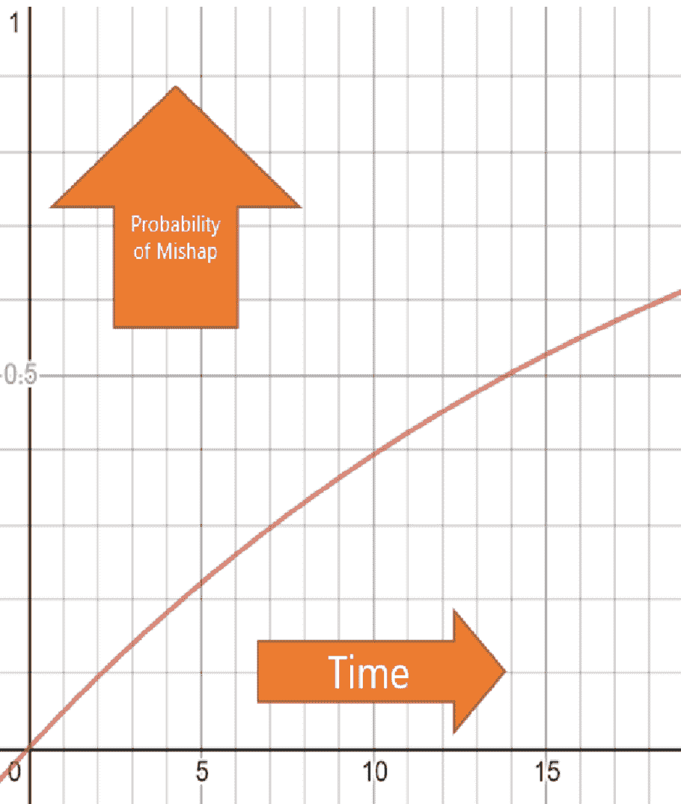

图 A-3. 预测随时间变化的泄漏概率

以下是我们如何在 Python 中为 λ = .05 和 T = 5 年建模此函数，如示例 A-8 所示。

### 示例 A-8. 预测随时间变化的泄漏概率的代码

```
from math import exp

# Probability of leak in 1 year
p_leak = .05

# number of years
t = 5

# Probability of leak within 5 years
# 0.22119921692859512
p_leak_5_years = 1.0 - exp(-p_leak * t)

print("PROBABILITY OF LEAK WITHIN 5 YEARS: {}".format(p_leak_5_years))
```

罐体在 2 年后发生故障的概率约为 9.5%，5 年约为 22.1%，10 年约为 39.3%。时间一久，罐体泄漏的可能性就越大。我们可以将此公式推广，以预测任何在给定期间内具有概率的事件，并查看该概率在不同时间段内如何变化。

## 山爬算法与线性回归

如果你觉得在从零开始构建机器学习时微积分令人不知所措，可以尝试一种更蛮力的方法。让我们尝试一种山爬算法，在若干次迭代中通过添加随机值来随机调整 m 和 b。这些随机值可以是正数或负数（这会使加法操作实质上变成减法），我们只保留改善平方和的调整。

但是，我们就随意生成任何随机数作为调整量吗？我们希望更倾向于较小的移动，但偶尔可能会允许较大的移动。这样我们大多数时候进行微调，但在需要时偶尔也会做出大跳跃。实现此目的的最佳工具是使用标准正态分布，均值为 0，标准差为 1。回顾第 3 章，标准正态分布在 0 附近具有高值密度，而值距离 0 越远（无论是负方向还是正方向），该值出现的可能性就越小，如图 A-4 所示。

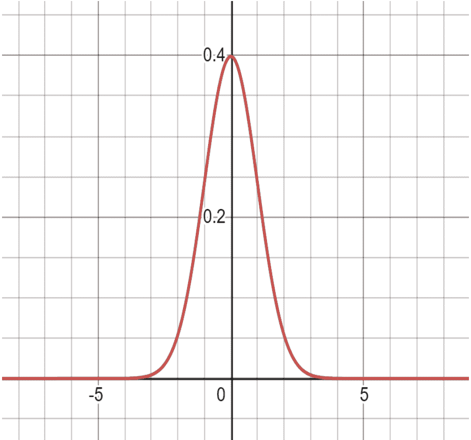

图 A-4. 标准正态分布中的大多数值都很小且接近 0，而较大的值在尾部出现的频率较低

回到线性回归，我们将 m 和 b 从 0 或某些其他起始值开始。然后在 `for` 循环中进行 150,000 次迭代，通过添加从标准正态分布中采样的值来随机调整 m 和 b。如果随机调整改善/减小了平方和，我们就保留它。但如果平方和增加了，我们就撤销该随机调整。换句话说，我们只保留改善平方和的调整。让我们在示例 A-9 中看一下。

### 示例 A-9.

```
from numpy.random import normal
import pandas as pd

# Import points from CSV
points = [p for p in pd.read_csv("https://bit.ly/2KF29Bd").itertuples()]

# Building the model
m = 0.0
b = 0.0

# The number of iterations to perform
iterations = 150000

# Number of points
n = float(len(points))

# Initialize with a really large loss
# that we know will get replaced
best_loss = 1000000000000.0

for i in range(iterations):
    # Randomly adjust "m" and "b"
    m_adjust = normal(0,1)
    b_adjust = normal(0,1)

    m += m_adjust
    b += b_adjust

    # Calculate loss, which is total sum squared error
    new_loss = 0.0
    for p in points:
        new_loss += (p.y - (m * p.x + b)) ** 2

    # If loss has improved, keep new values. Otherwise revert.
    if new_loss < best_loss:
        print("y = {0}x + {1}".format(m, b))
        best_loss = new_loss
    else:
        m -= m_adjust
        b -= b_adjust

print("y = {0}x + {1}".format(m, b))
```

你将看到算法的进展，但最终你应该得到一个拟合函数，大约为 y = 1.9395722046562853x + 4.731834051245578，左右可能略有不同。让我们验证一下这个答案。当我使用 Excel 或 Desmos 为我执行线性回归时，Desmos 给出了 y = 1.93939x + 4.73333。不赖！我已经非常接近了！

为什么我们需要 100 万次迭代？通过实验，我发现经过足够多的迭代后，解不再有多大改进，并且 m 和 b 的最优值收敛到可以最小化平方和的非常接近的位置。你会发现许多机器学习库和算法都会有一个执行迭代次数的参数，它正是起到这个作用。你需要有足够的


所以它大约会收敛到正确答案，但不会过度，以免在已经找到可接受解时浪费计算时间。

你可能还有另一个疑问，为什么我将 `best_loss` 初始化为一个极大的数值。我这么做是为了用一个我知道在搜索开始后会被覆盖的值来初始化最佳损失，然后它将与每次迭代的新损失进行比较，以查看是否带来改进。我本来也可以使用正无穷 `float( 'inf' )`，而不是一个非常大的数字。

## 爬山算法与逻辑回归

就像前面线性回归的例子一样，我们也可以将爬山算法应用于逻辑回归。如果你觉得微积分和偏导数一次性太多，也可以再次使用这种技术。

爬山算法的方法论是相同的：使用正态分布中的随机值调整 m 和 b。不过，我们有一个不同的目标函数，即第 6 章讨论过的最大似然估计。因此，我们只采取增加似然估计的随机调整，经过足够多的迭代后，我们应该能收敛到一个拟合的逻辑回归。

所有这些都在示例 A-10 中演示。

_示例 A-10. 为简单逻辑回归使用爬山算法._

```
import math
import random
import numpy as np
import pandas as pd

# Desmos graph: https://www.desmos.com/calculator/6cb10atg3l
points = [p for p in pd.read_csv("https://tinyurl.com/y2coco07").itertuples()]
best_likelihood = -10_000_000
b0 = .01
b1 = .01

# calculate maximum likelihood
def predict_probability(x):
    p = 1.0 / (1.0001 + math.exp(-(b0 + b1 * x)))
    return p

for i in range(1_000_000):
# Select b0 or b1 randomly, and adjust it randomly
random_b = random.choice(range(2))

random_adjust = np.random.normal()

if random_b == 0:
    b0 += -random_adjust
elif random_b == 1:
    b1 += random_adjust

# Calculate total likelihood
true_estimates = sum(math.log(predict_probability(p.x)) for p in points if p.y == 1.0)
false_estimates = sum(math.log(1.0 - predict_probability(p.x)) for p in points if p.y == 0.0)

total_likelihood = true_estimates + false_estimates

# If likelihood improves, keep the random adjustment. Otherwise revert.
if best_likelihood < total_likelihood:
    best_likelihood = total_likelihood
elif random_b == 0:
    b0 -= random_adjust
elif random_b == 1:
    b1 -= random_adjust

print("1.0 / (1 + exp(-({0} + {1}*x))".format(b0, b1))
print("BEST LIKELIHOOD: {0}".format(math.exp(best_likelihood)))
```

有关最大似然估计、逻辑函数以及我们使用 log() 函数的原因的更多详细信息，请参阅第 6 章。

## 线性规划简介

每个数据科学专业人士都应该熟悉的一种技术是 **线性规划**，它通过引入“松弛变量”来适应方程组求解不等式系统。当线性规划系统中的变量是离散整数或二进制变量（0 或 1）时，它被称为 **整数规划**。当同时使用线性连续变量和整数变量时，它被称为 **混合整数规划**。

尽管线性规划及其变体更多是算法驱动而非数据驱动，但它们可以用于解决大量经典的“人工智能”问题。虽然将线性规划系统称为“人工智能”听起来可能存疑，但许多供应商和公司都普遍采用这种做法，因为这会提升其感知价值。

在实践中，最好使用众多可用的求解器库来为你执行线性规划，但本节末尾将提供从头开始实现的资源。对于这些示例，我们将使用 PuLP，不过 Pyomo 也是一个选项。我们还将使用图形直觉，尽管超过三维的问题不容易可视化。

以下是我们的示例。你有两条产品线：iPac 和 iPac Ultra。iPac 每单位利润为 200 美元，而 iPac Ultra 每单位利润为 300 美元。

然而，装配线每天只能工作 20 小时，生产一个 iPac 需要 1 小时，生产一个 iPac Ultra 需要 3 小时。

每天只能提供 45 套组件，iPac 需要 6 套，而 iPac Ultra 需要 2 套。

假设所有供应都能售出，我们应该销售多少 iPac 和 iPac Ultra 才能最大化利润？

首先，我们先记录第一个约束并将其拆解。

- ...装配线每天只能工作 20 小时，生产一个 iPac 需要 1 小时，生产一个 iPac Ultra 需要 3 小时。

我们可以将其表示为一个不等式，其中 x 是 iPac 的单位数量，y 是 iPac Ultra 的单位数量。两者都必须为正，图 A-5 显示我们可以相应地绘图。

$x + 3y \le 20(x \ge 0, y \ge 0)$

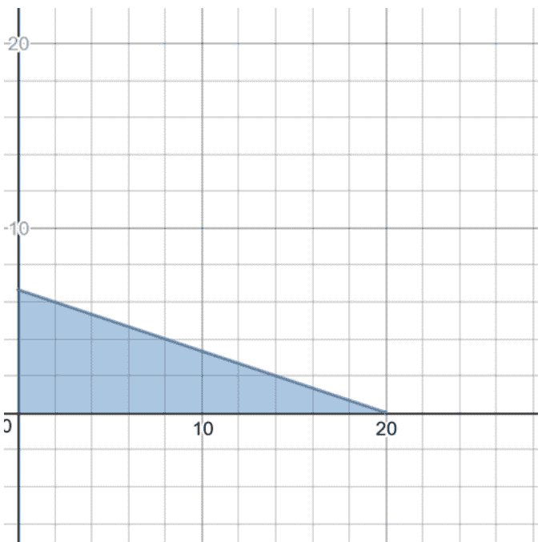

图 A-5. 绘制第一个约束

现在让我们看看第二个约束。

每天只能提供 45 套组件，iPac 需要 6 套，而 iPac Ultra 需要 2 套。

我们也可以如图 A-6 所示建模并绘图。

```
6x + 2y ≤ 45(x ≥ 0, y ≥ 0)
```

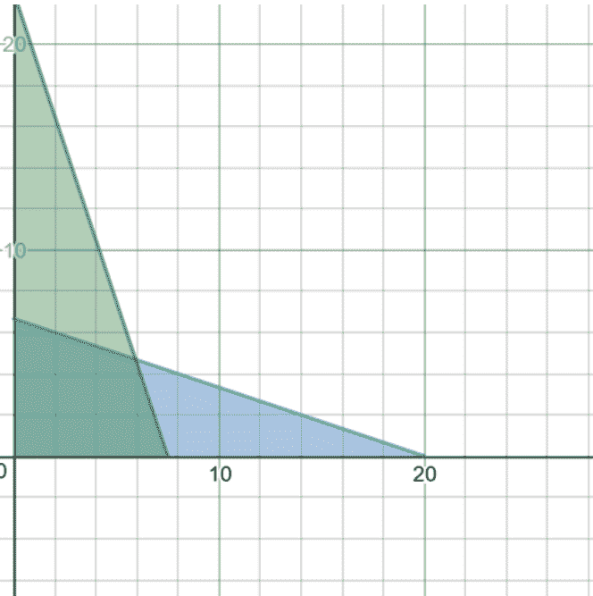

图 A-6. 绘制第二个约束

注意在图 A-6 中，我们现在有了这两个约束之间的重叠。我们的解位于该重叠区域内，我们称之为 *可行域*。最后，我们要最大化利润 Z，根据 iPac 和 iPac Ultra 各自的利润金额，可以如下表示：

```
Z = 200x + 300y
```

如果将此函数表示为一条直线，我们可以尽可能增加 Z，直到该直线刚好不再位于可行域内。然后我们记录 x 和 y 的值，如图 A-7 所示。

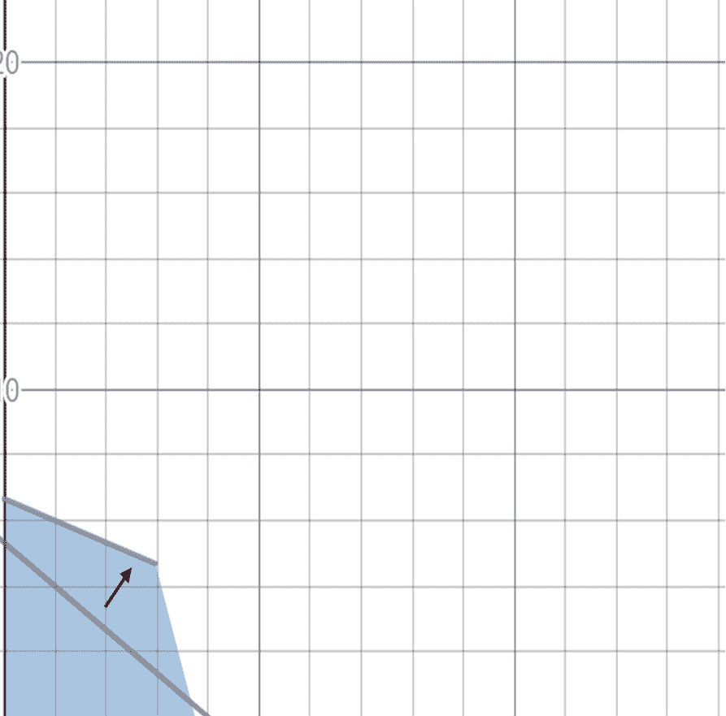

图 A-7. 增加我们的目标线，直到它不再位于可行域内

## 目标函数的 DESMOS 图

如果你需要以更具交互性和动画的方式可视化此内容，请查看 Desmos 上的此图表：
https://www.desmos.com/calculator/iildqi2vt7

当你尽可能增加利润 Z 时，当该线“刚好接触”可行域时，你将落在可行域的一个顶点或角上。该顶点提供将最大化利润的 x 和 y 值，如图 A-8 所示。

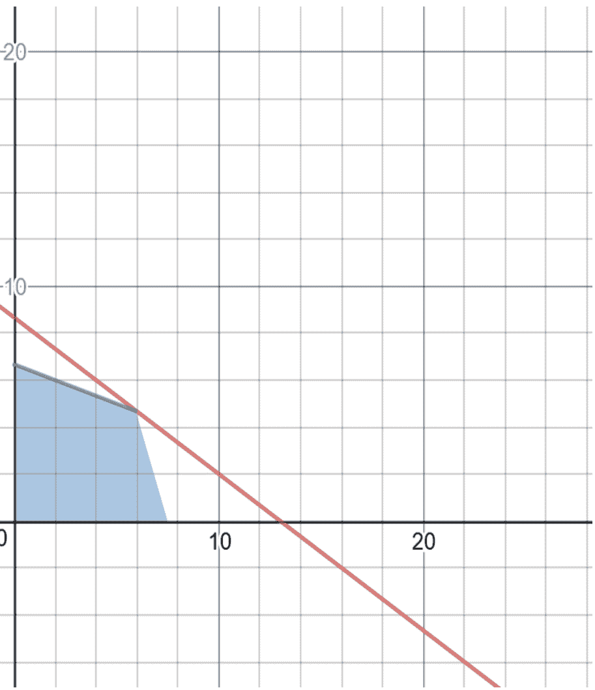

图 A-8. 我们线性规划系统的最大化目标。

虽然我们可以使用 NumPy 和大量矩阵运算来数值求解此问题，但使用如示例 A-11 所示的 PuLP 会更容易。请注意，`LpVariable` 定义要求解的变量。`LpProblem` 是使用 Python 运算符添加约束和目标函数的线性规划系统。然后通过在 `LpProblem` 上调用 `solve()` 来求解变量。

## 示例 A-11. 使用 Python PuLP 求解线性规划系统

```
# GRAPH: https://www.desmos.com/calculator/iildqi2vt7
from pulp import *

# declare your variables
x = LpVariable("x", 0)  # 0<=x
y = LpVariable("y", 0)  # 0<=y

# defines the problem
prob = LpProblem("factory_problem", LpMaximize)

# defines the constraints
prob += x + 3*y <= 20
prob += 6*x +2*y <= 45

# defines the objective function to maximize
prob += 200*x + 300*y

# solve the problem
status = prob.solve()
print(LpStatus[status])

# print the results x = 5.9375, y = 4.6875
print(value(x))
print(value(y))
```

现在你可能在想，生产 5.9375 和 4.6875 个单位是否合理？如果你可以容忍变量中的连续值，线性规划系统会高效得多，而且你也许之后可以将它们四舍五入。但某些类型的问题绝对要求离散地处理整数和二进制变量。

为了强制 x 和 y 变量被视为整数，请提供类别参数 `cat=LpInteger`，如示例 A-12 所示。

## 示例 A-12. 强制将变量求解为整数

```
# declare your variables
x = LpVariable("x", 0, cat=LpInteger) # 0<=x
y = LpVariable("y", 0, cat=LpInteger) # 0<=y
```

在图形上，这意味着我们用离散点而非连续区域来填充可行域。我们的解不一定落在顶点上，而更可能落在最接近顶点的点上，如图 A-9 所示。


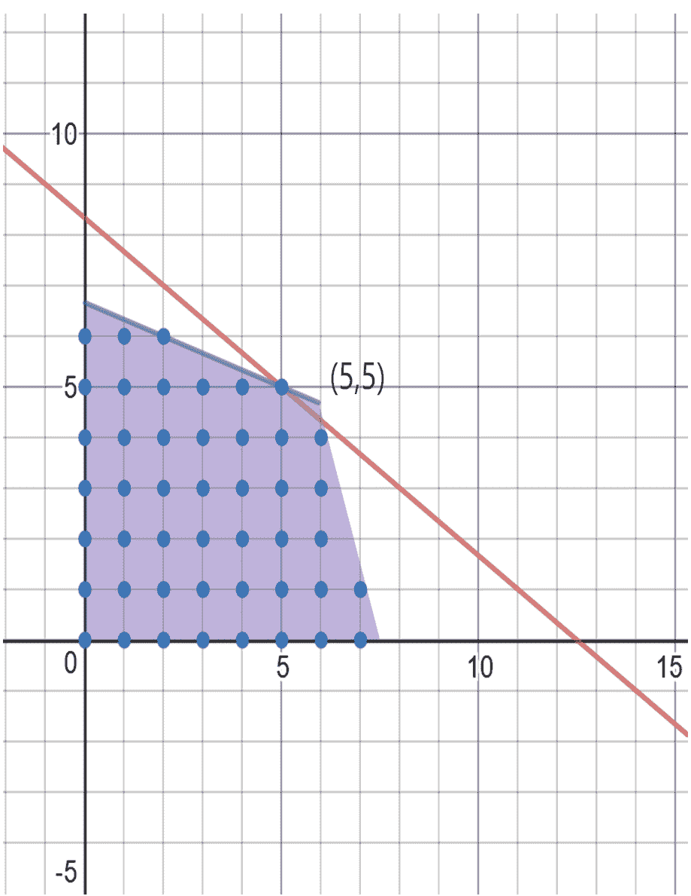

图 A-9. 离散线性规划系统

线性规划中存在一些特殊情况，如图 A-10 所示。有时可能会有多个解。有时候，可能根本没有解。

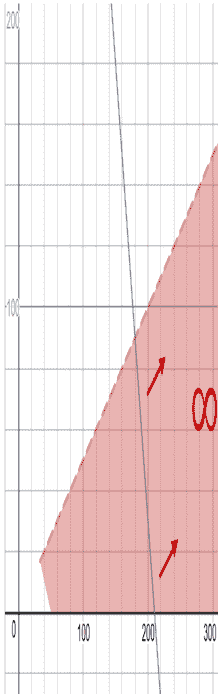
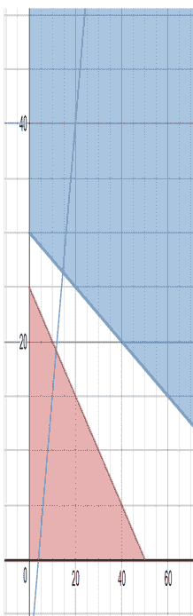
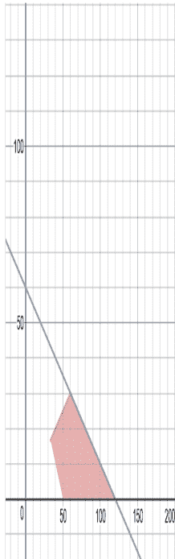
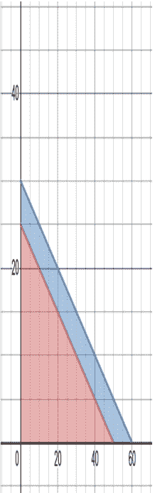

**无界** – 最大化或最小化没有限制，通常由于缺少或损坏的约束导致。

**不可行** – 所有受约束区域之间没有重叠。

**备选解** – 目标线与边界约束平行，沿线呈现出许多解。

**冗余** – 两个边界相同方向的平行约束可以合并为一个。

图 A-10. 线性规划的特殊情况

这只是线性规划的一个快速入门示例，遗憾的是本书篇幅有限，无法充分涵盖该主题。它可用于令人惊讶的问题，包括调度受限资源（如员工、服务器作业或房间）、解决数独以及优化金融投资组合。

如果想了解更多，网上有一些很好的 YouTube 视频，包括 PatrickJMT 和 Josh Emmanuel。如果想深入学习离散优化，Pascal Van Hentenryck 教授在 Coursera 上整理了一门课程，做出了巨大贡献。

## 使用 Scikit-learn 的 MNIST 分类器

示例 A-13 展示了如何使用 Scikit-learn 的神经网络进行分类。

```python
Example A-13.
import numpy as np
import pandas as pd
# load data
from sklearn.model_selection import train_test_split
from sklearn.neural_network import MLPClassifier
df = pd.read_csv('https://bit.ly/3ilJc2C', compression='zip', delimiter=",")
# Extract input variables (all rows, all columns but last column)
# Note we should do some linear scaling here
X = (df.values[:, :-1] / 255.0)
# Extract output column (all rows, last column)
Y = df.values[:, -1]
# Get a count of each group to ensure samples are equitably balanced
print(df.groupby(["class"]).agg({"class": [np.size]}))
# Separate training and testing data
# Note that I use the 'stratify' parameter to ensure
# each class is proportionally represented in both sets
X_train, X_test, Y_train, Y_test = train_test_split(X, Y, test_size=.33,
random_state=10, stratify=Y)
nn = MLPClassifier(solver='sgd',
hidden_layer_sizes=(100, ),
activation='logistic',
max_iter=480,
learning_rate_init=.1)
nn.fit(X_train, Y_train)
print("Training set score: %f" % nn.score(X_train, Y_train))
print("Test set score: %f" % nn.score(X_test, Y_test))
# Display heat map
import matplotlib.pyplot as plt
fig, axes = plt.subplots(4, 4)
# use global min / max to ensure all weights are shown on the same scale
vmin, vmax = nn.coefs_[0].min(), nn.coefs_[0].max()
for coef, ax in zip(nn.coefs_[0].T, axes.ravel()):
    ax.matshow(coef.reshape(28, 28), cmap=plt.cm.gray, vmin=.5 * vmin, vmax=.5
           * vmax)
    ax.set_xticks(())
    ax.set_yticks(())

plt.show()
```
